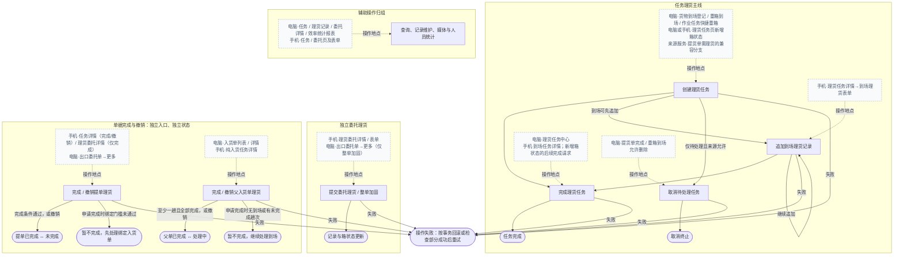

# 理货模块介绍

技术依据与后续维护见 [AI 开发上下文](ai-context.md)。

## 1. 模块范围

理货负责来源派单、任务处理、到场记录与核对、独立委托理货及整单加固、提单和父入货单的理货完成/撤销，并提供记录维护、媒体下载及相关统计。任务、本趟到场、提单、父入货单和箱状态独立管理。

电脑入口包括理货任务中心、货物到场登记、进口重箱到场及作业任务快捷新增、提货单、出口委托单、入货单、理货记录和效率统计报表；手机通过理货任务及详情/表单、理货委托和出口委托详情进入。具体页面及操作在下表分别列出。手机链接以应用内路由解析，电脑站内链接以后台应用根解析；实际菜单启用和岗位授权尚未核验。

说明覆盖已确认的29项功能、52条差异入口，展开为64条具体操作。流程行只说明当前理货步骤，来源登记、落箱、库存和收费由所属业务管理；理货实际自动触发的核对汇总、绑定委托货物重建和有限状态回退在对应行保留。

2026-11-13核对源码基线、工作区及157份证据指纹，均与既有分析一致。本轮重点核验请求目录与源码根的区分、文档迁移、链接和索引；业务事实沿用同基线静态分析，覆盖仍为部分核验。未运行页面、业务测试或查询数据库。来源完整CRUD、财务全流程和全部报表维度未全量分析；实际部署DDL、动态字典/配置及设备表现待核验。

本次请求工作目录固定为 `/www/ai`，文档位于其下 `docs/code-module-feature-map/tally/`。源码根仍为 `/www/storage`，源码Git位于其下 `web`；模块索引保留在源码根的 `AGENTS.md`，详细基线见AI上下文。

## 2. 业务流程

### 主业务流程总览

实线表示业务流转，标有“操作地点”的灰色虚线仅说明在哪里操作。任务、本趟到场、提单、父入货单状态独立；提单可从独立入口操作，父入货单完成须有到场且全部完成。手机新增箱状态分两次请求，手机进口任务详情仍只读。各步骤实际写入见下表。

数据影响中的【读取】表示本步只查询该表，不新增或修改；其他读写和条件性联动逐表说明。

### 任务理货：创建、记录、完成与来源取消

| 业务流程 | 操作地点 | 业务解析 | 数据影响 | 结果与下一步 |
| --- | --- | --- | --- | --- |
| 创建理货任务 | 电脑→出口业务→[货物到场登记](/export/cargo-arrival)→新增→保存 | 来源登记保存成功后自动派发理货，装箱/入库作业类型决定任务类型；保存入口须有到场新增权限，本步只建立待处理理货任务。 | `tk_tally_task`【新增】：来源登记保存成功后，按作业类型新增arrival_loading或arrival_storage的pending任务，生成TT编号，以sourceId关联本趟到场。 | 待处理到场理货任务生成 → 从统一任务页处理；来源登记、预约和收费按到场业务流程处理。 |
| 创建理货任务 | 电脑→进口重箱到场 [代码入口](../../../../storage/web/plus-ui/src/views/storage/impot/heavyEntry/index.vue)→新增→选择安排掏箱→保存 | 来源新增入口须有重箱新增权限，保存时选择安排掏箱才派单；理货服务锁定已有来源及箱档案，检查同源有效/同箱待执行任务，防止重复。 | `im_heavy_entry`【读取】：锁定已保存的重箱到场并取得来源箱档案。 `tk_container_profile`【读取】：锁定来源真实箱档案，供理货派单关联校验。 `im_entrust_order_container`【读取】：仅旧来源未明确orderContainerId时，解析历史关联的真实箱档案。 `tk_tally_task`【读取/新增】：拒绝同源非取消任务或同箱待执行掏箱任务重复；新增unload_inbound/pending任务，以sourceId和containerProfileId关联来源。 | 待处理掏箱理货生成 → 到任务中心完成；落箱作业与掏箱理货分别推进。 |
| 创建理货任务 | 电脑→过程跟踪→作业任务 [代码入口](../../../../storage/web/plus-ui/src/views/storage/tracking/jobTask/index.vue)→重箱到场→保存 | 来源新增入口须有重箱新增权限，保存时选择安排掏箱才派单；理货服务锁定已有来源及箱档案，检查同源有效/同箱待执行任务，防止重复。 | `im_heavy_entry`【读取】：锁定已保存的重箱到场并取得来源箱档案。 `tk_container_profile`【读取】：锁定来源真实箱档案，供理货派单关联校验。 `im_entrust_order_container`【读取】：仅旧来源未明确orderContainerId时，解析历史关联的真实箱档案。 `tk_tally_task`【读取/新增】：拒绝同源非取消任务或同箱待执行掏箱任务重复；新增unload_inbound/pending任务，以sourceId和containerProfileId关联来源。 | 待处理掏箱理货生成 → 到任务中心完成；落箱作业与掏箱理货分别推进。 |
| 创建理货任务 | 电脑→重箱到场 [代码入口](../../../../storage/web/plus-ui/src/views/storage/impot/heavyEntry/index.vue)→安排掏箱 | 有重箱编辑权限且来源允许安排时才显示；锁定来源并检查重复后建立待处理掏箱理货，同时将来源方式改为安排掏箱。 | `im_heavy_entry`【读取/更新】：读取并锁定已有来源，取得真实箱档案；安排成功后仅回写inboundType=unload_inbound。 `tk_container_profile`【读取】：锁定来源真实箱档案，供理货派单关联校验。 `im_entrust_order_container`【读取】：仅旧来源未明确orderContainerId时，解析历史关联的真实箱档案。 `tk_tally_task`【读取/新增】：拒绝同源非取消任务或同箱待执行掏箱任务重复；新增unload_inbound/pending任务，以sourceId和containerProfileId关联来源。 | 待处理掏箱理货生成 → 到任务中心完成；落箱作业与掏箱理货分别推进。 |
| 创建理货任务 | 自动触发代码 [代码入口](../../../../storage/web/ruoyi-modules/st-storage/src/main/java/com/i4h2/storage/impot/pickuporder/service/impl/ImPickupOrderServiceImpl.java)；电脑提货表单 [代码入口](../../../../storage/web/plus-ui/src/views/storage/impot/pickupOrder/form.vue)固定no | 来源保存请求needTally=yes时派发待处理出库理货；正常电脑表单“是否理货”固定否且禁用，所以普通新增不会派单。 | `tk_tally_task`【新增】：仅来源needTally=yes时新增pickup_outbound/pending任务，生成任务编号，以sourceType/sourceId关联提货单。 | 兼容分支生成待处理出库理货 → 后续由任务页完成；普通来源新增不生成理货任务。 |
| 创建理货任务 | 电脑→过程跟踪→理货任务中心 [代码入口](../../../../storage/web/plus-ui/src/views/storage/tracking/tallyTask/index.vue)→箱号状态更新→创建确定 | 有任务新增权限且页面已选箱档案，确定后只建立待处理箱状态任务。 | `tk_tally_task`【新增】：新增container_status/pending任务，保存所选containerProfileId及TT编号，不在创建请求写完成子项。 | 待处理任务生成 → 后续另行完成才更新箱状态。 |
| 创建理货任务 → 完成理货任务 | 手机→首页→理货任务（应用内 [页面](/pages/tally/tallyTask/index)）→新增箱状态→提交 | 箱档案、装箱状态和非负整数件数必填，重量可空但填写须有效且非负；新增按钮无本地权限隐藏，服务分别要求任务新增及完成权限。提交先创建待处理任务再请求完成，两请求非同一事务。 | `tk_tally_task`【新增/读取/更新】：先新增container_status/pending及TT编号、containerProfileId；创建成功后的完成请求置completed，写finishTime及理货人。第二请求失败保留已建pending任务。 `tk_tally_task_item`【新增】：仅完成请求按items新增任务子项，以taskId关联刚建任务，保存箱状态及本次明细。 `tk_container_profile`【读取/更新】：完成请求锁定箱档案并写bizStatus及latestTaskId、latestOperatorId/Name、latestUpdateTime；空白状态不覆盖原状态。 `tk_container_timeline`【新增】：仅完成请求写tally_status事件，保存箱档案、前后业务状态、来源taskId及人/时间。 | 两步成功后提示成功、关闭表单并刷新；第二步失败保留已建待处理任务，检查后恢复处理，不能认为创建已回滚。 |
| 追加到场理货记录 | 手机→理货任务卡片→详情（应用内 [页面](/pages/tally/tallyTask/detail?taskId={任务ID})）→更新理货状态→表单（应用内 [页面](/pages/tally/tallyRecord/form?taskId={任务ID})）→提交 | 需记录新增权限，页面按类型检查箱号/状态/位置且上传中禁提交；本次只追加箱级状态、件重及媒体，多箱逐请求可部分成功。此表单不提交核对items或完成标记，普通新增的任务状态/箱归属服务保护仍有差异。 | `ex_tally_record`【新增】：逐提交箱新增TR记录，以arrivalId归属本趟，保存本次tallyPieces、tallyWeight、箱状态、位置及新增媒体引用；此表单不提交体积或完成标记。 `ex_cargo_arrival`【读取】：校验当前到场及其关联；本页提交不带cargoCompleted，因此本次追加不回写到场完成。 `ex_inbound_record`【读取】：有关联父单时检查可编辑。 `ex_entrust_order_container`【读取/更新】：记录有箱档案及非空状态且命中委托箱时，更新spreadStatus；spreadFinishTime为空才首次填入。 `tk_container_profile`【读取/更新】：记录有箱档案和非空状态、且主档存在时更新bizStatus；本链不维护通用任务的全部latest*。 | 记录保存后回详情继续理货；本趟和任务仍须另行完成，部分失败先检查已保存记录再重试。 |
| 完成理货任务 | 电脑→过程跟踪→理货任务中心 [代码入口](../../../../storage/web/plus-ui/src/views/storage/tracking/tallyTask/index.vue)→非到场完成任务→确定 | 有完成权限、任务待处理且明细有效才可提交；掏箱件数为非负整数、重量非负且位置必填，提货须本单明细ID。按当前任务来源完成回写；历史kg/吨不自动换算，当前通用表单不提交体积。 | `tk_tally_task`【读取/更新】：待处理任务置completed，写finishTime及理货人，完成标记空值按0处理。 `tk_tally_task_item`【新增】：按items逐项新增任务子项，以taskId关联当前任务，保存箱档案、状态及理货明细。 `tk_container_profile`【读取/更新】：按当前非到场任务锁定箱档案；掏箱写bizStatus=empty_in_yard，独立箱状态写所选状态，两者维护latest*；提货分支不据此更新箱状态。 `tk_container_timeline`【新增】：追加tally_status事件，保存箱档案、前后业务状态、来源taskId、操作人与事件时间。 `im_entrust_order_container`【读取】：进口掏箱遇历史关联ID时核对并解析真实箱档案。 `im_heavy_entry`【读取/更新】：仅掏箱来源回填unloadTime，不修改落箱entryStatus。 `im_pickup_order`【读取/更新】：提货来源单据未completed时置pickupStatus=tally_completed；已收尾则跳过回写。 `im_pickup_order_item`【读取/更新】：按itemId校验归属；提货单未收尾时回填对应pickupPieces及pickupWeight，不按同箱号覆盖其他行。 | 任务完成 → 查询结果；掏箱不等于落箱完成，提货库存仍由来源另行收尾。 |
| 完成理货任务 | 电脑→过程跟踪→理货任务中心 [代码入口](../../../../storage/web/plus-ui/src/views/storage/tracking/tallyTask/index.vue)→到场完成任务→确认/核对/位置 | 需理货完成权限且父单可编辑，服务拒绝已完成/取消任务；按配置核对品名、整数件数、重量kg及体积m³，零值不等于空，差异不阻断。纯入货单路径免位置，其余到场入库位置必填；核对非负校验仍有缺口。 | `tk_tally_task`【读取/更新】：taskStatus置completed、arrivalCompleted置1，并写理货人及finishTime。 `ex_cargo_arrival`【读取/更新】：本趟tallyStatus置completed；关联本趟与入货单的主键不变。 `ex_inbound_record`【读取】：有父入货单时检查可编辑，不在本步骤完成父单。 `ex_tally_record`【读取/新增/更新】：追加arrival_tally_completed完成日志；有核对提交时另建到场核对记录，符合配置时在完成日志保存arrivalSnapshotJson。现存本趟记录cargoCompleted置1，非纯入货的到场入库记录补storageLocation；必要时补位置记录。 `ex_tally_record_item`【读取/新增】：提交核对items时逐行新增，以tallyRecordId关联本次核对记录；有入货单汇总时读取既有核对子行。 `ex_cargo_arrival_item`【读取】：无需核对且无需差异面板时读取本趟登记明细构造快照。 `ex_entrust_order`【读取】：完成日志存在直接委托时验证委托存在。 `ex_entrust_inbound_rel`【读取】：存在父入货单时读取绑定委托，未绑定即不重建货物。 `ex_inbound_record_item`【读取】：存在绑定委托时读取父单登记货物基准。 `ex_entrust_order_cargo_item`【逻辑删除/新增】：有绑定委托时逻辑删除同orderId及inboundRecordId的原来源货物行，再按登记/核对合计重建；保留这两个归属键。 | 本趟及任务完成 → 按需要独立处理父入货单或提单；失败按本次事务回滚，不自动完成提单。 |
| 完成理货任务 | 手机→理货任务卡片→详情（应用内 [页面](/pages/tally/tallyTask/detail?taskId={任务ID})）→完成到场登记理货 | 需理货完成权限且父单可编辑，服务拒绝已完成/取消任务；按配置核对品名、整数件数、重量kg及体积m³，零值不等于空，差异不阻断。纯入货单路径免位置，其余到场入库位置必填；核对非负校验仍有缺口，手机按钮显示条件不等于服务已允许。 | `tk_tally_task`【读取/更新】：taskStatus置completed、arrivalCompleted置1，并写理货人及finishTime。 `ex_cargo_arrival`【读取/更新】：本趟tallyStatus置completed；关联本趟与入货单的主键不变。 `ex_inbound_record`【读取】：有父入货单时检查可编辑，不在本步骤完成父单。 `ex_tally_record`【读取/新增/更新】：追加arrival_tally_completed完成日志；有核对提交时另建到场核对记录，符合配置时在完成日志保存arrivalSnapshotJson。现存本趟记录cargoCompleted置1，非纯入货的到场入库记录补storageLocation；必要时补位置记录。 `ex_tally_record_item`【读取/新增】：提交核对items时逐行新增，以tallyRecordId关联本次核对记录；有入货单汇总时读取既有核对子行。 `ex_cargo_arrival_item`【读取】：无需核对且无需差异面板时读取本趟登记明细构造快照。 `ex_entrust_order`【读取】：完成日志存在直接委托时验证委托存在。 `ex_entrust_inbound_rel`【读取】：存在父入货单时读取绑定委托，未绑定即不重建货物。 `ex_inbound_record_item`【读取】：存在绑定委托时读取父单登记货物基准。 `ex_entrust_order_cargo_item`【逻辑删除/新增】：有绑定委托时逻辑删除同orderId及inboundRecordId的原来源货物行，再按登记/核对合计重建；保留这两个归属键。 | 本趟及任务完成 → 按需要独立处理父入货单或提单；失败按本次事务回滚，不自动完成提单。 |
| 完成理货任务 | 电脑→过程跟踪→理货任务中心 [代码入口](../../../../storage/web/plus-ui/src/views/storage/tracking/tallyTask/index.vue)→勾选当前页→批量完成理货→确定 | 当前页仅待处理任务可勾选，无完成权限隐藏批量入口，无选择或加载时禁用；一次1—100项且任务不能重复，全部表单校验通过才提交。到场专用/其他通用分流，必要配置或基准读取失败阻止提交，全批同一事务，提交中阻止重复及关闭。 | `tk_tally_task`【读取/更新】：非到场通用分支置completed、写完成人/时间，空白完成标记按0；到场专用分支置completed及arrivalCompleted=1并写人/时间。 `tk_tally_task_item`【新增】：仅非到场通用分支逐项新增任务子项，以taskId关联任务；到场专用分支不新增子项。 `tk_container_profile`【读取/更新】：通用分支锁涉及箱档案；掏箱写empty_in_yard，独立箱状态写所选状态并维护latest*；提货及专用到场不因此更新箱状态。 `tk_container_timeline`【新增】：仅掏箱或独立箱状态任务追加tally_status事件，保存来源taskId、前后状态、人和时间。 `im_entrust_order_container`【读取】：进口掏箱遇历史关联ID时核对并解析真实箱档案。 `im_heavy_entry`【读取/更新】：仅掏箱来源回填unloadTime，不修改落箱entryStatus。 `im_pickup_order`【读取/更新】：提货来源单据未completed时置pickupStatus=tally_completed；已收尾则跳过回写。 `im_pickup_order_item`【读取/更新】：按itemId校验归属；提货单未收尾时回填对应pickupPieces及pickupWeight，不按同箱号覆盖其他行。 `ex_cargo_arrival`【读取/更新】：到场专用分支置本趟tallyStatus=completed，并读取同入货单到场范围用于汇总核对。 `ex_inbound_record`【读取】：批内到场来源检查父入货单可编辑，不在本批完成父单。 `ex_tally_record`【读取/新增/更新】：到场专用分支追加arrival_tally_completed日志，条件新增核对/位置记录或快照；本趟现存记录cargoCompleted置1并按路径补位置。 `ex_entrust_order`【读取】：到场完成日志有直接委托时验证存在，本批不自动完成提单。 `ex_tally_record_item`【读取/新增】：提交核对items时逐行新增，以tallyRecordId关联本次核对记录；有入货单汇总时读取既有核对子行。 `ex_cargo_arrival_item`【读取】：无需核对且无需差异面板时读取本趟登记明细构造快照。 `ex_entrust_inbound_rel`【读取】：存在父入货单时读取绑定委托，未绑定即不重建货物。 `ex_inbound_record_item`【读取】：存在绑定委托时读取父单登记货物基准。 `ex_entrust_order_cargo_item`【逻辑删除/新增】：有绑定委托时逻辑删除同orderId及inboundRecordId的原来源货物行，再按登记/核对合计重建；保留这两个归属键。 | 全批成功后关闭、刷新并清选；任一失败整批回滚并保留草稿重试，提单和父单仍独立处理。 |
| 取消待处理任务 | 电脑→提货单 [代码入口](../../../../storage/web/plus-ui/src/views/storage/impot/pickupOrder/index.vue)→提货完成→确认完成 | 提货来源完成收尾时，系统取消该单待处理理货；已完成理货不撤回，任务页没有普通取消按钮。 | `tk_tally_task`【更新】：来源收尾事务中，仅相同sourceType/sourceId且taskStatus=pending的理货任务改cancelled；已完成任务不因此回退。 | 待处理理货取消 → 本理货任务终止；更新随来源收尾事务提交或回滚。 |
| 取消待处理任务 | 电脑→重箱到场 [代码入口](../../../../storage/web/plus-ui/src/views/storage/impot/heavyEntry/index.vue)→删除→原因/检查→确认 | 来源允许删除并执行收尾时，系统取消关联待处理理货；本步不撤回已完成理货，未通过来源删除检查时不会发生取消。 | `tk_tally_task`【读取/更新】：来源收尾事务中，仅相同sourceType/sourceId且taskStatus=pending的理货任务改cancelled；已完成任务不因此回退。 | 待处理理货取消 → 本理货任务终止；更新随来源收尾事务提交或回滚。 |

### 独立委托理货与整单加固

| 业务流程 | 操作地点 | 业务解析 | 数据影响 | 结果与下一步 |
| --- | --- | --- | --- | --- |
| 提交委托理货 / 整单加固 | 手机→理货底部委托单→详情（应用内 [页面](/pages/tally/entrustOrder/detail?id={委托ID})）→按箱/按提单→表单（应用内 [页面](/pages/tally/entrustOrder/form?orderId={委托ID})）→提交 | 需委托理货权限，箱档案及装箱状态必填，件重可空但填写须有效非负，上传中禁提交；手机不按提单已完成状态统一隐藏。按箱或整提单一次多箱事务追加并更新箱状态。 | `ex_entrust_order`【读取】：校验本次理货的指定委托存在。 `ex_entrust_order_container`【读取/更新】：对应委托箱spreadStatus改为本次状态，spreadFinishTime为空才首次填写；已加固/封箱在整单加固时跳过。 `ex_tally_record`【读取/新增】：逐提交箱新增entrust_loading记录，以orderId及containerProfileId关联委托与箱；保存本次状态、件重尺及新增媒体引用。 `tk_container_profile`【读取/更新】：有档案且本次箱被处理时更新bizStatus；不维护通用任务使用的全部latest*。 | 本次记录和箱状态更新后可结束或继续追加；不创建/完成任务，也不自动完成提单。 |
| 提交委托理货 / 整单加固 | 电脑→出口业务→[出口委托单](/export/entrust-order)→更多→全部已加固 | 电脑前端须委托编辑权限才显示，后端允许编辑或理货权限；重复提交受阻；把已有委托中仍可处理的箱批量更新为已加固，是可独立发起的动作；跳过已封箱/已加固箱，需处理箱无档案或全单无可处理箱时拒绝。 | `ex_entrust_order`【读取】：校验当前委托存在并取得本次处理箱集合。 `ex_entrust_order_container`【读取/更新】：对应委托箱spreadStatus改为本次状态，spreadFinishTime为空才首次填写；已加固/封箱在整单加固时跳过。 `ex_tally_record`【读取/新增】：仅未sealed/reinforced且可处理的箱新增entrust_loading记录，packingStatus=reinforced，以orderId及containerProfileId归属；不生成任务子项。 `tk_container_profile`【读取/更新】：有档案且本次箱被处理时更新bizStatus；不维护通用任务使用的全部latest*。 | 本次加固后回详情检查；同次事务失败回滚，全部跳过时拒绝，不代表提单完成或放行。 |
| 提交委托理货 / 整单加固 | 手机→理货底部委托单→详情（应用内 [页面](/pages/tally/entrustOrder/detail?id={委托ID})）→本单装箱完成 | 手机至少一箱未封箱且未加固才显示；服务需委托编辑或理货权限；把已有委托中仍可处理的箱批量更新为已加固，是可独立发起的动作；跳过已封箱/已加固箱，需处理箱无档案或全单无可处理箱时拒绝。 | `ex_entrust_order`【读取】：校验当前委托存在并取得本次处理箱集合。 `ex_entrust_order_container`【读取/更新】：对应委托箱spreadStatus改为本次状态，spreadFinishTime为空才首次填写；已加固/封箱在整单加固时跳过。 `ex_tally_record`【读取/新增】：仅未sealed/reinforced且可处理的箱新增entrust_loading记录，packingStatus=reinforced，以orderId及containerProfileId归属；不生成任务子项。 `tk_container_profile`【读取/更新】：有档案且本次箱被处理时更新bizStatus；不维护通用任务使用的全部latest*。 | 本次加固后回详情检查；同次事务失败回滚，全部跳过时拒绝，不代表提单完成或放行。 |

### 提单理货的完成与撤销

| 业务流程 | 操作地点 | 业务解析 | 数据影响 | 结果与下一步 |
| --- | --- | --- | --- | --- |
| 完成 / 撤销提单理货 | 手机→理货任务卡片→详情（应用内 [页面](/pages/tally/tallyTask/detail?taskId={任务ID})）→完成提单入货 | 需任务完成权限，到场动作区且非纯入货、提单标记未完成才显示；从直接关联委托的到场任务确认提单入货结束；严格规则启用且有绑定时检查绑定入货单完成，无绑定旧路径放行，当前实现未统一要求本趟先完成，取消状态保护仍有缺口。 | `tk_tally_task`【读取/更新】：本任务cargoCompleted由未完成置1，不改taskStatus或arrivalCompleted。 `ex_cargo_arrival`【读取】：验证到场任务并取得直接关联委托或纯入货路径。 `ex_entrust_order`【读取/更新】：有直接委托时置receiveStatus=completed，不改变箱状态。 `ex_entrust_inbound_rel`【读取】：严格配置开启时读取该委托绑定入货单。 `ex_inbound_record`【读取】：有绑定时检查完成门槛；保存日志时还检查所属父入货单可编辑。 `ex_tally_record`【新增】：追加cargo_completed日志，以arrivalId及可派生orderId归属，不写箱件重尺或核对子行。 | 提单完成并标记本任务 → 可独立撤销提单层；本趟、任务及箱状态不因此统一完成。 |
| 完成 / 撤销提单理货 | 电脑→出口业务→[出口委托单](/export/entrust-order)→更多→完成理货 | 需委托编辑或委托理货权限，提单未完成时才显示；提交中禁用；从已有委托独立确认提单入货结束；严格规则启用且已有绑定时要求绑定入货单理货完成，未通过先处理绑定入货单后再试，旧路径无绑定则跳过。 | `ex_entrust_order`【读取/更新】：读取receiveStatus及委托存在性；按原状态条件更新为completed，不修改任务或箱状态。 `ex_tally_record`【新增】：仅委托状态更新成功后追加cargo_completed日志，以orderId归属。 `ex_entrust_inbound_rel`【读取】：读取委托绑定入货单的关系。 `ex_inbound_record`【读取】：有绑定时读取父入货单状态及展示。 | 提单完成后本次收尾结束 → 电脑可取消；不要求所有箱先加固，不等于箱作业完成或业务放行。 |
| 完成 / 撤销提单理货 | 手机→理货底部委托单→详情（应用内 [页面](/pages/tally/entrustOrder/detail?id={委托ID})）→完成提单入货 | 需委托编辑或委托理货权限，提单未完成时才显示；可见仍须通过接口鉴权；从已有委托独立确认提单入货结束；严格规则启用且已有绑定时要求绑定入货单理货完成，未通过先处理绑定入货单后再试，旧路径无绑定则跳过。 | `ex_entrust_order`【读取/更新】：读取receiveStatus及委托存在性；按原状态条件更新为completed，不修改任务或箱状态。 `ex_tally_record`【新增】：仅委托状态更新成功后追加cargo_completed日志，以orderId归属。 `ex_entrust_inbound_rel`【读取】：读取委托绑定入货单的关系。 `ex_inbound_record`【读取】：有绑定时读取父入货单状态及展示。 | 提单完成后本次收尾结束 → 电脑可取消；不要求所有箱先加固，不等于箱作业完成或业务放行。 |
| 完成 / 撤销提单理货 | 手机→理货任务卡片→详情（应用内 [页面](/pages/tally/tallyTask/detail?taskId={任务ID})）→撤销提单理货完成 | 需任务完成权限、非纯入货、任务未取消且提单标记已完成才显示；纠正当前任务已确认的提单完成标记，须任务未取消且直接关联委托；只撤销当前任务及委托的提单完成，不重新执行本趟。 | `tk_tally_task`【读取/更新】：本任务cargoCompleted仅由1改0，不变更执行完成状态或arrivalCompleted。 `ex_cargo_arrival`【读取】：确认本趟直接有委托关联。 `ex_entrust_order`【更新】：直接关联委托receiveStatus恢复incomplete，不删除已有记录。 | 提单回到未完成 → 可重新确认；保留到场/任务已完成结果、记录、媒体及箱状态。 |
| 完成 / 撤销提单理货 | 电脑→出口业务→[出口委托单](/export/entrust-order)→更多→取消理货 | 需委托编辑或理货权限且提单已完成；无权限隐藏、提交中禁用；对已完成提单重新开放理货确认，只恢复委托的入货未完成状态；不清除任何关联任务上的提单完成标记。 | `ex_entrust_order`【读取/更新】：校验receiveStatus已为completed，条件更新为incomplete；不新增撤销日志或处理其他业务结果。 | 提单回到未完成 → 可继续提单层处理；任务/到场结果、历史记录、媒体及箱状态保留。 |

### 父入货单理货的完成与撤销

| 业务流程 | 操作地点 | 业务解析 | 数据影响 | 结果与下一步 |
| --- | --- | --- | --- | --- |
| 完成 / 撤销父入货单理货 | 电脑→出口业务→[入货单](/export/inbound-record)→列表行→完成入货单理货 | 需入货单编辑或任务完成权限（含超级权限），操作中禁止重复；完成入口对应父单未完成，撤销入口对应父单已完成；收拢同一入货单各趟理货结果，锁父单及到场，至少有一趟且全部完成才允许父单收尾；无到场先登记，有未完成趟次则继续其理货。 | `ex_inbound_record`【读取/更新】：锁父单，通过门槛后tallyStatus置completed；不生成额外记录。 `ex_cargo_arrival`【读取】：按父入货单锁定全部当前到场，检查至少一趟且均已完成。 | 父单理货完成 → 受可编辑检查保护的相关理货写入受限，需修改先撤销父单完成；不自动完成已绑定委托提单，并发边界待验。 |
| 完成 / 撤销父入货单理货 | 电脑→出口业务→[入货单](/export/inbound-record)→详情抽屉→完成入货单理货 | 需入货单编辑或任务完成权限（含超级权限），操作中禁止重复；完成入口对应父单未完成，撤销入口对应父单已完成；收拢同一入货单各趟理货结果，锁父单及到场，至少有一趟且全部完成才允许父单收尾；无到场先登记，有未完成趟次则继续其理货。 | `ex_inbound_record`【读取/更新】：锁父单，通过门槛后tallyStatus置completed；不生成额外记录。 `ex_cargo_arrival`【读取】：按父入货单锁定全部当前到场，检查至少一趟且均已完成。 | 父单理货完成 → 受可编辑检查保护的相关理货写入受限，需修改先撤销父单完成；不自动完成已绑定委托提单，并发边界待验。 |
| 完成 / 撤销父入货单理货 | 手机→理货任务卡片→详情（应用内 [页面](/pages/tally/tallyTask/detail?taskId={任务ID})）→纯入货路径→完成入货单理货 | 需入货单编辑或任务完成权限（含超级权限），操作中禁止重复；完成入口对应父单未完成，撤销入口对应父单已完成；收拢同一入货单各趟理货结果，锁父单及到场，至少有一趟且全部完成才允许父单收尾；无到场先登记，有未完成趟次则继续其理货。 | `ex_inbound_record`【读取/更新】：锁父单，通过门槛后tallyStatus置completed；不生成额外记录。 `ex_cargo_arrival`【读取】：按父入货单锁定全部当前到场，检查至少一趟且均已完成。 | 父单理货完成 → 受可编辑检查保护的相关理货写入受限，需修改先撤销父单完成；不自动完成已绑定委托提单，并发边界待验。 |
| 完成 / 撤销父入货单理货 | 电脑→出口业务→[入货单](/export/inbound-record)→列表行→撤销理货完成 | 需入货单编辑或任务完成权限（含超级权限），操作中禁止重复；完成入口对应父单未完成，撤销入口对应父单已完成；为继续相关理货重新开放已完成父单，锁父单后只恢复处理中；不重建任务或到场，也不撤回各趟已有理货结果。 | `ex_inbound_record`【读取/更新】：锁父单，仅将tallyStatus由completed恢复processing；不新增撤销日志。 | 父单恢复处理中 → 可继续相关编辑；既有到场、任务及提单结果保留。 |
| 完成 / 撤销父入货单理货 | 电脑→出口业务→[入货单](/export/inbound-record)→详情抽屉→撤销理货完成 | 需入货单编辑或任务完成权限（含超级权限），操作中禁止重复；完成入口对应父单未完成，撤销入口对应父单已完成；为继续相关理货重新开放已完成父单，锁父单后只恢复处理中；不重建任务或到场，也不撤回各趟已有理货结果。 | `ex_inbound_record`【读取/更新】：锁父单，仅将tallyStatus由completed恢复processing；不新增撤销日志。 | 父单恢复处理中 → 可继续相关编辑；既有到场、任务及提单结果保留。 |
| 完成 / 撤销父入货单理货 | 手机→理货任务卡片→详情（应用内 [页面](/pages/tally/tallyTask/detail?taskId={任务ID})）→纯入货路径→撤销理货完成 | 需入货单编辑或任务完成权限（含超级权限），操作中禁止重复；完成入口对应父单未完成，撤销入口对应父单已完成；为继续相关理货重新开放已完成父单，锁父单后只恢复处理中；不重建任务或到场，也不撤回各趟已有理货结果。 | `ex_inbound_record`【读取/更新】：锁父单，仅将tallyStatus由completed恢复processing；不新增撤销日志。 | 父单恢复处理中 → 可继续相关编辑；既有到场、任务及提单结果保留。 |

### 查询、记录维护、媒体与统计

| 业务流程 | 操作地点 | 业务解析 | 数据影响 | 结果与下一步 |
| --- | --- | --- | --- | --- |
| 查询、记录维护、媒体与人员统计 | 电脑→过程跟踪→理货任务中心 [代码入口](../../../../storage/web/plus-ui/src/views/storage/tracking/tallyTask/index.vue)→搜索 | 需任务列表权限，筛选和导航不代表岗位授权；按已输入的来源、状态、单号等条件查找任务，作业类型多选为OR；提交条件后从第一页重查。 | `tk_tally_task`【读取】：读取任务列表及同条件总数。 `ex_cargo_arrival`【读取】：到场来源关联本趟及同入货单历史到场。 `ex_entrust_order`【读取】：到场直接关联委托时补充提单及来源字段。 `ex_inbound_record`【读取】：到场关联入货单时补充单号。 `im_pickup_order`【读取】：提货来源关联提货单。 `im_entrust_order`【读取】：进口来源关联委托提单。 `im_pickup_reservation`【读取】：提货来源关联预约车辆条件。 `im_heavy_entry`【读取】：重箱来源关联到场记录。 `st_customer`【读取】：按来源及租户读取客户名称。 `st_customer_contact`【读取】：按来源及租户读取联系人名称。 `ex_tally_record`【读取】：到场来源按入货单优先规则取最近人员快照。 `ex_cargo_arrival_item`【读取】：有到场任务时补充本趟货物摘要。 | 列表更新 → 查看详情或处理任务；本次查询不改变业务数据。 |
| 查询、记录维护、媒体与人员统计 | 电脑→过程跟踪→理货任务中心 [代码入口](../../../../storage/web/plus-ui/src/views/storage/tracking/tallyTask/index.vue)→重置 | 需任务列表权限，筛选和导航不代表岗位授权；清空查询条件并恢复默认待处理及第一页，重新查询；不会取消或撤销任务。 | `tk_tally_task`【读取】：读取任务列表及同条件总数。 `ex_cargo_arrival`【读取】：到场来源关联本趟及同入货单历史到场。 `ex_entrust_order`【读取】：到场直接关联委托时补充提单及来源字段。 `ex_inbound_record`【读取】：到场关联入货单时补充单号。 `im_pickup_order`【读取】：提货来源关联提货单。 `im_entrust_order`【读取】：进口来源关联委托提单。 `im_pickup_reservation`【读取】：提货来源关联预约车辆条件。 `im_heavy_entry`【读取】：重箱来源关联到场记录。 `st_customer`【读取】：按来源及租户读取客户名称。 `st_customer_contact`【读取】：按来源及租户读取联系人名称。 `ex_tally_record`【读取】：到场来源按入货单优先规则取最近人员快照。 `ex_cargo_arrival_item`【读取】：有到场任务时补充本趟货物摘要。 | 显示默认条件任务 → 可重新筛选，业务数据不变。 |
| 查询、记录维护、媒体与人员统计 | 电脑→过程跟踪→理货任务中心 [代码入口](../../../../storage/web/plus-ui/src/views/storage/tracking/tallyTask/index.vue)→刷新 | 需任务列表权限，筛选和导航不代表岗位授权；沿用当前查询条件刷新列表，清理当前选择；刷新本身不完成任务。 | `tk_tally_task`【读取】：读取任务列表及同条件总数。 `ex_cargo_arrival`【读取】：到场来源关联本趟及同入货单历史到场。 `ex_entrust_order`【读取】：到场直接关联委托时补充提单及来源字段。 `ex_inbound_record`【读取】：到场关联入货单时补充单号。 `im_pickup_order`【读取】：提货来源关联提货单。 `im_entrust_order`【读取】：进口来源关联委托提单。 `im_pickup_reservation`【读取】：提货来源关联预约车辆条件。 `im_heavy_entry`【读取】：重箱来源关联到场记录。 `st_customer`【读取】：按来源及租户读取客户名称。 `st_customer_contact`【读取】：按来源及租户读取联系人名称。 `ex_tally_record`【读取】：到场来源按入货单优先规则取最近人员快照。 `ex_cargo_arrival_item`【读取】：有到场任务时补充本趟货物摘要。 | 列表刷新 → 重新选择待处理任务，业务数据不变。 |
| 查询、记录维护、媒体与人员统计 | 电脑→过程跟踪→理货任务中心 [代码入口](../../../../storage/web/plus-ui/src/views/storage/tracking/tallyTask/index.vue)→分页 | 需任务列表权限，筛选和导航不代表岗位授权；在当前条件下读取目标页，换页清理原勾选；不会把不同页的选择拼成批量。 | `tk_tally_task`【读取】：读取任务列表及同条件总数。 `ex_cargo_arrival`【读取】：到场来源关联本趟及同入货单历史到场。 `ex_entrust_order`【读取】：到场直接关联委托时补充提单及来源字段。 `ex_inbound_record`【读取】：到场关联入货单时补充单号。 `im_pickup_order`【读取】：提货来源关联提货单。 `im_entrust_order`【读取】：进口来源关联委托提单。 `im_pickup_reservation`【读取】：提货来源关联预约车辆条件。 `im_heavy_entry`【读取】：重箱来源关联到场记录。 `st_customer`【读取】：按来源及租户读取客户名称。 `st_customer_contact`【读取】：按来源及租户读取联系人名称。 `ex_tally_record`【读取】：到场来源按入货单优先规则取最近人员快照。 `ex_cargo_arrival_item`【读取】：有到场任务时补充本趟货物摘要。 | 显示目标页 → 可查看详情或勾选当前页任务，业务数据不变。 |
| 查询、记录维护、媒体与人员统计 | 手机→首页→理货任务（应用内 [页面](/pages/tally/tallyTask/index)）→搜索 | 需任务列表权限，筛选和导航不代表岗位授权；确认关键词后从第一页查询任务与各页签角标，并保存已确认条件；自动进入按缓存及业务路由优先级恢复。 | `tk_tally_task`【读取】：读取任务列表及同条件总数。 `ex_cargo_arrival`【读取】：到场来源关联本趟及同入货单历史到场。 `ex_entrust_order`【读取】：到场直接关联委托时补充提单及来源字段。 `ex_inbound_record`【读取】：到场关联入货单时补充单号。 `im_pickup_order`【读取】：提货来源关联提货单。 `im_entrust_order`【读取】：进口来源关联委托提单。 `im_pickup_reservation`【读取】：提货来源关联预约车辆条件。 `im_heavy_entry`【读取】：重箱来源关联到场记录。 `st_customer`【读取】：按来源及租户读取客户名称。 `st_customer_contact`【读取】：按来源及租户读取联系人名称。 `ex_tally_record`【读取】：到场来源按入货单优先规则取最近人员快照。 `ex_cargo_arrival_item`【读取】：有到场任务时补充本趟货物摘要。 | 列表及角标更新 → 查看任务或日志；数据库只读，本机缓存不等于服务端用户偏好。 |
| 查询、记录维护、媒体与人员统计 | 手机→首页→理货任务（应用内 [页面](/pages/tally/tallyTask/index)）→筛选弹层→确定 | 需任务列表权限，筛选和导航不代表岗位授权；确认到场类型、作业类型及其他筛选后从第一页查询列表和角标；选择只改草稿，确定才保存，今日日期按UTC+8创建日派生。 | `tk_tally_task`【读取】：读取任务列表及同条件总数。 `ex_cargo_arrival`【读取】：到场来源关联本趟及同入货单历史到场。 `ex_entrust_order`【读取】：到场直接关联委托时补充提单及来源字段。 `ex_inbound_record`【读取】：到场关联入货单时补充单号。 `im_pickup_order`【读取】：提货来源关联提货单。 `im_entrust_order`【读取】：进口来源关联委托提单。 `im_pickup_reservation`【读取】：提货来源关联预约车辆条件。 `im_heavy_entry`【读取】：重箱来源关联到场记录。 `st_customer`【读取】：按来源及租户读取客户名称。 `st_customer_contact`【读取】：按来源及租户读取联系人名称。 `ex_tally_record`【读取】：到场来源按入货单优先规则取最近人员快照。 `ex_cargo_arrival_item`【读取】：有到场任务时补充本趟货物摘要。 | 列表及角标更新 → 查看任务或日志；数据库只读，本机缓存不等于服务端用户偏好。 |
| 查询、记录维护、媒体与人员统计 | 手机→首页→理货任务（应用内 [页面](/pages/tally/tallyTask/index)）→状态页签→切换 | 需任务列表权限，筛选和导航不代表岗位授权；按全部、今日、待处理或已完成切换任务范围，保留其他已确认筛选并保存页签；今日页签不固定缓存某一天。 | `tk_tally_task`【读取】：读取任务列表及同条件总数。 `ex_cargo_arrival`【读取】：到场来源关联本趟及同入货单历史到场。 `ex_entrust_order`【读取】：到场直接关联委托时补充提单及来源字段。 `ex_inbound_record`【读取】：到场关联入货单时补充单号。 `im_pickup_order`【读取】：提货来源关联提货单。 `im_entrust_order`【读取】：进口来源关联委托提单。 `im_pickup_reservation`【读取】：提货来源关联预约车辆条件。 `im_heavy_entry`【读取】：重箱来源关联到场记录。 `st_customer`【读取】：按来源及租户读取客户名称。 `st_customer_contact`【读取】：按来源及租户读取联系人名称。 `ex_tally_record`【读取】：到场来源按入货单优先规则取最近人员快照。 `ex_cargo_arrival_item`【读取】：有到场任务时补充本趟货物摘要。 | 列表及角标更新 → 查看任务或日志；数据库只读，本机缓存不等于服务端用户偏好。 |
| 查询、记录维护、媒体与人员统计 | 手机→首页→理货任务（应用内 [页面](/pages/tally/tallyTask/index)）→排序弹层→确定 | 需任务列表权限，筛选和导航不代表岗位授权；确认排序字段与方向后保存偏好并重查；任务SQL仍有固定排序，最终分页排序效果待联调，不把选项当作已验证生效。 | `tk_tally_task`【读取】：读取任务列表及同条件总数。 `ex_cargo_arrival`【读取】：到场来源关联本趟及同入货单历史到场。 `ex_entrust_order`【读取】：到场直接关联委托时补充提单及来源字段。 `ex_inbound_record`【读取】：到场关联入货单时补充单号。 `im_pickup_order`【读取】：提货来源关联提货单。 `im_entrust_order`【读取】：进口来源关联委托提单。 `im_pickup_reservation`【读取】：提货来源关联预约车辆条件。 `im_heavy_entry`【读取】：重箱来源关联到场记录。 `st_customer`【读取】：按来源及租户读取客户名称。 `st_customer_contact`【读取】：按来源及租户读取联系人名称。 `ex_tally_record`【读取】：到场来源按入货单优先规则取最近人员快照。 `ex_cargo_arrival_item`【读取】：有到场任务时补充本趟货物摘要。 | 列表及角标更新 → 查看任务或日志；数据库只读，本机缓存不等于服务端用户偏好。 |
| 查询、记录维护、媒体与人员统计 | 手机→旧装箱列表（应用内 [页面](/pages/tally/loading/index)）→自动转任务列表 | 保留该入口已确认的来源、作业类型、箱号或状态参数，跳转统一任务列表；旧演示详情不作为真实完成入口。 | 无数据库交互。 | 进入统一列表后由目标页查询任务；本次导航不改变业务数据，旧页首页可达性仍待核验。 |
| 查询、记录维护、媒体与人员统计 | 手机→旧掏箱列表（应用内 [页面](/pages/tally/unloading/index)）→自动转任务列表 | 保留该入口已确认的来源、作业类型、箱号或状态参数，跳转统一任务列表；旧演示详情不作为真实完成入口。 | 无数据库交互。 | 进入统一列表后由目标页查询任务；本次导航不改变业务数据，旧页首页可达性仍待核验。 |
| 查询、记录维护、媒体与人员统计 | 手机→旧到场登记详情→按箱进入理货（应用内 [页面](/pages/tally/cargoArrival/detail?id={到场ID})） | 保留该入口已确认的来源、作业类型、箱号或状态参数，跳转统一任务列表；旧演示详情不作为真实完成入口。 | 无数据库交互。 | 进入统一列表后由目标页查询任务；本次导航不改变业务数据，旧页首页可达性仍待核验。 |
| 查询、记录维护、媒体与人员统计 | 电脑→过程跟踪→理货任务中心 [代码入口](../../../../storage/web/plus-ui/src/views/storage/tracking/tallyTask/index.vue)→详情 | 需任务详情查询权限；有来源关联不代表可编辑全部来源业务；在处理前或完成后核对任务来源、关联箱、理货要求及已有结果；按实际来源加载详情，不把详情响应当作新记录。 | `tk_tally_task`【读取】：读取当前任务详情及来源上下文。 `ex_cargo_arrival`【读取】：到场来源关联本趟及同入货单历史到场。 `ex_entrust_order`【读取】：到场直接关联委托时补充提单及来源字段。 `ex_inbound_record`【读取】：到场关联入货单时补充单号。 `im_pickup_order`【读取】：提货来源关联提货单。 `im_entrust_order`【读取】：进口来源关联委托提单。 `im_heavy_entry`【读取】：重箱来源关联到场记录。 `st_customer`【读取】：按来源及租户读取客户名称。 `st_customer_contact`【读取】：按来源及租户读取联系人名称。 `ex_tally_record`【读取】：查看任务相关上下文时，入货关联路径读取同单各趟记录以汇总核对；任务日志入口还按分组范围回看理货记录。 `tk_tally_task_item`【读取】：读取已存任务子项，无明细的待提货任务另以来源明细构造响应。 `im_pickup_order_item`【读取】：待处理提货任务无任务子项或加载来源摘要时读取提货明细。 `im_pickup_reservation`【读取】：提货来源详情SQL关联预约车辆/司机摘要。 `im_entrust_order_container`【读取】：提货来源SQL读取箱型/箱明细摘要。 `ex_inbound_record_item`【读取】：到场关联入货单时读取登记基准。 `ex_entrust_inbound_rel`【读取】：读取入货单绑定委托关系。 `ex_tally_record_item`【读取】：入货单核对汇总有记录时读取子行。 | 显示详情 → 按任务类型进入到场专用或其他通用完成，亦可只读关闭。 |
| 查询、记录维护、媒体与人员统计 | 手机→理货任务卡片→详情（应用内 [页面](/pages/tally/tallyTask/detail?taskId={任务ID})） | 需任务详情查询权限；有来源关联不代表可编辑全部来源业务；核对手机任务来源、理货要求及已有结果；到场任务可按条件继续处理，非到场任务详情当前只读。 | `tk_tally_task`【读取】：读取当前任务详情及来源上下文。 `ex_cargo_arrival`【读取】：到场来源关联本趟及同入货单历史到场。 `ex_entrust_order`【读取】：到场直接关联委托时补充提单及来源字段。 `ex_inbound_record`【读取】：到场关联入货单时补充单号。 `im_pickup_order`【读取】：提货来源关联提货单。 `im_entrust_order`【读取】：进口来源关联委托提单。 `im_heavy_entry`【读取】：重箱来源关联到场记录。 `st_customer`【读取】：按来源及租户读取客户名称。 `st_customer_contact`【读取】：按来源及租户读取联系人名称。 `ex_tally_record`【读取】：查看任务相关上下文时，入货关联路径读取同单各趟记录以汇总核对；任务日志入口还按分组范围回看理货记录。 `tk_tally_task_item`【读取】：读取已存任务子项，无明细的待提货任务另以来源明细构造响应。 `im_pickup_order_item`【读取】：待处理提货任务无任务子项或加载来源摘要时读取提货明细。 `im_pickup_reservation`【读取】：提货来源详情SQL关联预约车辆/司机摘要。 `im_entrust_order_container`【读取】：提货来源SQL读取箱型/箱明细摘要。 `ex_inbound_record_item`【读取】：到场关联入货单时读取登记基准。 `ex_entrust_inbound_rel`【读取】：读取入货单绑定委托关系。 `ex_tally_record_item`【读取】：入货单核对汇总有记录时读取子行。 | 显示详情 → 到场可继续理货；手机进口任务不能从该详情完成。 |
| 查询、记录维护、媒体与人员统计 | 手机→理货底部导航→委托单（应用内 [页面](/pages/tally/entrustOrder/index)） | 需委托列表权限，列表状态是委托业务状态而非理货完成状态；查找已有委托的直接理货入口，按单号、箱号及委托状态筛选；委托业务状态与理货完成状态独立。 | `ex_entrust_order`【读取】：读取委托/提单号、业务状态及船航信息。 `ex_entrust_order_container`【读取】：支持箱号筛选、总箱量和已到场箱量。 `st_customer`【读取】：显示当前委托客户名称。 `ex_cargo_arrival`【读取】：确定委托关联到场范围以查询最近理货。 `ex_tally_record`【读取】：读取本单最近理货人及时间摘要。 | 委托列表更新 → 查看理货上下文或卡片日志，不改变委托和任务状态。 |
| 查询、记录维护、媒体与人员统计 | 手机→理货底部委托单→详情（应用内 [页面](/pages/tally/entrustOrder/detail?id={委托ID})） | 需委托理货权限；查看委托基本信息、箱号/位置、当前装箱状态及最近理货数量和时间，查询不创建或完成任务。状态取本箱最近记录后再回退箱状态，未找到时显示占位。 | `ex_entrust_order`【读取】：显示委托号、提单号及receiveStatus。 `ex_entrust_order_container`【读取】：显示本单箱号、箱型、箱档案关联及装箱状态。 `st_customer`【读取】：显示当前委托客户名称。 `ex_cargo_arrival`【读取】：确定本委托关联到场的记录范围。 `ex_tally_record`【读取】：读取本单直接及关联到场记录，按箱归并最近状态、件重及时间。 `tk_container_profile`【读取】：取得当前箱实际位置。 `ex_empty_entry`【读取】：为当前箱位置提供空箱到场实际位置的回退信息。 `st_storage_location`【读取】：有效位置ID的编码未命中缓存时，读取locationCode用于位置展示。 | 显示上下文 → 可独立发起按箱/提单更新、提单完成或整单加固，没有强制先后。 |
| 查询、记录维护、媒体与人员统计 | 手机→委托理货表单→历史图片移除（应用内 [页面](/pages/tally/entrustOrder/form)） | 需委托理货权限，历史图片能定位原记录才可移除；失败需重新进入确认；在直接委托理货表单维护已存图片，核对记录属于该委托后即时请求移除引用，不等待表单提交；不删除OSS文件。 | `ex_entrust_order`【读取】：校验被操作委托存在。 `ex_cargo_arrival`【读取】：仅记录未直接归该委托且有关联到场时，确认到场属于当前委托。 `ex_tally_record`【读取/读取/更新】：从当前记录photoJson的CSV引用移除指定OSS ID；最后引用置null的实际持久化仍待核验。 | 请求成功后继续表单；最后一张图片引用能否实际清空待运行核验，不将表单取消视为撤销该请求。 |
| 查询、记录维护、媒体与人员统计 | 电脑→出口业务→[理货记录](/export/tally-record)→搜索 | 需记录列表权限，委托详情还需能进入该详情；回查既有理货记录，按记录、委托或到场范围读取；当前电脑到场单号输入未被后端过滤，属于已知筛选缺口。 | `ex_tally_record`【读取】：读取已存理货记录，不产生新日志。 `ex_tally_record_item`【读取】：有记录时读取关联核对子行。 `ex_cargo_arrival`【读取】：按筛选或日志归属读取到场范围及到场单号。 `ex_entrust_order`【读取】：有委托ID时补充提单及委托展示。 | 显示记录列表 → 查看详情和媒体，或按权限删除/导出；查询不改变业务数据。 |
| 查询、记录维护、媒体与人员统计 | 电脑→出口业务→[理货记录](/export/tally-record)→重置 | 需记录列表权限，委托详情还需能进入该详情；恢复记录列表默认查询条件并重查；当前到场单号筛选缺口不因重置而修复。 | `ex_tally_record`【读取】：读取已存理货记录，不产生新日志。 `ex_tally_record_item`【读取】：有记录时读取关联核对子行。 `ex_cargo_arrival`【读取】：按筛选或日志归属读取到场范围及到场单号。 `ex_entrust_order`【读取】：有委托ID时补充提单及委托展示。 | 列表按默认条件更新，理货记录及状态不变。 |
| 查询、记录维护、媒体与人员统计 | 电脑→出口业务→[出口委托单](/export/entrust-order)→详情→理货记录页签 | 需记录列表权限，委托详情还需能进入该详情；在委托详情回看该委托直接理货及所有关联到场记录，箱号条件只缩小当前委托范围。 | `ex_tally_record`【读取】：读取已存理货记录，不产生新日志。 `ex_tally_record_item`【读取】：有记录时读取关联核对子行。 `ex_cargo_arrival`【读取】：按筛选或日志归属读取到场范围及到场单号。 `ex_entrust_order`【读取】：有委托ID时补充提单及委托展示。 | 显示理货记录页签 → 查看媒体或勾选下载，业务数据不变。 |
| 查询、记录维护、媒体与人员统计 | 手机→首页出口业务→出口委托单→详情（应用内 [页面](/pages/storage/export/entrust-order/detail?id={委托ID})）→理货记录页签 | 需记录列表权限，委托详情还需能进入该详情；在手机出口委托详情回看直接及关联到场记录，只加载前100条，没有继续分页；与理货任务日志过滤口径不同。 | `ex_tally_record`【读取】：读取已存理货记录，不产生新日志。 `ex_tally_record_item`【读取】：有记录时读取关联核对子行。 `ex_cargo_arrival`【读取】：按筛选或日志归属读取到场范围及到场单号。 `ex_entrust_order`【读取】：有委托ID时补充提单及委托展示。 | 显示已加载范围 → 预览媒体或下载该范围媒体；不提供此处直接完成理货的入口。 |
| 查询、记录维护、媒体与人员统计 | 电脑→出口业务→[理货记录](/export/tally-record)→详情 | 需记录详情查询权限，抽屉只读无编辑提交；核对单条已存记录及媒体，打开只读抽屉；本页面不提供编辑保存。 | `ex_tally_record`【读取】：读取已存理货记录，不产生新日志。 `ex_tally_record_item`【读取】：有记录时读取关联核对子行。 `ex_cargo_arrival`【读取】：按筛选或日志归属读取到场范围及到场单号。 `ex_entrust_order`【读取】：有委托ID时补充提单及委托展示。 | 查看后关闭返回，理货业务数据不变。 |
| 查询、记录维护、媒体与人员统计 | 电脑→出口业务→[理货记录](/export/tally-record)→工具栏→勾选记录→删除→确认 | 需记录删除权限，无权限隐藏；工具栏还须至少勾选一条，否则禁用；删除误存理货记录，须有删除权限并通过父入货单可编辑检查；同次事务仅做有限状态回退，不能当作完整业务撤销。 | `ex_tally_record`【读取/逻辑删除】：逻辑删除指定记录；另读取剩余同到场完成标记及同箱非空状态记录，用于决定有限回退。 `ex_tally_record_item`【逻辑删除】：按tallyRecordId逻辑删除所删记录的核对子行。 `ex_cargo_arrival`【读取/更新】：删到完成记录且本趟无其余cargoCompleted=1记录时，tallyStatus恢复processing。 `ex_inbound_record`【读取】：检查关联父入货单可编辑，已完成时阻止本次删除。 `ex_entrust_order_container`【读取/更新】：被删记录带箱状态且该箱无其他非空状态记录时，spreadStatus回not_required；不清spreadFinishTime。 `tk_container_profile`【读取/更新】：相同无剩余状态条件下bizStatus回not_required，不作完整历史状态重算。 | 删除后刷新；不撤销任务/提单完成，也不重新同步绑定货物或完整重算箱状态，相关一致性风险仍保留。 |
| 查询、记录维护、媒体与人员统计 | 电脑→出口业务→[理货记录](/export/tally-record)→行内→删除→确认 | 需记录删除权限，无权限隐藏，确认后才删除；删除误存理货记录，须有删除权限并通过父入货单可编辑检查；同次事务仅做有限状态回退，不能当作完整业务撤销。 | `ex_tally_record`【读取/逻辑删除】：逻辑删除指定记录；另读取剩余同到场完成标记及同箱非空状态记录，用于决定有限回退。 `ex_tally_record_item`【逻辑删除】：按tallyRecordId逻辑删除所删记录的核对子行。 `ex_cargo_arrival`【读取/更新】：删到完成记录且本趟无其余cargoCompleted=1记录时，tallyStatus恢复processing。 `ex_inbound_record`【读取】：检查关联父入货单可编辑，已完成时阻止本次删除。 `ex_entrust_order_container`【读取/更新】：被删记录带箱状态且该箱无其他非空状态记录时，spreadStatus回not_required；不清spreadFinishTime。 `tk_container_profile`【读取/更新】：相同无剩余状态条件下bizStatus回not_required，不作完整历史状态重算。 | 删除后刷新；不撤销任务/提单完成，也不重新同步绑定货物或完整重算箱状态，相关一致性风险仍保留。 |
| 查询、记录维护、媒体与人员统计 | 电脑→出口业务→[理货记录](/export/tally-record)→导出 | 需记录导出权限，无权限按钮隐藏且接口独立鉴权；把当前查询范围的记录导为Excel，不以勾选集合作为范围；导出是辅助操作，不是独立统计报表。 | `ex_tally_record`【读取】：读取已存理货记录，不产生新日志。 `ex_cargo_arrival`【读取】：按筛选或日志归属读取到场范围及到场单号。 `ex_entrust_order`【读取】：有委托ID时补充提单及委托展示。 非数据库产物：生成当前查询范围的Excel响应文件，文件不等于业务入库记录。 | 生成下载文件后本次操作结束，不改变理货状态或新增业务记录。 |
| 查询、记录维护、媒体与人员统计 | 电脑→出口业务→[出口委托单](/export/entrust-order)→详情→理货记录→勾选→批量下载照片视频 | 服务需记录导出权限，前端未按此权限隐藏；电脑须勾选，手机须已加载媒体，空集合不可下载；汇集选中记录的照片视频，按箱号目录打包；没有有效媒体时拒绝，打包会生成新ZIP并登记附件，不修改原理货记录。 | `ex_tally_record`【读取】：按选定记录或手机已加载范围读取媒体CSV及箱号分组。 `sys_oss`【读取/新增】：读取原媒体元数据；成功打包登记新的ZIP附件元数据，包含文件名、URL、服务及大小，原媒体记录不删除。 非数据库产物：生成并上传ZIP对象，返回下载链接；与数据库附件登记无跨系统原子回滚保证。 | 获得链接后下载结束；对象存储与附件登记没有跨系统原子回滚保证，失败残留待验。 |
| 查询、记录维护、媒体与人员统计 | 手机→首页出口业务→出口委托单→详情（应用内 [页面](/pages/storage/export/entrust-order/detail?id={委托ID})）→理货记录→下载照片视频 | 服务需记录导出权限，前端未按此权限隐藏；电脑须勾选，手机须已加载媒体，空集合不可下载；下载当前已加载前100条中有媒体的记录，不能代表整张委托全部历史；请求成功会生成ZIP及附件登记，H5打开链接，其他端提示浏览器下载。 | `ex_tally_record`【读取】：按选定记录或手机已加载范围读取媒体CSV及箱号分组。 `sys_oss`【读取/新增】：读取原媒体元数据；成功打包登记新的ZIP附件元数据，包含文件名、URL、服务及大小，原媒体记录不删除。 非数据库产物：生成并上传ZIP对象，返回下载链接；与数据库附件登记无跨系统原子回滚保证。 | 下载或按浏览器提示处理后结束；理货业务数据不变，打包失败不保证无外部残留。 |
| 查询、记录维护、媒体与人员统计 | 手机→首页→理货任务（应用内 [页面](/pages/tally/tallyTask/index)）→任务卡片理货日志 | 任务日志的任务详情、记录接口分别鉴权；委托日志需委托理货权限；回看任务相关理货过程，到场来源优先整张入货单，再按委托、再本趟取日志，其他来源用任务明细；过滤普通入库日志，过滤后空的满页继续读取。 | `tk_tally_task`【读取】：读取当前任务来源及人/时间，决定到场日志或任务items路径。 `ex_cargo_arrival`【读取】：按入货单/委托/本趟定位日志并显示各趟到场单号。 `ex_entrust_order`【读取】：补充记录关联的提单/委托单号。 `ex_inbound_record`【读取】：取得入货单号用于分组标题。 `ex_tally_record`【读取】：读取当前分组的理货记录、人/时间及快照。 `tk_tally_task_item`【读取】：非到场来源显示已有任务items。 `im_pickup_order_item`【读取】：仅待提货任务无任务子项时，由提货行派生详情items。 `ex_tally_record_item`【读取】：显示对应记录的核对数量。 | 当前分组继续分页或关闭结束；隐藏普通入库日志不代表没有记录，也不完成或折叠任务。 |
| 查询、记录维护、媒体与人员统计 | 手机→理货委托列表→卡片理货日志（应用内 [页面](/pages/tally/entrustOrder/index)） | 任务日志的任务详情、记录接口分别鉴权；委托日志需委托理货权限；回看当前委托范围日志，按委托分页，隐藏普通入库记录；过滤后空的满页继续读取，不改用任务页入货单优先分组。 | `ex_entrust_order`【读取】：验证当前委托存在并补充源单号。 `ex_cargo_arrival`【读取】：定位该委托的全部到场记录范围。 `ex_tally_record`【读取】：读取该委托范围的理货记录、人/时间及快照。 `ex_tally_record_item`【读取】：显示对应记录的核对数量。 | 当前委托日志继续分页或关闭结束，业务数据不变。 |
| 查询、记录维护、媒体与人员统计 | 手机→进口提货详情→去理货任务（应用内 [页面](/pages/tally/importPickup/detail?id={提货单ID})） | 仅进行中提货单显示“去理货任务”，导航本身无数据库写入；从进行中的进口提货详情查找本单待处理理货，携带来源、类型和单号转入统一列表；这是查询导航，手机进口完成入口仍有缺口。 | 无数据库交互。 | 进入筛选列表查看任务；不能把导航成功视为已经完成理货。 |
| 查询、记录维护、媒体与人员统计 | 电脑→[效率统计报表](/report/efficiency)→理货人员统计（页签） | 需报表查看权限，日期两端必选；默认近30天、每页20条，加载时限制操作；按实际理货人和完成日期统计任务数与任务子项箱次，进入时默认近30天；专用到场无子项可为1任务0箱次，直接追加记录不产生同样计数。 | `tk_tally_task`【读取】：按人员和完成时间读取completed任务，不按理货日志计数。 `tk_tally_task_item`【读取】：读取任务子项计箱次/明细，无子项任务保留任务计数。 `sys_user`【读取】：读取当前同租户昵称，无ID或缺昵称按约定回退。 | 显示人员分页和合计 → 可独立钻取明细；任务数、箱次、日志条数及作业概览箱量不能互换。 |
| 查询、记录维护、媒体与人员统计 | 电脑→[效率统计报表](/report/efficiency)→理货人员统计→搜索 | 需报表查看权限，日期两端必选；默认近30天、每页20条，加载时限制操作；确认日期、业务及人员名称后读取第一页及全部筛选合计，并关闭原明细；未确认的输入不影响原钻取范围。 | `tk_tally_task`【读取】：按人员和完成时间读取completed任务，不按理货日志计数。 `tk_tally_task_item`【读取】：读取任务子项计箱次/明细，无子项任务保留任务计数。 `sys_user`【读取】：读取当前同租户昵称，无ID或缺昵称按约定回退。 | 显示人员分页和合计 → 可独立钻取明细；任务数、箱次、日志条数及作业概览箱量不能互换。 |
| 查询、记录维护、媒体与人员统计 | 电脑→[效率统计报表](/report/efficiency)→理货人员统计→重置 | 需报表查看权限，日期两端必选；默认近30天、每页20条，加载时限制操作；恢复近30天、全部业务和空人员名称并重新查询，离开页签再进入也按默认范围加载。 | `tk_tally_task`【读取】：按人员和完成时间读取completed任务，不按理货日志计数。 `tk_tally_task_item`【读取】：读取任务子项计箱次/明细，无子项任务保留任务计数。 `sys_user`【读取】：读取当前同租户昵称，无ID或缺昵称按约定回退。 | 显示人员分页和合计 → 可独立钻取明细；任务数、箱次、日志条数及作业概览箱量不能互换。 |
| 查询、记录维护、媒体与人员统计 | 电脑→[效率统计报表](/report/efficiency)→理货人员统计→刷新 | 需报表查看权限，日期两端必选；默认近30天、每页20条，加载时限制操作；保留已应用筛选重新读取人员列表与全条件合计；不按当前页合计，也不以姓名当唯一人员身份。 | `tk_tally_task`【读取】：按人员和完成时间读取completed任务，不按理货日志计数。 `tk_tally_task_item`【读取】：读取任务子项计箱次/明细，无子项任务保留任务计数。 `sys_user`【读取】：读取当前同租户昵称，无ID或缺昵称按约定回退。 | 显示人员分页和合计 → 可独立钻取明细；任务数、箱次、日志条数及作业概览箱量不能互换。 |
| 查询、记录维护、媒体与人员统计 | 电脑→[效率统计报表](/report/efficiency)→理货人员统计→完成任务数（数字链接） | 需报表查看权限且非加载中；数值为0的数字链接禁用，行内查看明细没有非零限制。按已应用日期/业务及人员ID或未归属范围钻取，两列数字使用同一人员明细，不以姓名作唯一身份。 | `tk_tally_task`【读取】：按人员和完成时间读取completed任务，不按理货日志计数。 `tk_tally_task_item`【读取】：读取任务子项计箱次/明细，无子项任务保留任务计数。 `sys_user`【读取】：读取当前同租户昵称，无ID或缺昵称按约定回退。 | 分页查看或关闭结束；没有任务子项的完成任务仍保留明细行，不改变理货数据。 |
| 查询、记录维护、媒体与人员统计 | 电脑→[效率统计报表](/report/efficiency)→理货人员统计→理货箱次（数字链接） | 需报表查看权限且非加载中；数值为0的数字链接禁用，行内查看明细没有非零限制。按已应用日期/业务及人员ID或未归属范围钻取，两列数字使用同一人员明细，不以姓名作唯一身份。 | `tk_tally_task`【读取】：按人员和完成时间读取completed任务，不按理货日志计数。 `tk_tally_task_item`【读取】：读取任务子项计箱次/明细，无子项任务保留任务计数。 `sys_user`【读取】：读取当前同租户昵称，无ID或缺昵称按约定回退。 | 分页查看或关闭结束；没有任务子项的完成任务仍保留明细行，不改变理货数据。 |
| 查询、记录维护、媒体与人员统计 | 电脑→[效率统计报表](/report/efficiency)→理货人员统计→查看明细（行内） | 需报表查看权限且非加载中；数值为0的数字链接禁用，行内查看明细没有非零限制。按已应用日期/业务及人员ID或未归属范围钻取，两列数字使用同一人员明细，不以姓名作唯一身份。 | `tk_tally_task`【读取】：按人员和完成时间读取completed任务，不按理货日志计数。 `tk_tally_task_item`【读取】：读取任务子项计箱次/明细，无子项任务保留任务计数。 `sys_user`【读取】：读取当前同租户昵称，无ID或缺昵称按约定回退。 | 分页查看或关闭结束；没有任务子项的完成任务仍保留明细行，不改变理货数据。 |

## 3. Map、枚举与字典

| 字段/Map | 实际键值及类型、业务文案 | 默认/未命中处理 | 前后端或历史差异 | 使用端 |
| --- | --- | --- | --- | --- |
| 任务类型 | string：arrival_loading=到场装箱；arrival_storage=到场入库；unload_inbound=掏箱入库；pickup_outbound=提货出库；container_status=箱号状态更新 | 未知显示原值，缺失“-” | 入库型=arrival_storage OR unload_inbound；通用模板多行仅arrival_loading，真实到场改走核对行 | 电脑、手机 |
| 理货记录类型 | string：arrival_loading=货物到场装箱；arrival_storage=货物到场入库；container_status=箱号状态更新；entrust_loading=委托单装箱；cargo_completed=完成提单入货；arrival_tally_completed=完成到场登记理货 | 未知原值，空“-” | 任务另有掏箱/出库类型，不在出口记录枚举；手机文案到场装箱/到场入库 | 电脑、手机 |
| sourceType | string：ex_cargo_arrival=货物到场登记；im_heavy_entry=重箱到场；im_pickup_order=提货单 | 未知原值，空“-” | 箱号状态更新任务可无来源；效率业务以ex_/im_前缀推导 | 电脑、手机 |
| packingStatus | string：empty_box=空箱；half_full=半满；full=满箱；reinforced=已加固；sealed=已打铅封 | 未知原值；空“-” | 手机将no_required/not_required归空箱；直接委托详情full文案全满；电脑通用显示原值 | 电脑、手机 |
| taskStatus | string：pending=待处理/警告；completed=已完成/成功；cancelled=已取消/信息 | 未知原值或“-”，信息样式 | cancelled无独立手机页签；DDL旧注释仅提pending/completed不代表完整枚举 | 电脑、手机 |
| 完成标记 | string：1=是；0=否 | 任务空/未知“-”；电脑记录非1一律否 | 不是boolean；旧记录详情表单局部转boolean；任务提单与本趟、记录完成三处不同 | 电脑、手机 |
| 委托与入货单状态 | receiveStatus：incomplete=未完成，completed=已完成；入货tallyStatus：processing=未完成，completed=已完成 | 按具体页面原值或占位 | orderStatus页签另为全部空串、in_progress进行中、completed已放行、closed已关闭，不能混用 | 电脑、手机 |
| 手机页签→请求 | all→不加状态+手选时间；today→不加状态+UTC+8今日创建时间；pending/completed→同名状态+手选时间 | 普通进入优先缓存页签，无缓存today；状态路由优先，单据业务路由按原入口初始化 | 状态角标与列表用相同业务筛选，首屏并行获取total | 手机 |
| 业务类型派生 | ex_cargo_arrival且inboundNo非空→入货单，否则出口提单；im_heavy_entry/im_pickup_order→进口提单 | 其他来源空标签 | 已有blNo也不把入货来源改为出口提单；用于显示，不写库 | 手机 |
| 租户严格参数 | storage.export.inboundCargoRequired；storage.export.tallyCorrectionRequired；storage.export.inboundDiffPanelVisible：string配置仅忽略大小写true为真；storage.export.inboundWeightToleranceKg：Decimal kg | 后端配置缺失按false，容差空/非法/负数为0；手机配置请求失败可回null；新电脑请求失败阻止完成 | 任一前三项为真启用绑定入货完成门槛；弹核对只由后两项OR；容差不阻断本趟完成；部署实际值todo | 后端、电脑、手机 |
| 入库位置字典 | st_tally_storage_location：dictValue:string→dictLabel:string | 手机加载失败Map={}、展示回退原码；缺值不自动分配 | 代码未硬编码全集，未查库，实际键值todo；不是containerProfile.locationIds | 电脑、手机 |
| 作业方式 | string：machine=机械；manual=人工 | 未知原值，空“-” | 理货单接受string[]或CSV，过滤空项以“、”连接；其他页面按自身类型 | 手机理货单 |
| tallyInfo | pickupDate/提箱日期；pickupInfo/提货信息；dropLocationText/卸落箱位置；arrivalInfo/到货信息；operationModes/string[]；photoRequirement/拍照；labelRequirement/贴标；palletRequirement/托盘；reinforceRequirement/加固；specialRequirement/特殊；loadingPhotoRequirement/装箱拍照；loadingRemark/装箱备注；collectionFeeText/代收费，其余为string | 理货单空“-”；提箱日期回退委托创建时间；船期etd优先eta | 特殊要求合并specialRequirement与loadingPhotoRequirement；备注合并loadingRemark/collectionFeeText/order.remark；总量优先cargoItems | 手机及电脑详情 |
| arrivalSnapshotJson对象 | source:string=cargo_arrival；verified:boolean=false；arrivalNo:string；items:Array<{cargoNameCn:string,cargoUnit:string,pieces:string／null,weight:string／null,volume:string／null}> | 解析失败/null/空items不显示快照，回退普通日志；缺测量为null不补0 | 后端明确保留null；旧无items来源回退到场主表且体积null；不是verified=true核对数据 | 后端写、手机读 |
| 最新箱记录Map | 后端Map<Long档案ID,记录VO>；手机Map<string档案ID,记录> | 有箱档案才入Map；无记录回箱状态 | 服务按tallyTime比较，不按每箱所有历史累加；手机详情recordMap遍历倒序日志反复set，同箱可能被旧行覆盖 | 后端、手机 |
| 历史媒体归属Map | historyPhotoOwners:Record<string OSS ID,string recordId>；historyPhotoIds/historyVideoIds:string[] | 无归属不发删除；提交对历史集合取差集 | 同一OSS ID多记录引用时只保存首个owner，删除一次不等于删完全部引用；任务表单不删除原日志 | 手机 |
| 入货核对聚合Map | Map<入货ID,Map<trim品名,CheckedSums>>；另有arrival→inbound和record→arrival映射 | 没有核对行checkedItems不填；未核对品名回登记值 | 累加所有相关核对行，名称为键，不按品名库ID/单位去重；快照无核对行不参与 | 后端 |
| 到场货物与日志过滤Map | Map<Long到场ID,List<ArrivalCargoItemVo>>补任务列表；手机入货单分组/委托/本趟日志均对tallyType≠arrival_storage过滤 | 无明细列表[]；日志原始满页但过滤空则继续请求 | 未显示入库日志不等于没有；普通列表/详情没有同样过滤 | 后端、手机 |
| 人员统计筛选与维度 | dimension:string，business=业务人员分析、tally=理货人员统计、forklift=叉车人员统计；bizType:string，export=出口、import=进口、fullstorage=整箱堆存、空=全部 | 父页初始business；本页固定tally；未知业务在明细回退原值或- | 理货metric必须空；不是作业概览taskType筛选；切页签销毁重建 | 电脑、后端 |
| 人员身份与统计列 | Map用户ID→personName；documentCount:number=完成任务数；boxCount:number=理货箱次；unassigned:boolean=true表示无人员ID | 空ID为未归属；非空ID昵称缺失回退用户+ID；计数空为0 | 两列钻取均metric=undefined，同名不合并；人员名来自当前同租户sys_user | 电脑、后端 |
| 手机任务日志分组优先级 | sourceType=ex_cargo_arrival时：inboundRecordId有值→整张入货单；否则orderId有值→委托；否则sourceId→本趟arrivalId；其余来源→任务items | ID均保留string；入货单无到场/无日志显示空态，不向委托或全部记录回退 | 入货ID优先于同时存在的orderId；不按提单号归并；委托列表日志范围保持不变 | 手机 |
| 手机任务到场类型 | linkType:string；空串=不限、order=委托单、inbound=入货单 | 无缓存默认空，普通进入恢复；显式业务路由优先；前端非法值归空，后端未知值不加条件 | 沿用到场登记关联字段非null判断；双方都有时两类均可命中；独立于tallyType作业类型 | 手机、后端 |
| 手机筛选缓存对象 | key:string=storage:tallyTask:filters:v1；value:{version:1,activeTab:today/all/pending/completed,filters:{keyword,blNo,linkType,containerNo,plateNo,orderByColumn,isAsc:string；tallyTypes:string[]；createTimeRange:{begin,end:string}}} | 不存在/版本不符/类型非法按默认；合法字段白名单回填；读写异常不阻断请求 | 按确认保存；不缓存派生今日日期、分页、列表及业务路由来源；本地设备偏好不与服务端账户同步 | 手机 |
| 来源派单开关 | inboundType:string，no_unload=暂不掏箱、unload_inbound=安排掏箱；needTally:string，no=否、yes=是 | 电脑重箱默认no_unload；提货默认no且禁用选择；服务仅精确unload_inbound或yes触发派单 | 作业任务快捷重箱复用来源表单；重箱后续可安排掏箱；上传提货附件不触发任务取消 | 电脑来源页、后端 |

## 4. 相关统计报表

| 报表名称 | 报表链接 | 简述 |
| --- | --- | --- |
| 理货人员统计（工作区未提交） | [站内页面](/report/efficiency) → 理货人员统计；[代码入口](../../../../storage/web/plus-ui/src/views/report/efficiency/components/PersonnelStatistics.vue) | 按实际理货人和完成日期统计完成任务数/理货箱次，支持人员与明细分页及全条件合计。专用到场完成无子项也计1任务、0箱次。 |
| 作业概览（原效率报表） | [站内页面](/report/efficiency) → 作业概览；[代码入口](../../../../storage/web/plus-ui/src/views/report/efficiency/components/OperationOverview.vue) | 理货箱量/趋势按完成任务子项计数，不是理货日志数；出口装箱查当前箱主档及最近更新时间。概览不提供上述人员任务数口径。 |

普通记录列表、日志弹层、Excel和媒体ZIP属于查询或辅助操作，不作为独立统计报表。

## 5. 优化建议

以下为候选建议，保留既有业务决定，尚未据此修改代码或执行修复。

| 问题 | 优先级及理由 | 触发与影响 | 建议与验证 |
| --- | --- | --- | --- |
| 到场单号筛选缺口 | 中：影响查单与导出范围 | 记录页填写到场单号仍可能返回其他到场记录。 | 补齐受支持的关联筛选或改用到场主键，核对列表与导出范围一致。 |
| 完成与追加的状态保护差异 | 高：影响状态及数据一致性 | 到场新页面已走专用完成；普通追加和旧通用接口仍未统一任务状态、核对及取消保护，任务提单完成也有缺口。 | 保留已确认兼容策略，收敛服务边界，验证旧客户端、直接请求、已完成/取消任务及父单仍处理中的情况；不以前端隐藏代替后端保护。 |
| 核对数值与历史单位 | 高：影响数量准确性 | 手机及后端核对可放行负数；登记小数件数与整数核对、历史吨与kg并存。 | 先明确单位和整数/非负契约，覆盖空、null、0、负数、小数及历史数据。 |
| 最近状态与历史读取范围 | 中：影响现场判断 | 同箱倒序记录可能被旧状态覆盖；部分详情最多读取前100条。 | 统一最近记录取值并验证同时间和超100条记录，明确或补足历史范围。 |
| 手机进口任务完成入口 | 高：业务处理链未闭合 | 手机进口详情只读，跳到统一列表不等于具备完成入口。 | 确认是否启用手机完成，获授权后验证从入口到来源回写的全链路。 |
| 手机连续请求部分成功 | 中：重试可能重复追加 | 新增箱状态先建任务再完成，多箱到场逐请求；后一步失败会保留已成功部分。 | 保留可恢复的任务/草稿，明确重试入口；原子批量需另按业务需求决定。 |
| 删除联动及最后图片清空 | 高：可能留下关联不一致 | 删核对记录不重同步绑定货物；任务、提单及剩余箱状态不完整回退，最后图片清空待实测。 | 先确认撤销边界和空值持久化策略，验证最后/剩余记录、已完成父单及单图删除。 |
| 任务数、箱次与日志口径 | 中：报表可能被误解 | 专用到场可为1任务0箱次，直接理货/加固只写记录，作业概览采用另一箱量口径。 | 分别确认各口径，对比不同完成方式和历史时间，不直接把报表改成日志计数。 |
| 手机排序效果 | 低：体验需联调确认 | 排序选项与后端固定排序同时存在，最终分页排序效果未验证。 | 检查实际SQL和分页稳定性，确认不生效后再最小调整。 |
| 到场记录的箱归属 | 高：可能更新无关箱状态 | 到场装箱未像直接委托理货一样统一校验箱属于当前业务。 | 明确到场、委托与箱档案的一致性门槛，保留无箱核对例外并验证租户隔离。 |
| 理货人和时间的可信来源 | 高：影响审计及最近人员展示 | 普通新增可传理货人和理货时间，缺失才回填登录信息。 | 确认历史导入的例外；普通入口由服务生成审计值，验证未来时间及人员错配。 |
| 配置异常时的降级 | 高：可能降低业务门槛 | 服务布尔配置异常可按未启用处理，手机失败留空，电脑无法识别服务内部降级。 | 区分明确关闭与读取失败，关键配置失败时拒绝写入并允许重试。 |
| 父单封单并发 | 高：风险尚未并发复现 | 父单完成使用锁，但部分可编辑检查只读，检查后至写入可能发生交错。 | 在正确环境验证封单与增删/完成交错、重复提单完成，再统一必要锁顺序。 |
| 筛选缓存跨账号 | 中：共享设备可能误判无任务 | 缓存按设备固定键保存，退出不清理，无账号/租户隔离及过期。 | 确认分账号保存或退出清理策略，验证切账号、旧日期；不将此项当作已证明的数据越权。 |
| 多趟核对数量口径 | 高：须先确认业务约定 | 核对预填父单总量，汇总却累计全部趟次且按品名合并，同名不同单位也可能累加。 | 保留“不擅改预填数量口径”的决定，先确认每趟/整单及单位规则，再授权修改。 |
| 手机媒体下载范围 | 中：页面范围与平台受限 | 出口委托详情只按前100条已加载记录下载；非H5提示浏览器，局部未按导出权限隐藏。 | 明确范围文案或按需求补分页/全量选择，验证超100条、权限、空媒体和平台差异。 |
