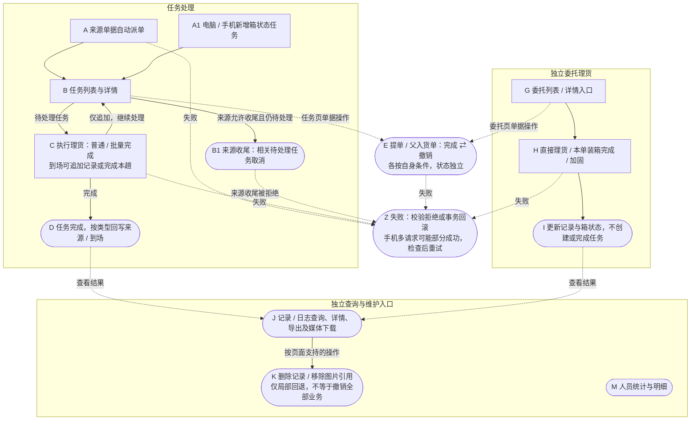
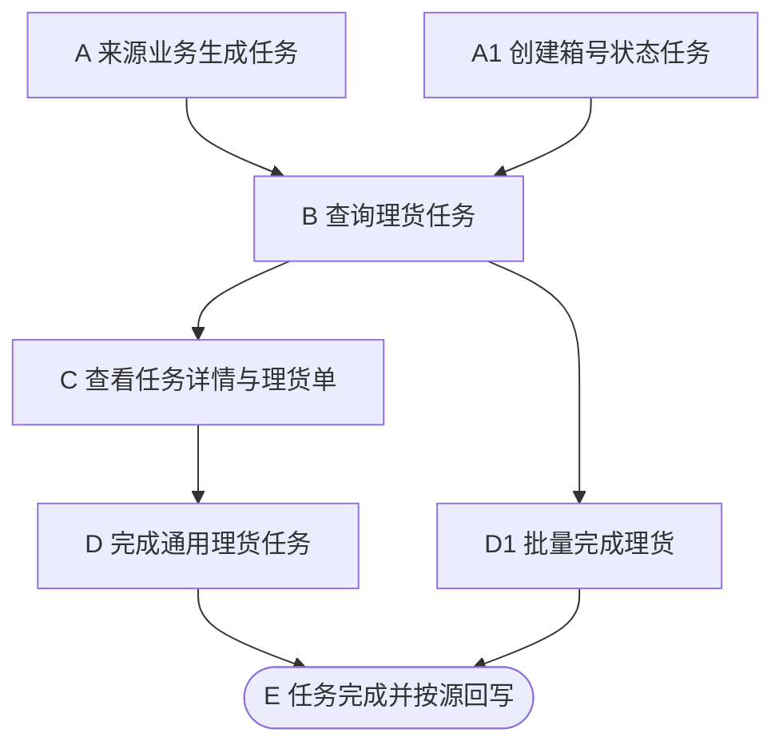
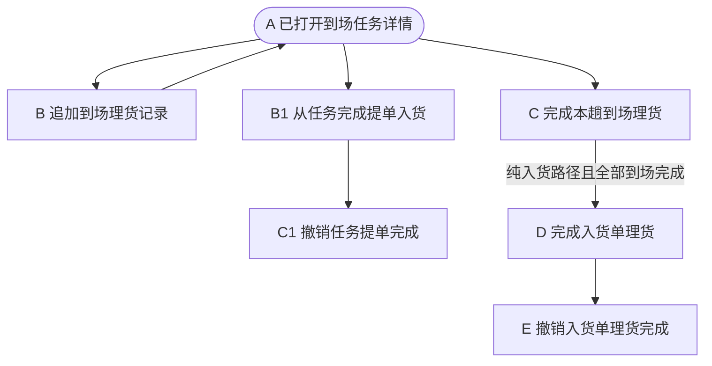
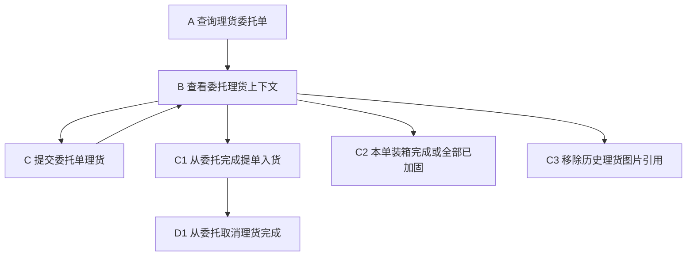
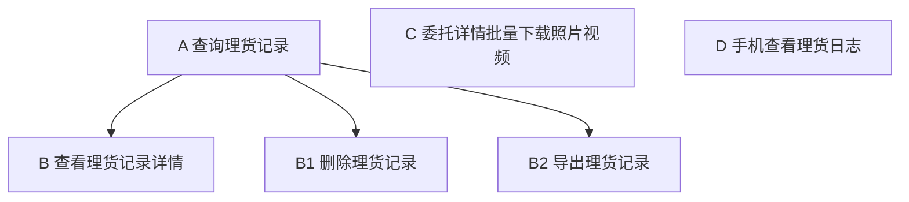
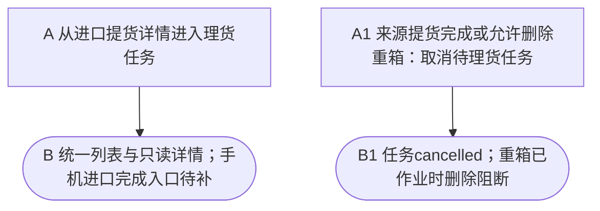
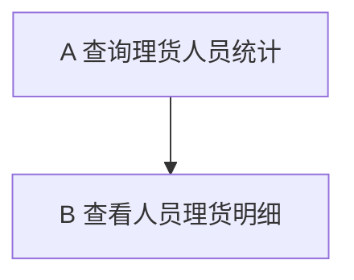

# 理货：AI 开发上下文

本次按当前code-module-feature-map技能整理双文档，并按用户指定位置存放于预览目录。已逐一核对117个源码证据文件的SHA-256，与既有事实基线一致；重点回读来源派单、独立箱状态创建、直接委托理货及专用到场完成入口。保留已实现功能、人工约定、稳定ID和未修复建议，本轮不修改业务实现。

任务、本趟到场、父入货单、提单与箱状态独立。普通追加、直接委托理货、通用完成及专用到场完成的副作用不同；不可把任务数、箱次和日志数互换。来源收尾可系统取消pending理货，任务页没有普通取消入口；完整分支与出口见FLOW-OVERVIEW。

## 1. 摘要与基线

已核实范围包括任务、理货记录、到场/提单/父入货单完成与撤销、直接委托理货、来源派单及收尾、媒体和相关统计。当前重点复核三类创建链：来源单据自动派任务、电脑/手机独立箱状态任务、直接委托追加记录；其余事实沿用同一源码指纹基线的既有静态分析。首图按阶段合并入口与动作，完整角色、入口与功能映射保留在事实表，具体岗位、运行菜单及角色绑定未查询，不能将页面分组当作角色授权。

源码Git为web，HEAD `3c40a18befda1f0c919e789515852f078b2a1d1c`；根目录不是Git仓库，双文档与根索引在web Git外。当前包含此前理货及报表未提交改动，本轮仅维护双文档，并将根索引中的理货路径更新到指定预览目录。工作区清单如下，已分析文件的字节指纹见证据表；指纹不表示每个文件已全量语义或运行验证。

```text
 M plus-mobile/src/api/storage/export/tallyRecord/types.ts
 M plus-mobile/src/pages/tally/tallyTask/index.vue
 M plus-mobile/tests/tallyLogStorageFilter.test.mjs
 M plus-mobile/tests/tallyTaskTabs.test.mjs
 M plus-ui/src/api/report/efficiencyReport/index.ts
 M plus-ui/src/api/report/efficiencyReport/types.ts
 M plus-ui/src/views/report/efficiency/index.vue
 M ruoyi-modules/st-storage/src/main/java/com/i4h2/report/efficiency/controller/EfficiencyReportController.java
 M ruoyi-modules/st-storage/src/main/java/com/i4h2/report/efficiency/service/IEfficiencyReportService.java
 M ruoyi-modules/st-storage/src/main/java/com/i4h2/report/efficiency/service/impl/EfficiencyReportServiceImpl.java
 M ruoyi-modules/st-storage/src/main/java/com/i4h2/storage/export/tallyrecord/domain/bo/ExportTallyRecordBo.java
 M ruoyi-modules/st-storage/src/main/java/com/i4h2/storage/export/tallyrecord/service/impl/ExportTallyRecordServiceImpl.java
 M ruoyi-modules/st-storage/src/main/java/com/i4h2/storage/tracking/tallytask/domain/bo/TallyTaskBo.java
 M ruoyi-modules/st-storage/src/main/java/com/i4h2/storage/tracking/tallytask/domain/vo/TallyTaskVo.java
 M ruoyi-modules/st-storage/src/main/resources/mapper/tracking/tallytask/TallyTaskMapper.xml
 M script/sql/2.sys_menu.sql
?? plus-mobile/tests/tallyLogInboundGrouping.test.mjs
?? plus-ui/src/views/report/efficiency/components/
?? plus-ui/src/views/report/efficiency/personnelHelpers.ts
?? plus-ui/tests/report/efficiencyPersonnel.spec.ts
?? ruoyi-modules/st-storage/src/main/java/com/i4h2/report/efficiency/domain/bo/EfficiencyPersonnelBo.java
?? ruoyi-modules/st-storage/src/main/java/com/i4h2/report/efficiency/domain/vo/EfficiencyPersonnelDetailVo.java
?? ruoyi-modules/st-storage/src/main/java/com/i4h2/report/efficiency/domain/vo/EfficiencyPersonnelSummaryVo.java
?? ruoyi-modules/st-storage/src/main/java/com/i4h2/report/efficiency/domain/vo/EfficiencyPersonnelVo.java
?? ruoyi-modules/st-storage/src/main/java/com/i4h2/report/efficiency/mapper/
?? ruoyi-modules/st-storage/src/main/resources/mapper/report/
?? ruoyi-modules/st-storage/src/test/java/com/i4h2/report/efficiency/
?? ruoyi-modules/st-storage/src/test/java/com/i4h2/storage/export/tallyrecord/service/impl/ExportTallyInboundLogQueryTest.java
?? ruoyi-modules/st-storage/src/test/java/com/i4h2/storage/tracking/tallytask/mapper/
?? script/sql/update/20261110_efficiency_personnel_report_menu.sql
?? script/tests/
```

核验范围为静态源码、反向调用方搜索、既有AI事实与当前文件指纹、双文档一致性。未启动服务、运行业务测试、查询数据库、调用业务写接口或执行迁移。此前43项手机缓存/筛选/日志测试、9项SQL/4项Mapper与其他实现轮结果为历史记录；此前审查对负数核对与旧记录覆盖做过局部真实函数复现，本轮没有重新运行。coverage=partial：来源完整CRUD、收费/开票/退款、叉车/司机全流程、全部报表维度未全量分析；实际部署DDL、字典/配置、租户隔离、设备能力及真实角色就地todo。

电脑站内链接以后台应用根解析，声明菜单不代表线上启用；任务中心及未核实运行地址使用源码入口。手机 `/pages/...` 为uni-app应用内路由，非普通Web URL。源码链接相对本Markdown目录为 `../../../../storage/web/...`；弹窗/抽屉无独立URL。已注册旧页不自动代表首页可达，旧演示详情不作为完成入口。

本文件是后续AI的唯一模块文档输入；开发者说明只作同步写入目标。两份文档与索引位置如下：

```yaml
ai_context: /www/ai/skill-previews/code-module-feature-map/storage-tally/ai-context.md
developer_output: /www/ai/skill-previews/code-module-feature-map/storage-tally/developer-guide.md
module_index_file: /www/storage/AGENTS.md
```

索引为根 [AGENTS.md](../../../../storage/AGENTS.md) 中唯一tally条目，已更新到当前预览目录。后续核对需求、规范和源码，不依赖开发者说明；理货完整事实仍在本文件定义，关联模块仅作背景。

## 2. 按需求定位索引

| 变更类型 | 优先入口与复用点 | 约束及影响 | 验证方向 |
| --- | --- | --- | --- |
| 新增字段/件重尺/单位 | E-001/E-002电脑表单；E-009/E-012手机；E-043/E-044 BO→E-005/E-018存储 | R-003/R-005/R-007；四表不同精度，件数Integer vs登记Decimal；字段表逐项核对 | 空/null/0/小数/历史吨、列表/详情/日志/核对与导出 |
| 批量完成/多任务表单 | E-001任务勾选/页签→E-054 API→E-004 Controller→E-063 BO→E-005 batchCompleteTask；复用completeArrival与completeTask | R-013/R-014；到场专用分支、核对按配置、其他类型保留、≤100整批事务 | E-064事务与边界；E-068长ID/入货位置/提货明细隔离；模拟浏览器全批校验与单条回归 |
| 任务创建/状态/副作用 | E-004→E-005；E-024/E-025/E-026来源；复用ITallyTaskService | R-002/R-003/R-004；掏箱落箱独立、提货库存只收尾累计 | 重复任务、同箱多行itemId、第二请求失败、并发完成/取消 |
| 到场完成/核对/位置 | E-008弹窗→E-005 completeArrival→E-018→E-019；复用InboundTallySupport | R-006/R-007/R-008；配置OR、父入货锁、核对事务与绑定货物刷新 | 严格组合、纯入货免位置、差异不阻断、快照未核对、回滚 |
| 提单/父入货完成与撤销 | E-022/E-011/E-008→E-014/E-005/E-019 | R-008；同名完成不同层；委托撤销不清任务标记 | 多到场同委托、无绑定/未完成绑定、取消后旧日志保留 |
| 直接理货/整单加固/媒体 | E-012/E-011→E-013/E-014→E-018；复用现有CSV控件 | R-009/R-010；一次POST事务vs即时删图；状态优先级 | sealed/reinforced混合、最后图片、多引用OSS、跨委托归属 |
| 按钮/权限/移动入口 | 本文件页面按钮顺序→E-001/E-007/E-008/E-011/E-022→真实Controller | R-001；父容器AND/OR、无本地权限不等于无权限；OPT-005 | 有/无权限，隐藏/禁用/校验，手机进口实际可达性 |
| 筛选/最新记录/日志显示 | E-007手机日志→E-085/E-086查询契约→E-018到场ID范围；E-031页签；E-033/E-034快照 | R-011/R-016；入货优先、空集合不放宽；arrivalNo缺失、详情100条上限及旧覆盖新 | UTC+8跨日、模糊/精确、过滤空页、同箱多条、超100条 |
| 统计/导出/历史时间 | E-028/E-077/E-078人员与概览；E-017导出/下载 | R-012；人员任务数/箱次与概览分离；主档latest时间不是日志时间 | 三种提交入口产生行数差异、空来源、未知尺寸、时间范围 |

## 3. 关键约束与契约

以下规则是完整定义，摘要、功能与按钮表只提供影响判断的局部提示；修改时一并核对关联字段/Map与真实源码。不要从旧注释推断已执行校验，尤其BO上的“比对不通过回滚”注释与当前差异不阻断实现不同。

### R-001 身份、权限与返回

所有业务ID前端按string。任务控制器权限storage:tallyTask:list/query/add/complete；记录storage:exportTallyRecord:list/query/add/remove/export；直接上下文/提交/删图片用storage:exportEntrustOrder:tally；委托完成/取消/加固后端为edit OR tally；父入货完成/撤销为exportInboundRecord:edit OR tallyTask:complete。页面可见不等于服务授权，菜单SQL不等于实际角色配置。列表TableDataInfo；详情R<VO>，普通写toAjax/R<Void>，创建任务R<Long>。

依据：E-004 E-013 E-017 E-046。

### R-002 任务创建与源头

出口到场保存按operateType=loading建arrival_loading，否则arrival_storage；名为createInitialTallyRecord的方法实际只建任务。进口重到场inboundType=unload_inbound建掏箱任务，与落箱独立；锁到场和档案，限制同源有效任务及同箱待执行掏箱。提货单needTally=yes建pickup_outbound。重箱可从独立来源列表或作业任务快捷新增，并可在来源列表安排掏箱；提货页面默认needTally=no且禁用，服务仅保留yes兼容派任务分支。手工普通箱状态创建只要求tallyType非空，未统一限制枚举/来源组合。创建发布TaskNotifyEvent；真实通知投递未验证。

依据：E-005 E-024 E-025 E-026。

### R-003 通用完成与事务

completeTask只允许pending且明细非空。到场先校验父入货可编辑；进口掏箱锁源、统一真实箱档案，兼容明确关联的历史箱明细ID；其他先按档案ID有序锁箱并锁任务。入库/掏箱每行件数和重量非空非负，非纯入货路径位置非空；其他类型行只明确要求箱档案，出库另验证itemId属于当前提货。事务内插tk_tally_task_item、置任务completed/人/时间，空白两个完成标记默认0，再分源回写。不自动调用专用到场核对/专用提单绑定校验；旧通用API传两个标记均0也能任务完成，不能视为本趟或提单完成；新电脑真实到场入口不再使用该表单。

依据：E-005 E-002 E-043。

### R-004 不同源完成副作用

到场通用完成逐行调用记录insertByBo，使用任务arrivalCompleted回填记录cargoCompleted，任务cargoCompleted=1才把委托receiveStatus完成；不写专用到场完成日志。掏箱完成仅更新im_heavy_entry.unload_time及相关档案empty_in_yard/时间线，不改变落箱entry_status，未证明自动占用散货位置。提货按itemId回填pickupPieces/Weight、提货单tally_completed；不在这里累计库存，库存由独立提货完成收尾。已completed提货单回写跳过；独立completePickup（提货完成）才取消待处理理货并累计库存；uploadOutboundDoc只保存/替换附件，不取消任务或累计库存。独立箱状态更新主档bizStatus、latestTask/操作人/时间并写时间线。

依据：E-005 E-026。

### R-005 普通追加记录

记录insertByBo先校验到场所属入货可编辑，再按类型校验、归一化、插记录/核对行并同步状态。arrival_loading需到场且有档案，但仅核对行而无顶层件重尺/媒体的correctionOnly允许无箱；arrival_storage需到场但没有通用入库件重/位置必填限制。entrust_loading必须委托/箱档案/装箱状态，检查该箱归属；container_status也需箱及状态。普通新增并未全面验证任务pending、非负或枚举白名单。手机表单pending检查不是服务器新增记录的统一保护。

依据：E-018 E-009。

### R-006 专用到场完成

completeArrival仅支持ex_cargo_arrival来源且arrival_loading/storage；父入货可编辑，锁任务，拒绝任务completed或arrivalCompleted=1，锁定任务后显式拒绝cancelled。纯入货路径定义为arrival.inboundRecordId非空 AND orderId为空，所有租户免位置；其他arrival_storage位置必填。required=true要求核对品名/整数件数/重量/体积非空，未全面非负校验；差异不阻断完成，没有按重量容差比较后拒绝。保存核对行→同步绑定委托货物→任务/到场完成→该到场所有现存记录cargoCompleted=1、必要时位置→追加完成日志及发布事件，同事务回滚。委托入库无记录时可补普通位置记录。

依据：E-005 E-018 E-019 E-020。

### R-007 快照与核对聚合

仅到场完成日志且correctionRequired=false AND diffPanelVisible=false保存后端登记快照。快照内容见Map，verified=false，与ex_tally_record_item核对行不同。入货checkedItems累计该入货全部到场记录的核对子行，按trim品名合计；有核对的名称覆盖登记量，无核对保留登记量，新增名追加，completeArrival据此同步绑定委托来源货物。快照不参与合计。登记基准展示优先入货单items，其次本趟到场items；核对弹窗可能预填父单总量，不能擅自认定该默认就是本趟量。

依据：E-018 E-019 E-008 E-033。

### R-008 三层完成与撤销

任务completeCargo：只限到场来源，未统一要求pending/本趟已完成；检查任务标记、委托receiveStatus及严格绑定门槛，写本任务cargoCompleted=1和委托completed及完成日志；入货单独立路径拒绝。取消要求非cancelled、标记1且到场直接有orderId，条件更新本任务标记0及委托incomplete，不退本趟/任务/箱/媒体。委托completeCargo使用原receiveStatus条件更新并写日志，取消只回委托incomplete，不重置任何任务cargoCompleted。电脑入货列表/详情与手机共用父入货completeTally；其锁父和到场，要求至少一到场且全部tallyStatus=completed；reopen只回父processing。父完成后相关到场记录增删、通用/专用到场理货会被可编辑检查阻断，但不要把所有委托直理货都说成受同一父单锁。

依据：E-005 E-014 E-019 E-021。

### R-009 直接理货与加固

直接委托submit一次POST多箱事务，逐箱追加entrust_loading，既不创建/完成任务也不改receiveStatus。箱状态同步委托箱spreadStatus及主档bizStatus；spreadFinishTime为空则首次写当前时间，后续不覆盖；该记录同步不维护通用任务使用的全部latest*字段。completeLoading按最新箱记录→spreadStatus→bizStatus取状态，sealed/reinforced都跳过，其余每箱追加reinforced；任何需处理箱无档案拒绝并事务回滚，全跳过拒绝。最新记录归并比较tallyTime，不能直接以id或当前档案时间替代。

依据：E-014 E-018 E-042。

### R-010 媒体与记录删除

photoJson/videoJson是CSV OSS ID。直接表单聚合历史，新增只提交差集；历史照片删除即时改原记录引用，检查属于委托，不删除OSS。删除最后引用时设置null，实际是否持久化清空需核对字段更新策略/运行，不能保证已清空。记录批删事务内删除核对子行；若某到场无其余cargoCompleted=1记录则回processing；若某档案无其余非空packingStatus记录则回not_required，有其余记录时不重新计算最新状态，也不清spreadFinishTime。删除不回退tk_tally_task、arrivalCompleted或委托receiveStatus，也未调用绑定委托货物重新同步。打包按箱名分目录、空箱名未分配箱号，忽略非数字/空CSV项，没媒体拒绝；不保证去重及所有OSS成功。

依据：E-012 E-017 E-018。

### R-011 查询与显示差异

任务多类型优先单类型，手机到场类型筛选见R-017；手机今日以UTC+8创建日；任务SQL固定create_time desc,id desc，手机排序参数的最终效果todo。任务blNo条件在到场路径匹配委托blNo OR 入货inboundNo；plateNo专用筛选没覆盖重到场，但keyword覆盖。记录tallyNo精确、containerNo模糊、orderId为直接记录OR该委托所有到场；arrivalNo不存在于BO/wrapper。手机任务日志新增入货单分组规则见R-016；手机出口日志仍隐藏arrival_storage，但其他入口仍可见。到场详情只取前100条记录且倒序逐项set同箱Map，可能旧覆盖新。

依据：E-006 E-007 E-008 E-010 E-015 E-018。

### R-012 作业概览的报表边界

效率理货箱量为范围内已completed且finishTime非空的任务下全部tk_tally_task_item行数，不按箱全局去重；直接委托追加ex_tally_record或专用completeArrival本身不插任务子项，不能把日志数当理货箱量。业务过滤按sourceType ex_/im_前缀，堆存返回空，来源空的独立状态任务在全部可出现、按进出口过滤被排除。出口装箱另查当前主档full/reinforced/sealed及latestUpdateTime，不是全部历史日志事件；直接记录同步bizStatus却不维护同样latest字段，需评估统计时点影响。

依据：E-028 E-018 E-005。

### R-013 批量完成理货

当前页仅勾选pending，仍复用storage:tallyTask:complete；列表/弹窗加载或无选择时禁用，刷新/换页清选择。打开时重读全部任务，存在到场来源则读取租户strictConfig，配置/必要登记数据失败关闭弹窗、提示重试，不允许按未核对降级或提交半批。到场判定为sourceType=ex_cargo_arrival AND tallyType为arrival_loading/storage；核对/位置规则复用R-006。基准取入货单登记items（不是checkedItems），没有明细则读取本趟到场items，按手机方式预填并保留零与空差异；不擅自把父单量改成本趟量。无核对且无位置时到场不生成核对行，单条显示确认框、全部此类任务批量显示汇总确认；其余/混合类型保留任务页签，各任务表单独立且全部挂载校验。电脑核对品名有内容时必填，correctionRequired要求件重尺齐全；数值需有限、件数Integer，差异及容差不阻断；未增加单独的非负业务规则。未通过全批校验不请求，定位第一个无效任务。验证/提交期间阻止重复点击及关闭；成功关闭刷新清选，失败保留草稿。

单条到场POST /storage/tracking/tally-task/{id}/complete-arrival，其他类型继续/complete。批量仍POST /batch-complete，tasks每项继承通用字段并可增加arrivalCompletion:{storageLocation?,items?}；新电脑到场始终发送该属性，无数据也传{}。非null arrivalCompletion调用completeArrival，缺失或null沿用completeTask，旧JSON兼容；来源/类型由专用服务校验，不信任客户端标记。集合1—100项、非null元素、taskId非null且不重复，继承校验仍生效。外层@Transactional同事务执行两种分支，任一失败整批回滚，AFTER_COMMIT通知只在提交后消费。新到场完成不写通用任务子项、不顺带完成提单；作业概览的理货箱量仍按R-012取任务子项，不能把电脑到场完成数当作该报表理货箱量。

依据：E-001 E-005 E-054 E-063 E-064 E-065 E-069 E-070 E-071 E-072 E-073 E-074 E-075 E-076。

### R-014 电脑任务类型多选

页面queryParams.tallyTypes为string[]，el-select multiple；API封装转逗号分隔字符串供现有TallyTaskBo.setTallyTypes拆分，XML使用IN，选中类型为OR关系。非空多值优先旧tallyType，空数组省略多值；页面重置空数组并清旧单值、恢复pending及第一页，分页保留筛选。路由先归一化tallyTypes（数组/CSV、trim、去空去重），非空优先；否则兼容旧tallyType单值，无需新增后端筛选或数据库变更。

依据：E-001 E-006 E-054 E-065 E-069 E-074。

### R-015 理货人员统计

当前工作区新增只读页签，当前HEAD不包含该实现。父页初始业务人员分析；切入理货人员统计才挂载，离开销毁，再进默认近30天。按实际tally_user_id及finish_time筛completed任务，LEFT JOIN未删任务子项：任务身份DISTINCT为完成任务数，子项逐行累计为箱次，无子项保留1任务0箱次。相同箱号不跨任务去重；专用到场完成仍计任务数，直接委托理货/追加日志不建任务则不直接贡献这两个计数。按人员ID分组；同名分开；无ID为未归属；非空ID取同租户当前sys_user昵称，缺失回退用户+ID，不依赖任务姓名快照。业务按来源ex_/im_前缀推导，全业务保留空来源，堆存筛选在理货维度没有来源。

GET personnel-summary/personnel-list/personnel-detail-list均需report:efficiency:list。dateStart/dateEnd必填合法且起≤止，以服务系统时区[start日00:00,结束次日00:00)过滤完成时间；名称trim后不区分大小写包含。dimension=tally禁止非空metric；personId与unassigned=true互斥；分页默认20、范围1—500。页面保存已应用筛选，明细不会读取尚未搜索的输入；列表与合计同条件，全部合计不是当前页和。数字0/加载中禁用，行内查看明细只受加载与权限限制；两列均无metric，用同一人员范围钻取。关闭清理明细、请求序号隔离迟到响应；仅查询，无人员报表导出或理货写入入口。菜单/迁移部署、真实租户隔离及时区运行验收todo。

依据：E-028 E-040 E-077 E-078 E-079 E-080 E-081 E-082 E-083。

### R-016 手机入货单日志分组

任务卡片日志优先按到场sourceDetail.inboundRecordId分组，即使同时有orderId也不扩大为委托范围；没有入货单才按orderId查委托，再无委托则按本趟arrivalId查。其他来源继续读任务items。以字符串主键定位，不按入货单号/提单号文本归并；同一入货单的多趟到场共享一组日志，不同入货单隔离；任务列表仍逐任务展示，未折叠任务。弹层显示入货单号，记录显示各自arrivalNo，组内理货人/时间缺失显示占位，不能回填当前任务人员/完成时间而误指其他趟。委托列表日志仍按原委托范围查询。

复用GET /storage/export/tallyRecord/list及原list权限，ExportTallyRecordBo新增仅查询inboundRecordId。Service先用BaseMapper取该入货单下当前可见、未删除到场ID，再以arrivalId IN范围筛日志；没有到场时限定1=0，禁止退为全部日志。其他显式arrivalId/orderId等条件保持AND交集；前端入货分组请求仅发inboundRecordId和分页，不夹带本趟/委托限制。全体分页依create_time DESC,id DESC稳定排列；沿用MyBatis租户与逻辑删除机制，真实租户运行验收todo。无需数据库字段/迁移，不复制历史记录；记录仍通过arrivalId→到场inboundRecordId间接归属。

每页20，原arrival_storage显示过滤保留，arrival_tally_completed日志保留；原始满页但过滤为空时继续取下一页，直到可显示或末页，页码与滚动加载始终保持当前分组。打开时清空旧数据，关闭清理状态；请求序号拦截关闭/切组后迟到的详情与日志，加载中不并发翻页。新增规则不改变核对汇总、完成日志生成、任务/提单/父入货单完成语义。

依据：E-007 E-018 E-085 E-086 E-087 E-088 E-089。

### R-017 手机到场类型筛选

手机理货任务筛选弹层首项“到场类型”为radio：空串=不限、order=委托单、inbound=入货单；与多选“作业类型”独立，均可组合其他筛选。无缓存时默认不限；选择仅更新弹层草稿，确定后重查第一页与全部页签角标；清空后确定恢复不限。切页签、翻页保留类型，今日只隐藏创建时间，不隐藏此项。路由显式linkType仅接受order/inbound，非法值回空；普通进入时可恢复缓存，业务链接与缓存的优先级见R-019。请求空值转undefined，不主动改写sourceType。

TallyTaskBo新增可选String linkType，selectTaskPage XML沿用已关联到场ca：order要求真实ex_cargo_arrival来源且ca.order_id非null；inbound要求相同来源且ca.inbound_record_id非null。与到场登记现有筛选口径一致，两关联同时存在时可同时命中两种筛选，不依赖提单号是否填写，不要求另一关联为空。非到场来源或已删除/不存在的到场均不能命中已选类型。不传/空/未知类型保持原任务范围；其他作业多选、状态、日期、关键词条件仍为AND交集。列表与角标共用任务list接口/Mapper及原权限，不新增数据库字段、菜单或写入接口。

依据：E-006 E-007 E-024 E-051 E-090 E-091 E-092。

### R-018 入货单的上次理货人

任务list的lastTallyUserName从理货记录人员快照派生，手机卡片直接展示，空值显示--。当前到场ca.inbound_record_id非null时，优先汇总与其相同入货单ID的所有未删到场登记下、同租户且未删的ex_tally_record；即使当前到场同时有关联委托，也不扩大为委托范围，不混入委托直接记录或其他入货单。当前到场及历史到场的tenant_id均校验等于任务租户，记录tenant_id同样校验；历史到场删除时其记录不参与。按主键关联，不依赖提单号/入货单号字符串。

按COALESCE(tally_time,create_time) DESC、id DESC取一条，包含各类理货记录及完成日志，不限制为已完成任务或手机日志当前可见类型。取记录tally_user_name快照，不查当前用户昵称，也不跳过最新记录的空人员名去找更旧人员；无历史或最近人员名为空时返回空、手机占位，不回退到委托或任务完成人。无入货关联时保留原委托范围（直接order_id OR该委托的到场记录）。其他任务来源不新增人员来源。

范围由任务Mapper列表投影实现，接口/VO字段名及权限不变；字段注释已改为入货单优先。新SQL同时作用于调用该list的电脑与手机，但电脑没有新增入口；手机无需额外请求或控件。无数据库结构/历史数据修复。

依据：E-006 E-007 E-093 E-094。

### R-019 手机筛选本地缓存

作用域为当前设备上的手机理货任务页，uni同步本地存储key=storage:tallyTask:filters:v1，数据为{version:1,activeTab,filters}。保存白名单字段：keyword/blNo/linkType/containerNo/plateNo/orderByColumn/isAsc、tallyTypes:string[]、createTimeRange:{begin,end}；activeTab另存。搜索、筛选确定、排序确定、切状态页签时先保存再查询；不等服务器成功，不保存未确认输入/弹层草稿，不在普通刷新或自动进入时覆盖缓存。清空当前可见筛选后按确定，空值覆盖旧缓存；今日隐藏的手动日期仍沿原规则保留，关键字是独立搜索输入。

onLoad同步恢复缓存，onShow据恢复状态从第一页查列表和角标；不缓存pageNum/pageSize、列表、loading、附件、任务数据或只由单据链接传入的sourceType/sourceNo。恢复验证version=1及filters非数组对象；文本仅接string，到场类型/排序字段/方向/页签按现有集合校验；作业数组去重且仅保留当前选项；日期仅接受YYYY-MM-DD及可选HH:mm:ss字符串格式。未知版本、无缓存/非法字段使用默认，存储读写抛异常时不阻断查询。不是服务端用户偏好，无账户同步、有效期或新增用户身份存储。

普通无业务参数进入恢复缓存页签，无缓存默认today；仅taskStatus路由覆盖页签并保留已存筛选。若路由显式含tallyTypes/tallyType/sourceType/sourceNo/linkType/blNo/containerNo任意一项（包括空串），以该业务入口完整条件替换缓存业务筛选，清关键词、车号、手动日期；排序偏好保留，状态由原路由规则初始化。自动进入不写回，正常入口下次仍可恢复原偏好；用户主动搜索/确认/切页签则保存当时可见条件。今日只缓存页签，不缓存派生当天日期，跨日重新计算UTC+8日期。返回仍存活的页面沿用其内存条件，重新加载页面时再读缓存。

依据：E-007 E-031 E-032 E-051 E-052 E-092。

### R-020 关键创建调用方与来源边界

当前反查确认：电脑到场登记保存→到场任务；电脑重箱到场保存（选择掏箱）及作业任务快捷重箱表单→掏箱任务；电脑重箱列表安排掏箱→同一掏箱任务创建。提货服务insert保留needTally=yes分支，但电脑提货表单默认no且禁用选择，不能称为正常可选yes页面；手机调度“重箱进场”只下发作业落箱任务，不直接调用来源重箱新增/掏箱派单。司机独立登录预约、本人货物到场只读查询不创建理货任务；角色标题、司机身份及后台角色不能互推。

来源取消有两条确认链：电脑提货完成→completePickup→取消该单pending理货并累计库存；电脑允许删除重箱→生命周期服务检查后取消pending理货并回滚来源。上传出库单仅改附件，与取消/库存收尾独立，旧服务注释不作为事实。重箱已有完成时间/理货人或已作业时删除检查阻断。

电脑入货列表及详情均有父单完成/撤销，与手机纯入货任务详情共用同一服务与权限OR。手机正常出口委托详情也能查理货记录及下载媒体，和理货底部委托详情是不同页面：前者只取前100条、下载当前媒体范围且非H5提示浏览器；后者可直接追加理货、完成提单与整单加固。旧手机到场登记列表/详情已注册，但首页直达入口todo；详情按箱转统一任务列表，回单图片归到场模块，专用保存可能回写departed/signed及费用，不能称为只改附件。旧loading/unloading列表重定向，旧详情仍为演示，不视为正常完成入口。

菜单SQL、首页“理货员/出口业务/调度闸口”等分组仅证明页面导航，未查询真实角色授权；主流程统一写系统登录/后台授权用户并就地保留岗位todo，不把权限码当成岗位绑定。全部已确认页面调用方、入口差异及依据在7.1逐行定义。

依据：E-095—E-110 E-114 E-115 E-116 E-117。

## 4. 新需求使用约定

1. 读当前需求、根规范、本AI上下文及相关源码；核对本基线到当前HEAD、暂存/未暂存/未跟踪文件。文档与代码冲突时先复核代码再更新事实，不切分支、不重置或覆盖用户改动；无法解析旧基线时注明非精确增量核验。
2. 先说明目标与当前行为差异、已有可复用实现、建议方案、具体文件/符号、接口/字段变化、历史数据与兼容、权限/状态/相关统计导出影响和验证范围。完整满足需求、正确性与兼容性的前提下，优先复用现有实现，以尽可能少的代码改动完成目标，保持简洁可读。
3. 只求方案就不改代码；明确要求实现时沿既有授权继续，不机械增加批准环节。只澄清影响正确性的必要缺口；未实施建议和历史待办不是开发指令。禁止无关重构、批量格式化、不必要抽象/依赖，必要联动修改、验证和文档同步不能省略。
4. 数据库MCP始终仅查询。结构变化先输出SQL不执行，修复UPDATE/DELETE先给SELECT预览，不能借分析任务调用业务写接口或执行迁移；未知标todo，不猜实际库/租户/角色。
5. 区分实现完成、未完成、失败、方案与未验证；文档修改不等于功能修复，静态检查不等于业务验收。

## 5. 问题状态与人工决定

用户展示约定（2026-11-11）：开发者说明业务流程主图尽可能简洁，同类入口与操作合并为阶段节点；保留主要流向、独立流程、关键分支与出口。角色、全部已确认页面入口及具体规则放在图后表格；多个功能ID可映射同一阶段节点，AI事实表与人版映射同步，不将独立状态画成必经先后关系。

用户已确认并实现：电脑多选OR；到场完成复用手机专用服务，差异不阻断；纯入货免位置；提单完成独立；其他类型与旧请求兼容、混合批量整批事务；手机入货日志及上次人员按入货单优先、到场类型筛选与已确认条件本地缓存。用户明确不擅改核对预填的数量口径。现有工作区包含这些改动及人员报表，本轮只重新整理文档，以下风险没有因此被修复或获授权开发。数据库MCP仅查询，忽略web下agent；具体岗位、字典与部署未知不猜。

此前审查的局部复现只确认页面负数核对可放行和旧记录覆盖新记录；并发封单、线上图片清空及真实数据影响仍待验证。规则代码可确认与业务口径需确认分开记录，不把合法的状态独立或已明确的兼容策略直接判为缺陷。

| 建议ID | 关联功能 | 性质/优先级 | 触发与影响 | 建议及验证方向 | 证据 |
| --- | --- | --- | --- | --- | --- |
| OPT-001 | F-018 | 缺陷候选／中 | 记录页填到场单号仍返回其他到场记录。前端传arrivalNo但BO和wrapper没有过滤。 | 补齐参数→关联到场查询或改为已支持arrivalId；验证列表与导出同条件一致。 | E-015 E-018 |
| OPT-002 | F-004 F-006 F-007 F-014 | 校验差异／高 | 新电脑到场入口已切专用完成并拦截cancelled；旧通用API仍兼容原行为，任务提单完成仍缺统一取消检查。 | 当前电脑到场入口已统一到手机专用规则；旧通用API及任务提单完成的后续收敛仍属候选，验证直接调用与兼容性。 | E-005 E-020 E-019 |
| OPT-003 | F-005 F-013 | 确认校验缺口／高；单位口径需确认 | 手机核对真实函数可放行负件/重/体积，后端required只查非空；旧吨标签与kg链路并存，登记Decimal可能预填Integer件数。 | 先补有限数/整数/非负的服务契约并确认历史单位；0/空/null/负数/小数均验。此前审查局部复现，不代表本轮重跑或已修复。 | E-016 E-041 E-043 E-044 E-008 |
| OPT-004 | F-002 F-005 | 确认展示问题／中 | 倒序日志反复Map.set同箱，旧状态覆盖新状态，已在前一审查局部复现；到场详情和手机出口详情各仅前100条。 | 统一已确认的最新规则，验证同箱多条/同时间/超100条；不要把错误当前展示当验收期望。 | E-008 E-011 E-012 E-014 E-108 |
| OPT-005 | F-004 F-025 | 入口缺口／高 | 手机进口任务详情只有只读；去理货任务只到列表，通用form虽有完成分支却无非到场按钮。旧loading/unloading详情无真实提交。 | 确认是否启用手机进口完成并接入真实入口；验收从首页到持久化回写，禁用或迁移演示页需另授权。 | E-008 E-009 E-027 E-037 E-038 |
| OPT-006 | F-003 F-005 | 一致性／中 | 手机新增先建再完成；到场多箱逐请求。后一步失败可留下pending或已成功部分记录，重试有重复追加风险。 | 保留已建ID或明确恢复入口，若业务要求原子批量再考虑接口；验证第二步失败、半批失败和重试。 | E-007 E-009 |
| OPT-007 | F-017 F-020 | 删除联动／高 | 删除核对记录不重同步绑定委托货物，不撤销任务/提单或重算剩余最新箱状态；最后图片赋null与仓库NOT_NULL策略冲突，真实持久化待验。 | 确认业务撤销边界与null持久化策略，验证一图/多图、最后记录/有剩余、已完成父入货和任务完成标记。 | E-018 E-005 E-019 E-111 |
| OPT-008 | F-004 F-006 F-013 F-016 | 统计范围／中 | 作业概览仅计任务子项；新增人员统计分任务数/箱次。专用到场可为1任务0箱次，直接理货/加固仅写日志，主档时点另用latestUpdateTime。 | 分别确认任务量、箱次与日志口径，比较三类提交后的两类报表，不自动改成日志计数。 | E-028 E-018 E-005 E-078 |
| OPT-009 | F-001 | 体验候选／低 | 任务手机排序选择与XML固定order by并存。 | 联调确认分页插件最终SQL，若确不生效再最小修改；验证两种字段、升降序与分页稳定性。 | E-006 E-007 |
| OPT-010 | F-004 F-005 F-006 F-007 | 确认入口校验差异／高 | 普通新增仅检查父单可编辑，缺任务已完成/取消保护；旧通用到场完成不走专用核对；任务提单完成缺取消检查。 | 按现有兼容约定收敛服务规则；验证直接请求、旧客户端、已完成任务仍父processing、取消状态。未获授权修复。 | E-005 E-018 E-020 E-021 |
| OPT-011 | F-005 | 确认归属校验缺口／高 | 到场装箱记录校验箱档案是否填写，未像委托直理货验证箱归属；随后可同步箱档案状态。 | 补充到场/委托/箱档案一致性门槛，验证有效但不属于当前业务的箱、无箱核对例外和租户隔离。 | E-018 E-009 |
| OPT-012 | F-005 F-018 F-023 | 确认审计数据可写／高 | 新增BO允许传理货人ID/名称和tallyTime，仅缺失回填登录态；新最近人员按日志时间与姓名快照取值，可能被不可信入参影响。 | 确认是否仅专用导入可指定历史信息；普通入口由服务生成审计值，验证未来时间、人员错配及最近人员展示。 | E-018 E-086 E-006 |
| OPT-013 | F-006 F-007 F-014 | 确认异常降级路径／高 | 后端布尔配置读取异常返回false，手机请求失败留null；可能降低核对或绑定门槛。电脑仅能阻断HTTP失败，不能识别服务内部降级。 | 区分明确未启用与读取失败；必要配置失败拒绝写并允许重试。验证服务/缓存异常和全部配置组合。 | E-020 E-008 E-001 |
| OPT-014 | F-005 F-006 F-009 F-020 | 并发风险／高，尚未并发复现 | 父单完成锁父及到场，普通记录可编辑检查只读；检查通过至写入之间可能被另一请求完成封单。任务提单完成也缺统一行锁。 | 在正确环境验证封单与增删/完成交错、重复提单完成；明确并共享锁顺序后再最小修复，不能声称已有事务即完全串行。 | E-021 E-019 E-018 E-005 |
| OPT-015 | F-001 | 确认缓存隔离缺口／中 | 筛选为设备固定key，无账号/租户隔离和过期；退出不清缓存，换账号可继承旧条件，导致误认为无任务。 | 确认是否按账号/租户保存偏好或退出清理；验证共享设备、旧日期与切账号。此项不等于业务数据越权。 | E-007 E-112 |
| OPT-016 | F-006 | 业务数量口径风险／高，需确认 | 核对预填父入货总量，但聚合累加全到场核对行且只按trim品名分组；整单100件两趟各确认100会汇总200，同名不同单位也合并。 | 先确认每趟分量/整单累计与同名单位规则；遵守已确认“不擅改预填数量口径”，验证多趟和同名多单位后另行授权实施。 | E-008 E-069 E-070 E-019 |
| OPT-017 | F-018 F-022 | 范围与平台限制／中 | 手机出口委托详情只加载前100条且按该集合下载媒体；非H5仅提示浏览器下载，按钮未按export权限局部隐藏。 | 明确当前范围文案或按需求补全分页/全量选择；测试超100记录、无权限、无媒体和非H5端。 | E-108 E-017 |

## 6. 验证与同步约定

本轮仅静态反查与文档校验，不重跑业务测试：检查主图阶段简洁且保留主要分支和出口、全部功能ID到阶段节点的映射及表内完整入口、角色依据与边界、新五列表头、总览/局部图对应、字段/Map/按钮映射、相对链接、证据指纹和根索引唯一性。无真实数据库/服务、真机/浏览器或外部通知验收。

既有测试入口：手机 `tests/tallyTaskTabs.test.mjs`、`tallyTaskFilter.test.mjs`、`tallyLogInboundGrouping.test.mjs`、`tallyLogStorageFilter.test.mjs`（此前合计43项）；`script/tests/tally_last_tally_user_test.py`（此前9项合成内存SQL）；后端`TallyTaskLinkTypeQueryTest`（此前4项Mapper）、`TallyTaskBatchCompleteTest`、`TallyTaskArrivalSnapshotCompletionTest`、`ExportTallyArrivalSnapshotTest`、`ExportEntrustOrderTallyCompletionTest`及`InboundManualTallyTest`。此前手机全量类型检查7条其他模块错误曾与当时HEAD同环境对照一致，本轮未重新执行，不能据此称当前全量通过。

后续变更应覆盖：普通追加的完成/取消保护及箱归属；负数/空/null/小数与单位；同单多趟预填和汇总；封单并发；删除核对后的绑定货物、任务与箱状态；手机多HTTP部分成功重试；PC列表/详情与手机父单完成/撤销一致；任务提单完成与委托取消的标记差异；旧兼容API；来源安排/取消/库存收尾；超100条与最新记录；媒体最后引用；缓存跨账号及路由覆盖；统计三种口径与权限。

完成获授权功能修改后，先维护本AI摘要/契约/完整总览及角色入口事实/ID/证据，再由AI事实和源码同步人版九节，最后核对根AGENTS同一条目及最终基线/指纹。仅求方案时不改代码；实现请求沿已有授权继续，不机械增加审批。新增ID递增不回收，旧规则不从人版补齐；本约定只在当前获授权任务执行，不创建监听或自动化。

## 7. 完整事实附表与证据

### 7.1 全流程、发起身份、全部已确认入口与节点

模块从来源/手工创建任务或独立委托理货进入，分别形成任务、到场、提单及父单结果；来源取消、记录删除、附件和统计有各自分支。首图为完整总览，后续局部图仅补充细节。角色以登录身份、页面标题及权限链路为依据，实际岗位授权todo。图中P/N编号为结果或入口来源，不另造功能ID。

#### FLOW-OVERVIEW 完整业务总览



读图说明：虚线表示可选操作、结果查询或异常去向，不表示必须依次完成。提单完成不以任务完成为统一前提；父入货单完成要求至少一趟到场且全部完成，撤销不统一回退子任务或到场结果。手机新增箱状态任务可连续请求完成；多请求失败需检查是否已部分保存。到场回单、出场签字、费用及司机本人记录查看由关联模块独立处理，具体边界保留在下表和页面说明。

| 业务动作 | 发起角色/来源 | 页面入口 | 关键处理 | 结果与下一步 | 总览节点 | 局部节点 | 证据 | 角色依据与边界 | 接口与服务链路 |
| --- | --- | --- | --- | --- | --- | --- | --- | --- | --- |
| F-024 来源业务生成理货任务 | 后台授权用户（具体岗位todo） | 电脑→出口业务→[货物到场登记](/export/cargo-arrival)→新增→保存 | 保存来源并按loading/storage派到场理货；FLOW-OVERVIEW / A | 生成来源任务并发布事件 → 从统一任务页处理；普通电脑提货新增默认不派理货。 | FLOW-OVERVIEW / A | FLOW-TASK / A | E-098 E-099 E-117 E-024 | 页面add按钮+Controller权限；具体岗位todo | 货物到场insert→createInitialTallyRecord；重箱insert/arrangeUnload→createTask；提货insert在needTally=yes时→createTask |
| F-024 来源业务生成理货任务 | 后台授权用户（具体岗位todo） | 电脑→进口重箱到场 [代码入口](../../../../storage/web/plus-ui/src/views/storage/impot/heavyEntry/index.vue)→新增→选择安排掏箱→保存 | unload_inbound才派掏箱理货，与落箱独立；FLOW-OVERVIEW / A | 生成来源任务并发布事件 → 从统一任务页处理；普通电脑提货新增默认不派理货。 | FLOW-OVERVIEW / A | FLOW-TASK / A | E-100 E-101 E-025 E-106 | 来源add权限及表单inboundType，非手机端推断岗位 | 货物到场insert→createInitialTallyRecord；重箱insert/arrangeUnload→createTask；提货insert在needTally=yes时→createTask |
| F-024 来源业务生成理货任务 | 后台授权用户（具体岗位todo） | 电脑→过程跟踪→作业任务 [代码入口](../../../../storage/web/plus-ui/src/views/storage/tracking/jobTask/index.vue)→重箱到场→保存 | 复用重箱新增及掏箱安排字段，选择安排才派任务；FLOW-OVERVIEW / A | 生成来源任务并发布事件 → 从统一任务页处理；普通电脑提货新增默认不派理货。 | FLOW-OVERVIEW / A | FLOW-TASK / A | E-103 E-101 E-025 | 快捷按钮沿用重箱add权限、调用同源服务 | 货物到场insert→createInitialTallyRecord；重箱insert/arrangeUnload→createTask；提货insert在needTally=yes时→createTask |
| F-024 来源业务生成理货任务 | 后台授权用户（具体岗位todo） | 电脑→重箱到场 [代码入口](../../../../storage/web/plus-ui/src/views/storage/impot/heavyEntry/index.vue)→安排掏箱 | 锁来源并拦截有效任务重复安排，创建pending掏箱理货；FLOW-OVERVIEW / A | 生成来源任务并发布事件 → 从统一任务页处理；普通电脑提货新增默认不派理货。 | FLOW-OVERVIEW / A | FLOW-TASK / A | E-100 E-102 E-106 | edit权限AND canArrangeUnload；来源接口二次锁校验 | 货物到场insert→createInitialTallyRecord；重箱insert/arrangeUnload→createTask；提货insert在needTally=yes时→createTask |
| F-024 来源业务生成理货任务 | 来源服务兼容调用者（后台身份与权限需合法，正常yes页面未发现） | 自动触发代码 [代码入口](../../../../storage/web/ruoyi-modules/st-storage/src/main/java/com/i4h2/storage/impot/pickuporder/service/impl/ImPickupOrderServiceImpl.java)；电脑提货表单 [代码入口](../../../../storage/web/plus-ui/src/views/storage/impot/pickupOrder/form.vue)固定no | 仅来源请求needTally=yes创建出库理货，正常新建no不触发；FLOW-OVERVIEW / A | 生成来源任务并发布事件 → 从统一任务页处理；普通电脑提货新增默认不派理货。 | FLOW-OVERVIEW / A | FLOW-TASK / A | E-026 E-104 E-105 E-107 | 服务存在yes分支；前端禁用选择，不能称为正常可选页面 | 货物到场insert→createInitialTallyRecord；重箱insert/arrangeUnload→createTask；提货insert在needTally=yes时→createTask |
| F-001 查询理货任务 | 后台授权用户（具体岗位todo） | 电脑→过程跟踪→理货任务中心 [代码入口](../../../../storage/web/plus-ui/src/views/storage/tracking/tallyTask/index.vue)→搜索/重置/刷新/分页 | 组合筛选并恢复已确认缓存，列表/角标同条件；按来源返回上次人员；FLOW-OVERVIEW / B | 列表/角标更新 → 查看详情、创建独立任务或电脑勾选批量。 | FLOW-OVERVIEW / B | FLOW-TASK / B | E-001 E-004 E-006 | list权限+菜单声明，岗位与运行菜单todo | GET /storage/tracking/tally-task/list → queryPageList → selectTaskPage |
| F-001 查询理货任务 | 手机系统登录用户（首页“理货员”入口分组，岗位授权todo） | 手机→首页理货员分组→理货任务（应用内 `/pages/tally/tallyTask/index`）→搜索/筛选/页签 | 组合筛选并恢复已确认缓存，列表/角标同条件；按来源返回上次人员；FLOW-OVERVIEW / B | 列表/角标更新 → 查看详情、创建独立任务或电脑勾选批量。 | FLOW-OVERVIEW / B | FLOW-TASK / B | E-007 E-095 E-004 | 首页理货员只是分组名称；实际list权限与角色绑定todo | GET /storage/tracking/tally-task/list → queryPageList → selectTaskPage |
| F-001 查询理货任务 | 手机旧路由进入者（系统登录） | 手机→旧装箱列表（应用内 `/pages/tally/loading/index`）→自动转任务列表 | 旧列表自动转统一任务查询，保留已定义路由筛选；FLOW-OVERVIEW / B | 列表/角标更新 → 查看详情、创建独立任务或电脑勾选批量。 | FLOW-OVERVIEW / B | FLOW-TASK / B | E-049 E-007 E-036 | 路由已注册且redirectTo；不把演示详情当真实业务 | GET /storage/tracking/tally-task/list → queryPageList → selectTaskPage |
| F-001 查询理货任务 | 手机旧路由进入者（系统登录） | 手机→旧掏箱列表（应用内 `/pages/tally/unloading/index`）→自动转任务列表 | 旧列表自动转统一任务查询，保留已定义路由筛选；FLOW-OVERVIEW / B | 列表/角标更新 → 查看详情、创建独立任务或电脑勾选批量。 | FLOW-OVERVIEW / B | FLOW-TASK / B | E-050 E-007 E-036 | 路由已注册且redirectTo；不把演示详情当真实业务 | GET /storage/tracking/tally-task/list → queryPageList → selectTaskPage |
| F-001 查询理货任务 | 手机旧到场登记入口使用者（首页入口todo） | 手机→旧到场登记详情→按箱进入理货（应用内 `/pages/tally/cargoArrival/detail?id={到场ID}`） | 带到场来源单号/作业类型/箱号/pending跳任务列表；不直接完成；FLOW-OVERVIEW / B | 列表/角标更新 → 查看详情、创建独立任务或电脑勾选批量。 | FLOW-OVERVIEW / B | FLOW-TASK / B | E-115 E-114 E-036 | 页面已注册并实际navigateTo统一任务列表；可达首页菜单未发现 | GET /storage/tracking/tally-task/list → queryPageList → selectTaskPage |
| F-002 查看任务详情与理货单 | 后台授权用户（具体岗位todo） | 电脑→过程跟踪→理货任务中心 [代码入口](../../../../storage/web/plus-ui/src/views/storage/tracking/tallyTask/index.vue)→详情 | 读取来源上下文、任务结果及理货要求；手机非到场详情只读；FLOW-OVERVIEW / B | 显示任务与来源 → 依类型进入到场或电脑通用完成；手机进口只读。 | FLOW-OVERVIEW / B | FLOW-TASK / C | E-001 E-004 | 已确认详情按钮/卡片及query接口；岗位todo | GET /storage/tracking/tally-task/{id} → queryById/loadSourceDetail |
| F-002 查看任务详情与理货单 | 手机系统登录用户（首页“理货员”入口分组，岗位授权todo） | 手机→理货任务卡片→详情（应用内 `/pages/tally/tallyTask/detail?taskId={任务ID}`） | 读取来源上下文、任务结果及理货要求；手机非到场详情只读；FLOW-OVERVIEW / B | 显示任务与来源 → 依类型进入到场或电脑通用完成；手机进口只读。 | FLOW-OVERVIEW / B | FLOW-TASK / C | E-008 E-095 E-004 | 已确认详情按钮/卡片及query接口；岗位todo | GET /storage/tracking/tally-task/{id} → queryById/loadSourceDetail |
| F-003 创建箱号状态任务 | 后台授权用户（具体岗位todo） | 电脑→过程跟踪→理货任务中心 [代码入口](../../../../storage/web/plus-ui/src/views/storage/tracking/tallyTask/index.vue)→箱号状态更新→创建确定 | 选择箱档案创建pending箱状态任务，手机另发完成请求；FLOW-OVERVIEW / A1 | 新增pending任务 → 电脑后续完成；手机第二请求失败时保留已建任务。 | FLOW-OVERVIEW / A1 | FLOW-TASK / A1 | E-001 E-004 | add权限按钮 | POST /storage/tracking/tally-task → createTask |
| F-003 创建箱号状态任务 | 手机系统登录用户（首页“理货员”入口分组，岗位授权todo） | 手机→首页理货员分组→理货任务（应用内 `/pages/tally/tallyTask/index`）→新增→提交 | 选择箱档案创建pending箱状态任务，手机另发完成请求；FLOW-OVERVIEW / A1 | 新增pending任务 → 电脑后续完成；手机第二请求失败时保留已建任务。 | FLOW-OVERVIEW / A1 | FLOW-TASK / A1 | E-007 E-004 E-095 | 手机按钮无局部权限隐藏，服务分别需add/complete | POST /storage/tracking/tally-task → createTask |
| F-004 完成通用理货任务 | 后台授权用户（具体岗位todo） | 电脑→过程跟踪→理货任务中心 [代码入口](../../../../storage/web/plus-ui/src/views/storage/tracking/tallyTask/index.vue)→非到场完成任务→确定 | 仅pending；校验类型明细及提货行归属，写任务子项并按源回写；FLOW-OVERVIEW / C | 任务completed、人/时间及来源结果写入 → 查询日志/统计；提货库存等由来源另收尾。 | FLOW-OVERVIEW / C | FLOW-TASK / D | E-001 E-005 E-004 | complete权限AND pending | POST /storage/tracking/tally-task/complete → completeTask → syncSourceAfterTaskCompleted |
| F-004 完成通用理货任务 | 手机系统登录用户（首页“理货员”入口分组，岗位授权todo） | 手机→首页理货员分组→理货任务（应用内 `/pages/tally/tallyTask/index`）→新增箱状态→提交（创建后连续完成） | 仅pending；校验类型明细及提货行归属，写任务子项并按源回写；FLOW-OVERVIEW / C | 任务completed、人/时间及来源结果写入 → 查询日志/统计；提货库存等由来源另收尾。 | FLOW-OVERVIEW / C | FLOW-TASK / D | E-007 E-005 | 正常手机可达通用完成为新增箱状态；其他通用表单分支仅技术兼容 | POST /storage/tracking/tally-task/complete → completeTask → syncSourceAfterTaskCompleted |
| F-005 追加到场理货记录 | 手机系统登录用户（首页“理货员”入口分组，岗位授权todo） | 手机→理货任务卡片→详情（应用内 `/pages/tally/tallyTask/detail?taskId={任务ID}`）→更新理货状态→表单（应用内 `/pages/tally/tallyRecord/form?taskId={任务ID}`） | 按箱/提单追加普通到场记录；手机多箱为逐个独立请求；FLOW-OVERVIEW / C | 新增日志与适用箱状态 → 返回详情；本趟仍需专用完成，后续箱失败可能部分成功。 | FLOW-OVERVIEW / C | FLOW-ARRIVAL / B | E-008 E-009 E-017 | 界面更新条件与普通记录add权限不完全一致，按页面/服务分别核对 | POST /storage/export/tallyRecord → insertByBo；每箱一个请求 |
| F-006 完成本趟到场理货 | 后台授权用户（具体岗位todo） | 电脑→过程跟踪→理货任务中心 [代码入口](../../../../storage/web/plus-ui/src/views/storage/tracking/tallyTask/index.vue)→到场完成任务→确认/核对/位置 | 按配置核对或选位置，无需输入时确认；纯入货免位置，提单不随本趟完成；FLOW-OVERVIEW / C | 任务与到场完成、日志/快照及绑定货物同步 → 另行判断父入货或提单是否完成。 | FLOW-OVERVIEW / C | FLOW-ARRIVAL / C | E-001 E-069 E-070 E-071 E-004 | complete权限+真实到场来源；配置或必要数据失败阻断 | POST /storage/tracking/tally-task/{id}/complete-arrival → completeArrival |
| F-006 完成本趟到场理货 | 手机系统登录用户（首页“理货员”入口分组，岗位授权todo） | 手机→理货任务卡片→详情（应用内 `/pages/tally/tallyTask/detail?taskId={任务ID}`）→完成到场登记理货 | 按配置核对或选位置，无需输入时确认；纯入货免位置，提单不随本趟完成；FLOW-OVERVIEW / C | 任务与到场完成、日志/快照及绑定货物同步 → 另行判断父入货或提单是否完成。 | FLOW-OVERVIEW / C | FLOW-ARRIVAL / C | E-008 E-004 | complete权限；服务锁后拒绝完成/取消，手机配置失败降级仍是风险 | POST /storage/tracking/tally-task/{id}/complete-arrival → completeArrival |
| F-007 从任务完成提单入货 | 手机系统登录用户（首页“理货员”入口分组，岗位授权todo） | 手机→理货任务卡片→详情（应用内 `/pages/tally/tallyTask/detail?taskId={任务ID}`）→完成提单入货 | 校验委托及严格绑定门槛，写任务提单标记与委托状态；取消状态保护仍有缺口；FLOW-OVERVIEW / E | 委托完成及本任务提单标记1 → 可独立撤销提单层，不等于本趟完成。 | FLOW-OVERVIEW / E | FLOW-ARRIVAL / B1 | E-008 E-004 E-005 | 手机完成权限；非纯入货路径；服务状态检查差异保留 | POST /storage/tracking/tally-task/{id}/complete-cargo → completeCargo |
| F-008 撤销任务提单完成 | 手机系统登录用户（首页“理货员”入口分组，岗位授权todo） | 手机→理货任务卡片→详情（应用内 `/pages/tally/tallyTask/detail?taskId={任务ID}`）→撤销提单理货完成 | 只撤销本任务提单标记及直接关联委托完成，不回退本趟结果；FLOW-OVERVIEW / E | 本任务标记0及委托incomplete → 本趟/箱/媒体保留，可后续重新确认。 | FLOW-OVERVIEW / E | FLOW-ARRIVAL / C1 | E-008 E-004 E-005 | 完成权限且标记1、非取消、直接委托 | POST /storage/tracking/tally-task/{id}/cancel-complete-cargo → cancelCompleteCargo |
| F-009 完成入货单理货 | 后台授权用户（具体岗位todo） | 电脑→出口业务→[入货单](/export/inbound-record)→列表行→完成入货单理货 | 父单至少一到场且全部完成，锁父单和到场后置completed；FLOW-OVERVIEW / E | 父状态completed → 相关理货写入受限制；修改前先撤销父完成，并发边界待验。 | FLOW-OVERVIEW / E | FLOW-ARRIVAL / D | E-096 E-046 E-019 | 前后端入货edit OR 任务complete；真实岗位todo | POST /storage/export/inboundRecord/{id}/complete-tally → completeTally |
| F-009 完成入货单理货 | 后台授权用户（具体岗位todo） | 电脑→出口业务→[入货单](/export/inbound-record)→详情抽屉→完成入货单理货 | 父单至少一到场且全部完成，锁父单和到场后置completed；FLOW-OVERVIEW / E | 父状态completed → 相关理货写入受限制；修改前先撤销父完成，并发边界待验。 | FLOW-OVERVIEW / E | FLOW-ARRIVAL / D | E-097 E-046 E-019 | 先需query进入详情；完成另需edit OR complete | POST /storage/export/inboundRecord/{id}/complete-tally → completeTally |
| F-009 完成入货单理货 | 手机系统登录用户（首页“理货员”入口分组，岗位授权todo） | 手机→理货任务卡片→详情（应用内 `/pages/tally/tallyTask/detail?taskId={任务ID}`）→纯入货路径→完成入货单理货 | 父单至少一到场且全部完成，锁父单和到场后置completed；FLOW-OVERVIEW / E | 父状态completed → 相关理货写入受限制；修改前先撤销父完成，并发边界待验。 | FLOW-OVERVIEW / E | FLOW-ARRIVAL / D | E-008 E-046 E-019 | 系统用户；入货edit OR任务complete（含超级权限） | POST /storage/export/inboundRecord/{id}/complete-tally → completeTally |
| F-010 撤销入货单理货完成 | 后台授权用户（具体岗位todo） | 电脑→出口业务→[入货单](/export/inbound-record)→列表行→撤销理货完成 | 锁父单，仅将completed恢复processing；FLOW-OVERVIEW / E | 父状态processing → 可继续相关编辑；既有到场及任务完成结果保留。 | FLOW-OVERVIEW / E | FLOW-ARRIVAL / E | E-096 E-046 E-019 | 前后端入货edit OR 任务complete；真实岗位todo | POST /storage/export/inboundRecord/{id}/reopen-tally → reopenTally |
| F-010 撤销入货单理货完成 | 后台授权用户（具体岗位todo） | 电脑→出口业务→[入货单](/export/inbound-record)→详情抽屉→撤销理货完成 | 锁父单，仅将completed恢复processing；FLOW-OVERVIEW / E | 父状态processing → 可继续相关编辑；既有到场及任务完成结果保留。 | FLOW-OVERVIEW / E | FLOW-ARRIVAL / E | E-097 E-046 E-019 | 先需query进入详情；完成另需edit OR complete | POST /storage/export/inboundRecord/{id}/reopen-tally → reopenTally |
| F-010 撤销入货单理货完成 | 手机系统登录用户（首页“理货员”入口分组，岗位授权todo） | 手机→理货任务卡片→详情（应用内 `/pages/tally/tallyTask/detail?taskId={任务ID}`）→纯入货路径→撤销理货完成 | 锁父单，仅将completed恢复processing；FLOW-OVERVIEW / E | 父状态processing → 可继续相关编辑；既有到场及任务完成结果保留。 | FLOW-OVERVIEW / E | FLOW-ARRIVAL / E | E-008 E-046 E-019 | 系统用户；入货edit OR任务complete（含超级权限） | POST /storage/export/inboundRecord/{id}/reopen-tally → reopenTally |
| F-011 查询理货委托单 | 手机系统登录用户（首页“理货员”入口分组，岗位授权todo） | 手机→理货底部导航→委托单（应用内 `/pages/tally/entrustOrder/index`） | 按委托状态及单号/箱号筛选，委托状态与理货完成状态独立；FLOW-OVERVIEW / G | 委托列表更新 → 查看理货上下文或卡片日志。 | FLOW-OVERVIEW / G | FLOW-ORDER / A | E-010 E-039 E-095 | 底部真实路由；委托list接口权限 | GET /storage/export/entrust/list；共享委托列表接口 |
| F-012 查看委托理货上下文 | 手机系统登录用户（首页“理货员”入口分组，岗位授权todo） | 手机→理货底部委托单→详情（应用内 `/pages/tally/entrustOrder/detail?id={委托ID}`） | 汇总委托、最近箱记录及历史，不创建任务；FLOW-OVERVIEW / G | 上下文展示 → 按箱/提单更新，或独立完成提单、整单加固。 | FLOW-OVERVIEW / G | FLOW-ORDER / B | E-011 E-013 | 上下文tally权限；不是司机身份 | GET /storage/export/entrust/{id}/tally-context → queryContext |
| F-013 提交委托单理货 | 手机系统登录用户（首页“理货员”入口分组，岗位授权todo） | 手机→理货底部委托单→详情（应用内 `/pages/tally/entrustOrder/detail?id={委托ID}`）→按箱/按提单→表单（应用内 `/pages/tally/entrustOrder/form?orderId={委托ID}`）→提交 | 按箱或整提单一次事务追加记录并同步箱状态，不创建/完成任务；FLOW-OVERVIEW / H | 记录及箱状态更新 → 返回详情继续处理；提单完成与任务状态不随之改变。 | FLOW-OVERVIEW / H | FLOW-ORDER / C | E-011 E-012 E-013 E-014 | tally权限；当前入口不以提单完成状态统一隐藏 | POST /storage/export/entrust/{id}/tally-records → submit → insertByBo |
| F-014 从委托完成提单入货 | 后台授权用户（具体岗位todo） | 电脑→出口业务→[出口委托单](/export/entrust-order)→更多→完成理货 | 严格模式检查绑定入货完成，再写委托receiveStatus与完成日志；FLOW-OVERVIEW / E | 委托receiveStatus=completed并写日志 → 电脑可取消；不等于箱加固或业务放行。 | FLOW-OVERVIEW / E | FLOW-ORDER / C1 | E-022 E-013 E-014 | edit OR tally权限及receiveStatus条件 | POST /storage/export/entrust/{id}/complete-cargo → completeCargo |
| F-014 从委托完成提单入货 | 手机系统登录用户（首页“理货员”入口分组，岗位授权todo） | 手机→理货底部委托单→详情（应用内 `/pages/tally/entrustOrder/detail?id={委托ID}`）→完成提单入货 | 严格模式检查绑定入货完成，再写委托receiveStatus与完成日志；FLOW-OVERVIEW / E | 委托receiveStatus=completed并写日志 → 电脑可取消；不等于箱加固或业务放行。 | FLOW-OVERVIEW / E | FLOW-ORDER / C1 | E-011 E-013 E-014 | 本地状态入口，服务edit OR tally权限 | POST /storage/export/entrust/{id}/complete-cargo → completeCargo |
| F-015 从委托取消理货完成 | 后台授权用户（具体岗位todo） | 电脑→出口业务→[出口委托单](/export/entrust-order)→更多→取消理货 | 只将委托入货状态恢复incomplete，不重置关联任务提单标记；FLOW-OVERVIEW / E | 委托incomplete → 可继续提单层处理；历史记录及其他任务标记保留。 | FLOW-OVERVIEW / E | FLOW-ORDER / D1 | E-022 E-013 E-014 | edit OR tally权限且receiveStatus=completed | POST /storage/export/entrust/{id}/cancel-complete-cargo → cancelCompleteCargo |
| F-016 本单装箱完成或全部已加固 | 后台授权用户（具体岗位todo） | 电脑→出口业务→[出口委托单](/export/entrust-order)→更多→全部已加固 | 跳过已加固/铅封箱，其余追加已加固记录；无候选箱拒绝；FLOW-OVERVIEW / H | 可处理箱写reinforced日志 → 回详情/列表检查；全部跳过则服务拒绝。 | FLOW-OVERVIEW / H | FLOW-ORDER / C2 | E-022 E-013 E-014 | 前端edit，后端edit OR tally；无前端候选箱统一限制 | POST /storage/export/entrust/{id}/complete-loading → completeLoading |
| F-016 本单装箱完成或全部已加固 | 手机系统登录用户（首页“理货员”入口分组，岗位授权todo） | 手机→理货底部委托单→详情（应用内 `/pages/tally/entrustOrder/detail?id={委托ID}`）→本单装箱完成 | 跳过已加固/铅封箱，其余追加已加固记录；无候选箱拒绝；FLOW-OVERVIEW / H | 可处理箱写reinforced日志 → 回详情/列表检查；全部跳过则服务拒绝。 | FLOW-OVERVIEW / H | FLOW-ORDER / C2 | E-011 E-013 E-014 | 本地至少一可处理箱；服务edit OR tally | POST /storage/export/entrust/{id}/complete-loading → completeLoading |
| F-017 移除历史理货图片引用 | 手机系统登录用户（首页“理货员”入口分组，岗位授权todo） | 手机→委托理货表单→历史图片移除（应用内 `/pages/tally/entrustOrder/form`） | 按记录归属即时修改历史图片引用，不等待表单提交；FLOW-OVERVIEW / K | 原记录图片引用即时变化 → 可继续表单；不删除OSS文件，最后引用持久化待验。 | FLOW-OVERVIEW / K | FLOW-ORDER / C3 | E-012 E-014 E-045 | tally权限与委托记录归属校验 | DELETE /storage/export/entrust/{id}/tally-records/{recordId}/photos/{ossId} → removeOrderTallyPhoto |
| F-018 查询理货记录 | 后台授权用户（具体岗位todo） | 电脑→出口业务→[理货记录](/export/tally-record)→查询 | 按记录或委托/到场范围只读查询；电脑到场单号筛选缺口仍存在；FLOW-OVERVIEW / J | 记录列表显示 → 查看详情、媒体或电脑删除/导出；手机详情限已加载范围。 | FLOW-OVERVIEW / J | FLOW-RECORD / A | E-015 E-017 E-018 | record:list权限 | GET /storage/export/tallyRecord/list → buildQueryWrapper |
| F-018 查询理货记录 | 后台授权用户（具体岗位todo） | 电脑→出口业务→[出口委托单](/export/entrust-order)→详情→理货记录页签 | 按记录或委托/到场范围只读查询；电脑到场单号筛选缺口仍存在；FLOW-OVERVIEW / J | 记录列表显示 → 查看详情、媒体或电脑删除/导出；手机详情限已加载范围。 | FLOW-OVERVIEW / J | FLOW-RECORD / A | E-023 E-017 | 先委托query，记录另需record:list | GET /storage/export/tallyRecord/list → buildQueryWrapper |
| F-018 查询理货记录 | 手机系统登录用户（首页“出口业务”入口，岗位授权todo） | 手机→首页出口业务→出口委托单→详情（应用内 `/pages/storage/export/entrust-order/detail?id={委托ID}`）→理货记录页签 | 按委托关联范围只取前100条展示，非手机理货日志过滤口径；FLOW-OVERVIEW / J | 记录列表显示 → 查看详情、媒体或电脑删除/导出；手机详情限已加载范围。 | FLOW-OVERVIEW / J | FLOW-RECORD / A | E-108 E-095 E-017 | 首页出口业务分组；记录list接口权限，局部无角色绑定 | GET /storage/export/tallyRecord/list → buildQueryWrapper |
| F-019 查看理货记录详情 | 后台授权用户（具体岗位todo） | 电脑→出口业务→[理货记录](/export/tally-record)→详情 | 打开单条记录及媒体只读抽屉，不提供编辑保存；FLOW-OVERVIEW / J | 只读详情显示 → 关闭返回；业务数据不变。 | FLOW-OVERVIEW / J | FLOW-RECORD / B | E-015 E-016 E-017 | record:query权限，show-submit=false | GET /storage/export/tallyRecord/{id} → queryById |
| F-020 删除理货记录 | 后台授权用户（具体岗位todo） | 电脑→出口业务→[理货记录](/export/tally-record)→工具栏勾选删除/行内删除→确认 | 事务删除记录及核对行，只做部分状态回退，相关一致性见优化建议；FLOW-OVERVIEW / K | 删除后刷新 → 核对子行移除，任务/提单/绑定货物不会完整同步回退。 | FLOW-OVERVIEW / K | FLOW-RECORD / B1 | E-015 E-017 E-018 | record:remove权限；父入货完成时阻断 | DELETE /storage/export/tallyRecord/{ids} → deleteWithValidByIds |
| F-021 导出理货记录 | 后台授权用户（具体岗位todo） | 电脑→出口业务→[理货记录](/export/tally-record)→导出 | 按当前查询条件导出，不按勾选集合；FLOW-OVERVIEW / J | 下载匹配记录Excel → 查看结束，不改变状态。 | FLOW-OVERVIEW / J | FLOW-RECORD / B2 | E-015 E-017 | record:export权限 | POST /storage/export/tallyRecord/export → queryList/ExcelUtil |
| F-022 批量下载照片视频 | 后台授权用户（具体岗位todo） | 电脑→出口业务→[出口委托单](/export/entrust-order)→详情→理货记录→勾选→批量下载照片视频 | 按勾选记录打包媒体，空有效媒体拒绝；FLOW-OVERVIEW / J | 获得媒体ZIP链接 → 浏览器下载结束；手机范围/非H5限制见页面说明。 | FLOW-OVERVIEW / J | FLOW-RECORD / C | E-023 E-017 | 前端仅检查勾选，后端record:export；实际角色todo | POST /storage/export/tallyRecord/download-zip → ISysOssService.downloadZip |
| F-022 批量下载照片视频 | 手机系统登录用户（首页“出口业务”入口，岗位授权todo） | 手机→首页出口业务→出口委托单→详情（应用内 `/pages/storage/export/entrust-order/detail?id={委托ID}`）→理货记录→下载照片视频 | 仅已加载前100条中有媒体记录，H5打开链接，非H5提示浏览器下载；FLOW-OVERVIEW / J | 获得媒体ZIP链接 → 浏览器下载结束；手机范围/非H5限制见页面说明。 | FLOW-OVERVIEW / J | FLOW-RECORD / C | E-108 E-017 E-095 | 无局部export隐藏；后端需export | POST /storage/export/tallyRecord/download-zip → ISysOssService.downloadZip |
| F-023 查看手机理货日志 | 手机系统登录用户（首页“理货员”入口分组，岗位授权todo） | 手机→首页理货员分组→理货任务（应用内 `/pages/tally/tallyTask/index`）→任务卡片理货日志 | 优先整张入货单，其次委托，再本趟；过滤普通入库日志并连续读取过滤空满页；FLOW-OVERVIEW / J | 日志弹层显示 → 当前分组继续加载或关闭；隐藏入库日志不代表后台无记录。 | FLOW-OVERVIEW / J | FLOW-RECORD / D | E-007 E-018 | 任务detail及记录接口权限分别生效；客户端无额外角色推断 | tallyRecord/list?inboundRecordId 或委托tallyRecords/本趟arrivalId；其他来源task detail.items；20条分页，过滤空满页继续拉取 |
| F-023 查看手机理货日志 | 手机系统登录用户（首页“理货员”入口分组，岗位授权todo） | 手机→理货委托列表→卡片理货日志（应用内 `/pages/tally/entrustOrder/index`） | 按委托分页读取，隐藏普通入库记录，过滤空满页继续拉取；FLOW-OVERVIEW / J | 日志弹层显示 → 当前分组继续加载或关闭；隐藏入库日志不代表后台无记录。 | FLOW-OVERVIEW / J | FLOW-RECORD / D | E-010 E-013 | 委托日志tally接口；与任务卡片入货优先范围区别 | tallyRecord/list?inboundRecordId 或委托tallyRecords/本趟arrivalId；其他来源task detail.items；20条分页，过滤空满页继续拉取 |
| F-025 从进口提货详情进入理货任务 | 手机系统登录用户（首页“理货员”入口分组，岗位授权todo） | 手机→进口提货详情→去理货任务（应用内 `/pages/tally/importPickup/detail?id={提货单ID}`） | 仅进行中提货带来源/类型/单号/pending条件转统一任务列表；FLOW-OVERVIEW / B | 进入筛选后的统一列表 → 查看任务；手机进口完成入口仍待明确。 | FLOW-OVERVIEW / B | FLOW-IMPORT / A | E-027 E-008 E-036 | 页面已注册，按钮状态in_progress；正常首页独立菜单todo | pickupStatus=in_progress → navigateTo task list；非写入 |
| F-026 批量完成理货 | 后台授权用户（具体岗位todo） | 电脑→过程跟踪→理货任务中心 [代码入口](../../../../storage/web/plus-ui/src/views/storage/tracking/tallyTask/index.vue)→勾选当前页→批量完成理货 | 当前页pending≤100；全部校验后按到场专用/其他通用分流，同一事务；FLOW-OVERVIEW / C | 全批成功关闭/刷新/清选 → 查看结果；任一失败回滚整批并保留草稿重试。 | FLOW-OVERVIEW / C | FLOW-TASK / D1 | E-001 E-004 E-005 E-063 E-075 | 沿用complete权限，非pending不能勾选 | POST /storage/tracking/tally-task/batch-complete → batchCompleteTask → completeArrival 或 completeTask |
| F-027 查询理货人员统计 | 后台授权用户（具体岗位todo） | 电脑→[效率统计报表](/report/efficiency)→理货人员统计 | 按理货人及完成日期区间汇总任务数和任务子项箱次，合计为全条件范围；FLOW-OVERVIEW / M | 显示人员分页与全条件合计 → 点数字或查看明细；与作业概览箱量分别理解。 | FLOW-OVERVIEW / M | FLOW-REPORT / A | E-040 E-077 E-078 E-080 | report:efficiency:list；工作区未提交实现、实际菜单部署todo | GET /report/efficiency/personnel-list 与 /personnel-summary → queryPersonnelList/queryPersonnelSummary → EfficiencyPersonnelMapper |
| F-028 查看人员理货明细 | 后台授权用户（具体岗位todo） | 电脑→[效率统计报表](/report/efficiency)→理货人员统计→数字/查看明细 | 按人员ID或未归属钻取已应用筛选范围，两列使用同一明细范围；FLOW-OVERVIEW / M | 明细分页显示 → 关闭结束；不改变理货数据。 | FLOW-OVERVIEW / M | FLOW-REPORT / B | E-077 E-078 E-079 E-080 | 同report:list，数值0禁用但行内查看仅加载限制 | GET /report/efficiency/personnel-detail-list → queryPersonnelDetails → EfficiencyPersonnelMapper.selectDetails |
| F-029 来源收尾取消待处理理货任务 | 后台来源操作触发的系统动作（岗位todo） | 电脑→提货单 [代码入口](../../../../storage/web/plus-ui/src/views/storage/impot/pickupOrder/index.vue)→提货完成→确认完成 | 来源提货完成事务置completed、取消pending理货、累计出库库存；上传附件不触发；FLOW-OVERVIEW / B1 | 待处理理货cancelled终止 → 提货来源completed且累计库存，或重箱来源按删除规则回滚。 | FLOW-OVERVIEW / B1 | FLOW-IMPORT / A1 | E-104 E-026 E-107 | 提货edit权限；前端进行中/理货完成，服务拒绝重复completed | ImPickupOrderServiceImpl.completePickup→cancelPendingTallyTasks；ImHeavyEntryLifecycleServiceImpl.delete→restoreAndDelete |
| F-029 来源收尾取消待处理理货任务 | 后台来源操作触发的系统动作（岗位todo） | 电脑→重箱到场 [代码入口](../../../../storage/web/plus-ui/src/views/storage/impot/heavyEntry/index.vue)→删除→原因/检查→确认 | 仅允许删除时取消pending理货，并按来源规则回滚位置/状态和时间线；FLOW-OVERVIEW / B1 | 待处理理货cancelled终止 → 提货来源completed且累计库存，或重箱来源按删除规则回滚。 | FLOW-OVERVIEW / B1 | FLOW-IMPORT / A1 | E-100 E-102 E-106 | remove权限；关联作业/位置回滚检查，已有理货阻断 | ImPickupOrderServiceImpl.completePickup→cancelPendingTallyTasks；ImHeavyEntryLifecycleServiceImpl.delete→restoreAndDelete |

#### 局部流程与技术定义（沿用稳定局部图ID）

##### FLOW-TASK 任务来源与通用处理



| 功能ID/名称 | 操作端/触发源 | 功能描述/局部节点 | 页面或真实触发入口 | 处理结果 | 证据 | 技术链路 |
| --- | --- | --- | --- | --- | --- | --- |
| F-001 查询理货任务 | 电脑、手机 | 按状态、来源、箱号等查看任务；FLOW-TASK / B | [电脑代码入口](../../../../storage/web/plus-ui/src/views/storage/tracking/tallyTask/index.vue)；手机应用内 `/pages/tally/tallyTask/index` | 列表及数量更新，不改变业务数据 | E-001 E-006 E-007 E-031 | GET /storage/tracking/tally-task/list → queryPageList → selectTaskPage |
| F-002 查看任务详情与理货单 | 电脑、手机 | 查看来源、理货结果、关联箱及要求；FLOW-TASK / C | 手机应用内 `/pages/tally/tallyTask/detail?taskId={任务ID}`；[电脑详情抽屉代码入口](../../../../storage/web/plus-ui/src/views/storage/tracking/tallyTask/index.vue) | 展示来源上下文，待处理提货任务可派生提货行 | E-005 E-008 E-035 | GET /storage/tracking/tally-task/{id} → queryById/loadSourceDetail |
| F-003 创建箱号状态任务 | 电脑、手机 | 选择箱档案创建独立理货任务；FLOW-TASK / A1 | [电脑代码入口](../../../../storage/web/plus-ui/src/views/storage/tracking/tallyTask/index.vue)；手机应用内 `/pages/tally/tallyTask/index` | 电脑建pending；手机随后另发完成请求，第二步失败时已建任务保留 | E-001 E-007 E-004 E-005 | POST /storage/tracking/tally-task → createTask |
| F-004 完成通用理货任务 | 电脑、手机 | 非到场填写原任务明细完成；旧通用API保留到场兼容；手机已确认可达入口为新增箱状态连续提交；FLOW-TASK / D | [电脑代码入口](../../../../storage/web/plus-ui/src/views/storage/tracking/tallyTask/index.vue)；手机应用内 `/pages/tally/tallyTask/index`；[手机通用表单代码入口](../../../../storage/web/plus-mobile/src/pages/tally/tallyRecord/form.vue) | 插任务子项、任务completed、操作者与时间，按来源回写；手机进口完成入口未连通，见优化建议 | E-001 E-002 E-005 E-007 E-009 | POST /storage/tracking/tally-task/complete → completeTask → syncSourceAfterTaskCompleted |
| F-026 批量完成理货 | 电脑 | 按各任务来源应用到场专用或原通用规则，一次事务完成；FLOW-TASK / D1 | [电脑代码入口](../../../../storage/web/plus-ui/src/views/storage/tracking/tallyTask/index.vue) → 勾选→批量完成理货 | 全批成功后关闭、刷新并清空选择；任一失败整批事务回滚并保留表单 | E-001 E-002 E-004 E-005 E-054 E-063 E-064 E-065 E-066 E-067 E-068 | POST /storage/tracking/tally-task/batch-complete → batchCompleteTask → completeArrival 或 completeTask |
| F-024 来源业务生成理货任务 | 电脑来源页面、来源接口 | 电脑到场保存、重箱来源保存/安排掏箱触发创建；提货仅保留needTally=yes兼容分支，页面默认no；FLOW-TASK / A | [自动触发代码入口](../../../../storage/web/ruoyi-modules/st-storage/src/main/java/com/i4h2/storage/export/cargoarrival/service/impl/ExportCargoArrivalServiceImpl.java)；[掏箱触发代码入口](../../../../storage/web/ruoyi-modules/st-storage/src/main/java/com/i4h2/storage/impot/heavyentry/service/impl/ImHeavyEntryServiceImpl.java)；[提货触发代码入口](../../../../storage/web/ruoyi-modules/st-storage/src/main/java/com/i4h2/storage/impot/pickuporder/service/impl/ImPickupOrderServiceImpl.java) | 按来源建立pending任务；普通电脑提货单新增默认不派理货；来源CRUD仅追踪触发片段 | E-024 E-025 E-026 E-005 E-098 E-100 E-101 E-102 E-103 E-104 E-105 | 货物到场insert→createInitialTallyRecord；重箱insert/arrangeUnload→createTask；提货insert在needTally=yes时→createTask |

##### FLOW-ARRIVAL 到场、提单与父入货单分别完成



| 功能ID/名称 | 操作端/触发源 | 功能描述/局部节点 | 页面或真实触发入口 | 处理结果 | 证据 | 技术链路 |
| --- | --- | --- | --- | --- | --- | --- |
| F-005 追加到场理货记录 | 手机 | 按箱、按提单或无箱记录本次理货状态；FLOW-ARRIVAL / B | 手机应用内 `/pages/tally/tallyTask/detail?taskId={任务ID}` → 应用内 `/pages/tally/tallyRecord/form?taskId={任务ID}` | 追加日志及箱状态；本次提交本身不完成任务，多箱逐请求可能部分成功 | E-008 E-009 E-018 | POST /storage/export/tallyRecord → insertByBo；每箱一个请求 |
| F-006 完成本趟到场理货 | 电脑、手机 | 按核对配置及来源补充核对/位置，或仅确认；FLOW-ARRIVAL / C | [电脑代码入口](../../../../storage/web/plus-ui/src/views/storage/tracking/tallyTask/index.vue) → 完成任务；手机应用内 `/pages/tally/tallyTask/detail?taskId={任务ID}` → 底部完成到场登记理货 | 任务与到场completed、理货人/时间、已有记录完成标记，追加完成日志；入货路径同步绑定货物 | E-008 E-005 E-018 E-019 E-020 | POST /storage/tracking/tally-task/{id}/complete-arrival → completeArrival |
| F-007 从任务完成提单入货 | 手机 | 在直接挂委托的到场任务标记提单完成；FLOW-ARRIVAL / B1 | 手机应用内 `/pages/tally/tallyTask/detail?taskId={任务ID}` | 任务cargoCompleted=1、委托receiveStatus=completed及完成日志，不完成本趟任务 | E-008 E-005 E-019 | POST /storage/tracking/tally-task/{id}/complete-cargo → completeCargo |
| F-008 撤销任务提单完成 | 手机 | 撤销本任务的提单完成标记；FLOW-ARRIVAL / C1 | 手机应用内 `/pages/tally/tallyTask/detail?taskId={任务ID}` | 本任务cargoCompleted=0、委托receiveStatus=incomplete；保留到场、任务完成、媒体及箱状态 | E-008 E-005 | POST /storage/tracking/tally-task/{id}/cancel-complete-cargo → cancelCompleteCargo |
| F-009 完成入货单理货 | 电脑、手机 | 在无直接委托的入货路径结束父入货单理货；FLOW-ARRIVAL / D | 电脑 [/export/inbound-record](/export/inbound-record) → 列表或详情→完成入货单理货；手机应用内 `/pages/tally/tallyTask/detail?taskId={任务ID}` | 所有到场均完成后父入货单tallyStatus=completed；后续相关理货写入被拒绝 | E-008 E-019 E-021 E-046 E-096 E-097 | POST /storage/export/inboundRecord/{id}/complete-tally → completeTally |
| F-010 撤销入货单理货完成 | 电脑、手机 | 重新开放父入货单理货编辑；FLOW-ARRIVAL / E | 电脑 [/export/inbound-record](/export/inbound-record) → 列表或详情→撤销理货完成；手机应用内 `/pages/tally/tallyTask/detail?taskId={任务ID}` | 父状态回processing；保留到场和任务已完成结果 | E-008 E-019 E-046 E-096 E-097 | POST /storage/export/inboundRecord/{id}/reopen-tally → reopenTally |

##### FLOW-ORDER 不依赖任务的委托理货



| 功能ID/名称 | 操作端/触发源 | 功能描述/局部节点 | 页面或真实触发入口 | 处理结果 | 证据 | 技术链路 |
| --- | --- | --- | --- | --- | --- | --- |
| F-011 查询理货委托单 | 手机 | 按提单、箱号、委托状态筛选；FLOW-ORDER / A | 手机应用内 `/pages/tally/entrustOrder/index` | 显示委托列表及状态角标，状态为委托状态 | E-010 E-048 | GET /storage/export/entrust/list；共享委托列表接口 |
| F-012 查看委托理货上下文 | 手机 | 查看箱状态、最近记录及全部历史；FLOW-ORDER / B | 手机应用内 `/pages/tally/entrustOrder/detail?id={委托ID}` | 返回order/latestRecords/records，不创建任务 | E-011 E-014 | GET /storage/export/entrust/{id}/tally-context → queryContext |
| F-013 提交委托单理货 | 手机 | 按箱或整提单更新装箱状态；FLOW-ORDER / C | 手机应用内 `/pages/tally/entrustOrder/form?orderId={委托ID}&containerProfileId={档案ID}`；整单 `batchMode=blNo` | 同一事务逐箱追加entrust_loading记录，同步委托箱状态与箱档案；不改变提单完成标记 | E-012 E-014 E-018 E-042 | POST /storage/export/entrust/{id}/tally-records → submit → insertByBo |
| F-014 从委托完成提单入货 | 电脑、手机 | 确认提单入货结束；FLOW-ORDER / C1 | 电脑站内 [/export/entrust-order](/export/entrust-order)；手机应用内 `/pages/tally/entrustOrder/detail?id={委托ID}` | receiveStatus=completed并追加完成日志；不要求所有箱已加固，不等于放行 | E-022 E-011 E-014 E-019 | POST /storage/export/entrust/{id}/complete-cargo → completeCargo |
| F-015 从委托取消理货完成 | 电脑 | 恢复委托入货未完成；FLOW-ORDER / D1 | 电脑站内 [/export/entrust-order](/export/entrust-order) → 更多→取消理货 | receiveStatus=incomplete，保留记录、媒体、箱作业状态；不重置关联任务标记 | E-022 E-014 | POST /storage/export/entrust/{id}/cancel-complete-cargo → cancelCompleteCargo |
| F-016 本单装箱完成或全部已加固 | 电脑、手机 | 把可处理箱更新为已加固；FLOW-ORDER / C2 | 电脑站内 [/export/entrust-order](/export/entrust-order)；手机应用内 `/pages/tally/entrustOrder/detail?id={委托ID}` | sealed/reinforced跳过，其他箱追加reinforced日志；无可更新箱则后端拒绝 | E-011 E-014 E-022 | POST /storage/export/entrust/{id}/complete-loading → completeLoading |
| F-017 移除历史理货图片引用 | 手机 | 在直接理货表单移除已存图片；FLOW-ORDER / C3 | 手机应用内 `/pages/tally/entrustOrder/form` → 历史图片删除 | 即时修改原记录photoJson；不等待表单提交，非删除OSS文件 | E-012 E-014 E-018 E-045 | DELETE /storage/export/entrust/{id}/tally-records/{recordId}/photos/{ossId} → removeOrderTallyPhoto |

##### FLOW-RECORD 记录查询及独立辅助操作



| 功能ID/名称 | 操作端/触发源 | 功能描述/局部节点 | 页面或真实触发入口 | 处理结果 | 证据 | 技术链路 |
| --- | --- | --- | --- | --- | --- | --- |
| F-018 查询理货记录 | 电脑、手机 | 查看已保存日志及关联单据；FLOW-RECORD / A | 电脑站内 [/export/tally-record](/export/tally-record)；手机应用内 `/pages/storage/export/entrust-order/detail?id={委托ID}` → 理货记录页签 | 按类型/理货单号等查询；到场单号输入当前不生效；手机出口委托详情只读取前100条 | E-015 E-018 E-108 | GET /storage/export/tallyRecord/list → buildQueryWrapper |
| F-019 查看理货记录详情 | 电脑 | 打开记录只读抽屉；FLOW-RECORD / B | 电脑站内 [/export/tally-record](/export/tally-record) → 详情 | 字段与媒体只读展示；本列表无编辑提交入口 | E-015 E-016 E-017 | GET /storage/export/tallyRecord/{id} → queryById |
| F-020 删除理货记录 | 电脑 | 单条或勾选多条删除；FLOW-RECORD / B1 | 电脑站内 [/export/tally-record](/export/tally-record) → 删除 | 删除记录与核对子行；有条件回退到场/箱状态，不撤销任务或提单标记 | E-015 E-018 E-021 | DELETE /storage/export/tallyRecord/{ids} → deleteWithValidByIds |
| F-021 导出理货记录 | 电脑 | 按当前筛选导出Excel；FLOW-RECORD / B2 | 电脑站内 [/export/tally-record](/export/tally-record) → 导出 | 导出匹配记录，不按勾选列表；不是独立统计报表 | E-015 E-017 E-018 | POST /storage/export/tallyRecord/export → queryList/ExcelUtil |
| F-022 批量下载照片视频 | 电脑、手机 | 在委托详情理货页签下载选中记录媒体；FLOW-RECORD / C | 电脑站内 [/export/entrust-order](/export/entrust-order) → 详情→理货记录；手机应用内 `/pages/storage/export/entrust-order/detail?id={委托ID}` → 理货记录→下载照片视频 | 按箱号目录打包，未分配箱号独立分组；无有效媒体提示失败；手机取当前已加载记录中的媒体，H5打开下载，其他端提示浏览器下载 | E-023 E-017 E-108 | POST /storage/export/tallyRecord/download-zip → ISysOssService.downloadZip |
| F-023 查看手机理货日志 | 手机 | 任务卡片或委托卡片打开历史；FLOW-RECORD / D | 手机应用内 `/pages/tally/tallyTask/index` 或 `/pages/tally/entrustOrder/index` → 理货日志 | 入货路径按整张入货单汇总各趟日志；无入货单沿用委托/本趟，其他来源用任务子项；仍过滤普通arrival_storage | E-007 E-010 E-018 E-033 E-034 E-085 E-086 E-088 | tallyRecord/list?inboundRecordId 或委托tallyRecords/本趟arrivalId；其他来源task detail.items；20条分页，过滤空满页继续拉取 |

##### FLOW-IMPORT 进口入口



| 功能ID/名称 | 操作端/触发源 | 功能描述/局部节点 | 页面或真实触发入口 | 处理结果 | 证据 | 技术链路 |
| --- | --- | --- | --- | --- | --- | --- |
| F-025 从进口提货详情进入理货任务 | 手机 | 筛选当前提货单的待处理理货任务；FLOW-IMPORT / A | 手机应用内 `/pages/tally/importPickup/detail?id={提货单ID}` | 带pickup_outbound、im_pickup_order、sourceNo、pending跳转统一列表；当前详情无进口完成按钮 | E-027 E-008 | pickupStatus=in_progress → navigateTo task list；非写入 |
| F-029 来源收尾取消待处理理货任务 | 电脑来源页面触发的系统动作 | 提货完成或允许删除重箱时系统取消尚待处理任务；FLOW-IMPORT / A1 | 电脑[提货单代码入口](../../../../storage/web/plus-ui/src/views/storage/impot/pickupOrder/index.vue)→提货完成；[重箱到场代码入口](../../../../storage/web/plus-ui/src/views/storage/impot/heavyEntry/index.vue)→删除 | 提货单completed并累计库存、待理货任务cancelled；重箱删除另有作业/库位回滚门槛，已理货拒绝删除 | E-026 E-102 E-104 E-100 E-106 E-107 | ImPickupOrderServiceImpl.completePickup→cancelPendingTallyTasks；ImHeavyEntryLifecycleServiceImpl.delete→restoreAndDelete |

##### FLOW-REPORT 理货人员统计（当前工作区）



| 功能ID/名称 | 操作端/触发源 | 功能描述/局部节点 | 页面或真实触发入口 | 处理结果 | 证据 | 技术链路 |
| --- | --- | --- | --- | --- | --- | --- |
| F-027 查询理货人员统计 | 电脑 | 按实际理货人和完成日期汇总任务数与箱次；FLOW-REPORT / A | 电脑站内 [/report/efficiency](/report/efficiency) → 理货人员统计页签 | 显示人员分页与全部合计；无子项的完成任务计1任务、0箱次 | E-028 E-040 E-077 E-078 E-079 E-080 E-081 E-082 E-083 E-084 | GET /report/efficiency/personnel-list 与 /personnel-summary → queryPersonnelList/queryPersonnelSummary → EfficiencyPersonnelMapper |
| F-028 查看人员理货明细 | 电脑 | 按已应用条件与人员ID钻取任务/箱行；FLOW-REPORT / B | 电脑站内 [/report/efficiency](/report/efficiency) → 理货人员统计→数字或查看明细 | 打开分页明细；无箱任务保留一行；只读不改变理货数据 | E-028 E-040 E-077 E-078 E-079 E-080 E-081 E-082 E-083 E-084 | GET /report/efficiency/personnel-detail-list → queryPersonnelDetails → EfficiencyPersonnelMapper.selectDetails |

### 7.2 页面顺序、用途、按钮与可观察结果

来源页面只列与理货直接有关的片段，完整登记/收费等归原模块。自动恢复缓存、来源自动派单和统计自动加载归流程，不虚构按钮。

#### 货物到场登记（电脑，理货任务来源）

出口业务→货物到场登记；此处仅覆盖保存后建理货任务，收费、开票、退款及登记全CRUD归到场模块。

| 按钮ID | 按钮/区域（显示顺序） | 功能ID | 操作前提 | 执行规则 | 界面/数据结果 | 不可用表现 | 证据 |
| --- | --- | --- | --- | --- | --- | --- | --- |
| BTN-118 | 新增 | F-024 | 有storage:exportCargoArrival:add权限 | 打开登记抽屉；可关联委托或入货单，作业类型决定后续任务类型 | 仅打开登记表单 | 无权限隐藏 | E-098 E-099 E-117 |
| BTN-119 | 登记抽屉：保存 | F-024 | 表单及来源关联校验通过；非提交中 | 来源登记保存成功后按loading/storage创建对应到场理货任务，方法名createInitialTallyRecord并非写日志 | 产生到场及pending理货任务，后续从任务页处理 | 校验不符阻止；服务异常按当前来源事务处理 | E-098 E-099 E-024 E-117 |

#### 重箱到场（电脑，掏箱来源及取消）

进口重箱到场；仅覆盖掏箱任务生成、安排与删除对理货的影响。

| 按钮ID | 按钮/区域（显示顺序） | 功能ID | 操作前提 | 执行规则 | 界面/数据结果 | 不可用表现 | 证据 |
| --- | --- | --- | --- | --- | --- | --- | --- |
| BTN-120 | 新增 | F-024 | 有storage:impotHeavyEntry:add权限 | 打开批量重箱进场抽屉；掏箱安排默认no_unload，可选unload_inbound | 待保存来源登记 | 无权限隐藏 | E-100 E-101 E-113 |
| BTN-121 | 重箱抽屉：保存 | F-024 | 来源表单校验通过，非提交中 | inboundType=unload_inbound才生成掏箱理货任务；落箱与掏箱相互独立 | 产生来源及适用任务；暂不掏箱时可后续安排 | 必填失败阻止；来源/箱有效任务冲突后端拒绝 | E-100 E-101 E-025 |
| BTN-122 | 安排掏箱 | F-024 | 有storage:impotHeavyEntry:edit AND row.canArrangeUnload | 先确认；服务锁来源，拒绝已存在非cancelled掏箱任务；回写inboundType | 创建pending掏箱任务并刷新，随后到理货任务中心完成 | 无权限或派生条件不符隐藏；arrangingId防重复处理 | E-100 E-102 E-106 |
| BTN-123 | 删除（打开校验弹窗） | F-029 | 有storage:impotHeavyEntry:remove权限 | 读取来源可删检查、关联任务与阻断原因，要求填写删除原因 | 只展示删除检查，尚未取消任务 | 不允许的记录显示阻断原因，确认删除禁用 | E-100 E-102 E-106 |
| BTN-124 | 删除弹窗：确认删除 | F-029 | 所有检查allowed AND 删除原因非空 AND 非提交中 | 服务再次锁定校验；仅待处理理货可取消，已有完成时间/理货人或已作业时阻断 | 取消pending理货并按来源规则处理作业/库位/时间线，成功刷新；流程终止 | 条件不符禁用或后端拒绝；失败回滚 | E-100 E-102 E-106 |

#### 作业任务（电脑，快捷重箱到场）

过程跟踪→作业任务的快捷来源按钮；复用重箱表单与来源新增服务，不是手工理货任务创建表单。

| 按钮ID | 按钮/区域（显示顺序） | 功能ID | 操作前提 | 执行规则 | 界面/数据结果 | 不可用表现 | 证据 |
| --- | --- | --- | --- | --- | --- | --- | --- |
| BTN-125 | 重箱到场（快捷工具栏） | F-024 | 有storage:impotHeavyEntry:add权限 | 打开快捷批量重箱进场表单，复用掏箱安排字段 | 显示来源表单 | 无权限隐藏 | E-103 E-101 |
| BTN-126 | 快捷重箱抽屉：保存 | F-024 | 重箱表单校验通过；非quickSubmitting | 调用同一重箱新增；选择安排掏箱才生成pending掏箱理货 | 来源和适用任务生成，回到作业/理货任务页继续 | 校验失败不请求；异常沿来源事务 | E-103 E-025 E-101 |

#### 提货单（电脑，理货兼容来源及收尾）

进口提货单；“是否理货”默认no且禁用，正常新建不派理货任务；needTally=yes仅为服务兼容分支。这里只追踪该字段及提货完成对理货的影响。

| 按钮ID | 按钮/区域（显示顺序） | 功能ID | 操作前提 | 执行规则 | 界面/数据结果 | 不可用表现 | 证据 |
| --- | --- | --- | --- | --- | --- | --- | --- |
| BTN-127 | 新增 | F-024 | 有storage:impotPickupOrder:add权限 | 打开提货单表单；是否理货默认no并禁用 | 等待保存来源，正常路径不会派理货任务 | 无权限隐藏；不能从此控件切yes | E-104 E-105 E-107 |
| BTN-128 | 提货抽屉：保存 | F-024 | 来源表单校验通过 | 当前页面新建按no保存；后台服务仍有needTally=yes派任务分支，未发现正常可选yes页面 | 正常仅生成提货单；兼容分支生成pending出库理货任务 | 不可宣称正常页面保存必定派理货 | E-104 E-105 E-026 E-107 |
| BTN-129 | 提货完成 | F-029 | 有storage:impotPickupOrder:edit AND 状态in_progress或tally_completed | 显示库存累计与单据不可编辑的确认提示 | 仅打开确认，尚未取消任务 | 其他状态隐藏 | E-104 E-107 |
| BTN-130 | 提货完成确认框：确认完成 | F-029 | 用户确认且后端单据存在、尚未completed | 服务事务置提货单completed、取消pending理货并累计出库库存；上传出库单只改附件 | 待处理理货变cancelled，不再允许事后完成；来源流程结束 | 已完成后端拒绝；异常回滚 | E-104 E-026 E-107 |

#### 入货单列表与详情（电脑，理货状态）

出口业务→入货单；列表行与详情抽屉均可完成/撤销父入货单理货，仅覆盖这些理货动作及其上下文。

| 按钮ID | 按钮/区域（显示顺序） | 功能ID | 操作前提 | 执行规则 | 界面/数据结果 | 不可用表现 | 证据 |
| --- | --- | --- | --- | --- | --- | --- | --- |
| BTN-131 | 列表：完成入货单理货 | F-009 | 入货edit OR 任务complete；父状态非completed；无其他tallySubmittingId | 确认后服务要求至少一到场且全部完成，并锁父及到场 | 父状态completed，后续相关编辑受限制；需要修改时先撤销父完成 | 无权限隐藏；提交中禁用；未完成到场后端拒绝 | E-096 E-019 E-046 |
| BTN-132 | 列表：撤销理货完成 | F-010 | 同上权限；父状态completed；非提交中 | 确认后只恢复父processing，不回退子任务/到场结果 | 允许继续父单相关编辑，已有理货保留 | 无权限隐藏；状态变化后端拒绝 | E-096 E-019 E-046 |
| BTN-133 | 列表：详情 | F-009 / F-010 | 有storage:exportInboundRecord:query权限 | 打开详情并加载到场列表前100条，理货按钮另按完成权限显示 | 显示父状态与到场信息，可继续完成/撤销 | 无query隐藏；其他完成权限仍独立 | E-096 E-097 |
| BTN-134 | 详情：完成入货单理货 | F-009 | 入货edit OR 任务complete；父状态非completed；非tallySubmitting | 与列表同一接口和全部到场门槛 | 刷新详情并通知列表刷新，父状态completed | 无权限隐藏；未满足门槛服务拒绝 | E-097 E-019 E-046 |
| BTN-135 | 详情：撤销入货单理货完成 | F-010 | 同上权限；父状态completed；非提交中 | 只恢复父processing | 刷新详情和列表，子结果不变 | 无权限隐藏；服务按状态拒绝重复撤销 | E-097 E-019 E-046 |
| BTN-136 | 入货详情抽屉：关闭 | F-009 / F-010 | 详情已打开 | 关闭只读上下文，不是撤销理货 | 业务状态不变 | 未打开无操作 | E-097 |

#### 理货任务中心（电脑）

菜单声明为过程跟踪→理货任务中心。采用页面源码作操作链接，避免把菜单声明当作运行路由。默认pending、10条分页。 类型可多选；完成统一按真实来源分流，配置/登记加载失败关闭并允许重新打开重试。到场不展示箱级件重、装箱状态、附件及两个完成标记。

| 按钮ID | 按钮/区域（显示顺序） | 功能ID | 操作前提 | 执行规则 | 界面/数据结果 | 不可用表现 | 证据 |
| --- | --- | --- | --- | --- | --- | --- | --- |
| BTN-001 | 搜索 | F-001 | 查询区可见；后端需任务list权限 | 类型多选按OR；空数组不限；非空tallyTypes优先旧tallyType，其余沿用模糊/精确条件 | 回到第一页更新列表 | 缺权限由接口拒绝 | E-001 E-002 E-004 E-005 E-006 |
| BTN-002 | 重置 | F-001 | 查询区可见 | 清空文本、类型数组及旧单值/来源，状态恢复pending | 重新加载第一页 | 查询区隐藏时按钮不可见 | E-001 E-002 E-004 E-005 E-006 |
| BTN-003 | 刷新／查询区显隐／列设置／分页 | F-001 | 共享工具栏；分页仅total>0 | 刷新沿用筛选；列设置只改本地显示 | 列表刷新或显示范围变化 | 加载中显示遮罩；无数据隐藏分页 | E-001 E-002 E-004 E-005 E-006 |
| BTN-100 | 任务勾选／全选 | F-026 | 当前行taskStatus=pending | 完成/取消行不可勾选；换页、刷新后清空选择 | 更新批量选择集合 | 非pending复选框禁用 | E-001 E-002 E-004 E-005 E-054 E-063 E-064 E-065 E-066 E-067 E-068 |
| BTN-101 | 批量完成理货 | F-026 | 有storage:tallyTask:complete AND 已勾选 AND 非列表/弹窗加载中 | 重读全部详情，到场另读核对配置/必要基准，任一非pending或读取失败不允许提交；按来源显示适用字段 | 全部到场无需录入时汇总确认，否则按任务页签；尚未写入 | 无权限隐藏、无选择/加载中禁用；状态已变提示重选 | E-001 E-002 E-004 E-005 E-054 E-063 E-064 E-065 E-066 E-067 E-068 E-069 E-070 E-071 E-075 |
| BTN-102 | 批量完成弹窗：任务编号页签 | F-026 | 批量弹窗完整加载 | 到场仅核对/所需位置，非到场沿用原明细；其他页签表单保持挂载以便全批校验 | 切换后草稿保留且互不覆盖 | 单条模式隐藏页签头；读取失败关闭 | E-001 E-002 E-004 E-005 E-054 E-063 E-064 E-065 E-066 E-067 E-068 E-069 E-070 E-071 E-075 |
| BTN-103 | 批量完成弹窗：全部完成 | F-026 | 有完成权限；各任务必填验证全部通过；非加载中 | 第一个无效任务自动切换定位且不发送请求；一次batch-complete提交按来源分流；单条到场complete-arrival，其他complete | 全批成功关闭/刷新/清选择；后端任一失败整批回滚，弹窗保留待修正 | 客户端验证失败定位任务；提交和验证期间防重复点击，服务拒绝已完成/取消/重复/超量/归属错误 | E-001 E-002 E-004 E-005 E-054 E-063 E-064 E-065 E-066 E-067 E-068 E-069 E-070 E-071 E-075 |
| BTN-104 | 批量完成弹窗：取消／关闭 | F-026 | 非加载中 | 清空任务表单、实例Map和当前页签；下次按详情重新初始化 | 未提交不改业务数据，关闭后再开不残留草稿 | 加载/验证/提交期间关闭入口和取消禁用 | E-001 E-002 E-004 E-005 E-054 E-063 E-064 E-065 E-066 E-067 E-068 E-069 E-070 E-071 E-075 |
| BTN-004 | 箱号状态更新 | F-003 | 有storage:tallyTask:add权限 | 打开创建弹窗，箱号来自箱档案选择器 | 仅打开表单，尚未写入 | 无权限隐藏 | E-001 E-002 E-004 E-005 E-006 |
| BTN-005 | 创建弹窗：确定 | F-003 | 箱档案必选；创建未结束 | 发送container_status和箱号、备注；后端仅对任务类型作必填，普通来源无完整枚举校验 | 创建pending任务；提示成功并筛选pending刷新 | 必填失败阻止请求；提交显示loading | E-001 E-002 E-004 E-005 E-006 |
| BTN-006 | 创建弹窗：取消／关闭 | F-003 | 弹窗已打开 | 关闭后清表单和校验 | 不创建任务 | 不额外代表撤销已提交请求 | E-001 E-002 E-004 E-005 E-006 |
| BTN-007 | 详情 | F-002 | 有storage:tallyTask:query权限 | 重新读取详情；来源单据按来源类型加载 | 打开只读抽屉 | 无权限隐藏 | E-001 E-002 E-004 E-005 E-006 |
| BTN-008 | 详情抽屉：关闭 | F-002 | 抽屉打开 | 仅关闭视图 | 任务数据不变 | 无额外业务条件 | E-001 E-002 E-004 E-005 E-006 |
| BTN-009 | 完成任务 | F-004 / F-006 | pending AND 有storage:tallyTask:complete权限 | 重读详情；真实到场按配置核对/所需位置或仅确认；其他类型保留通用明细，提货行ID与箱号锁定 | 打开对应表单或确认框，未提交任务仍pending | 非pending或无权限隐藏 | E-001 E-002 E-004 E-005 E-006 E-069 E-070 E-071 E-075 |
| BTN-012 | 完成弹窗：照片／视频添加、预览、移除 | F-004 | 通用表单且非arrival_storage、非unload_inbound；真实到场走专用组件 | 照片上限9，视频3；使用共享上传控件，提交CSV OSS ID | 编辑当前行媒体引用 | 到场专用组件与通用入库/掏箱不显示；格式/数量由控件限制 | E-001 E-002 E-004 E-005 E-006 |
| BTN-105 | 到场完成：确认／批量汇总确认 | F-006 / F-026 | 到场来源pending，核对两个开关均关且无需位置；有完成权限 | 显示任务编号/来源/类型，不要求箱状态、附件、通用件重或两个标记 | 单条专用接口或批量arrivalCompletion:{}完成本趟；提单标记不顺带改变 | 配置读取失败不打开可提交内容；旧/取消/已完成状态拒绝 | E-001 E-005 E-054 E-063 E-064 E-065 E-069 E-070 E-071 E-072 E-073 E-074 E-075 E-076 |
| BTN-106 | 到场核对：新增核对行 | F-006 / F-026 | correctionRequired OR diffPanelVisible，非提交中 | 新增空白品名/件数/单位/重量kg/体积m³行 | 只改变当前任务草稿 | 未启用核对不显示 | E-001 E-005 E-054 E-063 E-064 E-065 E-069 E-070 E-071 E-072 E-073 E-074 E-075 E-076 |
| BTN-107 | 到场核对：删除 | F-006 / F-026 | 核对面板已显示，非提交中 | 允许删至零；必填模式提交时不得为空 | 删除当前任务本地行，不改登记基准 | required时空集合最终校验拒绝 | E-001 E-005 E-054 E-063 E-064 E-065 E-069 E-070 E-071 E-072 E-073 E-074 E-075 E-076 |
| BTN-108 | 到场完成：入库位置选择 | F-006 / F-026 | arrival_storage AND 非纯入货路径 | 复用st_tally_storage_location；无委托纯入货路径隐藏且不发送位置 | 位置随本次专用完成提交 | 未选阻止提交；纯入货路径不显示 | E-001 E-005 E-054 E-063 E-064 E-065 E-069 E-070 E-071 E-072 E-073 E-074 E-075 E-076 |
| BTN-109 | 到场完成：确定／批量全部完成 | F-006 / F-026 | 所有适用表单校验通过、有完成权限、非加载中 | 核对与位置一次提交；批量各任务按各自类型分流且一个事务；不按差异拒绝 | 完成本趟、日志/快照/关联货物按手机服务回写；批量失败全回滚且保留表单 | 错误定位当前任务；必要数据失败不得跳过核对 | E-001 E-005 E-054 E-063 E-064 E-065 E-069 E-070 E-071 E-072 E-073 E-074 E-075 E-076 |
| BTN-013 | 完成弹窗：确定 | F-004 | 表单验证通过；有完成权限 | 非到场保留原件重/箱状态/位置等必填；新到场另走核对/位置或仅确认，不再填写两个标记 | 成功关闭并刷新；异常由事务回滚本请求 | 前端校验阻止；后端非pending、归属/父入货锁等拒绝 | E-001 E-002 E-004 E-005 E-006 |
| BTN-014 | 完成弹窗：取消／关闭 | F-004 | 弹窗已打开 | 非加载中关闭后清理所有任务临时状态、表单实例和校验 | 不改变业务状态 | 加载/验证/提交期间关闭和取消禁用 | E-001 E-002 E-004 E-005 E-006 |

#### 理货任务列表（手机）

首页理货员→理货任务。无缓存默认今日任务；普通进入恢复已确认筛选及页签，路由pending/completed可覆盖页签，单据入口使用自身业务条件。卡片详情、底部导航均为真实入口。入货单到场任务的日志按整张入货单汇总，列表本身仍逐任务显示。筛选支持到场类型单选，与作业类型多选独立组合。卡片“上次理货人”按入货单优先汇总各趟日志，无入货关联时沿用委托范围，缺失显示--。

| 按钮ID | 按钮/区域（显示顺序） | 功能ID | 操作前提 | 执行规则 | 界面/数据结果 | 不可用表现 | 证据 |
| --- | --- | --- | --- | --- | --- | --- | --- |
| BTN-015 | 搜索 | F-001 | 列表已进入；接口需list权限 | 按提单/客户/车号关键词沿用筛选；保存已应用关键词与条件到本地缓存 | 从第一页刷新列表与四类角标，下次进入自动回填 | 角标失败可为空，不写成0条已确认 | E-007 E-031 E-032 E-039 |
| BTN-016 | 全部／今日任务／待处理／已完成（页签） | F-001 | 列表可见 | 保存当前页签和筛选；今日按UTC+8当天创建日，不缓存派生日期；pending/completed精确筛选 | 列表/角标更新；取消任务可在全部或今日出现 | 无取消独立页签 | E-007 E-031 E-032 E-039 |
| BTN-017 | 筛选 | F-001 | 列表可见 | 打开弹层并克隆当前值；到场类型为不限/委托单/入货单单选，今日页签仅隐藏创建时间 | 尚未更改列表 | 关闭弹层不提交选择 | E-007 E-031 E-032 E-039 |
| BTN-117 | 筛选弹层：到场类型 | F-001 | 筛选弹层已打开 | 不限／委托单／入货单单选；复用到场关联口径，按确定后才应用 | 更新弹层草稿；确定后第一页与状态角标同时按类型筛选 | 关闭放弃本次选择；清空后确定恢复不限 | E-006 E-007 E-024 E-051 E-090 E-091 E-092 |
| BTN-018 | 筛选弹层：清空 | F-001 | 筛选弹层已打开 | 仅清空本地到场类型、作业类型、提单、箱号、车号及可见时间输入 | 等待确定后才查询并以空条件覆盖旧缓存；关闭不改已应用条件或缓存 | 不立即清空已加载列表 | E-007 E-031 E-032 E-039 |
| BTN-019 | 筛选弹层：确定 | F-001 | 筛选弹层已打开 | 回写到场类型及多选作业类型，保存已确认筛选；保持当前页签，列表与角标同条件查询 | 关闭弹层并查询第一页；刷新/下次进入自动恢复本次已确认条件 | 接口错误交全局处理 | E-006 E-007 E-031 E-051 E-090 E-091 E-092 |
| BTN-020 | 筛选弹层：关闭 | F-001 | 弹层已打开 | 放弃本次暂存输入 | 查询和列表不变 | 无写入动作 | E-007 E-031 E-032 E-039 |
| BTN-021 | 排序 | F-001 | 列表可见 | 打开排序弹层；选择创建/完成时间及正序/倒序 | 仅修改弹层暂存值 | 未确定不查询 | E-007 E-031 E-032 E-039 |
| BTN-022 | 排序弹层：确定 | F-001 | 弹层已打开 | 保存排序偏好并传排序字段/方向；XML仍固定create_time desc,id desc，最终排序效果需联调 | 关闭弹层并重查 | 不能把选择器变化写成排序已生效 | E-007 E-031 E-032 E-039 |
| BTN-023 | 排序弹层：取消／关闭 | F-001 | 弹层已打开 | 丢弃暂存选择 | 当前请求条件不变 | 无业务数据变化 | E-007 E-031 E-032 E-039 |
| BTN-024 | 任务卡片 | F-002 | 存在任务行 | 按字符串taskId跳转详情 | 展示对应来源及结果 | 无数据无卡片 | E-007 E-031 E-032 E-039 |
| BTN-025 | 理货日志 | F-023 | 存在任务行 | 入货单ID优先汇总全部到场日志；否则委托优先、本趟其次；其他来源用items；仍过滤普通入库记录 | 打开入货单分组日志，显示入货单号及各趟到场单号；其他来源按原范围展示 | 无记录显示空态，不代表后端无入库记录 | E-007 E-018 E-085 E-086 E-088 E-089 |
| BTN-026 | 日志关闭／滚动加载 | F-023 | 弹层打开；有更多页且非首页/追加加载中 | 分页保留入货单/委托/本趟范围；过滤空满页继续取；关闭清状态并隔离迟到响应 | 关闭清空或按当前组追加日志，不混入上次打开的记录 | 末页停止；本地任务子项无分页 | E-007 E-018 E-088 E-089 |
| BTN-027 | 拨打电话（卡片图标） | F-002 | 到场摘要存在且有司机电话 | 阻止卡片跳转，调用系统拨号 | 打开拨号能力，不写业务数据 | 无号码隐藏；设备能力todo | E-007 E-031 E-032 E-039 |
| BTN-028 | 新增 | F-003 | 浮动按钮无本地权限隐藏 | 打开箱状态弹层并重置 | 尚未创建任务 | 后端仍需add和后续complete权限 | E-007 E-031 E-032 E-039 |
| BTN-029 | 新增：箱号／装箱状态选择 | F-003 | 新增弹层打开 | 选档案回填箱号；选择状态 | 更新本地表单 | 两项未选不能提交 | E-007 E-031 E-032 E-039 |
| BTN-030 | 新增：照片／视频添加、预览、移除 | F-003 | 新增弹层打开 | 照片9、视频3；上传中阻止提交 | 更新OSS引用 | 格式/数量由共享控件限制 | E-007 E-031 E-032 E-039 |
| BTN-031 | 新增：提交 | F-003 / F-004 | 非creating；无上传；箱/状态齐全；件数有效且≥0，重量可空且≥0 | 先建任务再调用通用完成；两次HTTP不构成跨请求事务 | 成功提示并关闭刷新；第二步失败可能留下pending任务 | 客户端toast阻止；权限或后端错误交统一处理 | E-007 E-031 E-032 E-039 |
| BTN-032 | 新增：取消／关闭 | F-003 | 弹层打开 | 关闭视图；下次新增重新重置 | 未发送时无业务变化 | 不撤销已经创建的任务 | E-007 E-031 E-032 E-039 |
| BTN-033 | 理货任务／委托单（底部导航） | F-001 | 目标页与当前页不同 | redirectTo对应应用内路由 | 进入任务或委托列表 | 当前选项点击无动作 | E-007 E-031 E-032 E-039 |
| BTN-034 | 下拉刷新／上拉、加载更多 | F-001 | 非加载；未末页 | 每页15；跨北京时间日期重置第一页 | 替换或追加列表 | 加载中或末页阻止追加 | E-007 E-031 E-032 E-039 |

#### 理货任务详情与完成弹层（手机）

进入后自动加载任务及来源上下文；到场任务取前100条理货记录、直挂委托或入货单，必要时加载绑定委托箱号。非到场任务当前只有只读明细，没有完成入口。

| 按钮ID | 按钮/区域（显示顺序） | 功能ID | 操作前提 | 执行规则 | 界面/数据结果 | 不可用表现 | 证据 |
| --- | --- | --- | --- | --- | --- | --- | --- |
| BTN-035 | 更新理货状态（无箱） | F-005 | 到场任务 AND taskStatus≠completed AND 无箱 AND 非纯入货路径 | 跳转理货表单；详情入口不检查add权限，表单仅允许pending | 打开无箱表单；非pending重定向详情 | 入货单无箱或已completed隐藏；到场装箱无箱普通记录后端拒绝 | E-005 E-008 E-019 E-020 E-021 |
| BTN-036 | 按提单号更新理货状态 | F-005 | 上述可更新条件 AND arrival_loading AND 有blNo AND 有箱 | 全部关联箱进入批量表单 | 可本地统一状态 | 不满足隐藏 | E-005 E-008 E-019 E-020 E-021 |
| BTN-037 | 按箱号更新理货状态／箱卡片 | F-005 | 到场任务 AND taskStatus≠completed；有箱 | 带taskId/档案ID/箱号；关联入货单已完成仍会被后端拒绝 | 打开该箱表单 | 已completed按钮隐藏，卡片处理函数无动作；cancelled仍可能显示入口但表单退回 | E-005 E-008 E-019 E-020 E-021 |
| BTN-038 | 完成提单入货 | F-007 | 到场动作区 AND 完成权限 AND 非纯入货路径 AND cargoCompleted≠1 | 确认后服务检查委托是否完成及严格绑定门槛；服务未统一检查taskStatus= pending | 委托和本任务提单标记完成；刷新详情 | 不满足隐藏；入货单路径后端拒绝 | E-005 E-008 E-019 E-020 E-021 |
| BTN-039 | 取消提单理货完成 | F-008 | 到场任务 AND 完成权限 AND 非纯入货路径 AND 非cancelled AND cargoCompleted=1 | 确认后仅撤销提单层标记 | 保留本趟结果、媒体、箱状态；刷新 | 不满足隐藏；状态已变化后端拒绝 | E-005 E-008 E-019 E-020 E-021 |
| BTN-040 | 完成入货单理货 | F-009 | 纯入货路径 AND 已加载父单未完成 AND（入货edit OR 任务complete OR 超级权限） | 父单至少一条到场且全部tallyStatus=completed；行锁校验 | 父状态完成；后续相关写操作拒绝 | 仍有未完成到场时服务拒绝，状态不改 | E-005 E-008 E-019 E-020 E-021 |
| BTN-041 | 撤销入货单理货完成 | F-010 | 纯入货路径 AND 父状态completed AND 同上权限 | 确认后只恢复父单processing | 已有到场与任务结果保留 | 尚未完成时后端拒绝 | E-005 E-008 E-019 E-020 E-021 |
| BTN-042 | 完成到场登记理货 | F-006 | 到场动作区 AND 完成权限 AND arrivalCompleted≠1 | correctionRequired OR diffPanelVisible先核对；委托入库型接位置；纯入货无位置；其余确认框 | 进入对应确认流程；成功后任务/到场完成并刷新 | taskStatus已completed即使标记0仍会后端拒绝；父入货已完成拒绝 | E-005 E-008 E-019 E-020 E-021 |
| BTN-043 | 核对弹层：新增核对行 | F-006 | 核对弹层打开 | 新增空行，品名可选或输入 | 本地行增加 | 未进入核对流程不显示 | E-005 E-008 E-019 E-020 E-021 |
| BTN-044 | 核对弹层：删除 | F-006 | 核对弹层打开 | 可删至零行；required时最终不能为空 | 仅移除本地行 | 最终提交仍受必填校验 | E-005 E-008 E-019 E-020 E-021 |
| BTN-045 | 核对弹层：确认核对 | F-006 | 非actionLoading；有内容行的品名必填；required时件重尺齐全 | 默认登记基准优先入货单items，否则到场items；差异留痕不阻断，不按容差拒绝完成 | 直接提交或转位置弹层；核对行与完成在同一事务保存 | 空行/必填不符toast阻止；数量非负及有限数校验不足，见建议 | E-005 E-008 E-019 E-020 E-021 |
| BTN-046 | 核对弹层：取消／关闭 | F-006 | 非actionLoading | 关闭核对弹层 | 不落核对记录 | 提交中处理函数阻止关闭 | E-005 E-008 E-019 E-020 E-021 |
| BTN-047 | 位置弹层：选择入库位置 | F-006 | arrival_storage AND 非纯入货路径 | 来自st_tally_storage_location字典 | 只改本地选择 | 字典加载失败时可选项不足，实际值todo | E-005 E-008 E-019 E-020 E-021 |
| BTN-048 | 位置弹层：确认完成 | F-006 | 非actionLoading AND 位置非空 | 连同暂存核对行提交；后端无记录时可能补建位置记录 | 完成本趟并记录位置；刷新 | 未选位置toast阻止；服务异常事务回滚 | E-005 E-008 E-019 E-020 E-021 |
| BTN-049 | 位置弹层：取消／关闭 | F-006 | 非actionLoading | 仅关弹层 | 未提交无状态变化 | 提交中阻止关闭 | E-005 E-008 E-019 E-020 E-021 |

#### 到场理货表单（手机）

只能加载pending任务。arrival_loading/storage调用追加记录；其他类型代码可调用通用完成，但当前任务详情没有相应进口按钮，不能据此认为端到端可达。

| 按钮ID | 按钮/区域（显示顺序） | 功能ID | 操作前提 | 执行规则 | 界面/数据结果 | 不可用表现 | 证据 |
| --- | --- | --- | --- | --- | --- | --- | --- |
| BTN-050 | 选择箱号／装箱状态 | F-005 | 按类型显示；选定箱或提货出库锁定箱号 | 状态支持空箱/半满/满箱/加固/铅封 | 本地表单更新 | 锁定模式只读；缺必填提交被阻止 | E-009 E-018 E-043 |
| BTN-051 | 应用到全部箱子 | F-005 | arrival_loading按提单批量模式；已选批量状态 | 把本地状态应用全部行，不直接写库 | 所有行状态改变 | 无状态toast提示 | E-009 E-018 E-043 |
| BTN-052 | 新增明细 | F-005 | arrival_loading AND 非选定箱锁定 AND 非按提单模式 | 添加空行 | 行数增加 | 其他场景隐藏 | E-009 E-018 E-043 |
| BTN-053 | 删除明细 | F-005 | 同上条件 AND 行数>1 | 删除本地行 | 行数减少 | 最后一行隐藏 | E-009 E-018 E-043 |
| BTN-054 | 照片／视频添加、预览、移除 | F-005 | 表单打开 | 回显历史媒体，新请求仅提交相对历史ID差集；这里移除旧媒体不等于删除原日志 | 修改本地附件集合 | 上传中禁止提交；实际数量见当前控件props | E-009 E-018 E-043 |
| BTN-055 | 提交完成（到场） | F-005 | 表单非提交中、无上传、箱/状态/位置按类型齐全 | 件重填写时校验NaN和负数；缺值前端可放行，普通记录服务也未全面要求；逐箱独立HTTP追加 | 提示成功返回，任务本身仍pending；某后续箱失败不回滚先前请求 | 校验失败toast；父入货completed时服务拒绝 | E-009 E-018 E-043 |
| BTN-056 | 提交完成（非到场通用分支） | F-004 | 仅代码分支；任务pending，有明细与提货itemId | 通用完成的入库/掏箱后端要求件重，前端空值可能放行；实际手机入口待补 | 调用complete完成任务；不能声称进口手机链路已打通 | 当前非到场详情没有入口，直接路由需taskId | E-009 E-018 E-043 |

#### 理货委托列表（手机）

底部委托单入口；复用出口委托卡片，金额隐藏、日志和最近理货员显示，分页15。此委托卡片仍使用委托接口口径，任务卡片的入货单最近人员规则不直接迁移到该接口。

| 按钮ID | 按钮/区域（显示顺序） | 功能ID | 操作前提 | 执行规则 | 界面/数据结果 | 不可用表现 | 证据 |
| --- | --- | --- | --- | --- | --- | --- | --- |
| BTN-057 | 搜索 | F-011 | 有委托list接口权限 | 输入提单号，沿用当前其他筛选 | 更新列表及角标 | 权限由后端拒绝，局部控件无额外角色判断 | E-010 E-048 E-039 E-051 E-052 E-062 |
| BTN-058 | 筛选 | F-011 | 列表可见 | 打开委托号、提单、箱号、创建时间弹层，克隆当前值 | 不立即查询 | 关闭不提交选择 | E-010 E-048 E-039 E-051 E-052 E-062 |
| BTN-059 | 筛选弹层：清空 | F-011 | 弹层已打开 | 清空局部输入 | 待确定后才生效 | 已加载列表不变 | E-010 E-048 E-039 E-051 E-052 E-062 |
| BTN-060 | 筛选弹层：确定 | F-011 | 弹层已打开 | 回写筛选并关闭，保留委托状态页签 | 重查第一页及角标 | 接口缺权限拒绝 | E-010 E-048 E-039 E-051 E-052 E-062 |
| BTN-061 | 筛选弹层：关闭 | F-011 | 弹层已打开 | 不发送change | 不改变查询条件 | 无业务数据变化 | E-010 E-048 E-039 E-051 E-052 E-062 |
| BTN-062 | 全部／进行中／已放行／已关闭（页签） | F-011 | 列表可见 | 使用orderStatus而非receiveStatus | 更换委托状态过滤 | 不能用于判断理货完成 | E-010 E-048 E-039 E-051 E-052 E-062 |
| BTN-063 | 排序 | F-011 | 列表可见 | 打开创建、预计到港、预计离港时间及方向选择 | 只改弹层暂存 | 未确定不查询 | E-010 E-048 E-039 E-051 E-052 E-062 |
| BTN-064 | 排序弹层：确定 | F-011 | 弹层已打开 | 回写排序属性及正序/倒序方向 | 关闭弹层，重查列表 | 以实际返回顺序为准 | E-010 E-048 E-039 E-051 E-052 E-062 |
| BTN-065 | 排序弹层：取消／关闭 | F-011 | 弹层已打开 | 丢弃暂存值 | 当前列表条件不变 | 无业务数据变化 | E-010 E-048 E-039 E-051 E-052 E-062 |
| BTN-066 | 委托卡片 | F-012 | 存在委托行 | 按字符串委托ID跳转 | 读取理货上下文 | 目标接口无tally权限会拒绝 | E-010 E-048 E-039 E-051 E-052 E-062 |
| BTN-067 | 理货日志 | F-023 | 存在委托行 | 按委托分页查所有直接/到场理货日志，过滤arrival_storage | 弹层展示剩余日志 | 日志接口需tally权限 | E-010 E-048 E-039 E-051 E-052 E-062 |
| BTN-068 | 日志关闭／滚动加载 | F-023 | 弹层打开；未末页且非加载中 | 20条按原始返回量判断末页，纯过滤空页继续读 | 关闭或追加 | 加载中、末页停止 | E-010 E-048 E-039 E-051 E-052 E-062 |
| BTN-069 | 下拉刷新／上拉、加载更多 | F-011 | 非加载且未末页 | 按当前筛选重新或继续读取 | 更新列表 | 末页停止 | E-010 E-048 E-039 E-051 E-052 E-062 |
| BTN-070 | 理货任务／委托单（底部导航） | F-011 | 目标不是当前页 | redirectTo目标列表 | 切换页面 | 当前项无操作 | E-010 E-048 E-039 E-051 E-052 E-062 |

#### 委托理货详情（手机）

不依赖到场任务，可直接处理委托箱。上下文返回order/latestRecords/records；这里只描述理货范围。

| 按钮ID | 按钮/区域（显示顺序） | 功能ID | 操作前提 | 执行规则 | 界面/数据结果 | 不可用表现 | 证据 |
| --- | --- | --- | --- | --- | --- | --- | --- |
| BTN-071 | 按提单号更新理货状态 | F-013 | 上下文已加载；本地不按receiveStatus隐藏 | 打开batchMode=blNo表单，有档案的箱才成为表单行 | 显示整单箱状态表单 | 无可用箱表单空态；接口仍需tally权限 | E-011 E-013 E-014 |
| BTN-072 | 按箱号更新理货状态／箱卡片 | F-013 | 箱档案ID与箱号均存在 | 按档案ID选中一个箱 | 打开单箱表单 | 缺档案或箱号toast阻止 | E-011 E-013 E-014 |
| BTN-073 | 本单装箱完成 | F-016 | 至少一箱的最新状态/箱状态不是sealed且不是reinforced | 后台优先最新记录→spreadStatus→bizStatus，跳过sealed和reinforced | 其他箱写reinforced记录，刷新；全跳过后端拒绝 | 无候选箱隐藏；权限无局部判断但服务edit OR tally | E-011 E-013 E-014 |
| BTN-074 | 完成提单入货 | F-014 | 上下文receiveStatus≠completed | 确认后检查严格绑定入货单门槛，不自动完成到场/箱 | receiveStatus变completed并刷新 | 已完成隐藏；缺权限/门槛不符拒绝 | E-011 E-013 E-014 |

#### 委托理货表单（手机）

单箱或提单批量；表单当前状态优先箱spreadStatus/bizStatus、再回退最新记录，详情与服务的优先级存在差异。照片最多100，视频数量上限为历史视频数+3。

| 按钮ID | 按钮/区域（显示顺序） | 功能ID | 操作前提 | 执行规则 | 界面/数据结果 | 不可用表现 | 证据 |
| --- | --- | --- | --- | --- | --- | --- | --- |
| BTN-075 | 装箱状态选择 | F-013 | 表单已加载；批量模式另有统一状态选择 | 支持五种箱状态 | 本地状态改变 | 未选择不能提交 | E-012 E-013 E-014 E-018 E-042 E-045 |
| BTN-076 | 应用到全部箱子 | F-013 | 仅按提单批量模式 | 有统一状态才应用，逐行替换本地状态 | 提交前可再逐箱修正 | 未选统一状态toast；非批量隐藏 | E-012 E-013 E-014 E-018 E-042 E-045 |
| BTN-077 | 照片／视频添加、预览、移除 | F-013 | 表单已加载 | 汇总箱历史附件；新提交仅附加新OSS ID，避免重复媒体 | 更新本地选择；旧照片移除另走即时接口 | 上传中提交被阻止 | E-012 E-013 E-014 E-018 E-042 E-045 |
| BTN-078 | 历史照片：删除图标 | F-017 | 图片在historyPhotoOwners中可定位原记录 | 即时删除该记录引用；后端验证记录归属委托 | 立即生效，即使不再提交表单也保留变更 | 失败toast提示重新进入确认；是否清空最后图片受持久化策略影响，需实测 | E-012 E-013 E-014 E-018 E-042 E-045 |
| BTN-079 | 提交理货 | F-013 | 有箱行、状态必填、非submitting、无上传；件重可空，填写则非负有效 | 一次POST批量items，箱归属/状态必填服务校验；事务失败全批回滚 | 提示成功返回；不完成提单或本趟到场 | 输入错误toast；权限/归属错误服务拒绝 | E-012 E-013 E-014 E-018 E-042 E-045 |

#### 理货记录（电脑）

出口业务→理货记录，当前列表仅查询、详情、删除、导出；共用form中保留编辑代码不能当成当前编辑入口。

| 按钮ID | 按钮/区域（显示顺序） | 功能ID | 操作前提 | 执行规则 | 界面/数据结果 | 不可用表现 | 证据 |
| --- | --- | --- | --- | --- | --- | --- | --- |
| BTN-080 | 搜索 | F-018 | 列表可见；接口需record:list | 理货单号是精确条件，类型精确；arrivalNo未进入BO/服务过滤 | 更新匹配列表；到场单号条件当前无效 | 权限拒绝；无效查询列为当前缺陷 | E-015 E-016 E-017 E-018 E-021 |
| BTN-081 | 重置 | F-018 | 查询区显示 | 清空三项并回第一页 | 重查列表 | 查询区可通过工具栏隐藏 | E-015 E-016 E-017 E-018 E-021 |
| BTN-082 | 刷新／查询区显隐／列设置／分页 | F-018 | 共享工具栏；分页total>0 | 刷新清空勾选；列设置本地持久化 | 更新列表或显示 | loading遮罩；无记录隐藏分页 | E-015 E-016 E-017 E-018 E-021 |
| BTN-083 | 详情 | F-019 | 有record:query权限 | 父表单readonly且Drawer不显示提交 | 打开只读详情及媒体 | 无权限隐藏，记录不存在接口失败 | E-015 E-016 E-017 E-018 E-021 |
| BTN-084 | 详情：照片预览／视频查看 | F-019 | 存在附件；详情打开 | 附件控件禁编辑 | 查看文件，数据不变 | 无附件空态；外部播放能力未实测 | E-015 E-016 E-017 E-018 E-021 |
| BTN-085 | 详情：全屏／退出全屏 | F-019 | 共享DrawerForm已打开 | 在默认82%与100%间切换 | 仅改抽屉宽度 | 不代表编辑入口 | E-015 E-016 E-017 E-018 E-021 |
| BTN-086 | 详情：关闭（标题／页脚） | F-019 | 详情打开；无提交中状态 | 关闭并重置表单；共享抽屉关闭重置全屏 | 业务数据不变 | 当前show-submit=false，没有保存按钮 | E-015 E-016 E-017 E-018 E-021 |
| BTN-087 | 删除（工具栏） | F-020 | 有record:remove权限 AND 至少勾选一行 | 先确认；父入货completed阻断；删除核对行并条件回退状态 | 成功提示、刷新并清勾选 | 无权限隐藏；无勾选禁用 | E-015 E-016 E-017 E-018 E-021 |
| BTN-088 | 删除（行内） | F-020 | 有record:remove权限 | 单条确认；剩其他箱状态记录时不重算最新；最后一条回not_required | 成功刷新；不会同步撤销任务/提单完成 | 完成父入货时后端拒绝 | E-015 E-016 E-017 E-018 E-021 |
| BTN-089 | 导出 | F-021 | 有record:export权限 | 使用当前查询参数；不按勾选；不生效的arrivalNo同样无法过滤 | 下载Excel | 无权限隐藏，后端独立鉴权 | E-015 E-016 E-017 E-018 E-021 |

#### 出口委托列表与详情理货区（电脑）

只覆盖委托单中理货相关操作；其他业务由出口模块负责。

| 按钮ID | 按钮/区域（显示顺序） | 功能ID | 操作前提 | 执行规则 | 界面/数据结果 | 不可用表现 | 证据 |
| --- | --- | --- | --- | --- | --- | --- | --- |
| BTN-090 | 更多→完成理货 | F-014 | 有委托edit OR tally；receiveStatus≠completed | 确认后走专用完成接口及严格门槛 | 委托receiveStatus完成，列表刷新 | 无权限隐藏；cargoTallySubmitting时禁用 | E-022 E-023 E-013 E-014 E-017 |
| BTN-091 | 更多→取消理货 | F-015 | 同上权限；receiveStatus=completed | 只撤销委托入货完成，不重置任务层标记 | 列表变未完成；历史结果保留 | 无权限隐藏；提交中禁用 | E-022 E-023 E-013 E-014 E-017 |
| BTN-092 | 更多→全部已加固 | F-016 | 前端有委托edit；后端edit OR tally | 无前端箱候选过滤；后端跳过sealed/reinforced，全部跳过报错 | 可处理箱写已加固；刷新 | 无edit隐藏；重复提交处理函数阻止 | E-022 E-023 E-013 E-014 E-017 |
| BTN-093 | 详情→理货记录（页签） | F-018 | 先有委托query进入详情；日志接口另需record:list | 进入时读取orderId范围的直接记录 OR 所有关联到场记录 | 展示记录列表 | 缺record:list时接口拒绝 | E-022 E-023 E-013 E-014 E-017 |
| BTN-094 | 查询（箱号） | F-018 | 理货记录页签打开 | 按箱号like且保留orderId | 刷新本页签第一页 | 无本地额外权限限制，接口仍鉴权 | E-022 E-023 E-013 E-014 E-017 |
| BTN-095 | 记录勾选／全选 | F-022 | 有记录行 | 只选择本次下载集合 | 更新选中记录 | 无记录无法选择 | E-022 E-023 E-013 E-014 E-017 |
| BTN-096 | 批量下载照片视频 | F-022 | 至少选一条；前端未按export权限隐藏；后端需record:export | 按箱号分组；CSV空项、非数字ID略过；不按文件去重 | 加载打包后打开返回链接 | 无勾选禁用；无有效媒体后端失败 | E-022 E-023 E-013 E-014 E-017 |
| BTN-097 | 媒体预览／视频查看／分页 | F-018 | 有附件或total>0 | 只读媒体控件；页码沿用委托与箱号过滤 | 查看媒体或加载页 | 无附件显示—；无数据无分页 | E-022 E-023 E-013 E-014 E-017 |

#### 出口委托详情理货记录（手机）

首页“出口业务”→出口委托单→详情→理货记录；与理货员底部委托单页面不同，此处只读且媒体下载最多覆盖当前加载的前100条。

| 按钮ID | 按钮/区域（显示顺序） | 功能ID | 操作前提 | 执行规则 | 界面/数据结果 | 不可用表现 | 证据 |
| --- | --- | --- | --- | --- | --- | --- | --- |
| BTN-137 | 理货记录（页签） | F-018 | 已进入委托详情；接口另需record:list | 按orderId查直接记录及关联到场记录，page1/size100；无继续分页 | 显示只读件重尺、位置、人员与媒体 | 缺权限接口拒绝；无记录空态 | E-108 E-095 E-017 |
| BTN-138 | 理货照片／视频预览 | F-018 | 对应记录有附件 | 复用ImageList/FileList只读展示 | 查看当前记录媒体，不改变理货 | 无附件不显示 | E-108 |
| BTN-139 | 下载照片视频 | F-022 | 当前已加载记录至少一条有媒体；后端需record:export | 取当前前100条中有媒体记录ID，非按勾选；H5打开ZIP链接，其他端提示浏览器下载 | 下载已加载范围媒体；不保证整张委托全部历史 | 局部无权限隐藏未配置；空集合toast，无URL/失败提示 | E-108 E-017 |

#### 进口出库理货详情（手机）

该页只读显示提货、司机、余量和附件，当前可达动作是转统一任务列表。

| 按钮ID | 按钮/区域（显示顺序） | 功能ID | 操作前提 | 执行规则 | 界面/数据结果 | 不可用表现 | 证据 |
| --- | --- | --- | --- | --- | --- | --- | --- |
| BTN-098 | 拨打电话 | F-025 | 有司机电话 | 调用设备拨号 | 不修改业务数据 | 无号码隐藏 | E-027 E-008 |
| BTN-099 | 去理货任务 | F-025 | pickupStatus=in_progress | 带类型、来源、提货单号、pending跳统一列表 | 查看该提货单任务；目标详情目前无进口完成按钮 | 非进行中隐藏，不能当成已完成理货能力 | E-027 E-008 |

#### 理货人员统计（电脑，当前工作区）

入口为效率统计报表→理货人员统计，代码已存在但尚未提交。只覆盖理货维度，其他人员维度由报表模块维护；默认近30个自然日，20条分页，合计为全部筛选范围。

| 按钮ID | 按钮/区域（显示顺序） | 功能ID | 操作前提 | 执行规则 | 界面/数据结果 | 不可用表现 | 证据 |
| --- | --- | --- | --- | --- | --- | --- | --- |
| BTN-110 | 理货人员统计（页签） | F-027 | 进入效率统计报表；后端需report:efficiency:list | 默认父页为业务人员分析；选本页自动查近30天，离开销毁后重进重置 | 加载理货人员列表与合计；未提交实现以当前工作区为准 | 无权限接口拒绝；运行菜单是否部署todo | E-028 E-040 E-077 E-078 E-079 E-080 E-081 E-082 E-083 E-084 |
| BTN-111 | 搜索 | F-027 | 有report:efficiency:list；日期两端均已选 | 提交日期/业务/trim名称为已应用条件；第一页并关闭明细 | 列表与全条件合计更新；待编辑筛选不影响原明细 | 无权限隐藏；日期缺失提示；请求中loading | E-028 E-040 E-077 E-078 E-079 E-080 E-081 E-082 E-083 E-084 |
| BTN-112 | 重置 | F-027 | 非列表加载中 | 恢复近30天、全部业务、空名称并搜索 | 第一页重新加载 | 加载中禁用 | E-028 E-040 E-077 E-078 E-079 E-080 E-081 E-082 E-083 E-084 |
| BTN-113 | 刷新／查询区显隐／人员分页 | F-027 | 共享工具栏；分页total>0 | 刷新和分页沿用已应用条件；默认20条 | 更新人员列表及全条件合计 | 加载中遮罩；无数据无分页 | E-028 E-040 E-077 E-078 E-079 E-080 E-081 E-082 E-083 E-084 |
| BTN-114 | 完成任务数／理货箱次（数字链接） | F-028 | 有report:efficiency:list AND 非loading AND 对应数值非0 | 以人员ID或unassigned=true钻取；两列均不传metric，使用同一人员范围 | 弹出任务与箱明细，0箱无子项任务保留行 | 无权限隐藏；0或加载中禁用 | E-028 E-040 E-077 E-078 E-079 E-080 E-081 E-082 E-083 E-084 |
| BTN-115 | 查看明细（行内） | F-028 | 有report:efficiency:list AND 非loading | 以已应用筛选与人员身份查询，不依赖姓名唯一 | 打开该人员理货明细 | 无权限隐藏；加载中禁用 | E-028 E-040 E-077 E-078 E-079 E-080 E-081 E-082 E-083 E-084 |
| BTN-116 | 明细分页／关闭 | F-028 | 明细已打开；分页detailTotal>0 | 分页保持原人员范围；关闭清理明细及请求序号，丢弃迟到响应 | 追加查询对应页或关闭清空视图；业务数据不变 | 无数据不显示分页；请求中显示遮罩 | E-028 E-040 E-077 E-078 E-079 E-080 E-081 E-082 E-083 E-084 |

保留控件ID（不列入当前正常操作）：原通用模板到场明细增删只在异常来源兼容模板可能命中，真实到场优先专用组件。

| 按钮ID | 按钮/区域（显示顺序） | 功能ID | 操作前提 | 执行规则 | 界面/数据结果 | 不可用表现 | 证据 |
| --- | --- | --- | --- | --- | --- | --- | --- |
| BTN-010 | 完成弹窗：新增明细 | F-004 | 通用模板残留条件：arrival_loading；真实到场来源已优先进入专用组件 | 仅异常来源/旧通用模板可能命中；不属于正常电脑到场完成入口 | 兼容模板本地增删，不产生独立接口 | 正常到场任务不显示；保留原ID供追踪 | E-001 E-002 E-004 E-005 E-006 |
| BTN-011 | 完成弹窗：删除明细 | F-004 | 通用模板残留条件：arrival_loading；真实到场来源已优先进入专用组件 | 仅异常来源/旧通用模板可能命中；不属于正常电脑到场完成入口 | 兼容模板本地增删，不产生独立接口 | 正常到场任务不显示；保留原ID供追踪 | E-001 E-002 E-004 E-005 E-006 |

### 7.3 字段事实与端间差异

精度来自模型与仓库DDL，不代表线上结构；旧吨标签不触发自动历史换算。

| 字段ID | 字段名 | 请求/响应 | 字段含义 | 类型/单位/精度 | 前端默认/校验 | 后端默认/校验 | 补充说明 | 证据 |
| --- | --- | --- | --- | --- | --- | --- | --- | --- |
| FIELD-001 | 任务主键 | 请求taskId/路径id；响应id | 定位任务 | string↔Long/BIGINT | 响应及路由统一String | complete.taskId @NotNull | tk_tally_task.id；不能与提货行ID互换 | E-004 E-043 |
| FIELD-002 | 理货记录主键 | 响应id；删除ids；图片recordId | 定位日志 | string↔Long/BIGINT | 按字符串保留 | 详情不存在失败 | ex_tally_record.id；不同于taskId | E-015 E-017 |
| FIELD-003 | 任务编号 | 查询/响应tallyTaskNo | 任务流水号 | string；DDL varchar(32) | 电脑默认空 | createTask自动TT；查询like | 存储字段；来源不是手填单号 | E-005 E-006 E-030 |
| FIELD-004 | 理货单号 | 查询/响应tallyNo | 记录流水号 | string；DDL varchar(50) | 默认空；查询输入 | insert缺失/空白生成TR；查询eq | 不要把任务TT号当记录TR号 | E-018 E-030 |
| FIELD-005 | 任务/记录类型 | 请求/响应tallyType；查询tallyTypes | 动作分类 | string／List<string> | 电脑、手机多选以逗号拼接；默认无类型筛选，旧路由单值兼容 | 任务创建@NotBlank；查询拆分trim，非空多类型优先单类型；记录按分支校验 | 完整键值见Map；任务普通创建没有完整白名单 | E-004 E-005 E-006 E-018 |
| FIELD-006 | 来源类型 | 请求/响应sourceType | 来源单据分类 | string；DDL varchar(32) | 电脑筛选默认空 | 按精确类型分支 | container_status可空；非空未知值未统一拒绝 | E-005 E-006 |
| FIELD-007 | 来源ID | 请求/响应sourceId | 源业务主键 | string↔Long | 路由/响应按String | 按来源读取；进口重到场lockEntry | 不等于箱档案/委托箱明细ID | E-005 |
| FIELD-008 | 来源单号 | 请求/响应sourceNo | 来源业务编号 | string；DDL varchar(64) | 空值不筛选 | list like | 不同于派生blNo/inboundNo | E-006 |
| FIELD-009 | 关键字 | 仅查询keyword | 提单/客户/车牌综合搜索 | string | 手机默认空，空时undefined | XML OR多个来源字段like | 不搜索任意字段；各来源命中范围见XML | E-006 E-007 |
| FIELD-010 | 提单号 | 查询/响应blNo | 业务提单 | string | 空转undefined | 到场查询匹配委托blNo OR 入货inboundNo；响应COALESCE委托/入货blNo | 查询与响应不完全同口径；COALESCE不回退空串 | E-006 E-005 |
| FIELD-011 | 入货单号 | 仅响应inboundNo | 无提单入货来源展示 | string | 有blNo优先显示提单，否则显示入货单号 | 关联ex_inbound_record.inbound_no | 业务类型有inboundNo即入货单，即使已有提单 | E-006 E-032 |
| FIELD-012 | 客户/联系人 | 仅响应customerName/customerContactName | 来源客户展示 | string | 拼接非空名称 | 按来源关联客户/联系人表 | 派生值；权限码不等于角色实际可见范围 | E-006 |
| FIELD-013 | 车号 | 查询plateNo；响应arrivalPlateNo/sourceDetail.plateNo | 到场车辆 | string | 手机筛选空不传 | plateNo专用筛选覆盖出口到场/提货；keyword另含重箱到场 | 两种搜索范围有差异 | E-006 |
| FIELD-014 | 司机姓名/电话 | 响应arrivalDriverName/arrivalDriverPhone | 到场摘要与拨号 | string | 缺电话隐藏拨号 | 取到场数据 | 不在文档输出真实人员样本 | E-006 E-007 |
| FIELD-015 | 到场货物摘要 | 响应arrivalCargoName/arrivalPieces/arrivalWeight/arrivalCargoUnit/arrivalCargoItems[] | 任务列表本趟货物 | string/Decimal；kg | 有明细逐品名显示件重；无明细回退主表 | 按arrivalId分组加载真实到场明细 | arrivalCargoItems元素cargoNameCn,pieces,weight,cargoUnit；不同于核对items | E-005 E-007 |
| FIELD-016 | 箱档案ID | 请求items[].containerProfileId；创建同名；响应同名 | 物理箱档案 | string↔Long | 选择器回填，提货行锁定 | 非入库/掏箱任务行必填；直接理货@NotNull并查委托归属 | tk_container_profile.id；与ex/im委托箱明细ID区分 | E-005 E-042 E-043 |
| FIELD-017 | 箱号 | 请求items[].containerNo；响应containerNo | 可读箱号 | string；日志DDL20/任务32 | 选档案回填；特定选定箱模式非空 | 直接记录缺失可由箱明细补；掏箱按锁定来源覆盖 | 普通任务不全面校验输入箱号与档案一致 | E-005 E-018 E-030 |
| FIELD-018 | 提货明细ID | 请求items[].itemId；待处理响应items[].id | 精确匹配提货行 | string↔Long | pickup_outbound只读并必填 | 校验属于当前提货单 | 待处理且无任务子项时id来自im_pickup_order_item；已完成items.id是任务子项ID | E-005 E-043 |
| FIELD-019 | 装箱状态 | 请求items[].packingStatus/packingStatus；响应同名 | 箱作业状态 | string | 装箱与箱状态类型必填；批量先本地应用 | 直接委托记录要求非空；通用complete没有完整状态白名单 | 写委托箱spreadStatus及主档bizStatus；不是任务taskStatus | E-002 E-005 E-018 E-042 |
| FIELD-020 | 理货件数 | 请求items[].tallyPieces或tallyPieces；响应同名 | 箱级或任务级件数 | Integer/INT；件 | 电脑必填，min0精度0；手机新增必填，其他表单可空但填写须非负 | 通用入库/掏箱非空且≥0；其他普通记录未统一非负/必填校验 | 不能和登记Decimal件数混同；缺失、null不自动等于0；DDL默认仅声明 | E-001 E-009 E-018 E-030 E-043 |
| FIELD-021 | 理货重量 | 请求items[].tallyWeight或tallyWeight；响应同名 | 本次重量 | BigDecimal；任务DDL18,4、记录12,3 | 电脑通用任务4位小数；旧记录详情标吨/3位；新到场核对及手机日志标kg | 值直接传递，当前链路无统一kg↔吨换算 | 新进口迁移声明kg；历史任务可能吨，禁止按旧注释强行统一；实际库精度todo | E-001 E-016 E-030 E-034 E-041 |
| FIELD-022 | 理货体积 | 接口items[].tallyVolume/记录tallyVolume；响应同名 | 本次体积 | BigDecimal；m³；任务18,4/记录12,3 | 电脑通用完成payload、手机普通两表单未组装；电脑与手机到场核对弹层可填 | BO及模型支持，普通箱级不是全面必填 | 不要因后端有字段就声称页面可编辑 | E-002 E-009 E-012 E-043 |
| FIELD-023 | 入库位置 | 请求storageLocation或items[].storageLocation；响应同名 | 字典位置文本值 | string；任务DDL100/记录64 | arrival_storage、unload_inbound显示；纯入货路径隐藏且不提交 | 通用入库/掏箱必须非空；专用到场完成要求非纯入货的到场入库位置，纯入货例外 | 字典码不等于箱库位ID；服务未查字典有效性；不是占用实际箱位 | E-001 E-005 E-008 E-030 |
| FIELD-024 | 提单完成标记 | 请求complete.cargoCompleted；响应任务cargoCompleted | 任务上的提单层标记 | string：1/0 | 旧电脑通用表单曾必选；新电脑到场不显示/提交，提单另走独立操作 | 通用complete空白默认0；专用方法完成1、撤销0 | 委托receiveStatus另存；一个入口改变不保证其他任务同标记 | E-002 E-005 E-014 |
| FIELD-025 | 到场完成标记 | 请求complete.arrivalCompleted；响应同名 | 本趟任务完成意愿 | string：1/0 | 新电脑到场与手机均走专用完成，不显示/提交此选择；旧通用API兼容 | 通用空白默认0；completeArrival置1 | 通用complete即使传0也把任务completed，不能等价到场已完成 | E-002 E-005 |
| FIELD-026 | 日志入货完成标记 | 请求/响应cargoCompleted（记录层） | 用于到场tallyStatus同步 | string：1/0 | 旧详情boolean转换；日志表有独立列 | 值1才触发到场完成；完成日志会清空该值 | 与任务同名但含义不完全相同；删除最后标记1记录可能回processing | E-016 E-018 |
| FIELD-027 | 任务状态 | 查询/响应taskStatus | 任务生命周期 | pending/completed/cancelled | 电脑默认pending；手机默认今日不带状态 | 通用完成只接受pending；专用到场完成锁任务后拒绝cancelled、completed或arrivalCompleted=1 | 无普通任务取消按钮；提货完成或允许删除重箱来源时系统取消待处理任务；上传出库单只改附件 | E-005 E-007 E-026 E-102 E-104 |
| FIELD-028 | 委托入货状态 | 响应order.receiveStatus | 提单入货是否结束 | incomplete/completed | 详情展示已完成/未完成；与委托状态页签独立 | 专用完成/撤销写此列 | 完成提单不等于装箱加固或放行 | E-005 E-014 |
| FIELD-029 | 入货单理货状态 | 响应inboundRecord.tallyStatus | 父入货单手工结束状态 | processing/completed | 手机切换完成/撤销文案 | 至少一到场且全部完成才允许完成，行锁串行；撤销仅父状态 | completed之后相关理货写被拒绝 | E-019 E-021 |
| FIELD-030 | 照片/视频 | 请求/响应photoJson/videoJson；items[].同名 | 媒体引用 | 逗号分隔OSS ID字符串 | 电脑非到场通用完成9/3；手机新增9/3；到场追加/直接委托照片100、视频历史数+3；新到场完成不收附件 | 记录未统一检查数量/类型；下载仅解析数字OSS ID | 名字虽Json实为CSV；空串/undefined不等于删除原记录引用 | E-001 E-007 E-009 E-012 E-017 E-018 |
| FIELD-031 | 理货员ID/名称 | 响应tallyUserId/tallyUserName；记录BO同名可接收 | 操作人 | string↔Long／string | 展示；手机ID String | 任务从登录态写；记录请求缺值才回填登录用户 | 记录新增API允许传入非空人员快照，不能假定强制覆盖 | E-005 E-018 |
| FIELD-032 | 理货时间/任务完成时间 | 记录tallyTime；任务finishTime | 操作留痕时间 | Date/datetime | 只读详情展示；任务自动 | 任务完成new Date；记录tallyTime缺失填当前 | 记录时间可由API提供；最新记录按tallyTime比较 | E-005 E-014 E-018 |
| FIELD-033 | 最近理货员 | 仅响应lastTallyUserName | 入货单优先、否则委托单范围的最近理货记录人员 | string | 手机卡片直接显示；无历史或最近人员名空时占位-- | 入货ID汇总各趟有效到场的同租户有效日志，按coalesce(tally_time,create_time) desc,id desc取一条；否则原委托范围 | 即使关联委托仍优先入货；不读当前sys_user昵称、不回退任务完成人；含全部理货记录类型，与queryContext按箱归并不同 | E-006 E-007 E-010 E-014 E-093 E-094 |
| FIELD-034 | 备注 | 请求/响应remark；items[].remark | 任务或本次理货说明 | string；DDL500 | 各表单maxlength500 | 通用任务空白保留旧任务备注；其他未统一长度校验 | 行备注和任务备注不同列 | E-001 E-005 E-009 E-012 E-030 |
| FIELD-035 | 核对品名库ID | complete-arrival.items[].cargoCatalogId | 关联品名库 | string↔Long | 选品名回填，可不选库手填名 | 未做统一必填 | 核对汇总按trim后的名称，不按此ID分组 | E-008 E-019 E-044 |
| FIELD-036 | 核对中文品名 | complete-arrival.items[].cargoNameCn | 两方核对名称 | string；DDL200 | 有内容行品名必填 | correctionRequired=true才明确必填；normalize trim空白为null | 全空行过滤；无框架级递归必填覆盖所有场景 | E-008 E-005 E-018 E-044 |
| FIELD-037 | 核对件数 | complete-arrival.items[].tallyPieces | 核对实际件数 | Integer/INT | 两端required时不能为空；电脑另校验有限整数，手机字符串转Number | required时仅检查非null，未检查≥0 | 后端Integer不接小数；登记件数可小数，不能无损混用 | E-008 E-005 E-044 |
| FIELD-038 | 核对重量/体积 | complete-arrival.items[].tallyWeight/tallyVolume | 核对实际重量与体积 | BigDecimal；kg/m³；DDL12,3 | required时为空串阻止；电脑检查有限数，手机Number转换；重量kg、体积m³ | required时非null，未全面非负检查；容差不作为完成阻断 | null与零不同；对比差异留痕；实际DDL及小数输入仍需运行验证 | E-008 E-005 E-020 E-030 E-044 |
| FIELD-039 | 核对计件单位 | complete-arrival.items[].cargoUnit | 核对件数单位 | string；DDL20 | 从基准行回填，可输入 | trim空白转null，无统一必填 | 与品名汇总同名不同单位可能合并，需需求核对 | E-008 E-018 E-019 E-030 |
| FIELD-040 | 到场登记快照 | 仅响应arrivalSnapshotJson | 非核对租户的本趟登记留痕 | JSON字符串；件重尺为十进制string或null | 解析source/verified/items，不合法则回退普通日志 | 仅arrival_tally_completed且correctionRequired=false且diffPanelVisible=false生成 | 从后端登记表读取；source=cargo_arrival,verified=false，不参与核对items累计 | E-018 E-033 E-034 |
| FIELD-041 | 来源详情 | 仅响应sourceDetail | 分来源上下文 | Object：到场VO/提货VO/重到场Map | 按来源解析；重到场字段形态不统一 | 到场加载入货单/委托要求；重到场JdbcTemplate原始Map，异常吞掉 | 原始Map可能snake_case，与其他VO不同；不输出实际数据 | E-005 |
| FIELD-042 | 委托理货上下文 | 仅响应order/latestRecords/records | 直理货完整背景 | Object/Array | 按String档案ID构造Map | latestRecords按containerProfileId归并并比较tallyTime | records含直接委托与关联到场；不是仅本次任务结果 | E-014 E-012 |
| FIELD-043 | 核对汇总 | 仅响应checkedItems[] | 入货单理货口径货物 | 派生Array | 显示核对件重尺，非存储列 | 同入货单全到场核对行按trim品名求和；已核对覆盖，未核对回登记，新增品名追加 | completeArrival同步绑定委托来源货物；快照不参与 | E-019 |
| FIELD-044 | 创建时间区间 | 查询createTimeBegin/createTimeEnd | 任务创建日期筛选 | string datetime | 今日固定UTC+8 00:00:00—23:59:59；其他页签可手填 | SQL>=和<=；依赖数据库/服务时区解释 | 不是完成时间范围；今日角标与当前筛选联动 | E-006 E-031 |
| FIELD-045 | 排序 | 查询orderByColumn/isAsc | 请求排序意愿 | string | 手机可选t.createTime/t.finishTime、asc/desc | 任务XML已有固定排序，未证明覆盖生效 | 标todo运行核实，不宣称排序已通过 | E-007 E-006 |
| FIELD-046 | 分页/本地状态 | 查询pageNum/pageSize；本地activeTab/loading/actionLoading/pendingCheckItems | 分页与交互暂存 | number/string/boolean/Array | 电脑10；手机任务和委托15；日志20；详情到场记录仅100 | TableDataInfo rows/total；详情R<VO> | loading等不存数据库/筛选缓存；手机activeTab随筛选偏好缓存，恢复始终从第一页；核对暂存转位置后随请求发送 | E-001 E-007 E-008 E-010 |
| FIELD-047 | 下载记录集合 | 请求recordIds[]；响应data为下载URL | 指定媒体来源 | string[]↔List<Long> | 电脑至少勾选一条；手机出口委托详情取已加载前100条中有媒体的记录 | 集合校验；按箱目录，空媒体失败 | 电脑按勾选，手机按当前加载范围；H5直接打开，其他端提示浏览器下载；不是独立报表 | E-017 E-023 E-108 |
| FIELD-048 | 到场单号（记录查询） | 前端请求arrivalNo；响应arrivalNo | 到场可读编号 | string | 输入默认空 | ExportTallyRecordBo无此属性且wrapper不筛选 | 当前筛选失效；关联筛选可用arrivalId，但本页未提供ID控件 | E-015 E-018 |
| FIELD-049 | 理货要求 | 响应tallyInfo/委托tallyInfo | 理货单指令与备注 | Object；存委托tally_info_json | 只读理货单按已有要求及委托货物汇总显示 | 解析ExportEntrustTallyInfoVo；不是完成校验规则 | 字段键值见Map；完整委托编辑及建议历史归出口模块，本轮未全量分析 | E-005 E-035 |
| FIELD-050 | 批量完成任务集合 | 请求tasks[]；通用参数或{taskId,arrivalCompletion} | 一次提交多个完整任务 | TallyTaskBatchCompleteItemForm[]；主键string↔Long | 当前页pending勾选；按任务来源展示专用或通用表单，全部验证后提交 | 1—100项、非空及ID不重复；非null arrivalCompletion走专用完成，否则通用；整批事务 | 旧JSON保持兼容；新电脑到场无数据仍发送arrivalCompletion:{}；提单完成独立 | E-001 E-004 E-005 E-063 E-065 |
| FIELD-051 | 到场专用完成载荷 | 单条路径id+{storageLocation?,items?}；批量tasks[].arrivalCompletion | 与手机端相同的本趟完成数据 | Object；items为核对品名/件/单位/kg/m³数组 | 到场始终按专用路径，未启用核对/免位置时空对象；只按配置显示字段 | 复用completeArrival校验；锁后取消/已完成拒绝；核对必填按配置检查 | 不带箱级packingStatus/photoJson/videoJson或两个完成标记；非null空对象在批量中与属性缺失不同 | E-001 E-005 E-054 E-063 E-064 E-065 E-069 E-070 E-071 E-072 E-073 E-074 E-075 E-076 |
| FIELD-052 | 人员统计日期 | 请求dateStart/dateEnd | 筛选任务完成自然日 | YYYY-MM-DD string | 默认本地今天及前29天；必须选两端 | LocalDate解析并要求起≤止；服务系统时区[start00:00,结束次日00:00) | 过滤tk_tally_task.finish_time；不沿用手机今日创建日；部署时区todo | E-028 E-040 E-077 E-078 E-079 E-080 E-081 E-082 E-083 E-084 |
| FIELD-053 | 统计维度与业务 | 请求dimension/bizType/metric | 区分理货与进出口范围 | string | 本页dimension=tally；bizType默认空；metric不发送 | dimension枚举；bizType空/export/import/fullstorage；tally不接受非空metric | ex_/im_来源推导业务；全业务包含空来源，堆存筛选在理货维度为空 | E-028 E-040 E-077 E-078 E-079 E-080 E-081 E-082 E-083 E-084 |
| FIELD-054 | 人员身份与名称 | 请求personId/personName/unassigned；响应personId/personName | 分组与精确钻取人员 | personId string↔Long；unassigned boolean | 名称trim；钻取保留字符串ID，null人员ID转unassigned=true | ID与unassigned=true互斥；同租户user昵称回退用户+ID，无ID显示未归属；名称忽略大小写包含 | 按用户ID分组，同名人员不合并；统计展示读当前sys_user名称而非任务姓名快照 | E-028 E-040 E-077 E-078 E-079 E-080 E-081 E-082 E-083 E-084 |
| FIELD-055 | 人员完成任务数与理货箱次 | 响应documentCount/boxCount；summary同名 | 区分任务数和任务明细行数 | number；整数计数 | 空值显示0；全部合计使用summary，不求当前页和 | DISTINCT任务身份计documentCount；任务item每行计1箱次，无item计0 | 专用到场完成通常1任务0箱次；追加记录不建任务；同箱多明细逐行计箱次 | E-028 E-040 E-077 E-078 E-079 E-080 E-081 E-082 E-083 E-084 |
| FIELD-056 | 人员统计明细行 | 响应documentNo/taskNo/containerNo/boxQuantity/operationName/eventTime | 追踪来源、任务及完成事件 | string/number/datetime | 只读；无值显示占位 | 任务LEFT JOIN子项；无子项保留一行，boxQuantity=0；时间取finish_time | documentNo来自sourceNo；taskNo来自tallyTaskNo；多子项产生多行但任务数只计一次 | E-028 E-040 E-077 E-078 E-079 E-080 E-081 E-082 E-083 E-084 |
| FIELD-057 | 人员统计分页 | 请求pageNum/pageSize；响应rows/total | 人员行及明细独立分页 | number | 各默认第一页20条；更换人员重置明细分页 | 页码≥1，页大小1—500；关闭countSQL优化 | 请求序号隔离迟到响应；关闭明细清草稿；不支持当前人员页导出 | E-028 E-040 E-077 E-078 E-079 E-080 E-081 E-082 E-083 E-084 |
| FIELD-058 | 登记入货位置与完成位置 | 到场登记storageLocation；到场完成storageLocation | 两种入口各自的字典位置 | string；登记DDL100；记录DDL64 | 登记位置属于到场模块；完成仍按所需位置重新选择 | 登记修改null保留旧值，显式空串清除；loading归空；专用完成独立校验非纯入货入库位置 | 两个来源不得混淆；新登记字段不会自动满足完成弹窗选择；DDL部署todo | E-024 E-030 E-069 E-070 |
| FIELD-059 | 入货单日志分组 | 查询inboundRecordId；来源sourceDetail.inboundRecordId | 按入货单汇总其全部到场登记的日志 | string↔Long，非新增存储字段 | 到场有关联入货单即优先发此ID，20条分页；无入货单沿用原范围 | 先查所属到场ID再筛arrivalId IN；无到场强制空结果，原显式条件AND交集 | 同单不同趟查看同组；按主键而非单号文本归并；组内显示arrivalNo；无需迁移 | E-007 E-018 E-085 E-086 E-087 E-088 |
| FIELD-060 | 到场类型 | 查询/路由linkType；本地filter.linkType | 区分关联委托单或入货单的到场任务 | 可选string，派生关联筛选，不是存储字段 | 无缓存radio默认空；普通进入恢复缓存；清空并确认覆盖旧值，显式业务路由优先；空请求省略 | XML按来源ex_cargo_arrival及ca.order_id/ca.inbound_record_id非null筛；未知值不加条件 | 两关联同时存在可命中两类；与作业多选及其他查询AND组合，不依据有无提单号 | E-006 E-007 E-024 E-090 E-091 E-092 |
| FIELD-061 | 手机任务筛选缓存 | 本地uni storage:storage:tallyTask:filters:v1；不新增接口字段 | 刷新/重新进入恢复已确认的查询偏好 | 对象：version:number=1、activeTab:string、filters:Object | 按白名单保存搜索/筛选/排序/页签；回填后从第一页请求；坏缓存或读写失败不阻断查询 | 后端无缓存逻辑，继续按已有参数查询与鉴权 | 仅当前设备本地；不缓存任务数据/附件/页码或sourceType/sourceNo；业务路由优先，今日日期动态重算 | E-007 E-031 E-032 E-092 |
| FIELD-062 | 来源掏箱安排 | 重箱来源请求/响应inboundType | 控制来源保存后是否派掏箱理货 | string：no_unload/unload_inbound | 重箱表单默认no_unload；可选择安排掏箱；快捷作业页复用同表单 | 来源保存unload_inbound时创建；安排掏箱接口锁源并拒绝已有有效任务 | 不是落箱entryStatus；canArrangeUnload由档案存在及无有效理货任务派生 | E-025 E-100 E-101 E-102 E-103 E-113 |
| FIELD-063 | 提货是否理货 | 提货来源请求/响应needTally | 控制兼容路径是否创建提货出库理货任务 | string：yes/no | 当前电脑新增默认no且radio禁用；未发现正常可选yes页面 | insertByBo仅yes派任务；normalize未强制改为no | 不能把兼容服务分支当成正常页面功能；提货完成会取消尚pending的理货 | E-026 E-104 E-105 E-107 |

### 7.4 Map、枚举与字典

| Map ID | 字段/Map | 实际键值及类型、业务文案 | 默认/未命中处理 | 前后端或历史差异 | 使用端 | 证据 |
| --- | --- | --- | --- | --- | --- | --- |
| MAP-001 | 任务类型 | string：arrival_loading=到场装箱；arrival_storage=到场入库；unload_inbound=掏箱入库；pickup_outbound=提货出库；container_status=箱号状态更新 | 未知显示原值，缺失“-” | 入库型=arrival_storage OR unload_inbound；通用模板多行仅arrival_loading，真实到场改走核对行 | 电脑、手机 | E-003 E-032 |
| MAP-002 | 理货记录类型 | string：arrival_loading=货物到场装箱；arrival_storage=货物到场入库；container_status=箱号状态更新；entrust_loading=委托单装箱；cargo_completed=完成提单入货；arrival_tally_completed=完成到场登记理货 | 未知原值，空“-” | 任务另有掏箱/出库类型，不在出口记录枚举；手机文案到场装箱/到场入库 | 电脑、手机 | E-047 E-032 E-018 |
| MAP-003 | sourceType | string：ex_cargo_arrival=货物到场登记；im_heavy_entry=重箱到场；im_pickup_order=提货单 | 未知原值，空“-” | 箱号状态更新任务可无来源；效率业务以ex_/im_前缀推导 | 电脑、手机 | E-003 E-032 E-028 |
| MAP-004 | packingStatus | string：empty_box=空箱；half_full=半满；full=满箱；reinforced=已加固；sealed=已打铅封 | 未知原值；空“-” | 手机将no_required/not_required归空箱；直接委托详情full文案全满；电脑通用显示原值 | 电脑、手机 | E-003 E-032 E-011 E-047 |
| MAP-005 | taskStatus | string：pending=待处理/警告；completed=已完成/成功；cancelled=已取消/信息 | 未知原值或“-”，信息样式 | cancelled无独立手机页签；DDL旧注释仅提pending/completed不代表完整枚举 | 电脑、手机 | E-003 E-032 E-030 |
| MAP-006 | 完成标记 | string：1=是；0=否 | 任务空/未知“-”；电脑记录非1一律否 | 不是boolean；旧记录详情表单局部转boolean；任务提单与本趟、记录完成三处不同 | 电脑、手机 | E-003 E-047 E-016 E-005 |
| MAP-007 | 委托与入货单状态 | receiveStatus：incomplete=未完成，completed=已完成；入货tallyStatus：processing=未完成，completed=已完成 | 按具体页面原值或占位 | orderStatus页签另为全部空串、in_progress进行中、completed已放行、closed已关闭，不能混用 | 电脑、手机 | E-005 E-014 E-019 E-048 |
| MAP-008 | 手机页签→请求 | all→不加状态+手选时间；today→不加状态+UTC+8今日创建时间；pending/completed→同名状态+手选时间 | 普通进入优先缓存页签，无缓存today；状态路由优先，单据业务路由按原入口初始化 | 状态角标与列表用相同业务筛选，首屏并行获取total | 手机 | E-007 E-031 |
| MAP-009 | 业务类型派生 | ex_cargo_arrival且inboundNo非空→入货单，否则出口提单；im_heavy_entry/im_pickup_order→进口提单 | 其他来源空标签 | 已有blNo也不把入货来源改为出口提单；用于显示，不写库 | 手机 | E-032 |
| MAP-010 | 租户严格参数 | storage.export.inboundCargoRequired；storage.export.tallyCorrectionRequired；storage.export.inboundDiffPanelVisible：string配置仅忽略大小写true为真；storage.export.inboundWeightToleranceKg：Decimal kg | 后端配置缺失按false，容差空/非法/负数为0；手机配置请求失败可回null；新电脑请求失败阻止完成 | 任一前三项为真启用绑定入货完成门槛；弹核对只由后两项OR；容差不阻断本趟完成；部署实际值todo | 后端、电脑、手机 | E-020 E-005 E-019 |
| MAP-011 | 入库位置字典 | st_tally_storage_location：dictValue:string→dictLabel:string | 手机加载失败Map={}、展示回退原码；缺值不自动分配 | 代码未硬编码全集，未查库，实际键值todo；不是containerProfile.locationIds | 电脑、手机 | E-001 E-008 |
| MAP-012 | 作业方式 | string：machine=机械；manual=人工 | 未知原值，空“-” | 理货单接受string[]或CSV，过滤空项以“、”连接；其他页面按自身类型 | 手机理货单 | E-032 E-035 |
| MAP-013 | tallyInfo | pickupDate/提箱日期；pickupInfo/提货信息；dropLocationText/卸落箱位置；arrivalInfo/到货信息；operationModes/string[]；photoRequirement/拍照；labelRequirement/贴标；palletRequirement/托盘；reinforceRequirement/加固；specialRequirement/特殊；loadingPhotoRequirement/装箱拍照；loadingRemark/装箱备注；collectionFeeText/代收费，其余为string | 理货单空“-”；提箱日期回退委托创建时间；船期etd优先eta | 特殊要求合并specialRequirement与loadingPhotoRequirement；备注合并loadingRemark/collectionFeeText/order.remark；总量优先cargoItems | 手机及电脑详情 | E-035 E-005 E-023 |
| MAP-014 | arrivalSnapshotJson对象 | source:string=cargo_arrival；verified:boolean=false；arrivalNo:string；items:Array<{cargoNameCn:string,cargoUnit:string,pieces:string／null,weight:string／null,volume:string／null}> | 解析失败/null/空items不显示快照，回退普通日志；缺测量为null不补0 | 后端明确保留null；旧无items来源回退到场主表且体积null；不是verified=true核对数据 | 后端写、手机读 | E-018 E-033 E-034 |
| MAP-015 | 最新箱记录Map | 后端Map<Long档案ID,记录VO>；手机Map<string档案ID,记录> | 有箱档案才入Map；无记录回箱状态 | 服务按tallyTime比较，不按每箱所有历史累加；手机详情recordMap遍历倒序日志反复set，同箱可能被旧行覆盖 | 后端、手机 | E-014 E-008 E-012 |
| MAP-016 | 历史媒体归属Map | historyPhotoOwners:Record<string OSS ID,string recordId>；historyPhotoIds/historyVideoIds:string[] | 无归属不发删除；提交对历史集合取差集 | 同一OSS ID多记录引用时只保存首个owner，删除一次不等于删完全部引用；任务表单不删除原日志 | 手机 | E-012 E-009 |
| MAP-017 | 入货核对聚合Map | Map<入货ID,Map<trim品名,CheckedSums>>；另有arrival→inbound和record→arrival映射 | 没有核对行checkedItems不填；未核对品名回登记值 | 累加所有相关核对行，名称为键，不按品名库ID/单位去重；快照无核对行不参与 | 后端 | E-019 |
| MAP-018 | 到场货物与日志过滤Map | Map<Long到场ID,List<ArrivalCargoItemVo>>补任务列表；手机入货单分组/委托/本趟日志均对tallyType≠arrival_storage过滤 | 无明细列表[]；日志原始满页但过滤空则继续请求 | 未显示入库日志不等于没有；普通列表/详情没有同样过滤 | 后端、手机 | E-005 E-007 E-010 |
| MAP-019 | 人员统计筛选与维度 | dimension:string，business=业务人员分析、tally=理货人员统计、forklift=叉车人员统计；bizType:string，export=出口、import=进口、fullstorage=整箱堆存、空=全部 | 父页初始business；本页固定tally；未知业务在明细回退原值或- | 理货metric必须空；不是作业概览taskType筛选；切页签销毁重建 | 电脑、后端 | E-028 E-040 E-077 E-078 E-079 E-080 E-081 E-082 E-083 E-084 |
| MAP-020 | 人员身份与统计列 | Map用户ID→personName；documentCount:number=完成任务数；boxCount:number=理货箱次；unassigned:boolean=true表示无人员ID | 空ID为未归属；非空ID昵称缺失回退用户+ID；计数空为0 | 两列钻取均metric=undefined，同名不合并；人员名来自当前同租户sys_user | 电脑、后端 | E-028 E-040 E-077 E-078 E-079 E-080 E-081 E-082 E-083 E-084 |
| MAP-021 | 手机任务日志分组优先级 | sourceType=ex_cargo_arrival时：inboundRecordId有值→整张入货单；否则orderId有值→委托；否则sourceId→本趟arrivalId；其余来源→任务items | ID均保留string；入货单无到场/无日志显示空态，不向委托或全部记录回退 | 入货ID优先于同时存在的orderId；不按提单号归并；委托列表日志范围保持不变 | 手机 | E-007 E-018 E-085 E-086 E-088 |
| MAP-022 | 手机任务到场类型 | linkType:string；空串=不限、order=委托单、inbound=入货单 | 无缓存默认空，普通进入恢复；显式业务路由优先；前端非法值归空，后端未知值不加条件 | 沿用到场登记关联字段非null判断；双方都有时两类均可命中；独立于tallyType作业类型 | 手机、后端 | E-006 E-007 E-024 E-090 E-091 E-092 |
| MAP-023 | 手机筛选缓存对象 | key:string=storage:tallyTask:filters:v1；value:{version:1,activeTab:today/all/pending/completed,filters:{keyword,blNo,linkType,containerNo,plateNo,orderByColumn,isAsc:string；tallyTypes:string[]；createTimeRange:{begin,end:string}}} | 不存在/版本不符/类型非法按默认；合法字段白名单回填；读写异常不阻断请求 | 按确认保存；不缓存派生今日日期、分页、列表及业务路由来源；本地设备偏好不与服务端账户同步 | 手机 | E-007 E-031 E-032 E-092 |

| MAP-024 | 来源派单开关 | inboundType:string，no_unload=暂不掏箱、unload_inbound=安排掏箱；needTally:string，no=否、yes=是 | 电脑重箱默认no_unload；提货默认no且禁用选择；服务仅精确unload_inbound或yes触发派单 | 作业任务快捷重箱复用来源表单；重箱后续可安排掏箱；上传提货附件不触发任务取消 | 电脑来源页、后端 | E-025 E-026 E-101 E-102 E-103 E-105 E-113 |

### 7.5 真实相关报表

| 报表名称 | 报表链接 | 简述 |
| --- | --- | --- |
| 理货人员统计（工作区未提交） | [站内页面](/report/efficiency) → 理货人员统计；[代码入口](../../../../storage/web/plus-ui/src/views/report/efficiency/components/PersonnelStatistics.vue) | 按实际理货人和完成日期统计完成任务数/理货箱次，支持人员与明细分页及全条件合计。专用到场完成无子项也计1任务、0箱次。 |
| 作业概览（原效率报表） | [站内页面](/report/efficiency) → 作业概览；[代码入口](../../../../storage/web/plus-ui/src/views/report/efficiency/components/OperationOverview.vue) | 理货箱量/趋势按完成任务子项计数，不是理货日志数；出口装箱查当前箱主档及最近更新时间。概览不提供上述人员任务数口径。 |

普通记录列表、理货单要求、日志弹层、Excel与媒体ZIP不作为独立统计报表。

### 7.6 总览/局部图、角色、入口与技术证据映射

| 功能ID/业务动作 | 总览/局部节点 | 发起角色/来源 | 页面入口 | 证据 | 角色核实依据 | 接口与服务链路 |
| --- | --- | --- | --- | --- | --- | --- |
| F-024 来源业务生成理货任务 | FLOW-OVERVIEW / A；FLOW-TASK / A | 后台授权用户（具体岗位todo） | 电脑→出口业务→[货物到场登记](/export/cargo-arrival)→新增→保存 | E-098 E-099 E-117 E-024 | 页面add按钮+Controller权限；具体岗位todo | 货物到场insert→createInitialTallyRecord；重箱insert/arrangeUnload→createTask；提货insert在needTally=yes时→createTask |
| F-024 来源业务生成理货任务 | FLOW-OVERVIEW / A；FLOW-TASK / A | 后台授权用户（具体岗位todo） | 电脑→进口重箱到场 [代码入口](../../../../storage/web/plus-ui/src/views/storage/impot/heavyEntry/index.vue)→新增→选择安排掏箱→保存 | E-100 E-101 E-025 E-106 | 来源add权限及表单inboundType，非手机端推断岗位 | 货物到场insert→createInitialTallyRecord；重箱insert/arrangeUnload→createTask；提货insert在needTally=yes时→createTask |
| F-024 来源业务生成理货任务 | FLOW-OVERVIEW / A；FLOW-TASK / A | 后台授权用户（具体岗位todo） | 电脑→过程跟踪→作业任务 [代码入口](../../../../storage/web/plus-ui/src/views/storage/tracking/jobTask/index.vue)→重箱到场→保存 | E-103 E-101 E-025 | 快捷按钮沿用重箱add权限、调用同源服务 | 货物到场insert→createInitialTallyRecord；重箱insert/arrangeUnload→createTask；提货insert在needTally=yes时→createTask |
| F-024 来源业务生成理货任务 | FLOW-OVERVIEW / A；FLOW-TASK / A | 后台授权用户（具体岗位todo） | 电脑→重箱到场 [代码入口](../../../../storage/web/plus-ui/src/views/storage/impot/heavyEntry/index.vue)→安排掏箱 | E-100 E-102 E-106 | edit权限AND canArrangeUnload；来源接口二次锁校验 | 货物到场insert→createInitialTallyRecord；重箱insert/arrangeUnload→createTask；提货insert在needTally=yes时→createTask |
| F-024 来源业务生成理货任务 | FLOW-OVERVIEW / A；FLOW-TASK / A | 来源服务兼容调用者（后台身份与权限需合法，正常yes页面未发现） | 自动触发代码 [代码入口](../../../../storage/web/ruoyi-modules/st-storage/src/main/java/com/i4h2/storage/impot/pickuporder/service/impl/ImPickupOrderServiceImpl.java)；电脑提货表单 [代码入口](../../../../storage/web/plus-ui/src/views/storage/impot/pickupOrder/form.vue)固定no | E-026 E-104 E-105 E-107 | 服务存在yes分支；前端禁用选择，不能称为正常可选页面 | 货物到场insert→createInitialTallyRecord；重箱insert/arrangeUnload→createTask；提货insert在needTally=yes时→createTask |
| F-001 查询理货任务 | FLOW-OVERVIEW / B；FLOW-TASK / B | 后台授权用户（具体岗位todo） | 电脑→过程跟踪→理货任务中心 [代码入口](../../../../storage/web/plus-ui/src/views/storage/tracking/tallyTask/index.vue)→搜索/重置/刷新/分页 | E-001 E-004 E-006 | list权限+菜单声明，岗位与运行菜单todo | GET /storage/tracking/tally-task/list → queryPageList → selectTaskPage |
| F-001 查询理货任务 | FLOW-OVERVIEW / B；FLOW-TASK / B | 手机系统登录用户（首页“理货员”入口分组，岗位授权todo） | 手机→首页理货员分组→理货任务（应用内 `/pages/tally/tallyTask/index`）→搜索/筛选/页签 | E-007 E-095 E-004 | 首页理货员只是分组名称；实际list权限与角色绑定todo | GET /storage/tracking/tally-task/list → queryPageList → selectTaskPage |
| F-001 查询理货任务 | FLOW-OVERVIEW / B；FLOW-TASK / B | 手机旧路由进入者（系统登录） | 手机→旧装箱列表（应用内 `/pages/tally/loading/index`）→自动转任务列表 | E-049 E-007 E-036 | 路由已注册且redirectTo；不把演示详情当真实业务 | GET /storage/tracking/tally-task/list → queryPageList → selectTaskPage |
| F-001 查询理货任务 | FLOW-OVERVIEW / B；FLOW-TASK / B | 手机旧路由进入者（系统登录） | 手机→旧掏箱列表（应用内 `/pages/tally/unloading/index`）→自动转任务列表 | E-050 E-007 E-036 | 路由已注册且redirectTo；不把演示详情当真实业务 | GET /storage/tracking/tally-task/list → queryPageList → selectTaskPage |
| F-001 查询理货任务 | FLOW-OVERVIEW / B；FLOW-TASK / B | 手机旧到场登记入口使用者（首页入口todo） | 手机→旧到场登记详情→按箱进入理货（应用内 `/pages/tally/cargoArrival/detail?id={到场ID}`） | E-115 E-114 E-036 | 页面已注册并实际navigateTo统一任务列表；可达首页菜单未发现 | GET /storage/tracking/tally-task/list → queryPageList → selectTaskPage |
| F-002 查看任务详情与理货单 | FLOW-OVERVIEW / B；FLOW-TASK / C | 后台授权用户（具体岗位todo） | 电脑→过程跟踪→理货任务中心 [代码入口](../../../../storage/web/plus-ui/src/views/storage/tracking/tallyTask/index.vue)→详情 | E-001 E-004 | 已确认详情按钮/卡片及query接口；岗位todo | GET /storage/tracking/tally-task/{id} → queryById/loadSourceDetail |
| F-002 查看任务详情与理货单 | FLOW-OVERVIEW / B；FLOW-TASK / C | 手机系统登录用户（首页“理货员”入口分组，岗位授权todo） | 手机→理货任务卡片→详情（应用内 `/pages/tally/tallyTask/detail?taskId={任务ID}`） | E-008 E-095 E-004 | 已确认详情按钮/卡片及query接口；岗位todo | GET /storage/tracking/tally-task/{id} → queryById/loadSourceDetail |
| F-003 创建箱号状态任务 | FLOW-OVERVIEW / A1；FLOW-TASK / A1 | 后台授权用户（具体岗位todo） | 电脑→过程跟踪→理货任务中心 [代码入口](../../../../storage/web/plus-ui/src/views/storage/tracking/tallyTask/index.vue)→箱号状态更新→创建确定 | E-001 E-004 | add权限按钮 | POST /storage/tracking/tally-task → createTask |
| F-003 创建箱号状态任务 | FLOW-OVERVIEW / A1；FLOW-TASK / A1 | 手机系统登录用户（首页“理货员”入口分组，岗位授权todo） | 手机→首页理货员分组→理货任务（应用内 `/pages/tally/tallyTask/index`）→新增→提交 | E-007 E-004 E-095 | 手机按钮无局部权限隐藏，服务分别需add/complete | POST /storage/tracking/tally-task → createTask |
| F-004 完成通用理货任务 | FLOW-OVERVIEW / C；FLOW-TASK / D | 后台授权用户（具体岗位todo） | 电脑→过程跟踪→理货任务中心 [代码入口](../../../../storage/web/plus-ui/src/views/storage/tracking/tallyTask/index.vue)→非到场完成任务→确定 | E-001 E-005 E-004 | complete权限AND pending | POST /storage/tracking/tally-task/complete → completeTask → syncSourceAfterTaskCompleted |
| F-004 完成通用理货任务 | FLOW-OVERVIEW / C；FLOW-TASK / D | 手机系统登录用户（首页“理货员”入口分组，岗位授权todo） | 手机→首页理货员分组→理货任务（应用内 `/pages/tally/tallyTask/index`）→新增箱状态→提交（创建后连续完成） | E-007 E-005 | 正常手机可达通用完成为新增箱状态；其他通用表单分支仅技术兼容 | POST /storage/tracking/tally-task/complete → completeTask → syncSourceAfterTaskCompleted |
| F-005 追加到场理货记录 | FLOW-OVERVIEW / C；FLOW-ARRIVAL / B | 手机系统登录用户（首页“理货员”入口分组，岗位授权todo） | 手机→理货任务卡片→详情（应用内 `/pages/tally/tallyTask/detail?taskId={任务ID}`）→更新理货状态→表单（应用内 `/pages/tally/tallyRecord/form?taskId={任务ID}`） | E-008 E-009 E-017 | 界面更新条件与普通记录add权限不完全一致，按页面/服务分别核对 | POST /storage/export/tallyRecord → insertByBo；每箱一个请求 |
| F-006 完成本趟到场理货 | FLOW-OVERVIEW / C；FLOW-ARRIVAL / C | 后台授权用户（具体岗位todo） | 电脑→过程跟踪→理货任务中心 [代码入口](../../../../storage/web/plus-ui/src/views/storage/tracking/tallyTask/index.vue)→到场完成任务→确认/核对/位置 | E-001 E-069 E-070 E-071 E-004 | complete权限+真实到场来源；配置或必要数据失败阻断 | POST /storage/tracking/tally-task/{id}/complete-arrival → completeArrival |
| F-006 完成本趟到场理货 | FLOW-OVERVIEW / C；FLOW-ARRIVAL / C | 手机系统登录用户（首页“理货员”入口分组，岗位授权todo） | 手机→理货任务卡片→详情（应用内 `/pages/tally/tallyTask/detail?taskId={任务ID}`）→完成到场登记理货 | E-008 E-004 | complete权限；服务锁后拒绝完成/取消，手机配置失败降级仍是风险 | POST /storage/tracking/tally-task/{id}/complete-arrival → completeArrival |
| F-007 从任务完成提单入货 | FLOW-OVERVIEW / E；FLOW-ARRIVAL / B1 | 手机系统登录用户（首页“理货员”入口分组，岗位授权todo） | 手机→理货任务卡片→详情（应用内 `/pages/tally/tallyTask/detail?taskId={任务ID}`）→完成提单入货 | E-008 E-004 E-005 | 手机完成权限；非纯入货路径；服务状态检查差异保留 | POST /storage/tracking/tally-task/{id}/complete-cargo → completeCargo |
| F-008 撤销任务提单完成 | FLOW-OVERVIEW / E；FLOW-ARRIVAL / C1 | 手机系统登录用户（首页“理货员”入口分组，岗位授权todo） | 手机→理货任务卡片→详情（应用内 `/pages/tally/tallyTask/detail?taskId={任务ID}`）→撤销提单理货完成 | E-008 E-004 E-005 | 完成权限且标记1、非取消、直接委托 | POST /storage/tracking/tally-task/{id}/cancel-complete-cargo → cancelCompleteCargo |
| F-009 完成入货单理货 | FLOW-OVERVIEW / E；FLOW-ARRIVAL / D | 后台授权用户（具体岗位todo） | 电脑→出口业务→[入货单](/export/inbound-record)→列表行→完成入货单理货 | E-096 E-046 E-019 | 前后端入货edit OR 任务complete；真实岗位todo | POST /storage/export/inboundRecord/{id}/complete-tally → completeTally |
| F-009 完成入货单理货 | FLOW-OVERVIEW / E；FLOW-ARRIVAL / D | 后台授权用户（具体岗位todo） | 电脑→出口业务→[入货单](/export/inbound-record)→详情抽屉→完成入货单理货 | E-097 E-046 E-019 | 先需query进入详情；完成另需edit OR complete | POST /storage/export/inboundRecord/{id}/complete-tally → completeTally |
| F-009 完成入货单理货 | FLOW-OVERVIEW / E；FLOW-ARRIVAL / D | 手机系统登录用户（首页“理货员”入口分组，岗位授权todo） | 手机→理货任务卡片→详情（应用内 `/pages/tally/tallyTask/detail?taskId={任务ID}`）→纯入货路径→完成入货单理货 | E-008 E-046 E-019 | 系统用户；入货edit OR任务complete（含超级权限） | POST /storage/export/inboundRecord/{id}/complete-tally → completeTally |
| F-010 撤销入货单理货完成 | FLOW-OVERVIEW / E；FLOW-ARRIVAL / E | 后台授权用户（具体岗位todo） | 电脑→出口业务→[入货单](/export/inbound-record)→列表行→撤销理货完成 | E-096 E-046 E-019 | 前后端入货edit OR 任务complete；真实岗位todo | POST /storage/export/inboundRecord/{id}/reopen-tally → reopenTally |
| F-010 撤销入货单理货完成 | FLOW-OVERVIEW / E；FLOW-ARRIVAL / E | 后台授权用户（具体岗位todo） | 电脑→出口业务→[入货单](/export/inbound-record)→详情抽屉→撤销理货完成 | E-097 E-046 E-019 | 先需query进入详情；完成另需edit OR complete | POST /storage/export/inboundRecord/{id}/reopen-tally → reopenTally |
| F-010 撤销入货单理货完成 | FLOW-OVERVIEW / E；FLOW-ARRIVAL / E | 手机系统登录用户（首页“理货员”入口分组，岗位授权todo） | 手机→理货任务卡片→详情（应用内 `/pages/tally/tallyTask/detail?taskId={任务ID}`）→纯入货路径→撤销理货完成 | E-008 E-046 E-019 | 系统用户；入货edit OR任务complete（含超级权限） | POST /storage/export/inboundRecord/{id}/reopen-tally → reopenTally |
| F-011 查询理货委托单 | FLOW-OVERVIEW / G；FLOW-ORDER / A | 手机系统登录用户（首页“理货员”入口分组，岗位授权todo） | 手机→理货底部导航→委托单（应用内 `/pages/tally/entrustOrder/index`） | E-010 E-039 E-095 | 底部真实路由；委托list接口权限 | GET /storage/export/entrust/list；共享委托列表接口 |
| F-012 查看委托理货上下文 | FLOW-OVERVIEW / G；FLOW-ORDER / B | 手机系统登录用户（首页“理货员”入口分组，岗位授权todo） | 手机→理货底部委托单→详情（应用内 `/pages/tally/entrustOrder/detail?id={委托ID}`） | E-011 E-013 | 上下文tally权限；不是司机身份 | GET /storage/export/entrust/{id}/tally-context → queryContext |
| F-013 提交委托单理货 | FLOW-OVERVIEW / H；FLOW-ORDER / C | 手机系统登录用户（首页“理货员”入口分组，岗位授权todo） | 手机→理货底部委托单→详情（应用内 `/pages/tally/entrustOrder/detail?id={委托ID}`）→按箱/按提单→表单（应用内 `/pages/tally/entrustOrder/form?orderId={委托ID}`）→提交 | E-011 E-012 E-013 E-014 | tally权限；当前入口不以提单完成状态统一隐藏 | POST /storage/export/entrust/{id}/tally-records → submit → insertByBo |
| F-014 从委托完成提单入货 | FLOW-OVERVIEW / E；FLOW-ORDER / C1 | 后台授权用户（具体岗位todo） | 电脑→出口业务→[出口委托单](/export/entrust-order)→更多→完成理货 | E-022 E-013 E-014 | edit OR tally权限及receiveStatus条件 | POST /storage/export/entrust/{id}/complete-cargo → completeCargo |
| F-014 从委托完成提单入货 | FLOW-OVERVIEW / E；FLOW-ORDER / C1 | 手机系统登录用户（首页“理货员”入口分组，岗位授权todo） | 手机→理货底部委托单→详情（应用内 `/pages/tally/entrustOrder/detail?id={委托ID}`）→完成提单入货 | E-011 E-013 E-014 | 本地状态入口，服务edit OR tally权限 | POST /storage/export/entrust/{id}/complete-cargo → completeCargo |
| F-015 从委托取消理货完成 | FLOW-OVERVIEW / E；FLOW-ORDER / D1 | 后台授权用户（具体岗位todo） | 电脑→出口业务→[出口委托单](/export/entrust-order)→更多→取消理货 | E-022 E-013 E-014 | edit OR tally权限且receiveStatus=completed | POST /storage/export/entrust/{id}/cancel-complete-cargo → cancelCompleteCargo |
| F-016 本单装箱完成或全部已加固 | FLOW-OVERVIEW / H；FLOW-ORDER / C2 | 后台授权用户（具体岗位todo） | 电脑→出口业务→[出口委托单](/export/entrust-order)→更多→全部已加固 | E-022 E-013 E-014 | 前端edit，后端edit OR tally；无前端候选箱统一限制 | POST /storage/export/entrust/{id}/complete-loading → completeLoading |
| F-016 本单装箱完成或全部已加固 | FLOW-OVERVIEW / H；FLOW-ORDER / C2 | 手机系统登录用户（首页“理货员”入口分组，岗位授权todo） | 手机→理货底部委托单→详情（应用内 `/pages/tally/entrustOrder/detail?id={委托ID}`）→本单装箱完成 | E-011 E-013 E-014 | 本地至少一可处理箱；服务edit OR tally | POST /storage/export/entrust/{id}/complete-loading → completeLoading |
| F-017 移除历史理货图片引用 | FLOW-OVERVIEW / K；FLOW-ORDER / C3 | 手机系统登录用户（首页“理货员”入口分组，岗位授权todo） | 手机→委托理货表单→历史图片移除（应用内 `/pages/tally/entrustOrder/form`） | E-012 E-014 E-045 | tally权限与委托记录归属校验 | DELETE /storage/export/entrust/{id}/tally-records/{recordId}/photos/{ossId} → removeOrderTallyPhoto |
| F-018 查询理货记录 | FLOW-OVERVIEW / J；FLOW-RECORD / A | 后台授权用户（具体岗位todo） | 电脑→出口业务→[理货记录](/export/tally-record)→查询 | E-015 E-017 E-018 | record:list权限 | GET /storage/export/tallyRecord/list → buildQueryWrapper |
| F-018 查询理货记录 | FLOW-OVERVIEW / J；FLOW-RECORD / A | 后台授权用户（具体岗位todo） | 电脑→出口业务→[出口委托单](/export/entrust-order)→详情→理货记录页签 | E-023 E-017 | 先委托query，记录另需record:list | GET /storage/export/tallyRecord/list → buildQueryWrapper |
| F-018 查询理货记录 | FLOW-OVERVIEW / J；FLOW-RECORD / A | 手机系统登录用户（首页“出口业务”入口，岗位授权todo） | 手机→首页出口业务→出口委托单→详情（应用内 `/pages/storage/export/entrust-order/detail?id={委托ID}`）→理货记录页签 | E-108 E-095 E-017 | 首页出口业务分组；记录list接口权限，局部无角色绑定 | GET /storage/export/tallyRecord/list → buildQueryWrapper |
| F-019 查看理货记录详情 | FLOW-OVERVIEW / J；FLOW-RECORD / B | 后台授权用户（具体岗位todo） | 电脑→出口业务→[理货记录](/export/tally-record)→详情 | E-015 E-016 E-017 | record:query权限，show-submit=false | GET /storage/export/tallyRecord/{id} → queryById |
| F-020 删除理货记录 | FLOW-OVERVIEW / K；FLOW-RECORD / B1 | 后台授权用户（具体岗位todo） | 电脑→出口业务→[理货记录](/export/tally-record)→工具栏勾选删除/行内删除→确认 | E-015 E-017 E-018 | record:remove权限；父入货完成时阻断 | DELETE /storage/export/tallyRecord/{ids} → deleteWithValidByIds |
| F-021 导出理货记录 | FLOW-OVERVIEW / J；FLOW-RECORD / B2 | 后台授权用户（具体岗位todo） | 电脑→出口业务→[理货记录](/export/tally-record)→导出 | E-015 E-017 | record:export权限 | POST /storage/export/tallyRecord/export → queryList/ExcelUtil |
| F-022 批量下载照片视频 | FLOW-OVERVIEW / J；FLOW-RECORD / C | 后台授权用户（具体岗位todo） | 电脑→出口业务→[出口委托单](/export/entrust-order)→详情→理货记录→勾选→批量下载照片视频 | E-023 E-017 | 前端仅检查勾选，后端record:export；实际角色todo | POST /storage/export/tallyRecord/download-zip → ISysOssService.downloadZip |
| F-022 批量下载照片视频 | FLOW-OVERVIEW / J；FLOW-RECORD / C | 手机系统登录用户（首页“出口业务”入口，岗位授权todo） | 手机→首页出口业务→出口委托单→详情（应用内 `/pages/storage/export/entrust-order/detail?id={委托ID}`）→理货记录→下载照片视频 | E-108 E-017 E-095 | 无局部export隐藏；后端需export | POST /storage/export/tallyRecord/download-zip → ISysOssService.downloadZip |
| F-023 查看手机理货日志 | FLOW-OVERVIEW / J；FLOW-RECORD / D | 手机系统登录用户（首页“理货员”入口分组，岗位授权todo） | 手机→首页理货员分组→理货任务（应用内 `/pages/tally/tallyTask/index`）→任务卡片理货日志 | E-007 E-018 | 任务detail及记录接口权限分别生效；客户端无额外角色推断 | tallyRecord/list?inboundRecordId 或委托tallyRecords/本趟arrivalId；其他来源task detail.items；20条分页，过滤空满页继续拉取 |
| F-023 查看手机理货日志 | FLOW-OVERVIEW / J；FLOW-RECORD / D | 手机系统登录用户（首页“理货员”入口分组，岗位授权todo） | 手机→理货委托列表→卡片理货日志（应用内 `/pages/tally/entrustOrder/index`） | E-010 E-013 | 委托日志tally接口；与任务卡片入货优先范围区别 | tallyRecord/list?inboundRecordId 或委托tallyRecords/本趟arrivalId；其他来源task detail.items；20条分页，过滤空满页继续拉取 |
| F-025 从进口提货详情进入理货任务 | FLOW-OVERVIEW / B；FLOW-IMPORT / A | 手机系统登录用户（首页“理货员”入口分组，岗位授权todo） | 手机→进口提货详情→去理货任务（应用内 `/pages/tally/importPickup/detail?id={提货单ID}`） | E-027 E-008 E-036 | 页面已注册，按钮状态in_progress；正常首页独立菜单todo | pickupStatus=in_progress → navigateTo task list；非写入 |
| F-026 批量完成理货 | FLOW-OVERVIEW / C；FLOW-TASK / D1 | 后台授权用户（具体岗位todo） | 电脑→过程跟踪→理货任务中心 [代码入口](../../../../storage/web/plus-ui/src/views/storage/tracking/tallyTask/index.vue)→勾选当前页→批量完成理货 | E-001 E-004 E-005 E-063 E-075 | 沿用complete权限，非pending不能勾选 | POST /storage/tracking/tally-task/batch-complete → batchCompleteTask → completeArrival 或 completeTask |
| F-027 查询理货人员统计 | FLOW-OVERVIEW / M；FLOW-REPORT / A | 后台授权用户（具体岗位todo） | 电脑→[效率统计报表](/report/efficiency)→理货人员统计 | E-040 E-077 E-078 E-080 | report:efficiency:list；工作区未提交实现、实际菜单部署todo | GET /report/efficiency/personnel-list 与 /personnel-summary → queryPersonnelList/queryPersonnelSummary → EfficiencyPersonnelMapper |
| F-028 查看人员理货明细 | FLOW-OVERVIEW / M；FLOW-REPORT / B | 后台授权用户（具体岗位todo） | 电脑→[效率统计报表](/report/efficiency)→理货人员统计→数字/查看明细 | E-077 E-078 E-079 E-080 | 同report:list，数值0禁用但行内查看仅加载限制 | GET /report/efficiency/personnel-detail-list → queryPersonnelDetails → EfficiencyPersonnelMapper.selectDetails |
| F-029 来源收尾取消待处理理货任务 | FLOW-OVERVIEW / B1；FLOW-IMPORT / A1 | 后台来源操作触发的系统动作（岗位todo） | 电脑→提货单 [代码入口](../../../../storage/web/plus-ui/src/views/storage/impot/pickupOrder/index.vue)→提货完成→确认完成 | E-104 E-026 E-107 | 提货edit权限；前端进行中/理货完成，服务拒绝重复completed | ImPickupOrderServiceImpl.completePickup→cancelPendingTallyTasks；ImHeavyEntryLifecycleServiceImpl.delete→restoreAndDelete |
| F-029 来源收尾取消待处理理货任务 | FLOW-OVERVIEW / B1；FLOW-IMPORT / A1 | 后台来源操作触发的系统动作（岗位todo） | 电脑→重箱到场 [代码入口](../../../../storage/web/plus-ui/src/views/storage/impot/heavyEntry/index.vue)→删除→原因/检查→确认 | E-100 E-102 E-106 | remove权限；关联作业/位置回滚检查，已有理货阻断 | ImPickupOrderServiceImpl.completePickup→cancelPendingTallyTasks；ImHeavyEntryLifecycleServiceImpl.delete→restoreAndDelete |

本轮证据为最终工作区SHA-256快照。定向反查调用方/来源边界并对照此前审查；测试文件只作验证入口，不表示本轮重跑。菜单/DDL不是实际部署或角色证明；未知在规则及条目就地todo。

| 证据ID | 源码及定位符号 | 当前文件SHA-256 |
| --- | --- | --- |
| E-001 | [电脑任务查询、创建、完成弹窗及校验](../../../../storage/web/plus-ui/src/views/storage/tracking/tallyTask/index.vue) | d7feee6d0d96d384716fb264b9dbc094bd114a3d8f98cd5d364fa198f2776dc8 |
| E-002 | [任务表单显隐、默认值、请求构造；体积未组装](../../../../storage/web/plus-ui/src/views/storage/tracking/tallyTask/tallyTaskComplete.ts) | 9a65b64f338c540ee1ade0e9afe31eb915460fa460e83f201528f3b131656029 |
| E-003 | [任务、来源、箱状态映射](../../../../storage/web/plus-ui/src/views/storage/tracking/tallyTask/tallyTaskDisplay.ts) | cae3183a40c2cab4a7e9099e511b9989cb606a851d8bc494aeb862e2fdf97b8c |
| E-004 | [任务接口、权限、日志及幂等](../../../../storage/web/ruoyi-modules/st-storage/src/main/java/com/i4h2/storage/tracking/tallytask/controller/TallyTaskController.java) | 9ba1409713177c500c41da4d8e674c4e9aba73f7cdbdc971d543a6fd8d3ac3a2 |
| E-005 | [queryById/createTask/completeTask/completeArrival/completeCargo/cancelCompleteCargo及分来源回写](../../../../storage/web/ruoyi-modules/st-storage/src/main/java/com/i4h2/storage/tracking/tallytask/service/impl/TallyTaskServiceImpl.java) | 074bfaf081d355092f21e39d34ddbb67216834bcdd967c0db30a317a63338715 |
| E-006 | [selectTaskPage/selectTaskDetailById；关联展示、筛选、固定排序](../../../../storage/web/ruoyi-modules/st-storage/src/main/resources/mapper/tracking/tallytask/TallyTaskMapper.xml) | c08ce5638318dbdb0ea64982490e528f66e6bcf5e07331165822bc8267ee1f8a |
| E-007 | [今日/状态页签、查询、角标、创建后完成、日志过滤](../../../../storage/web/plus-mobile/src/pages/tally/tallyTask/index.vue) | 39b552dcf699b4878c17972a8d1c7c22ab9497cba2b5ab2f7de0cf1db58d486e |
| E-008 | [到场上下文、按钮父条件、核对/位置弹窗、入货单完成/撤销](../../../../storage/web/plus-mobile/src/pages/tally/tallyTask/detail.vue) | 5b5bb1617b4b22c868e0a9b718276f707e515430aca9b395cb52b54bbcaa0260 |
| E-009 | [手机到场追加记录与其他任务完成分流；历史附件差集](../../../../storage/web/plus-mobile/src/pages/tally/tallyRecord/form.vue) | 5d0ece6cb41bf456e240c88eddb65c3c1eb0fc84967e4a5ecce24b71ae0fb3e9 |
| E-010 | [委托列表、共享卡片、状态角标及日志分页](../../../../storage/web/plus-mobile/src/pages/tally/entrustOrder/index.vue) | 2244b05bd605dfdc6a9c486efa00ca205d9c49ecb499755615eceeaaa1d052c3 |
| E-011 | [委托按箱/整单入口、本单装箱完成、完成提单](../../../../storage/web/plus-mobile/src/pages/tally/entrustOrder/detail.vue) | adb31e0aeb100d61e44f95d37a134e34a59ae7546a69773f932da0b0c3c020ac |
| E-012 | [直接理货表单、历史图片即时移除、事务批量提交入口](../../../../storage/web/plus-mobile/src/pages/tally/entrustOrder/form.vue) | 6b95897eb952bf4185c4e305ead543922607872f0763788ad21bb624d8318f95 |
| E-013 | [tally-context/tally-records/complete-cargo/cancel-complete-cargo/complete-loading/图片移除](../../../../storage/web/ruoyi-modules/st-storage/src/main/java/com/i4h2/storage/export/entrust/controller/ExportEntrustOrderController.java) | 5e5ed7eaccfb995c4bfb2e451a70b273758ab4f3dee5067448e1b5b9e2181577 |
| E-014 | [直接理货、最新记录、完成与撤销、批量加固](../../../../storage/web/ruoyi-modules/st-storage/src/main/java/com/i4h2/storage/export/entrust/service/impl/ExportEntrustOrderTallyServiceImpl.java) | 0346e8041fc29cda659c4d6f848d436527e670c9d9b82d6fab16d9129a43d55c |
| E-015 | [理货记录列表；当前无新增/编辑按钮；arrivalNo查询](../../../../storage/web/plus-ui/src/views/storage/export/tallyRecord/index.vue) | 2feaff9e4282fbc7742196f1d47660d3e2d52db57ddfd6f8e1e517262703b71d |
| E-016 | [只读详情父容器、旧吨标签、照片/视频控件](../../../../storage/web/plus-ui/src/views/storage/export/tallyRecord/form.vue) | 17dfb5c739346aa559371ed594d96d609081d787cb3e27f3c3aab817aadc03b8 |
| E-017 | [记录列表/详情/新增/删除/导出/按箱打包下载](../../../../storage/web/ruoyi-modules/st-storage/src/main/java/com/i4h2/storage/export/tallyrecord/controller/ExportTallyRecordController.java) | 0676f299475ab280b3ab3e28b90e55d1f10cdfd6137e4579af90fd432d835104 |
| E-018 | [校验、归一化、快照、记录落库、状态同步及删除回退](../../../../storage/web/ruoyi-modules/st-storage/src/main/java/com/i4h2/storage/export/tallyrecord/service/impl/ExportTallyRecordServiceImpl.java) | 9d575b66a1e4d4813cc3f7e5b3963fe4888a7c9ebd6fe21f71cdd7f13731f366 |
| E-019 | [completeTally/reopenTally/assertBoundInboundCompleted/computeCheckedSums/syncBoundOrderCargoItems](../../../../storage/web/ruoyi-modules/st-storage/src/main/java/com/i4h2/storage/export/inboundrecord/service/impl/ExportInboundRecordServiceImpl.java) | 0add814e036be95e3f671257432ae20279ca4cce9d569b763d2a578b7c0d85f7 |
| E-020 | [三个租户开关、重量容差及失败默认](../../../../storage/web/ruoyi-modules/st-storage/src/main/java/com/i4h2/storage/export/inboundrecord/compare/InboundStrictConfig.java) | fe4af01a7a235fab4b8044179b4c1aeafbc71d99ff6a4b3a1a49cd1da3080e86 |
| E-021 | [完成入货单后阻止相关到场理货变更；该工具的部分只读校验并不加锁](../../../../storage/web/ruoyi-modules/st-storage/src/main/java/com/i4h2/storage/export/inboundrecord/support/InboundTallySupport.java) | acdd9f51e2a39340605f292d026a32736649cbc0f5d195f8d4f1b6f4a0d06bbb |
| E-022 | [更多→完成理货/取消理货/全部已加固](../../../../storage/web/plus-ui/src/views/storage/export/entrustOrder/index.vue) | 26b786ba5955de6886f08d1819ae7c999aa0d9803d2068863bf68a47fac8a4fb |
| E-023 | [理货记录页签、查询、选择、批量下载](../../../../storage/web/plus-ui/src/views/storage/export/entrustOrder/detail.vue) | f5d8e68addbbd7e9e58d47e0e84979dd4fd301dc40fbeb175eee2cadc72c6a16 |
| E-024 | [createInitialTallyRecord实际只调用createTask，非自动创建理货日志](../../../../storage/web/ruoyi-modules/st-storage/src/main/java/com/i4h2/storage/export/cargoarrival/service/impl/ExportCargoArrivalServiceImpl.java) | 4b9e50974361357de51941bebbe855322387fc8c8094dc86aede7fdf49510e95 |
| E-025 | [createUnloadTaskIfRequested；落箱与掏箱独立](../../../../storage/web/ruoyi-modules/st-storage/src/main/java/com/i4h2/storage/impot/heavyentry/service/impl/ImHeavyEntryServiceImpl.java) | 8c8db46baca6022b33b9586b34af3516fc59f145c632112ac516985f9bb45d6c |
| E-026 | [needTally兼容派任务、独立提货完成取消待处理任务及库存收尾；附件更新独立](../../../../storage/web/ruoyi-modules/st-storage/src/main/java/com/i4h2/storage/impot/pickuporder/service/impl/ImPickupOrderServiceImpl.java) | fd60f7863e715562de0bb62729563ba446092c835d1a0fb6cd14d5b7db1a30fb |
| E-027 | [进行中时去理货任务、只读详情及拨号](../../../../storage/web/plus-mobile/src/pages/tally/importPickup/detail.vue) | 82ea3c26d41fa94b0546df91268d684eda84d1d98d6d8e009019705b3d7be5b6 |
| E-028 | [queryTallyTasks/queryTallyItems/queryExportPackedProfiles统计来源](../../../../storage/web/ruoyi-modules/st-storage/src/main/java/com/i4h2/report/efficiency/service/impl/EfficiencyReportServiceImpl.java) | 48a825dd071ee3a08361ab6b985147519995365451e67b9fe7464417f9652af0 |
| E-029 | [站内菜单路径及权限声明，非运行角色授权](../../../../storage/web/script/sql/2.sys_menu.sql) | 12adac21688d16277d432a5a87e9c41efce128a4f3beef24d72a7e2379f83e66 |
| E-030 | [四张理货表DDL声明；未执行/未查询实际库](../../../../storage/web/script/sql/1.ry_storage.sql) | 3efac9fd4c8b2a7cc6a024b70a8a5ea509069c41143bc1d4a20fdecaa93d213c |
| E-031 | [UTC+8今日范围、页签与时间筛选组合](../../../../storage/web/plus-mobile/src/pages/tally/tallyTask/tabs.ts) | 1fc14a19b818ed3246ec70ba57be311f6bfa241efc20ba6b79ebf8517be0f27d |
| E-032 | [手机任务、日志、状态、来源、作业方式及业务类型映射](../../../../storage/web/plus-mobile/src/pages/tally/tallyTask/display.ts) | 547f07bd52eddbef2592a592987c444b775fe5a9695cc07e910756b6de4208cb |
| E-033 | [登记快照解析，严格区分verified=false](../../../../storage/web/plus-mobile/src/pages/tally/components/tallyLogSnapshot.ts) | 72f900d241310b110d3bf20b9eef3a6294ee0359cc6826700d6c102581390190 |
| E-034 | [快照与非快照日志的展示差异](../../../../storage/web/plus-mobile/src/pages/tally/components/TallyLogQuantities.vue) | 42e1339bf807799b6c3049dca910642803ba5683a9ef069bb1be6ab4f5bd9aeb |
| E-035 | [理货单只读要求、件重尺汇总和回退](../../../../storage/web/plus-mobile/src/pages/tally/tallyTask/tallySheet.ts) | e4630bb8d450f90832ddff8d492993f1542386125082dc62a5ce31ed3cbcf6a0 |
| E-036 | [手机路由注册；不代表实际入口可达](../../../../storage/web/plus-mobile/src/pages.json) | cdd7a3f80ff0a9668c5e93ddfb91f88af1f23e77ea11ec00fe60f2ad98fe4af4 |
| E-037 | [旧装箱详情演示数据，仅toast，无持久化提交](../../../../storage/web/plus-mobile/src/pages/tally/loading/detail.vue) | e64709b018d57d466e8a76f041269e717d2e0ee5d35b63e22f92b0fd5f32386f |
| E-038 | [旧掏箱详情演示数据，仅toast，无持久化提交](../../../../storage/web/plus-mobile/src/pages/tally/unloading/detail.vue) | e066079b0cc4a2c2fcad6d8ebd9b8b31d2193bdde244811306c81a3fbd710b3b |
| E-039 | [理货任务与委托单底部切换](../../../../storage/web/plus-mobile/src/pages/tally/components/TallyBottomNav.vue) | fc3990ec4432bcbc9f06f49cd46d93251df9e89959451b398d24de55de1cc3cf |
| E-040 | [真实效率统计页面](../../../../storage/web/plus-ui/src/views/report/efficiency/index.vue) | 941666b9fb0e7da535ca1807571bd34f0765e10780042d54fee11901f2f5d091 |
| E-041 | [新进口理货kg口径及历史理货重量不清洗的声明](../../../../storage/web/script/sql/update/20261013_im_entrust_kg_and_cargo_unit.sql) | 27247f0a4f1e307157a53733db9e037e66b59983bb3aa6cedc305cb6433ed664 |
| E-042 | [直接理货箱档案/状态必填，数量未加非负注解](../../../../storage/web/ruoyi-modules/st-storage/src/main/java/com/i4h2/storage/export/entrust/domain/bo/ExportEntrustOrderTallyItemBo.java) | bd5679f4587a225d70c71813d237f8eb5701ad6ed34d6b40c6d9afefa583a0b6 |
| E-043 | [任务行itemId/整数件数/BigDecimal重量体积](../../../../storage/web/ruoyi-modules/st-storage/src/main/java/com/i4h2/storage/tracking/tallytask/domain/bo/TallyTaskItemCompleteBo.java) | b92390a7e0ff8c71107525cb25029dfe6ab3923c11af79049f83a08ff028be44 |
| E-044 | [核对行品名、单位、整数件数及重量体积](../../../../storage/web/ruoyi-modules/st-storage/src/main/java/com/i4h2/storage/export/tallyrecord/domain/bo/ExportTallyRecordItemBo.java) | 1f3180db50c53589386388787d9402aa6f43bb82d434086002375da3f27d1db1 |
| E-045 | [上传/预览/删除共享控件，删除发出OSS ID](../../../../storage/web/plus-mobile/src/components/formItem/FormPhotoPicker.vue) | 996f4307663e746bb6b55622e4b5bc08c70d26e179005c4df1e4a0c88b4312b6 |
| E-046 | [完成/撤销入货单为edit OR tallyTask:complete](../../../../storage/web/ruoyi-modules/st-storage/src/main/java/com/i4h2/storage/export/inboundrecord/controller/ExportInboundRecordController.java) | 7b873dc0429945422ccb8cd9fa2110f180cbd16cfd2d0d2aedb80719a0f411d1 |
| E-047 | [记录六类映射、完成标记空值显示否](../../../../storage/web/plus-ui/src/views/storage/export/tallyRecord/tallyRecordDisplay.ts) | 98222a34dfaf89019eb437afd53841cca679eeee6b81c5ae56b939391a5cd8ea |
| E-048 | [委托状态页签与作业方式映射](../../../../storage/web/plus-mobile/src/pages/storage/export/entrust-order/display.ts) | f66ad4fffc7b64aa03aad8fbc9dee0cd0ef02926393b5a76354814389796e5ac |
| E-049 | [旧装箱列表重定向统一任务中心](../../../../storage/web/plus-mobile/src/pages/tally/loading/index.vue) | 6b67cd802532d175c82fbd1dddd309e22eb645c55d8576da43dc717751cbd074 |
| E-050 | [旧掏箱列表重定向统一任务中心](../../../../storage/web/plus-mobile/src/pages/tally/unloading/index.vue) | 8c3c9650d3fb2a782c6d7ad5e5c22d28088b9563ff240cd2dc461d340962f42a |
| E-051 | [筛选打开克隆、清空仅改暂存、确定才发change、关闭](../../../../storage/web/plus-mobile/src/components/popup-filter/popup-filter.vue) | 87aa5374673e57080d47ea93f8c233825297fe4216cd542e60a2c891af91a790 |
| E-052 | [排序正序/倒序、属性选择、确定及取消](../../../../storage/web/plus-mobile/src/components/popup-sort/popup-sort.vue) | 70875668b140d9ed846b6fee7bb30875b3ef6d56bb87535d000f68c0fc73cb96 |
| E-053 | [只读详情共享全屏、关闭及隐藏提交](../../../../storage/web/plus-ui/src/components/DrawerForm/index.vue) | e5fa7db91eb58884b0077d8e5740ce8b1395dd4063e7ffae091395fc7d2f6060 |
| E-054 | [电脑任务请求封装](../../../../storage/web/plus-ui/src/api/storage/tracking/tallyTask/index.ts) | 8911cfb1d38ff24989662412478e7078b6b4cef9a0f04277e340cdbbd40e6a9a |
| E-055 | [手机任务请求封装、专用完成/取消与类型](../../../../storage/web/plus-mobile/src/api/storage/tracking/tallyTask/index.ts) | da5360627ce904aebd08cc24ff65957ba2ed7003addf6b3817d3a7bfe5f54543 |
| E-056 | [电脑记录请求封装及导出/打包](../../../../storage/web/plus-ui/src/api/storage/export/tallyRecord/index.ts) | c7653f8df6c7221efbd1cf4e014c5278d3529657ae7572b23090df675ddea87d |
| E-057 | [手机追加记录及查询封装](../../../../storage/web/plus-mobile/src/api/storage/export/tallyRecord/index.ts) | d98a88521af0eb234f8f9455875121e24e9e81e93e4579037b77f06946626cea |
| E-058 | [手机委托上下文/批量理货/加固/图片删除封装](../../../../storage/web/plus-mobile/src/api/storage/export/entrustOrder/index.ts) | 2b2e446993f13a4a60035d5f0030a61b94c9e0da97ebedf494164e88019b3b3b |
| E-059 | [任务TenantEntity、物理表及逻辑删除](../../../../storage/web/ruoyi-modules/st-storage/src/main/java/com/i4h2/storage/tracking/tallytask/domain/TallyTask.java) | ccc91d20a0107021d82342285f26df1793f3924a910e1620e06e262ea3e4a4e6 |
| E-060 | [任务子项TenantEntity及字段](../../../../storage/web/ruoyi-modules/st-storage/src/main/java/com/i4h2/storage/tracking/tallytask/domain/TallyTaskItem.java) | d94de25d89a5a63a56b563356cd947f4c4d14df7a0e67187ff88b406a80cc593 |
| E-061 | [日志TenantEntity、快照、媒体字段未声明专用更新策略](../../../../storage/web/ruoyi-modules/st-storage/src/main/java/com/i4h2/storage/export/tallyrecord/domain/ExportTallyRecord.java) | 3e4762c6c2dfba60bece73b0130c429c9b941e5d62634834f4e566a3940cc208 |
| E-062 | [父页面传入金额隐藏、日志显示、详情动作隐藏、卡片可点](../../../../storage/web/plus-mobile/src/pages/storage/export/entrust-order/components/EntrustOrderCard.vue) | 8ad6f51b9dd1ae2d3b455296771286fd4cdede866331125508cc118d27a64e52 |
| E-063 | [批量请求tasks集合上限100、非空元素与递归校验](../../../../storage/web/ruoyi-modules/st-storage/src/main/java/com/i4h2/storage/tracking/tallytask/domain/bo/TallyTaskBatchCompleteBo.java) | d3f51dfde1c3e8d4ea0054c97b667cc625a5886b804e7486e2205fd4d948fdad |
| E-064 | [批量提交、后项失败事务回滚、重复/空/超量/嵌套校验测试](../../../../storage/web/ruoyi-modules/st-storage/src/test/java/com/i4h2/storage/tracking/tallytask/service/impl/TallyTaskBatchCompleteTest.java) | 7ceb1d34c096b9c7d6f3ec3c05286c28d6d99341534bfe86f33ffced74f35cfa |
| E-065 | [批量请求类型tasks:TallyTaskBatchCompleteItemForm[]，保留string主键](../../../../storage/web/plus-ui/src/api/storage/tracking/tallyTask/types.ts) | 58603d3ec234745d9209a5341ebef4741afa2ec0130793bc10352eab139bcf54 |
| E-066 | [batchCompleteTask服务契约](../../../../storage/web/ruoyi-modules/st-storage/src/main/java/com/i4h2/storage/tracking/tallytask/service/ITallyTaskService.java) | 07541b3ac8dc7790aa1afb0deb4eb4f90eb3b59fce0794822884444a6d4371a6 |
| E-067 | [AFTER_COMMIT消费任务通知事件，批量回滚不进入已提交通知](../../../../storage/web/ruoyi-modules/st-storage/src/main/java/com/i4h2/storage/tracking/notify/TaskNotifyListener.java) | 6932614f7cacf5ee3bbf152dbaf2b6d1132f6bcda14335eefc718a5da4d91080 |
| E-068 | [混合任务草稿隔离、长ID、纯入货免位置、提货同箱多明细映射回归](../../../../storage/web/plus-ui/src/views/storage/tracking/tallyTask/tallyTaskComplete.test.ts) | 3d1fc9dcab15ff7b4a9c5d94c3dce2a92aca5bd799d9051b44f21946afc08087 |
| E-069 | [到场类型判断、路由多选归一化、配置规则、核对草稿校验与专用payload](../../../../storage/web/plus-ui/src/views/storage/tracking/tallyTask/tallyTaskArrivalComplete.ts) | a1fc6148f755227ab40e89b5d86262b710323a2d3bdec280e3d0954c0ba593fe |
| E-070 | [核对基准优先入货items，否则本趟到场；数据失败不降级](../../../../storage/web/plus-ui/src/views/storage/tracking/tallyTask/tallyTaskArrivalContext.ts) | ec26993bad379884f4499f8517b7f6d0ebe4b78196d203c48081f2b6a1531714 |
| E-071 | [电脑核对/位置组件、登记基准及增删核对行](../../../../storage/web/plus-ui/src/views/storage/tracking/tallyTask/TallyTaskArrivalCompletion.vue) | 145492d9d73506601c3c2c6f84d9af5e85dc57a959d3d82fdbc5ee55b644a1b2 |
| E-072 | [8种配置、位置例外、零/null/整数/差异与草稿隔离测试](../../../../storage/web/plus-ui/src/views/storage/tracking/tallyTask/tallyTaskArrivalComplete.test.ts) | 71fde3202b0f974f4893fa9518996412aa88a0a98f2d242273b69e6aaea56883 |
| E-073 | [基准优先、回退、加载失败与无核对不请求基准测试](../../../../storage/web/plus-ui/src/views/storage/tracking/tallyTask/tallyTaskArrivalContext.test.ts) | 5868c303455fe2e67c99e9c6b4d5b44b86ac8979f98ddd0ac44c8970f29e9724 |
| E-074 | [多类型CSV优先、清空/旧单值、专用空对象接口测试](../../../../storage/web/plus-ui/src/api/storage/tracking/tallyTask/index.test.ts) | 0fe2e96c9acfbd4f60a3e07a953476b4f0092625060f1a117c27f29333ff741e |
| E-075 | [继承通用参数并增加可选arrivalCompletion，到场空对象标记](../../../../storage/web/ruoyi-modules/st-storage/src/main/java/com/i4h2/storage/tracking/tallytask/domain/bo/TallyTaskBatchCompleteItemBo.java) | 3d0fc768499d3f8a9bb5ff10d915ca62697ed3c5ffd8c21aca74e82fc043f051 |
| E-076 | [锁后取消、专用完成/位置/核对/提单独立及事务回归](../../../../storage/web/ruoyi-modules/st-storage/src/test/java/com/i4h2/storage/tracking/tallytask/service/impl/TallyTaskArrivalSnapshotCompletionTest.java) | d6aa92fb24b16b4505b7510f50def2041f95e7feafc4b0390eeb1c0fb160bfcb |
| E-077 | [人员统计共用页面：理货筛选、合计、钻取与分页](../../../../storage/web/plus-ui/src/views/report/efficiency/components/PersonnelStatistics.vue) | 3d3c799c56b1c2e1ea86769ac720a8cebed68fd944f15375ce032d798e94b474 |
| E-078 | [理货统计LEFT JOIN任务子项、按人员汇总及明细SQL](../../../../storage/web/ruoyi-modules/st-storage/src/main/resources/mapper/report/EfficiencyPersonnelMapper.xml) | 08584fe9bbcc95c84b6c0e1211e6c695624e0db03a63b5304c38d6d422dde7a0 |
| E-079 | [理货统计两列及人员钻取身份构建](../../../../storage/web/plus-ui/src/views/report/efficiency/personnelHelpers.ts) | b8a939c4c9ab3eb24a9b431c5cb824823972e97968383216a6e8bb5f19f394e1 |
| E-080 | [人员统计只读端点及report:efficiency:list权限](../../../../storage/web/ruoyi-modules/st-storage/src/main/java/com/i4h2/report/efficiency/controller/EfficiencyReportController.java) | c03d02f2050255584a7802914fa9e6c36ec997aea7773c4d973be26f47a308cb |
| E-081 | [人员统计API封装](../../../../storage/web/plus-ui/src/api/report/efficiencyReport/index.ts) | 865a0b7252a6e6995ea2a727471d7c6486fbf112b55ec0034c8e3c81a268b3da |
| E-082 | [人员统计筛选BO](../../../../storage/web/ruoyi-modules/st-storage/src/main/java/com/i4h2/report/efficiency/domain/bo/EfficiencyPersonnelBo.java) | e7275c63a8814094a0f3b23df0530ae8476d10e6ee01c0180e81f163020c076b |
| E-083 | [人员统计请求及响应TypeScript契约](../../../../storage/web/plus-ui/src/api/report/efficiencyReport/types.ts) | c6cf8f22d8aac4f6eb81d6058581085efa77dccb05bc5e49c86db25affb33e7f |
| E-084 | [原效率报表迁移作业概览组件](../../../../storage/web/plus-ui/src/views/report/efficiency/components/OperationOverview.vue) | 03724372e2107dfd4a303f979e9668fa1144224f40a47b0b88e892d618199d32 |
| E-085 | [手机日志查询新增入货单string ID契约](../../../../storage/web/plus-mobile/src/api/storage/export/tallyRecord/types.ts) | 7212539f0703ad8c2b98bdfb3f63de0f7142b358354e832a7a451c70afc2c09e |
| E-086 | [仅查询的inboundRecordId入参](../../../../storage/web/ruoyi-modules/st-storage/src/main/java/com/i4h2/storage/export/tallyrecord/domain/bo/ExportTallyRecordBo.java) | f3ea6f89200d3d0be33edda5f99baff9ccc60471f425c17c47d19887add0094d |
| E-087 | [入货日志范围与空集合/条件交集/旧查询兼容测试](../../../../storage/web/ruoyi-modules/st-storage/src/test/java/com/i4h2/storage/export/tallyrecord/service/impl/ExportTallyInboundLogQueryTest.java) | 50e8aa2b4bc83c34dcfcaf108cf75bb3c0ae986241d674b321c9c41331d170eb |
| E-088 | [真实手机页面函数的跨趟分组、分页与迟到响应测试](../../../../storage/web/plus-mobile/tests/tallyLogInboundGrouping.test.mjs) | 7bea6441a39c3d4f6e423d204f58b3d4a75b5318b56b76f36aed32ba7e28076d |
| E-089 | [手机任务与委托日志原过滤分页回归](../../../../storage/web/plus-mobile/tests/tallyLogStorageFilter.test.mjs) | 252764413e18a1bfa2be82800e32ac05af6c2284d53e065e7213b5e7f4a20f4d |
| E-090 | [任务到场类型可选查询入参](../../../../storage/web/ruoyi-modules/st-storage/src/main/java/com/i4h2/storage/tracking/tallytask/domain/bo/TallyTaskBo.java) | f929ff46eae9d7bfc816efec10a1b5f9e57fcb293b2ca87d8816761c95cf29f1 |
| E-091 | [真实任务Mapper XML的到场类型与组合筛选测试](../../../../storage/web/ruoyi-modules/st-storage/src/test/java/com/i4h2/storage/tracking/tallytask/mapper/TallyTaskLinkTypeQueryTest.java) | 124abe1a7ab53fe529d260f11cc4d10dd46d0136fc2af44ddf781109e6edfb0c |
| E-092 | [真实手机任务页面的缓存恢复/路由优先/存储故障、到场类型、页签/角标/分页与SFC测试](../../../../storage/web/plus-mobile/tests/tallyTaskTabs.test.mjs) | c203323b3e4db7061f8420a2875d2310df9c588f0b68477a30ad590985fd747c |
| E-093 | [任务最近理货人响应字段及入货单优先注释](../../../../storage/web/ruoyi-modules/st-storage/src/main/java/com/i4h2/storage/tracking/tallytask/domain/vo/TallyTaskVo.java) | eac90847decddcb6d6a8bd81040bf57040851b2058c16f12fc80553f799bdd7e |
| E-094 | [真实Mapper子查询的内存SQL执行测试：入货关联、时间、隔离与旧委托兼容](../../../../storage/web/script/tests/tally_last_tally_user_test.py) | f0ca92186e68b4057c399892c20063bdc31c26444d1c9ff397062ac07eb73b40 |
| E-095 | [手机首页业务分组与理货入口；标题不等于岗位授权](../../../../storage/web/plus-mobile/src/pages/index/index.vue) | 2a8ca3504cc1d89fd6115a8f8651ebae40e7befcad8e068d9a538c3c3178d094 |
| E-096 | [电脑入货列表完成/撤销入口与权限](../../../../storage/web/plus-ui/src/views/storage/export/inboundRecord/index.vue) | b19d9ebf18fef6f74eb1719b609ce8dd6bf46d28bba4646af539518512c5ef9b |
| E-097 | [电脑入货详情抽屉完成/撤销与到场只读列表](../../../../storage/web/plus-ui/src/views/storage/export/inboundRecord/detail.vue) | ff76da26afea3c8c120988fa1a362882d9d6b11b275bdeb69a82ba08c2dc102a |
| E-098 | [电脑货物到场新增保存及理货任务来源入口](../../../../storage/web/plus-ui/src/views/storage/export/cargoArrival/index.vue) | 49b9bdb999808583209a77e2cbe5b12e8d4b29c7f056fb6a4d4d980e84785bd0 |
| E-099 | [电脑到场表单委托/入货关联、作业类型与位置](../../../../storage/web/plus-ui/src/views/storage/export/cargoArrival/form.vue) | 780fb91a3723a25050eb4c3cf97bba13e3e11e079cdd0a8416188b8c37f071e4 |
| E-100 | [电脑重箱到场保存、安排掏箱与删除入口](../../../../storage/web/plus-ui/src/views/storage/impot/heavyEntry/index.vue) | e058365b79c2ce77ca53540c01f4887346500cc6abfac9a3dead01476e686463 |
| E-101 | [重箱到场表单是否安排掏箱](../../../../storage/web/plus-ui/src/views/storage/impot/heavyEntry/form.vue) | 13c0421921c705165aa5ed5284e2851f3d0f1b3786f9b0617a417a88a9d99fe9 |
| E-102 | [安排掏箱及来源删除取消任务的生命周期服务](../../../../storage/web/ruoyi-modules/st-storage/src/main/java/com/i4h2/storage/impot/heavyentry/service/impl/ImHeavyEntryLifecycleServiceImpl.java) | c5198cd5f739a81eb24ab0826e6ede583e17cd8b90ab467e78306600ec7bdae7 |
| E-103 | [作业任务页快捷重箱到场也调用来源新增](../../../../storage/web/plus-ui/src/views/storage/tracking/jobTask/index.vue) | 1587788a8cc19ff4d60e850a28d2fc99db3507b7cb956c037e702687e5dca596 |
| E-104 | [电脑提货单新增、提货完成与上传附件分离](../../../../storage/web/plus-ui/src/views/storage/impot/pickupOrder/index.vue) | ab71617bf2768d5b4d39885dc60a61ec633ed07d5cd9c8017ed6ed89cf24f7b8 |
| E-105 | [电脑提货表单是否理货默认no且禁用](../../../../storage/web/plus-ui/src/views/storage/impot/pickupOrder/form.vue) | 320eb970df9d718b82026fc3413dc7a7927697c1a46ca8a9d5e7d7227b7db3aa |
| E-106 | [重箱到场新增/安排/删除接口权限](../../../../storage/web/ruoyi-modules/st-storage/src/main/java/com/i4h2/storage/impot/heavyentry/controller/ImHeavyEntryController.java) | b3ea1aa7c83cdb06607fe9c5759047dfbc161545f9702aad17408ec7afd300e7 |
| E-107 | [提货完成与附件更新独立接口及权限](../../../../storage/web/ruoyi-modules/st-storage/src/main/java/com/i4h2/storage/impot/pickuporder/controller/ImPickupOrderController.java) | 1b83205444d2e993b8e1d17ca0fe596eb5bac42fe4ff5b1dcab2ba48c7c5c83f |
| E-108 | [手机出口委托详情理货页签、前100条与当前媒体下载](../../../../storage/web/plus-mobile/src/pages/storage/export/entrust-order/detail.vue) | f5360bb4193361dd1999e6d0bf07a85ca3c540f6feee154d5a7062445e60b70e |
| E-109 | [司机预约及本人到场只读接口；不调用货物到场新增](../../../../storage/web/ruoyi-modules/st-storage/src/main/java/com/i4h2/storage/common/driverarrival/controller/DriverArrivalDriverController.java) | eacd747d038a3fef189d71f5b3911485edd0e2f01ace235f7f970a2fe61972be |
| E-110 | [手机调度重箱进场提交作业落箱任务，非掏箱理货创建入口](../../../../storage/web/plus-mobile/src/pages/dispatcher/heavy-in/index.vue) | 20c89e8215cd2ed99cbc3d66cedfbac2f0e4edb3b3947b8270c15ed6e39c5b6c |
| E-111 | [MyBatis更新NOT_NULL默认策略，最后图片清空需核验实际SQL](../../../../storage/web/ruoyi-common/ruoyi-common-mybatis/src/main/resources/common-mybatis.yml) | 323d306d243f16381cbb7e54e0635985e5f5fa99aca28048942c8b1e1b962bef |
| E-112 | [手机退出清登录态但不清理货筛选缓存](../../../../storage/web/plus-mobile/src/stores/user.ts) | 34e6582d7c3f422e40e3c3cd478176c9078dde8f0f56ed79166837ef2d9da868 |
| E-113 | [重箱表单掏箱默认no_unload](../../../../storage/web/plus-ui/src/views/storage/impot/heavyEntry/form.helpers.ts) | 387a495f95ffa3e81a8d5cc04d948870fad5f7da1b8ca5582784846770be3bf8 |
| E-114 | [手机旧到场登记列表已注册；转详情及删除归到场模块](../../../../storage/web/plus-mobile/src/pages/tally/cargoArrival/index.vue) | 3480c3129f0dab2b56e21b5df8a3c12906cfaed453e0729b87050404cbb09f87 |
| E-115 | [旧到场详情按箱转任务列表及上传入货单图片入口](../../../../storage/web/plus-mobile/src/pages/tally/cargoArrival/detail.vue) | a2e4cfc8e6a69d245bae48981fa6ea159c04c029540cd21cbc0f2654646e17b6 |
| E-116 | [旧手机上传入货单图片，归到场模块关联出口](../../../../storage/web/plus-mobile/src/pages/tally/cargoArrival/inboundDoc.vue) | 847727e3dddac6d970c9f7aecaf36e6aa1cc2e35ba4118002d0189b8bc86a48d |
| E-117 | [到场新增与专用入货图片接口、权限与服务衔接](../../../../storage/web/ruoyi-modules/st-storage/src/main/java/com/i4h2/storage/export/cargoarrival/controller/ExportCargoArrivalController.java) | b1ddbe1c5ac924357764e6f9a8f788299e1d4cacf9780fd1126b06b99976ed92 |
