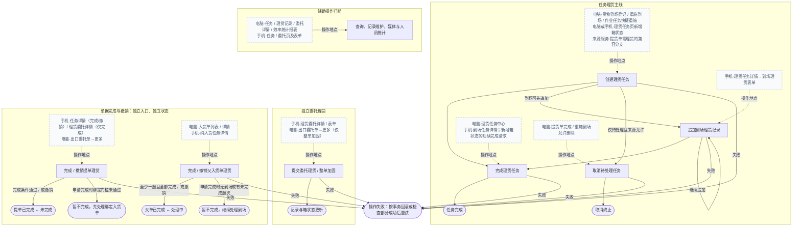

# 理货：开发测试功能说明

先看第2节总览图，再按主流程分组的七列表理解每一步做什么、在哪里做、如何推进、改变什么和何时结束；业务解析、入口和数据影响在同一行查看。第3节逐页查看按钮条件、关键规则和触发结果，第4～6节查字段、Map与可用条件，第7节找报表，第9节定位证据。后续AI读取独立的 [AI上下文](ai-context.md)，功能更新后同步本说明。

## 1. 模块范围

覆盖storage现有理货任务、理货记录、到场/提单/父入货单完成与撤销、直接委托理货、来源派单与取消、媒体及相关统计。关联来源业务仅覆盖理货衔接，不代表已分析全部来源CRUD、收费/退款或叉车/司机完整流程。

本次核对原138份证据指纹，补充18份共享查询、来源联动及表映射依据，定向复核逐表读写、条件性联动及事务边界。按最新skill先维护独立AI事实，再将52条差异入口展开为442条单表影响行；第2节图和表只展示业务名称，内部编号及逐表映射集中到第9节。其余字段、按钮、媒体及统计事实沿用同一指纹基线。源码含既有未提交的理货与报表改动；未运行页面、业务接口、数据库、迁移或业务测试。部署DDL、实际字典/配置、设备表现及角色岗位绑定均todo，静态推导的检查点不能写成业务验收通过。

电脑站内链接以后台应用根为基准，手机 `/pages/...` 是应用内路由。代码入口相对于本文目录为 `../../../../storage/web/...`；弹窗/抽屉以进入路径说明。菜单SQL与首页分组仅证明入口声明，不能直接证明真实岗位授权。

## 2. 业务流程

创建任务与完成任务构成任务主线，到场可先追加记录，来源收尾可取消待处理任务；委托直接理货、提单及父入货单的完成与撤销分别推进。

### 2.1 主业务流程总览

实线表示业务推进或分支；标有“操作地点”的灰色虚线仅说明在哪里操作。完整入口、条件性处理、逐表数据影响及后续去向见下方分组表。

### 2.2 主业务流程解析与数据影响

按主图顺序分组，同一步的差异入口和多表影响连续拆行，每行只列一张表；只读及条件性写入按行说明。全部表名均来自代码映射，库名、部署DDL和运行结果待核验；来源完整CRUD及收费写链、权限/配置/字典、框架审计和组件隐式翻译未全量分析，已确认的共享查询及来源衔接仍逐表保留。

#### 2.2.1 任务理货：创建、记录、完成与来源取消

| 业务动作 | 发起角色/来源 | 操作地点 | 业务解析 | 关联数据库/表 | 生成/变更的数据 | 结果与下一步 |
| --- | --- | --- | --- | --- | --- | --- |
| 来源业务生成理货任务 | 后台授权用户（具体岗位todo） | 电脑→出口业务→[货物到场登记](/export/cargo-arrival)→新增→保存 | 把本次货物到场纳入待处理理货；来源保存后按装箱或入库作业类型派单，此步只创建任务，不生成理货记录。登记保存构成到场理货来源。 | `ex_cargo_arrival`（新增） | 新增到场主记录并保存orderId或inboundRecordId及作业类型。 | 形成待处理到场任务 → 可先追加理货记录，也可直接完成本趟理货。 |
| 来源业务生成理货任务 | 后台授权用户（具体岗位todo） | 电脑→出口业务→[货物到场登记](/export/cargo-arrival)→新增→保存 | 来源业务生成理货任务过程中，仅提交明细时新增。 | `ex_cargo_arrival_item`（条件新增） | 有提交货物明细时新增到场货物行，以arrivalId关联本趟。 | 形成待处理到场任务 → 可先追加理货记录，也可直接完成本趟理货。 |
| 来源业务生成理货任务 | 后台授权用户（具体岗位todo） | 电脑→出口业务→[货物到场登记](/export/cargo-arrival)→新增→保存 | 选择委托单作为来源时验证存在。 | `ex_entrust_order`（读取） | 仅读取，无新增/变更。 | 形成待处理到场任务 → 可先追加理货记录，也可直接完成本趟理货。 |
| 来源业务生成理货任务 | 后台授权用户（具体岗位todo） | 电脑→出口业务→[货物到场登记](/export/cargo-arrival)→新增→保存 | 选择入货单作为来源时检查存在及可编辑。 | `ex_inbound_record`（读取） | 仅读取，无新增/变更。 | 形成待处理到场任务 → 可先追加理货记录，也可直接完成本趟理货。 |
| 来源业务生成理货任务 | 后台授权用户（具体岗位todo） | 电脑→出口业务→[货物到场登记](/export/cargo-arrival)→新增→保存 | 来源登记更新预约到场结果，不创建第二项理货任务。 | `tk_driver_arrival`（读取/更新） | 校验所选司机预约存在；登记保存后写arrivalStatus为登记默认到场状态、arrivalTime为当前时间。 | 形成待处理到场任务 → 可先追加理货记录，也可直接完成本趟理货。 |
| 来源业务生成理货任务 | 后台授权用户（具体岗位todo） | 电脑→出口业务→[货物到场登记](/export/cargo-arrival)→新增→保存 | 来源业务生成理货任务过程中，来源保存后派到场任务，不写理货记录。 | `tk_tally_task`（新增） | 新增arrival_loading或arrival_storage的pending任务，以sourceId关联本趟到场，生成任务ID及TT编号。 | 形成待处理到场任务 → 可先追加理货记录，也可直接完成本趟理货。 |
| 来源业务生成理货任务 | 后台授权用户（具体岗位todo） | 电脑→进口重箱到场 [代码入口](../../../../storage/web/plus-ui/src/views/storage/impot/heavyEntry/index.vue)→新增→选择安排掏箱→保存 | 为本次重箱到场安排掏箱理货；保存时选择安排掏箱才派单，暂不掏箱时可后续安排，落箱与掏箱各自推进。保存来源，并检查重复未完成到场。 | `im_heavy_entry`（读取/新增/条件更新） | 新增来源及变更前档案快照；来源落箱选择不需大叉时直接完成，另回填entryStatus=completed、entryTime及actualLocationIds；理货掏箱完成仍独立。 | 选择掏箱后形成待处理任务 → 到任务中心完成；落箱作业不因此完成。 |
| 来源业务生成理货任务 | 后台授权用户（具体岗位todo） | 电脑→进口重箱到场 [代码入口](../../../../storage/web/plus-ui/src/views/storage/impot/heavyEntry/index.vue)→新增→选择安排掏箱→保存 | 来源业务生成理货任务过程中，来源保存产生落箱作业，与掏箱理货独立。 | `tk_job_task`（读取/新增） | 新增关联来源的落箱任务；需大叉为pending并锁目标位，不需大叉为completed、finishMode=direct并写完成时间，双背保留任务组关联。 | 选择掏箱后形成待处理任务 → 到任务中心完成；落箱作业不因此完成。 |
| 来源业务生成理货任务 | 后台授权用户（具体岗位todo） | 电脑→进口重箱到场 [代码入口](../../../../storage/web/plus-ui/src/views/storage/impot/heavyEntry/index.vue)→新增→选择安排掏箱→保存 | 来源业务生成理货任务过程中，仅选择安排掏箱才派理货任务。 | `tk_tally_task`（读取/新增） | 选择unload_inbound时新增pending掏箱任务，以sourceType/sourceId、箱档案关联来源；检查同箱待执行和同源有效任务。 | 选择掏箱后形成待处理任务 → 到任务中心完成；落箱作业不因此完成。 |
| 来源业务生成理货任务 | 后台授权用户（具体岗位todo） | 电脑→进口重箱到场 [代码入口](../../../../storage/web/plus-ui/src/views/storage/impot/heavyEntry/index.vue)→新增→选择安排掏箱→保存 | 来源保存同时建立落箱作业，其创建会按是否需要大叉更新箱档案；与掏箱理货分别完成。 | `tk_container_profile`（读取/条件更新） | 锁定并校验档案；需大叉时bizStatus置doing并维护latest*，不需大叉的直接落箱更新在场/位置及latest*快照；未选位置时不占库位。 | 选择掏箱后形成待处理任务 → 到任务中心完成；落箱作业不因此完成。 |
| 来源业务生成理货任务 | 后台授权用户（具体岗位todo） | 电脑→进口重箱到场 [代码入口](../../../../storage/web/plus-ui/src/views/storage/impot/heavyEntry/index.vue)→新增→选择安排掏箱→保存 | 来源落箱直接完成才留结果。 | `tk_job_task_result`（条件新增） | 不需大叉直接完成时新增complete结果，以taskId归属落箱任务，保存直接完成方式及实际位置等结果JSON。 | 选择掏箱后形成待处理任务 → 到任务中心完成；落箱作业不因此完成。 |
| 来源业务生成理货任务 | 后台授权用户（具体岗位todo） | 电脑→进口重箱到场 [代码入口](../../../../storage/web/plus-ui/src/views/storage/impot/heavyEntry/index.vue)→新增→选择安排掏箱→保存 | 仅本次来源落箱直接完成时新增。 | `tk_container_timeline`（条件新增） | 直接落箱完成时追加箱状态/位置变化时间线，关联来源及操作人、事件时间。 | 选择掏箱后形成待处理任务 → 到任务中心完成；落箱作业不因此完成。 |
| 来源业务生成理货任务 | 后台授权用户（具体岗位todo） | 电脑→进口重箱到场 [代码入口](../../../../storage/web/plus-ui/src/views/storage/impot/heavyEntry/index.vue)→新增→选择安排掏箱→保存 | 来源作业创建维护全局车牌建议。 | `st_field_suggestion`（读取/条件新增/更新） | 车牌规范化后非空时，首次新增建议值且useCount=1；已有建议值则累计useCount，不存入本次理货记录。 | 选择掏箱后形成待处理任务 → 到任务中心完成；落箱作业不因此完成。 |
| 来源业务生成理货任务 | 后台授权用户（具体岗位todo） | 电脑→进口重箱到场 [代码入口](../../../../storage/web/plus-ui/src/views/storage/impot/heavyEntry/index.vue)→新增→选择安排掏箱→保存 | 来源业务生成理货任务过程中，核对来源进口委托存在。 | `im_entrust_order`（读取） | 仅读取，无新增/变更。 | 选择掏箱后形成待处理任务 → 到任务中心完成；落箱作业不因此完成。 |
| 来源业务生成理货任务 | 后台授权用户（具体岗位todo） | 电脑→进口重箱到场 [代码入口](../../../../storage/web/plus-ui/src/views/storage/impot/heavyEntry/index.vue)→新增→选择安排掏箱→保存 | 来源业务生成理货任务过程中，来源保存的到场状态联动。 | `im_entrust_order_container`（读取/条件更新） | 读取所选委托箱归属；来源保存后重算arrivalStatus，有变化才更新，理货任务本身不代表已落箱。 | 选择掏箱后形成待处理任务 → 到任务中心完成；落箱作业不因此完成。 |
| 来源业务生成理货任务 | 后台授权用户（具体岗位todo） | 电脑→进口重箱到场 [代码入口](../../../../storage/web/plus-ui/src/views/storage/impot/heavyEntry/index.vue)→新增→选择安排掏箱→保存 | 来源业务生成理货任务过程中，有dispatchId时校验提进口派车单、委托及箱归属。 | `im_pickup_dispatch`（读取） | 仅读取，无新增/变更。 | 选择掏箱后形成待处理任务 → 到任务中心完成；落箱作业不因此完成。 |
| 来源业务生成理货任务 | 后台授权用户（具体岗位todo） | 电脑→进口重箱到场 [代码入口](../../../../storage/web/plus-ui/src/views/storage/impot/heavyEntry/index.vue)→新增→选择安排掏箱→保存 | 来源业务生成理货任务过程中，有目标区位时验证存在。 | `st_location_zone`（读取） | 仅读取，无新增/变更。 | 选择掏箱后形成待处理任务 → 到任务中心完成；落箱作业不因此完成。 |
| 来源业务生成理货任务 | 后台授权用户（具体岗位todo） | 电脑→进口重箱到场 [代码入口](../../../../storage/web/plus-ui/src/views/storage/impot/heavyEntry/index.vue)→新增→选择安排掏箱→保存 | 来源落箱建任务时按执行方式锁定或占用库位，不把校验读取写成整个步骤只读。 | `st_storage_location`（读取/条件更新） | 验证库位有效、区位一致及可用；需大叉且有目标位时锁为locked并写占用归属，直接落箱有实际位置时占用为occupied；无位置不占用。 | 选择掏箱后形成待处理任务 → 到任务中心完成；落箱作业不因此完成。 |
| 来源业务生成理货任务 | 后台授权用户（具体岗位todo） | 电脑→过程跟踪→作业任务 [代码入口](../../../../storage/web/plus-ui/src/views/storage/tracking/jobTask/index.vue)→重箱到场→保存 | 从作业任务快捷登记重箱到场，复用同一来源表单及派单逻辑；只有选择安排掏箱才生成对应理货任务。保存来源，并检查重复未完成到场。 | `im_heavy_entry`（读取/新增/条件更新） | 新增来源及变更前档案快照；来源落箱选择不需大叉时直接完成，另回填entryStatus=completed、entryTime及actualLocationIds；理货掏箱完成仍独立。 | 来源登记及适用任务生成 → 分别处理落箱作业和掏箱理货。 |
| 来源业务生成理货任务 | 后台授权用户（具体岗位todo） | 电脑→过程跟踪→作业任务 [代码入口](../../../../storage/web/plus-ui/src/views/storage/tracking/jobTask/index.vue)→重箱到场→保存 | 来源业务生成理货任务过程中，来源保存产生落箱作业，与掏箱理货独立。 | `tk_job_task`（读取/新增） | 新增关联来源的落箱任务；需大叉为pending并锁目标位，不需大叉为completed、finishMode=direct并写完成时间，双背保留任务组关联。 | 来源登记及适用任务生成 → 分别处理落箱作业和掏箱理货。 |
| 来源业务生成理货任务 | 后台授权用户（具体岗位todo） | 电脑→过程跟踪→作业任务 [代码入口](../../../../storage/web/plus-ui/src/views/storage/tracking/jobTask/index.vue)→重箱到场→保存 | 来源业务生成理货任务过程中，仅选择安排掏箱才派理货任务。 | `tk_tally_task`（读取/新增） | 选择unload_inbound时新增pending掏箱任务，以sourceType/sourceId、箱档案关联来源；检查同箱待执行和同源有效任务。 | 来源登记及适用任务生成 → 分别处理落箱作业和掏箱理货。 |
| 来源业务生成理货任务 | 后台授权用户（具体岗位todo） | 电脑→过程跟踪→作业任务 [代码入口](../../../../storage/web/plus-ui/src/views/storage/tracking/jobTask/index.vue)→重箱到场→保存 | 来源保存同时建立落箱作业，其创建会按是否需要大叉更新箱档案；与掏箱理货分别完成。 | `tk_container_profile`（读取/条件更新） | 锁定并校验档案；需大叉时bizStatus置doing并维护latest*，不需大叉的直接落箱更新在场/位置及latest*快照；未选位置时不占库位。 | 来源登记及适用任务生成 → 分别处理落箱作业和掏箱理货。 |
| 来源业务生成理货任务 | 后台授权用户（具体岗位todo） | 电脑→过程跟踪→作业任务 [代码入口](../../../../storage/web/plus-ui/src/views/storage/tracking/jobTask/index.vue)→重箱到场→保存 | 来源落箱直接完成才留结果。 | `tk_job_task_result`（条件新增） | 不需大叉直接完成时新增complete结果，以taskId归属落箱任务，保存直接完成方式及实际位置等结果JSON。 | 来源登记及适用任务生成 → 分别处理落箱作业和掏箱理货。 |
| 来源业务生成理货任务 | 后台授权用户（具体岗位todo） | 电脑→过程跟踪→作业任务 [代码入口](../../../../storage/web/plus-ui/src/views/storage/tracking/jobTask/index.vue)→重箱到场→保存 | 仅本次来源落箱直接完成时新增。 | `tk_container_timeline`（条件新增） | 直接落箱完成时追加箱状态/位置变化时间线，关联来源及操作人、事件时间。 | 来源登记及适用任务生成 → 分别处理落箱作业和掏箱理货。 |
| 来源业务生成理货任务 | 后台授权用户（具体岗位todo） | 电脑→过程跟踪→作业任务 [代码入口](../../../../storage/web/plus-ui/src/views/storage/tracking/jobTask/index.vue)→重箱到场→保存 | 来源作业创建维护全局车牌建议。 | `st_field_suggestion`（读取/条件新增/更新） | 车牌规范化后非空时，首次新增建议值且useCount=1；已有建议值则累计useCount，不存入本次理货记录。 | 来源登记及适用任务生成 → 分别处理落箱作业和掏箱理货。 |
| 来源业务生成理货任务 | 后台授权用户（具体岗位todo） | 电脑→过程跟踪→作业任务 [代码入口](../../../../storage/web/plus-ui/src/views/storage/tracking/jobTask/index.vue)→重箱到场→保存 | 来源业务生成理货任务过程中，核对来源进口委托存在。 | `im_entrust_order`（读取） | 仅读取，无新增/变更。 | 来源登记及适用任务生成 → 分别处理落箱作业和掏箱理货。 |
| 来源业务生成理货任务 | 后台授权用户（具体岗位todo） | 电脑→过程跟踪→作业任务 [代码入口](../../../../storage/web/plus-ui/src/views/storage/tracking/jobTask/index.vue)→重箱到场→保存 | 来源业务生成理货任务过程中，来源保存的到场状态联动。 | `im_entrust_order_container`（读取/条件更新） | 读取所选委托箱归属；来源保存后重算arrivalStatus，有变化才更新，理货任务本身不代表已落箱。 | 来源登记及适用任务生成 → 分别处理落箱作业和掏箱理货。 |
| 来源业务生成理货任务 | 后台授权用户（具体岗位todo） | 电脑→过程跟踪→作业任务 [代码入口](../../../../storage/web/plus-ui/src/views/storage/tracking/jobTask/index.vue)→重箱到场→保存 | 快捷来源保存时，有dispatchId时校验派车单、委托和箱归属。 | `im_pickup_dispatch`（读取） | 仅读取，无新增/变更。 | 来源登记及适用任务生成 → 分别处理落箱作业和掏箱理货。 |
| 来源业务生成理货任务 | 后台授权用户（具体岗位todo） | 电脑→过程跟踪→作业任务 [代码入口](../../../../storage/web/plus-ui/src/views/storage/tracking/jobTask/index.vue)→重箱到场→保存 | 快捷来源保存时，有目标区位时验证存在。 | `st_location_zone`（读取） | 仅读取，无新增/变更。 | 来源登记及适用任务生成 → 分别处理落箱作业和掏箱理货。 |
| 来源业务生成理货任务 | 后台授权用户（具体岗位todo） | 电脑→过程跟踪→作业任务 [代码入口](../../../../storage/web/plus-ui/src/views/storage/tracking/jobTask/index.vue)→重箱到场→保存 | 来源落箱建任务时按执行方式锁定或占用库位，不把校验读取写成整个步骤只读。 | `st_storage_location`（读取/条件更新） | 验证库位有效、区位一致及可用；需大叉且有目标位时锁为locked并写占用归属，直接落箱有实际位置时占用为occupied；无位置不占用。 | 来源登记及适用任务生成 → 分别处理落箱作业和掏箱理货。 |
| 来源业务生成理货任务 | 后台授权用户（具体岗位todo） | 电脑→重箱到场 [代码入口](../../../../storage/web/plus-ui/src/views/storage/impot/heavyEntry/index.vue)→安排掏箱 | 对已有重箱到场补充安排掏箱；锁定来源并检查同源有效任务及同箱待执行掏箱任务，防止重复安排。现有来源补安排掏箱。 | `im_heavy_entry`（读取/更新） | 读取并锁定已有来源，安排成功后inboundType改为unload_inbound。 | 形成待处理掏箱任务 → 到任务中心完成；原落箱执行状态独立。 |
| 来源业务生成理货任务 | 后台授权用户（具体岗位todo） | 电脑→重箱到场 [代码入口](../../../../storage/web/plus-ui/src/views/storage/impot/heavyEntry/index.vue)→安排掏箱 | 来源业务生成理货任务过程中，重复安排被拒绝。 | `tk_tally_task`（读取/新增） | 校验同源有效任务及同箱待执行掏箱任务，新增unload_inbound/pending任务并关联来源和箱档案。 | 形成待处理掏箱任务 → 到任务中心完成；原落箱执行状态独立。 |
| 来源业务生成理货任务 | 后台授权用户（具体岗位todo） | 电脑→重箱到场 [代码入口](../../../../storage/web/plus-ui/src/views/storage/impot/heavyEntry/index.vue)→安排掏箱 | 来源业务生成理货任务过程中，锁定来源真实箱档案。 | `tk_container_profile`（读取） | 仅读取，无新增/变更。 | 形成待处理掏箱任务 → 到任务中心完成；原落箱执行状态独立。 |
| 来源业务生成理货任务 | 后台授权用户（具体岗位todo） | 电脑→重箱到场 [代码入口](../../../../storage/web/plus-ui/src/views/storage/impot/heavyEntry/index.vue)→安排掏箱 | 来源业务生成理货任务过程中，旧来源未明确orderContainerId时解析历史关联箱档案。 | `im_entrust_order_container`（读取） | 仅读取，无新增/变更。 | 形成待处理掏箱任务 → 到任务中心完成；原落箱执行状态独立。 |
| 来源业务生成理货任务 | 来源服务兼容调用者（后台身份与权限需合法，正常yes页面未发现） | 自动触发代码 [代码入口](../../../../storage/web/ruoyi-modules/st-storage/src/main/java/com/i4h2/storage/impot/pickuporder/service/impl/ImPickupOrderServiceImpl.java)；电脑提货表单 [代码入口](../../../../storage/web/plus-ui/src/views/storage/impot/pickupOrder/form.vue)固定no | 兼容来源请求声明需要理货时派发提货出库理货；当前正常新增页面固定为不需要理货，不从该控件启用派单。仅追踪来源及理货派单，完整收费写链另属提货模块。 | `im_pickup_order`（新增） | 保存来源提货单及needTally；当前正常页面固定no，兼容请求可为yes。 | 兼容分支形成待处理出库任务 → 后续理货；正常页面新增不派理货任务。 |
| 来源业务生成理货任务 | 来源服务兼容调用者（后台身份与权限需合法，正常yes页面未发现） | 自动触发代码 [代码入口](../../../../storage/web/ruoyi-modules/st-storage/src/main/java/com/i4h2/storage/impot/pickuporder/service/impl/ImPickupOrderServiceImpl.java)；电脑提货表单 [代码入口](../../../../storage/web/plus-ui/src/views/storage/impot/pickupOrder/form.vue)固定no | 来源业务生成理货任务过程中，来源保存提货明细。 | `im_pickup_order_item`（条件新增） | 有itemList时新增提货行，以pickupOrderId关联来源单。 | 兼容分支形成待处理出库任务 → 后续理货；正常页面新增不派理货任务。 |
| 来源业务生成理货任务 | 来源服务兼容调用者（后台身份与权限需合法，正常yes页面未发现） | 自动触发代码 [代码入口](../../../../storage/web/ruoyi-modules/st-storage/src/main/java/com/i4h2/storage/impot/pickuporder/service/impl/ImPickupOrderServiceImpl.java)；电脑提货表单 [代码入口](../../../../storage/web/plus-ui/src/views/storage/impot/pickupOrder/form.vue)固定no | 来源业务生成理货任务过程中，有提货计划ID时检查计划状态并补充来源委托。 | `im_pickup_plan`（读取） | 仅读取，无新增/变更。 | 兼容分支形成待处理出库任务 → 后续理货；正常页面新增不派理货任务。 |
| 来源业务生成理货任务 | 来源服务兼容调用者（后台身份与权限需合法，正常yes页面未发现） | 自动触发代码 [代码入口](../../../../storage/web/ruoyi-modules/st-storage/src/main/java/com/i4h2/storage/impot/pickuporder/service/impl/ImPickupOrderServiceImpl.java)；电脑提货表单 [代码入口](../../../../storage/web/plus-ui/src/views/storage/impot/pickupOrder/form.vue)固定no | 来源业务生成理货任务过程中，校验司机预约存在。 | `tk_driver_arrival`（读取） | 仅读取，无新增/变更。 | 兼容分支形成待处理出库任务 → 后续理货；正常页面新增不派理货任务。 |
| 来源业务生成理货任务 | 来源服务兼容调用者（后台身份与权限需合法，正常yes页面未发现） | 自动触发代码 [代码入口](../../../../storage/web/ruoyi-modules/st-storage/src/main/java/com/i4h2/storage/impot/pickuporder/service/impl/ImPickupOrderServiceImpl.java)；电脑提货表单 [代码入口](../../../../storage/web/plus-ui/src/views/storage/impot/pickupOrder/form.vue)固定no | 来源业务生成理货任务过程中，正常页面no不派单，yes仅服务兼容分支。 | `tk_tally_task`（条件新增） | 仅needTally=yes时新增pickup_outbound/pending任务，以sourceType/sourceId关联提货单。 | 兼容分支形成待处理出库任务 → 后续理货；正常页面新增不派理货任务。 |
| 创建箱号状态任务 | 后台授权用户（具体岗位todo） | 电脑→过程跟踪→理货任务中心 [代码入口](../../../../storage/web/plus-ui/src/views/storage/tracking/tallyTask/index.vue)→箱号状态更新→创建确定 | 直接为选定箱档案建立状态更新作业，创建时先形成待处理任务，尚未执行箱状态变更。仅创建待处理状态更新任务。 | `tk_tally_task`（新增） | 新增container_status/pending任务，保存所选containerProfileId及TT编号，不在创建请求写完成子项。 | 创建后可从任务中心完成 → 完成前保持待处理。 |
| 创建箱号状态任务 | 后台授权用户（具体岗位todo） | 电脑→过程跟踪→理货任务中心 [代码入口](../../../../storage/web/plus-ui/src/views/storage/tracking/tallyTask/index.vue)→箱号状态更新→创建确定 | 创建箱号状态任务过程中，表单选择箱档案时读取；创建接口本身不等于统一箱有效性校验。 | `tk_container_profile`（读取） | 仅读取，无新增/变更。 | 创建后可从任务中心完成 → 完成前保持待处理。 |
| 创建箱号状态任务 | 手机系统登录用户（首页“理货员”入口分组，岗位授权todo） | 手机→首页理货员分组→理货任务（应用内 `/pages/tally/tallyTask/index`）→新增→提交 | 为选定箱档案更新状态，手机提交依次请求创建和完成；两个请求不属于同一事务。仅创建待处理状态更新任务。 | `tk_tally_task`（新增） | 新增container_status/pending任务，保存所选containerProfileId及TT编号，不在创建请求写完成子项。 | 第二请求成功后任务结束；失败则已建任务保留待处理，检查后再恢复处理。 |
| 创建箱号状态任务 | 手机系统登录用户（首页“理货员”入口分组，岗位授权todo） | 手机→首页理货员分组→理货任务（应用内 `/pages/tally/tallyTask/index`）→新增→提交 | 创建箱号状态任务过程中，表单选择箱档案时读取；创建接口本身不等于统一箱有效性校验。 | `tk_container_profile`（读取） | 仅读取，无新增/变更。 | 第二请求成功后任务结束；失败则已建任务保留待处理，检查后再恢复处理。 |
| 追加到场理货记录 | 手机系统登录用户（首页“理货员”入口分组，岗位授权todo） | 手机→理货任务卡片→详情（应用内 `/pages/tally/tallyTask/detail?taskId={任务ID}`）→更新理货状态→表单（应用内 `/pages/tally/tallyRecord/form?taskId={任务ID}`） | 在本趟到场处理中按箱、提单或无箱核对追加理货情况，可多次追加，也可不经追加直接完成本趟；手机多箱逐个请求，后续请求失败不撤销已成功部分。每箱独立请求可部分成功。 | `ex_tally_record`（新增） | 追加到场TR记录，以arrivalId归属本趟，保存本次件重尺、状态及媒体引用。 | 返回详情继续追加或完成本趟 → 本次追加不结束任务；部分失败先检查已保存记录再重试。 |
| 追加到场理货记录 | 手机系统登录用户（首页“理货员”入口分组，岗位授权todo） | 手机→理货任务卡片→详情（应用内 `/pages/tally/tallyTask/detail?taskId={任务ID}`）→更新理货状态→表单（应用内 `/pages/tally/tallyRecord/form?taskId={任务ID}`） | 追加到场理货记录过程中，仅提交核对行时写入。 | `ex_tally_record_item`（条件新增） | 有核对items时新增子行，以tallyRecordId关联本次记录。 | 返回详情继续追加或完成本趟 → 本次追加不结束任务；部分失败先检查已保存记录再重试。 |
| 追加到场理货记录 | 手机系统登录用户（首页“理货员”入口分组，岗位授权todo） | 手机→理货任务卡片→详情（应用内 `/pages/tally/tallyTask/detail?taskId={任务ID}`）→更新理货状态→表单（应用内 `/pages/tally/tallyRecord/form?taskId={任务ID}`） | 追加到场理货记录过程中，普通追加不统一结束任务或本趟。 | `ex_cargo_arrival`（读取/条件更新） | 验证本趟存在；仅新记录cargoCompleted=1时置tallyStatus=completed。 | 返回详情继续追加或完成本趟 → 本次追加不结束任务；部分失败先检查已保存记录再重试。 |
| 追加到场理货记录 | 手机系统登录用户（首页“理货员”入口分组，岗位授权todo） | 手机→理货任务卡片→详情（应用内 `/pages/tally/tallyTask/detail?taskId={任务ID}`）→更新理货状态→表单（应用内 `/pages/tally/tallyRecord/form?taskId={任务ID}`） | 追加到场理货记录过程中，有关联父单时检查可编辑。 | `ex_inbound_record`（读取） | 仅读取，无新增/变更。 | 返回详情继续追加或完成本趟 → 本次追加不结束任务；部分失败先检查已保存记录再重试。 |
| 追加到场理货记录 | 手机系统登录用户（首页“理货员”入口分组，岗位授权todo） | 手机→理货任务卡片→详情（应用内 `/pages/tally/tallyTask/detail?taskId={任务ID}`）→更新理货状态→表单（应用内 `/pages/tally/tallyRecord/form?taskId={任务ID}`） | 追加到场理货记录过程中，箱状态存在才联动，归属检查缺口仍保留。 | `ex_entrust_order_container`（读取/条件更新） | 记录有箱档案及非空状态且命中委托箱时，更新spreadStatus；spreadFinishTime为空才首次填入。 | 返回详情继续追加或完成本趟 → 本次追加不结束任务；部分失败先检查已保存记录再重试。 |
| 追加到场理货记录 | 手机系统登录用户（首页“理货员”入口分组，岗位授权todo） | 手机→理货任务卡片→详情（应用内 `/pages/tally/tallyTask/detail?taskId={任务ID}`）→更新理货状态→表单（应用内 `/pages/tally/tallyRecord/form?taskId={任务ID}`） | 追加到场理货记录过程中，有箱状态才更新。 | `tk_container_profile`（读取/条件更新） | 记录有箱档案和非空状态、且主档存在时更新bizStatus；本链不维护通用任务的全部latest*。 | 返回详情继续追加或完成本趟 → 本次追加不结束任务；部分失败先检查已保存记录再重试。 |
| 完成通用理货任务 | 后台授权用户（具体岗位todo） | 电脑→过程跟踪→理货任务中心 [代码入口](../../../../storage/web/plus-ui/src/views/storage/tracking/tallyTask/index.vue)→非到场完成任务→确定 | 结束待处理的非到场理货任务，按类型校验明细和提货行归属，再按来源回写；旧通用到场接口仍保留兼容行为，不等同于专用到场核对完成。读取并锁定任务后保存完成结果。 | `tk_tally_task`（读取/更新） | 待处理任务置completed，写finishTime及理货人，完成标记空值按0处理。 | 任务完成 → 查询结果；掏箱不等于落箱完成，提货库存仍由来源另行收尾。 |
| 完成通用理货任务 | 后台授权用户（具体岗位todo） | 电脑→过程跟踪→理货任务中心 [代码入口](../../../../storage/web/plus-ui/src/views/storage/tracking/tallyTask/index.vue)→非到场完成任务→确定 | 完成通用理货任务过程中，通用完成才建立任务子项。 | `tk_tally_task_item`（新增） | 按items逐项新增任务子项，以taskId关联当前任务，保存箱档案、状态及理货明细。 | 任务完成 → 查询结果；掏箱不等于落箱完成，提货库存仍由来源另行收尾。 |
| 完成通用理货任务 | 后台授权用户（具体岗位todo） | 电脑→过程跟踪→理货任务中心 [代码入口](../../../../storage/web/plus-ui/src/views/storage/tracking/tallyTask/index.vue)→非到场完成任务→确定 | 完成通用理货任务过程中，按来源分别处理箱档案，不能把所有分支都视为箱状态更新。 | `tk_container_profile`（读取/更新） | 读取/锁定涉及的箱档案；掏箱来源写bizStatus=empty_in_yard，独立箱状态写所选状态，两者维护latest*。旧到场有箱状态时只按记录链更新bizStatus；提货分支不据此更新箱状态。 | 任务完成 → 查询结果；掏箱不等于落箱完成，提货库存仍由来源另行收尾。 |
| 完成通用理货任务 | 后台授权用户（具体岗位todo） | 电脑→过程跟踪→理货任务中心 [代码入口](../../../../storage/web/plus-ui/src/views/storage/tracking/tallyTask/index.vue)→非到场完成任务→确定 | 完成通用理货任务过程中，只有掏箱或独立箱状态分支写tally_status事件；提货及旧到场记录链不写该事件。 | `tk_container_timeline`（新增） | 追加tally_status事件，保存箱档案、前后业务状态、来源taskId、操作人与事件时间。 | 任务完成 → 查询结果；掏箱不等于落箱完成，提货库存仍由来源另行收尾。 |
| 完成通用理货任务 | 后台授权用户（具体岗位todo） | 电脑→过程跟踪→理货任务中心 [代码入口](../../../../storage/web/plus-ui/src/views/storage/tracking/tallyTask/index.vue)→非到场完成任务→确定 | 完成通用理货任务过程中，进口掏箱遇历史关联ID时核对并解析真实箱档案。 | `im_entrust_order_container`（读取） | 仅读取，无新增/变更。 | 任务完成 → 查询结果；掏箱不等于落箱完成，提货库存仍由来源另行收尾。 |
| 完成通用理货任务 | 后台授权用户（具体岗位todo） | 电脑→过程跟踪→理货任务中心 [代码入口](../../../../storage/web/plus-ui/src/views/storage/tracking/tallyTask/index.vue)→非到场完成任务→确定 | 完成通用理货任务过程中，只有进口重箱掏箱来源才回写。 | `im_heavy_entry`（读取/更新） | 仅掏箱来源回填unloadTime，不修改落箱entryStatus。 | 任务完成 → 查询结果；掏箱不等于落箱完成，提货库存仍由来源另行收尾。 |
| 完成通用理货任务 | 后台授权用户（具体岗位todo） | 电脑→过程跟踪→理货任务中心 [代码入口](../../../../storage/web/plus-ui/src/views/storage/tracking/tallyTask/index.vue)→非到场完成任务→确定 | 完成通用理货任务过程中，仅提货来源，不在这里累计出库库存。 | `im_pickup_order`（读取/更新） | 提货来源单据未completed时置pickupStatus=tally_completed；已收尾则跳过回写。 | 任务完成 → 查询结果；掏箱不等于落箱完成，提货库存仍由来源另行收尾。 |
| 完成通用理货任务 | 后台授权用户（具体岗位todo） | 电脑→过程跟踪→理货任务中心 [代码入口](../../../../storage/web/plus-ui/src/views/storage/tracking/tallyTask/index.vue)→非到场完成任务→确定 | 完成通用理货任务过程中，仅提货来源有对应提货行才回写。 | `im_pickup_order_item`（读取/更新） | 按itemId校验归属；提货单未收尾时回填对应pickupPieces及pickupWeight，不按同箱号覆盖其他行。 | 任务完成 → 查询结果；掏箱不等于落箱完成，提货库存仍由来源另行收尾。 |
| 完成通用理货任务 | 后台授权用户（具体岗位todo） | 电脑→过程跟踪→理货任务中心 [代码入口](../../../../storage/web/plus-ui/src/views/storage/tracking/tallyTask/index.vue)→非到场完成任务→确定 | 完成通用理货任务过程中，仅旧到场通用兼容分支。 | `ex_cargo_arrival`（读取/更新） | 旧到场通用请求的记录cargoCompleted=1时可将本趟tallyStatus置completed；不写专用核对完成链。 | 任务完成 → 查询结果；掏箱不等于落箱完成，提货库存仍由来源另行收尾。 |
| 完成通用理货任务 | 后台授权用户（具体岗位todo） | 电脑→过程跟踪→理货任务中心 [代码入口](../../../../storage/web/plus-ui/src/views/storage/tracking/tallyTask/index.vue)→非到场完成任务→确定 | 完成通用理货任务过程中，旧到场兼容分支检查父入货单可编辑。 | `ex_inbound_record`（读取） | 仅读取，无新增/变更。 | 任务完成 → 查询结果；掏箱不等于落箱完成，提货库存仍由来源另行收尾。 |
| 完成通用理货任务 | 后台授权用户（具体岗位todo） | 电脑→过程跟踪→理货任务中心 [代码入口](../../../../storage/web/plus-ui/src/views/storage/tracking/tallyTask/index.vue)→非到场完成任务→确定 | 完成通用理货任务过程中，仅旧到场通用兼容分支。 | `ex_tally_record`（新增） | 旧到场通用分支逐任务子项追加记录；cargoCompleted按任务arrivalCompleted回填，不追加专用到场完成日志。 | 任务完成 → 查询结果；掏箱不等于落箱完成，提货库存仍由来源另行收尾。 |
| 完成通用理货任务 | 后台授权用户（具体岗位todo） | 电脑→过程跟踪→理货任务中心 [代码入口](../../../../storage/web/plus-ui/src/views/storage/tracking/tallyTask/index.vue)→非到场完成任务→确定 | 完成通用理货任务过程中，仅旧到场记录有装箱状态时联动。 | `ex_entrust_order_container`（读取/更新） | 旧到场记录有箱与状态时更新spreadStatus，spreadFinishTime为空才首次补时间。 | 任务完成 → 查询结果；掏箱不等于落箱完成，提货库存仍由来源另行收尾。 |
| 完成通用理货任务 | 后台授权用户（具体岗位todo） | 电脑→过程跟踪→理货任务中心 [代码入口](../../../../storage/web/plus-ui/src/views/storage/tracking/tallyTask/index.vue)→非到场完成任务→确定 | 完成通用理货任务过程中，仅兼容分支，不代替专用提单绑定校验。 | `ex_entrust_order`（更新） | 旧到场通用分支任务cargoCompleted=1且有直接委托时，置receiveStatus=completed。 | 任务完成 → 查询结果；掏箱不等于落箱完成，提货库存仍由来源另行收尾。 |
| 完成通用理货任务 | 手机系统登录用户（首页“理货员”入口分组，岗位授权todo） | 手机→首页理货员分组→理货任务（应用内 `/pages/tally/tallyTask/index`）→新增箱状态→提交（创建后连续完成） | 接续手机新增箱状态任务的第二个请求；任务须待处理且明细有效，完成时更新对应箱状态。读取并锁定任务后保存完成结果。 | `tk_tally_task`（读取/更新） | 待处理任务置completed，写finishTime及理货人，完成标记空值按0处理。 | 任务及箱状态更新后本次操作结束；失败不回滚前一请求已建的待处理任务。 |
| 完成通用理货任务 | 手机系统登录用户（首页“理货员”入口分组，岗位授权todo） | 手机→首页理货员分组→理货任务（应用内 `/pages/tally/tallyTask/index`）→新增箱状态→提交（创建后连续完成） | 完成通用理货任务过程中，通用完成才建立任务子项。 | `tk_tally_task_item`（新增） | 按items逐项新增任务子项，以taskId关联当前任务，保存箱档案、状态及理货明细。 | 任务及箱状态更新后本次操作结束；失败不回滚前一请求已建的待处理任务。 |
| 完成通用理货任务 | 手机系统登录用户（首页“理货员”入口分组，岗位授权todo） | 手机→首页理货员分组→理货任务（应用内 `/pages/tally/tallyTask/index`）→新增箱状态→提交（创建后连续完成） | 完成通用理货任务过程中，箱状态任务锁箱并更新主档。 | `tk_container_profile`（读取/更新） | 写bizStatus及latestTaskId、latestOperatorId/Name、latestUpdateTime；空白状态不覆盖原bizStatus。 | 任务及箱状态更新后本次操作结束；失败不回滚前一请求已建的待处理任务。 |
| 完成通用理货任务 | 手机系统登录用户（首页“理货员”入口分组，岗位授权todo） | 手机→首页理货员分组→理货任务（应用内 `/pages/tally/tallyTask/index`）→新增箱状态→提交（创建后连续完成） | 完成通用理货任务过程中，通用箱状态完成保留时间线。 | `tk_container_timeline`（新增） | 追加tally_status事件，保存箱档案、前后业务状态、来源taskId、操作人与事件时间。 | 任务及箱状态更新后本次操作结束；失败不回滚前一请求已建的待处理任务。 |
| 完成本趟到场理货 | 后台授权用户（具体岗位todo） | 电脑→过程跟踪→理货任务中心 [代码入口](../../../../storage/web/plus-ui/src/views/storage/tracking/tallyTask/index.vue)→到场完成任务→确认/核对/位置 | 结束本趟到场理货，须任务未完成、未取消且父入货单可编辑；按配置核对，差异不阻断，纯入货单路径免位置，其他到场入库需位置。锁定并校验本趟任务；完成本趟后记录任务结果。 | `tk_tally_task`（读取/更新） | taskStatus置completed、arrivalCompleted置1，并写理货人及finishTime。 | 本趟及任务完成 → 按需要独立处理父入货单或提单；失败按本次事务回滚，不自动完成提单。 |
| 完成本趟到场理货 | 后台授权用户（具体岗位todo） | 电脑→过程跟踪→理货任务中心 [代码入口](../../../../storage/web/plus-ui/src/views/storage/tracking/tallyTask/index.vue)→到场完成任务→确认/核对/位置 | 完成本趟到场理货过程中，读取本趟并结束到场理货；汇总时还读取同入货单其他趟。 | `ex_cargo_arrival`（读取/更新） | 本趟tallyStatus置completed；关联本趟与入货单的主键不变。 | 本趟及任务完成 → 按需要独立处理父入货单或提单；失败按本次事务回滚，不自动完成提单。 |
| 完成本趟到场理货 | 后台授权用户（具体岗位todo） | 电脑→过程跟踪→理货任务中心 [代码入口](../../../../storage/web/plus-ui/src/views/storage/tracking/tallyTask/index.vue)→到场完成任务→确认/核对/位置 | 完成本趟到场理货过程中，有父入货单时检查可编辑，不在本步骤完成父单。 | `ex_inbound_record`（读取） | 仅读取，无新增/变更。 | 本趟及任务完成 → 按需要独立处理父入货单或提单；失败按本次事务回滚，不自动完成提单。 |
| 完成本趟到场理货 | 后台授权用户（具体岗位todo） | 电脑→过程跟踪→理货任务中心 [代码入口](../../../../storage/web/plus-ui/src/views/storage/tracking/tallyTask/index.vue)→到场完成任务→确认/核对/位置 | 完成本趟到场理货过程中，完成日志及条件性核对/位置记录同事务；无核对快照不等于已核对。 | `ex_tally_record`（读取/新增/更新） | 追加arrival_tally_completed完成日志；有核对提交时另建到场核对记录，符合配置时在完成日志保存arrivalSnapshotJson。现存本趟记录cargoCompleted置1，非纯入货的到场入库记录补storageLocation；必要时补位置记录。 | 本趟及任务完成 → 按需要独立处理父入货单或提单；失败按本次事务回滚，不自动完成提单。 |
| 完成本趟到场理货 | 后台授权用户（具体岗位todo） | 电脑→过程跟踪→理货任务中心 [代码入口](../../../../storage/web/plus-ui/src/views/storage/tracking/tallyTask/index.vue)→到场完成任务→确认/核对/位置 | 完成本趟到场理货过程中，有核对数据才新增；入货单合计读取同单各趟核对行。 | `ex_tally_record_item`（读取/新增） | 提交核对items时逐行新增，以tallyRecordId关联本次核对记录；有入货单汇总时读取既有核对子行。 | 本趟及任务完成 → 按需要独立处理父入货单或提单；失败按本次事务回滚，不自动完成提单。 |
| 完成本趟到场理货 | 后台授权用户（具体岗位todo） | 电脑→过程跟踪→理货任务中心 [代码入口](../../../../storage/web/plus-ui/src/views/storage/tracking/tallyTask/index.vue)→到场完成任务→确认/核对/位置 | 完成本趟到场理货过程中，无需核对且无需差异面板时读取本趟登记明细构造快照。 | `ex_cargo_arrival_item`（读取） | 仅读取，无新增/变更。 | 本趟及任务完成 → 按需要独立处理父入货单或提单；失败按本次事务回滚，不自动完成提单。 |
| 完成本趟到场理货 | 后台授权用户（具体岗位todo） | 电脑→过程跟踪→理货任务中心 [代码入口](../../../../storage/web/plus-ui/src/views/storage/tracking/tallyTask/index.vue)→到场完成任务→确认/核对/位置 | 完成本趟到场理货过程中，完成日志存在直接委托时验证委托存在。 | `ex_entrust_order`（读取） | 仅读取，无新增/变更。 | 本趟及任务完成 → 按需要独立处理父入货单或提单；失败按本次事务回滚，不自动完成提单。 |
| 完成本趟到场理货 | 后台授权用户（具体岗位todo） | 电脑→过程跟踪→理货任务中心 [代码入口](../../../../storage/web/plus-ui/src/views/storage/tracking/tallyTask/index.vue)→到场完成任务→确认/核对/位置 | 完成本趟到场理货过程中，存在父入货单时读取绑定委托，未绑定即不重建货物。 | `ex_entrust_inbound_rel`（读取） | 仅读取，无新增/变更。 | 本趟及任务完成 → 按需要独立处理父入货单或提单；失败按本次事务回滚，不自动完成提单。 |
| 完成本趟到场理货 | 后台授权用户（具体岗位todo） | 电脑→过程跟踪→理货任务中心 [代码入口](../../../../storage/web/plus-ui/src/views/storage/tracking/tallyTask/index.vue)→到场完成任务→确认/核对/位置 | 完成本趟到场理货过程中，存在绑定委托时读取父单登记货物基准。 | `ex_inbound_record_item`（读取） | 仅读取，无新增/变更。 | 本趟及任务完成 → 按需要独立处理父入货单或提单；失败按本次事务回滚，不自动完成提单。 |
| 完成本趟到场理货 | 后台授权用户（具体岗位todo） | 电脑→过程跟踪→理货任务中心 [代码入口](../../../../storage/web/plus-ui/src/views/storage/tracking/tallyTask/index.vue)→到场完成任务→确认/核对/位置 | 完成本趟到场理货过程中，仅绑定入货单的来源货物联动；该变更与本趟完成同事务。 | `ex_entrust_order_cargo_item`（逻辑删除/新增） | 有绑定委托时逻辑删除同orderId及inboundRecordId的原来源货物行，再按登记/核对合计重建；保留这两个归属键。 | 本趟及任务完成 → 按需要独立处理父入货单或提单；失败按本次事务回滚，不自动完成提单。 |
| 完成本趟到场理货 | 手机系统登录用户（首页“理货员”入口分组，岗位授权todo） | 手机→理货任务卡片→详情（应用内 `/pages/tally/tallyTask/detail?taskId={任务ID}`）→完成到场登记理货 | 结束本趟到场理货，须任务未完成、未取消且父入货单可编辑；按配置核对，差异不阻断，纯入货单路径免位置，其他到场入库需位置。锁定并校验本趟任务；完成本趟后记录任务结果。 | `tk_tally_task`（读取/更新） | taskStatus置completed、arrivalCompleted置1，并写理货人及finishTime。 | 本趟及任务完成 → 按需要独立处理父入货单或提单；失败按本次事务回滚，不自动完成提单。 |
| 完成本趟到场理货 | 手机系统登录用户（首页“理货员”入口分组，岗位授权todo） | 手机→理货任务卡片→详情（应用内 `/pages/tally/tallyTask/detail?taskId={任务ID}`）→完成到场登记理货 | 完成本趟到场理货过程中，读取本趟并结束到场理货；汇总时还读取同入货单其他趟。 | `ex_cargo_arrival`（读取/更新） | 本趟tallyStatus置completed；关联本趟与入货单的主键不变。 | 本趟及任务完成 → 按需要独立处理父入货单或提单；失败按本次事务回滚，不自动完成提单。 |
| 完成本趟到场理货 | 手机系统登录用户（首页“理货员”入口分组，岗位授权todo） | 手机→理货任务卡片→详情（应用内 `/pages/tally/tallyTask/detail?taskId={任务ID}`）→完成到场登记理货 | 完成本趟到场理货过程中，有父入货单时检查可编辑，不在本步骤完成父单。 | `ex_inbound_record`（读取） | 仅读取，无新增/变更。 | 本趟及任务完成 → 按需要独立处理父入货单或提单；失败按本次事务回滚，不自动完成提单。 |
| 完成本趟到场理货 | 手机系统登录用户（首页“理货员”入口分组，岗位授权todo） | 手机→理货任务卡片→详情（应用内 `/pages/tally/tallyTask/detail?taskId={任务ID}`）→完成到场登记理货 | 完成本趟到场理货过程中，完成日志及条件性核对/位置记录同事务；无核对快照不等于已核对。 | `ex_tally_record`（读取/新增/更新） | 追加arrival_tally_completed完成日志；有核对提交时另建到场核对记录，符合配置时在完成日志保存arrivalSnapshotJson。现存本趟记录cargoCompleted置1，非纯入货的到场入库记录补storageLocation；必要时补位置记录。 | 本趟及任务完成 → 按需要独立处理父入货单或提单；失败按本次事务回滚，不自动完成提单。 |
| 完成本趟到场理货 | 手机系统登录用户（首页“理货员”入口分组，岗位授权todo） | 手机→理货任务卡片→详情（应用内 `/pages/tally/tallyTask/detail?taskId={任务ID}`）→完成到场登记理货 | 完成本趟到场理货过程中，有核对数据才新增；入货单合计读取同单各趟核对行。 | `ex_tally_record_item`（读取/新增） | 提交核对items时逐行新增，以tallyRecordId关联本次核对记录；有入货单汇总时读取既有核对子行。 | 本趟及任务完成 → 按需要独立处理父入货单或提单；失败按本次事务回滚，不自动完成提单。 |
| 完成本趟到场理货 | 手机系统登录用户（首页“理货员”入口分组，岗位授权todo） | 手机→理货任务卡片→详情（应用内 `/pages/tally/tallyTask/detail?taskId={任务ID}`）→完成到场登记理货 | 完成本趟到场理货过程中，无需核对且无需差异面板时读取本趟登记明细构造快照。 | `ex_cargo_arrival_item`（读取） | 仅读取，无新增/变更。 | 本趟及任务完成 → 按需要独立处理父入货单或提单；失败按本次事务回滚，不自动完成提单。 |
| 完成本趟到场理货 | 手机系统登录用户（首页“理货员”入口分组，岗位授权todo） | 手机→理货任务卡片→详情（应用内 `/pages/tally/tallyTask/detail?taskId={任务ID}`）→完成到场登记理货 | 完成本趟到场理货过程中，完成日志存在直接委托时验证委托存在。 | `ex_entrust_order`（读取） | 仅读取，无新增/变更。 | 本趟及任务完成 → 按需要独立处理父入货单或提单；失败按本次事务回滚，不自动完成提单。 |
| 完成本趟到场理货 | 手机系统登录用户（首页“理货员”入口分组，岗位授权todo） | 手机→理货任务卡片→详情（应用内 `/pages/tally/tallyTask/detail?taskId={任务ID}`）→完成到场登记理货 | 完成本趟到场理货过程中，存在父入货单时读取绑定委托，未绑定即不重建货物。 | `ex_entrust_inbound_rel`（读取） | 仅读取，无新增/变更。 | 本趟及任务完成 → 按需要独立处理父入货单或提单；失败按本次事务回滚，不自动完成提单。 |
| 完成本趟到场理货 | 手机系统登录用户（首页“理货员”入口分组，岗位授权todo） | 手机→理货任务卡片→详情（应用内 `/pages/tally/tallyTask/detail?taskId={任务ID}`）→完成到场登记理货 | 完成本趟到场理货过程中，存在绑定委托时读取父单登记货物基准。 | `ex_inbound_record_item`（读取） | 仅读取，无新增/变更。 | 本趟及任务完成 → 按需要独立处理父入货单或提单；失败按本次事务回滚，不自动完成提单。 |
| 完成本趟到场理货 | 手机系统登录用户（首页“理货员”入口分组，岗位授权todo） | 手机→理货任务卡片→详情（应用内 `/pages/tally/tallyTask/detail?taskId={任务ID}`）→完成到场登记理货 | 完成本趟到场理货过程中，仅绑定入货单的来源货物联动；该变更与本趟完成同事务。 | `ex_entrust_order_cargo_item`（逻辑删除/新增） | 有绑定委托时逻辑删除同orderId及inboundRecordId的原来源货物行，再按登记/核对合计重建；保留这两个归属键。 | 本趟及任务完成 → 按需要独立处理父入货单或提单；失败按本次事务回滚，不自动完成提单。 |
| 批量完成理货 | 后台授权用户（具体岗位todo） | 电脑→过程跟踪→理货任务中心 [代码入口](../../../../storage/web/plus-ui/src/views/storage/tracking/tallyTask/index.vue)→勾选当前页→批量完成理货 | 批量完成理货过程中，批内任务按类型分支更新，同一个外层事务提交。 | `tk_tally_task`（读取/更新） | 非到场通用分支置completed、写完成人/时间，空白完成标记按0；到场专用分支置completed及arrivalCompleted=1并写人/时间。 | 全批成功后关闭、刷新并清选；任一失败整批回滚并保留草稿重试，提单和父单仍独立处理。 |
| 批量完成理货 | 后台授权用户（具体岗位todo） | 电脑→过程跟踪→理货任务中心 [代码入口](../../../../storage/web/plus-ui/src/views/storage/tracking/tallyTask/index.vue)→勾选当前页→批量完成理货 | 批量完成理货过程中，非到场才写任务子项。 | `tk_tally_task_item`（新增） | 仅非到场通用分支逐项新增任务子项，以taskId关联任务；到场专用分支不新增子项。 | 全批成功后关闭、刷新并清选；任一失败整批回滚并保留草稿重试，提单和父单仍独立处理。 |
| 批量完成理货 | 后台授权用户（具体岗位todo） | 电脑→过程跟踪→理货任务中心 [代码入口](../../../../storage/web/plus-ui/src/views/storage/tracking/tallyTask/index.vue)→勾选当前页→批量完成理货 | 批量完成理货过程中，只按非到场通用分支执行箱档案副作用。 | `tk_container_profile`（读取/条件更新） | 通用分支锁涉及箱档案；掏箱写empty_in_yard，独立箱状态写所选状态并维护latest*；提货及专用到场不因此更新箱状态。 | 全批成功后关闭、刷新并清选；任一失败整批回滚并保留草稿重试，提单和父单仍独立处理。 |
| 批量完成理货 | 后台授权用户（具体岗位todo） | 电脑→过程跟踪→理货任务中心 [代码入口](../../../../storage/web/plus-ui/src/views/storage/tracking/tallyTask/index.vue)→勾选当前页→批量完成理货 | 批量完成理货过程中，非到场且为掏箱/独立箱状态才写时间线。 | `tk_container_timeline`（条件新增） | 仅掏箱或独立箱状态任务追加tally_status事件，保存来源taskId、前后状态、人和时间。 | 全批成功后关闭、刷新并清选；任一失败整批回滚并保留草稿重试，提单和父单仍独立处理。 |
| 批量完成理货 | 后台授权用户（具体岗位todo） | 电脑→过程跟踪→理货任务中心 [代码入口](../../../../storage/web/plus-ui/src/views/storage/tracking/tallyTask/index.vue)→勾选当前页→批量完成理货 | 批量完成理货过程中，进口掏箱遇历史关联ID时核对并解析真实箱档案。 | `im_entrust_order_container`（读取） | 仅读取，无新增/变更。 | 全批成功后关闭、刷新并清选；任一失败整批回滚并保留草稿重试，提单和父单仍独立处理。 |
| 批量完成理货 | 后台授权用户（具体岗位todo） | 电脑→过程跟踪→理货任务中心 [代码入口](../../../../storage/web/plus-ui/src/views/storage/tracking/tallyTask/index.vue)→勾选当前页→批量完成理货 | 批量完成理货过程中，只有进口重箱掏箱来源才回写。 | `im_heavy_entry`（读取/更新） | 仅掏箱来源回填unloadTime，不修改落箱entryStatus。 | 全批成功后关闭、刷新并清选；任一失败整批回滚并保留草稿重试，提单和父单仍独立处理。 |
| 批量完成理货 | 后台授权用户（具体岗位todo） | 电脑→过程跟踪→理货任务中心 [代码入口](../../../../storage/web/plus-ui/src/views/storage/tracking/tallyTask/index.vue)→勾选当前页→批量完成理货 | 批量完成理货过程中，仅提货来源，不在这里累计出库库存。 | `im_pickup_order`（读取/更新） | 提货来源单据未completed时置pickupStatus=tally_completed；已收尾则跳过回写。 | 全批成功后关闭、刷新并清选；任一失败整批回滚并保留草稿重试，提单和父单仍独立处理。 |
| 批量完成理货 | 后台授权用户（具体岗位todo） | 电脑→过程跟踪→理货任务中心 [代码入口](../../../../storage/web/plus-ui/src/views/storage/tracking/tallyTask/index.vue)→勾选当前页→批量完成理货 | 批量完成理货过程中，仅提货来源有对应提货行才回写。 | `im_pickup_order_item`（读取/更新） | 按itemId校验归属；提货单未收尾时回填对应pickupPieces及pickupWeight，不按同箱号覆盖其他行。 | 全批成功后关闭、刷新并清选；任一失败整批回滚并保留草稿重试，提单和父单仍独立处理。 |
| 批量完成理货 | 后台授权用户（具体岗位todo） | 电脑→过程跟踪→理货任务中心 [代码入口](../../../../storage/web/plus-ui/src/views/storage/tracking/tallyTask/index.vue)→勾选当前页→批量完成理货 | 批量完成理货过程中，批内到场任务走专用完成，非到场不更新到场。 | `ex_cargo_arrival`（读取/更新） | 到场专用分支置本趟tallyStatus=completed，并读取同入货单到场范围用于汇总核对。 | 全批成功后关闭、刷新并清选；任一失败整批回滚并保留草稿重试，提单和父单仍独立处理。 |
| 批量完成理货 | 后台授权用户（具体岗位todo） | 电脑→过程跟踪→理货任务中心 [代码入口](../../../../storage/web/plus-ui/src/views/storage/tracking/tallyTask/index.vue)→勾选当前页→批量完成理货 | 批量完成理货过程中，批内到场来源检查父入货单可编辑，不在本批完成父单。 | `ex_inbound_record`（读取） | 仅读取，无新增/变更。 | 全批成功后关闭、刷新并清选；任一失败整批回滚并保留草稿重试，提单和父单仍独立处理。 |
| 批量完成理货 | 后台授权用户（具体岗位todo） | 电脑→过程跟踪→理货任务中心 [代码入口](../../../../storage/web/plus-ui/src/views/storage/tracking/tallyTask/index.vue)→勾选当前页→批量完成理货 | 批量完成理货过程中，仅批内到场专用链处理理货记录，其他任务不因此写到场日志。 | `ex_tally_record`（读取/新增/更新） | 到场专用分支追加arrival_tally_completed日志，条件新增核对/位置记录或快照；本趟现存记录cargoCompleted置1并按路径补位置。 | 全批成功后关闭、刷新并清选；任一失败整批回滚并保留草稿重试，提单和父单仍独立处理。 |
| 批量完成理货 | 后台授权用户（具体岗位todo） | 电脑→过程跟踪→理货任务中心 [代码入口](../../../../storage/web/plus-ui/src/views/storage/tracking/tallyTask/index.vue)→勾选当前页→批量完成理货 | 批量完成理货过程中，到场完成日志有直接委托时验证存在，本批不自动完成提单。 | `ex_entrust_order`（读取） | 仅读取，无新增/变更。 | 全批成功后关闭、刷新并清选；任一失败整批回滚并保留草稿重试，提单和父单仍独立处理。 |
| 批量完成理货 | 后台授权用户（具体岗位todo） | 电脑→过程跟踪→理货任务中心 [代码入口](../../../../storage/web/plus-ui/src/views/storage/tracking/tallyTask/index.vue)→勾选当前页→批量完成理货 | 批量完成理货过程中，有核对数据才新增；入货单合计读取同单各趟核对行。 | `ex_tally_record_item`（读取/新增） | 提交核对items时逐行新增，以tallyRecordId关联本次核对记录；有入货单汇总时读取既有核对子行。 | 全批成功后关闭、刷新并清选；任一失败整批回滚并保留草稿重试，提单和父单仍独立处理。 |
| 批量完成理货 | 后台授权用户（具体岗位todo） | 电脑→过程跟踪→理货任务中心 [代码入口](../../../../storage/web/plus-ui/src/views/storage/tracking/tallyTask/index.vue)→勾选当前页→批量完成理货 | 批量完成理货过程中，无需核对且无需差异面板时读取本趟登记明细构造快照。 | `ex_cargo_arrival_item`（读取） | 仅读取，无新增/变更。 | 全批成功后关闭、刷新并清选；任一失败整批回滚并保留草稿重试，提单和父单仍独立处理。 |
| 批量完成理货 | 后台授权用户（具体岗位todo） | 电脑→过程跟踪→理货任务中心 [代码入口](../../../../storage/web/plus-ui/src/views/storage/tracking/tallyTask/index.vue)→勾选当前页→批量完成理货 | 批量完成理货过程中，存在父入货单时读取绑定委托，未绑定即不重建货物。 | `ex_entrust_inbound_rel`（读取） | 仅读取，无新增/变更。 | 全批成功后关闭、刷新并清选；任一失败整批回滚并保留草稿重试，提单和父单仍独立处理。 |
| 批量完成理货 | 后台授权用户（具体岗位todo） | 电脑→过程跟踪→理货任务中心 [代码入口](../../../../storage/web/plus-ui/src/views/storage/tracking/tallyTask/index.vue)→勾选当前页→批量完成理货 | 批量完成理货过程中，存在绑定委托时读取父单登记货物基准。 | `ex_inbound_record_item`（读取） | 仅读取，无新增/变更。 | 全批成功后关闭、刷新并清选；任一失败整批回滚并保留草稿重试，提单和父单仍独立处理。 |
| 批量完成理货 | 后台授权用户（具体岗位todo） | 电脑→过程跟踪→理货任务中心 [代码入口](../../../../storage/web/plus-ui/src/views/storage/tracking/tallyTask/index.vue)→勾选当前页→批量完成理货 | 批量完成理货过程中，仅绑定入货单的来源货物联动；该变更与本趟完成同事务。 | `ex_entrust_order_cargo_item`（逻辑删除/新增） | 有绑定委托时逻辑删除同orderId及inboundRecordId的原来源货物行，再按登记/核对合计重建；保留这两个归属键。 | 全批成功后关闭、刷新并清选；任一失败整批回滚并保留草稿重试，提单和父单仍独立处理。 |
| 来源收尾取消待处理理货任务 | 后台来源操作触发的系统动作（岗位todo） | 电脑→提货单 [代码入口](../../../../storage/web/plus-ui/src/views/storage/impot/pickupOrder/index.vue)→提货完成→确认完成 | 由提货来源收尾结束剩余待理货工作，提货完成时仅取消该单待处理理货并累计出库库存；上传出库附件不触发此链。提货来源手动收尾。 | `im_pickup_order`（读取/更新） | 来源pickupStatus置completed，重复完成会被拒绝。 | 待处理理货取消，来源提货完成 → 来源流程结束；任务页没有普通取消按钮。 |
| 来源收尾取消待处理理货任务 | 后台来源操作触发的系统动作（岗位todo） | 电脑→提货单 [代码入口](../../../../storage/web/plus-ui/src/views/storage/impot/pickupOrder/index.vue)→提货完成→确认完成 | 来源收尾取消待处理理货任务过程中，来源收尾取消待理货工作。 | `tk_tally_task`（条件更新） | 仅相同来源单且taskStatus=pending的任务改cancelled，已完成任务不改。 | 待处理理货取消，来源提货完成 → 来源流程结束；任务页没有普通取消按钮。 |
| 来源收尾取消待处理理货任务 | 后台来源操作触发的系统动作（岗位todo） | 电脑→提货单 [代码入口](../../../../storage/web/plus-ui/src/views/storage/impot/pickupOrder/index.vue)→提货完成→确认完成 | 来源收尾取消待处理理货任务过程中，读取来源明细的箱档案和本次提货件重。 | `im_pickup_order_item`（读取） | 仅读取，无新增/变更。 | 待处理理货取消，来源提货完成 → 来源流程结束；任务页没有普通取消按钮。 |
| 来源收尾取消待处理理货任务 | 后台来源操作触发的系统动作（岗位todo） | 电脑→提货单 [代码入口](../../../../storage/web/plus-ui/src/views/storage/impot/pickupOrder/index.vue)→提货完成→确认完成 | 来源收尾取消待处理理货任务过程中，库存累计只在来源完成收尾执行。 | `im_entrust_order_container`（读取/更新） | 按明细箱档案匹配，累加outboundPieces及outboundWeight；空累计值按0起算。 | 待处理理货取消，来源提货完成 → 来源流程结束；任务页没有普通取消按钮。 |
| 来源收尾取消待处理理货任务 | 后台来源操作触发的系统动作（岗位todo） | 电脑→重箱到场 [代码入口](../../../../storage/web/plus-ui/src/views/storage/impot/heavyEntry/index.vue)→删除→原因/检查→确认 | 由允许删除的重箱来源终止待理货工作，全部删除检查通过且原因已填才取消待处理任务并回退来源；已有作业或完成理货等情况阻断删除。已完成理货等阻断时不执行删除。 | `tk_tally_task`（读取/条件更新） | 删除检查通过后，仅pending理货任务置cancelled并写删除原因摘要。 | 待处理理货取消，来源按删除规则回退 → 该来源流程终止；已作业阻断时不执行本次变更。 |
| 来源收尾取消待处理理货任务 | 后台来源操作触发的系统动作（岗位todo） | 电脑→重箱到场 [代码入口](../../../../storage/web/plus-ui/src/views/storage/impot/heavyEntry/index.vue)→删除→原因/检查→确认 | 来源收尾取消待处理理货任务过程中，来源删除取消作业。 | `tk_job_task`（读取/更新） | 来源落箱作业任务置cancelled并写resultSummary；读取剩余来源作业用于重算到场状态。 | 待处理理货取消，来源按删除规则回退 → 该来源流程终止；已作业阻断时不执行本次变更。 |
| 来源收尾取消待处理理货任务 | 后台来源操作触发的系统动作（岗位todo） | 电脑→重箱到场 [代码入口](../../../../storage/web/plus-ui/src/views/storage/impot/heavyEntry/index.vue)→删除→原因/检查→确认 | 来源收尾取消待处理理货任务过程中，来源通过允许删除检查后恢复快照。 | `tk_container_profile`（读取/更新） | 按变更前快照恢复业务/通用状态、区位、在离场时间及latestTaskId，更新本次操作人和时间。 | 待处理理货取消，来源按删除规则回退 → 该来源流程终止；已作业阻断时不执行本次变更。 |
| 来源收尾取消待处理理货任务 | 后台来源操作触发的系统动作（岗位todo） | 电脑→重箱到场 [代码入口](../../../../storage/web/plus-ui/src/views/storage/impot/heavyEntry/index.vue)→删除→原因/检查→确认 | 来源收尾取消待处理理货任务过程中，来源删除，不是删除理货记录。 | `im_heavy_entry`（读取/更新/逻辑删除） | 写入删除原因摘要后逻辑删除当前来源；读取该箱剩余有效到场用于重算。 | 待处理理货取消，来源按删除规则回退 → 该来源流程终止；已作业阻断时不执行本次变更。 |
| 来源收尾取消待处理理货任务 | 后台来源操作触发的系统动作（岗位todo） | 电脑→重箱到场 [代码入口](../../../../storage/web/plus-ui/src/views/storage/impot/heavyEntry/index.vue)→删除→原因/检查→确认 | 来源收尾取消待处理理货任务过程中，有orderContainerId时重算来源到场状态。 | `im_entrust_order_container`（读取/条件更新） | 按剩余来源和作业重算arrivalStatus；只在状态变化时更新。 | 待处理理货取消，来源按删除规则回退 → 该来源流程终止；已作业阻断时不执行本次变更。 |
| 来源收尾取消待处理理货任务 | 后台来源操作触发的系统动作（岗位todo） | 电脑→重箱到场 [代码入口](../../../../storage/web/plus-ui/src/views/storage/impot/heavyEntry/index.vue)→删除→原因/检查→确认 | 来源收尾取消待处理理货任务过程中，记录来源删除及恢复过程。 | `tk_container_timeline`（新增） | 追加entry_deleted事件，保存恢复前后状态/位置、来源、原因和操作人。 | 待处理理货取消，来源按删除规则回退 → 该来源流程终止；已作业阻断时不执行本次变更。 |
| 来源收尾取消待处理理货任务 | 后台来源操作触发的系统动作（岗位todo） | 电脑→重箱到场 [代码入口](../../../../storage/web/plus-ui/src/views/storage/impot/heavyEntry/index.vue)→删除→原因/检查→确认 | 来源收尾取消待处理理货任务过程中，只有存在占用且通过归属检查时释放。 | `st_storage_location`（读取/条件更新） | 存在本箱占用时按归属释放库位，未占用或归属不符的边界按库位服务检查。 | 待处理理货取消，来源按删除规则回退 → 该来源流程终止；已作业阻断时不执行本次变更。 |

#### 2.2.2 独立委托理货与整单加固

| 业务动作 | 发起角色/来源 | 操作地点 | 业务解析 | 关联数据库/表 | 生成/变更的数据 | 结果与下一步 |
| --- | --- | --- | --- | --- | --- | --- |
| 提交委托单理货 | 手机系统登录用户（首页“理货员”入口分组，岗位授权todo） | 手机→理货底部委托单→详情（应用内 `/pages/tally/entrustOrder/detail?id={委托ID}`）→按箱/按提单→表单（应用内 `/pages/tally/entrustOrder/form?orderId={委托ID}`）→提交 | 对已有委托按箱或整提单追加装箱理货，无须先创建任务；校验箱归属，同次多箱处于一个事务，历史删图另行即时请求，不随提交合并回滚。读取委托业务状态及理货要求。 | `ex_entrust_order`（读取） | 仅读取，无新增/变更。 | 本次记录和箱状态更新后可结束或继续追加；不创建/完成任务，也不自动完成提单。 |
| 提交委托单理货 | 手机系统登录用户（首页“理货员”入口分组，岗位授权todo） | 手机→理货底部委托单→详情（应用内 `/pages/tally/entrustOrder/detail?id={委托ID}`）→按箱/按提单→表单（应用内 `/pages/tally/entrustOrder/form?orderId={委托ID}`）→提交 | 提交委托单理货过程中，读取委托箱号和到场汇总；只处理本次有效箱。 | `ex_entrust_order_container`（读取/条件更新） | 对应委托箱spreadStatus改为本次状态，spreadFinishTime为空才首次填写；已加固/封箱在整单加固时跳过。 | 本次记录和箱状态更新后可结束或继续追加；不创建/完成任务，也不自动完成提单。 |
| 提交委托单理货 | 手机系统登录用户（首页“理货员”入口分组，岗位授权todo） | 手机→理货底部委托单→详情（应用内 `/pages/tally/entrustOrder/detail?id={委托ID}`）→按箱/按提单→表单（应用内 `/pages/tally/entrustOrder/form?orderId={委托ID}`）→提交 | 提交委托单理货过程中，有客户关联时补充客户名称。 | `st_customer`（读取） | 仅读取，无新增/变更。 | 本次记录和箱状态更新后可结束或继续追加；不创建/完成任务，也不自动完成提单。 |
| 提交委托单理货 | 手机系统登录用户（首页“理货员”入口分组，岗位授权todo） | 手机→理货底部委托单→详情（应用内 `/pages/tally/entrustOrder/detail?id={委托ID}`）→按箱/按提单→表单（应用内 `/pages/tally/entrustOrder/form?orderId={委托ID}`）→提交 | 提交委托单理货过程中，有联系人关联时补充联系人展示。 | `st_customer_contact`（读取） | 仅读取，无新增/变更。 | 本次记录和箱状态更新后可结束或继续追加；不创建/完成任务，也不自动完成提单。 |
| 提交委托单理货 | 手机系统登录用户（首页“理货员”入口分组，岗位授权todo） | 手机→理货底部委托单→详情（应用内 `/pages/tally/entrustOrder/detail?id={委托ID}`）→按箱/按提单→表单（应用内 `/pages/tally/entrustOrder/form?orderId={委托ID}`）→提交 | 提交委托单理货过程中，有查询/提箱场站关联时补充场站名称。 | `st_station`（读取） | 仅读取，无新增/变更。 | 本次记录和箱状态更新后可结束或继续追加；不创建/完成任务，也不自动完成提单。 |
| 提交委托单理货 | 手机系统登录用户（首页“理货员”入口分组，岗位授权todo） | 手机→理货底部委托单→详情（应用内 `/pages/tally/entrustOrder/detail?id={委托ID}`）→按箱/按提单→表单（应用内 `/pages/tally/entrustOrder/form?orderId={委托ID}`）→提交 | 提交委托单理货过程中，共享委托查询读取费用合计，费用业务写入不在本模块范围。 | `fi_expense`（读取） | 仅读取，无新增/变更。 | 本次记录和箱状态更新后可结束或继续追加；不创建/完成任务，也不自动完成提单。 |
| 提交委托单理货 | 手机系统登录用户（首页“理货员”入口分组，岗位授权todo） | 手机→理货底部委托单→详情（应用内 `/pages/tally/entrustOrder/detail?id={委托ID}`）→按箱/按提单→表单（应用内 `/pages/tally/entrustOrder/form?orderId={委托ID}`）→提交 | 提交委托单理货过程中，查询委托关联到场范围。 | `ex_cargo_arrival`（读取） | 仅读取，无新增/变更。 | 本次记录和箱状态更新后可结束或继续追加；不创建/完成任务，也不自动完成提单。 |
| 提交委托单理货 | 手机系统登录用户（首页“理货员”入口分组，岗位授权todo） | 手机→理货底部委托单→详情（应用内 `/pages/tally/entrustOrder/detail?id={委托ID}`）→按箱/按提单→表单（应用内 `/pages/tally/entrustOrder/form?orderId={委托ID}`）→提交 | 提交委托单理货过程中，读取最近理货人员及时间摘要；直接提交或整单加固的实际处理箱才追加。 | `ex_tally_record`（读取/新增） | 逐提交箱新增entrust_loading记录，以orderId及containerProfileId关联委托与箱；保存本次状态、件重尺及新增媒体引用。 | 本次记录和箱状态更新后可结束或继续追加；不创建/完成任务，也不自动完成提单。 |
| 提交委托单理货 | 手机系统登录用户（首页“理货员”入口分组，岗位授权todo） | 手机→理货底部委托单→详情（应用内 `/pages/tally/entrustOrder/detail?id={委托ID}`）→按箱/按提单→表单（应用内 `/pages/tally/entrustOrder/form?orderId={委托ID}`）→提交 | 提交委托单理货过程中，读取委托货物明细。 | `ex_entrust_order_cargo_item`（读取） | 仅读取，无新增/变更。 | 本次记录和箱状态更新后可结束或继续追加；不创建/完成任务，也不自动完成提单。 |
| 提交委托单理货 | 手机系统登录用户（首页“理货员”入口分组，岗位授权todo） | 手机→理货底部委托单→详情（应用内 `/pages/tally/entrustOrder/detail?id={委托ID}`）→按箱/按提单→表单（应用内 `/pages/tally/entrustOrder/form?orderId={委托ID}`）→提交 | 提交委托单理货过程中，委托详情补充订舱明细。 | `ex_entrust_order_booking_item`（读取） | 仅读取，无新增/变更。 | 本次记录和箱状态更新后可结束或继续追加；不创建/完成任务，也不自动完成提单。 |
| 提交委托单理货 | 手机系统登录用户（首页“理货员”入口分组，岗位授权todo） | 手机→理货底部委托单→详情（应用内 `/pages/tally/entrustOrder/detail?id={委托ID}`）→按箱/按提单→表单（应用内 `/pages/tally/entrustOrder/form?orderId={委托ID}`）→提交 | 提交委托单理货过程中，有箱档案时补充空箱到场时间。 | `ex_empty_entry`（读取） | 仅读取，无新增/变更。 | 本次记录和箱状态更新后可结束或继续追加；不创建/完成任务，也不自动完成提单。 |
| 提交委托单理货 | 手机系统登录用户（首页“理货员”入口分组，岗位授权todo） | 手机→理货底部委托单→详情（应用内 `/pages/tally/entrustOrder/detail?id={委托ID}`）→按箱/按提单→表单（应用内 `/pages/tally/entrustOrder/form?orderId={委托ID}`）→提交 | 提交委托单理货过程中，有箱档案时补充当前箱状态和位置；箱状态更新与本次多箱追加同事务。 | `tk_container_profile`（读取/条件更新） | 有档案且本次箱被处理时更新bizStatus；不维护通用任务使用的全部latest*。 | 本次记录和箱状态更新后可结束或继续追加；不创建/完成任务，也不自动完成提单。 |
| 提交委托单理货 | 手机系统登录用户（首页“理货员”入口分组，岗位授权todo） | 手机→理货底部委托单→详情（应用内 `/pages/tally/entrustOrder/detail?id={委托ID}`）→按箱/按提单→表单（应用内 `/pages/tally/entrustOrder/form?orderId={委托ID}`）→提交 | 提交委托单理货过程中，位置编码不在缓存且有有效位置ID时读取编码。 | `st_storage_location`（读取） | 仅读取，无新增/变更。 | 本次记录和箱状态更新后可结束或继续追加；不创建/完成任务，也不自动完成提单。 |
| 提交委托单理货 | 手机系统登录用户（首页“理货员”入口分组，岗位授权todo） | 手机→理货底部委托单→详情（应用内 `/pages/tally/entrustOrder/detail?id={委托ID}`）→按箱/按提单→表单（应用内 `/pages/tally/entrustOrder/form?orderId={委托ID}`）→提交 | 提交委托单理货过程中，读取委托绑定入货单的关系。 | `ex_entrust_inbound_rel`（读取） | 仅读取，无新增/变更。 | 本次记录和箱状态更新后可结束或继续追加；不创建/完成任务，也不自动完成提单。 |
| 提交委托单理货 | 手机系统登录用户（首页“理货员”入口分组，岗位授权todo） | 手机→理货底部委托单→详情（应用内 `/pages/tally/entrustOrder/detail?id={委托ID}`）→按箱/按提单→表单（应用内 `/pages/tally/entrustOrder/form?orderId={委托ID}`）→提交 | 提交委托单理货过程中，有绑定时读取父入货单状态及展示。 | `ex_inbound_record`（读取） | 仅读取，无新增/变更。 | 本次记录和箱状态更新后可结束或继续追加；不创建/完成任务，也不自动完成提单。 |
| 提交委托单理货 | 手机系统登录用户（首页“理货员”入口分组，岗位授权todo） | 手机→理货底部委托单→详情（应用内 `/pages/tally/entrustOrder/detail?id={委托ID}`）→按箱/按提单→表单（应用内 `/pages/tally/entrustOrder/form?orderId={委托ID}`）→提交 | 提交委托单理货过程中，有绑定时读取登记货物基准。 | `ex_inbound_record_item`（读取） | 仅读取，无新增/变更。 | 本次记录和箱状态更新后可结束或继续追加；不创建/完成任务，也不自动完成提单。 |
| 提交委托单理货 | 手机系统登录用户（首页“理货员”入口分组，岗位授权todo） | 手机→理货底部委托单→详情（应用内 `/pages/tally/entrustOrder/detail?id={委托ID}`）→按箱/按提单→表单（应用内 `/pages/tally/entrustOrder/form?orderId={委托ID}`）→提交 | 提交委托单理货过程中，有关联核对记录时读取核对子行合计。 | `ex_tally_record_item`（读取） | 仅读取，无新增/变更。 | 本次记录和箱状态更新后可结束或继续追加；不创建/完成任务，也不自动完成提单。 |
| 本单装箱完成或全部已加固 | 后台授权用户（具体岗位todo） | 电脑→出口业务→[出口委托单](/export/entrust-order)→更多→全部已加固 | 把已有委托中仍可处理的箱批量更新为已加固，是可独立发起的动作；跳过已封箱/已加固箱，需处理箱无档案或全单无可处理箱时拒绝。读取委托业务状态及理货要求。 | `ex_entrust_order`（读取） | 仅读取，无新增/变更。 | 本次加固后回详情检查；同次事务失败回滚，全部跳过时拒绝，不代表提单完成或放行。 |
| 本单装箱完成或全部已加固 | 后台授权用户（具体岗位todo） | 电脑→出口业务→[出口委托单](/export/entrust-order)→更多→全部已加固 | 本单装箱完成或全部已加固过程中，读取委托箱号和到场汇总；只处理本次有效箱。 | `ex_entrust_order_container`（读取/条件更新） | 对应委托箱spreadStatus改为本次状态，spreadFinishTime为空才首次填写；已加固/封箱在整单加固时跳过。 | 本次加固后回详情检查；同次事务失败回滚，全部跳过时拒绝，不代表提单完成或放行。 |
| 本单装箱完成或全部已加固 | 后台授权用户（具体岗位todo） | 电脑→出口业务→[出口委托单](/export/entrust-order)→更多→全部已加固 | 本单装箱完成或全部已加固过程中，有客户关联时补充客户名称。 | `st_customer`（读取） | 仅读取，无新增/变更。 | 本次加固后回详情检查；同次事务失败回滚，全部跳过时拒绝，不代表提单完成或放行。 |
| 本单装箱完成或全部已加固 | 后台授权用户（具体岗位todo） | 电脑→出口业务→[出口委托单](/export/entrust-order)→更多→全部已加固 | 本单装箱完成或全部已加固过程中，有联系人关联时补充联系人展示。 | `st_customer_contact`（读取） | 仅读取，无新增/变更。 | 本次加固后回详情检查；同次事务失败回滚，全部跳过时拒绝，不代表提单完成或放行。 |
| 本单装箱完成或全部已加固 | 后台授权用户（具体岗位todo） | 电脑→出口业务→[出口委托单](/export/entrust-order)→更多→全部已加固 | 本单装箱完成或全部已加固过程中，有查询/提箱场站关联时补充场站名称。 | `st_station`（读取） | 仅读取，无新增/变更。 | 本次加固后回详情检查；同次事务失败回滚，全部跳过时拒绝，不代表提单完成或放行。 |
| 本单装箱完成或全部已加固 | 后台授权用户（具体岗位todo） | 电脑→出口业务→[出口委托单](/export/entrust-order)→更多→全部已加固 | 本单装箱完成或全部已加固过程中，共享委托查询读取费用合计，费用业务写入不在本模块范围。 | `fi_expense`（读取） | 仅读取，无新增/变更。 | 本次加固后回详情检查；同次事务失败回滚，全部跳过时拒绝，不代表提单完成或放行。 |
| 本单装箱完成或全部已加固 | 后台授权用户（具体岗位todo） | 电脑→出口业务→[出口委托单](/export/entrust-order)→更多→全部已加固 | 本单装箱完成或全部已加固过程中，查询委托关联到场范围。 | `ex_cargo_arrival`（读取） | 仅读取，无新增/变更。 | 本次加固后回详情检查；同次事务失败回滚，全部跳过时拒绝，不代表提单完成或放行。 |
| 本单装箱完成或全部已加固 | 后台授权用户（具体岗位todo） | 电脑→出口业务→[出口委托单](/export/entrust-order)→更多→全部已加固 | 本单装箱完成或全部已加固过程中，读取最近理货人员及时间摘要；直接提交或整单加固的实际处理箱才追加。 | `ex_tally_record`（读取/新增） | 仅未sealed/reinforced且可处理的箱新增entrust_loading记录，packingStatus=reinforced，以orderId及containerProfileId归属；不生成任务子项。 | 本次加固后回详情检查；同次事务失败回滚，全部跳过时拒绝，不代表提单完成或放行。 |
| 本单装箱完成或全部已加固 | 后台授权用户（具体岗位todo） | 电脑→出口业务→[出口委托单](/export/entrust-order)→更多→全部已加固 | 本单装箱完成或全部已加固过程中，读取委托货物明细。 | `ex_entrust_order_cargo_item`（读取） | 仅读取，无新增/变更。 | 本次加固后回详情检查；同次事务失败回滚，全部跳过时拒绝，不代表提单完成或放行。 |
| 本单装箱完成或全部已加固 | 后台授权用户（具体岗位todo） | 电脑→出口业务→[出口委托单](/export/entrust-order)→更多→全部已加固 | 本单装箱完成或全部已加固过程中，委托详情补充订舱明细。 | `ex_entrust_order_booking_item`（读取） | 仅读取，无新增/变更。 | 本次加固后回详情检查；同次事务失败回滚，全部跳过时拒绝，不代表提单完成或放行。 |
| 本单装箱完成或全部已加固 | 后台授权用户（具体岗位todo） | 电脑→出口业务→[出口委托单](/export/entrust-order)→更多→全部已加固 | 本单装箱完成或全部已加固过程中，有箱档案时补充空箱到场时间。 | `ex_empty_entry`（读取） | 仅读取，无新增/变更。 | 本次加固后回详情检查；同次事务失败回滚，全部跳过时拒绝，不代表提单完成或放行。 |
| 本单装箱完成或全部已加固 | 后台授权用户（具体岗位todo） | 电脑→出口业务→[出口委托单](/export/entrust-order)→更多→全部已加固 | 本单装箱完成或全部已加固过程中，有箱档案时补充当前箱状态和位置；箱状态更新与本次多箱追加同事务。 | `tk_container_profile`（读取/条件更新） | 有档案且本次箱被处理时更新bizStatus；不维护通用任务使用的全部latest*。 | 本次加固后回详情检查；同次事务失败回滚，全部跳过时拒绝，不代表提单完成或放行。 |
| 本单装箱完成或全部已加固 | 后台授权用户（具体岗位todo） | 电脑→出口业务→[出口委托单](/export/entrust-order)→更多→全部已加固 | 本单装箱完成或全部已加固过程中，位置编码不在缓存且有有效位置ID时读取编码。 | `st_storage_location`（读取） | 仅读取，无新增/变更。 | 本次加固后回详情检查；同次事务失败回滚，全部跳过时拒绝，不代表提单完成或放行。 |
| 本单装箱完成或全部已加固 | 后台授权用户（具体岗位todo） | 电脑→出口业务→[出口委托单](/export/entrust-order)→更多→全部已加固 | 本单装箱完成或全部已加固过程中，读取委托绑定入货单的关系。 | `ex_entrust_inbound_rel`（读取） | 仅读取，无新增/变更。 | 本次加固后回详情检查；同次事务失败回滚，全部跳过时拒绝，不代表提单完成或放行。 |
| 本单装箱完成或全部已加固 | 后台授权用户（具体岗位todo） | 电脑→出口业务→[出口委托单](/export/entrust-order)→更多→全部已加固 | 本单装箱完成或全部已加固过程中，有绑定时读取父入货单状态及展示。 | `ex_inbound_record`（读取） | 仅读取，无新增/变更。 | 本次加固后回详情检查；同次事务失败回滚，全部跳过时拒绝，不代表提单完成或放行。 |
| 本单装箱完成或全部已加固 | 后台授权用户（具体岗位todo） | 电脑→出口业务→[出口委托单](/export/entrust-order)→更多→全部已加固 | 本单装箱完成或全部已加固过程中，有绑定时读取登记货物基准。 | `ex_inbound_record_item`（读取） | 仅读取，无新增/变更。 | 本次加固后回详情检查；同次事务失败回滚，全部跳过时拒绝，不代表提单完成或放行。 |
| 本单装箱完成或全部已加固 | 后台授权用户（具体岗位todo） | 电脑→出口业务→[出口委托单](/export/entrust-order)→更多→全部已加固 | 本单装箱完成或全部已加固过程中，有关联核对记录时读取核对子行合计。 | `ex_tally_record_item`（读取） | 仅读取，无新增/变更。 | 本次加固后回详情检查；同次事务失败回滚，全部跳过时拒绝，不代表提单完成或放行。 |
| 本单装箱完成或全部已加固 | 手机系统登录用户（首页“理货员”入口分组，岗位授权todo） | 手机→理货底部委托单→详情（应用内 `/pages/tally/entrustOrder/detail?id={委托ID}`）→本单装箱完成 | 把已有委托中仍可处理的箱批量更新为已加固，是可独立发起的动作；跳过已封箱/已加固箱，需处理箱无档案或全单无可处理箱时拒绝。读取委托业务状态及理货要求。 | `ex_entrust_order`（读取） | 仅读取，无新增/变更。 | 本次加固后回详情检查；同次事务失败回滚，全部跳过时拒绝，不代表提单完成或放行。 |
| 本单装箱完成或全部已加固 | 手机系统登录用户（首页“理货员”入口分组，岗位授权todo） | 手机→理货底部委托单→详情（应用内 `/pages/tally/entrustOrder/detail?id={委托ID}`）→本单装箱完成 | 本单装箱完成或全部已加固过程中，读取委托箱号和到场汇总；只处理本次有效箱。 | `ex_entrust_order_container`（读取/条件更新） | 对应委托箱spreadStatus改为本次状态，spreadFinishTime为空才首次填写；已加固/封箱在整单加固时跳过。 | 本次加固后回详情检查；同次事务失败回滚，全部跳过时拒绝，不代表提单完成或放行。 |
| 本单装箱完成或全部已加固 | 手机系统登录用户（首页“理货员”入口分组，岗位授权todo） | 手机→理货底部委托单→详情（应用内 `/pages/tally/entrustOrder/detail?id={委托ID}`）→本单装箱完成 | 本单装箱完成或全部已加固过程中，有客户关联时补充客户名称。 | `st_customer`（读取） | 仅读取，无新增/变更。 | 本次加固后回详情检查；同次事务失败回滚，全部跳过时拒绝，不代表提单完成或放行。 |
| 本单装箱完成或全部已加固 | 手机系统登录用户（首页“理货员”入口分组，岗位授权todo） | 手机→理货底部委托单→详情（应用内 `/pages/tally/entrustOrder/detail?id={委托ID}`）→本单装箱完成 | 本单装箱完成或全部已加固过程中，有联系人关联时补充联系人展示。 | `st_customer_contact`（读取） | 仅读取，无新增/变更。 | 本次加固后回详情检查；同次事务失败回滚，全部跳过时拒绝，不代表提单完成或放行。 |
| 本单装箱完成或全部已加固 | 手机系统登录用户（首页“理货员”入口分组，岗位授权todo） | 手机→理货底部委托单→详情（应用内 `/pages/tally/entrustOrder/detail?id={委托ID}`）→本单装箱完成 | 本单装箱完成或全部已加固过程中，有查询/提箱场站关联时补充场站名称。 | `st_station`（读取） | 仅读取，无新增/变更。 | 本次加固后回详情检查；同次事务失败回滚，全部跳过时拒绝，不代表提单完成或放行。 |
| 本单装箱完成或全部已加固 | 手机系统登录用户（首页“理货员”入口分组，岗位授权todo） | 手机→理货底部委托单→详情（应用内 `/pages/tally/entrustOrder/detail?id={委托ID}`）→本单装箱完成 | 本单装箱完成或全部已加固过程中，共享委托查询读取费用合计，费用业务写入不在本模块范围。 | `fi_expense`（读取） | 仅读取，无新增/变更。 | 本次加固后回详情检查；同次事务失败回滚，全部跳过时拒绝，不代表提单完成或放行。 |
| 本单装箱完成或全部已加固 | 手机系统登录用户（首页“理货员”入口分组，岗位授权todo） | 手机→理货底部委托单→详情（应用内 `/pages/tally/entrustOrder/detail?id={委托ID}`）→本单装箱完成 | 本单装箱完成或全部已加固过程中，查询委托关联到场范围。 | `ex_cargo_arrival`（读取） | 仅读取，无新增/变更。 | 本次加固后回详情检查；同次事务失败回滚，全部跳过时拒绝，不代表提单完成或放行。 |
| 本单装箱完成或全部已加固 | 手机系统登录用户（首页“理货员”入口分组，岗位授权todo） | 手机→理货底部委托单→详情（应用内 `/pages/tally/entrustOrder/detail?id={委托ID}`）→本单装箱完成 | 本单装箱完成或全部已加固过程中，读取最近理货人员及时间摘要；直接提交或整单加固的实际处理箱才追加。 | `ex_tally_record`（读取/新增） | 仅未sealed/reinforced且可处理的箱新增entrust_loading记录，packingStatus=reinforced，以orderId及containerProfileId归属；不生成任务子项。 | 本次加固后回详情检查；同次事务失败回滚，全部跳过时拒绝，不代表提单完成或放行。 |
| 本单装箱完成或全部已加固 | 手机系统登录用户（首页“理货员”入口分组，岗位授权todo） | 手机→理货底部委托单→详情（应用内 `/pages/tally/entrustOrder/detail?id={委托ID}`）→本单装箱完成 | 本单装箱完成或全部已加固过程中，读取委托货物明细。 | `ex_entrust_order_cargo_item`（读取） | 仅读取，无新增/变更。 | 本次加固后回详情检查；同次事务失败回滚，全部跳过时拒绝，不代表提单完成或放行。 |
| 本单装箱完成或全部已加固 | 手机系统登录用户（首页“理货员”入口分组，岗位授权todo） | 手机→理货底部委托单→详情（应用内 `/pages/tally/entrustOrder/detail?id={委托ID}`）→本单装箱完成 | 本单装箱完成或全部已加固过程中，委托详情补充订舱明细。 | `ex_entrust_order_booking_item`（读取） | 仅读取，无新增/变更。 | 本次加固后回详情检查；同次事务失败回滚，全部跳过时拒绝，不代表提单完成或放行。 |
| 本单装箱完成或全部已加固 | 手机系统登录用户（首页“理货员”入口分组，岗位授权todo） | 手机→理货底部委托单→详情（应用内 `/pages/tally/entrustOrder/detail?id={委托ID}`）→本单装箱完成 | 本单装箱完成或全部已加固过程中，有箱档案时补充空箱到场时间。 | `ex_empty_entry`（读取） | 仅读取，无新增/变更。 | 本次加固后回详情检查；同次事务失败回滚，全部跳过时拒绝，不代表提单完成或放行。 |
| 本单装箱完成或全部已加固 | 手机系统登录用户（首页“理货员”入口分组，岗位授权todo） | 手机→理货底部委托单→详情（应用内 `/pages/tally/entrustOrder/detail?id={委托ID}`）→本单装箱完成 | 本单装箱完成或全部已加固过程中，有箱档案时补充当前箱状态和位置；箱状态更新与本次多箱追加同事务。 | `tk_container_profile`（读取/条件更新） | 有档案且本次箱被处理时更新bizStatus；不维护通用任务使用的全部latest*。 | 本次加固后回详情检查；同次事务失败回滚，全部跳过时拒绝，不代表提单完成或放行。 |
| 本单装箱完成或全部已加固 | 手机系统登录用户（首页“理货员”入口分组，岗位授权todo） | 手机→理货底部委托单→详情（应用内 `/pages/tally/entrustOrder/detail?id={委托ID}`）→本单装箱完成 | 本单装箱完成或全部已加固过程中，位置编码不在缓存且有有效位置ID时读取编码。 | `st_storage_location`（读取） | 仅读取，无新增/变更。 | 本次加固后回详情检查；同次事务失败回滚，全部跳过时拒绝，不代表提单完成或放行。 |
| 本单装箱完成或全部已加固 | 手机系统登录用户（首页“理货员”入口分组，岗位授权todo） | 手机→理货底部委托单→详情（应用内 `/pages/tally/entrustOrder/detail?id={委托ID}`）→本单装箱完成 | 本单装箱完成或全部已加固过程中，读取委托绑定入货单的关系。 | `ex_entrust_inbound_rel`（读取） | 仅读取，无新增/变更。 | 本次加固后回详情检查；同次事务失败回滚，全部跳过时拒绝，不代表提单完成或放行。 |
| 本单装箱完成或全部已加固 | 手机系统登录用户（首页“理货员”入口分组，岗位授权todo） | 手机→理货底部委托单→详情（应用内 `/pages/tally/entrustOrder/detail?id={委托ID}`）→本单装箱完成 | 本单装箱完成或全部已加固过程中，有绑定时读取父入货单状态及展示。 | `ex_inbound_record`（读取） | 仅读取，无新增/变更。 | 本次加固后回详情检查；同次事务失败回滚，全部跳过时拒绝，不代表提单完成或放行。 |
| 本单装箱完成或全部已加固 | 手机系统登录用户（首页“理货员”入口分组，岗位授权todo） | 手机→理货底部委托单→详情（应用内 `/pages/tally/entrustOrder/detail?id={委托ID}`）→本单装箱完成 | 本单装箱完成或全部已加固过程中，有绑定时读取登记货物基准。 | `ex_inbound_record_item`（读取） | 仅读取，无新增/变更。 | 本次加固后回详情检查；同次事务失败回滚，全部跳过时拒绝，不代表提单完成或放行。 |
| 本单装箱完成或全部已加固 | 手机系统登录用户（首页“理货员”入口分组，岗位授权todo） | 手机→理货底部委托单→详情（应用内 `/pages/tally/entrustOrder/detail?id={委托ID}`）→本单装箱完成 | 本单装箱完成或全部已加固过程中，有关联核对记录时读取核对子行合计。 | `ex_tally_record_item`（读取） | 仅读取，无新增/变更。 | 本次加固后回详情检查；同次事务失败回滚，全部跳过时拒绝，不代表提单完成或放行。 |

#### 2.2.3 提单理货的完成与撤销

| 业务动作 | 发起角色/来源 | 操作地点 | 业务解析 | 关联数据库/表 | 生成/变更的数据 | 结果与下一步 |
| --- | --- | --- | --- | --- | --- | --- |
| 从任务完成提单入货 | 手机系统登录用户（首页“理货员”入口分组，岗位授权todo） | 手机→理货任务卡片→详情（应用内 `/pages/tally/tallyTask/detail?taskId={任务ID}`）→完成提单入货 | 从直接关联委托的到场任务确认提单入货结束；严格规则启用且有绑定时检查绑定入货单完成，无绑定旧路径放行，当前实现未统一要求本趟先完成，取消状态保护仍有缺口。从任务入口确认提单层完成。 | `tk_tally_task`（读取/更新） | 本任务cargoCompleted由未完成置1，不改taskStatus或arrivalCompleted。 | 提单完成并标记本任务 → 可独立撤销提单层；本趟、任务及箱状态不因此统一完成。 |
| 从任务完成提单入货 | 手机系统登录用户（首页“理货员”入口分组，岗位授权todo） | 手机→理货任务卡片→详情（应用内 `/pages/tally/tallyTask/detail?taskId={任务ID}`）→完成提单入货 | 从任务完成提单入货过程中，验证到场任务并取得直接关联委托或纯入货路径。 | `ex_cargo_arrival`（读取） | 仅读取，无新增/变更。 | 提单完成并标记本任务 → 可独立撤销提单层；本趟、任务及箱状态不因此统一完成。 |
| 从任务完成提单入货 | 手机系统登录用户（首页“理货员”入口分组，岗位授权todo） | 手机→理货任务卡片→详情（应用内 `/pages/tally/tallyTask/detail?taskId={任务ID}`）→完成提单入货 | 从任务完成提单入货过程中，提单层独立收尾。 | `ex_entrust_order`（读取/条件更新） | 有直接委托时置receiveStatus=completed，不改变箱状态。 | 提单完成并标记本任务 → 可独立撤销提单层；本趟、任务及箱状态不因此统一完成。 |
| 从任务完成提单入货 | 手机系统登录用户（首页“理货员”入口分组，岗位授权todo） | 手机→理货任务卡片→详情（应用内 `/pages/tally/tallyTask/detail?taskId={任务ID}`）→完成提单入货 | 从任务完成提单入货过程中，严格配置开启时读取该委托绑定入货单。 | `ex_entrust_inbound_rel`（读取） | 仅读取，无新增/变更。 | 提单完成并标记本任务 → 可独立撤销提单层；本趟、任务及箱状态不因此统一完成。 |
| 从任务完成提单入货 | 手机系统登录用户（首页“理货员”入口分组，岗位授权todo） | 手机→理货任务卡片→详情（应用内 `/pages/tally/tallyTask/detail?taskId={任务ID}`）→完成提单入货 | 从任务完成提单入货过程中，有绑定时检查完成门槛；保存日志时还检查所属父入货单可编辑。 | `ex_inbound_record`（读取） | 仅读取，无新增/变更。 | 提单完成并标记本任务 → 可独立撤销提单层；本趟、任务及箱状态不因此统一完成。 |
| 从任务完成提单入货 | 手机系统登录用户（首页“理货员”入口分组，岗位授权todo） | 手机→理货任务卡片→详情（应用内 `/pages/tally/tallyTask/detail?taskId={任务ID}`）→完成提单入货 | 从任务完成提单入货过程中，提单完成留痕，与本趟专用完成不同。 | `ex_tally_record`（新增） | 追加cargo_completed日志，以arrivalId及可派生orderId归属，不写箱件重尺或核对子行。 | 提单完成并标记本任务 → 可独立撤销提单层；本趟、任务及箱状态不因此统一完成。 |
| 从委托完成提单入货 | 后台授权用户（具体岗位todo） | 电脑→出口业务→[出口委托单](/export/entrust-order)→更多→完成理货 | 从已有委托独立确认提单入货结束；严格规则启用且已有绑定时要求绑定入货单理货完成，未通过先处理绑定入货单后再试，旧路径无绑定则跳过。读取委托业务状态及理货要求；委托入口独立完成提单，绑定门槛通过后执行。 | `ex_entrust_order`（读取/条件更新） | 按原receiveStatus作条件更新为completed；不修改任何任务标记。 | 提单完成后本次收尾结束 → 电脑可取消；不要求所有箱先加固，不等于箱作业完成或业务放行。 |
| 从委托完成提单入货 | 后台授权用户（具体岗位todo） | 电脑→出口业务→[出口委托单](/export/entrust-order)→更多→完成理货 | 从委托完成提单入货过程中，读取委托箱号和到场汇总。 | `ex_entrust_order_container`（读取） | 仅读取，无新增/变更。 | 提单完成后本次收尾结束 → 电脑可取消；不要求所有箱先加固，不等于箱作业完成或业务放行。 |
| 从委托完成提单入货 | 后台授权用户（具体岗位todo） | 电脑→出口业务→[出口委托单](/export/entrust-order)→更多→完成理货 | 从委托完成提单入货过程中，有客户关联时补充客户名称。 | `st_customer`（读取） | 仅读取，无新增/变更。 | 提单完成后本次收尾结束 → 电脑可取消；不要求所有箱先加固，不等于箱作业完成或业务放行。 |
| 从委托完成提单入货 | 后台授权用户（具体岗位todo） | 电脑→出口业务→[出口委托单](/export/entrust-order)→更多→完成理货 | 从委托完成提单入货过程中，有联系人关联时补充联系人展示。 | `st_customer_contact`（读取） | 仅读取，无新增/变更。 | 提单完成后本次收尾结束 → 电脑可取消；不要求所有箱先加固，不等于箱作业完成或业务放行。 |
| 从委托完成提单入货 | 后台授权用户（具体岗位todo） | 电脑→出口业务→[出口委托单](/export/entrust-order)→更多→完成理货 | 从委托完成提单入货过程中，有查询/提箱场站关联时补充场站名称。 | `st_station`（读取） | 仅读取，无新增/变更。 | 提单完成后本次收尾结束 → 电脑可取消；不要求所有箱先加固，不等于箱作业完成或业务放行。 |
| 从委托完成提单入货 | 后台授权用户（具体岗位todo） | 电脑→出口业务→[出口委托单](/export/entrust-order)→更多→完成理货 | 从委托完成提单入货过程中，共享委托查询读取费用合计，费用业务写入不在本模块范围。 | `fi_expense`（读取） | 仅读取，无新增/变更。 | 提单完成后本次收尾结束 → 电脑可取消；不要求所有箱先加固，不等于箱作业完成或业务放行。 |
| 从委托完成提单入货 | 后台授权用户（具体岗位todo） | 电脑→出口业务→[出口委托单](/export/entrust-order)→更多→完成理货 | 从委托完成提单入货过程中，查询委托关联到场范围。 | `ex_cargo_arrival`（读取） | 仅读取，无新增/变更。 | 提单完成后本次收尾结束 → 电脑可取消；不要求所有箱先加固，不等于箱作业完成或业务放行。 |
| 从委托完成提单入货 | 后台授权用户（具体岗位todo） | 电脑→出口业务→[出口委托单](/export/entrust-order)→更多→完成理货 | 从委托完成提单入货过程中，读取最近理货人员及时间摘要；状态更新未成功不生成完成日志。 | `ex_tally_record`（读取/条件新增） | 仅委托状态更新成功后追加cargo_completed日志，以orderId归属。 | 提单完成后本次收尾结束 → 电脑可取消；不要求所有箱先加固，不等于箱作业完成或业务放行。 |
| 从委托完成提单入货 | 后台授权用户（具体岗位todo） | 电脑→出口业务→[出口委托单](/export/entrust-order)→更多→完成理货 | 从委托完成提单入货过程中，读取委托货物明细。 | `ex_entrust_order_cargo_item`（读取） | 仅读取，无新增/变更。 | 提单完成后本次收尾结束 → 电脑可取消；不要求所有箱先加固，不等于箱作业完成或业务放行。 |
| 从委托完成提单入货 | 后台授权用户（具体岗位todo） | 电脑→出口业务→[出口委托单](/export/entrust-order)→更多→完成理货 | 从委托完成提单入货过程中，委托详情补充订舱明细。 | `ex_entrust_order_booking_item`（读取） | 仅读取，无新增/变更。 | 提单完成后本次收尾结束 → 电脑可取消；不要求所有箱先加固，不等于箱作业完成或业务放行。 |
| 从委托完成提单入货 | 后台授权用户（具体岗位todo） | 电脑→出口业务→[出口委托单](/export/entrust-order)→更多→完成理货 | 从委托完成提单入货过程中，有箱档案时补充空箱到场时间。 | `ex_empty_entry`（读取） | 仅读取，无新增/变更。 | 提单完成后本次收尾结束 → 电脑可取消；不要求所有箱先加固，不等于箱作业完成或业务放行。 |
| 从委托完成提单入货 | 后台授权用户（具体岗位todo） | 电脑→出口业务→[出口委托单](/export/entrust-order)→更多→完成理货 | 从委托完成提单入货过程中，有箱档案时补充当前箱状态和位置。 | `tk_container_profile`（读取） | 仅读取，无新增/变更。 | 提单完成后本次收尾结束 → 电脑可取消；不要求所有箱先加固，不等于箱作业完成或业务放行。 |
| 从委托完成提单入货 | 后台授权用户（具体岗位todo） | 电脑→出口业务→[出口委托单](/export/entrust-order)→更多→完成理货 | 从委托完成提单入货过程中，位置编码不在缓存且有有效位置ID时读取编码。 | `st_storage_location`（读取） | 仅读取，无新增/变更。 | 提单完成后本次收尾结束 → 电脑可取消；不要求所有箱先加固，不等于箱作业完成或业务放行。 |
| 从委托完成提单入货 | 后台授权用户（具体岗位todo） | 电脑→出口业务→[出口委托单](/export/entrust-order)→更多→完成理货 | 从委托完成提单入货过程中，读取委托绑定入货单的关系。 | `ex_entrust_inbound_rel`（读取） | 仅读取，无新增/变更。 | 提单完成后本次收尾结束 → 电脑可取消；不要求所有箱先加固，不等于箱作业完成或业务放行。 |
| 从委托完成提单入货 | 后台授权用户（具体岗位todo） | 电脑→出口业务→[出口委托单](/export/entrust-order)→更多→完成理货 | 从委托完成提单入货过程中，有绑定时读取父入货单状态及展示。 | `ex_inbound_record`（读取） | 仅读取，无新增/变更。 | 提单完成后本次收尾结束 → 电脑可取消；不要求所有箱先加固，不等于箱作业完成或业务放行。 |
| 从委托完成提单入货 | 后台授权用户（具体岗位todo） | 电脑→出口业务→[出口委托单](/export/entrust-order)→更多→完成理货 | 从委托完成提单入货过程中，有绑定时读取登记货物基准。 | `ex_inbound_record_item`（读取） | 仅读取，无新增/变更。 | 提单完成后本次收尾结束 → 电脑可取消；不要求所有箱先加固，不等于箱作业完成或业务放行。 |
| 从委托完成提单入货 | 后台授权用户（具体岗位todo） | 电脑→出口业务→[出口委托单](/export/entrust-order)→更多→完成理货 | 从委托完成提单入货过程中，有关联核对记录时读取核对子行合计。 | `ex_tally_record_item`（读取） | 仅读取，无新增/变更。 | 提单完成后本次收尾结束 → 电脑可取消；不要求所有箱先加固，不等于箱作业完成或业务放行。 |
| 从委托完成提单入货 | 手机系统登录用户（首页“理货员”入口分组，岗位授权todo） | 手机→理货底部委托单→详情（应用内 `/pages/tally/entrustOrder/detail?id={委托ID}`）→完成提单入货 | 从已有委托独立确认提单入货结束；严格规则启用且已有绑定时要求绑定入货单理货完成，未通过先处理绑定入货单后再试，旧路径无绑定则跳过。读取委托业务状态及理货要求；委托入口独立完成提单，绑定门槛通过后执行。 | `ex_entrust_order`（读取/条件更新） | 按原receiveStatus作条件更新为completed；不修改任何任务标记。 | 提单完成后本次收尾结束 → 电脑可取消；不要求所有箱先加固，不等于箱作业完成或业务放行。 |
| 从委托完成提单入货 | 手机系统登录用户（首页“理货员”入口分组，岗位授权todo） | 手机→理货底部委托单→详情（应用内 `/pages/tally/entrustOrder/detail?id={委托ID}`）→完成提单入货 | 从委托完成提单入货过程中，读取委托箱号和到场汇总。 | `ex_entrust_order_container`（读取） | 仅读取，无新增/变更。 | 提单完成后本次收尾结束 → 电脑可取消；不要求所有箱先加固，不等于箱作业完成或业务放行。 |
| 从委托完成提单入货 | 手机系统登录用户（首页“理货员”入口分组，岗位授权todo） | 手机→理货底部委托单→详情（应用内 `/pages/tally/entrustOrder/detail?id={委托ID}`）→完成提单入货 | 从委托完成提单入货过程中，有客户关联时补充客户名称。 | `st_customer`（读取） | 仅读取，无新增/变更。 | 提单完成后本次收尾结束 → 电脑可取消；不要求所有箱先加固，不等于箱作业完成或业务放行。 |
| 从委托完成提单入货 | 手机系统登录用户（首页“理货员”入口分组，岗位授权todo） | 手机→理货底部委托单→详情（应用内 `/pages/tally/entrustOrder/detail?id={委托ID}`）→完成提单入货 | 从委托完成提单入货过程中，有联系人关联时补充联系人展示。 | `st_customer_contact`（读取） | 仅读取，无新增/变更。 | 提单完成后本次收尾结束 → 电脑可取消；不要求所有箱先加固，不等于箱作业完成或业务放行。 |
| 从委托完成提单入货 | 手机系统登录用户（首页“理货员”入口分组，岗位授权todo） | 手机→理货底部委托单→详情（应用内 `/pages/tally/entrustOrder/detail?id={委托ID}`）→完成提单入货 | 从委托完成提单入货过程中，有查询/提箱场站关联时补充场站名称。 | `st_station`（读取） | 仅读取，无新增/变更。 | 提单完成后本次收尾结束 → 电脑可取消；不要求所有箱先加固，不等于箱作业完成或业务放行。 |
| 从委托完成提单入货 | 手机系统登录用户（首页“理货员”入口分组，岗位授权todo） | 手机→理货底部委托单→详情（应用内 `/pages/tally/entrustOrder/detail?id={委托ID}`）→完成提单入货 | 从委托完成提单入货过程中，共享委托查询读取费用合计，费用业务写入不在本模块范围。 | `fi_expense`（读取） | 仅读取，无新增/变更。 | 提单完成后本次收尾结束 → 电脑可取消；不要求所有箱先加固，不等于箱作业完成或业务放行。 |
| 从委托完成提单入货 | 手机系统登录用户（首页“理货员”入口分组，岗位授权todo） | 手机→理货底部委托单→详情（应用内 `/pages/tally/entrustOrder/detail?id={委托ID}`）→完成提单入货 | 从委托完成提单入货过程中，查询委托关联到场范围。 | `ex_cargo_arrival`（读取） | 仅读取，无新增/变更。 | 提单完成后本次收尾结束 → 电脑可取消；不要求所有箱先加固，不等于箱作业完成或业务放行。 |
| 从委托完成提单入货 | 手机系统登录用户（首页“理货员”入口分组，岗位授权todo） | 手机→理货底部委托单→详情（应用内 `/pages/tally/entrustOrder/detail?id={委托ID}`）→完成提单入货 | 从委托完成提单入货过程中，读取最近理货人员及时间摘要；状态更新未成功不生成完成日志。 | `ex_tally_record`（读取/条件新增） | 仅委托状态更新成功后追加cargo_completed日志，以orderId归属。 | 提单完成后本次收尾结束 → 电脑可取消；不要求所有箱先加固，不等于箱作业完成或业务放行。 |
| 从委托完成提单入货 | 手机系统登录用户（首页“理货员”入口分组，岗位授权todo） | 手机→理货底部委托单→详情（应用内 `/pages/tally/entrustOrder/detail?id={委托ID}`）→完成提单入货 | 从委托完成提单入货过程中，读取委托货物明细。 | `ex_entrust_order_cargo_item`（读取） | 仅读取，无新增/变更。 | 提单完成后本次收尾结束 → 电脑可取消；不要求所有箱先加固，不等于箱作业完成或业务放行。 |
| 从委托完成提单入货 | 手机系统登录用户（首页“理货员”入口分组，岗位授权todo） | 手机→理货底部委托单→详情（应用内 `/pages/tally/entrustOrder/detail?id={委托ID}`）→完成提单入货 | 从委托完成提单入货过程中，委托详情补充订舱明细。 | `ex_entrust_order_booking_item`（读取） | 仅读取，无新增/变更。 | 提单完成后本次收尾结束 → 电脑可取消；不要求所有箱先加固，不等于箱作业完成或业务放行。 |
| 从委托完成提单入货 | 手机系统登录用户（首页“理货员”入口分组，岗位授权todo） | 手机→理货底部委托单→详情（应用内 `/pages/tally/entrustOrder/detail?id={委托ID}`）→完成提单入货 | 从委托完成提单入货过程中，有箱档案时补充空箱到场时间。 | `ex_empty_entry`（读取） | 仅读取，无新增/变更。 | 提单完成后本次收尾结束 → 电脑可取消；不要求所有箱先加固，不等于箱作业完成或业务放行。 |
| 从委托完成提单入货 | 手机系统登录用户（首页“理货员”入口分组，岗位授权todo） | 手机→理货底部委托单→详情（应用内 `/pages/tally/entrustOrder/detail?id={委托ID}`）→完成提单入货 | 从委托完成提单入货过程中，有箱档案时补充当前箱状态和位置。 | `tk_container_profile`（读取） | 仅读取，无新增/变更。 | 提单完成后本次收尾结束 → 电脑可取消；不要求所有箱先加固，不等于箱作业完成或业务放行。 |
| 从委托完成提单入货 | 手机系统登录用户（首页“理货员”入口分组，岗位授权todo） | 手机→理货底部委托单→详情（应用内 `/pages/tally/entrustOrder/detail?id={委托ID}`）→完成提单入货 | 从委托完成提单入货过程中，位置编码不在缓存且有有效位置ID时读取编码。 | `st_storage_location`（读取） | 仅读取，无新增/变更。 | 提单完成后本次收尾结束 → 电脑可取消；不要求所有箱先加固，不等于箱作业完成或业务放行。 |
| 从委托完成提单入货 | 手机系统登录用户（首页“理货员”入口分组，岗位授权todo） | 手机→理货底部委托单→详情（应用内 `/pages/tally/entrustOrder/detail?id={委托ID}`）→完成提单入货 | 从委托完成提单入货过程中，读取委托绑定入货单的关系。 | `ex_entrust_inbound_rel`（读取） | 仅读取，无新增/变更。 | 提单完成后本次收尾结束 → 电脑可取消；不要求所有箱先加固，不等于箱作业完成或业务放行。 |
| 从委托完成提单入货 | 手机系统登录用户（首页“理货员”入口分组，岗位授权todo） | 手机→理货底部委托单→详情（应用内 `/pages/tally/entrustOrder/detail?id={委托ID}`）→完成提单入货 | 从委托完成提单入货过程中，有绑定时读取父入货单状态及展示。 | `ex_inbound_record`（读取） | 仅读取，无新增/变更。 | 提单完成后本次收尾结束 → 电脑可取消；不要求所有箱先加固，不等于箱作业完成或业务放行。 |
| 从委托完成提单入货 | 手机系统登录用户（首页“理货员”入口分组，岗位授权todo） | 手机→理货底部委托单→详情（应用内 `/pages/tally/entrustOrder/detail?id={委托ID}`）→完成提单入货 | 从委托完成提单入货过程中，有绑定时读取登记货物基准。 | `ex_inbound_record_item`（读取） | 仅读取，无新增/变更。 | 提单完成后本次收尾结束 → 电脑可取消；不要求所有箱先加固，不等于箱作业完成或业务放行。 |
| 从委托完成提单入货 | 手机系统登录用户（首页“理货员”入口分组，岗位授权todo） | 手机→理货底部委托单→详情（应用内 `/pages/tally/entrustOrder/detail?id={委托ID}`）→完成提单入货 | 从委托完成提单入货过程中，有关联核对记录时读取核对子行合计。 | `ex_tally_record_item`（读取） | 仅读取，无新增/变更。 | 提单完成后本次收尾结束 → 电脑可取消；不要求所有箱先加固，不等于箱作业完成或业务放行。 |
| 撤销任务提单完成 | 手机系统登录用户（首页“理货员”入口分组，岗位授权todo） | 手机→理货任务卡片→详情（应用内 `/pages/tally/tallyTask/detail?taskId={任务ID}`）→撤销提单理货完成 | 纠正当前任务已确认的提单完成标记，须任务未取消且直接关联委托；只撤销当前任务及委托的提单完成，不重新执行本趟。只撤销当前任务提单标记。 | `tk_tally_task`（读取/条件更新） | 本任务cargoCompleted仅由1改0，不变更执行完成状态或arrivalCompleted。 | 提单回到未完成 → 可重新确认；保留到场/任务已完成结果、记录、媒体及箱状态。 |
| 撤销任务提单完成 | 手机系统登录用户（首页“理货员”入口分组，岗位授权todo） | 手机→理货任务卡片→详情（应用内 `/pages/tally/tallyTask/detail?taskId={任务ID}`）→撤销提单理货完成 | 撤销任务提单完成过程中，确认本趟直接有委托关联。 | `ex_cargo_arrival`（读取） | 仅读取，无新增/变更。 | 提单回到未完成 → 可重新确认；保留到场/任务已完成结果、记录、媒体及箱状态。 |
| 撤销任务提单完成 | 手机系统登录用户（首页“理货员”入口分组，岗位授权todo） | 手机→理货任务卡片→详情（应用内 `/pages/tally/tallyTask/detail?taskId={任务ID}`）→撤销提单理货完成 | 撤销任务提单完成过程中，同步恢复提单未完成。 | `ex_entrust_order`（更新） | 直接关联委托receiveStatus恢复incomplete，不删除已有记录。 | 提单回到未完成 → 可重新确认；保留到场/任务已完成结果、记录、媒体及箱状态。 |
| 从委托取消理货完成 | 后台授权用户（具体岗位todo） | 电脑→出口业务→[出口委托单](/export/entrust-order)→更多→取消理货 | 对已完成提单重新开放理货确认，只恢复委托的入货未完成状态；不清除任何关联任务上的提单完成标记。读取委托业务状态及理货要求；当前委托已完成时才可取消。 | `ex_entrust_order`（读取/条件更新） | receiveStatus仅由completed恢复incomplete；不在本表以外撤回任务、媒体或箱状态。 | 提单回到未完成 → 可继续提单层处理；任务/到场结果、历史记录、媒体及箱状态保留。 |
| 从委托取消理货完成 | 后台授权用户（具体岗位todo） | 电脑→出口业务→[出口委托单](/export/entrust-order)→更多→取消理货 | 从委托取消理货完成过程中，读取委托箱号和到场汇总。 | `ex_entrust_order_container`（读取） | 仅读取，无新增/变更。 | 提单回到未完成 → 可继续提单层处理；任务/到场结果、历史记录、媒体及箱状态保留。 |
| 从委托取消理货完成 | 后台授权用户（具体岗位todo） | 电脑→出口业务→[出口委托单](/export/entrust-order)→更多→取消理货 | 从委托取消理货完成过程中，有客户关联时补充客户名称。 | `st_customer`（读取） | 仅读取，无新增/变更。 | 提单回到未完成 → 可继续提单层处理；任务/到场结果、历史记录、媒体及箱状态保留。 |
| 从委托取消理货完成 | 后台授权用户（具体岗位todo） | 电脑→出口业务→[出口委托单](/export/entrust-order)→更多→取消理货 | 从委托取消理货完成过程中，有联系人关联时补充联系人展示。 | `st_customer_contact`（读取） | 仅读取，无新增/变更。 | 提单回到未完成 → 可继续提单层处理；任务/到场结果、历史记录、媒体及箱状态保留。 |
| 从委托取消理货完成 | 后台授权用户（具体岗位todo） | 电脑→出口业务→[出口委托单](/export/entrust-order)→更多→取消理货 | 从委托取消理货完成过程中，有查询/提箱场站关联时补充场站名称。 | `st_station`（读取） | 仅读取，无新增/变更。 | 提单回到未完成 → 可继续提单层处理；任务/到场结果、历史记录、媒体及箱状态保留。 |
| 从委托取消理货完成 | 后台授权用户（具体岗位todo） | 电脑→出口业务→[出口委托单](/export/entrust-order)→更多→取消理货 | 从委托取消理货完成过程中，共享委托查询读取费用合计，费用业务写入不在本模块范围。 | `fi_expense`（读取） | 仅读取，无新增/变更。 | 提单回到未完成 → 可继续提单层处理；任务/到场结果、历史记录、媒体及箱状态保留。 |
| 从委托取消理货完成 | 后台授权用户（具体岗位todo） | 电脑→出口业务→[出口委托单](/export/entrust-order)→更多→取消理货 | 从委托取消理货完成过程中，查询委托关联到场范围。 | `ex_cargo_arrival`（读取） | 仅读取，无新增/变更。 | 提单回到未完成 → 可继续提单层处理；任务/到场结果、历史记录、媒体及箱状态保留。 |
| 从委托取消理货完成 | 后台授权用户（具体岗位todo） | 电脑→出口业务→[出口委托单](/export/entrust-order)→更多→取消理货 | 从委托取消理货完成过程中，读取最近理货人员及时间摘要。 | `ex_tally_record`（读取） | 仅读取，无新增/变更。 | 提单回到未完成 → 可继续提单层处理；任务/到场结果、历史记录、媒体及箱状态保留。 |
| 从委托取消理货完成 | 后台授权用户（具体岗位todo） | 电脑→出口业务→[出口委托单](/export/entrust-order)→更多→取消理货 | 从委托取消理货完成过程中，读取委托货物明细。 | `ex_entrust_order_cargo_item`（读取） | 仅读取，无新增/变更。 | 提单回到未完成 → 可继续提单层处理；任务/到场结果、历史记录、媒体及箱状态保留。 |
| 从委托取消理货完成 | 后台授权用户（具体岗位todo） | 电脑→出口业务→[出口委托单](/export/entrust-order)→更多→取消理货 | 从委托取消理货完成过程中，委托详情补充订舱明细。 | `ex_entrust_order_booking_item`（读取） | 仅读取，无新增/变更。 | 提单回到未完成 → 可继续提单层处理；任务/到场结果、历史记录、媒体及箱状态保留。 |
| 从委托取消理货完成 | 后台授权用户（具体岗位todo） | 电脑→出口业务→[出口委托单](/export/entrust-order)→更多→取消理货 | 从委托取消理货完成过程中，有箱档案时补充空箱到场时间。 | `ex_empty_entry`（读取） | 仅读取，无新增/变更。 | 提单回到未完成 → 可继续提单层处理；任务/到场结果、历史记录、媒体及箱状态保留。 |
| 从委托取消理货完成 | 后台授权用户（具体岗位todo） | 电脑→出口业务→[出口委托单](/export/entrust-order)→更多→取消理货 | 从委托取消理货完成过程中，有箱档案时补充当前箱状态和位置。 | `tk_container_profile`（读取） | 仅读取，无新增/变更。 | 提单回到未完成 → 可继续提单层处理；任务/到场结果、历史记录、媒体及箱状态保留。 |
| 从委托取消理货完成 | 后台授权用户（具体岗位todo） | 电脑→出口业务→[出口委托单](/export/entrust-order)→更多→取消理货 | 从委托取消理货完成过程中，位置编码不在缓存且有有效位置ID时读取编码。 | `st_storage_location`（读取） | 仅读取，无新增/变更。 | 提单回到未完成 → 可继续提单层处理；任务/到场结果、历史记录、媒体及箱状态保留。 |
| 从委托取消理货完成 | 后台授权用户（具体岗位todo） | 电脑→出口业务→[出口委托单](/export/entrust-order)→更多→取消理货 | 从委托取消理货完成过程中，读取委托绑定入货单的关系。 | `ex_entrust_inbound_rel`（读取） | 仅读取，无新增/变更。 | 提单回到未完成 → 可继续提单层处理；任务/到场结果、历史记录、媒体及箱状态保留。 |
| 从委托取消理货完成 | 后台授权用户（具体岗位todo） | 电脑→出口业务→[出口委托单](/export/entrust-order)→更多→取消理货 | 从委托取消理货完成过程中，有绑定时读取父入货单状态及展示。 | `ex_inbound_record`（读取） | 仅读取，无新增/变更。 | 提单回到未完成 → 可继续提单层处理；任务/到场结果、历史记录、媒体及箱状态保留。 |
| 从委托取消理货完成 | 后台授权用户（具体岗位todo） | 电脑→出口业务→[出口委托单](/export/entrust-order)→更多→取消理货 | 从委托取消理货完成过程中，有绑定时读取登记货物基准。 | `ex_inbound_record_item`（读取） | 仅读取，无新增/变更。 | 提单回到未完成 → 可继续提单层处理；任务/到场结果、历史记录、媒体及箱状态保留。 |
| 从委托取消理货完成 | 后台授权用户（具体岗位todo） | 电脑→出口业务→[出口委托单](/export/entrust-order)→更多→取消理货 | 从委托取消理货完成过程中，有关联核对记录时读取核对子行合计。 | `ex_tally_record_item`（读取） | 仅读取，无新增/变更。 | 提单回到未完成 → 可继续提单层处理；任务/到场结果、历史记录、媒体及箱状态保留。 |

#### 2.2.4 父入货单理货的完成与撤销

| 业务动作 | 发起角色/来源 | 操作地点 | 业务解析 | 关联数据库/表 | 生成/变更的数据 | 结果与下一步 |
| --- | --- | --- | --- | --- | --- | --- |
| 完成入货单理货 | 后台授权用户（具体岗位todo） | 电脑→出口业务→[入货单](/export/inbound-record)→列表行→完成入货单理货 | 收拢同一入货单各趟理货结果，锁父单及到场，至少有一趟且全部完成才允许父单收尾；无到场先登记，有未完成趟次则继续其理货。父单至少有一趟且全部完成才结束。 | `ex_inbound_record`（读取/更新） | 锁父单，通过门槛后tallyStatus置completed；不生成额外记录。 | 父单理货完成 → 受可编辑检查保护的相关理货写入受限，需修改先撤销父单完成；不自动完成已绑定委托提单，并发边界待验。 |
| 完成入货单理货 | 后台授权用户（具体岗位todo） | 电脑→出口业务→[入货单](/export/inbound-record)→列表行→完成入货单理货 | 完成入货单理货过程中，按父入货单锁定全部当前到场，检查至少一趟且均已完成。 | `ex_cargo_arrival`（读取） | 仅读取，无新增/变更。 | 父单理货完成 → 受可编辑检查保护的相关理货写入受限，需修改先撤销父单完成；不自动完成已绑定委托提单，并发边界待验。 |
| 完成入货单理货 | 后台授权用户（具体岗位todo） | 电脑→出口业务→[入货单](/export/inbound-record)→详情抽屉→完成入货单理货 | 收拢同一入货单各趟理货结果，锁父单及到场，至少有一趟且全部完成才允许父单收尾；无到场先登记，有未完成趟次则继续其理货。父单至少有一趟且全部完成才结束。 | `ex_inbound_record`（读取/更新） | 锁父单，通过门槛后tallyStatus置completed；不生成额外记录。 | 父单理货完成 → 受可编辑检查保护的相关理货写入受限，需修改先撤销父单完成；不自动完成已绑定委托提单，并发边界待验。 |
| 完成入货单理货 | 后台授权用户（具体岗位todo） | 电脑→出口业务→[入货单](/export/inbound-record)→详情抽屉→完成入货单理货 | 完成入货单理货过程中，按父入货单锁定全部当前到场，检查至少一趟且均已完成。 | `ex_cargo_arrival`（读取） | 仅读取，无新增/变更。 | 父单理货完成 → 受可编辑检查保护的相关理货写入受限，需修改先撤销父单完成；不自动完成已绑定委托提单，并发边界待验。 |
| 完成入货单理货 | 手机系统登录用户（首页“理货员”入口分组，岗位授权todo） | 手机→理货任务卡片→详情（应用内 `/pages/tally/tallyTask/detail?taskId={任务ID}`）→纯入货路径→完成入货单理货 | 收拢同一入货单各趟理货结果，锁父单及到场，至少有一趟且全部完成才允许父单收尾；无到场先登记，有未完成趟次则继续其理货。父单至少有一趟且全部完成才结束。 | `ex_inbound_record`（读取/更新） | 锁父单，通过门槛后tallyStatus置completed；不生成额外记录。 | 父单理货完成 → 受可编辑检查保护的相关理货写入受限，需修改先撤销父单完成；不自动完成已绑定委托提单，并发边界待验。 |
| 完成入货单理货 | 手机系统登录用户（首页“理货员”入口分组，岗位授权todo） | 手机→理货任务卡片→详情（应用内 `/pages/tally/tallyTask/detail?taskId={任务ID}`）→纯入货路径→完成入货单理货 | 完成入货单理货过程中，按父入货单锁定全部当前到场，检查至少一趟且均已完成。 | `ex_cargo_arrival`（读取） | 仅读取，无新增/变更。 | 父单理货完成 → 受可编辑检查保护的相关理货写入受限，需修改先撤销父单完成；不自动完成已绑定委托提单，并发边界待验。 |
| 撤销入货单理货完成 | 后台授权用户（具体岗位todo） | 电脑→出口业务→[入货单](/export/inbound-record)→列表行→撤销理货完成 | 为继续相关理货重新开放已完成父单，锁父单后只恢复处理中；不重建任务或到场，也不撤回各趟已有理货结果。重新开放父单，既有子流程结果保留。 | `ex_inbound_record`（读取/更新） | 锁父单，仅将tallyStatus由completed恢复processing；不新增撤销日志。 | 父单恢复处理中 → 可继续相关编辑；既有到场、任务及提单结果保留。 |
| 撤销入货单理货完成 | 后台授权用户（具体岗位todo） | 电脑→出口业务→[入货单](/export/inbound-record)→详情抽屉→撤销理货完成 | 为继续相关理货重新开放已完成父单，锁父单后只恢复处理中；不重建任务或到场，也不撤回各趟已有理货结果。重新开放父单，既有子流程结果保留。 | `ex_inbound_record`（读取/更新） | 锁父单，仅将tallyStatus由completed恢复processing；不新增撤销日志。 | 父单恢复处理中 → 可继续相关编辑；既有到场、任务及提单结果保留。 |
| 撤销入货单理货完成 | 手机系统登录用户（首页“理货员”入口分组，岗位授权todo） | 手机→理货任务卡片→详情（应用内 `/pages/tally/tallyTask/detail?taskId={任务ID}`）→纯入货路径→撤销理货完成 | 为继续相关理货重新开放已完成父单，锁父单后只恢复处理中；不重建任务或到场，也不撤回各趟已有理货结果。重新开放父单，既有子流程结果保留。 | `ex_inbound_record`（读取/更新） | 锁父单，仅将tallyStatus由completed恢复processing；不新增撤销日志。 | 父单恢复处理中 → 可继续相关编辑；既有到场、任务及提单结果保留。 |

#### 2.2.5 查询、记录维护、媒体与统计

| 业务动作 | 发起角色/来源 | 操作地点 | 业务解析 | 关联数据库/表 | 生成/变更的数据 | 结果与下一步 |
| --- | --- | --- | --- | --- | --- | --- |
| 查询理货任务 | 后台授权用户（具体岗位todo） | 电脑→过程跟踪→理货任务中心 [代码入口](../../../../storage/web/plus-ui/src/views/storage/tracking/tallyTask/index.vue)→搜索/重置/刷新/分页 | 查找需要处理或回看的理货任务，组合来源、状态、单号等条件；类型多选为OR，来源关联还提供上次理货人等展示。读取任务列表及同条件总数。 | `tk_tally_task`（读取） | 仅读取，无新增/变更。 | 显示任务列表 → 查看详情、创建独立箱状态任务或勾选批量完成；本次查询不改变理货数据。 |
| 查询理货任务 | 后台授权用户（具体岗位todo） | 电脑→过程跟踪→理货任务中心 [代码入口](../../../../storage/web/plus-ui/src/views/storage/tracking/tallyTask/index.vue)→搜索/重置/刷新/分页 | 查询理货任务过程中，到场来源关联本趟及同入货单历史到场。 | `ex_cargo_arrival`（读取） | 仅读取，无新增/变更。 | 显示任务列表 → 查看详情、创建独立箱状态任务或勾选批量完成；本次查询不改变理货数据。 |
| 查询理货任务 | 后台授权用户（具体岗位todo） | 电脑→过程跟踪→理货任务中心 [代码入口](../../../../storage/web/plus-ui/src/views/storage/tracking/tallyTask/index.vue)→搜索/重置/刷新/分页 | 查询理货任务过程中，到场直接关联委托时补充提单及来源字段。 | `ex_entrust_order`（读取） | 仅读取，无新增/变更。 | 显示任务列表 → 查看详情、创建独立箱状态任务或勾选批量完成；本次查询不改变理货数据。 |
| 查询理货任务 | 后台授权用户（具体岗位todo） | 电脑→过程跟踪→理货任务中心 [代码入口](../../../../storage/web/plus-ui/src/views/storage/tracking/tallyTask/index.vue)→搜索/重置/刷新/分页 | 查询理货任务过程中，到场关联入货单时补充单号。 | `ex_inbound_record`（读取） | 仅读取，无新增/变更。 | 显示任务列表 → 查看详情、创建独立箱状态任务或勾选批量完成；本次查询不改变理货数据。 |
| 查询理货任务 | 后台授权用户（具体岗位todo） | 电脑→过程跟踪→理货任务中心 [代码入口](../../../../storage/web/plus-ui/src/views/storage/tracking/tallyTask/index.vue)→搜索/重置/刷新/分页 | 查询理货任务过程中，提货来源关联提货单。 | `im_pickup_order`（读取） | 仅读取，无新增/变更。 | 显示任务列表 → 查看详情、创建独立箱状态任务或勾选批量完成；本次查询不改变理货数据。 |
| 查询理货任务 | 后台授权用户（具体岗位todo） | 电脑→过程跟踪→理货任务中心 [代码入口](../../../../storage/web/plus-ui/src/views/storage/tracking/tallyTask/index.vue)→搜索/重置/刷新/分页 | 查询理货任务过程中，进口来源关联委托提单。 | `im_entrust_order`（读取） | 仅读取，无新增/变更。 | 显示任务列表 → 查看详情、创建独立箱状态任务或勾选批量完成；本次查询不改变理货数据。 |
| 查询理货任务 | 后台授权用户（具体岗位todo） | 电脑→过程跟踪→理货任务中心 [代码入口](../../../../storage/web/plus-ui/src/views/storage/tracking/tallyTask/index.vue)→搜索/重置/刷新/分页 | 查询理货任务过程中，提货来源关联预约车辆条件。 | `im_pickup_reservation`（读取） | 仅读取，无新增/变更。 | 显示任务列表 → 查看详情、创建独立箱状态任务或勾选批量完成；本次查询不改变理货数据。 |
| 查询理货任务 | 后台授权用户（具体岗位todo） | 电脑→过程跟踪→理货任务中心 [代码入口](../../../../storage/web/plus-ui/src/views/storage/tracking/tallyTask/index.vue)→搜索/重置/刷新/分页 | 查询理货任务过程中，重箱来源关联到场记录。 | `im_heavy_entry`（读取） | 仅读取，无新增/变更。 | 显示任务列表 → 查看详情、创建独立箱状态任务或勾选批量完成；本次查询不改变理货数据。 |
| 查询理货任务 | 后台授权用户（具体岗位todo） | 电脑→过程跟踪→理货任务中心 [代码入口](../../../../storage/web/plus-ui/src/views/storage/tracking/tallyTask/index.vue)→搜索/重置/刷新/分页 | 查询理货任务过程中，按来源及租户读取客户名称。 | `st_customer`（读取） | 仅读取，无新增/变更。 | 显示任务列表 → 查看详情、创建独立箱状态任务或勾选批量完成；本次查询不改变理货数据。 |
| 查询理货任务 | 后台授权用户（具体岗位todo） | 电脑→过程跟踪→理货任务中心 [代码入口](../../../../storage/web/plus-ui/src/views/storage/tracking/tallyTask/index.vue)→搜索/重置/刷新/分页 | 查询理货任务过程中，按来源及租户读取联系人名称。 | `st_customer_contact`（读取） | 仅读取，无新增/变更。 | 显示任务列表 → 查看详情、创建独立箱状态任务或勾选批量完成；本次查询不改变理货数据。 |
| 查询理货任务 | 后台授权用户（具体岗位todo） | 电脑→过程跟踪→理货任务中心 [代码入口](../../../../storage/web/plus-ui/src/views/storage/tracking/tallyTask/index.vue)→搜索/重置/刷新/分页 | 查询理货任务过程中，到场来源按入货单优先规则取最近人员快照。 | `ex_tally_record`（读取） | 仅读取，无新增/变更。 | 显示任务列表 → 查看详情、创建独立箱状态任务或勾选批量完成；本次查询不改变理货数据。 |
| 查询理货任务 | 后台授权用户（具体岗位todo） | 电脑→过程跟踪→理货任务中心 [代码入口](../../../../storage/web/plus-ui/src/views/storage/tracking/tallyTask/index.vue)→搜索/重置/刷新/分页 | 查询理货任务过程中，有到场任务时补充本趟货物摘要。 | `ex_cargo_arrival_item`（读取） | 仅读取，无新增/变更。 | 显示任务列表 → 查看详情、创建独立箱状态任务或勾选批量完成；本次查询不改变理货数据。 |
| 查询理货任务 | 手机系统登录用户（首页“理货员”入口分组，岗位授权todo） | 手机→首页理货员分组→理货任务（应用内 `/pages/tally/tallyTask/index`）→搜索/筛选/页签 | 查找手机当前理货任务，已确认的筛选与页签按本地缓存及业务路由优先级恢复；列表和角标使用相同条件，今日按创建日期筛选。读取任务列表及同条件总数。 | `tk_tally_task`（读取） | 仅读取，无新增/变更。 | 显示列表和角标 → 查看详情、日志或新增箱状态；查询不改变理货数据，缓存仅为本机偏好。 |
| 查询理货任务 | 手机系统登录用户（首页“理货员”入口分组，岗位授权todo） | 手机→首页理货员分组→理货任务（应用内 `/pages/tally/tallyTask/index`）→搜索/筛选/页签 | 查询理货任务过程中，到场来源关联本趟及同入货单历史到场。 | `ex_cargo_arrival`（读取） | 仅读取，无新增/变更。 | 显示列表和角标 → 查看详情、日志或新增箱状态；查询不改变理货数据，缓存仅为本机偏好。 |
| 查询理货任务 | 手机系统登录用户（首页“理货员”入口分组，岗位授权todo） | 手机→首页理货员分组→理货任务（应用内 `/pages/tally/tallyTask/index`）→搜索/筛选/页签 | 查询理货任务过程中，到场直接关联委托时补充提单及来源字段。 | `ex_entrust_order`（读取） | 仅读取，无新增/变更。 | 显示列表和角标 → 查看详情、日志或新增箱状态；查询不改变理货数据，缓存仅为本机偏好。 |
| 查询理货任务 | 手机系统登录用户（首页“理货员”入口分组，岗位授权todo） | 手机→首页理货员分组→理货任务（应用内 `/pages/tally/tallyTask/index`）→搜索/筛选/页签 | 查询理货任务过程中，到场关联入货单时补充单号。 | `ex_inbound_record`（读取） | 仅读取，无新增/变更。 | 显示列表和角标 → 查看详情、日志或新增箱状态；查询不改变理货数据，缓存仅为本机偏好。 |
| 查询理货任务 | 手机系统登录用户（首页“理货员”入口分组，岗位授权todo） | 手机→首页理货员分组→理货任务（应用内 `/pages/tally/tallyTask/index`）→搜索/筛选/页签 | 查询理货任务过程中，提货来源关联提货单。 | `im_pickup_order`（读取） | 仅读取，无新增/变更。 | 显示列表和角标 → 查看详情、日志或新增箱状态；查询不改变理货数据，缓存仅为本机偏好。 |
| 查询理货任务 | 手机系统登录用户（首页“理货员”入口分组，岗位授权todo） | 手机→首页理货员分组→理货任务（应用内 `/pages/tally/tallyTask/index`）→搜索/筛选/页签 | 查询理货任务过程中，进口来源关联委托提单。 | `im_entrust_order`（读取） | 仅读取，无新增/变更。 | 显示列表和角标 → 查看详情、日志或新增箱状态；查询不改变理货数据，缓存仅为本机偏好。 |
| 查询理货任务 | 手机系统登录用户（首页“理货员”入口分组，岗位授权todo） | 手机→首页理货员分组→理货任务（应用内 `/pages/tally/tallyTask/index`）→搜索/筛选/页签 | 查询理货任务过程中，提货来源关联预约车辆条件。 | `im_pickup_reservation`（读取） | 仅读取，无新增/变更。 | 显示列表和角标 → 查看详情、日志或新增箱状态；查询不改变理货数据，缓存仅为本机偏好。 |
| 查询理货任务 | 手机系统登录用户（首页“理货员”入口分组，岗位授权todo） | 手机→首页理货员分组→理货任务（应用内 `/pages/tally/tallyTask/index`）→搜索/筛选/页签 | 查询理货任务过程中，重箱来源关联到场记录。 | `im_heavy_entry`（读取） | 仅读取，无新增/变更。 | 显示列表和角标 → 查看详情、日志或新增箱状态；查询不改变理货数据，缓存仅为本机偏好。 |
| 查询理货任务 | 手机系统登录用户（首页“理货员”入口分组，岗位授权todo） | 手机→首页理货员分组→理货任务（应用内 `/pages/tally/tallyTask/index`）→搜索/筛选/页签 | 查询理货任务过程中，按来源及租户读取客户名称。 | `st_customer`（读取） | 仅读取，无新增/变更。 | 显示列表和角标 → 查看详情、日志或新增箱状态；查询不改变理货数据，缓存仅为本机偏好。 |
| 查询理货任务 | 手机系统登录用户（首页“理货员”入口分组，岗位授权todo） | 手机→首页理货员分组→理货任务（应用内 `/pages/tally/tallyTask/index`）→搜索/筛选/页签 | 查询理货任务过程中，按来源及租户读取联系人名称。 | `st_customer_contact`（读取） | 仅读取，无新增/变更。 | 显示列表和角标 → 查看详情、日志或新增箱状态；查询不改变理货数据，缓存仅为本机偏好。 |
| 查询理货任务 | 手机系统登录用户（首页“理货员”入口分组，岗位授权todo） | 手机→首页理货员分组→理货任务（应用内 `/pages/tally/tallyTask/index`）→搜索/筛选/页签 | 查询理货任务过程中，到场来源按入货单优先规则取最近人员快照。 | `ex_tally_record`（读取） | 仅读取，无新增/变更。 | 显示列表和角标 → 查看详情、日志或新增箱状态；查询不改变理货数据，缓存仅为本机偏好。 |
| 查询理货任务 | 手机系统登录用户（首页“理货员”入口分组，岗位授权todo） | 手机→首页理货员分组→理货任务（应用内 `/pages/tally/tallyTask/index`）→搜索/筛选/页签 | 查询理货任务过程中，有到场任务时补充本趟货物摘要。 | `ex_cargo_arrival_item`（读取） | 仅读取，无新增/变更。 | 显示列表和角标 → 查看详情、日志或新增箱状态；查询不改变理货数据，缓存仅为本机偏好。 |
| 查询理货任务 | 手机旧路由进入者（系统登录） | 手机→旧装箱列表（应用内 `/pages/tally/loading/index`）→自动转任务列表 | 接续旧装箱列表入口，自动转入统一理货任务列表并保留已定义的路由筛选；旧演示详情不当作实际完成入口。读取任务列表及同条件总数。 | `tk_tally_task`（读取） | 仅读取，无新增/变更。 | 进入筛选后的任务列表 → 查看对应任务并按当前入口处理。 |
| 查询理货任务 | 手机旧路由进入者（系统登录） | 手机→旧装箱列表（应用内 `/pages/tally/loading/index`）→自动转任务列表 | 查询理货任务过程中，到场来源关联本趟及同入货单历史到场。 | `ex_cargo_arrival`（读取） | 仅读取，无新增/变更。 | 进入筛选后的任务列表 → 查看对应任务并按当前入口处理。 |
| 查询理货任务 | 手机旧路由进入者（系统登录） | 手机→旧装箱列表（应用内 `/pages/tally/loading/index`）→自动转任务列表 | 查询理货任务过程中，到场直接关联委托时补充提单及来源字段。 | `ex_entrust_order`（读取） | 仅读取，无新增/变更。 | 进入筛选后的任务列表 → 查看对应任务并按当前入口处理。 |
| 查询理货任务 | 手机旧路由进入者（系统登录） | 手机→旧装箱列表（应用内 `/pages/tally/loading/index`）→自动转任务列表 | 查询理货任务过程中，到场关联入货单时补充单号。 | `ex_inbound_record`（读取） | 仅读取，无新增/变更。 | 进入筛选后的任务列表 → 查看对应任务并按当前入口处理。 |
| 查询理货任务 | 手机旧路由进入者（系统登录） | 手机→旧装箱列表（应用内 `/pages/tally/loading/index`）→自动转任务列表 | 查询理货任务过程中，提货来源关联提货单。 | `im_pickup_order`（读取） | 仅读取，无新增/变更。 | 进入筛选后的任务列表 → 查看对应任务并按当前入口处理。 |
| 查询理货任务 | 手机旧路由进入者（系统登录） | 手机→旧装箱列表（应用内 `/pages/tally/loading/index`）→自动转任务列表 | 查询理货任务过程中，进口来源关联委托提单。 | `im_entrust_order`（读取） | 仅读取，无新增/变更。 | 进入筛选后的任务列表 → 查看对应任务并按当前入口处理。 |
| 查询理货任务 | 手机旧路由进入者（系统登录） | 手机→旧装箱列表（应用内 `/pages/tally/loading/index`）→自动转任务列表 | 查询理货任务过程中，提货来源关联预约车辆条件。 | `im_pickup_reservation`（读取） | 仅读取，无新增/变更。 | 进入筛选后的任务列表 → 查看对应任务并按当前入口处理。 |
| 查询理货任务 | 手机旧路由进入者（系统登录） | 手机→旧装箱列表（应用内 `/pages/tally/loading/index`）→自动转任务列表 | 查询理货任务过程中，重箱来源关联到场记录。 | `im_heavy_entry`（读取） | 仅读取，无新增/变更。 | 进入筛选后的任务列表 → 查看对应任务并按当前入口处理。 |
| 查询理货任务 | 手机旧路由进入者（系统登录） | 手机→旧装箱列表（应用内 `/pages/tally/loading/index`）→自动转任务列表 | 查询理货任务过程中，按来源及租户读取客户名称。 | `st_customer`（读取） | 仅读取，无新增/变更。 | 进入筛选后的任务列表 → 查看对应任务并按当前入口处理。 |
| 查询理货任务 | 手机旧路由进入者（系统登录） | 手机→旧装箱列表（应用内 `/pages/tally/loading/index`）→自动转任务列表 | 查询理货任务过程中，按来源及租户读取联系人名称。 | `st_customer_contact`（读取） | 仅读取，无新增/变更。 | 进入筛选后的任务列表 → 查看对应任务并按当前入口处理。 |
| 查询理货任务 | 手机旧路由进入者（系统登录） | 手机→旧装箱列表（应用内 `/pages/tally/loading/index`）→自动转任务列表 | 查询理货任务过程中，到场来源按入货单优先规则取最近人员快照。 | `ex_tally_record`（读取） | 仅读取，无新增/变更。 | 进入筛选后的任务列表 → 查看对应任务并按当前入口处理。 |
| 查询理货任务 | 手机旧路由进入者（系统登录） | 手机→旧装箱列表（应用内 `/pages/tally/loading/index`）→自动转任务列表 | 查询理货任务过程中，有到场任务时补充本趟货物摘要。 | `ex_cargo_arrival_item`（读取） | 仅读取，无新增/变更。 | 进入筛选后的任务列表 → 查看对应任务并按当前入口处理。 |
| 查询理货任务 | 手机旧路由进入者（系统登录） | 手机→旧掏箱列表（应用内 `/pages/tally/unloading/index`）→自动转任务列表 | 接续旧掏箱列表入口，自动转入统一理货任务列表并保留已定义的路由筛选；旧演示详情不当作实际完成入口。读取任务列表及同条件总数。 | `tk_tally_task`（读取） | 仅读取，无新增/变更。 | 进入筛选后的任务列表 → 查看对应任务；手机进口详情仍只读。 |
| 查询理货任务 | 手机旧路由进入者（系统登录） | 手机→旧掏箱列表（应用内 `/pages/tally/unloading/index`）→自动转任务列表 | 查询理货任务过程中，到场来源关联本趟及同入货单历史到场。 | `ex_cargo_arrival`（读取） | 仅读取，无新增/变更。 | 进入筛选后的任务列表 → 查看对应任务；手机进口详情仍只读。 |
| 查询理货任务 | 手机旧路由进入者（系统登录） | 手机→旧掏箱列表（应用内 `/pages/tally/unloading/index`）→自动转任务列表 | 查询理货任务过程中，到场直接关联委托时补充提单及来源字段。 | `ex_entrust_order`（读取） | 仅读取，无新增/变更。 | 进入筛选后的任务列表 → 查看对应任务；手机进口详情仍只读。 |
| 查询理货任务 | 手机旧路由进入者（系统登录） | 手机→旧掏箱列表（应用内 `/pages/tally/unloading/index`）→自动转任务列表 | 查询理货任务过程中，到场关联入货单时补充单号。 | `ex_inbound_record`（读取） | 仅读取，无新增/变更。 | 进入筛选后的任务列表 → 查看对应任务；手机进口详情仍只读。 |
| 查询理货任务 | 手机旧路由进入者（系统登录） | 手机→旧掏箱列表（应用内 `/pages/tally/unloading/index`）→自动转任务列表 | 查询理货任务过程中，提货来源关联提货单。 | `im_pickup_order`（读取） | 仅读取，无新增/变更。 | 进入筛选后的任务列表 → 查看对应任务；手机进口详情仍只读。 |
| 查询理货任务 | 手机旧路由进入者（系统登录） | 手机→旧掏箱列表（应用内 `/pages/tally/unloading/index`）→自动转任务列表 | 查询理货任务过程中，进口来源关联委托提单。 | `im_entrust_order`（读取） | 仅读取，无新增/变更。 | 进入筛选后的任务列表 → 查看对应任务；手机进口详情仍只读。 |
| 查询理货任务 | 手机旧路由进入者（系统登录） | 手机→旧掏箱列表（应用内 `/pages/tally/unloading/index`）→自动转任务列表 | 查询理货任务过程中，提货来源关联预约车辆条件。 | `im_pickup_reservation`（读取） | 仅读取，无新增/变更。 | 进入筛选后的任务列表 → 查看对应任务；手机进口详情仍只读。 |
| 查询理货任务 | 手机旧路由进入者（系统登录） | 手机→旧掏箱列表（应用内 `/pages/tally/unloading/index`）→自动转任务列表 | 查询理货任务过程中，重箱来源关联到场记录。 | `im_heavy_entry`（读取） | 仅读取，无新增/变更。 | 进入筛选后的任务列表 → 查看对应任务；手机进口详情仍只读。 |
| 查询理货任务 | 手机旧路由进入者（系统登录） | 手机→旧掏箱列表（应用内 `/pages/tally/unloading/index`）→自动转任务列表 | 查询理货任务过程中，按来源及租户读取客户名称。 | `st_customer`（读取） | 仅读取，无新增/变更。 | 进入筛选后的任务列表 → 查看对应任务；手机进口详情仍只读。 |
| 查询理货任务 | 手机旧路由进入者（系统登录） | 手机→旧掏箱列表（应用内 `/pages/tally/unloading/index`）→自动转任务列表 | 查询理货任务过程中，按来源及租户读取联系人名称。 | `st_customer_contact`（读取） | 仅读取，无新增/变更。 | 进入筛选后的任务列表 → 查看对应任务；手机进口详情仍只读。 |
| 查询理货任务 | 手机旧路由进入者（系统登录） | 手机→旧掏箱列表（应用内 `/pages/tally/unloading/index`）→自动转任务列表 | 查询理货任务过程中，到场来源按入货单优先规则取最近人员快照。 | `ex_tally_record`（读取） | 仅读取，无新增/变更。 | 进入筛选后的任务列表 → 查看对应任务；手机进口详情仍只读。 |
| 查询理货任务 | 手机旧路由进入者（系统登录） | 手机→旧掏箱列表（应用内 `/pages/tally/unloading/index`）→自动转任务列表 | 查询理货任务过程中，有到场任务时补充本趟货物摘要。 | `ex_cargo_arrival_item`（读取） | 仅读取，无新增/变更。 | 进入筛选后的任务列表 → 查看对应任务；手机进口详情仍只读。 |
| 查询理货任务 | 手机旧到场登记入口使用者（首页入口todo） | 手机→旧到场登记详情→按箱进入理货（应用内 `/pages/tally/cargoArrival/detail?id={到场ID}`） | 从旧到场详情定位该箱的待处理理货，携带来源单号、作业类型和箱号转统一任务列表；只负责定位，不直接完成。读取任务列表及同条件总数。 | `tk_tally_task`（读取） | 仅读取，无新增/变更。 | 进入筛选后的任务列表 → 查看对应任务；旧页首页直达入口仍待核验。 |
| 查询理货任务 | 手机旧到场登记入口使用者（首页入口todo） | 手机→旧到场登记详情→按箱进入理货（应用内 `/pages/tally/cargoArrival/detail?id={到场ID}`） | 查询理货任务过程中，到场来源关联本趟及同入货单历史到场。 | `ex_cargo_arrival`（读取） | 仅读取，无新增/变更。 | 进入筛选后的任务列表 → 查看对应任务；旧页首页直达入口仍待核验。 |
| 查询理货任务 | 手机旧到场登记入口使用者（首页入口todo） | 手机→旧到场登记详情→按箱进入理货（应用内 `/pages/tally/cargoArrival/detail?id={到场ID}`） | 查询理货任务过程中，到场直接关联委托时补充提单及来源字段。 | `ex_entrust_order`（读取） | 仅读取，无新增/变更。 | 进入筛选后的任务列表 → 查看对应任务；旧页首页直达入口仍待核验。 |
| 查询理货任务 | 手机旧到场登记入口使用者（首页入口todo） | 手机→旧到场登记详情→按箱进入理货（应用内 `/pages/tally/cargoArrival/detail?id={到场ID}`） | 查询理货任务过程中，到场关联入货单时补充单号。 | `ex_inbound_record`（读取） | 仅读取，无新增/变更。 | 进入筛选后的任务列表 → 查看对应任务；旧页首页直达入口仍待核验。 |
| 查询理货任务 | 手机旧到场登记入口使用者（首页入口todo） | 手机→旧到场登记详情→按箱进入理货（应用内 `/pages/tally/cargoArrival/detail?id={到场ID}`） | 查询理货任务过程中，提货来源关联提货单。 | `im_pickup_order`（读取） | 仅读取，无新增/变更。 | 进入筛选后的任务列表 → 查看对应任务；旧页首页直达入口仍待核验。 |
| 查询理货任务 | 手机旧到场登记入口使用者（首页入口todo） | 手机→旧到场登记详情→按箱进入理货（应用内 `/pages/tally/cargoArrival/detail?id={到场ID}`） | 查询理货任务过程中，进口来源关联委托提单。 | `im_entrust_order`（读取） | 仅读取，无新增/变更。 | 进入筛选后的任务列表 → 查看对应任务；旧页首页直达入口仍待核验。 |
| 查询理货任务 | 手机旧到场登记入口使用者（首页入口todo） | 手机→旧到场登记详情→按箱进入理货（应用内 `/pages/tally/cargoArrival/detail?id={到场ID}`） | 查询理货任务过程中，提货来源关联预约车辆条件。 | `im_pickup_reservation`（读取） | 仅读取，无新增/变更。 | 进入筛选后的任务列表 → 查看对应任务；旧页首页直达入口仍待核验。 |
| 查询理货任务 | 手机旧到场登记入口使用者（首页入口todo） | 手机→旧到场登记详情→按箱进入理货（应用内 `/pages/tally/cargoArrival/detail?id={到场ID}`） | 查询理货任务过程中，重箱来源关联到场记录。 | `im_heavy_entry`（读取） | 仅读取，无新增/变更。 | 进入筛选后的任务列表 → 查看对应任务；旧页首页直达入口仍待核验。 |
| 查询理货任务 | 手机旧到场登记入口使用者（首页入口todo） | 手机→旧到场登记详情→按箱进入理货（应用内 `/pages/tally/cargoArrival/detail?id={到场ID}`） | 查询理货任务过程中，按来源及租户读取客户名称。 | `st_customer`（读取） | 仅读取，无新增/变更。 | 进入筛选后的任务列表 → 查看对应任务；旧页首页直达入口仍待核验。 |
| 查询理货任务 | 手机旧到场登记入口使用者（首页入口todo） | 手机→旧到场登记详情→按箱进入理货（应用内 `/pages/tally/cargoArrival/detail?id={到场ID}`） | 查询理货任务过程中，按来源及租户读取联系人名称。 | `st_customer_contact`（读取） | 仅读取，无新增/变更。 | 进入筛选后的任务列表 → 查看对应任务；旧页首页直达入口仍待核验。 |
| 查询理货任务 | 手机旧到场登记入口使用者（首页入口todo） | 手机→旧到场登记详情→按箱进入理货（应用内 `/pages/tally/cargoArrival/detail?id={到场ID}`） | 查询理货任务过程中，到场来源按入货单优先规则取最近人员快照。 | `ex_tally_record`（读取） | 仅读取，无新增/变更。 | 进入筛选后的任务列表 → 查看对应任务；旧页首页直达入口仍待核验。 |
| 查询理货任务 | 手机旧到场登记入口使用者（首页入口todo） | 手机→旧到场登记详情→按箱进入理货（应用内 `/pages/tally/cargoArrival/detail?id={到场ID}`） | 查询理货任务过程中，有到场任务时补充本趟货物摘要。 | `ex_cargo_arrival_item`（读取） | 仅读取，无新增/变更。 | 进入筛选后的任务列表 → 查看对应任务；旧页首页直达入口仍待核验。 |
| 查看任务详情与理货单 | 后台授权用户（具体岗位todo） | 电脑→过程跟踪→理货任务中心 [代码入口](../../../../storage/web/plus-ui/src/views/storage/tracking/tallyTask/index.vue)→详情 | 在处理前或完成后核对任务来源、关联箱、理货要求及已有结果；按实际来源加载详情，不把详情响应当作新记录。读取任务列表及同条件总数。 | `tk_tally_task`（读取） | 仅读取，无新增/变更。 | 显示详情 → 按任务类型进入到场专用或其他通用完成，亦可只读关闭。 |
| 查看任务详情与理货单 | 后台授权用户（具体岗位todo） | 电脑→过程跟踪→理货任务中心 [代码入口](../../../../storage/web/plus-ui/src/views/storage/tracking/tallyTask/index.vue)→详情 | 查看任务详情与理货单过程中，到场来源关联本趟及同入货单历史到场。 | `ex_cargo_arrival`（读取） | 仅读取，无新增/变更。 | 显示详情 → 按任务类型进入到场专用或其他通用完成，亦可只读关闭。 |
| 查看任务详情与理货单 | 后台授权用户（具体岗位todo） | 电脑→过程跟踪→理货任务中心 [代码入口](../../../../storage/web/plus-ui/src/views/storage/tracking/tallyTask/index.vue)→详情 | 查看任务详情与理货单过程中，到场直接关联委托时补充提单及来源字段。 | `ex_entrust_order`（读取） | 仅读取，无新增/变更。 | 显示详情 → 按任务类型进入到场专用或其他通用完成，亦可只读关闭。 |
| 查看任务详情与理货单 | 后台授权用户（具体岗位todo） | 电脑→过程跟踪→理货任务中心 [代码入口](../../../../storage/web/plus-ui/src/views/storage/tracking/tallyTask/index.vue)→详情 | 查看任务详情与理货单过程中，到场关联入货单时补充单号。 | `ex_inbound_record`（读取） | 仅读取，无新增/变更。 | 显示详情 → 按任务类型进入到场专用或其他通用完成，亦可只读关闭。 |
| 查看任务详情与理货单 | 后台授权用户（具体岗位todo） | 电脑→过程跟踪→理货任务中心 [代码入口](../../../../storage/web/plus-ui/src/views/storage/tracking/tallyTask/index.vue)→详情 | 查看任务详情与理货单过程中，提货来源关联提货单。 | `im_pickup_order`（读取） | 仅读取，无新增/变更。 | 显示详情 → 按任务类型进入到场专用或其他通用完成，亦可只读关闭。 |
| 查看任务详情与理货单 | 后台授权用户（具体岗位todo） | 电脑→过程跟踪→理货任务中心 [代码入口](../../../../storage/web/plus-ui/src/views/storage/tracking/tallyTask/index.vue)→详情 | 查看任务详情与理货单过程中，进口来源关联委托提单。 | `im_entrust_order`（读取） | 仅读取，无新增/变更。 | 显示详情 → 按任务类型进入到场专用或其他通用完成，亦可只读关闭。 |
| 查看任务详情与理货单 | 后台授权用户（具体岗位todo） | 电脑→过程跟踪→理货任务中心 [代码入口](../../../../storage/web/plus-ui/src/views/storage/tracking/tallyTask/index.vue)→详情 | 查看任务详情与理货单过程中，重箱来源关联到场记录。 | `im_heavy_entry`（读取） | 仅读取，无新增/变更。 | 显示详情 → 按任务类型进入到场专用或其他通用完成，亦可只读关闭。 |
| 查看任务详情与理货单 | 后台授权用户（具体岗位todo） | 电脑→过程跟踪→理货任务中心 [代码入口](../../../../storage/web/plus-ui/src/views/storage/tracking/tallyTask/index.vue)→详情 | 查看任务详情与理货单过程中，按来源及租户读取客户名称。 | `st_customer`（读取） | 仅读取，无新增/变更。 | 显示详情 → 按任务类型进入到场专用或其他通用完成，亦可只读关闭。 |
| 查看任务详情与理货单 | 后台授权用户（具体岗位todo） | 电脑→过程跟踪→理货任务中心 [代码入口](../../../../storage/web/plus-ui/src/views/storage/tracking/tallyTask/index.vue)→详情 | 查看任务详情与理货单过程中，按来源及租户读取联系人名称。 | `st_customer_contact`（读取） | 仅读取，无新增/变更。 | 显示详情 → 按任务类型进入到场专用或其他通用完成，亦可只读关闭。 |
| 查看任务详情与理货单 | 后台授权用户（具体岗位todo） | 电脑→过程跟踪→理货任务中心 [代码入口](../../../../storage/web/plus-ui/src/views/storage/tracking/tallyTask/index.vue)→详情 | 查看任务相关上下文时，入货关联路径读取同单各趟记录以汇总核对；任务日志入口还按分组范围回看理货记录。 | `ex_tally_record`（读取） | 仅读取，无新增/变更。 | 显示详情 → 按任务类型进入到场专用或其他通用完成，亦可只读关闭。 |
| 查看任务详情与理货单 | 后台授权用户（具体岗位todo） | 电脑→过程跟踪→理货任务中心 [代码入口](../../../../storage/web/plus-ui/src/views/storage/tracking/tallyTask/index.vue)→详情 | 查看任务详情与理货单过程中，读取已存任务子项，无明细的待提货任务另以来源明细构造响应。 | `tk_tally_task_item`（读取） | 仅读取，无新增/变更。 | 显示详情 → 按任务类型进入到场专用或其他通用完成，亦可只读关闭。 |
| 查看任务详情与理货单 | 后台授权用户（具体岗位todo） | 电脑→过程跟踪→理货任务中心 [代码入口](../../../../storage/web/plus-ui/src/views/storage/tracking/tallyTask/index.vue)→详情 | 查看任务详情与理货单过程中，待处理提货任务无任务子项或加载来源摘要时读取提货明细。 | `im_pickup_order_item`（读取） | 仅读取，无新增/变更。 | 显示详情 → 按任务类型进入到场专用或其他通用完成，亦可只读关闭。 |
| 查看任务详情与理货单 | 后台授权用户（具体岗位todo） | 电脑→过程跟踪→理货任务中心 [代码入口](../../../../storage/web/plus-ui/src/views/storage/tracking/tallyTask/index.vue)→详情 | 查看任务详情与理货单过程中，提货来源详情SQL关联预约车辆/司机摘要。 | `im_pickup_reservation`（读取） | 仅读取，无新增/变更。 | 显示详情 → 按任务类型进入到场专用或其他通用完成，亦可只读关闭。 |
| 查看任务详情与理货单 | 后台授权用户（具体岗位todo） | 电脑→过程跟踪→理货任务中心 [代码入口](../../../../storage/web/plus-ui/src/views/storage/tracking/tallyTask/index.vue)→详情 | 查看任务详情与理货单过程中，提货来源SQL读取箱型/箱明细摘要。 | `im_entrust_order_container`（读取） | 仅读取，无新增/变更。 | 显示详情 → 按任务类型进入到场专用或其他通用完成，亦可只读关闭。 |
| 查看任务详情与理货单 | 后台授权用户（具体岗位todo） | 电脑→过程跟踪→理货任务中心 [代码入口](../../../../storage/web/plus-ui/src/views/storage/tracking/tallyTask/index.vue)→详情 | 查看任务详情与理货单过程中，到场关联入货单时读取登记基准。 | `ex_inbound_record_item`（读取） | 仅读取，无新增/变更。 | 显示详情 → 按任务类型进入到场专用或其他通用完成，亦可只读关闭。 |
| 查看任务详情与理货单 | 后台授权用户（具体岗位todo） | 电脑→过程跟踪→理货任务中心 [代码入口](../../../../storage/web/plus-ui/src/views/storage/tracking/tallyTask/index.vue)→详情 | 查看任务详情与理货单过程中，读取入货单绑定委托关系。 | `ex_entrust_inbound_rel`（读取） | 仅读取，无新增/变更。 | 显示详情 → 按任务类型进入到场专用或其他通用完成，亦可只读关闭。 |
| 查看任务详情与理货单 | 后台授权用户（具体岗位todo） | 电脑→过程跟踪→理货任务中心 [代码入口](../../../../storage/web/plus-ui/src/views/storage/tracking/tallyTask/index.vue)→详情 | 查看任务详情与理货单过程中，入货单核对汇总有记录时读取子行。 | `ex_tally_record_item`（读取） | 仅读取，无新增/变更。 | 显示详情 → 按任务类型进入到场专用或其他通用完成，亦可只读关闭。 |
| 查看任务详情与理货单 | 手机系统登录用户（首页“理货员”入口分组，岗位授权todo） | 手机→理货任务卡片→详情（应用内 `/pages/tally/tallyTask/detail?taskId={任务ID}`） | 核对手机任务来源、理货要求及已有结果；到场任务可按条件继续处理，非到场任务详情当前只读。读取任务列表及同条件总数。 | `tk_tally_task`（读取） | 仅读取，无新增/变更。 | 显示详情 → 到场可继续理货；手机进口任务不能从该详情完成。 |
| 查看任务详情与理货单 | 手机系统登录用户（首页“理货员”入口分组，岗位授权todo） | 手机→理货任务卡片→详情（应用内 `/pages/tally/tallyTask/detail?taskId={任务ID}`） | 查看任务详情与理货单过程中，到场来源关联本趟及同入货单历史到场。 | `ex_cargo_arrival`（读取） | 仅读取，无新增/变更。 | 显示详情 → 到场可继续理货；手机进口任务不能从该详情完成。 |
| 查看任务详情与理货单 | 手机系统登录用户（首页“理货员”入口分组，岗位授权todo） | 手机→理货任务卡片→详情（应用内 `/pages/tally/tallyTask/detail?taskId={任务ID}`） | 查看任务详情与理货单过程中，到场直接关联委托时补充提单及来源字段。 | `ex_entrust_order`（读取） | 仅读取，无新增/变更。 | 显示详情 → 到场可继续理货；手机进口任务不能从该详情完成。 |
| 查看任务详情与理货单 | 手机系统登录用户（首页“理货员”入口分组，岗位授权todo） | 手机→理货任务卡片→详情（应用内 `/pages/tally/tallyTask/detail?taskId={任务ID}`） | 查看任务详情与理货单过程中，到场关联入货单时补充单号。 | `ex_inbound_record`（读取） | 仅读取，无新增/变更。 | 显示详情 → 到场可继续理货；手机进口任务不能从该详情完成。 |
| 查看任务详情与理货单 | 手机系统登录用户（首页“理货员”入口分组，岗位授权todo） | 手机→理货任务卡片→详情（应用内 `/pages/tally/tallyTask/detail?taskId={任务ID}`） | 查看任务详情与理货单过程中，提货来源关联提货单。 | `im_pickup_order`（读取） | 仅读取，无新增/变更。 | 显示详情 → 到场可继续理货；手机进口任务不能从该详情完成。 |
| 查看任务详情与理货单 | 手机系统登录用户（首页“理货员”入口分组，岗位授权todo） | 手机→理货任务卡片→详情（应用内 `/pages/tally/tallyTask/detail?taskId={任务ID}`） | 查看任务详情与理货单过程中，进口来源关联委托提单。 | `im_entrust_order`（读取） | 仅读取，无新增/变更。 | 显示详情 → 到场可继续理货；手机进口任务不能从该详情完成。 |
| 查看任务详情与理货单 | 手机系统登录用户（首页“理货员”入口分组，岗位授权todo） | 手机→理货任务卡片→详情（应用内 `/pages/tally/tallyTask/detail?taskId={任务ID}`） | 查看任务详情与理货单过程中，重箱来源关联到场记录。 | `im_heavy_entry`（读取） | 仅读取，无新增/变更。 | 显示详情 → 到场可继续理货；手机进口任务不能从该详情完成。 |
| 查看任务详情与理货单 | 手机系统登录用户（首页“理货员”入口分组，岗位授权todo） | 手机→理货任务卡片→详情（应用内 `/pages/tally/tallyTask/detail?taskId={任务ID}`） | 查看任务详情与理货单过程中，按来源及租户读取客户名称。 | `st_customer`（读取） | 仅读取，无新增/变更。 | 显示详情 → 到场可继续理货；手机进口任务不能从该详情完成。 |
| 查看任务详情与理货单 | 手机系统登录用户（首页“理货员”入口分组，岗位授权todo） | 手机→理货任务卡片→详情（应用内 `/pages/tally/tallyTask/detail?taskId={任务ID}`） | 查看任务详情与理货单过程中，按来源及租户读取联系人名称。 | `st_customer_contact`（读取） | 仅读取，无新增/变更。 | 显示详情 → 到场可继续理货；手机进口任务不能从该详情完成。 |
| 查看任务详情与理货单 | 手机系统登录用户（首页“理货员”入口分组，岗位授权todo） | 手机→理货任务卡片→详情（应用内 `/pages/tally/tallyTask/detail?taskId={任务ID}`） | 查看任务相关上下文时，入货关联路径读取同单各趟记录以汇总核对；任务日志入口还按分组范围回看理货记录。 | `ex_tally_record`（读取） | 仅读取，无新增/变更。 | 显示详情 → 到场可继续理货；手机进口任务不能从该详情完成。 |
| 查看任务详情与理货单 | 手机系统登录用户（首页“理货员”入口分组，岗位授权todo） | 手机→理货任务卡片→详情（应用内 `/pages/tally/tallyTask/detail?taskId={任务ID}`） | 查看任务详情与理货单过程中，读取已存任务子项，无明细的待提货任务另以来源明细构造响应。 | `tk_tally_task_item`（读取） | 仅读取，无新增/变更。 | 显示详情 → 到场可继续理货；手机进口任务不能从该详情完成。 |
| 查看任务详情与理货单 | 手机系统登录用户（首页“理货员”入口分组，岗位授权todo） | 手机→理货任务卡片→详情（应用内 `/pages/tally/tallyTask/detail?taskId={任务ID}`） | 查看任务详情与理货单过程中，待处理提货任务无任务子项或加载来源摘要时读取提货明细。 | `im_pickup_order_item`（读取） | 仅读取，无新增/变更。 | 显示详情 → 到场可继续理货；手机进口任务不能从该详情完成。 |
| 查看任务详情与理货单 | 手机系统登录用户（首页“理货员”入口分组，岗位授权todo） | 手机→理货任务卡片→详情（应用内 `/pages/tally/tallyTask/detail?taskId={任务ID}`） | 查看任务详情与理货单过程中，提货来源详情SQL关联预约车辆/司机摘要。 | `im_pickup_reservation`（读取） | 仅读取，无新增/变更。 | 显示详情 → 到场可继续理货；手机进口任务不能从该详情完成。 |
| 查看任务详情与理货单 | 手机系统登录用户（首页“理货员”入口分组，岗位授权todo） | 手机→理货任务卡片→详情（应用内 `/pages/tally/tallyTask/detail?taskId={任务ID}`） | 查看任务详情与理货单过程中，提货来源SQL读取箱型/箱明细摘要。 | `im_entrust_order_container`（读取） | 仅读取，无新增/变更。 | 显示详情 → 到场可继续理货；手机进口任务不能从该详情完成。 |
| 查看任务详情与理货单 | 手机系统登录用户（首页“理货员”入口分组，岗位授权todo） | 手机→理货任务卡片→详情（应用内 `/pages/tally/tallyTask/detail?taskId={任务ID}`） | 查看任务详情与理货单过程中，到场关联入货单时读取登记基准。 | `ex_inbound_record_item`（读取） | 仅读取，无新增/变更。 | 显示详情 → 到场可继续理货；手机进口任务不能从该详情完成。 |
| 查看任务详情与理货单 | 手机系统登录用户（首页“理货员”入口分组，岗位授权todo） | 手机→理货任务卡片→详情（应用内 `/pages/tally/tallyTask/detail?taskId={任务ID}`） | 查看任务详情与理货单过程中，读取入货单绑定委托关系。 | `ex_entrust_inbound_rel`（读取） | 仅读取，无新增/变更。 | 显示详情 → 到场可继续理货；手机进口任务不能从该详情完成。 |
| 查看任务详情与理货单 | 手机系统登录用户（首页“理货员”入口分组，岗位授权todo） | 手机→理货任务卡片→详情（应用内 `/pages/tally/tallyTask/detail?taskId={任务ID}`） | 查看任务详情与理货单过程中，入货单核对汇总有记录时读取子行。 | `ex_tally_record_item`（读取） | 仅读取，无新增/变更。 | 显示详情 → 到场可继续理货；手机进口任务不能从该详情完成。 |
| 查询理货委托单 | 手机系统登录用户（首页“理货员”入口分组，岗位授权todo） | 手机→理货底部导航→委托单（应用内 `/pages/tally/entrustOrder/index`） | 查找已有委托的直接理货入口，按单号、箱号及委托状态筛选；委托业务状态与理货完成状态独立。读取委托业务状态及理货要求。 | `ex_entrust_order`（读取） | 仅读取，无新增/变更。 | 委托列表更新 → 查看理货上下文或卡片日志，不改变委托和任务状态。 |
| 查询理货委托单 | 手机系统登录用户（首页“理货员”入口分组，岗位授权todo） | 手机→理货底部导航→委托单（应用内 `/pages/tally/entrustOrder/index`） | 查询理货委托单过程中，读取委托箱号和到场汇总。 | `ex_entrust_order_container`（读取） | 仅读取，无新增/变更。 | 委托列表更新 → 查看理货上下文或卡片日志，不改变委托和任务状态。 |
| 查询理货委托单 | 手机系统登录用户（首页“理货员”入口分组，岗位授权todo） | 手机→理货底部导航→委托单（应用内 `/pages/tally/entrustOrder/index`） | 查询理货委托单过程中，有客户关联时补充客户名称。 | `st_customer`（读取） | 仅读取，无新增/变更。 | 委托列表更新 → 查看理货上下文或卡片日志，不改变委托和任务状态。 |
| 查询理货委托单 | 手机系统登录用户（首页“理货员”入口分组，岗位授权todo） | 手机→理货底部导航→委托单（应用内 `/pages/tally/entrustOrder/index`） | 查询理货委托单过程中，有联系人关联时补充联系人展示。 | `st_customer_contact`（读取） | 仅读取，无新增/变更。 | 委托列表更新 → 查看理货上下文或卡片日志，不改变委托和任务状态。 |
| 查询理货委托单 | 手机系统登录用户（首页“理货员”入口分组，岗位授权todo） | 手机→理货底部导航→委托单（应用内 `/pages/tally/entrustOrder/index`） | 查询理货委托单过程中，有查询/提箱场站关联时补充场站名称。 | `st_station`（读取） | 仅读取，无新增/变更。 | 委托列表更新 → 查看理货上下文或卡片日志，不改变委托和任务状态。 |
| 查询理货委托单 | 手机系统登录用户（首页“理货员”入口分组，岗位授权todo） | 手机→理货底部导航→委托单（应用内 `/pages/tally/entrustOrder/index`） | 查询理货委托单过程中，共享委托查询读取费用合计，费用业务写入不在本模块范围。 | `fi_expense`（读取） | 仅读取，无新增/变更。 | 委托列表更新 → 查看理货上下文或卡片日志，不改变委托和任务状态。 |
| 查询理货委托单 | 手机系统登录用户（首页“理货员”入口分组，岗位授权todo） | 手机→理货底部导航→委托单（应用内 `/pages/tally/entrustOrder/index`） | 查询理货委托单过程中，查询委托关联到场范围。 | `ex_cargo_arrival`（读取） | 仅读取，无新增/变更。 | 委托列表更新 → 查看理货上下文或卡片日志，不改变委托和任务状态。 |
| 查询理货委托单 | 手机系统登录用户（首页“理货员”入口分组，岗位授权todo） | 手机→理货底部导航→委托单（应用内 `/pages/tally/entrustOrder/index`） | 查询理货委托单过程中，读取最近理货人员及时间摘要。 | `ex_tally_record`（读取） | 仅读取，无新增/变更。 | 委托列表更新 → 查看理货上下文或卡片日志，不改变委托和任务状态。 |
| 查询理货委托单 | 手机系统登录用户（首页“理货员”入口分组，岗位授权todo） | 手机→理货底部导航→委托单（应用内 `/pages/tally/entrustOrder/index`） | 查询理货委托单过程中，读取委托货物明细。 | `ex_entrust_order_cargo_item`（读取） | 仅读取，无新增/变更。 | 委托列表更新 → 查看理货上下文或卡片日志，不改变委托和任务状态。 |
| 查看委托理货上下文 | 手机系统登录用户（首页“理货员”入口分组，岗位授权todo） | 手机→理货底部委托单→详情（应用内 `/pages/tally/entrustOrder/detail?id={委托ID}`） | 为直接委托理货核对整单上下文，汇总委托、每箱最近记录和历史；只读取，不先创建理货任务。读取委托业务状态及理货要求。 | `ex_entrust_order`（读取） | 仅读取，无新增/变更。 | 显示上下文 → 可独立发起按箱/提单更新、提单完成或整单加固，没有强制先后。 |
| 查看委托理货上下文 | 手机系统登录用户（首页“理货员”入口分组，岗位授权todo） | 手机→理货底部委托单→详情（应用内 `/pages/tally/entrustOrder/detail?id={委托ID}`） | 查看委托理货上下文过程中，读取委托箱号和到场汇总。 | `ex_entrust_order_container`（读取） | 仅读取，无新增/变更。 | 显示上下文 → 可独立发起按箱/提单更新、提单完成或整单加固，没有强制先后。 |
| 查看委托理货上下文 | 手机系统登录用户（首页“理货员”入口分组，岗位授权todo） | 手机→理货底部委托单→详情（应用内 `/pages/tally/entrustOrder/detail?id={委托ID}`） | 查看委托理货上下文过程中，有客户关联时补充客户名称。 | `st_customer`（读取） | 仅读取，无新增/变更。 | 显示上下文 → 可独立发起按箱/提单更新、提单完成或整单加固，没有强制先后。 |
| 查看委托理货上下文 | 手机系统登录用户（首页“理货员”入口分组，岗位授权todo） | 手机→理货底部委托单→详情（应用内 `/pages/tally/entrustOrder/detail?id={委托ID}`） | 查看委托理货上下文过程中，有联系人关联时补充联系人展示。 | `st_customer_contact`（读取） | 仅读取，无新增/变更。 | 显示上下文 → 可独立发起按箱/提单更新、提单完成或整单加固，没有强制先后。 |
| 查看委托理货上下文 | 手机系统登录用户（首页“理货员”入口分组，岗位授权todo） | 手机→理货底部委托单→详情（应用内 `/pages/tally/entrustOrder/detail?id={委托ID}`） | 查看委托理货上下文过程中，有查询/提箱场站关联时补充场站名称。 | `st_station`（读取） | 仅读取，无新增/变更。 | 显示上下文 → 可独立发起按箱/提单更新、提单完成或整单加固，没有强制先后。 |
| 查看委托理货上下文 | 手机系统登录用户（首页“理货员”入口分组，岗位授权todo） | 手机→理货底部委托单→详情（应用内 `/pages/tally/entrustOrder/detail?id={委托ID}`） | 查看委托理货上下文过程中，共享委托查询读取费用合计，费用业务写入不在本模块范围。 | `fi_expense`（读取） | 仅读取，无新增/变更。 | 显示上下文 → 可独立发起按箱/提单更新、提单完成或整单加固，没有强制先后。 |
| 查看委托理货上下文 | 手机系统登录用户（首页“理货员”入口分组，岗位授权todo） | 手机→理货底部委托单→详情（应用内 `/pages/tally/entrustOrder/detail?id={委托ID}`） | 查看委托理货上下文过程中，查询委托关联到场范围。 | `ex_cargo_arrival`（读取） | 仅读取，无新增/变更。 | 显示上下文 → 可独立发起按箱/提单更新、提单完成或整单加固，没有强制先后。 |
| 查看委托理货上下文 | 手机系统登录用户（首页“理货员”入口分组，岗位授权todo） | 手机→理货底部委托单→详情（应用内 `/pages/tally/entrustOrder/detail?id={委托ID}`） | 查看委托理货上下文过程中，读取最近理货人员及时间摘要。 | `ex_tally_record`（读取） | 仅读取，无新增/变更。 | 显示上下文 → 可独立发起按箱/提单更新、提单完成或整单加固，没有强制先后。 |
| 查看委托理货上下文 | 手机系统登录用户（首页“理货员”入口分组，岗位授权todo） | 手机→理货底部委托单→详情（应用内 `/pages/tally/entrustOrder/detail?id={委托ID}`） | 查看委托理货上下文过程中，读取委托货物明细。 | `ex_entrust_order_cargo_item`（读取） | 仅读取，无新增/变更。 | 显示上下文 → 可独立发起按箱/提单更新、提单完成或整单加固，没有强制先后。 |
| 查看委托理货上下文 | 手机系统登录用户（首页“理货员”入口分组，岗位授权todo） | 手机→理货底部委托单→详情（应用内 `/pages/tally/entrustOrder/detail?id={委托ID}`） | 查看委托理货上下文过程中，委托详情补充订舱明细。 | `ex_entrust_order_booking_item`（读取） | 仅读取，无新增/变更。 | 显示上下文 → 可独立发起按箱/提单更新、提单完成或整单加固，没有强制先后。 |
| 查看委托理货上下文 | 手机系统登录用户（首页“理货员”入口分组，岗位授权todo） | 手机→理货底部委托单→详情（应用内 `/pages/tally/entrustOrder/detail?id={委托ID}`） | 查看委托理货上下文过程中，有箱档案时补充空箱到场时间。 | `ex_empty_entry`（读取） | 仅读取，无新增/变更。 | 显示上下文 → 可独立发起按箱/提单更新、提单完成或整单加固，没有强制先后。 |
| 查看委托理货上下文 | 手机系统登录用户（首页“理货员”入口分组，岗位授权todo） | 手机→理货底部委托单→详情（应用内 `/pages/tally/entrustOrder/detail?id={委托ID}`） | 查看委托理货上下文过程中，有箱档案时补充当前箱状态和位置。 | `tk_container_profile`（读取） | 仅读取，无新增/变更。 | 显示上下文 → 可独立发起按箱/提单更新、提单完成或整单加固，没有强制先后。 |
| 查看委托理货上下文 | 手机系统登录用户（首页“理货员”入口分组，岗位授权todo） | 手机→理货底部委托单→详情（应用内 `/pages/tally/entrustOrder/detail?id={委托ID}`） | 查看委托理货上下文过程中，位置编码不在缓存且有有效位置ID时读取编码。 | `st_storage_location`（读取） | 仅读取，无新增/变更。 | 显示上下文 → 可独立发起按箱/提单更新、提单完成或整单加固，没有强制先后。 |
| 查看委托理货上下文 | 手机系统登录用户（首页“理货员”入口分组，岗位授权todo） | 手机→理货底部委托单→详情（应用内 `/pages/tally/entrustOrder/detail?id={委托ID}`） | 查看委托理货上下文过程中，读取委托绑定入货单的关系。 | `ex_entrust_inbound_rel`（读取） | 仅读取，无新增/变更。 | 显示上下文 → 可独立发起按箱/提单更新、提单完成或整单加固，没有强制先后。 |
| 查看委托理货上下文 | 手机系统登录用户（首页“理货员”入口分组，岗位授权todo） | 手机→理货底部委托单→详情（应用内 `/pages/tally/entrustOrder/detail?id={委托ID}`） | 查看委托理货上下文过程中，有绑定时读取父入货单状态及展示。 | `ex_inbound_record`（读取） | 仅读取，无新增/变更。 | 显示上下文 → 可独立发起按箱/提单更新、提单完成或整单加固，没有强制先后。 |
| 查看委托理货上下文 | 手机系统登录用户（首页“理货员”入口分组，岗位授权todo） | 手机→理货底部委托单→详情（应用内 `/pages/tally/entrustOrder/detail?id={委托ID}`） | 查看委托理货上下文过程中，有绑定时读取登记货物基准。 | `ex_inbound_record_item`（读取） | 仅读取，无新增/变更。 | 显示上下文 → 可独立发起按箱/提单更新、提单完成或整单加固，没有强制先后。 |
| 查看委托理货上下文 | 手机系统登录用户（首页“理货员”入口分组，岗位授权todo） | 手机→理货底部委托单→详情（应用内 `/pages/tally/entrustOrder/detail?id={委托ID}`） | 查看委托理货上下文过程中，有关联核对记录时读取核对子行合计。 | `ex_tally_record_item`（读取） | 仅读取，无新增/变更。 | 显示上下文 → 可独立发起按箱/提单更新、提单完成或整单加固，没有强制先后。 |
| 移除历史理货图片引用 | 手机系统登录用户（首页“理货员”入口分组，岗位授权todo） | 手机→委托理货表单→历史图片移除（应用内 `/pages/tally/entrustOrder/form`） | 在直接委托理货表单维护已存图片，核对记录属于该委托后即时请求移除引用，不等待表单提交；不删除OSS文件。读取委托业务状态及理货要求。 | `ex_entrust_order`（读取） | 仅读取，无新增/变更。 | 请求成功后继续表单；最后一张图片引用能否实际清空待运行核验，不将表单取消视为撤销该请求。 |
| 移除历史理货图片引用 | 手机系统登录用户（首页“理货员”入口分组，岗位授权todo） | 手机→委托理货表单→历史图片移除（应用内 `/pages/tally/entrustOrder/form`） | 移除历史理货图片引用过程中，读取委托箱号和到场汇总。 | `ex_entrust_order_container`（读取） | 仅读取，无新增/变更。 | 请求成功后继续表单；最后一张图片引用能否实际清空待运行核验，不将表单取消视为撤销该请求。 |
| 移除历史理货图片引用 | 手机系统登录用户（首页“理货员”入口分组，岗位授权todo） | 手机→委托理货表单→历史图片移除（应用内 `/pages/tally/entrustOrder/form`） | 移除历史理货图片引用过程中，有客户关联时补充客户名称。 | `st_customer`（读取） | 仅读取，无新增/变更。 | 请求成功后继续表单；最后一张图片引用能否实际清空待运行核验，不将表单取消视为撤销该请求。 |
| 移除历史理货图片引用 | 手机系统登录用户（首页“理货员”入口分组，岗位授权todo） | 手机→委托理货表单→历史图片移除（应用内 `/pages/tally/entrustOrder/form`） | 移除历史理货图片引用过程中，有联系人关联时补充联系人展示。 | `st_customer_contact`（读取） | 仅读取，无新增/变更。 | 请求成功后继续表单；最后一张图片引用能否实际清空待运行核验，不将表单取消视为撤销该请求。 |
| 移除历史理货图片引用 | 手机系统登录用户（首页“理货员”入口分组，岗位授权todo） | 手机→委托理货表单→历史图片移除（应用内 `/pages/tally/entrustOrder/form`） | 移除历史理货图片引用过程中，有查询/提箱场站关联时补充场站名称。 | `st_station`（读取） | 仅读取，无新增/变更。 | 请求成功后继续表单；最后一张图片引用能否实际清空待运行核验，不将表单取消视为撤销该请求。 |
| 移除历史理货图片引用 | 手机系统登录用户（首页“理货员”入口分组，岗位授权todo） | 手机→委托理货表单→历史图片移除（应用内 `/pages/tally/entrustOrder/form`） | 移除历史理货图片引用过程中，共享委托查询读取费用合计，费用业务写入不在本模块范围。 | `fi_expense`（读取） | 仅读取，无新增/变更。 | 请求成功后继续表单；最后一张图片引用能否实际清空待运行核验，不将表单取消视为撤销该请求。 |
| 移除历史理货图片引用 | 手机系统登录用户（首页“理货员”入口分组，岗位授权todo） | 手机→委托理货表单→历史图片移除（应用内 `/pages/tally/entrustOrder/form`） | 移除历史理货图片引用过程中，查询委托关联到场范围。 | `ex_cargo_arrival`（读取） | 仅读取，无新增/变更。 | 请求成功后继续表单；最后一张图片引用能否实际清空待运行核验，不将表单取消视为撤销该请求。 |
| 移除历史理货图片引用 | 手机系统登录用户（首页“理货员”入口分组，岗位授权todo） | 手机→委托理货表单→历史图片移除（应用内 `/pages/tally/entrustOrder/form`） | 移除历史理货图片引用过程中，读取最近理货人员及时间摘要；独立请求即时移除引用，不删除OSS文件。 | `ex_tally_record`（读取/读取/更新） | 从当前记录photoJson的CSV引用移除指定OSS ID；最后引用置null的实际持久化仍待核验。 | 请求成功后继续表单；最后一张图片引用能否实际清空待运行核验，不将表单取消视为撤销该请求。 |
| 移除历史理货图片引用 | 手机系统登录用户（首页“理货员”入口分组，岗位授权todo） | 手机→委托理货表单→历史图片移除（应用内 `/pages/tally/entrustOrder/form`） | 移除历史理货图片引用过程中，读取委托货物明细。 | `ex_entrust_order_cargo_item`（读取） | 仅读取，无新增/变更。 | 请求成功后继续表单；最后一张图片引用能否实际清空待运行核验，不将表单取消视为撤销该请求。 |
| 移除历史理货图片引用 | 手机系统登录用户（首页“理货员”入口分组，岗位授权todo） | 手机→委托理货表单→历史图片移除（应用内 `/pages/tally/entrustOrder/form`） | 移除历史理货图片引用过程中，委托详情补充订舱明细。 | `ex_entrust_order_booking_item`（读取） | 仅读取，无新增/变更。 | 请求成功后继续表单；最后一张图片引用能否实际清空待运行核验，不将表单取消视为撤销该请求。 |
| 移除历史理货图片引用 | 手机系统登录用户（首页“理货员”入口分组，岗位授权todo） | 手机→委托理货表单→历史图片移除（应用内 `/pages/tally/entrustOrder/form`） | 移除历史理货图片引用过程中，有箱档案时补充空箱到场时间。 | `ex_empty_entry`（读取） | 仅读取，无新增/变更。 | 请求成功后继续表单；最后一张图片引用能否实际清空待运行核验，不将表单取消视为撤销该请求。 |
| 移除历史理货图片引用 | 手机系统登录用户（首页“理货员”入口分组，岗位授权todo） | 手机→委托理货表单→历史图片移除（应用内 `/pages/tally/entrustOrder/form`） | 移除历史理货图片引用过程中，有箱档案时补充当前箱状态和位置。 | `tk_container_profile`（读取） | 仅读取，无新增/变更。 | 请求成功后继续表单；最后一张图片引用能否实际清空待运行核验，不将表单取消视为撤销该请求。 |
| 移除历史理货图片引用 | 手机系统登录用户（首页“理货员”入口分组，岗位授权todo） | 手机→委托理货表单→历史图片移除（应用内 `/pages/tally/entrustOrder/form`） | 移除历史理货图片引用过程中，位置编码不在缓存且有有效位置ID时读取编码。 | `st_storage_location`（读取） | 仅读取，无新增/变更。 | 请求成功后继续表单；最后一张图片引用能否实际清空待运行核验，不将表单取消视为撤销该请求。 |
| 移除历史理货图片引用 | 手机系统登录用户（首页“理货员”入口分组，岗位授权todo） | 手机→委托理货表单→历史图片移除（应用内 `/pages/tally/entrustOrder/form`） | 移除历史理货图片引用过程中，读取委托绑定入货单的关系。 | `ex_entrust_inbound_rel`（读取） | 仅读取，无新增/变更。 | 请求成功后继续表单；最后一张图片引用能否实际清空待运行核验，不将表单取消视为撤销该请求。 |
| 移除历史理货图片引用 | 手机系统登录用户（首页“理货员”入口分组，岗位授权todo） | 手机→委托理货表单→历史图片移除（应用内 `/pages/tally/entrustOrder/form`） | 移除历史理货图片引用过程中，有绑定时读取父入货单状态及展示。 | `ex_inbound_record`（读取） | 仅读取，无新增/变更。 | 请求成功后继续表单；最后一张图片引用能否实际清空待运行核验，不将表单取消视为撤销该请求。 |
| 移除历史理货图片引用 | 手机系统登录用户（首页“理货员”入口分组，岗位授权todo） | 手机→委托理货表单→历史图片移除（应用内 `/pages/tally/entrustOrder/form`） | 移除历史理货图片引用过程中，有绑定时读取登记货物基准。 | `ex_inbound_record_item`（读取） | 仅读取，无新增/变更。 | 请求成功后继续表单；最后一张图片引用能否实际清空待运行核验，不将表单取消视为撤销该请求。 |
| 移除历史理货图片引用 | 手机系统登录用户（首页“理货员”入口分组，岗位授权todo） | 手机→委托理货表单→历史图片移除（应用内 `/pages/tally/entrustOrder/form`） | 移除历史理货图片引用过程中，有关联核对记录时读取核对子行合计。 | `ex_tally_record_item`（读取） | 仅读取，无新增/变更。 | 请求成功后继续表单；最后一张图片引用能否实际清空待运行核验，不将表单取消视为撤销该请求。 |
| 查询理货记录 | 后台授权用户（具体岗位todo） | 电脑→出口业务→[理货记录](/export/tally-record)→查询 | 回查既有理货记录，按记录、委托或到场范围读取；当前电脑到场单号输入未被后端过滤，属于已知筛选缺口。读取已存理货记录，不产生新日志。 | `ex_tally_record`（读取） | 仅读取，无新增/变更。 | 显示记录列表 → 查看详情和媒体，或按权限删除/导出；查询不改变业务数据。 |
| 查询理货记录 | 后台授权用户（具体岗位todo） | 电脑→出口业务→[理货记录](/export/tally-record)→查询 | 查询理货记录过程中，有记录时读取关联核对子行。 | `ex_tally_record_item`（读取） | 仅读取，无新增/变更。 | 显示记录列表 → 查看详情和媒体，或按权限删除/导出；查询不改变业务数据。 |
| 查询理货记录 | 后台授权用户（具体岗位todo） | 电脑→出口业务→[理货记录](/export/tally-record)→查询 | 查询理货记录过程中，按筛选或日志归属读取到场范围及到场单号。 | `ex_cargo_arrival`（读取） | 仅读取，无新增/变更。 | 显示记录列表 → 查看详情和媒体，或按权限删除/导出；查询不改变业务数据。 |
| 查询理货记录 | 后台授权用户（具体岗位todo） | 电脑→出口业务→[理货记录](/export/tally-record)→查询 | 查询理货记录过程中，有委托ID时补充提单及委托展示。 | `ex_entrust_order`（读取） | 仅读取，无新增/变更。 | 显示记录列表 → 查看详情和媒体，或按权限删除/导出；查询不改变业务数据。 |
| 查询理货记录 | 后台授权用户（具体岗位todo） | 电脑→出口业务→[出口委托单](/export/entrust-order)→详情→理货记录页签 | 在委托详情回看该委托直接理货及所有关联到场记录，箱号条件只缩小当前委托范围。读取已存理货记录，不产生新日志。 | `ex_tally_record`（读取） | 仅读取，无新增/变更。 | 显示理货记录页签 → 查看媒体或勾选下载，业务数据不变。 |
| 查询理货记录 | 后台授权用户（具体岗位todo） | 电脑→出口业务→[出口委托单](/export/entrust-order)→详情→理货记录页签 | 查询理货记录过程中，有记录时读取关联核对子行。 | `ex_tally_record_item`（读取） | 仅读取，无新增/变更。 | 显示理货记录页签 → 查看媒体或勾选下载，业务数据不变。 |
| 查询理货记录 | 后台授权用户（具体岗位todo） | 电脑→出口业务→[出口委托单](/export/entrust-order)→详情→理货记录页签 | 查询理货记录过程中，按筛选或日志归属读取到场范围及到场单号。 | `ex_cargo_arrival`（读取） | 仅读取，无新增/变更。 | 显示理货记录页签 → 查看媒体或勾选下载，业务数据不变。 |
| 查询理货记录 | 后台授权用户（具体岗位todo） | 电脑→出口业务→[出口委托单](/export/entrust-order)→详情→理货记录页签 | 查询理货记录过程中，有委托ID时补充提单及委托展示。 | `ex_entrust_order`（读取） | 仅读取，无新增/变更。 | 显示理货记录页签 → 查看媒体或勾选下载，业务数据不变。 |
| 查询理货记录 | 手机系统登录用户（首页“出口业务”入口，岗位授权todo） | 手机→首页出口业务→出口委托单→详情（应用内 `/pages/storage/export/entrust-order/detail?id={委托ID}`）→理货记录页签 | 在手机出口委托详情回看直接及关联到场记录，只加载前100条，没有继续分页；与理货任务日志过滤口径不同。读取已存理货记录，不产生新日志。 | `ex_tally_record`（读取） | 仅读取，无新增/变更。 | 显示已加载范围 → 预览媒体或下载该范围媒体；不提供此处直接完成理货的入口。 |
| 查询理货记录 | 手机系统登录用户（首页“出口业务”入口，岗位授权todo） | 手机→首页出口业务→出口委托单→详情（应用内 `/pages/storage/export/entrust-order/detail?id={委托ID}`）→理货记录页签 | 查询理货记录过程中，有记录时读取关联核对子行。 | `ex_tally_record_item`（读取） | 仅读取，无新增/变更。 | 显示已加载范围 → 预览媒体或下载该范围媒体；不提供此处直接完成理货的入口。 |
| 查询理货记录 | 手机系统登录用户（首页“出口业务”入口，岗位授权todo） | 手机→首页出口业务→出口委托单→详情（应用内 `/pages/storage/export/entrust-order/detail?id={委托ID}`）→理货记录页签 | 查询理货记录过程中，按筛选或日志归属读取到场范围及到场单号。 | `ex_cargo_arrival`（读取） | 仅读取，无新增/变更。 | 显示已加载范围 → 预览媒体或下载该范围媒体；不提供此处直接完成理货的入口。 |
| 查询理货记录 | 手机系统登录用户（首页“出口业务”入口，岗位授权todo） | 手机→首页出口业务→出口委托单→详情（应用内 `/pages/storage/export/entrust-order/detail?id={委托ID}`）→理货记录页签 | 查询理货记录过程中，有委托ID时补充提单及委托展示。 | `ex_entrust_order`（读取） | 仅读取，无新增/变更。 | 显示已加载范围 → 预览媒体或下载该范围媒体；不提供此处直接完成理货的入口。 |
| 查看理货记录详情 | 后台授权用户（具体岗位todo） | 电脑→出口业务→[理货记录](/export/tally-record)→详情 | 核对单条已存记录及媒体，打开只读抽屉；本页面不提供编辑保存。读取已存理货记录，不产生新日志。 | `ex_tally_record`（读取） | 仅读取，无新增/变更。 | 查看后关闭返回，理货业务数据不变。 |
| 查看理货记录详情 | 后台授权用户（具体岗位todo） | 电脑→出口业务→[理货记录](/export/tally-record)→详情 | 查看理货记录详情过程中，有记录时读取关联核对子行。 | `ex_tally_record_item`（读取） | 仅读取，无新增/变更。 | 查看后关闭返回，理货业务数据不变。 |
| 查看理货记录详情 | 后台授权用户（具体岗位todo） | 电脑→出口业务→[理货记录](/export/tally-record)→详情 | 查看理货记录详情过程中，按筛选或日志归属读取到场范围及到场单号。 | `ex_cargo_arrival`（读取） | 仅读取，无新增/变更。 | 查看后关闭返回，理货业务数据不变。 |
| 查看理货记录详情 | 后台授权用户（具体岗位todo） | 电脑→出口业务→[理货记录](/export/tally-record)→详情 | 查看理货记录详情过程中，有委托ID时补充提单及委托展示。 | `ex_entrust_order`（读取） | 仅读取，无新增/变更。 | 查看后关闭返回，理货业务数据不变。 |
| 删除理货记录 | 后台授权用户（具体岗位todo） | 电脑→出口业务→[理货记录](/export/tally-record)→工具栏勾选删除/行内删除→确认 | 移除误存记录，父入货单完成时受可编辑检查阻断；事务删除记录及核对行，仅按剩余记录做有限状态回退，不能当作完整业务撤销。先检查相关父入货单可编辑。 | `ex_tally_record`（读取/逻辑删除） | 逻辑删除指定记录；另读取剩余同到场完成标记及同箱非空状态记录，用于决定有限回退。 | 删除后刷新；不撤销任务/提单完成，也不重新同步绑定货物或完整重算箱状态，相关一致性风险仍保留。 |
| 删除理货记录 | 后台授权用户（具体岗位todo） | 电脑→出口业务→[理货记录](/export/tally-record)→工具栏勾选删除/行内删除→确认 | 删除理货记录过程中，随主记录删除同事务处理。 | `ex_tally_record_item`（逻辑删除） | 按tallyRecordId逻辑删除所删记录的核对子行。 | 删除后刷新；不撤销任务/提单完成，也不重新同步绑定货物或完整重算箱状态，相关一致性风险仍保留。 |
| 删除理货记录 | 后台授权用户（具体岗位todo） | 电脑→出口业务→[理货记录](/export/tally-record)→工具栏勾选删除/行内删除→确认 | 删除理货记录过程中，只有完成记录被删且无其他完成记录才回退。 | `ex_cargo_arrival`（读取/条件更新） | 删到完成记录且本趟无其余cargoCompleted=1记录时，tallyStatus恢复processing。 | 删除后刷新；不撤销任务/提单完成，也不重新同步绑定货物或完整重算箱状态，相关一致性风险仍保留。 |
| 删除理货记录 | 后台授权用户（具体岗位todo） | 电脑→出口业务→[理货记录](/export/tally-record)→工具栏勾选删除/行内删除→确认 | 删除理货记录过程中，检查关联父入货单可编辑，已完成时阻止本次删除。 | `ex_inbound_record`（读取） | 仅读取，无新增/变更。 | 删除后刷新；不撤销任务/提单完成，也不重新同步绑定货物或完整重算箱状态，相关一致性风险仍保留。 |
| 删除理货记录 | 后台授权用户（具体岗位todo） | 电脑→出口业务→[理货记录](/export/tally-record)→工具栏勾选删除/行内删除→确认 | 删除理货记录过程中，不重算有剩余记录时的最新箱状态。 | `ex_entrust_order_container`（读取/条件更新） | 被删记录带箱状态且该箱无其他非空状态记录时，spreadStatus回not_required；不清spreadFinishTime。 | 删除后刷新；不撤销任务/提单完成，也不重新同步绑定货物或完整重算箱状态，相关一致性风险仍保留。 |
| 删除理货记录 | 后台授权用户（具体岗位todo） | 电脑→出口业务→[理货记录](/export/tally-record)→工具栏勾选删除/行内删除→确认 | 删除理货记录过程中，仅有限回退，不等于业务撤销。 | `tk_container_profile`（读取/条件更新） | 相同无剩余状态条件下bizStatus回not_required，不作完整历史状态重算。 | 删除后刷新；不撤销任务/提单完成，也不重新同步绑定货物或完整重算箱状态，相关一致性风险仍保留。 |
| 导出理货记录 | 后台授权用户（具体岗位todo） | 电脑→出口业务→[理货记录](/export/tally-record)→导出 | 把当前查询范围的记录导为Excel，不以勾选集合作为范围；导出是辅助操作，不是独立统计报表。读取已存理货记录，不产生新日志。 | `ex_tally_record`（读取） | 仅读取，无新增/变更。 | 生成下载文件后本次操作结束，不改变理货状态或新增业务记录。 |
| 导出理货记录 | 后台授权用户（具体岗位todo） | 电脑→出口业务→[理货记录](/export/tally-record)→导出 | 导出理货记录过程中，有记录时读取关联核对子行。 | `ex_tally_record_item`（读取） | 仅读取，无新增/变更。 | 生成下载文件后本次操作结束，不改变理货状态或新增业务记录。 |
| 导出理货记录 | 后台授权用户（具体岗位todo） | 电脑→出口业务→[理货记录](/export/tally-record)→导出 | 导出理货记录过程中，按筛选或日志归属读取到场范围及到场单号。 | `ex_cargo_arrival`（读取） | 仅读取，无新增/变更。 | 生成下载文件后本次操作结束，不改变理货状态或新增业务记录。 |
| 导出理货记录 | 后台授权用户（具体岗位todo） | 电脑→出口业务→[理货记录](/export/tally-record)→导出 | 导出理货记录过程中，有委托ID时补充提单及委托展示。 | `ex_entrust_order`（读取） | 仅读取，无新增/变更。 | 生成下载文件后本次操作结束，不改变理货状态或新增业务记录。 |
| 批量下载照片视频 | 后台授权用户（具体岗位todo） | 电脑→出口业务→[出口委托单](/export/entrust-order)→详情→理货记录→勾选→批量下载照片视频 | 汇集选中记录的照片视频，按箱号目录打包；没有有效媒体时拒绝，打包会生成新ZIP并登记附件，不修改原理货记录。按选定记录或手机已加载范围读取媒体CSV及箱号分组。 | `ex_tally_record`（读取） | 仅读取，无新增/变更。 | 获得链接后下载结束；对象存储与附件登记没有跨系统原子回滚保证，失败残留待验。 |
| 批量下载照片视频 | 后台授权用户（具体岗位todo） | 电脑→出口业务→[出口委托单](/export/entrust-order)→详情→理货记录→勾选→批量下载照片视频 | 批量下载照片视频过程中，上传新ZIP对象属于外部存储副作用，不与附件元数据组成跨系统原子事务。 | `sys_oss`（读取/新增） | 读取原媒体元数据；成功打包登记新的ZIP附件元数据，包含文件名、URL、服务及大小，原媒体记录不删除。 | 获得链接后下载结束；对象存储与附件登记没有跨系统原子回滚保证，失败残留待验。 |
| 批量下载照片视频 | 手机系统登录用户（首页“出口业务”入口，岗位授权todo） | 手机→首页出口业务→出口委托单→详情（应用内 `/pages/storage/export/entrust-order/detail?id={委托ID}`）→理货记录→下载照片视频 | 下载当前已加载前100条中有媒体的记录，不能代表整张委托全部历史；请求成功会生成ZIP及附件登记，H5打开链接，其他端提示浏览器下载。按选定记录或手机已加载范围读取媒体CSV及箱号分组。 | `ex_tally_record`（读取） | 仅读取，无新增/变更。 | 下载或按浏览器提示处理后结束；理货业务数据不变，打包失败不保证无外部残留。 |
| 批量下载照片视频 | 手机系统登录用户（首页“出口业务”入口，岗位授权todo） | 手机→首页出口业务→出口委托单→详情（应用内 `/pages/storage/export/entrust-order/detail?id={委托ID}`）→理货记录→下载照片视频 | 批量下载照片视频过程中，上传新ZIP对象属于外部存储副作用，不与附件元数据组成跨系统原子事务。 | `sys_oss`（读取/新增） | 读取原媒体元数据；成功打包登记新的ZIP附件元数据，包含文件名、URL、服务及大小，原媒体记录不删除。 | 下载或按浏览器提示处理后结束；理货业务数据不变，打包失败不保证无外部残留。 |
| 查看手机理货日志 | 手机系统登录用户（首页“理货员”入口分组，岗位授权todo） | 手机→首页理货员分组→理货任务（应用内 `/pages/tally/tallyTask/index`）→任务卡片理货日志 | 回看任务相关理货过程，到场来源优先整张入货单，再按委托、再本趟取日志，其他来源用任务明细；过滤普通入库日志，过滤后空的满页继续读取。读取任务列表及同条件总数。 | `tk_tally_task`（读取） | 仅读取，无新增/变更。 | 当前分组继续分页或关闭结束；隐藏普通入库日志不代表没有记录，也不完成或折叠任务。 |
| 查看手机理货日志 | 手机系统登录用户（首页“理货员”入口分组，岗位授权todo） | 手机→首页理货员分组→理货任务（应用内 `/pages/tally/tallyTask/index`）→任务卡片理货日志 | 查看手机理货日志过程中，到场来源关联本趟及同入货单历史到场；按筛选或日志归属读取到场范围及到场单号。 | `ex_cargo_arrival`（读取） | 仅读取，无新增/变更。 | 当前分组继续分页或关闭结束；隐藏普通入库日志不代表没有记录，也不完成或折叠任务。 |
| 查看手机理货日志 | 手机系统登录用户（首页“理货员”入口分组，岗位授权todo） | 手机→首页理货员分组→理货任务（应用内 `/pages/tally/tallyTask/index`）→任务卡片理货日志 | 查看手机理货日志过程中，到场直接关联委托时补充提单及来源字段；有委托ID时补充提单及委托展示。 | `ex_entrust_order`（读取） | 仅读取，无新增/变更。 | 当前分组继续分页或关闭结束；隐藏普通入库日志不代表没有记录，也不完成或折叠任务。 |
| 查看手机理货日志 | 手机系统登录用户（首页“理货员”入口分组，岗位授权todo） | 手机→首页理货员分组→理货任务（应用内 `/pages/tally/tallyTask/index`）→任务卡片理货日志 | 查看手机理货日志过程中，到场关联入货单时补充单号。 | `ex_inbound_record`（读取） | 仅读取，无新增/变更。 | 当前分组继续分页或关闭结束；隐藏普通入库日志不代表没有记录，也不完成或折叠任务。 |
| 查看手机理货日志 | 手机系统登录用户（首页“理货员”入口分组，岗位授权todo） | 手机→首页理货员分组→理货任务（应用内 `/pages/tally/tallyTask/index`）→任务卡片理货日志 | 查看手机理货日志过程中，提货来源关联提货单。 | `im_pickup_order`（读取） | 仅读取，无新增/变更。 | 当前分组继续分页或关闭结束；隐藏普通入库日志不代表没有记录，也不完成或折叠任务。 |
| 查看手机理货日志 | 手机系统登录用户（首页“理货员”入口分组，岗位授权todo） | 手机→首页理货员分组→理货任务（应用内 `/pages/tally/tallyTask/index`）→任务卡片理货日志 | 查看手机理货日志过程中，进口来源关联委托提单。 | `im_entrust_order`（读取） | 仅读取，无新增/变更。 | 当前分组继续分页或关闭结束；隐藏普通入库日志不代表没有记录，也不完成或折叠任务。 |
| 查看手机理货日志 | 手机系统登录用户（首页“理货员”入口分组，岗位授权todo） | 手机→首页理货员分组→理货任务（应用内 `/pages/tally/tallyTask/index`）→任务卡片理货日志 | 查看手机理货日志过程中，重箱来源关联到场记录。 | `im_heavy_entry`（读取） | 仅读取，无新增/变更。 | 当前分组继续分页或关闭结束；隐藏普通入库日志不代表没有记录，也不完成或折叠任务。 |
| 查看手机理货日志 | 手机系统登录用户（首页“理货员”入口分组，岗位授权todo） | 手机→首页理货员分组→理货任务（应用内 `/pages/tally/tallyTask/index`）→任务卡片理货日志 | 查看手机理货日志过程中，按来源及租户读取客户名称。 | `st_customer`（读取） | 仅读取，无新增/变更。 | 当前分组继续分页或关闭结束；隐藏普通入库日志不代表没有记录，也不完成或折叠任务。 |
| 查看手机理货日志 | 手机系统登录用户（首页“理货员”入口分组，岗位授权todo） | 手机→首页理货员分组→理货任务（应用内 `/pages/tally/tallyTask/index`）→任务卡片理货日志 | 查看手机理货日志过程中，按来源及租户读取联系人名称。 | `st_customer_contact`（读取） | 仅读取，无新增/变更。 | 当前分组继续分页或关闭结束；隐藏普通入库日志不代表没有记录，也不完成或折叠任务。 |
| 查看手机理货日志 | 手机系统登录用户（首页“理货员”入口分组，岗位授权todo） | 手机→首页理货员分组→理货任务（应用内 `/pages/tally/tallyTask/index`）→任务卡片理货日志 | 查看任务相关上下文时，入货关联路径读取同单各趟记录以汇总核对；任务日志入口还按分组范围回看理货记录。 | `ex_tally_record`（读取） | 仅读取，无新增/变更。 | 当前分组继续分页或关闭结束；隐藏普通入库日志不代表没有记录，也不完成或折叠任务。 |
| 查看手机理货日志 | 手机系统登录用户（首页“理货员”入口分组，岗位授权todo） | 手机→首页理货员分组→理货任务（应用内 `/pages/tally/tallyTask/index`）→任务卡片理货日志 | 查看手机理货日志过程中，读取已存任务子项，无明细的待提货任务另以来源明细构造响应。 | `tk_tally_task_item`（读取） | 仅读取，无新增/变更。 | 当前分组继续分页或关闭结束；隐藏普通入库日志不代表没有记录，也不完成或折叠任务。 |
| 查看手机理货日志 | 手机系统登录用户（首页“理货员”入口分组，岗位授权todo） | 手机→首页理货员分组→理货任务（应用内 `/pages/tally/tallyTask/index`）→任务卡片理货日志 | 查看手机理货日志过程中，待处理提货任务无任务子项或加载来源摘要时读取提货明细。 | `im_pickup_order_item`（读取） | 仅读取，无新增/变更。 | 当前分组继续分页或关闭结束；隐藏普通入库日志不代表没有记录，也不完成或折叠任务。 |
| 查看手机理货日志 | 手机系统登录用户（首页“理货员”入口分组，岗位授权todo） | 手机→首页理货员分组→理货任务（应用内 `/pages/tally/tallyTask/index`）→任务卡片理货日志 | 查看手机理货日志过程中，提货来源详情SQL关联预约车辆/司机摘要。 | `im_pickup_reservation`（读取） | 仅读取，无新增/变更。 | 当前分组继续分页或关闭结束；隐藏普通入库日志不代表没有记录，也不完成或折叠任务。 |
| 查看手机理货日志 | 手机系统登录用户（首页“理货员”入口分组，岗位授权todo） | 手机→首页理货员分组→理货任务（应用内 `/pages/tally/tallyTask/index`）→任务卡片理货日志 | 查看手机理货日志过程中，提货来源SQL读取箱型/箱明细摘要。 | `im_entrust_order_container`（读取） | 仅读取，无新增/变更。 | 当前分组继续分页或关闭结束；隐藏普通入库日志不代表没有记录，也不完成或折叠任务。 |
| 查看手机理货日志 | 手机系统登录用户（首页“理货员”入口分组，岗位授权todo） | 手机→首页理货员分组→理货任务（应用内 `/pages/tally/tallyTask/index`）→任务卡片理货日志 | 查看手机理货日志过程中，到场关联入货单时读取登记基准。 | `ex_inbound_record_item`（读取） | 仅读取，无新增/变更。 | 当前分组继续分页或关闭结束；隐藏普通入库日志不代表没有记录，也不完成或折叠任务。 |
| 查看手机理货日志 | 手机系统登录用户（首页“理货员”入口分组，岗位授权todo） | 手机→首页理货员分组→理货任务（应用内 `/pages/tally/tallyTask/index`）→任务卡片理货日志 | 查看手机理货日志过程中，读取入货单绑定委托关系。 | `ex_entrust_inbound_rel`（读取） | 仅读取，无新增/变更。 | 当前分组继续分页或关闭结束；隐藏普通入库日志不代表没有记录，也不完成或折叠任务。 |
| 查看手机理货日志 | 手机系统登录用户（首页“理货员”入口分组，岗位授权todo） | 手机→首页理货员分组→理货任务（应用内 `/pages/tally/tallyTask/index`）→任务卡片理货日志 | 查看手机理货日志过程中，入货单核对汇总有记录时读取子行；有记录时读取关联核对子行。 | `ex_tally_record_item`（读取） | 仅读取，无新增/变更。 | 当前分组继续分页或关闭结束；隐藏普通入库日志不代表没有记录，也不完成或折叠任务。 |
| 查看手机理货日志 | 手机系统登录用户（首页“理货员”入口分组，岗位授权todo） | 手机→理货委托列表→卡片理货日志（应用内 `/pages/tally/entrustOrder/index`） | 回看当前委托范围日志，按委托分页，隐藏普通入库记录；过滤后空的满页继续读取，不改用任务页入货单优先分组。读取委托业务状态及理货要求；有委托ID时补充提单及委托展示。 | `ex_entrust_order`（读取） | 仅读取，无新增/变更。 | 当前委托日志继续分页或关闭结束，业务数据不变。 |
| 查看手机理货日志 | 手机系统登录用户（首页“理货员”入口分组，岗位授权todo） | 手机→理货委托列表→卡片理货日志（应用内 `/pages/tally/entrustOrder/index`） | 查看手机理货日志过程中，读取委托箱号和到场汇总。 | `ex_entrust_order_container`（读取） | 仅读取，无新增/变更。 | 当前委托日志继续分页或关闭结束，业务数据不变。 |
| 查看手机理货日志 | 手机系统登录用户（首页“理货员”入口分组，岗位授权todo） | 手机→理货委托列表→卡片理货日志（应用内 `/pages/tally/entrustOrder/index`） | 查看手机理货日志过程中，有客户关联时补充客户名称。 | `st_customer`（读取） | 仅读取，无新增/变更。 | 当前委托日志继续分页或关闭结束，业务数据不变。 |
| 查看手机理货日志 | 手机系统登录用户（首页“理货员”入口分组，岗位授权todo） | 手机→理货委托列表→卡片理货日志（应用内 `/pages/tally/entrustOrder/index`） | 查看手机理货日志过程中，有联系人关联时补充联系人展示。 | `st_customer_contact`（读取） | 仅读取，无新增/变更。 | 当前委托日志继续分页或关闭结束，业务数据不变。 |
| 查看手机理货日志 | 手机系统登录用户（首页“理货员”入口分组，岗位授权todo） | 手机→理货委托列表→卡片理货日志（应用内 `/pages/tally/entrustOrder/index`） | 查看手机理货日志过程中，有查询/提箱场站关联时补充场站名称。 | `st_station`（读取） | 仅读取，无新增/变更。 | 当前委托日志继续分页或关闭结束，业务数据不变。 |
| 查看手机理货日志 | 手机系统登录用户（首页“理货员”入口分组，岗位授权todo） | 手机→理货委托列表→卡片理货日志（应用内 `/pages/tally/entrustOrder/index`） | 查看手机理货日志过程中，共享委托查询读取费用合计，费用业务写入不在本模块范围。 | `fi_expense`（读取） | 仅读取，无新增/变更。 | 当前委托日志继续分页或关闭结束，业务数据不变。 |
| 查看手机理货日志 | 手机系统登录用户（首页“理货员”入口分组，岗位授权todo） | 手机→理货委托列表→卡片理货日志（应用内 `/pages/tally/entrustOrder/index`） | 查看手机理货日志过程中，查询委托关联到场范围；按筛选或日志归属读取到场范围及到场单号。 | `ex_cargo_arrival`（读取） | 仅读取，无新增/变更。 | 当前委托日志继续分页或关闭结束，业务数据不变。 |
| 查看手机理货日志 | 手机系统登录用户（首页“理货员”入口分组，岗位授权todo） | 手机→理货委托列表→卡片理货日志（应用内 `/pages/tally/entrustOrder/index`） | 查看手机理货日志过程中，读取最近理货人员及时间摘要；读取已存理货记录，不产生新日志。 | `ex_tally_record`（读取） | 仅读取，无新增/变更。 | 当前委托日志继续分页或关闭结束，业务数据不变。 |
| 查看手机理货日志 | 手机系统登录用户（首页“理货员”入口分组，岗位授权todo） | 手机→理货委托列表→卡片理货日志（应用内 `/pages/tally/entrustOrder/index`） | 查看手机理货日志过程中，读取委托货物明细。 | `ex_entrust_order_cargo_item`（读取） | 仅读取，无新增/变更。 | 当前委托日志继续分页或关闭结束，业务数据不变。 |
| 查看手机理货日志 | 手机系统登录用户（首页“理货员”入口分组，岗位授权todo） | 手机→理货委托列表→卡片理货日志（应用内 `/pages/tally/entrustOrder/index`） | 查看手机理货日志过程中，委托详情补充订舱明细。 | `ex_entrust_order_booking_item`（读取） | 仅读取，无新增/变更。 | 当前委托日志继续分页或关闭结束，业务数据不变。 |
| 查看手机理货日志 | 手机系统登录用户（首页“理货员”入口分组，岗位授权todo） | 手机→理货委托列表→卡片理货日志（应用内 `/pages/tally/entrustOrder/index`） | 查看手机理货日志过程中，有箱档案时补充空箱到场时间。 | `ex_empty_entry`（读取） | 仅读取，无新增/变更。 | 当前委托日志继续分页或关闭结束，业务数据不变。 |
| 查看手机理货日志 | 手机系统登录用户（首页“理货员”入口分组，岗位授权todo） | 手机→理货委托列表→卡片理货日志（应用内 `/pages/tally/entrustOrder/index`） | 查看手机理货日志过程中，有箱档案时补充当前箱状态和位置。 | `tk_container_profile`（读取） | 仅读取，无新增/变更。 | 当前委托日志继续分页或关闭结束，业务数据不变。 |
| 查看手机理货日志 | 手机系统登录用户（首页“理货员”入口分组，岗位授权todo） | 手机→理货委托列表→卡片理货日志（应用内 `/pages/tally/entrustOrder/index`） | 查看手机理货日志过程中，位置编码不在缓存且有有效位置ID时读取编码。 | `st_storage_location`（读取） | 仅读取，无新增/变更。 | 当前委托日志继续分页或关闭结束，业务数据不变。 |
| 查看手机理货日志 | 手机系统登录用户（首页“理货员”入口分组，岗位授权todo） | 手机→理货委托列表→卡片理货日志（应用内 `/pages/tally/entrustOrder/index`） | 查看手机理货日志过程中，读取委托绑定入货单的关系。 | `ex_entrust_inbound_rel`（读取） | 仅读取，无新增/变更。 | 当前委托日志继续分页或关闭结束，业务数据不变。 |
| 查看手机理货日志 | 手机系统登录用户（首页“理货员”入口分组，岗位授权todo） | 手机→理货委托列表→卡片理货日志（应用内 `/pages/tally/entrustOrder/index`） | 查看手机理货日志过程中，有绑定时读取父入货单状态及展示。 | `ex_inbound_record`（读取） | 仅读取，无新增/变更。 | 当前委托日志继续分页或关闭结束，业务数据不变。 |
| 查看手机理货日志 | 手机系统登录用户（首页“理货员”入口分组，岗位授权todo） | 手机→理货委托列表→卡片理货日志（应用内 `/pages/tally/entrustOrder/index`） | 查看手机理货日志过程中，有绑定时读取登记货物基准。 | `ex_inbound_record_item`（读取） | 仅读取，无新增/变更。 | 当前委托日志继续分页或关闭结束，业务数据不变。 |
| 查看手机理货日志 | 手机系统登录用户（首页“理货员”入口分组，岗位授权todo） | 手机→理货委托列表→卡片理货日志（应用内 `/pages/tally/entrustOrder/index`） | 查看手机理货日志过程中，有关联核对记录时读取核对子行合计；有记录时读取关联核对子行。 | `ex_tally_record_item`（读取） | 仅读取，无新增/变更。 | 当前委托日志继续分页或关闭结束，业务数据不变。 |
| 从进口提货详情进入理货任务 | 手机系统登录用户（首页“理货员”入口分组，岗位授权todo） | 手机→进口提货详情→去理货任务（应用内 `/pages/tally/importPickup/detail?id={提货单ID}`） | 从进行中的进口提货详情查找本单待处理理货，携带来源、类型和单号转入统一列表；这是查询导航，手机进口完成入口仍有缺口。此处只统计跳转，目标页面加载归查询理货任务。 | 无 | 无数据库新增/变更；仅构造应用内跳转参数。 | 进入筛选列表查看任务；不能把导航成功视为已经完成理货。 |
| 查询理货人员统计 | 后台授权用户（具体岗位todo） | 电脑→[效率统计报表](/report/efficiency)→理货人员统计 | 按实际理货人及完成日期回看工作量，分别累计完成任务数和任务子项箱次，合计覆盖全部筛选范围；专用到场无子项可计1任务0箱次，直接记录不产生同样计数。按人员和完成时间读取completed任务，不按理货日志计数。 | `tk_tally_task`（读取） | 仅读取，无新增/变更。 | 显示人员分页和合计 → 可独立钻取明细；任务数、箱次、日志条数及作业概览箱量不能互换。 |
| 查询理货人员统计 | 后台授权用户（具体岗位todo） | 电脑→[效率统计报表](/report/efficiency)→理货人员统计 | 查询理货人员统计过程中，读取任务子项计箱次/明细，无子项任务保留任务计数。 | `tk_tally_task_item`（读取） | 仅读取，无新增/变更。 | 显示人员分页和合计 → 可独立钻取明细；任务数、箱次、日志条数及作业概览箱量不能互换。 |
| 查询理货人员统计 | 后台授权用户（具体岗位todo） | 电脑→[效率统计报表](/report/efficiency)→理货人员统计 | 查询理货人员统计过程中，读取当前同租户昵称，无ID或缺昵称按约定回退。 | `sys_user`（读取） | 仅读取，无新增/变更。 | 显示人员分页和合计 → 可独立钻取明细；任务数、箱次、日志条数及作业概览箱量不能互换。 |
| 查看人员理货明细 | 后台授权用户（具体岗位todo） | 电脑→[效率统计报表](/report/efficiency)→理货人员统计→数字/查看明细 | 核查某人员的统计来源，按已应用条件与人员ID或未归属范围钻取，两列使用同一明细范围；不按姓名当唯一身份。按人员和完成时间读取completed任务，不按理货日志计数。 | `tk_tally_task`（读取） | 仅读取，无新增/变更。 | 分页查看或关闭结束；没有任务子项的完成任务仍保留明细行，不改变理货数据。 |
| 查看人员理货明细 | 后台授权用户（具体岗位todo） | 电脑→[效率统计报表](/report/efficiency)→理货人员统计→数字/查看明细 | 查看人员理货明细过程中，读取任务子项计箱次/明细，无子项任务保留任务计数。 | `tk_tally_task_item`（读取） | 仅读取，无新增/变更。 | 分页查看或关闭结束；没有任务子项的完成任务仍保留明细行，不改变理货数据。 |
| 查看人员理货明细 | 后台授权用户（具体岗位todo） | 电脑→[效率统计报表](/report/efficiency)→理货人员统计→数字/查看明细 | 查看人员理货明细过程中，读取当前同租户昵称，无ID或缺昵称按约定回退。 | `sys_user`（读取） | 仅读取，无新增/变更。 | 分页查看或关闭结束；没有任务子项的完成任务仍保留明细行，不改变理货数据。 |

## 3. 页面与功能描述

按来源页面、电脑任务、手机任务与委托、记录及报表顺序列举。角色未核实处仅写入口身份。自动加载放页面说明；打开弹层与提交动作分别列出，前提、处理和结果各自简述。以下为静态代码推导，不代表已执行真实页面或接口验收。

### 3.1 货物到场登记（电脑，理货任务来源）

出口业务→货物到场登记；此处仅覆盖保存后建理货任务，收费、开票、退款及登记全CRUD归到场模块。

| 按钮名称 | 按钮操作条件 | 关键规则 | 触发结果 |
| --- | --- | --- | --- |
| 新增 | 有storage:exportCargoArrival:add权限 | 打开登记抽屉；可关联委托或入货单，作业类型决定后续任务类型 | 仅打开登记表单 |
| 登记抽屉：保存 | 表单及来源关联校验通过；非提交中 | 来源登记保存成功后按loading/storage创建对应到场理货任务，方法名createInitialTallyRecord并非写日志 | 产生到场及pending理货任务，后续从任务页处理 |

### 3.2 重箱到场（电脑，掏箱来源及取消）

进口重箱到场；仅覆盖掏箱任务生成、安排与删除对理货的影响。

| 按钮名称 | 按钮操作条件 | 关键规则 | 触发结果 |
| --- | --- | --- | --- |
| 新增 | 有storage:impotHeavyEntry:add权限 | 打开批量重箱进场抽屉；掏箱安排默认no_unload，可选unload_inbound | 待保存来源登记 |
| 重箱抽屉：保存 | 来源表单校验通过，非提交中 | inboundType=unload_inbound才生成掏箱理货任务；落箱与掏箱相互独立 | 产生来源及适用任务；暂不掏箱时可后续安排 |
| 安排掏箱 | 有storage:impotHeavyEntry:edit AND row.canArrangeUnload | 先确认；服务锁来源，拒绝已存在非cancelled掏箱任务；回写inboundType | 创建pending掏箱任务并刷新，随后到理货任务中心完成 |
| 删除（打开校验弹窗） | 有storage:impotHeavyEntry:remove权限 | 读取来源可删检查、关联任务与阻断原因，要求填写删除原因 | 只展示删除检查，尚未取消任务 |
| 删除弹窗：确认删除 | 所有检查allowed AND 删除原因非空 AND 非提交中 | 服务再次锁定校验；仅待处理理货可取消，已有完成时间/理货人或已作业时阻断 | 取消pending理货并按来源规则处理作业/库位/时间线，成功刷新；流程终止 |

### 3.3 作业任务（电脑，快捷重箱到场）

过程跟踪→作业任务的快捷来源按钮；复用重箱表单与来源新增服务，不是手工理货任务创建表单。

| 按钮名称 | 按钮操作条件 | 关键规则 | 触发结果 |
| --- | --- | --- | --- |
| 重箱到场（快捷工具栏） | 有storage:impotHeavyEntry:add权限 | 打开快捷批量重箱进场表单，复用掏箱安排字段 | 显示来源表单 |
| 快捷重箱抽屉：保存 | 重箱表单校验通过；非quickSubmitting | 调用同一重箱新增；选择安排掏箱才生成pending掏箱理货 | 来源和适用任务生成，回到作业/理货任务页继续 |

### 3.4 提货单（电脑，理货兼容来源及收尾）

进口提货单；“是否理货”默认no且禁用，正常新建不派理货任务；needTally=yes仅为服务兼容分支。这里只追踪该字段及提货完成对理货的影响。

| 按钮名称 | 按钮操作条件 | 关键规则 | 触发结果 |
| --- | --- | --- | --- |
| 新增 | 有storage:impotPickupOrder:add权限 | 打开提货单表单；是否理货默认no并禁用 | 等待保存来源，正常路径不会派理货任务 |
| 提货抽屉：保存 | 来源表单校验通过 | 当前页面新建按no保存；后台服务仍有needTally=yes派任务分支，未发现正常可选yes页面 | 正常仅生成提货单；兼容分支生成pending出库理货任务 |
| 提货完成 | 有storage:impotPickupOrder:edit AND 状态in_progress或tally_completed | 显示库存累计与单据不可编辑的确认提示 | 仅打开确认，尚未取消任务 |
| 提货完成确认框：确认完成 | 用户确认且后端单据存在、尚未completed | 服务事务置提货单completed、取消pending理货并累计出库库存；上传出库单只改附件 | 待处理理货变cancelled，不再允许事后完成；来源流程结束 |

### 3.5 入货单列表与详情（电脑，理货状态）

出口业务→入货单；列表行与详情抽屉均可完成/撤销父入货单理货，仅覆盖这些理货动作及其上下文。

| 按钮名称 | 按钮操作条件 | 关键规则 | 触发结果 |
| --- | --- | --- | --- |
| 列表：完成入货单理货 | 入货edit OR 任务complete；父状态非completed；无其他tallySubmittingId | 确认后服务要求至少一到场且全部完成，并锁父及到场 | 父状态completed，后续相关编辑受限制；需要修改时先撤销父完成 |
| 列表：撤销理货完成 | 同上权限；父状态completed；非提交中 | 确认后只恢复父processing，不回退子任务/到场结果 | 允许继续父单相关编辑，已有理货保留 |
| 列表：详情 | 有storage:exportInboundRecord:query权限 | 打开详情并加载到场列表前100条，理货按钮另按完成权限显示 | 显示父状态与到场信息，可继续完成/撤销 |
| 详情：完成入货单理货 | 入货edit OR 任务complete；父状态非completed；非tallySubmitting | 与列表同一接口和全部到场门槛 | 刷新详情并通知列表刷新，父状态completed |
| 详情：撤销入货单理货完成 | 同上权限；父状态completed；非提交中 | 只恢复父processing | 刷新详情和列表，子结果不变 |
| 入货详情抽屉：关闭 | 详情已打开 | 关闭只读上下文，不是撤销理货 | 业务状态不变 |

### 3.6 理货任务中心（电脑）

菜单声明为过程跟踪→理货任务中心。采用页面源码作操作链接，避免把菜单声明当作运行路由。默认pending、10条分页。 类型可多选；完成统一按真实来源分流，配置/登记加载失败关闭并允许重新打开重试。到场不展示箱级件重、装箱状态、附件及两个完成标记。

| 按钮名称 | 按钮操作条件 | 关键规则 | 触发结果 |
| --- | --- | --- | --- |
| 搜索 | 查询区可见；后端需任务list权限 | 类型多选按OR；空数组不限；非空tallyTypes优先旧tallyType，其余沿用模糊/精确条件 | 回到第一页更新列表 |
| 重置 | 查询区可见 | 清空文本、类型数组及旧单值/来源，状态恢复pending | 重新加载第一页 |
| 刷新／查询区显隐／列设置／分页 | 共享工具栏；分页仅total>0 | 刷新沿用筛选；列设置只改本地显示 | 列表刷新或显示范围变化 |
| 任务勾选／全选 | 当前行taskStatus=pending | 完成/取消行不可勾选；换页、刷新后清空选择 | 更新批量选择集合 |
| 批量完成理货 | 有storage:tallyTask:complete AND 已勾选 AND 非列表/弹窗加载中 | 重读全部详情，到场另读核对配置/必要基准，任一非pending或读取失败不允许提交；按来源显示适用字段 | 全部到场无需录入时汇总确认，否则按任务页签；尚未写入 |
| 批量完成弹窗：任务编号页签 | 批量弹窗完整加载 | 到场仅核对/所需位置，非到场沿用原明细；其他页签表单保持挂载以便全批校验 | 切换后草稿保留且互不覆盖 |
| 批量完成弹窗：全部完成 | 有完成权限；各任务必填验证全部通过；非加载中 | 第一个无效任务自动切换定位且不发送请求；一次batch-complete提交按来源分流；单条到场complete-arrival，其他complete | 全批成功关闭/刷新/清选择；后端任一失败整批回滚，弹窗保留待修正 |
| 批量完成弹窗：取消／关闭 | 非加载中 | 清空任务表单、实例Map和当前页签；下次按详情重新初始化 | 未提交不改业务数据，关闭后再开不残留草稿 |
| 箱号状态更新 | 有storage:tallyTask:add权限 | 打开创建弹窗，箱号来自箱档案选择器 | 仅打开表单，尚未写入 |
| 创建弹窗：确定 | 箱档案必选；创建未结束 | 发送container_status和箱号、备注；后端仅对任务类型作必填，普通来源无完整枚举校验 | 创建pending任务；提示成功并筛选pending刷新 |
| 创建弹窗：取消／关闭 | 弹窗已打开 | 关闭后清表单和校验 | 不创建任务 |
| 详情 | 有storage:tallyTask:query权限 | 重新读取详情；来源单据按来源类型加载 | 打开只读抽屉 |
| 详情抽屉：关闭 | 抽屉打开 | 仅关闭视图 | 任务数据不变 |
| 完成任务 | pending AND 有storage:tallyTask:complete权限 | 重读详情；真实到场按配置核对/所需位置或仅确认；其他类型保留通用明细，提货行ID与箱号锁定 | 打开对应表单或确认框，未提交任务仍pending |
| 完成弹窗：照片／视频添加、预览、移除 | 通用表单且非arrival_storage、非unload_inbound；真实到场走专用组件 | 照片上限9，视频3；使用共享上传控件，提交CSV OSS ID | 编辑当前行媒体引用 |
| 到场完成：确认／批量汇总确认 | 到场来源pending，核对两个开关均关且无需位置；有完成权限 | 显示任务编号/来源/类型，不要求箱状态、附件、通用件重或两个标记 | 单条专用接口或批量arrivalCompletion:{}完成本趟；提单标记不顺带改变 |
| 到场核对：新增核对行 | correctionRequired OR diffPanelVisible，非提交中 | 新增空白品名/件数/单位/重量kg/体积m³行 | 只改变当前任务草稿 |
| 到场核对：删除 | 核对面板已显示，非提交中 | 允许删至零；必填模式提交时不得为空 | 删除当前任务本地行，不改登记基准 |
| 到场完成：入库位置选择 | arrival_storage AND 非纯入货路径 | 复用st_tally_storage_location；无委托纯入货路径隐藏且不发送位置 | 位置随本次专用完成提交 |
| 到场完成：确定／批量全部完成 | 所有适用表单校验通过、有完成权限、非加载中 | 核对与位置一次提交；批量各任务按各自类型分流且一个事务；不按差异拒绝 | 完成本趟、日志/快照/关联货物按手机服务回写；批量失败全回滚且保留表单 |
| 完成弹窗：确定 | 表单验证通过；有完成权限 | 非到场保留原件重/箱状态/位置等必填；新到场另走核对/位置或仅确认，不再填写两个标记 | 成功关闭并刷新；异常由事务回滚本请求 |
| 完成弹窗：取消／关闭 | 弹窗已打开 | 非加载中关闭后清理所有任务临时状态、表单实例和校验 | 不改变业务状态 |

### 3.7 理货任务列表（手机）

首页理货员→理货任务。无缓存默认今日任务；普通进入恢复已确认筛选及页签，路由pending/completed可覆盖页签，单据入口使用自身业务条件。卡片详情、底部导航均为真实入口。入货单到场任务的日志按整张入货单汇总，列表本身仍逐任务显示。筛选支持到场类型单选，与作业类型多选独立组合。卡片“上次理货人”按入货单优先汇总各趟日志，无入货关联时沿用委托范围，缺失显示--。

| 按钮名称 | 按钮操作条件 | 关键规则 | 触发结果 |
| --- | --- | --- | --- |
| 搜索 | 列表已进入；接口需list权限 | 按提单/客户/车号关键词沿用筛选；保存已应用关键词与条件到本地缓存 | 从第一页刷新列表与四类角标，下次进入自动回填 |
| 全部／今日任务／待处理／已完成（页签） | 列表可见 | 保存当前页签和筛选；今日按UTC+8当天创建日，不缓存派生日期；pending/completed精确筛选 | 列表/角标更新；取消任务可在全部或今日出现 |
| 筛选 | 列表可见 | 打开弹层并克隆当前值；到场类型为不限/委托单/入货单单选，今日页签仅隐藏创建时间 | 尚未更改列表 |
| 筛选弹层：到场类型 | 筛选弹层已打开 | 不限／委托单／入货单单选；复用到场关联口径，按确定后才应用 | 更新弹层草稿；确定后第一页与状态角标同时按类型筛选 |
| 筛选弹层：清空 | 筛选弹层已打开 | 仅清空本地到场类型、作业类型、提单、箱号、车号及可见时间输入 | 等待确定后才查询并以空条件覆盖旧缓存；关闭不改已应用条件或缓存 |
| 筛选弹层：确定 | 筛选弹层已打开 | 回写到场类型及多选作业类型，保存已确认筛选；保持当前页签，列表与角标同条件查询 | 关闭弹层并查询第一页；刷新/下次进入自动恢复本次已确认条件 |
| 筛选弹层：关闭 | 弹层已打开 | 放弃本次暂存输入 | 查询和列表不变 |
| 排序 | 列表可见 | 打开排序弹层；选择创建/完成时间及正序/倒序 | 仅修改弹层暂存值 |
| 排序弹层：确定 | 弹层已打开 | 保存排序偏好并传排序字段/方向；XML仍固定create_time desc,id desc，最终排序效果需联调 | 关闭弹层并重查 |
| 排序弹层：取消／关闭 | 弹层已打开 | 丢弃暂存选择 | 当前请求条件不变 |
| 任务卡片 | 存在任务行 | 按字符串taskId跳转详情 | 展示对应来源及结果 |
| 理货日志 | 存在任务行 | 入货单ID优先汇总全部到场日志；否则委托优先、本趟其次；其他来源用items；仍过滤普通入库记录 | 打开入货单分组日志，显示入货单号及各趟到场单号；其他来源按原范围展示 |
| 日志关闭／滚动加载 | 弹层打开；有更多页且非首页/追加加载中 | 分页保留入货单/委托/本趟范围；过滤空满页继续取；关闭清状态并隔离迟到响应 | 关闭清空或按当前组追加日志，不混入上次打开的记录 |
| 拨打电话（卡片图标） | 到场摘要存在且有司机电话 | 阻止卡片跳转，调用系统拨号 | 打开拨号能力，不写业务数据 |
| 新增 | 浮动按钮无本地权限隐藏 | 打开箱状态弹层并重置 | 尚未创建任务 |
| 新增：箱号／装箱状态选择 | 新增弹层打开 | 选档案回填箱号；选择状态 | 更新本地表单 |
| 新增：照片／视频添加、预览、移除 | 新增弹层打开 | 照片9、视频3；上传中阻止提交 | 更新OSS引用 |
| 新增：提交 | 非creating；无上传；箱/状态齐全；件数有效且≥0，重量可空且≥0 | 先建任务再调用通用完成；两次HTTP不构成跨请求事务 | 成功提示并关闭刷新；第二步失败可能留下pending任务 |
| 新增：取消／关闭 | 弹层打开 | 关闭视图；下次新增重新重置 | 未发送时无业务变化 |
| 理货任务／委托单（底部导航） | 目标页与当前页不同 | redirectTo对应应用内路由 | 进入任务或委托列表 |
| 下拉刷新／上拉、加载更多 | 非加载；未末页 | 每页15；跨北京时间日期重置第一页 | 替换或追加列表 |

### 3.8 理货任务详情与完成弹层（手机）

进入后自动加载任务及来源上下文；到场任务取前100条理货记录、直挂委托或入货单，必要时加载绑定委托箱号。非到场任务当前只有只读明细，没有完成入口。

| 按钮名称 | 按钮操作条件 | 关键规则 | 触发结果 |
| --- | --- | --- | --- |
| 更新理货状态（无箱） | 到场任务 AND taskStatus≠completed AND 无箱 AND 非纯入货路径 | 跳转理货表单；详情入口不检查add权限，表单仅允许pending | 打开无箱表单；非pending重定向详情 |
| 按提单号更新理货状态 | 上述可更新条件 AND arrival_loading AND 有blNo AND 有箱 | 全部关联箱进入批量表单 | 可本地统一状态 |
| 按箱号更新理货状态／箱卡片 | 到场任务 AND taskStatus≠completed；有箱 | 带taskId/档案ID/箱号；关联入货单已完成仍会被后端拒绝 | 打开该箱表单 |
| 完成提单入货 | 到场动作区 AND 完成权限 AND 非纯入货路径 AND cargoCompleted≠1 | 确认后服务检查委托是否完成及严格绑定门槛；服务未统一检查taskStatus= pending | 委托和本任务提单标记完成；刷新详情 |
| 取消提单理货完成 | 到场任务 AND 完成权限 AND 非纯入货路径 AND 非cancelled AND cargoCompleted=1 | 确认后仅撤销提单层标记 | 保留本趟结果、媒体、箱状态；刷新 |
| 完成入货单理货 | 纯入货路径 AND 已加载父单未完成 AND（入货edit OR 任务complete OR 超级权限） | 父单至少一条到场且全部tallyStatus=completed；行锁校验 | 父状态完成；后续相关写操作拒绝 |
| 撤销入货单理货完成 | 纯入货路径 AND 父状态completed AND 同上权限 | 确认后只恢复父单processing | 已有到场与任务结果保留 |
| 完成到场登记理货 | 到场动作区 AND 完成权限 AND arrivalCompleted≠1 | correctionRequired OR diffPanelVisible先核对；委托入库型接位置；纯入货无位置；其余确认框 | 进入对应确认流程；成功后任务/到场完成并刷新 |
| 核对弹层：新增核对行 | 核对弹层打开 | 新增空行，品名可选或输入 | 本地行增加 |
| 核对弹层：删除 | 核对弹层打开 | 可删至零行；required时最终不能为空 | 仅移除本地行 |
| 核对弹层：确认核对 | 非actionLoading；有内容行的品名必填；required时件重尺齐全 | 默认登记基准优先入货单items，否则到场items；差异留痕不阻断，不按容差拒绝完成 | 直接提交或转位置弹层；核对行与完成在同一事务保存 |
| 核对弹层：取消／关闭 | 非actionLoading | 关闭核对弹层 | 不落核对记录 |
| 位置弹层：选择入库位置 | arrival_storage AND 非纯入货路径 | 来自st_tally_storage_location字典 | 只改本地选择 |
| 位置弹层：确认完成 | 非actionLoading AND 位置非空 | 连同暂存核对行提交；后端无记录时可能补建位置记录 | 完成本趟并记录位置；刷新 |
| 位置弹层：取消／关闭 | 非actionLoading | 仅关弹层 | 未提交无状态变化 |

### 3.9 到场理货表单（手机）

只能加载pending任务。arrival_loading/storage调用追加记录；其他类型代码可调用通用完成，但当前任务详情没有相应进口按钮，不能据此认为端到端可达。

| 按钮名称 | 按钮操作条件 | 关键规则 | 触发结果 |
| --- | --- | --- | --- |
| 选择箱号／装箱状态 | 按类型显示；选定箱或提货出库锁定箱号 | 状态支持空箱/半满/满箱/加固/铅封 | 本地表单更新 |
| 应用到全部箱子 | arrival_loading按提单批量模式；已选批量状态 | 把本地状态应用全部行，不直接写库 | 所有行状态改变 |
| 新增明细 | arrival_loading AND 非选定箱锁定 AND 非按提单模式 | 添加空行 | 行数增加 |
| 删除明细 | 同上条件 AND 行数>1 | 删除本地行 | 行数减少 |
| 照片／视频添加、预览、移除 | 表单打开 | 回显历史媒体，新请求仅提交相对历史ID差集；这里移除旧媒体不等于删除原日志 | 修改本地附件集合 |
| 提交完成（到场） | 表单非提交中、无上传、箱/状态/位置按类型齐全 | 件重填写时校验NaN和负数；缺值前端可放行，普通记录服务也未全面要求；逐箱独立HTTP追加 | 提示成功返回，任务本身仍pending；某后续箱失败不回滚先前请求 |
| 提交完成（非到场通用分支） | 仅代码分支；任务pending，有明细与提货itemId | 通用完成的入库/掏箱后端要求件重，前端空值可能放行；实际手机入口待补 | 调用complete完成任务；不能声称进口手机链路已打通 |

### 3.10 理货委托列表（手机）

底部委托单入口；复用出口委托卡片，金额隐藏、日志和最近理货员显示，分页15。此委托卡片仍使用委托接口口径，任务卡片的入货单最近人员规则不直接迁移到该接口。

| 按钮名称 | 按钮操作条件 | 关键规则 | 触发结果 |
| --- | --- | --- | --- |
| 搜索 | 有委托list接口权限 | 输入提单号，沿用当前其他筛选 | 更新列表及角标 |
| 筛选 | 列表可见 | 打开委托号、提单、箱号、创建时间弹层，克隆当前值 | 不立即查询 |
| 筛选弹层：清空 | 弹层已打开 | 清空局部输入 | 待确定后才生效 |
| 筛选弹层：确定 | 弹层已打开 | 回写筛选并关闭，保留委托状态页签 | 重查第一页及角标 |
| 筛选弹层：关闭 | 弹层已打开 | 不发送change | 不改变查询条件 |
| 全部／进行中／已放行／已关闭（页签） | 列表可见 | 使用orderStatus而非receiveStatus | 更换委托状态过滤 |
| 排序 | 列表可见 | 打开创建、预计到港、预计离港时间及方向选择 | 只改弹层暂存 |
| 排序弹层：确定 | 弹层已打开 | 回写排序属性及正序/倒序方向 | 关闭弹层，重查列表 |
| 排序弹层：取消／关闭 | 弹层已打开 | 丢弃暂存值 | 当前列表条件不变 |
| 委托卡片 | 存在委托行 | 按字符串委托ID跳转 | 读取理货上下文 |
| 理货日志 | 存在委托行 | 按委托分页查所有直接/到场理货日志，过滤arrival_storage | 弹层展示剩余日志 |
| 日志关闭／滚动加载 | 弹层打开；未末页且非加载中 | 20条按原始返回量判断末页，纯过滤空页继续读 | 关闭或追加 |
| 下拉刷新／上拉、加载更多 | 非加载且未末页 | 按当前筛选重新或继续读取 | 更新列表 |
| 理货任务／委托单（底部导航） | 目标不是当前页 | redirectTo目标列表 | 切换页面 |

### 3.11 委托理货详情（手机）

不依赖到场任务，可直接处理委托箱。上下文返回order/latestRecords/records；这里只描述理货范围。

| 按钮名称 | 按钮操作条件 | 关键规则 | 触发结果 |
| --- | --- | --- | --- |
| 按提单号更新理货状态 | 上下文已加载；本地不按receiveStatus隐藏 | 打开batchMode=blNo表单，有档案的箱才成为表单行 | 显示整单箱状态表单 |
| 按箱号更新理货状态／箱卡片 | 箱档案ID与箱号均存在 | 按档案ID选中一个箱 | 打开单箱表单 |
| 本单装箱完成 | 至少一箱的最新状态/箱状态不是sealed且不是reinforced | 后台优先最新记录→spreadStatus→bizStatus，跳过sealed和reinforced | 其他箱写reinforced记录，刷新；全跳过后端拒绝 |
| 完成提单入货 | 上下文receiveStatus≠completed | 确认后检查严格绑定入货单门槛，不自动完成到场/箱 | receiveStatus变completed并刷新 |

### 3.12 委托理货表单（手机）

单箱或提单批量；表单当前状态优先箱spreadStatus/bizStatus、再回退最新记录，详情与服务的优先级存在差异。照片最多100，视频数量上限为历史视频数+3。

| 按钮名称 | 按钮操作条件 | 关键规则 | 触发结果 |
| --- | --- | --- | --- |
| 装箱状态选择 | 表单已加载；批量模式另有统一状态选择 | 支持五种箱状态 | 本地状态改变 |
| 应用到全部箱子 | 仅按提单批量模式 | 有统一状态才应用，逐行替换本地状态 | 提交前可再逐箱修正 |
| 照片／视频添加、预览、移除 | 表单已加载 | 汇总箱历史附件；新提交仅附加新OSS ID，避免重复媒体 | 更新本地选择；旧照片移除另走即时接口 |
| 历史照片：删除图标 | 图片在historyPhotoOwners中可定位原记录 | 即时删除该记录引用；后端验证记录归属委托 | 立即生效，即使不再提交表单也保留变更 |
| 提交理货 | 有箱行、状态必填、非submitting、无上传；件重可空，填写则非负有效 | 一次POST批量items，箱归属/状态必填服务校验；事务失败全批回滚 | 提示成功返回；不完成提单或本趟到场 |

### 3.13 理货记录（电脑）

出口业务→理货记录，当前列表仅查询、详情、删除、导出；共用form中保留编辑代码不能当成当前编辑入口。

| 按钮名称 | 按钮操作条件 | 关键规则 | 触发结果 |
| --- | --- | --- | --- |
| 搜索 | 列表可见；接口需record:list | 理货单号是精确条件，类型精确；arrivalNo未进入BO/服务过滤 | 更新匹配列表；到场单号条件当前无效 |
| 重置 | 查询区显示 | 清空三项并回第一页 | 重查列表 |
| 刷新／查询区显隐／列设置／分页 | 共享工具栏；分页total>0 | 刷新清空勾选；列设置本地持久化 | 更新列表或显示 |
| 详情 | 有record:query权限 | 父表单readonly且Drawer不显示提交 | 打开只读详情及媒体 |
| 详情：照片预览／视频查看 | 存在附件；详情打开 | 附件控件禁编辑 | 查看文件，数据不变 |
| 详情：全屏／退出全屏 | 共享DrawerForm已打开 | 在默认82%与100%间切换 | 仅改抽屉宽度 |
| 详情：关闭（标题／页脚） | 详情打开；无提交中状态 | 关闭并重置表单；共享抽屉关闭重置全屏 | 业务数据不变 |
| 删除（工具栏） | 有record:remove权限 AND 至少勾选一行 | 先确认；父入货completed阻断；删除核对行并条件回退状态 | 成功提示、刷新并清勾选 |
| 删除（行内） | 有record:remove权限 | 单条确认；剩其他箱状态记录时不重算最新；最后一条回not_required | 成功刷新；不会同步撤销任务/提单完成 |
| 导出 | 有record:export权限 | 使用当前查询参数；不按勾选；不生效的arrivalNo同样无法过滤 | 下载Excel |

### 3.14 出口委托列表与详情理货区（电脑）

只覆盖委托单中理货相关操作；其他业务由出口模块负责。

| 按钮名称 | 按钮操作条件 | 关键规则 | 触发结果 |
| --- | --- | --- | --- |
| 更多→完成理货 | 有委托edit OR tally；receiveStatus≠completed | 确认后走专用完成接口及严格门槛 | 委托receiveStatus完成，列表刷新 |
| 更多→取消理货 | 同上权限；receiveStatus=completed | 只撤销委托入货完成，不重置任务层标记 | 列表变未完成；历史结果保留 |
| 更多→全部已加固 | 前端有委托edit；后端edit OR tally | 无前端箱候选过滤；后端跳过sealed/reinforced，全部跳过报错 | 可处理箱写已加固；刷新 |
| 详情→理货记录（页签） | 先有委托query进入详情；日志接口另需record:list | 进入时读取orderId范围的直接记录 OR 所有关联到场记录 | 展示记录列表 |
| 查询（箱号） | 理货记录页签打开 | 按箱号like且保留orderId | 刷新本页签第一页 |
| 记录勾选／全选 | 有记录行 | 只选择本次下载集合 | 更新选中记录；成功打包会上传ZIP并新增附件元数据，不修改理货记录。 |
| 批量下载照片视频 | 至少选一条；前端未按export权限隐藏；后端需record:export | 按箱号分组；CSV空项、非数字ID略过；不按文件去重 | 加载打包后打开返回链接；成功打包会上传ZIP并新增附件元数据，不修改理货记录。 |
| 媒体预览／视频查看／分页 | 有附件或total>0 | 只读媒体控件；页码沿用委托与箱号过滤 | 查看媒体或加载页 |

### 3.15 出口委托详情理货记录（手机）

首页“出口业务”→出口委托单→详情→理货记录；与理货员底部委托单页面不同，此处只读且媒体下载最多覆盖当前加载的前100条。

| 按钮名称 | 按钮操作条件 | 关键规则 | 触发结果 |
| --- | --- | --- | --- |
| 理货记录（页签） | 已进入委托详情；接口另需record:list | 按orderId查直接记录及关联到场记录，page1/size100；无继续分页 | 显示只读件重尺、位置、人员与媒体 |
| 理货照片／视频预览 | 对应记录有附件 | 复用ImageList/FileList只读展示 | 查看当前记录媒体，不改变理货 |
| 下载照片视频 | 当前已加载记录至少一条有媒体；后端需record:export | 取当前前100条中有媒体记录ID，非按勾选；H5打开ZIP链接，其他端提示浏览器下载 | 下载已加载范围媒体；不保证整张委托全部历史；成功打包会上传ZIP并新增附件元数据，不修改理货记录。 |

### 3.16 进口出库理货详情（手机）

该页只读显示提货、司机、余量和附件，当前可达动作是转统一任务列表。

| 按钮名称 | 按钮操作条件 | 关键规则 | 触发结果 |
| --- | --- | --- | --- |
| 拨打电话 | 有司机电话 | 调用设备拨号 | 不修改业务数据 |
| 去理货任务 | pickupStatus=in_progress | 带类型、来源、提货单号、pending跳统一列表 | 查看该提货单任务；目标详情目前无进口完成按钮 |

### 3.17 理货人员统计（电脑，当前工作区）

入口为效率统计报表→理货人员统计，代码已存在但尚未提交。只覆盖理货维度，其他人员维度由报表模块维护；默认近30个自然日，20条分页，合计为全部筛选范围。

| 按钮名称 | 按钮操作条件 | 关键规则 | 触发结果 |
| --- | --- | --- | --- |
| 理货人员统计（页签） | 进入效率统计报表；后端需report:efficiency:list | 默认父页为业务人员分析；选本页自动查近30天，离开销毁后重进重置 | 加载理货人员列表与合计；未提交实现以当前工作区为准 |
| 搜索 | 有report:efficiency:list；日期两端均已选 | 提交日期/业务/trim名称为已应用条件；第一页并关闭明细 | 列表与全条件合计更新；待编辑筛选不影响原明细 |
| 重置 | 非列表加载中 | 恢复近30天、全部业务、空名称并搜索 | 第一页重新加载 |
| 刷新／查询区显隐／人员分页 | 共享工具栏；分页total>0 | 刷新和分页沿用已应用条件；默认20条 | 更新人员列表及全条件合计 |
| 完成任务数／理货箱次（数字链接） | 有report:efficiency:list AND 非loading AND 对应数值非0 | 以人员ID或unassigned=true钻取；两列均不传metric，使用同一人员范围 | 弹出任务与箱明细，0箱无子项任务保留行 |
| 查看明细（行内） | 有report:efficiency:list AND 非loading | 以已应用筛选与人员身份查询，不依赖姓名唯一 | 打开该人员理货明细 |
| 明细分页／关闭 | 明细已打开；分页detailTotal>0 | 分页保持原人员范围；关闭清理明细及请求序号，丢弃迟到响应 | 追加查询对应页或关闭清空视图；业务数据不变 |

## 4. 字段定义与数据来源

按接口与页面使用保留请求/响应、字段含义、精度和两端约束；业务ID前端按string、后端通常Long。精度来自代码与声明DDL，实际部署结构todo；缺失、null、空串和零值不能互换。旧吨标签与kg并存，不能擅自换算历史数据。

### 4.1 标识、来源与业务展示

| 字段名 | 请求/响应 | 字段含义 | 类型/单位/精度 | 前端默认/校验 | 后端默认/校验 | 补充说明 |
| --- | --- | --- | --- | --- | --- | --- |
| 任务主键 | 请求taskId/路径id；响应id | 定位任务 | string↔Long/BIGINT | 响应及路由统一String | complete.taskId @NotNull | tk_tally_task.id；不能与提货行ID互换 |
| 理货记录主键 | 响应id；删除ids；图片recordId | 定位日志 | string↔Long/BIGINT | 按字符串保留 | 详情不存在失败 | ex_tally_record.id；不同于taskId |
| 任务编号 | 查询/响应tallyTaskNo | 任务流水号 | string；DDL varchar(32) | 电脑默认空 | createTask自动TT；查询like | 存储字段；来源不是手填单号 |
| 理货单号 | 查询/响应tallyNo | 记录流水号 | string；DDL varchar(50) | 默认空；查询输入 | insert缺失/空白生成TR；查询eq | 不要把任务TT号当记录TR号 |
| 任务/记录类型 | 请求/响应tallyType；查询tallyTypes | 动作分类 | string／List<string> | 电脑、手机多选以逗号拼接；默认无类型筛选，旧路由单值兼容 | 任务创建@NotBlank；查询拆分trim，非空多类型优先单类型；记录按分支校验 | 完整键值见Map；任务普通创建没有完整白名单 |
| 来源类型 | 请求/响应sourceType | 来源单据分类 | string；DDL varchar(32) | 电脑筛选默认空 | 按精确类型分支 | container_status可空；非空未知值未统一拒绝 |
| 来源ID | 请求/响应sourceId | 源业务主键 | string↔Long | 路由/响应按String | 按来源读取；进口重到场lockEntry | 不等于箱档案/委托箱明细ID |
| 来源单号 | 请求/响应sourceNo | 来源业务编号 | string；DDL varchar(64) | 空值不筛选 | list like | 不同于派生blNo/inboundNo |
| 关键字 | 仅查询keyword | 提单/客户/车牌综合搜索 | string | 手机默认空，空时undefined | XML OR多个来源字段like | 不搜索任意字段；各来源命中范围见XML |
| 提单号 | 查询/响应blNo | 业务提单 | string | 空转undefined | 到场查询匹配委托blNo OR 入货inboundNo；响应COALESCE委托/入货blNo | 查询与响应不完全同口径；COALESCE不回退空串 |
| 入货单号 | 仅响应inboundNo | 无提单入货来源展示 | string | 有blNo优先显示提单，否则显示入货单号 | 关联ex_inbound_record.inbound_no | 业务类型有inboundNo即入货单，即使已有提单 |
| 客户/联系人 | 仅响应customerName/customerContactName | 来源客户展示 | string | 拼接非空名称 | 按来源关联客户/联系人表 | 派生值；权限码不等于角色实际可见范围 |
| 车号 | 查询plateNo；响应arrivalPlateNo/sourceDetail.plateNo | 到场车辆 | string | 手机筛选空不传 | plateNo专用筛选覆盖出口到场/提货；keyword另含重箱到场 | 两种搜索范围有差异 |
| 司机姓名/电话 | 响应arrivalDriverName/arrivalDriverPhone | 到场摘要与拨号 | string | 缺电话隐藏拨号 | 取到场数据 | 不在文档输出真实人员样本 |
| 到场货物摘要 | 响应arrivalCargoName/arrivalPieces/arrivalWeight/arrivalCargoUnit/arrivalCargoItems[] | 任务列表本趟货物 | string/Decimal；kg | 有明细逐品名显示件重；无明细回退主表 | 按arrivalId分组加载真实到场明细 | arrivalCargoItems元素cargoNameCn,pieces,weight,cargoUnit；不同于核对items |
| 箱档案ID | 请求items[].containerProfileId；创建同名；响应同名 | 物理箱档案 | string↔Long | 选择器回填，提货行锁定 | 非入库/掏箱任务行必填；直接理货@NotNull并查委托归属 | tk_container_profile.id；与ex/im委托箱明细ID区分 |
| 箱号 | 请求items[].containerNo；响应containerNo | 可读箱号 | string；日志DDL20/任务32 | 选档案回填；特定选定箱模式非空 | 直接记录缺失可由箱明细补；掏箱按锁定来源覆盖 | 普通任务不全面校验输入箱号与档案一致 |
| 提货明细ID | 请求items[].itemId；待处理响应items[].id | 精确匹配提货行 | string↔Long | pickup_outbound只读并必填 | 校验属于当前提货单 | 待处理且无任务子项时id来自im_pickup_order_item；已完成items.id是任务子项ID |
| 装箱状态 | 请求items[].packingStatus/packingStatus；响应同名 | 箱作业状态 | string | 装箱与箱状态类型必填；批量先本地应用 | 直接委托记录要求非空；通用complete没有完整状态白名单 | 写委托箱spreadStatus及主档bizStatus；不是任务taskStatus |

### 4.2 数量、状态与完成层级

| 字段名 | 请求/响应 | 字段含义 | 类型/单位/精度 | 前端默认/校验 | 后端默认/校验 | 补充说明 |
| --- | --- | --- | --- | --- | --- | --- |
| 理货件数 | 请求items[].tallyPieces或tallyPieces；响应同名 | 箱级或任务级件数 | Integer/INT；件 | 电脑必填，min0精度0；手机新增必填，其他表单可空但填写须非负 | 通用入库/掏箱非空且≥0；其他普通记录未统一非负/必填校验 | 不能和登记Decimal件数混同；缺失、null不自动等于0；DDL默认仅声明 |
| 理货重量 | 请求items[].tallyWeight或tallyWeight；响应同名 | 本次重量 | BigDecimal；任务DDL18,4、记录12,3 | 电脑通用任务4位小数；旧记录详情标吨/3位；新到场核对及手机日志标kg | 值直接传递，当前链路无统一kg↔吨换算 | 新进口迁移声明kg；历史任务可能吨，禁止按旧注释强行统一；实际库精度todo |
| 理货体积 | 接口items[].tallyVolume/记录tallyVolume；响应同名 | 本次体积 | BigDecimal；m³；任务18,4/记录12,3 | 电脑通用完成payload、手机普通两表单未组装；电脑与手机到场核对弹层可填 | BO及模型支持，普通箱级不是全面必填 | 不要因后端有字段就声称页面可编辑 |
| 入库位置 | 请求storageLocation或items[].storageLocation；响应同名 | 字典位置文本值 | string；任务DDL100/记录64 | arrival_storage、unload_inbound显示；纯入货路径隐藏且不提交 | 通用入库/掏箱必须非空；专用到场完成要求非纯入货的到场入库位置，纯入货例外 | 字典码不等于箱库位ID；服务未查字典有效性；不是占用实际箱位 |
| 提单完成标记 | 请求complete.cargoCompleted；响应任务cargoCompleted | 任务上的提单层标记 | string：1/0 | 旧电脑通用表单曾必选；新电脑到场不显示/提交，提单另走独立操作 | 通用complete空白默认0；专用方法完成1、撤销0 | 委托receiveStatus另存；一个入口改变不保证其他任务同标记 |
| 到场完成标记 | 请求complete.arrivalCompleted；响应同名 | 本趟任务完成意愿 | string：1/0 | 新电脑到场与手机均走专用完成，不显示/提交此选择；旧通用API兼容 | 通用空白默认0；completeArrival置1 | 通用complete即使传0也把任务completed，不能等价到场已完成 |
| 日志入货完成标记 | 请求/响应cargoCompleted（记录层） | 用于到场tallyStatus同步 | string：1/0 | 旧详情boolean转换；日志表有独立列 | 值1才触发到场完成；完成日志会清空该值 | 与任务同名但含义不完全相同；删除最后标记1记录可能回processing |
| 任务状态 | 查询/响应taskStatus | 任务生命周期 | pending/completed/cancelled | 电脑默认pending；手机默认今日不带状态 | 通用完成只接受pending；专用到场完成锁任务后拒绝cancelled、completed或arrivalCompleted=1 | 无普通任务取消按钮；提货完成或允许删除重箱来源时系统取消待处理任务；上传出库单只改附件 |
| 委托入货状态 | 响应order.receiveStatus | 提单入货是否结束 | incomplete/completed | 详情展示已完成/未完成；与委托状态页签独立 | 专用完成/撤销写此列 | 完成提单不等于装箱加固或放行 |
| 入货单理货状态 | 响应inboundRecord.tallyStatus | 父入货单手工结束状态 | processing/completed | 手机切换完成/撤销文案 | 至少一到场且全部完成才允许完成，行锁串行；撤销仅父状态 | completed之后相关理货写被拒绝 |
| 照片/视频 | 请求/响应photoJson/videoJson；items[].同名 | 媒体引用 | 逗号分隔OSS ID字符串 | 电脑非到场通用完成9/3；手机新增9/3；到场追加/直接委托照片100、视频历史数+3；新到场完成不收附件 | 记录未统一检查数量/类型；下载仅解析数字OSS ID | 名字虽Json实为CSV；空串/undefined不等于删除原记录引用 |
| 理货员ID/名称 | 响应tallyUserId/tallyUserName；记录BO同名可接收 | 操作人 | string↔Long／string | 展示；手机ID String | 任务从登录态写；记录请求缺值才回填登录用户 | 记录新增API允许传入非空人员快照，不能假定强制覆盖 |
| 理货时间/任务完成时间 | 记录tallyTime；任务finishTime | 操作留痕时间 | Date/datetime | 只读详情展示；任务自动 | 任务完成new Date；记录tallyTime缺失填当前 | 记录时间可由API提供；最新记录按tallyTime比较 |
| 最近理货员 | 仅响应lastTallyUserName | 入货单优先、否则委托单范围的最近理货记录人员 | string | 手机卡片直接显示；无历史或最近人员名空时占位-- | 入货ID汇总各趟有效到场的同租户有效日志，按coalesce(tally_time,create_time) desc,id desc取一条；否则原委托范围 | 即使关联委托仍优先入货；不读当前sys_user昵称、不回退任务完成人；含全部理货记录类型，与queryContext按箱归并不同 |
| 备注 | 请求/响应remark；items[].remark | 任务或本次理货说明 | string；DDL500 | 各表单maxlength500 | 通用任务空白保留旧任务备注；其他未统一长度校验 | 行备注和任务备注不同列 |
| 核对品名库ID | complete-arrival.items[].cargoCatalogId | 关联品名库 | string↔Long | 选品名回填，可不选库手填名 | 未做统一必填 | 核对汇总按trim后的名称，不按此ID分组 |
| 核对中文品名 | complete-arrival.items[].cargoNameCn | 两方核对名称 | string；DDL200 | 有内容行品名必填 | correctionRequired=true才明确必填；normalize trim空白为null | 全空行过滤；无框架级递归必填覆盖所有场景 |
| 核对件数 | complete-arrival.items[].tallyPieces | 核对实际件数 | Integer/INT | 两端required时不能为空；电脑另校验有限整数，手机字符串转Number | required时仅检查非null，未检查≥0 | 后端Integer不接小数；登记件数可小数，不能无损混用 |

### 4.3 核对、附件、批量及新增查询/统计契约

| 字段名 | 请求/响应 | 字段含义 | 类型/单位/精度 | 前端默认/校验 | 后端默认/校验 | 补充说明 |
| --- | --- | --- | --- | --- | --- | --- |
| 核对重量/体积 | complete-arrival.items[].tallyWeight/tallyVolume | 核对实际重量与体积 | BigDecimal；kg/m³；DDL12,3 | required时为空串阻止；电脑检查有限数，手机Number转换；重量kg、体积m³ | required时非null，未全面非负检查；容差不作为完成阻断 | null与零不同；对比差异留痕；实际DDL及小数输入仍需运行验证 |
| 核对计件单位 | complete-arrival.items[].cargoUnit | 核对件数单位 | string；DDL20 | 从基准行回填，可输入 | trim空白转null，无统一必填 | 与品名汇总同名不同单位可能合并，需需求核对 |
| 到场登记快照 | 仅响应arrivalSnapshotJson | 非核对租户的本趟登记留痕 | JSON字符串；件重尺为十进制string或null | 解析source/verified/items，不合法则回退普通日志 | 仅arrival_tally_completed且correctionRequired=false且diffPanelVisible=false生成 | 从后端登记表读取；source=cargo_arrival,verified=false，不参与核对items累计 |
| 来源详情 | 仅响应sourceDetail | 分来源上下文 | Object：到场VO/提货VO/重到场Map | 按来源解析；重到场字段形态不统一 | 到场加载入货单/委托要求；重到场JdbcTemplate原始Map，异常吞掉 | 原始Map可能snake_case，与其他VO不同；不输出实际数据 |
| 委托理货上下文 | 仅响应order/latestRecords/records | 直理货完整背景 | Object/Array | 按String档案ID构造Map | latestRecords按containerProfileId归并并比较tallyTime | records含直接委托与关联到场；不是仅本次任务结果 |
| 核对汇总 | 仅响应checkedItems[] | 入货单理货口径货物 | 派生Array | 显示核对件重尺，非存储列 | 同入货单全到场核对行按trim品名求和；已核对覆盖，未核对回登记，新增品名追加 | completeArrival同步绑定委托来源货物；快照不参与 |
| 创建时间区间 | 查询createTimeBegin/createTimeEnd | 任务创建日期筛选 | string datetime | 今日固定UTC+8 00:00:00—23:59:59；其他页签可手填 | SQL>=和<=；依赖数据库/服务时区解释 | 不是完成时间范围；今日角标与当前筛选联动 |
| 排序 | 查询orderByColumn/isAsc | 请求排序意愿 | string | 手机可选t.createTime/t.finishTime、asc/desc | 任务XML已有固定排序，未证明覆盖生效 | 标todo运行核实，不宣称排序已通过 |
| 分页/本地状态 | 查询pageNum/pageSize；本地activeTab/loading/actionLoading/pendingCheckItems | 分页与交互暂存 | number/string/boolean/Array | 电脑10；手机任务和委托15；日志20；详情到场记录仅100 | TableDataInfo rows/total；详情R<VO> | loading等不存数据库/筛选缓存；手机activeTab随筛选偏好缓存，恢复始终从第一页；核对暂存转位置后随请求发送 |
| 下载记录集合 | 请求recordIds[]；响应data为下载URL | 指定媒体来源 | string[]↔List<Long> | 电脑至少勾选一条；手机出口委托详情取已加载前100条中有媒体的记录 | 集合校验；按箱目录，空媒体失败 | 电脑按勾选，手机按当前加载范围；H5直接打开，其他端提示浏览器下载；不是独立报表 |
| 到场单号（记录查询） | 前端请求arrivalNo；响应arrivalNo | 到场可读编号 | string | 输入默认空 | ExportTallyRecordBo无此属性且wrapper不筛选 | 当前筛选失效；关联筛选可用arrivalId，但本页未提供ID控件 |
| 理货要求 | 响应tallyInfo/委托tallyInfo | 理货单指令与备注 | Object；存委托tally_info_json | 只读理货单按已有要求及委托货物汇总显示 | 解析ExportEntrustTallyInfoVo；不是完成校验规则 | 字段键值见Map；完整委托编辑及建议历史归出口模块，本轮未全量分析 |
| 批量完成任务集合 | 请求tasks[]；通用参数或{taskId,arrivalCompletion} | 一次提交多个完整任务 | TallyTaskBatchCompleteItemForm[]；主键string↔Long | 当前页pending勾选；按任务来源展示专用或通用表单，全部验证后提交 | 1—100项、非空及ID不重复；非null arrivalCompletion走专用完成，否则通用；整批事务 | 旧JSON保持兼容；新电脑到场无数据仍发送arrivalCompletion:{}；提单完成独立 |
| 到场专用完成载荷 | 单条路径id+{storageLocation?,items?}；批量tasks[].arrivalCompletion | 与手机端相同的本趟完成数据 | Object；items为核对品名/件/单位/kg/m³数组 | 到场始终按专用路径，未启用核对/免位置时空对象；只按配置显示字段 | 复用completeArrival校验；锁后取消/已完成拒绝；核对必填按配置检查 | 不带箱级packingStatus/photoJson/videoJson或两个完成标记；非null空对象在批量中与属性缺失不同 |
| 人员统计日期 | 请求dateStart/dateEnd | 筛选任务完成自然日 | YYYY-MM-DD string | 默认本地今天及前29天；必须选两端 | LocalDate解析并要求起≤止；服务系统时区[start00:00,结束次日00:00) | 过滤tk_tally_task.finish_time；不沿用手机今日创建日；部署时区todo |
| 统计维度与业务 | 请求dimension/bizType/metric | 区分理货与进出口范围 | string | 本页dimension=tally；bizType默认空；metric不发送 | dimension枚举；bizType空/export/import/fullstorage；tally不接受非空metric | ex_/im_来源推导业务；全业务包含空来源，堆存筛选在理货维度为空 |
| 人员身份与名称 | 请求personId/personName/unassigned；响应personId/personName | 分组与精确钻取人员 | personId string↔Long；unassigned boolean | 名称trim；钻取保留字符串ID，null人员ID转unassigned=true | ID与unassigned=true互斥；同租户user昵称回退用户+ID，无ID显示未归属；名称忽略大小写包含 | 按用户ID分组，同名人员不合并；统计展示读当前sys_user名称而非任务姓名快照 |
| 人员完成任务数与理货箱次 | 响应documentCount/boxCount；summary同名 | 区分任务数和任务明细行数 | number；整数计数 | 空值显示0；全部合计使用summary，不求当前页和 | DISTINCT任务身份计documentCount；任务item每行计1箱次，无item计0 | 专用到场完成通常1任务0箱次；追加记录不建任务；同箱多明细逐行计箱次 |
| 人员统计明细行 | 响应documentNo/taskNo/containerNo/boxQuantity/operationName/eventTime | 追踪来源、任务及完成事件 | string/number/datetime | 只读；无值显示占位 | 任务LEFT JOIN子项；无子项保留一行，boxQuantity=0；时间取finish_time | documentNo来自sourceNo；taskNo来自tallyTaskNo；多子项产生多行但任务数只计一次 |
| 人员统计分页 | 请求pageNum/pageSize；响应rows/total | 人员行及明细独立分页 | number | 各默认第一页20条；更换人员重置明细分页 | 页码≥1，页大小1—500；关闭countSQL优化 | 请求序号隔离迟到响应；关闭明细清草稿；不支持当前人员页导出 |
| 登记入货位置与完成位置 | 到场登记storageLocation；到场完成storageLocation | 两种入口各自的字典位置 | string；登记DDL100；记录DDL64 | 登记位置属于到场模块；完成仍按所需位置重新选择 | 登记修改null保留旧值，显式空串清除；loading归空；专用完成独立校验非纯入货入库位置 | 两个来源不得混淆；新登记字段不会自动满足完成弹窗选择；DDL部署todo |
| 入货单日志分组 | 查询inboundRecordId；来源sourceDetail.inboundRecordId | 按入货单汇总其全部到场登记的日志 | string↔Long，非新增存储字段 | 到场有关联入货单即优先发此ID，20条分页；无入货单沿用原范围 | 先查所属到场ID再筛arrivalId IN；无到场强制空结果，原显式条件AND交集 | 同单不同趟查看同组；按主键而非单号文本归并；组内显示arrivalNo；无需迁移 |
| 到场类型 | 查询/路由linkType；本地filter.linkType | 区分关联委托单或入货单的到场任务 | 可选string，派生关联筛选，不是存储字段 | 无缓存radio默认空；普通进入恢复缓存；清空并确认覆盖旧值，显式业务路由优先；空请求省略 | XML按来源ex_cargo_arrival及ca.order_id/ca.inbound_record_id非null筛；未知值不加条件 | 两关联同时存在可命中两类；与作业多选及其他查询AND组合，不依据有无提单号 |
| 手机任务筛选缓存 | 本地uni storage:storage:tallyTask:filters:v1；不新增接口字段 | 刷新/重新进入恢复已确认的查询偏好 | 对象：version:number=1、activeTab:string、filters:Object | 按白名单保存搜索/筛选/排序/页签；回填后从第一页请求；坏缓存或读写失败不阻断查询 | 后端无缓存逻辑，继续按已有参数查询与鉴权 | 仅当前设备本地；不缓存任务数据/附件/页码或sourceType/sourceNo；业务路由优先，今日日期动态重算 |
| 来源掏箱安排 | 重箱来源请求/响应inboundType | 控制来源保存后是否派掏箱理货 | string：no_unload/unload_inbound | 重箱表单默认no_unload；可选择安排掏箱；快捷作业页复用同表单 | 来源保存unload_inbound时创建；安排掏箱接口锁源并拒绝已有有效任务 | 不是落箱entryStatus；canArrangeUnload由档案存在及无有效理货任务派生 |
| 提货是否理货 | 提货来源请求/响应needTally | 控制兼容路径是否创建提货出库理货任务 | string：yes/no | 当前电脑新增默认no且radio禁用；未发现正常可选yes页面 | insertByBo仅yes派任务；normalize未强制改为no | 不能把兼容服务分支当成正常页面功能；提货完成会取消尚pending的理货 |

## 5. Map、枚举与字典

以下为实际代码映射及其使用差异。库位字典全集与租户配置实际值未查询，未知值回退和部署缺口按行说明。

| 字段/Map | 实际键值及类型、业务文案 | 默认/未命中处理 | 前后端或历史差异 | 使用端 |
| --- | --- | --- | --- | --- |
| 任务类型 | string：arrival_loading=到场装箱；arrival_storage=到场入库；unload_inbound=掏箱入库；pickup_outbound=提货出库；container_status=箱号状态更新 | 未知显示原值，缺失“-” | 入库型=arrival_storage OR unload_inbound；通用模板多行仅arrival_loading，真实到场改走核对行 | 电脑、手机 |
| 理货记录类型 | string：arrival_loading=货物到场装箱；arrival_storage=货物到场入库；container_status=箱号状态更新；entrust_loading=委托单装箱；cargo_completed=完成提单入货；arrival_tally_completed=完成到场登记理货 | 未知原值，空“-” | 任务另有掏箱/出库类型，不在出口记录枚举；手机文案到场装箱/到场入库 | 电脑、手机 |
| sourceType | string：ex_cargo_arrival=货物到场登记；im_heavy_entry=重箱到场；im_pickup_order=提货单 | 未知原值，空“-” | 箱号状态更新任务可无来源；效率业务以ex_/im_前缀推导 | 电脑、手机 |
| packingStatus | string：empty_box=空箱；half_full=半满；full=满箱；reinforced=已加固；sealed=已打铅封 | 未知原值；空“-” | 手机将no_required/not_required归空箱；直接委托详情full文案全满；电脑通用显示原值 | 电脑、手机 |
| taskStatus | string：pending=待处理/警告；completed=已完成/成功；cancelled=已取消/信息 | 未知原值或“-”，信息样式 | cancelled无独立手机页签；DDL旧注释仅提pending/completed不代表完整枚举 | 电脑、手机 |
| 完成标记 | string：1=是；0=否 | 任务空/未知“-”；电脑记录非1一律否 | 不是boolean；旧记录详情表单局部转boolean；任务提单与本趟、记录完成三处不同 | 电脑、手机 |
| 委托与入货单状态 | receiveStatus：incomplete=未完成，completed=已完成；入货tallyStatus：processing=未完成，completed=已完成 | 按具体页面原值或占位 | orderStatus页签另为全部空串、in_progress进行中、completed已放行、closed已关闭，不能混用 | 电脑、手机 |
| 手机页签→请求 | all→不加状态+手选时间；today→不加状态+UTC+8今日创建时间；pending/completed→同名状态+手选时间 | 普通进入优先缓存页签，无缓存today；状态路由优先，单据业务路由按原入口初始化 | 状态角标与列表用相同业务筛选，首屏并行获取total | 手机 |
| 业务类型派生 | ex_cargo_arrival且inboundNo非空→入货单，否则出口提单；im_heavy_entry/im_pickup_order→进口提单 | 其他来源空标签 | 已有blNo也不把入货来源改为出口提单；用于显示，不写库 | 手机 |
| 租户严格参数 | storage.export.inboundCargoRequired；storage.export.tallyCorrectionRequired；storage.export.inboundDiffPanelVisible：string配置仅忽略大小写true为真；storage.export.inboundWeightToleranceKg：Decimal kg | 后端配置缺失按false，容差空/非法/负数为0；手机配置请求失败可回null；新电脑请求失败阻止完成 | 任一前三项为真启用绑定入货完成门槛；弹核对只由后两项OR；容差不阻断本趟完成；部署实际值todo | 后端、电脑、手机 |
| 入库位置字典 | st_tally_storage_location：dictValue:string→dictLabel:string | 手机加载失败Map={}、展示回退原码；缺值不自动分配 | 代码未硬编码全集，未查库，实际键值todo；不是containerProfile.locationIds | 电脑、手机 |
| 作业方式 | string：machine=机械；manual=人工 | 未知原值，空“-” | 理货单接受string[]或CSV，过滤空项以“、”连接；其他页面按自身类型 | 手机理货单 |
| tallyInfo | pickupDate/提箱日期；pickupInfo/提货信息；dropLocationText/卸落箱位置；arrivalInfo/到货信息；operationModes/string[]；photoRequirement/拍照；labelRequirement/贴标；palletRequirement/托盘；reinforceRequirement/加固；specialRequirement/特殊；loadingPhotoRequirement/装箱拍照；loadingRemark/装箱备注；collectionFeeText/代收费，其余为string | 理货单空“-”；提箱日期回退委托创建时间；船期etd优先eta | 特殊要求合并specialRequirement与loadingPhotoRequirement；备注合并loadingRemark/collectionFeeText/order.remark；总量优先cargoItems | 手机及电脑详情 |
| arrivalSnapshotJson对象 | source:string=cargo_arrival；verified:boolean=false；arrivalNo:string；items:Array<{cargoNameCn:string,cargoUnit:string,pieces:string／null,weight:string／null,volume:string／null}> | 解析失败/null/空items不显示快照，回退普通日志；缺测量为null不补0 | 后端明确保留null；旧无items来源回退到场主表且体积null；不是verified=true核对数据 | 后端写、手机读 |
| 最新箱记录Map | 后端Map<Long档案ID,记录VO>；手机Map<string档案ID,记录> | 有箱档案才入Map；无记录回箱状态 | 服务按tallyTime比较，不按每箱所有历史累加；手机详情recordMap遍历倒序日志反复set，同箱可能被旧行覆盖 | 后端、手机 |
| 历史媒体归属Map | historyPhotoOwners:Record<string OSS ID,string recordId>；historyPhotoIds/historyVideoIds:string[] | 无归属不发删除；提交对历史集合取差集 | 同一OSS ID多记录引用时只保存首个owner，删除一次不等于删完全部引用；任务表单不删除原日志 | 手机 |
| 入货核对聚合Map | Map<入货ID,Map<trim品名,CheckedSums>>；另有arrival→inbound和record→arrival映射 | 没有核对行checkedItems不填；未核对品名回登记值 | 累加所有相关核对行，名称为键，不按品名库ID/单位去重；快照无核对行不参与 | 后端 |
| 到场货物与日志过滤Map | Map<Long到场ID,List<ArrivalCargoItemVo>>补任务列表；手机入货单分组/委托/本趟日志均对tallyType≠arrival_storage过滤 | 无明细列表[]；日志原始满页但过滤空则继续请求 | 未显示入库日志不等于没有；普通列表/详情没有同样过滤 | 后端、手机 |
| 人员统计筛选与维度 | dimension:string，business=业务人员分析、tally=理货人员统计、forklift=叉车人员统计；bizType:string，export=出口、import=进口、fullstorage=整箱堆存、空=全部 | 父页初始business；本页固定tally；未知业务在明细回退原值或- | 理货metric必须空；不是作业概览taskType筛选；切页签销毁重建 | 电脑、后端 |
| 人员身份与统计列 | Map用户ID→personName；documentCount:number=完成任务数；boxCount:number=理货箱次；unassigned:boolean=true表示无人员ID | 空ID为未归属；非空ID昵称缺失回退用户+ID；计数空为0 | 两列钻取均metric=undefined，同名不合并；人员名来自当前同租户sys_user | 电脑、后端 |
| 手机任务日志分组优先级 | sourceType=ex_cargo_arrival时：inboundRecordId有值→整张入货单；否则orderId有值→委托；否则sourceId→本趟arrivalId；其余来源→任务items | ID均保留string；入货单无到场/无日志显示空态，不向委托或全部记录回退 | 入货ID优先于同时存在的orderId；不按提单号归并；委托列表日志范围保持不变 | 手机 |
| 手机任务到场类型 | linkType:string；空串=不限、order=委托单、inbound=入货单 | 无缓存默认空，普通进入恢复；显式业务路由优先；前端非法值归空，后端未知值不加条件 | 沿用到场登记关联字段非null判断；双方都有时两类均可命中；独立于tallyType作业类型 | 手机、后端 |
| 手机筛选缓存对象 | key:string=storage:tallyTask:filters:v1；value:{version:1,activeTab:today/all/pending/completed,filters:{keyword,blNo,linkType,containerNo,plateNo,orderByColumn,isAsc:string；tallyTypes:string[]；createTimeRange:{begin,end:string}}} | 不存在/版本不符/类型非法按默认；合法字段白名单回填；读写异常不阻断请求 | 按确认保存；不缓存派生今日日期、分页、列表及业务路由来源；本地设备偏好不与服务端账户同步 | 手机 |
| 来源派单开关 | inboundType:string，no_unload=暂不掏箱、unload_inbound=安排掏箱；needTally:string，no=否、yes=是 | 电脑重箱默认no_unload；提货默认no且禁用选择；服务仅精确unload_inbound或yes触发派单 | 作业任务快捷重箱复用来源表单；重箱后续可安排掏箱；上传提货附件不触发任务取消 | 电脑来源页、后端 |

## 6. 列举页面按钮：描述按钮功能与可用条件

本节集中核对可用条件与不可用表现，正常流程及触发结果见第3节对应页面。权限码与具体岗位绑定不同，未发现局部隐藏表达式不等于后端无权限限制。保留完整AND/OR和父入口条件，不能从显示条件推断服务已经强制相同限制。

### 6.1 货物到场登记（电脑，理货任务来源）

| 页面/区域/按钮名称 | 关联功能 ID | 按钮功能 | 可用条件 | 不可用时的表现或原因 |
| --- | --- | --- | --- | --- |
| 货物到场登记（电脑，理货任务来源）／新增 | F-024 | 打开登记抽屉；可关联委托或入货单，作业类型决定后续任务类型 | 有storage:exportCargoArrival:add权限 | 无权限隐藏 |
| 货物到场登记（电脑，理货任务来源）／登记抽屉：保存 | F-024 | 来源登记保存成功后按loading/storage创建对应到场理货任务，方法名createInitialTallyRecord并非写日志 | 表单及来源关联校验通过；非提交中 | 校验不符阻止；服务异常按当前来源事务处理 |

### 6.2 重箱到场（电脑，掏箱来源及取消）

| 页面/区域/按钮名称 | 关联功能 ID | 按钮功能 | 可用条件 | 不可用时的表现或原因 |
| --- | --- | --- | --- | --- |
| 重箱到场（电脑，掏箱来源及取消）／新增 | F-024 | 打开批量重箱进场抽屉；掏箱安排默认no_unload，可选unload_inbound | 有storage:impotHeavyEntry:add权限 | 无权限隐藏 |
| 重箱到场（电脑，掏箱来源及取消）／重箱抽屉：保存 | F-024 | inboundType=unload_inbound才生成掏箱理货任务；落箱与掏箱相互独立 | 来源表单校验通过，非提交中 | 必填失败阻止；来源/箱有效任务冲突后端拒绝 |
| 重箱到场（电脑，掏箱来源及取消）／安排掏箱 | F-024 | 先确认；服务锁来源，拒绝已存在非cancelled掏箱任务；回写inboundType | 有storage:impotHeavyEntry:edit AND row.canArrangeUnload | 无权限或派生条件不符隐藏；arrangingId防重复处理 |
| 重箱到场（电脑，掏箱来源及取消）／删除（打开校验弹窗） | F-029 | 读取来源可删检查、关联任务与阻断原因，要求填写删除原因 | 有storage:impotHeavyEntry:remove权限 | 不允许的记录显示阻断原因，确认删除禁用 |
| 重箱到场（电脑，掏箱来源及取消）／删除弹窗：确认删除 | F-029 | 服务再次锁定校验；仅待处理理货可取消，已有完成时间/理货人或已作业时阻断 | 所有检查allowed AND 删除原因非空 AND 非提交中 | 条件不符禁用或后端拒绝；失败回滚 |

### 6.3 作业任务（电脑，快捷重箱到场）

| 页面/区域/按钮名称 | 关联功能 ID | 按钮功能 | 可用条件 | 不可用时的表现或原因 |
| --- | --- | --- | --- | --- |
| 作业任务（电脑，快捷重箱到场）／重箱到场（快捷工具栏） | F-024 | 打开快捷批量重箱进场表单，复用掏箱安排字段 | 有storage:impotHeavyEntry:add权限 | 无权限隐藏 |
| 作业任务（电脑，快捷重箱到场）／快捷重箱抽屉：保存 | F-024 | 调用同一重箱新增；选择安排掏箱才生成pending掏箱理货 | 重箱表单校验通过；非quickSubmitting | 校验失败不请求；异常沿来源事务 |

### 6.4 提货单（电脑，理货兼容来源及收尾）

| 页面/区域/按钮名称 | 关联功能 ID | 按钮功能 | 可用条件 | 不可用时的表现或原因 |
| --- | --- | --- | --- | --- |
| 提货单（电脑，理货兼容来源及收尾）／新增 | F-024 | 打开提货单表单；是否理货默认no并禁用 | 有storage:impotPickupOrder:add权限 | 无权限隐藏；不能从此控件切yes |
| 提货单（电脑，理货兼容来源及收尾）／提货抽屉：保存 | F-024 | 当前页面新建按no保存；后台服务仍有needTally=yes派任务分支，未发现正常可选yes页面 | 来源表单校验通过 | 不可宣称正常页面保存必定派理货 |
| 提货单（电脑，理货兼容来源及收尾）／提货完成 | F-029 | 显示库存累计与单据不可编辑的确认提示 | 有storage:impotPickupOrder:edit AND 状态in_progress或tally_completed | 其他状态隐藏 |
| 提货单（电脑，理货兼容来源及收尾）／提货完成确认框：确认完成 | F-029 | 服务事务置提货单completed、取消pending理货并累计出库库存；上传出库单只改附件 | 用户确认且后端单据存在、尚未completed | 已完成后端拒绝；异常回滚 |

### 6.5 入货单列表与详情（电脑，理货状态）

| 页面/区域/按钮名称 | 关联功能 ID | 按钮功能 | 可用条件 | 不可用时的表现或原因 |
| --- | --- | --- | --- | --- |
| 入货单列表与详情（电脑，理货状态）／列表：完成入货单理货 | F-009 | 确认后服务要求至少一到场且全部完成，并锁父及到场 | 入货edit OR 任务complete；父状态非completed；无其他tallySubmittingId | 无权限隐藏；提交中禁用；未完成到场后端拒绝 |
| 入货单列表与详情（电脑，理货状态）／列表：撤销理货完成 | F-010 | 确认后只恢复父processing，不回退子任务/到场结果 | 同上权限；父状态completed；非提交中 | 无权限隐藏；状态变化后端拒绝 |
| 入货单列表与详情（电脑，理货状态）／列表：详情 | F-009 / F-010 | 打开详情并加载到场列表前100条，理货按钮另按完成权限显示 | 有storage:exportInboundRecord:query权限 | 无query隐藏；其他完成权限仍独立 |
| 入货单列表与详情（电脑，理货状态）／详情：完成入货单理货 | F-009 | 与列表同一接口和全部到场门槛 | 入货edit OR 任务complete；父状态非completed；非tallySubmitting | 无权限隐藏；未满足门槛服务拒绝 |
| 入货单列表与详情（电脑，理货状态）／详情：撤销入货单理货完成 | F-010 | 只恢复父processing | 同上权限；父状态completed；非提交中 | 无权限隐藏；服务按状态拒绝重复撤销 |
| 入货单列表与详情（电脑，理货状态）／入货详情抽屉：关闭 | F-009 / F-010 | 关闭只读上下文，不是撤销理货 | 详情已打开 | 未打开无操作 |

### 6.6 理货任务中心（电脑）

| 页面/区域/按钮名称 | 关联功能 ID | 按钮功能 | 可用条件 | 不可用时的表现或原因 |
| --- | --- | --- | --- | --- |
| 理货任务中心（电脑）／搜索 | F-001 | 类型多选按OR；空数组不限；非空tallyTypes优先旧tallyType，其余沿用模糊/精确条件 | 查询区可见；后端需任务list权限 | 缺权限由接口拒绝 |
| 理货任务中心（电脑）／重置 | F-001 | 清空文本、类型数组及旧单值/来源，状态恢复pending | 查询区可见 | 查询区隐藏时按钮不可见 |
| 理货任务中心（电脑）／刷新／查询区显隐／列设置／分页 | F-001 | 刷新沿用筛选；列设置只改本地显示 | 共享工具栏；分页仅total>0 | 加载中显示遮罩；无数据隐藏分页 |
| 理货任务中心（电脑）／任务勾选／全选 | F-026 | 完成/取消行不可勾选；换页、刷新后清空选择 | 当前行taskStatus=pending | 非pending复选框禁用 |
| 理货任务中心（电脑）／批量完成理货 | F-026 | 重读全部详情，到场另读核对配置/必要基准，任一非pending或读取失败不允许提交；按来源显示适用字段 | 有storage:tallyTask:complete AND 已勾选 AND 非列表/弹窗加载中 | 无权限隐藏、无选择/加载中禁用；状态已变提示重选 |
| 理货任务中心（电脑）／批量完成弹窗：任务编号页签 | F-026 | 到场仅核对/所需位置，非到场沿用原明细；其他页签表单保持挂载以便全批校验 | 批量弹窗完整加载 | 单条模式隐藏页签头；读取失败关闭 |
| 理货任务中心（电脑）／批量完成弹窗：全部完成 | F-026 | 第一个无效任务自动切换定位且不发送请求；一次batch-complete提交按来源分流；单条到场complete-arrival，其他complete | 有完成权限；各任务必填验证全部通过；非加载中 | 客户端验证失败定位任务；提交和验证期间防重复点击，服务拒绝已完成/取消/重复/超量/归属错误 |
| 理货任务中心（电脑）／批量完成弹窗：取消／关闭 | F-026 | 清空任务表单、实例Map和当前页签；下次按详情重新初始化 | 非加载中 | 加载/验证/提交期间关闭入口和取消禁用 |
| 理货任务中心（电脑）／箱号状态更新 | F-003 | 打开创建弹窗，箱号来自箱档案选择器 | 有storage:tallyTask:add权限 | 无权限隐藏 |
| 理货任务中心（电脑）／创建弹窗：确定 | F-003 | 发送container_status和箱号、备注；后端仅对任务类型作必填，普通来源无完整枚举校验 | 箱档案必选；创建未结束 | 必填失败阻止请求；提交显示loading |
| 理货任务中心（电脑）／创建弹窗：取消／关闭 | F-003 | 关闭后清表单和校验 | 弹窗已打开 | 不额外代表撤销已提交请求 |
| 理货任务中心（电脑）／详情 | F-002 | 重新读取详情；来源单据按来源类型加载 | 有storage:tallyTask:query权限 | 无权限隐藏 |
| 理货任务中心（电脑）／详情抽屉：关闭 | F-002 | 仅关闭视图 | 抽屉打开 | 无额外业务条件 |
| 理货任务中心（电脑）／完成任务 | F-004 / F-006 | 重读详情；真实到场按配置核对/所需位置或仅确认；其他类型保留通用明细，提货行ID与箱号锁定 | pending AND 有storage:tallyTask:complete权限 | 非pending或无权限隐藏 |
| 理货任务中心（电脑）／完成弹窗：照片／视频添加、预览、移除 | F-004 | 照片上限9，视频3；使用共享上传控件，提交CSV OSS ID | 通用表单且非arrival_storage、非unload_inbound；真实到场走专用组件 | 到场专用组件与通用入库/掏箱不显示；格式/数量由控件限制 |
| 理货任务中心（电脑）／到场完成：确认／批量汇总确认 | F-006 / F-026 | 显示任务编号/来源/类型，不要求箱状态、附件、通用件重或两个标记 | 到场来源pending，核对两个开关均关且无需位置；有完成权限 | 配置读取失败不打开可提交内容；旧/取消/已完成状态拒绝 |
| 理货任务中心（电脑）／到场核对：新增核对行 | F-006 / F-026 | 新增空白品名/件数/单位/重量kg/体积m³行 | correctionRequired OR diffPanelVisible，非提交中 | 未启用核对不显示 |
| 理货任务中心（电脑）／到场核对：删除 | F-006 / F-026 | 允许删至零；必填模式提交时不得为空 | 核对面板已显示，非提交中 | required时空集合最终校验拒绝 |
| 理货任务中心（电脑）／到场完成：入库位置选择 | F-006 / F-026 | 复用st_tally_storage_location；无委托纯入货路径隐藏且不发送位置 | arrival_storage AND 非纯入货路径 | 未选阻止提交；纯入货路径不显示 |
| 理货任务中心（电脑）／到场完成：确定／批量全部完成 | F-006 / F-026 | 核对与位置一次提交；批量各任务按各自类型分流且一个事务；不按差异拒绝 | 所有适用表单校验通过、有完成权限、非加载中 | 错误定位当前任务；必要数据失败不得跳过核对 |
| 理货任务中心（电脑）／完成弹窗：确定 | F-004 | 非到场保留原件重/箱状态/位置等必填；新到场另走核对/位置或仅确认，不再填写两个标记 | 表单验证通过；有完成权限 | 前端校验阻止；后端非pending、归属/父入货锁等拒绝 |
| 理货任务中心（电脑）／完成弹窗：取消／关闭 | F-004 | 非加载中关闭后清理所有任务临时状态、表单实例和校验 | 弹窗已打开 | 加载/验证/提交期间关闭和取消禁用 |

### 6.7 理货任务列表（手机）

| 页面/区域/按钮名称 | 关联功能 ID | 按钮功能 | 可用条件 | 不可用时的表现或原因 |
| --- | --- | --- | --- | --- |
| 理货任务列表（手机）／搜索 | F-001 | 按提单/客户/车号关键词沿用筛选；保存已应用关键词与条件到本地缓存 | 列表已进入；接口需list权限 | 角标失败可为空，不写成0条已确认 |
| 理货任务列表（手机）／全部／今日任务／待处理／已完成（页签） | F-001 | 保存当前页签和筛选；今日按UTC+8当天创建日，不缓存派生日期；pending/completed精确筛选 | 列表可见 | 无取消独立页签 |
| 理货任务列表（手机）／筛选 | F-001 | 打开弹层并克隆当前值；到场类型为不限/委托单/入货单单选，今日页签仅隐藏创建时间 | 列表可见 | 关闭弹层不提交选择 |
| 理货任务列表（手机）／筛选弹层：到场类型 | F-001 | 不限／委托单／入货单单选；复用到场关联口径，按确定后才应用 | 筛选弹层已打开 | 关闭放弃本次选择；清空后确定恢复不限 |
| 理货任务列表（手机）／筛选弹层：清空 | F-001 | 仅清空本地到场类型、作业类型、提单、箱号、车号及可见时间输入 | 筛选弹层已打开 | 不立即清空已加载列表 |
| 理货任务列表（手机）／筛选弹层：确定 | F-001 | 回写到场类型及多选作业类型，保存已确认筛选；保持当前页签，列表与角标同条件查询 | 筛选弹层已打开 | 接口错误交全局处理 |
| 理货任务列表（手机）／筛选弹层：关闭 | F-001 | 放弃本次暂存输入 | 弹层已打开 | 无写入动作 |
| 理货任务列表（手机）／排序 | F-001 | 打开排序弹层；选择创建/完成时间及正序/倒序 | 列表可见 | 未确定不查询 |
| 理货任务列表（手机）／排序弹层：确定 | F-001 | 保存排序偏好并传排序字段/方向；XML仍固定create_time desc,id desc，最终排序效果需联调 | 弹层已打开 | 不能把选择器变化写成排序已生效 |
| 理货任务列表（手机）／排序弹层：取消／关闭 | F-001 | 丢弃暂存选择 | 弹层已打开 | 无业务数据变化 |
| 理货任务列表（手机）／任务卡片 | F-002 | 按字符串taskId跳转详情 | 存在任务行 | 无数据无卡片 |
| 理货任务列表（手机）／理货日志 | F-023 | 入货单ID优先汇总全部到场日志；否则委托优先、本趟其次；其他来源用items；仍过滤普通入库记录 | 存在任务行 | 无记录显示空态，不代表后端无入库记录 |
| 理货任务列表（手机）／日志关闭／滚动加载 | F-023 | 分页保留入货单/委托/本趟范围；过滤空满页继续取；关闭清状态并隔离迟到响应 | 弹层打开；有更多页且非首页/追加加载中 | 末页停止；本地任务子项无分页 |
| 理货任务列表（手机）／拨打电话（卡片图标） | F-002 | 阻止卡片跳转，调用系统拨号 | 到场摘要存在且有司机电话 | 无号码隐藏；设备能力todo |
| 理货任务列表（手机）／新增 | F-003 | 打开箱状态弹层并重置 | 浮动按钮无本地权限隐藏 | 后端仍需add和后续complete权限 |
| 理货任务列表（手机）／新增：箱号／装箱状态选择 | F-003 | 选档案回填箱号；选择状态 | 新增弹层打开 | 两项未选不能提交 |
| 理货任务列表（手机）／新增：照片／视频添加、预览、移除 | F-003 | 照片9、视频3；上传中阻止提交 | 新增弹层打开 | 格式/数量由共享控件限制 |
| 理货任务列表（手机）／新增：提交 | F-003 / F-004 | 先建任务再调用通用完成；两次HTTP不构成跨请求事务 | 非creating；无上传；箱/状态齐全；件数有效且≥0，重量可空且≥0 | 客户端toast阻止；权限或后端错误交统一处理 |
| 理货任务列表（手机）／新增：取消／关闭 | F-003 | 关闭视图；下次新增重新重置 | 弹层打开 | 不撤销已经创建的任务 |
| 理货任务列表（手机）／理货任务／委托单（底部导航） | F-001 | redirectTo对应应用内路由 | 目标页与当前页不同 | 当前选项点击无动作 |
| 理货任务列表（手机）／下拉刷新／上拉、加载更多 | F-001 | 每页15；跨北京时间日期重置第一页 | 非加载；未末页 | 加载中或末页阻止追加 |

### 6.8 理货任务详情与完成弹层（手机）

| 页面/区域/按钮名称 | 关联功能 ID | 按钮功能 | 可用条件 | 不可用时的表现或原因 |
| --- | --- | --- | --- | --- |
| 理货任务详情与完成弹层（手机）／更新理货状态（无箱） | F-005 | 跳转理货表单；详情入口不检查add权限，表单仅允许pending | 到场任务 AND taskStatus≠completed AND 无箱 AND 非纯入货路径 | 入货单无箱或已completed隐藏；到场装箱无箱普通记录后端拒绝 |
| 理货任务详情与完成弹层（手机）／按提单号更新理货状态 | F-005 | 全部关联箱进入批量表单 | 上述可更新条件 AND arrival_loading AND 有blNo AND 有箱 | 不满足隐藏 |
| 理货任务详情与完成弹层（手机）／按箱号更新理货状态／箱卡片 | F-005 | 带taskId/档案ID/箱号；关联入货单已完成仍会被后端拒绝 | 到场任务 AND taskStatus≠completed；有箱 | 已completed按钮隐藏，卡片处理函数无动作；cancelled仍可能显示入口但表单退回 |
| 理货任务详情与完成弹层（手机）／完成提单入货 | F-007 | 确认后服务检查委托是否完成及严格绑定门槛；服务未统一检查taskStatus= pending | 到场动作区 AND 完成权限 AND 非纯入货路径 AND cargoCompleted≠1 | 不满足隐藏；入货单路径后端拒绝 |
| 理货任务详情与完成弹层（手机）／取消提单理货完成 | F-008 | 确认后仅撤销提单层标记 | 到场任务 AND 完成权限 AND 非纯入货路径 AND 非cancelled AND cargoCompleted=1 | 不满足隐藏；状态已变化后端拒绝 |
| 理货任务详情与完成弹层（手机）／完成入货单理货 | F-009 | 父单至少一条到场且全部tallyStatus=completed；行锁校验 | 纯入货路径 AND 已加载父单未完成 AND（入货edit OR 任务complete OR 超级权限） | 仍有未完成到场时服务拒绝，状态不改 |
| 理货任务详情与完成弹层（手机）／撤销入货单理货完成 | F-010 | 确认后只恢复父单processing | 纯入货路径 AND 父状态completed AND 同上权限 | 尚未完成时后端拒绝 |
| 理货任务详情与完成弹层（手机）／完成到场登记理货 | F-006 | correctionRequired OR diffPanelVisible先核对；委托入库型接位置；纯入货无位置；其余确认框 | 到场动作区 AND 完成权限 AND arrivalCompleted≠1 | taskStatus已completed即使标记0仍会后端拒绝；父入货已完成拒绝 |
| 理货任务详情与完成弹层（手机）／核对弹层：新增核对行 | F-006 | 新增空行，品名可选或输入 | 核对弹层打开 | 未进入核对流程不显示 |
| 理货任务详情与完成弹层（手机）／核对弹层：删除 | F-006 | 可删至零行；required时最终不能为空 | 核对弹层打开 | 最终提交仍受必填校验 |
| 理货任务详情与完成弹层（手机）／核对弹层：确认核对 | F-006 | 默认登记基准优先入货单items，否则到场items；差异留痕不阻断，不按容差拒绝完成 | 非actionLoading；有内容行的品名必填；required时件重尺齐全 | 空行/必填不符toast阻止；数量非负及有限数校验不足，见建议 |
| 理货任务详情与完成弹层（手机）／核对弹层：取消／关闭 | F-006 | 关闭核对弹层 | 非actionLoading | 提交中处理函数阻止关闭 |
| 理货任务详情与完成弹层（手机）／位置弹层：选择入库位置 | F-006 | 来自st_tally_storage_location字典 | arrival_storage AND 非纯入货路径 | 字典加载失败时可选项不足，实际值todo |
| 理货任务详情与完成弹层（手机）／位置弹层：确认完成 | F-006 | 连同暂存核对行提交；后端无记录时可能补建位置记录 | 非actionLoading AND 位置非空 | 未选位置toast阻止；服务异常事务回滚 |
| 理货任务详情与完成弹层（手机）／位置弹层：取消／关闭 | F-006 | 仅关弹层 | 非actionLoading | 提交中阻止关闭 |

### 6.9 到场理货表单（手机）

| 页面/区域/按钮名称 | 关联功能 ID | 按钮功能 | 可用条件 | 不可用时的表现或原因 |
| --- | --- | --- | --- | --- |
| 到场理货表单（手机）／选择箱号／装箱状态 | F-005 | 状态支持空箱/半满/满箱/加固/铅封 | 按类型显示；选定箱或提货出库锁定箱号 | 锁定模式只读；缺必填提交被阻止 |
| 到场理货表单（手机）／应用到全部箱子 | F-005 | 把本地状态应用全部行，不直接写库 | arrival_loading按提单批量模式；已选批量状态 | 无状态toast提示 |
| 到场理货表单（手机）／新增明细 | F-005 | 添加空行 | arrival_loading AND 非选定箱锁定 AND 非按提单模式 | 其他场景隐藏 |
| 到场理货表单（手机）／删除明细 | F-005 | 删除本地行 | 同上条件 AND 行数>1 | 最后一行隐藏 |
| 到场理货表单（手机）／照片／视频添加、预览、移除 | F-005 | 回显历史媒体，新请求仅提交相对历史ID差集；这里移除旧媒体不等于删除原日志 | 表单打开 | 上传中禁止提交；实际数量见当前控件props |
| 到场理货表单（手机）／提交完成（到场） | F-005 | 件重填写时校验NaN和负数；缺值前端可放行，普通记录服务也未全面要求；逐箱独立HTTP追加 | 表单非提交中、无上传、箱/状态/位置按类型齐全 | 校验失败toast；父入货completed时服务拒绝 |
| 到场理货表单（手机）／提交完成（非到场通用分支） | F-004 | 通用完成的入库/掏箱后端要求件重，前端空值可能放行；实际手机入口待补 | 仅代码分支；任务pending，有明细与提货itemId | 当前非到场详情没有入口，直接路由需taskId |

### 6.10 理货委托列表（手机）

| 页面/区域/按钮名称 | 关联功能 ID | 按钮功能 | 可用条件 | 不可用时的表现或原因 |
| --- | --- | --- | --- | --- |
| 理货委托列表（手机）／搜索 | F-011 | 输入提单号，沿用当前其他筛选 | 有委托list接口权限 | 权限由后端拒绝，局部控件无额外角色判断 |
| 理货委托列表（手机）／筛选 | F-011 | 打开委托号、提单、箱号、创建时间弹层，克隆当前值 | 列表可见 | 关闭不提交选择 |
| 理货委托列表（手机）／筛选弹层：清空 | F-011 | 清空局部输入 | 弹层已打开 | 已加载列表不变 |
| 理货委托列表（手机）／筛选弹层：确定 | F-011 | 回写筛选并关闭，保留委托状态页签 | 弹层已打开 | 接口缺权限拒绝 |
| 理货委托列表（手机）／筛选弹层：关闭 | F-011 | 不发送change | 弹层已打开 | 无业务数据变化 |
| 理货委托列表（手机）／全部／进行中／已放行／已关闭（页签） | F-011 | 使用orderStatus而非receiveStatus | 列表可见 | 不能用于判断理货完成 |
| 理货委托列表（手机）／排序 | F-011 | 打开创建、预计到港、预计离港时间及方向选择 | 列表可见 | 未确定不查询 |
| 理货委托列表（手机）／排序弹层：确定 | F-011 | 回写排序属性及正序/倒序方向 | 弹层已打开 | 以实际返回顺序为准 |
| 理货委托列表（手机）／排序弹层：取消／关闭 | F-011 | 丢弃暂存值 | 弹层已打开 | 无业务数据变化 |
| 理货委托列表（手机）／委托卡片 | F-012 | 按字符串委托ID跳转 | 存在委托行 | 目标接口无tally权限会拒绝 |
| 理货委托列表（手机）／理货日志 | F-023 | 按委托分页查所有直接/到场理货日志，过滤arrival_storage | 存在委托行 | 日志接口需tally权限 |
| 理货委托列表（手机）／日志关闭／滚动加载 | F-023 | 20条按原始返回量判断末页，纯过滤空页继续读 | 弹层打开；未末页且非加载中 | 加载中、末页停止 |
| 理货委托列表（手机）／下拉刷新／上拉、加载更多 | F-011 | 按当前筛选重新或继续读取 | 非加载且未末页 | 末页停止 |
| 理货委托列表（手机）／理货任务／委托单（底部导航） | F-011 | redirectTo目标列表 | 目标不是当前页 | 当前项无操作 |

### 6.11 委托理货详情（手机）

| 页面/区域/按钮名称 | 关联功能 ID | 按钮功能 | 可用条件 | 不可用时的表现或原因 |
| --- | --- | --- | --- | --- |
| 委托理货详情（手机）／按提单号更新理货状态 | F-013 | 打开batchMode=blNo表单，有档案的箱才成为表单行 | 上下文已加载；本地不按receiveStatus隐藏 | 无可用箱表单空态；接口仍需tally权限 |
| 委托理货详情（手机）／按箱号更新理货状态／箱卡片 | F-013 | 按档案ID选中一个箱 | 箱档案ID与箱号均存在 | 缺档案或箱号toast阻止 |
| 委托理货详情（手机）／本单装箱完成 | F-016 | 后台优先最新记录→spreadStatus→bizStatus，跳过sealed和reinforced | 至少一箱的最新状态/箱状态不是sealed且不是reinforced | 无候选箱隐藏；权限无局部判断但服务edit OR tally |
| 委托理货详情（手机）／完成提单入货 | F-014 | 确认后检查严格绑定入货单门槛，不自动完成到场/箱 | 上下文receiveStatus≠completed | 已完成隐藏；缺权限/门槛不符拒绝 |

### 6.12 委托理货表单（手机）

| 页面/区域/按钮名称 | 关联功能 ID | 按钮功能 | 可用条件 | 不可用时的表现或原因 |
| --- | --- | --- | --- | --- |
| 委托理货表单（手机）／装箱状态选择 | F-013 | 支持五种箱状态 | 表单已加载；批量模式另有统一状态选择 | 未选择不能提交 |
| 委托理货表单（手机）／应用到全部箱子 | F-013 | 有统一状态才应用，逐行替换本地状态 | 仅按提单批量模式 | 未选统一状态toast；非批量隐藏 |
| 委托理货表单（手机）／照片／视频添加、预览、移除 | F-013 | 汇总箱历史附件；新提交仅附加新OSS ID，避免重复媒体 | 表单已加载 | 上传中提交被阻止 |
| 委托理货表单（手机）／历史照片：删除图标 | F-017 | 即时删除该记录引用；后端验证记录归属委托 | 图片在historyPhotoOwners中可定位原记录 | 失败toast提示重新进入确认；是否清空最后图片受持久化策略影响，需实测 |
| 委托理货表单（手机）／提交理货 | F-013 | 一次POST批量items，箱归属/状态必填服务校验；事务失败全批回滚 | 有箱行、状态必填、非submitting、无上传；件重可空，填写则非负有效 | 输入错误toast；权限/归属错误服务拒绝 |

### 6.13 理货记录（电脑）

| 页面/区域/按钮名称 | 关联功能 ID | 按钮功能 | 可用条件 | 不可用时的表现或原因 |
| --- | --- | --- | --- | --- |
| 理货记录（电脑）／搜索 | F-018 | 理货单号是精确条件，类型精确；arrivalNo未进入BO/服务过滤 | 列表可见；接口需record:list | 权限拒绝；无效查询列为当前缺陷 |
| 理货记录（电脑）／重置 | F-018 | 清空三项并回第一页 | 查询区显示 | 查询区可通过工具栏隐藏 |
| 理货记录（电脑）／刷新／查询区显隐／列设置／分页 | F-018 | 刷新清空勾选；列设置本地持久化 | 共享工具栏；分页total>0 | loading遮罩；无记录隐藏分页 |
| 理货记录（电脑）／详情 | F-019 | 父表单readonly且Drawer不显示提交 | 有record:query权限 | 无权限隐藏，记录不存在接口失败 |
| 理货记录（电脑）／详情：照片预览／视频查看 | F-019 | 附件控件禁编辑 | 存在附件；详情打开 | 无附件空态；外部播放能力未实测 |
| 理货记录（电脑）／详情：全屏／退出全屏 | F-019 | 在默认82%与100%间切换 | 共享DrawerForm已打开 | 不代表编辑入口 |
| 理货记录（电脑）／详情：关闭（标题／页脚） | F-019 | 关闭并重置表单；共享抽屉关闭重置全屏 | 详情打开；无提交中状态 | 当前show-submit=false，没有保存按钮 |
| 理货记录（电脑）／删除（工具栏） | F-020 | 先确认；父入货completed阻断；删除核对行并条件回退状态 | 有record:remove权限 AND 至少勾选一行 | 无权限隐藏；无勾选禁用 |
| 理货记录（电脑）／删除（行内） | F-020 | 单条确认；剩其他箱状态记录时不重算最新；最后一条回not_required | 有record:remove权限 | 完成父入货时后端拒绝 |
| 理货记录（电脑）／导出 | F-021 | 使用当前查询参数；不按勾选；不生效的arrivalNo同样无法过滤 | 有record:export权限 | 无权限隐藏，后端独立鉴权 |

### 6.14 出口委托列表与详情理货区（电脑）

| 页面/区域/按钮名称 | 关联功能 ID | 按钮功能 | 可用条件 | 不可用时的表现或原因 |
| --- | --- | --- | --- | --- |
| 出口委托列表与详情理货区（电脑）／更多→完成理货 | F-014 | 确认后走专用完成接口及严格门槛 | 有委托edit OR tally；receiveStatus≠completed | 无权限隐藏；cargoTallySubmitting时禁用 |
| 出口委托列表与详情理货区（电脑）／更多→取消理货 | F-015 | 只撤销委托入货完成，不重置任务层标记 | 同上权限；receiveStatus=completed | 无权限隐藏；提交中禁用 |
| 出口委托列表与详情理货区（电脑）／更多→全部已加固 | F-016 | 无前端箱候选过滤；后端跳过sealed/reinforced，全部跳过报错 | 前端有委托edit；后端edit OR tally | 无edit隐藏；重复提交处理函数阻止 |
| 出口委托列表与详情理货区（电脑）／详情→理货记录（页签） | F-018 | 进入时读取orderId范围的直接记录 OR 所有关联到场记录 | 先有委托query进入详情；日志接口另需record:list | 缺record:list时接口拒绝 |
| 出口委托列表与详情理货区（电脑）／查询（箱号） | F-018 | 按箱号like且保留orderId | 理货记录页签打开 | 无本地额外权限限制，接口仍鉴权 |
| 出口委托列表与详情理货区（电脑）／记录勾选／全选 | F-022 | 只选择本次下载集合 | 有记录行 | 无记录无法选择 |
| 出口委托列表与详情理货区（电脑）／批量下载照片视频 | F-022 | 按箱号分组；CSV空项、非数字ID略过；不按文件去重 | 至少选一条；前端未按export权限隐藏；后端需record:export | 无勾选禁用；无有效媒体后端失败 |
| 出口委托列表与详情理货区（电脑）／媒体预览／视频查看／分页 | F-018 | 只读媒体控件；页码沿用委托与箱号过滤 | 有附件或total>0 | 无附件显示—；无数据无分页 |

### 6.15 出口委托详情理货记录（手机）

| 页面/区域/按钮名称 | 关联功能 ID | 按钮功能 | 可用条件 | 不可用时的表现或原因 |
| --- | --- | --- | --- | --- |
| 出口委托详情理货记录（手机）／理货记录（页签） | F-018 | 按orderId查直接记录及关联到场记录，page1/size100；无继续分页 | 已进入委托详情；接口另需record:list | 缺权限接口拒绝；无记录空态 |
| 出口委托详情理货记录（手机）／理货照片／视频预览 | F-018 | 复用ImageList/FileList只读展示 | 对应记录有附件 | 无附件不显示 |
| 出口委托详情理货记录（手机）／下载照片视频 | F-022 | 取当前前100条中有媒体记录ID，非按勾选；H5打开ZIP链接，其他端提示浏览器下载 | 当前已加载记录至少一条有媒体；后端需record:export | 局部无权限隐藏未配置；空集合toast，无URL/失败提示 |

### 6.16 进口出库理货详情（手机）

| 页面/区域/按钮名称 | 关联功能 ID | 按钮功能 | 可用条件 | 不可用时的表现或原因 |
| --- | --- | --- | --- | --- |
| 进口出库理货详情（手机）／拨打电话 | F-025 | 调用设备拨号 | 有司机电话 | 无号码隐藏 |
| 进口出库理货详情（手机）／去理货任务 | F-025 | 带类型、来源、提货单号、pending跳统一列表 | pickupStatus=in_progress | 非进行中隐藏，不能当成已完成理货能力 |

### 6.17 理货人员统计（电脑，当前工作区）

| 页面/区域/按钮名称 | 关联功能 ID | 按钮功能 | 可用条件 | 不可用时的表现或原因 |
| --- | --- | --- | --- | --- |
| 理货人员统计（电脑，当前工作区）／理货人员统计（页签） | F-027 | 默认父页为业务人员分析；选本页自动查近30天，离开销毁后重进重置 | 进入效率统计报表；后端需report:efficiency:list | 无权限接口拒绝；运行菜单是否部署todo |
| 理货人员统计（电脑，当前工作区）／搜索 | F-027 | 提交日期/业务/trim名称为已应用条件；第一页并关闭明细 | 有report:efficiency:list；日期两端均已选 | 无权限隐藏；日期缺失提示；请求中loading |
| 理货人员统计（电脑，当前工作区）／重置 | F-027 | 恢复近30天、全部业务、空名称并搜索 | 非列表加载中 | 加载中禁用 |
| 理货人员统计（电脑，当前工作区）／刷新／查询区显隐／人员分页 | F-027 | 刷新和分页沿用已应用条件；默认20条 | 共享工具栏；分页total>0 | 加载中遮罩；无数据无分页 |
| 理货人员统计（电脑，当前工作区）／完成任务数／理货箱次（数字链接） | F-028 | 以人员ID或unassigned=true钻取；两列均不传metric，使用同一人员范围 | 有report:efficiency:list AND 非loading AND 对应数值非0 | 无权限隐藏；0或加载中禁用 |
| 理货人员统计（电脑，当前工作区）／查看明细（行内） | F-028 | 以已应用筛选与人员身份查询，不依赖姓名唯一 | 有report:efficiency:list AND 非loading | 无权限隐藏；加载中禁用 |
| 理货人员统计（电脑，当前工作区）／明细分页／关闭 | F-028 | 分页保持原人员范围；关闭清理明细及请求序号，丢弃迟到响应 | 明细已打开；分页detailTotal>0 | 无数据不显示分页；请求中显示遮罩 |

被保留的旧通用到场明细增删控件不是正常电脑到场完成入口；不在本节当作当前正常按钮。

## 7. 相关统计报表

仅列已发现的真实统计页面，不将理货记录普通导出视为独立报表。人员统计包含当前未提交的报表实现，实际部署仍todo。

| 报表名称 | 报表链接 | 简述 |
| --- | --- | --- |
| 理货人员统计（工作区未提交） | [站内页面](/report/efficiency) → 理货人员统计；[代码入口](../../../../storage/web/plus-ui/src/views/report/efficiency/components/PersonnelStatistics.vue) | 按实际理货人和完成日期统计完成任务数/理货箱次，支持人员与明细分页及全条件合计。专用到场完成无子项也计1任务、0箱次。 |
| 作业概览（原效率报表） | [站内页面](/report/efficiency) → 作业概览；[代码入口](../../../../storage/web/plus-ui/src/views/report/efficiency/components/OperationOverview.vue) | 理货箱量/趋势按完成任务子项计数，不是理货日志数；出口装箱查当前箱主档及最近更新时间。概览不提供上述人员任务数口径。 |

## 8. 优化建议

以下为已知问题、待业务确认边界或候选建议，均不构成已批准开发任务。本次只整理文档，未修复这些问题；历史局部复现不等于本轮重跑或生产验证。

| 建议 ID | 关联功能 | 性质/优先级 | 触发与影响 | 建议及验证方向 | 证据 |
| --- | --- | --- | --- | --- | --- |
| OPT-001 | F-018 | 缺陷候选／中 | 记录页填到场单号仍返回其他到场记录。前端传arrivalNo但BO和wrapper没有过滤。 | 补齐参数→关联到场查询或改为已支持arrivalId；验证列表与导出同条件一致。 | E-015 E-018 |
| OPT-002 | F-004 F-006 F-007 F-014 | 校验差异／高 | 新电脑到场入口已切专用完成并拦截cancelled；旧通用API仍兼容原行为，任务提单完成仍缺统一取消检查。 | 当前电脑到场入口已统一到手机专用规则；旧通用API及任务提单完成的后续收敛仍属候选，验证直接调用与兼容性。 | E-005 E-020 E-019 |
| OPT-003 | F-005 F-013 | 确认校验缺口／高；单位口径需确认 | 手机核对真实函数可放行负件/重/体积，后端required只查非空；旧吨标签与kg链路并存，登记Decimal可能预填Integer件数。 | 先补有限数/整数/非负的服务契约并确认历史单位；0/空/null/负数/小数均验。此前审查局部复现，不代表本轮重跑或已修复。 | E-016 E-041 E-043 E-044 E-008 |
| OPT-004 | F-002 F-005 | 确认展示问题／中 | 倒序日志反复Map.set同箱，旧状态覆盖新状态，已在前一审查局部复现；到场详情和手机出口详情各仅前100条。 | 统一已确认的最新规则，验证同箱多条/同时间/超100条；不要把错误当前展示当验收期望。 | E-008 E-011 E-012 E-014 E-108 |
| OPT-005 | F-004 F-025 | 入口缺口／高 | 手机进口任务详情只有只读；去理货任务只到列表，通用form虽有完成分支却无非到场按钮。旧loading/unloading详情无真实提交。 | 确认是否启用手机进口完成并接入真实入口；验收从首页到持久化回写，禁用或迁移演示页需另授权。 | E-008 E-009 E-027 E-037 E-038 |
| OPT-006 | F-003 F-005 | 一致性／中 | 手机新增先建再完成；到场多箱逐请求。后一步失败可留下pending或已成功部分记录，重试有重复追加风险。 | 保留已建ID或明确恢复入口，若业务要求原子批量再考虑接口；验证第二步失败、半批失败和重试。 | E-007 E-009 |
| OPT-007 | F-017 F-020 | 删除联动／高 | 删除核对记录不重同步绑定委托货物，不撤销任务/提单或重算剩余最新箱状态；最后图片赋null与仓库NOT_NULL策略冲突，真实持久化待验。 | 确认业务撤销边界与null持久化策略，验证一图/多图、最后记录/有剩余、已完成父入货和任务完成标记。 | E-018 E-005 E-019 E-111 |
| OPT-008 | F-004 F-006 F-013 F-016 | 统计范围／中 | 作业概览仅计任务子项；新增人员统计分任务数/箱次。专用到场可为1任务0箱次，直接理货/加固仅写日志，主档时点另用latestUpdateTime。 | 分别确认任务量、箱次与日志口径，比较三类提交后的两类报表，不自动改成日志计数。 | E-028 E-018 E-005 E-078 |
| OPT-009 | F-001 | 体验候选／低 | 任务手机排序选择与XML固定order by并存。 | 联调确认分页插件最终SQL，若确不生效再最小修改；验证两种字段、升降序与分页稳定性。 | E-006 E-007 |
| OPT-010 | F-004 F-005 F-006 F-007 | 确认入口校验差异／高 | 普通新增仅检查父单可编辑，缺任务已完成/取消保护；旧通用到场完成不走专用核对；任务提单完成缺取消检查。 | 按现有兼容约定收敛服务规则；验证直接请求、旧客户端、已完成任务仍父processing、取消状态。未获授权修复。 | E-005 E-018 E-020 E-021 |
| OPT-011 | F-005 | 确认归属校验缺口／高 | 到场装箱记录校验箱档案是否填写，未像委托直理货验证箱归属；随后可同步箱档案状态。 | 补充到场/委托/箱档案一致性门槛，验证有效但不属于当前业务的箱、无箱核对例外和租户隔离。 | E-018 E-009 |
| OPT-012 | F-005 F-018 F-023 | 确认审计数据可写／高 | 新增BO允许传理货人ID/名称和tallyTime，仅缺失回填登录态；新最近人员按日志时间与姓名快照取值，可能被不可信入参影响。 | 确认是否仅专用导入可指定历史信息；普通入口由服务生成审计值，验证未来时间、人员错配及最近人员展示。 | E-018 E-086 E-006 |
| OPT-013 | F-006 F-007 F-014 | 确认异常降级路径／高 | 后端布尔配置读取异常返回false，手机请求失败留null；可能降低核对或绑定门槛。电脑仅能阻断HTTP失败，不能识别服务内部降级。 | 区分明确未启用与读取失败；必要配置失败拒绝写并允许重试。验证服务/缓存异常和全部配置组合。 | E-020 E-008 E-001 |
| OPT-014 | F-005 F-006 F-009 F-020 | 并发风险／高，尚未并发复现 | 父单完成锁父及到场，普通记录可编辑检查只读；检查通过至写入之间可能被另一请求完成封单。任务提单完成也缺统一行锁。 | 在正确环境验证封单与增删/完成交错、重复提单完成；明确并共享锁顺序后再最小修复，不能声称已有事务即完全串行。 | E-021 E-019 E-018 E-005 |
| OPT-015 | F-001 | 确认缓存隔离缺口／中 | 筛选为设备固定key，无账号/租户隔离和过期；退出不清缓存，换账号可继承旧条件，导致误认为无任务。 | 确认是否按账号/租户保存偏好或退出清理；验证共享设备、旧日期与切账号。此项不等于业务数据越权。 | E-007 E-112 |
| OPT-016 | F-006 | 业务数量口径风险／高，需确认 | 核对预填父入货总量，但聚合累加全到场核对行且只按trim品名分组；整单100件两趟各确认100会汇总200，同名不同单位也合并。 | 先确认每趟分量/整单累计与同名单位规则；遵守已确认“不擅改预填数量口径”，验证多趟和同名多单位后另行授权实施。 | E-008 E-069 E-070 E-019 |
| OPT-017 | F-018 F-022 | 范围与平台限制／中 | 手机出口委托详情只加载前100条且按该集合下载媒体；非H5仅提示浏览器下载，按钮未按export权限局部隐藏。 | 明确当前范围文案或按需求补全分页/全量选择；测试超100记录、无权限、无媒体和非H5端。 | E-108 E-017 |

## 9. 代码证据索引

本节保留稳定ID、入口/角色依据、总览节点及技术链路，供开发定位；完整局部图与未来AI开发事实保存在独立AI上下文。源码SHA-256为本次检查时的字节快照，不等于全量语义或运行验证。

### 9.1 业务动作、角色与入口映射

| 功能ID/业务动作 | 总览节点 | 发起角色/来源 | 页面入口 | 角色依据与边界 | 接口与服务链路 | 证据 |
| --- | --- | --- | --- | --- | --- | --- |
| F-024 来源业务生成理货任务 | FLOW-OVERVIEW / A | 后台授权用户（具体岗位todo） | 电脑→出口业务→[货物到场登记](/export/cargo-arrival)→新增→保存 | 页面add按钮+Controller权限；具体岗位todo | 货物到场insert→createInitialTallyRecord；重箱insert/arrangeUnload→createTask；提货insert在needTally=yes时→createTask | E-005 E-024 E-059 E-098 E-099 E-117 E-119 E-120 |
| F-024 来源业务生成理货任务 | FLOW-OVERVIEW / A | 后台授权用户（具体岗位todo） | 电脑→进口重箱到场 [代码入口](../../../../storage/web/plus-ui/src/views/storage/impot/heavyEntry/index.vue)→新增→选择安排掏箱→保存 | 来源add权限及表单inboundType，非手机端推断岗位 | 货物到场insert→createInitialTallyRecord；重箱insert/arrangeUnload→createTask；提货insert在needTally=yes时→createTask | E-005 E-025 E-059 E-100 E-101 E-103 E-106 E-128 E-133 |
| F-024 来源业务生成理货任务 | FLOW-OVERVIEW / A | 后台授权用户（具体岗位todo） | 电脑→过程跟踪→作业任务 [代码入口](../../../../storage/web/plus-ui/src/views/storage/tracking/jobTask/index.vue)→重箱到场→保存 | 快捷按钮沿用重箱add权限、调用同源服务 | 货物到场insert→createInitialTallyRecord；重箱insert/arrangeUnload→createTask；提货insert在needTally=yes时→createTask | E-005 E-025 E-059 E-101 E-103 E-128 E-133 |
| F-024 来源业务生成理货任务 | FLOW-OVERVIEW / A | 后台授权用户（具体岗位todo） | 电脑→重箱到场 [代码入口](../../../../storage/web/plus-ui/src/views/storage/impot/heavyEntry/index.vue)→安排掏箱 | edit权限AND canArrangeUnload；来源接口二次锁校验 | 货物到场insert→createInitialTallyRecord；重箱insert/arrangeUnload→createTask；提货insert在needTally=yes时→createTask | E-005 E-059 E-100 E-102 E-106 E-126 E-128 |
| F-024 来源业务生成理货任务 | FLOW-OVERVIEW / A | 来源服务兼容调用者（后台身份与权限需合法，正常yes页面未发现） | 自动触发代码 [代码入口](../../../../storage/web/ruoyi-modules/st-storage/src/main/java/com/i4h2/storage/impot/pickuporder/service/impl/ImPickupOrderServiceImpl.java)；电脑提货表单 [代码入口](../../../../storage/web/plus-ui/src/views/storage/impot/pickupOrder/form.vue)固定no | 服务存在yes分支；前端禁用选择，不能称为正常可选页面 | 货物到场insert→createInitialTallyRecord；重箱insert/arrangeUnload→createTask；提货insert在needTally=yes时→createTask | E-026 E-059 E-104 E-105 E-107 E-129 E-130 |
| F-001 查询理货任务 | FLOW-OVERVIEW / N | 后台授权用户（具体岗位todo） | 电脑→过程跟踪→理货任务中心 [代码入口](../../../../storage/web/plus-ui/src/views/storage/tracking/tallyTask/index.vue)→搜索/重置/刷新/分页 | list权限+菜单声明，岗位与运行菜单todo | GET /storage/tracking/tally-task/list → queryPageList → selectTaskPage | E-001 E-004 E-005 E-006 E-007 E-059 E-061 E-119 E-120 E-121 E-124 |
| F-001 查询理货任务 | FLOW-OVERVIEW / N | 手机系统登录用户（首页“理货员”入口分组，岗位授权todo） | 手机→首页理货员分组→理货任务（应用内 `/pages/tally/tallyTask/index`）→搜索/筛选/页签 | 首页理货员只是分组名称；实际list权限与角色绑定todo | GET /storage/tracking/tally-task/list → queryPageList → selectTaskPage | E-004 E-005 E-006 E-007 E-059 E-061 E-095 E-119 E-120 E-121 E-124 |
| F-001 查询理货任务 | FLOW-OVERVIEW / N | 手机旧路由进入者（系统登录） | 手机→旧装箱列表（应用内 `/pages/tally/loading/index`）→自动转任务列表 | 路由已注册且redirectTo；不把演示详情当真实业务 | GET /storage/tracking/tally-task/list → queryPageList → selectTaskPage | E-005 E-006 E-007 E-036 E-049 E-059 E-061 E-119 E-120 E-121 E-124 |
| F-001 查询理货任务 | FLOW-OVERVIEW / N | 手机旧路由进入者（系统登录） | 手机→旧掏箱列表（应用内 `/pages/tally/unloading/index`）→自动转任务列表 | 路由已注册且redirectTo；不把演示详情当真实业务 | GET /storage/tracking/tally-task/list → queryPageList → selectTaskPage | E-005 E-006 E-007 E-036 E-050 E-059 E-061 E-119 E-120 E-121 E-124 |
| F-001 查询理货任务 | FLOW-OVERVIEW / N | 手机旧到场登记入口使用者（首页入口todo） | 手机→旧到场登记详情→按箱进入理货（应用内 `/pages/tally/cargoArrival/detail?id={到场ID}`） | 页面已注册并实际navigateTo统一任务列表；可达首页菜单未发现 | GET /storage/tracking/tally-task/list → queryPageList → selectTaskPage | E-005 E-006 E-007 E-036 E-059 E-061 E-114 E-115 E-119 E-120 E-121 E-124 |
| F-002 查看任务详情与理货单 | FLOW-OVERVIEW / N | 后台授权用户（具体岗位todo） | 电脑→过程跟踪→理货任务中心 [代码入口](../../../../storage/web/plus-ui/src/views/storage/tracking/tallyTask/index.vue)→详情 | 已确认详情按钮/卡片及query接口；岗位todo | GET /storage/tracking/tally-task/{id} → queryById/loadSourceDetail | E-001 E-004 E-005 E-006 E-059 E-060 E-061 E-119 E-120 E-121 E-124 |
| F-002 查看任务详情与理货单 | FLOW-OVERVIEW / N | 手机系统登录用户（首页“理货员”入口分组，岗位授权todo） | 手机→理货任务卡片→详情（应用内 `/pages/tally/tallyTask/detail?taskId={任务ID}`） | 已确认详情按钮/卡片及query接口；岗位todo | GET /storage/tracking/tally-task/{id} → queryById/loadSourceDetail | E-004 E-005 E-006 E-008 E-059 E-060 E-061 E-095 E-119 E-120 E-121 E-124 |
| F-003 创建箱号状态任务 | FLOW-OVERVIEW / A | 后台授权用户（具体岗位todo） | 电脑→过程跟踪→理货任务中心 [代码入口](../../../../storage/web/plus-ui/src/views/storage/tracking/tallyTask/index.vue)→箱号状态更新→创建确定 | add权限按钮 | POST /storage/tracking/tally-task → createTask | E-001 E-004 E-005 E-007 E-059 E-126 |
| F-003 创建箱号状态任务 | FLOW-OVERVIEW / A | 手机系统登录用户（首页“理货员”入口分组，岗位授权todo） | 手机→首页理货员分组→理货任务（应用内 `/pages/tally/tallyTask/index`）→新增→提交 | 手机按钮无局部权限隐藏，服务分别需add/complete | POST /storage/tracking/tally-task → createTask | E-004 E-005 E-007 E-059 E-095 E-126 |
| F-004 完成通用理货任务 | FLOW-OVERVIEW / B | 后台授权用户（具体岗位todo） | 电脑→过程跟踪→理货任务中心 [代码入口](../../../../storage/web/plus-ui/src/views/storage/tracking/tallyTask/index.vue)→非到场完成任务→确定 | complete权限AND pending | POST /storage/tracking/tally-task/complete → completeTask → syncSourceAfterTaskCompleted | E-001 E-004 E-005 E-018 E-059 E-060 E-061 E-126 E-127 E-128 E-129 E-130 |
| F-004 完成通用理货任务 | FLOW-OVERVIEW / B | 手机系统登录用户（首页“理货员”入口分组，岗位授权todo） | 手机→首页理货员分组→理货任务（应用内 `/pages/tally/tallyTask/index`）→新增箱状态→提交（创建后连续完成） | 正常手机可达通用完成为新增箱状态；其他通用表单分支仅技术兼容 | POST /storage/tracking/tally-task/complete → completeTask → syncSourceAfterTaskCompleted | E-005 E-007 E-059 E-060 E-126 E-127 |
| F-005 追加到场理货记录 | FLOW-OVERVIEW / A1 | 手机系统登录用户（首页“理货员”入口分组，岗位授权todo） | 手机→理货任务卡片→详情（应用内 `/pages/tally/tallyTask/detail?taskId={任务ID}`）→更新理货状态→表单（应用内 `/pages/tally/tallyRecord/form?taskId={任务ID}`） | 界面更新条件与普通记录add权限不完全一致，按页面/服务分别核对 | POST /storage/export/tallyRecord → insertByBo；每箱一个请求 | E-008 E-009 E-017 E-018 E-021 E-061 E-118 E-119 E-122 E-124 E-126 |
| F-006 完成本趟到场理货 | FLOW-OVERVIEW / B | 后台授权用户（具体岗位todo） | 电脑→过程跟踪→理货任务中心 [代码入口](../../../../storage/web/plus-ui/src/views/storage/tracking/tallyTask/index.vue)→到场完成任务→确认/核对/位置 | complete权限+真实到场来源；配置或必要数据失败阻断 | POST /storage/tracking/tally-task/{id}/complete-arrival → completeArrival | E-001 E-004 E-005 E-018 E-019 E-021 E-059 E-061 E-069 E-070 E-071 E-118 E-119 E-123 E-125 E-131 |
| F-006 完成本趟到场理货 | FLOW-OVERVIEW / B | 手机系统登录用户（首页“理货员”入口分组，岗位授权todo） | 手机→理货任务卡片→详情（应用内 `/pages/tally/tallyTask/detail?taskId={任务ID}`）→完成到场登记理货 | complete权限；服务锁后拒绝完成/取消，手机配置失败降级仍是风险 | POST /storage/tracking/tally-task/{id}/complete-arrival → completeArrival | E-004 E-005 E-008 E-018 E-019 E-021 E-059 E-061 E-118 E-119 E-123 E-125 E-131 |
| F-007 从任务完成提单入货 | FLOW-OVERVIEW / F | 手机系统登录用户（首页“理货员”入口分组，岗位授权todo） | 手机→理货任务卡片→详情（应用内 `/pages/tally/tallyTask/detail?taskId={任务ID}`）→完成提单入货 | 手机完成权限；非纯入货路径；服务状态检查差异保留 | POST /storage/tracking/tally-task/{id}/complete-cargo → completeCargo | E-004 E-005 E-008 E-018 E-019 E-059 E-061 E-119 E-121 E-124 E-131 |
| F-008 撤销任务提单完成 | FLOW-OVERVIEW / F | 手机系统登录用户（首页“理货员”入口分组，岗位授权todo） | 手机→理货任务卡片→详情（应用内 `/pages/tally/tallyTask/detail?taskId={任务ID}`）→撤销提单理货完成 | 完成权限且标记1、非取消、直接委托 | POST /storage/tracking/tally-task/{id}/cancel-complete-cargo → cancelCompleteCargo | E-004 E-005 E-008 E-059 E-119 E-121 |
| F-009 完成入货单理货 | FLOW-OVERVIEW / H | 后台授权用户（具体岗位todo） | 电脑→出口业务→[入货单](/export/inbound-record)→列表行→完成入货单理货 | 前后端入货edit OR 任务complete；真实岗位todo | POST /storage/export/inboundRecord/{id}/complete-tally → completeTally | E-019 E-021 E-046 E-096 E-119 E-124 |
| F-009 完成入货单理货 | FLOW-OVERVIEW / H | 后台授权用户（具体岗位todo） | 电脑→出口业务→[入货单](/export/inbound-record)→详情抽屉→完成入货单理货 | 先需query进入详情；完成另需edit OR complete | POST /storage/export/inboundRecord/{id}/complete-tally → completeTally | E-019 E-021 E-046 E-097 E-119 E-124 |
| F-009 完成入货单理货 | FLOW-OVERVIEW / H | 手机系统登录用户（首页“理货员”入口分组，岗位授权todo） | 手机→理货任务卡片→详情（应用内 `/pages/tally/tallyTask/detail?taskId={任务ID}`）→纯入货路径→完成入货单理货 | 系统用户；入货edit OR任务complete（含超级权限） | POST /storage/export/inboundRecord/{id}/complete-tally → completeTally | E-008 E-019 E-021 E-046 E-119 E-124 |
| F-010 撤销入货单理货完成 | FLOW-OVERVIEW / H | 后台授权用户（具体岗位todo） | 电脑→出口业务→[入货单](/export/inbound-record)→列表行→撤销理货完成 | 前后端入货edit OR 任务complete；真实岗位todo | POST /storage/export/inboundRecord/{id}/reopen-tally → reopenTally | E-019 E-021 E-046 E-096 E-124 |
| F-010 撤销入货单理货完成 | FLOW-OVERVIEW / H | 后台授权用户（具体岗位todo） | 电脑→出口业务→[入货单](/export/inbound-record)→详情抽屉→撤销理货完成 | 先需query进入详情；完成另需edit OR complete | POST /storage/export/inboundRecord/{id}/reopen-tally → reopenTally | E-019 E-021 E-046 E-097 E-124 |
| F-010 撤销入货单理货完成 | FLOW-OVERVIEW / H | 手机系统登录用户（首页“理货员”入口分组，岗位授权todo） | 手机→理货任务卡片→详情（应用内 `/pages/tally/tallyTask/detail?taskId={任务ID}`）→纯入货路径→撤销理货完成 | 系统用户；入货edit OR任务complete（含超级权限） | POST /storage/export/inboundRecord/{id}/reopen-tally → reopenTally | E-008 E-019 E-021 E-046 E-124 |
| F-011 查询理货委托单 | FLOW-OVERVIEW / N | 手机系统登录用户（首页“理货员”入口分组，岗位授权todo） | 手机→理货底部导航→委托单（应用内 `/pages/tally/entrustOrder/index`） | 底部真实路由；委托list接口权限 | GET /storage/export/entrust/list；共享委托列表接口 | E-010 E-014 E-039 E-061 E-095 E-119 E-121 E-122 |
| F-012 查看委托理货上下文 | FLOW-OVERVIEW / N | 手机系统登录用户（首页“理货员”入口分组，岗位授权todo） | 手机→理货底部委托单→详情（应用内 `/pages/tally/entrustOrder/detail?id={委托ID}`） | 上下文tally权限；不是司机身份 | GET /storage/export/entrust/{id}/tally-context → queryContext | E-011 E-013 E-014 E-018 E-061 E-119 E-121 E-122 |
| F-013 提交委托单理货 | FLOW-OVERVIEW / D | 手机系统登录用户（首页“理货员”入口分组，岗位授权todo） | 手机→理货底部委托单→详情（应用内 `/pages/tally/entrustOrder/detail?id={委托ID}`）→按箱/按提单→表单（应用内 `/pages/tally/entrustOrder/form?orderId={委托ID}`）→提交 | tally权限；当前入口不以提单完成状态统一隐藏 | POST /storage/export/entrust/{id}/tally-records → submit → insertByBo | E-011 E-012 E-013 E-014 E-018 E-061 E-121 E-122 E-126 |
| F-014 从委托完成提单入货 | FLOW-OVERVIEW / F | 后台授权用户（具体岗位todo） | 电脑→出口业务→[出口委托单](/export/entrust-order)→更多→完成理货 | edit OR tally权限及receiveStatus条件 | POST /storage/export/entrust/{id}/complete-cargo → completeCargo | E-013 E-014 E-018 E-019 E-022 E-061 E-121 E-124 E-131 |
| F-014 从委托完成提单入货 | FLOW-OVERVIEW / F | 手机系统登录用户（首页“理货员”入口分组，岗位授权todo） | 手机→理货底部委托单→详情（应用内 `/pages/tally/entrustOrder/detail?id={委托ID}`）→完成提单入货 | 本地状态入口，服务edit OR tally权限 | POST /storage/export/entrust/{id}/complete-cargo → completeCargo | E-011 E-013 E-014 E-018 E-019 E-061 E-121 E-124 E-131 |
| F-015 从委托取消理货完成 | FLOW-OVERVIEW / F | 后台授权用户（具体岗位todo） | 电脑→出口业务→[出口委托单](/export/entrust-order)→更多→取消理货 | edit OR tally权限且receiveStatus=completed | POST /storage/export/entrust/{id}/cancel-complete-cargo → cancelCompleteCargo | E-013 E-014 E-022 E-121 |
| F-016 本单装箱完成或全部已加固 | FLOW-OVERVIEW / D | 后台授权用户（具体岗位todo） | 电脑→出口业务→[出口委托单](/export/entrust-order)→更多→全部已加固 | 前端edit，后端edit OR tally；无前端候选箱统一限制 | POST /storage/export/entrust/{id}/complete-loading → completeLoading | E-013 E-014 E-018 E-022 E-061 E-121 E-122 E-126 |
| F-016 本单装箱完成或全部已加固 | FLOW-OVERVIEW / D | 手机系统登录用户（首页“理货员”入口分组，岗位授权todo） | 手机→理货底部委托单→详情（应用内 `/pages/tally/entrustOrder/detail?id={委托ID}`）→本单装箱完成 | 本地至少一可处理箱；服务edit OR tally | POST /storage/export/entrust/{id}/complete-loading → completeLoading | E-011 E-013 E-014 E-018 E-061 E-121 E-122 E-126 |
| F-017 移除历史理货图片引用 | FLOW-OVERVIEW / N | 手机系统登录用户（首页“理货员”入口分组，岗位授权todo） | 手机→委托理货表单→历史图片移除（应用内 `/pages/tally/entrustOrder/form`） | tally权限与委托记录归属校验 | DELETE /storage/export/entrust/{id}/tally-records/{recordId}/photos/{ossId} → removeOrderTallyPhoto | E-012 E-014 E-018 E-045 E-061 E-111 E-119 |
| F-018 查询理货记录 | FLOW-OVERVIEW / N | 后台授权用户（具体岗位todo） | 电脑→出口业务→[理货记录](/export/tally-record)→查询 | record:list权限 | GET /storage/export/tallyRecord/list → buildQueryWrapper | E-015 E-017 E-018 E-061 E-118 E-119 E-121 |
| F-018 查询理货记录 | FLOW-OVERVIEW / N | 后台授权用户（具体岗位todo） | 电脑→出口业务→[出口委托单](/export/entrust-order)→详情→理货记录页签 | 先委托query，记录另需record:list | GET /storage/export/tallyRecord/list → buildQueryWrapper | E-017 E-018 E-023 E-061 E-118 E-119 E-121 |
| F-018 查询理货记录 | FLOW-OVERVIEW / N | 手机系统登录用户（首页“出口业务”入口，岗位授权todo） | 手机→首页出口业务→出口委托单→详情（应用内 `/pages/storage/export/entrust-order/detail?id={委托ID}`）→理货记录页签 | 首页出口业务分组；记录list接口权限，局部无角色绑定 | GET /storage/export/tallyRecord/list → buildQueryWrapper | E-017 E-018 E-061 E-095 E-108 E-118 E-119 E-121 |
| F-019 查看理货记录详情 | FLOW-OVERVIEW / N | 后台授权用户（具体岗位todo） | 电脑→出口业务→[理货记录](/export/tally-record)→详情 | record:query权限，show-submit=false | GET /storage/export/tallyRecord/{id} → queryById | E-015 E-016 E-017 E-018 E-061 E-118 E-119 E-121 |
| F-020 删除理货记录 | FLOW-OVERVIEW / N | 后台授权用户（具体岗位todo） | 电脑→出口业务→[理货记录](/export/tally-record)→工具栏勾选删除/行内删除→确认 | record:remove权限；父入货完成时阻断 | DELETE /storage/export/tallyRecord/{ids} → deleteWithValidByIds | E-015 E-017 E-018 E-021 E-061 E-118 E-119 E-122 E-124 E-126 |
| F-021 导出理货记录 | FLOW-OVERVIEW / N | 后台授权用户（具体岗位todo） | 电脑→出口业务→[理货记录](/export/tally-record)→导出 | record:export权限 | POST /storage/export/tallyRecord/export → queryList/ExcelUtil | E-015 E-017 E-018 E-061 E-118 E-119 E-121 |
| F-022 批量下载照片视频 | FLOW-OVERVIEW / N | 后台授权用户（具体岗位todo） | 电脑→出口业务→[出口委托单](/export/entrust-order)→详情→理货记录→勾选→批量下载照片视频 | 前端仅检查勾选，后端record:export；实际角色todo | POST /storage/export/tallyRecord/download-zip → ISysOssService.downloadZip | E-017 E-023 E-061 E-108 E-135 E-136 |
| F-022 批量下载照片视频 | FLOW-OVERVIEW / N | 手机系统登录用户（首页“出口业务”入口，岗位授权todo） | 手机→首页出口业务→出口委托单→详情（应用内 `/pages/storage/export/entrust-order/detail?id={委托ID}`）→理货记录→下载照片视频 | 无局部export隐藏；后端需export | POST /storage/export/tallyRecord/download-zip → ISysOssService.downloadZip | E-017 E-061 E-095 E-108 E-135 E-136 |
| F-023 查看手机理货日志 | FLOW-OVERVIEW / N | 手机系统登录用户（首页“理货员”入口分组，岗位授权todo） | 手机→首页理货员分组→理货任务（应用内 `/pages/tally/tallyTask/index`）→任务卡片理货日志 | 任务detail及记录接口权限分别生效；客户端无额外角色推断 | tallyRecord/list?inboundRecordId 或委托tallyRecords/本趟arrivalId；其他来源task detail.items；20条分页，过滤空满页继续拉取 | E-005 E-007 E-018 E-060 E-061 E-086 E-118 E-119 E-121 |
| F-023 查看手机理货日志 | FLOW-OVERVIEW / N | 手机系统登录用户（首页“理货员”入口分组，岗位授权todo） | 手机→理货委托列表→卡片理货日志（应用内 `/pages/tally/entrustOrder/index`） | 委托日志tally接口；与任务卡片入货优先范围区别 | tallyRecord/list?inboundRecordId 或委托tallyRecords/本趟arrivalId；其他来源task detail.items；20条分页，过滤空满页继续拉取 | E-005 E-007 E-010 E-013 E-018 E-060 E-061 E-086 E-118 E-119 E-121 |
| F-025 从进口提货详情进入理货任务 | FLOW-OVERVIEW / N | 手机系统登录用户（首页“理货员”入口分组，岗位授权todo） | 手机→进口提货详情→去理货任务（应用内 `/pages/tally/importPickup/detail?id={提货单ID}`） | 页面已注册，按钮状态in_progress；正常首页独立菜单todo | pickupStatus=in_progress → navigateTo task list；非写入 | E-008 E-027 E-036 |
| F-026 批量完成理货 | FLOW-OVERVIEW / B | 后台授权用户（具体岗位todo） | 电脑→过程跟踪→理货任务中心 [代码入口](../../../../storage/web/plus-ui/src/views/storage/tracking/tallyTask/index.vue)→勾选当前页→批量完成理货 | 沿用complete权限，非pending不能勾选 | POST /storage/tracking/tally-task/batch-complete → batchCompleteTask → completeArrival 或 completeTask | E-001 E-004 E-005 E-018 E-019 E-059 E-060 E-061 E-063 E-075 E-118 E-119 E-123 |
| F-027 查询理货人员统计 | FLOW-OVERVIEW / N | 后台授权用户（具体岗位todo） | 电脑→[效率统计报表](/report/efficiency)→理货人员统计 | report:efficiency:list；工作区未提交实现、实际菜单部署todo | GET /report/efficiency/personnel-list 与 /personnel-summary → queryPersonnelList/queryPersonnelSummary → EfficiencyPersonnelMapper | E-028 E-040 E-059 E-060 E-077 E-078 E-080 |
| F-028 查看人员理货明细 | FLOW-OVERVIEW / N | 后台授权用户（具体岗位todo） | 电脑→[效率统计报表](/report/efficiency)→理货人员统计→数字/查看明细 | 同report:list，数值0禁用但行内查看仅加载限制 | GET /report/efficiency/personnel-detail-list → queryPersonnelDetails → EfficiencyPersonnelMapper.selectDetails | E-028 E-059 E-060 E-077 E-078 E-079 E-080 |
| F-029 来源收尾取消待处理理货任务 | FLOW-OVERVIEW / B1 | 后台来源操作触发的系统动作（岗位todo） | 电脑→提货单 [代码入口](../../../../storage/web/plus-ui/src/views/storage/impot/pickupOrder/index.vue)→提货完成→确认完成 | 提货edit权限；前端进行中/理货完成，服务拒绝重复completed | ImPickupOrderServiceImpl.completePickup→cancelPendingTallyTasks；ImHeavyEntryLifecycleServiceImpl.delete→restoreAndDelete | E-026 E-059 E-104 E-107 E-129 E-130 E-132 |
| F-029 来源收尾取消待处理理货任务 | FLOW-OVERVIEW / B1 | 后台来源操作触发的系统动作（岗位todo） | 电脑→重箱到场 [代码入口](../../../../storage/web/plus-ui/src/views/storage/impot/heavyEntry/index.vue)→删除→原因/检查→确认 | remove权限；关联作业/位置回滚检查，已有理货阻断 | ImPickupOrderServiceImpl.completePickup→cancelPendingTallyTasks；ImHeavyEntryLifecycleServiceImpl.delete→restoreAndDelete | E-059 E-100 E-102 E-106 E-126 E-127 E-128 E-132 E-133 E-134 E-137 E-138 |

### 9.2 字段映射

| 字段 ID | 字段名 | 请求/响应 | 证据 |
| --- | --- | --- | --- |
| FIELD-001 | 任务主键 | 请求taskId/路径id；响应id | E-004 E-043 |
| FIELD-002 | 理货记录主键 | 响应id；删除ids；图片recordId | E-015 E-017 |
| FIELD-003 | 任务编号 | 查询/响应tallyTaskNo | E-005 E-006 E-030 |
| FIELD-004 | 理货单号 | 查询/响应tallyNo | E-018 E-030 |
| FIELD-005 | 任务/记录类型 | 请求/响应tallyType；查询tallyTypes | E-004 E-005 E-006 E-018 |
| FIELD-006 | 来源类型 | 请求/响应sourceType | E-005 E-006 |
| FIELD-007 | 来源ID | 请求/响应sourceId | E-005 |
| FIELD-008 | 来源单号 | 请求/响应sourceNo | E-006 |
| FIELD-009 | 关键字 | 仅查询keyword | E-006 E-007 |
| FIELD-010 | 提单号 | 查询/响应blNo | E-006 E-005 |
| FIELD-011 | 入货单号 | 仅响应inboundNo | E-006 E-032 |
| FIELD-012 | 客户/联系人 | 仅响应customerName/customerContactName | E-006 |
| FIELD-013 | 车号 | 查询plateNo；响应arrivalPlateNo/sourceDetail.plateNo | E-006 |
| FIELD-014 | 司机姓名/电话 | 响应arrivalDriverName/arrivalDriverPhone | E-006 E-007 |
| FIELD-015 | 到场货物摘要 | 响应arrivalCargoName/arrivalPieces/arrivalWeight/arrivalCargoUnit/arrivalCargoItems[] | E-005 E-007 |
| FIELD-016 | 箱档案ID | 请求items[].containerProfileId；创建同名；响应同名 | E-005 E-042 E-043 |
| FIELD-017 | 箱号 | 请求items[].containerNo；响应containerNo | E-005 E-018 E-030 |
| FIELD-018 | 提货明细ID | 请求items[].itemId；待处理响应items[].id | E-005 E-043 |
| FIELD-019 | 装箱状态 | 请求items[].packingStatus/packingStatus；响应同名 | E-002 E-005 E-018 E-042 |
| FIELD-020 | 理货件数 | 请求items[].tallyPieces或tallyPieces；响应同名 | E-001 E-009 E-018 E-030 E-043 |
| FIELD-021 | 理货重量 | 请求items[].tallyWeight或tallyWeight；响应同名 | E-001 E-016 E-030 E-034 E-041 |
| FIELD-022 | 理货体积 | 接口items[].tallyVolume/记录tallyVolume；响应同名 | E-002 E-009 E-012 E-043 |
| FIELD-023 | 入库位置 | 请求storageLocation或items[].storageLocation；响应同名 | E-001 E-005 E-008 E-030 |
| FIELD-024 | 提单完成标记 | 请求complete.cargoCompleted；响应任务cargoCompleted | E-002 E-005 E-014 |
| FIELD-025 | 到场完成标记 | 请求complete.arrivalCompleted；响应同名 | E-002 E-005 |
| FIELD-026 | 日志入货完成标记 | 请求/响应cargoCompleted（记录层） | E-016 E-018 |
| FIELD-027 | 任务状态 | 查询/响应taskStatus | E-005 E-007 E-026 E-102 E-104 |
| FIELD-028 | 委托入货状态 | 响应order.receiveStatus | E-005 E-014 |
| FIELD-029 | 入货单理货状态 | 响应inboundRecord.tallyStatus | E-019 E-021 |
| FIELD-030 | 照片/视频 | 请求/响应photoJson/videoJson；items[].同名 | E-001 E-007 E-009 E-012 E-017 E-018 |
| FIELD-031 | 理货员ID/名称 | 响应tallyUserId/tallyUserName；记录BO同名可接收 | E-005 E-018 |
| FIELD-032 | 理货时间/任务完成时间 | 记录tallyTime；任务finishTime | E-005 E-014 E-018 |
| FIELD-033 | 最近理货员 | 仅响应lastTallyUserName | E-006 E-007 E-010 E-014 E-093 E-094 |
| FIELD-034 | 备注 | 请求/响应remark；items[].remark | E-001 E-005 E-009 E-012 E-030 |
| FIELD-035 | 核对品名库ID | complete-arrival.items[].cargoCatalogId | E-008 E-019 E-044 |
| FIELD-036 | 核对中文品名 | complete-arrival.items[].cargoNameCn | E-008 E-005 E-018 E-044 |
| FIELD-037 | 核对件数 | complete-arrival.items[].tallyPieces | E-008 E-005 E-044 |
| FIELD-038 | 核对重量/体积 | complete-arrival.items[].tallyWeight/tallyVolume | E-008 E-005 E-020 E-030 E-044 |
| FIELD-039 | 核对计件单位 | complete-arrival.items[].cargoUnit | E-008 E-018 E-019 E-030 |
| FIELD-040 | 到场登记快照 | 仅响应arrivalSnapshotJson | E-018 E-033 E-034 |
| FIELD-041 | 来源详情 | 仅响应sourceDetail | E-005 |
| FIELD-042 | 委托理货上下文 | 仅响应order/latestRecords/records | E-014 E-012 |
| FIELD-043 | 核对汇总 | 仅响应checkedItems[] | E-019 |
| FIELD-044 | 创建时间区间 | 查询createTimeBegin/createTimeEnd | E-006 E-031 |
| FIELD-045 | 排序 | 查询orderByColumn/isAsc | E-007 E-006 |
| FIELD-046 | 分页/本地状态 | 查询pageNum/pageSize；本地activeTab/loading/actionLoading/pendingCheckItems | E-001 E-007 E-008 E-010 |
| FIELD-047 | 下载记录集合 | 请求recordIds[]；响应data为下载URL | E-017 E-023 E-108 |
| FIELD-048 | 到场单号（记录查询） | 前端请求arrivalNo；响应arrivalNo | E-015 E-018 |
| FIELD-049 | 理货要求 | 响应tallyInfo/委托tallyInfo | E-005 E-035 |
| FIELD-050 | 批量完成任务集合 | 请求tasks[]；通用参数或{taskId,arrivalCompletion} | E-001 E-004 E-005 E-063 E-065 |
| FIELD-051 | 到场专用完成载荷 | 单条路径id+{storageLocation?,items?}；批量tasks[].arrivalCompletion | E-001 E-005 E-054 E-063 E-064 E-065 E-069 E-070 E-071 E-072 E-073 E-074 E-075 E-076 |
| FIELD-052 | 人员统计日期 | 请求dateStart/dateEnd | E-028 E-040 E-077 E-078 E-079 E-080 E-081 E-082 E-083 E-084 |
| FIELD-053 | 统计维度与业务 | 请求dimension/bizType/metric | E-028 E-040 E-077 E-078 E-079 E-080 E-081 E-082 E-083 E-084 |
| FIELD-054 | 人员身份与名称 | 请求personId/personName/unassigned；响应personId/personName | E-028 E-040 E-077 E-078 E-079 E-080 E-081 E-082 E-083 E-084 |
| FIELD-055 | 人员完成任务数与理货箱次 | 响应documentCount/boxCount；summary同名 | E-028 E-040 E-077 E-078 E-079 E-080 E-081 E-082 E-083 E-084 |
| FIELD-056 | 人员统计明细行 | 响应documentNo/taskNo/containerNo/boxQuantity/operationName/eventTime | E-028 E-040 E-077 E-078 E-079 E-080 E-081 E-082 E-083 E-084 |
| FIELD-057 | 人员统计分页 | 请求pageNum/pageSize；响应rows/total | E-028 E-040 E-077 E-078 E-079 E-080 E-081 E-082 E-083 E-084 |
| FIELD-058 | 登记入货位置与完成位置 | 到场登记storageLocation；到场完成storageLocation | E-024 E-030 E-069 E-070 |
| FIELD-059 | 入货单日志分组 | 查询inboundRecordId；来源sourceDetail.inboundRecordId | E-007 E-018 E-085 E-086 E-087 E-088 |
| FIELD-060 | 到场类型 | 查询/路由linkType；本地filter.linkType | E-006 E-007 E-024 E-090 E-091 E-092 |
| FIELD-061 | 手机任务筛选缓存 | 本地uni storage:storage:tallyTask:filters:v1；不新增接口字段 | E-007 E-031 E-032 E-092 |
| FIELD-062 | 来源掏箱安排 | 重箱来源请求/响应inboundType | E-025 E-100 E-101 E-102 E-103 E-113 |
| FIELD-063 | 提货是否理货 | 提货来源请求/响应needTally | E-026 E-104 E-105 E-107 |

### 9.3 Map映射

| Map ID | 字段/Map | 证据 |
| --- | --- | --- |
| MAP-001 | 任务类型 | E-003 E-032 |
| MAP-002 | 理货记录类型 | E-047 E-032 E-018 |
| MAP-003 | sourceType | E-003 E-032 E-028 |
| MAP-004 | packingStatus | E-003 E-032 E-011 E-047 |
| MAP-005 | taskStatus | E-003 E-032 E-030 |
| MAP-006 | 完成标记 | E-003 E-047 E-016 E-005 |
| MAP-007 | 委托与入货单状态 | E-005 E-014 E-019 E-048 |
| MAP-008 | 手机页签→请求 | E-007 E-031 |
| MAP-009 | 业务类型派生 | E-032 |
| MAP-010 | 租户严格参数 | E-020 E-005 E-019 |
| MAP-011 | 入库位置字典 | E-001 E-008 |
| MAP-012 | 作业方式 | E-032 E-035 |
| MAP-013 | tallyInfo | E-035 E-005 E-023 |
| MAP-014 | arrivalSnapshotJson对象 | E-018 E-033 E-034 |
| MAP-015 | 最新箱记录Map | E-014 E-008 E-012 |
| MAP-016 | 历史媒体归属Map | E-012 E-009 |
| MAP-017 | 入货核对聚合Map | E-019 |
| MAP-018 | 到场货物与日志过滤Map | E-005 E-007 E-010 |
| MAP-019 | 人员统计筛选与维度 | E-028 E-040 E-077 E-078 E-079 E-080 E-081 E-082 E-083 E-084 |
| MAP-020 | 人员身份与统计列 | E-028 E-040 E-077 E-078 E-079 E-080 E-081 E-082 E-083 E-084 |
| MAP-021 | 手机任务日志分组优先级 | E-007 E-018 E-085 E-086 E-088 |
| MAP-022 | 手机任务到场类型 | E-006 E-007 E-024 E-090 E-091 E-092 |
| MAP-023 | 手机筛选缓存对象 | E-007 E-031 E-032 E-092 |
| MAP-024 | 来源派单开关 | E-025 E-026 E-101 E-102 E-103 E-105 E-113 |

### 9.4 页面按钮映射

| 按钮 ID | 所属页面 | 按钮名称 | 关联功能 | 证据 |
| --- | --- | --- | --- | --- |
| BTN-118 | 货物到场登记（电脑，理货任务来源） | 新增 | F-024 | E-098 E-099 E-117 |
| BTN-119 | 货物到场登记（电脑，理货任务来源） | 登记抽屉：保存 | F-024 | E-098 E-099 E-024 E-117 |
| BTN-120 | 重箱到场（电脑，掏箱来源及取消） | 新增 | F-024 | E-100 E-101 E-113 |
| BTN-121 | 重箱到场（电脑，掏箱来源及取消） | 重箱抽屉：保存 | F-024 | E-100 E-101 E-025 |
| BTN-122 | 重箱到场（电脑，掏箱来源及取消） | 安排掏箱 | F-024 | E-100 E-102 E-106 |
| BTN-123 | 重箱到场（电脑，掏箱来源及取消） | 删除（打开校验弹窗） | F-029 | E-100 E-102 E-106 |
| BTN-124 | 重箱到场（电脑，掏箱来源及取消） | 删除弹窗：确认删除 | F-029 | E-100 E-102 E-106 |
| BTN-125 | 作业任务（电脑，快捷重箱到场） | 重箱到场（快捷工具栏） | F-024 | E-103 E-101 |
| BTN-126 | 作业任务（电脑，快捷重箱到场） | 快捷重箱抽屉：保存 | F-024 | E-103 E-025 E-101 |
| BTN-127 | 提货单（电脑，理货兼容来源及收尾） | 新增 | F-024 | E-104 E-105 E-107 |
| BTN-128 | 提货单（电脑，理货兼容来源及收尾） | 提货抽屉：保存 | F-024 | E-104 E-105 E-026 E-107 |
| BTN-129 | 提货单（电脑，理货兼容来源及收尾） | 提货完成 | F-029 | E-104 E-107 |
| BTN-130 | 提货单（电脑，理货兼容来源及收尾） | 提货完成确认框：确认完成 | F-029 | E-104 E-026 E-107 |
| BTN-131 | 入货单列表与详情（电脑，理货状态） | 列表：完成入货单理货 | F-009 | E-096 E-019 E-046 |
| BTN-132 | 入货单列表与详情（电脑，理货状态） | 列表：撤销理货完成 | F-010 | E-096 E-019 E-046 |
| BTN-133 | 入货单列表与详情（电脑，理货状态） | 列表：详情 | F-009 / F-010 | E-096 E-097 |
| BTN-134 | 入货单列表与详情（电脑，理货状态） | 详情：完成入货单理货 | F-009 | E-097 E-019 E-046 |
| BTN-135 | 入货单列表与详情（电脑，理货状态） | 详情：撤销入货单理货完成 | F-010 | E-097 E-019 E-046 |
| BTN-136 | 入货单列表与详情（电脑，理货状态） | 入货详情抽屉：关闭 | F-009 / F-010 | E-097 |
| BTN-001 | 理货任务中心（电脑） | 搜索 | F-001 | E-001 E-002 E-004 E-005 E-006 |
| BTN-002 | 理货任务中心（电脑） | 重置 | F-001 | E-001 E-002 E-004 E-005 E-006 |
| BTN-003 | 理货任务中心（电脑） | 刷新／查询区显隐／列设置／分页 | F-001 | E-001 E-002 E-004 E-005 E-006 |
| BTN-100 | 理货任务中心（电脑） | 任务勾选／全选 | F-026 | E-001 E-002 E-004 E-005 E-054 E-063 E-064 E-065 E-066 E-067 E-068 |
| BTN-101 | 理货任务中心（电脑） | 批量完成理货 | F-026 | E-001 E-002 E-004 E-005 E-054 E-063 E-064 E-065 E-066 E-067 E-068 E-069 E-070 E-071 E-075 |
| BTN-102 | 理货任务中心（电脑） | 批量完成弹窗：任务编号页签 | F-026 | E-001 E-002 E-004 E-005 E-054 E-063 E-064 E-065 E-066 E-067 E-068 E-069 E-070 E-071 E-075 |
| BTN-103 | 理货任务中心（电脑） | 批量完成弹窗：全部完成 | F-026 | E-001 E-002 E-004 E-005 E-054 E-063 E-064 E-065 E-066 E-067 E-068 E-069 E-070 E-071 E-075 |
| BTN-104 | 理货任务中心（电脑） | 批量完成弹窗：取消／关闭 | F-026 | E-001 E-002 E-004 E-005 E-054 E-063 E-064 E-065 E-066 E-067 E-068 E-069 E-070 E-071 E-075 |
| BTN-004 | 理货任务中心（电脑） | 箱号状态更新 | F-003 | E-001 E-002 E-004 E-005 E-006 |
| BTN-005 | 理货任务中心（电脑） | 创建弹窗：确定 | F-003 | E-001 E-002 E-004 E-005 E-006 |
| BTN-006 | 理货任务中心（电脑） | 创建弹窗：取消／关闭 | F-003 | E-001 E-002 E-004 E-005 E-006 |
| BTN-007 | 理货任务中心（电脑） | 详情 | F-002 | E-001 E-002 E-004 E-005 E-006 |
| BTN-008 | 理货任务中心（电脑） | 详情抽屉：关闭 | F-002 | E-001 E-002 E-004 E-005 E-006 |
| BTN-009 | 理货任务中心（电脑） | 完成任务 | F-004 / F-006 | E-001 E-002 E-004 E-005 E-006 E-069 E-070 E-071 E-075 |
| BTN-012 | 理货任务中心（电脑） | 完成弹窗：照片／视频添加、预览、移除 | F-004 | E-001 E-002 E-004 E-005 E-006 |
| BTN-105 | 理货任务中心（电脑） | 到场完成：确认／批量汇总确认 | F-006 / F-026 | E-001 E-005 E-054 E-063 E-064 E-065 E-069 E-070 E-071 E-072 E-073 E-074 E-075 E-076 |
| BTN-106 | 理货任务中心（电脑） | 到场核对：新增核对行 | F-006 / F-026 | E-001 E-005 E-054 E-063 E-064 E-065 E-069 E-070 E-071 E-072 E-073 E-074 E-075 E-076 |
| BTN-107 | 理货任务中心（电脑） | 到场核对：删除 | F-006 / F-026 | E-001 E-005 E-054 E-063 E-064 E-065 E-069 E-070 E-071 E-072 E-073 E-074 E-075 E-076 |
| BTN-108 | 理货任务中心（电脑） | 到场完成：入库位置选择 | F-006 / F-026 | E-001 E-005 E-054 E-063 E-064 E-065 E-069 E-070 E-071 E-072 E-073 E-074 E-075 E-076 |
| BTN-109 | 理货任务中心（电脑） | 到场完成：确定／批量全部完成 | F-006 / F-026 | E-001 E-005 E-054 E-063 E-064 E-065 E-069 E-070 E-071 E-072 E-073 E-074 E-075 E-076 |
| BTN-013 | 理货任务中心（电脑） | 完成弹窗：确定 | F-004 | E-001 E-002 E-004 E-005 E-006 |
| BTN-014 | 理货任务中心（电脑） | 完成弹窗：取消／关闭 | F-004 | E-001 E-002 E-004 E-005 E-006 |
| BTN-015 | 理货任务列表（手机） | 搜索 | F-001 | E-007 E-031 E-032 E-039 |
| BTN-016 | 理货任务列表（手机） | 全部／今日任务／待处理／已完成（页签） | F-001 | E-007 E-031 E-032 E-039 |
| BTN-017 | 理货任务列表（手机） | 筛选 | F-001 | E-007 E-031 E-032 E-039 |
| BTN-117 | 理货任务列表（手机） | 筛选弹层：到场类型 | F-001 | E-006 E-007 E-024 E-051 E-090 E-091 E-092 |
| BTN-018 | 理货任务列表（手机） | 筛选弹层：清空 | F-001 | E-007 E-031 E-032 E-039 |
| BTN-019 | 理货任务列表（手机） | 筛选弹层：确定 | F-001 | E-006 E-007 E-031 E-051 E-090 E-091 E-092 |
| BTN-020 | 理货任务列表（手机） | 筛选弹层：关闭 | F-001 | E-007 E-031 E-032 E-039 |
| BTN-021 | 理货任务列表（手机） | 排序 | F-001 | E-007 E-031 E-032 E-039 |
| BTN-022 | 理货任务列表（手机） | 排序弹层：确定 | F-001 | E-007 E-031 E-032 E-039 |
| BTN-023 | 理货任务列表（手机） | 排序弹层：取消／关闭 | F-001 | E-007 E-031 E-032 E-039 |
| BTN-024 | 理货任务列表（手机） | 任务卡片 | F-002 | E-007 E-031 E-032 E-039 |
| BTN-025 | 理货任务列表（手机） | 理货日志 | F-023 | E-007 E-018 E-085 E-086 E-088 E-089 |
| BTN-026 | 理货任务列表（手机） | 日志关闭／滚动加载 | F-023 | E-007 E-018 E-088 E-089 |
| BTN-027 | 理货任务列表（手机） | 拨打电话（卡片图标） | F-002 | E-007 E-031 E-032 E-039 |
| BTN-028 | 理货任务列表（手机） | 新增 | F-003 | E-007 E-031 E-032 E-039 |
| BTN-029 | 理货任务列表（手机） | 新增：箱号／装箱状态选择 | F-003 | E-007 E-031 E-032 E-039 |
| BTN-030 | 理货任务列表（手机） | 新增：照片／视频添加、预览、移除 | F-003 | E-007 E-031 E-032 E-039 |
| BTN-031 | 理货任务列表（手机） | 新增：提交 | F-003 / F-004 | E-007 E-031 E-032 E-039 |
| BTN-032 | 理货任务列表（手机） | 新增：取消／关闭 | F-003 | E-007 E-031 E-032 E-039 |
| BTN-033 | 理货任务列表（手机） | 理货任务／委托单（底部导航） | F-001 | E-007 E-031 E-032 E-039 |
| BTN-034 | 理货任务列表（手机） | 下拉刷新／上拉、加载更多 | F-001 | E-007 E-031 E-032 E-039 |
| BTN-035 | 理货任务详情与完成弹层（手机） | 更新理货状态（无箱） | F-005 | E-005 E-008 E-019 E-020 E-021 |
| BTN-036 | 理货任务详情与完成弹层（手机） | 按提单号更新理货状态 | F-005 | E-005 E-008 E-019 E-020 E-021 |
| BTN-037 | 理货任务详情与完成弹层（手机） | 按箱号更新理货状态／箱卡片 | F-005 | E-005 E-008 E-019 E-020 E-021 |
| BTN-038 | 理货任务详情与完成弹层（手机） | 完成提单入货 | F-007 | E-005 E-008 E-019 E-020 E-021 |
| BTN-039 | 理货任务详情与完成弹层（手机） | 取消提单理货完成 | F-008 | E-005 E-008 E-019 E-020 E-021 |
| BTN-040 | 理货任务详情与完成弹层（手机） | 完成入货单理货 | F-009 | E-005 E-008 E-019 E-020 E-021 |
| BTN-041 | 理货任务详情与完成弹层（手机） | 撤销入货单理货完成 | F-010 | E-005 E-008 E-019 E-020 E-021 |
| BTN-042 | 理货任务详情与完成弹层（手机） | 完成到场登记理货 | F-006 | E-005 E-008 E-019 E-020 E-021 |
| BTN-043 | 理货任务详情与完成弹层（手机） | 核对弹层：新增核对行 | F-006 | E-005 E-008 E-019 E-020 E-021 |
| BTN-044 | 理货任务详情与完成弹层（手机） | 核对弹层：删除 | F-006 | E-005 E-008 E-019 E-020 E-021 |
| BTN-045 | 理货任务详情与完成弹层（手机） | 核对弹层：确认核对 | F-006 | E-005 E-008 E-019 E-020 E-021 |
| BTN-046 | 理货任务详情与完成弹层（手机） | 核对弹层：取消／关闭 | F-006 | E-005 E-008 E-019 E-020 E-021 |
| BTN-047 | 理货任务详情与完成弹层（手机） | 位置弹层：选择入库位置 | F-006 | E-005 E-008 E-019 E-020 E-021 |
| BTN-048 | 理货任务详情与完成弹层（手机） | 位置弹层：确认完成 | F-006 | E-005 E-008 E-019 E-020 E-021 |
| BTN-049 | 理货任务详情与完成弹层（手机） | 位置弹层：取消／关闭 | F-006 | E-005 E-008 E-019 E-020 E-021 |
| BTN-050 | 到场理货表单（手机） | 选择箱号／装箱状态 | F-005 | E-009 E-018 E-043 |
| BTN-051 | 到场理货表单（手机） | 应用到全部箱子 | F-005 | E-009 E-018 E-043 |
| BTN-052 | 到场理货表单（手机） | 新增明细 | F-005 | E-009 E-018 E-043 |
| BTN-053 | 到场理货表单（手机） | 删除明细 | F-005 | E-009 E-018 E-043 |
| BTN-054 | 到场理货表单（手机） | 照片／视频添加、预览、移除 | F-005 | E-009 E-018 E-043 |
| BTN-055 | 到场理货表单（手机） | 提交完成（到场） | F-005 | E-009 E-018 E-043 |
| BTN-056 | 到场理货表单（手机） | 提交完成（非到场通用分支） | F-004 | E-009 E-018 E-043 |
| BTN-057 | 理货委托列表（手机） | 搜索 | F-011 | E-010 E-048 E-039 E-051 E-052 E-062 |
| BTN-058 | 理货委托列表（手机） | 筛选 | F-011 | E-010 E-048 E-039 E-051 E-052 E-062 |
| BTN-059 | 理货委托列表（手机） | 筛选弹层：清空 | F-011 | E-010 E-048 E-039 E-051 E-052 E-062 |
| BTN-060 | 理货委托列表（手机） | 筛选弹层：确定 | F-011 | E-010 E-048 E-039 E-051 E-052 E-062 |
| BTN-061 | 理货委托列表（手机） | 筛选弹层：关闭 | F-011 | E-010 E-048 E-039 E-051 E-052 E-062 |
| BTN-062 | 理货委托列表（手机） | 全部／进行中／已放行／已关闭（页签） | F-011 | E-010 E-048 E-039 E-051 E-052 E-062 |
| BTN-063 | 理货委托列表（手机） | 排序 | F-011 | E-010 E-048 E-039 E-051 E-052 E-062 |
| BTN-064 | 理货委托列表（手机） | 排序弹层：确定 | F-011 | E-010 E-048 E-039 E-051 E-052 E-062 |
| BTN-065 | 理货委托列表（手机） | 排序弹层：取消／关闭 | F-011 | E-010 E-048 E-039 E-051 E-052 E-062 |
| BTN-066 | 理货委托列表（手机） | 委托卡片 | F-012 | E-010 E-048 E-039 E-051 E-052 E-062 |
| BTN-067 | 理货委托列表（手机） | 理货日志 | F-023 | E-010 E-048 E-039 E-051 E-052 E-062 |
| BTN-068 | 理货委托列表（手机） | 日志关闭／滚动加载 | F-023 | E-010 E-048 E-039 E-051 E-052 E-062 |
| BTN-069 | 理货委托列表（手机） | 下拉刷新／上拉、加载更多 | F-011 | E-010 E-048 E-039 E-051 E-052 E-062 |
| BTN-070 | 理货委托列表（手机） | 理货任务／委托单（底部导航） | F-011 | E-010 E-048 E-039 E-051 E-052 E-062 |
| BTN-071 | 委托理货详情（手机） | 按提单号更新理货状态 | F-013 | E-011 E-013 E-014 |
| BTN-072 | 委托理货详情（手机） | 按箱号更新理货状态／箱卡片 | F-013 | E-011 E-013 E-014 |
| BTN-073 | 委托理货详情（手机） | 本单装箱完成 | F-016 | E-011 E-013 E-014 |
| BTN-074 | 委托理货详情（手机） | 完成提单入货 | F-014 | E-011 E-013 E-014 |
| BTN-075 | 委托理货表单（手机） | 装箱状态选择 | F-013 | E-012 E-013 E-014 E-018 E-042 E-045 |
| BTN-076 | 委托理货表单（手机） | 应用到全部箱子 | F-013 | E-012 E-013 E-014 E-018 E-042 E-045 |
| BTN-077 | 委托理货表单（手机） | 照片／视频添加、预览、移除 | F-013 | E-012 E-013 E-014 E-018 E-042 E-045 |
| BTN-078 | 委托理货表单（手机） | 历史照片：删除图标 | F-017 | E-012 E-013 E-014 E-018 E-042 E-045 |
| BTN-079 | 委托理货表单（手机） | 提交理货 | F-013 | E-012 E-013 E-014 E-018 E-042 E-045 |
| BTN-080 | 理货记录（电脑） | 搜索 | F-018 | E-015 E-016 E-017 E-018 E-021 |
| BTN-081 | 理货记录（电脑） | 重置 | F-018 | E-015 E-016 E-017 E-018 E-021 |
| BTN-082 | 理货记录（电脑） | 刷新／查询区显隐／列设置／分页 | F-018 | E-015 E-016 E-017 E-018 E-021 |
| BTN-083 | 理货记录（电脑） | 详情 | F-019 | E-015 E-016 E-017 E-018 E-021 |
| BTN-084 | 理货记录（电脑） | 详情：照片预览／视频查看 | F-019 | E-015 E-016 E-017 E-018 E-021 |
| BTN-085 | 理货记录（电脑） | 详情：全屏／退出全屏 | F-019 | E-015 E-016 E-017 E-018 E-021 |
| BTN-086 | 理货记录（电脑） | 详情：关闭（标题／页脚） | F-019 | E-015 E-016 E-017 E-018 E-021 |
| BTN-087 | 理货记录（电脑） | 删除（工具栏） | F-020 | E-015 E-016 E-017 E-018 E-021 |
| BTN-088 | 理货记录（电脑） | 删除（行内） | F-020 | E-015 E-016 E-017 E-018 E-021 |
| BTN-089 | 理货记录（电脑） | 导出 | F-021 | E-015 E-016 E-017 E-018 E-021 |
| BTN-090 | 出口委托列表与详情理货区（电脑） | 更多→完成理货 | F-014 | E-022 E-023 E-013 E-014 E-017 |
| BTN-091 | 出口委托列表与详情理货区（电脑） | 更多→取消理货 | F-015 | E-022 E-023 E-013 E-014 E-017 |
| BTN-092 | 出口委托列表与详情理货区（电脑） | 更多→全部已加固 | F-016 | E-022 E-023 E-013 E-014 E-017 |
| BTN-093 | 出口委托列表与详情理货区（电脑） | 详情→理货记录（页签） | F-018 | E-022 E-023 E-013 E-014 E-017 |
| BTN-094 | 出口委托列表与详情理货区（电脑） | 查询（箱号） | F-018 | E-022 E-023 E-013 E-014 E-017 |
| BTN-095 | 出口委托列表与详情理货区（电脑） | 记录勾选／全选 | F-022 | E-022 E-023 E-013 E-014 E-017 |
| BTN-096 | 出口委托列表与详情理货区（电脑） | 批量下载照片视频 | F-022 | E-022 E-023 E-013 E-014 E-017 |
| BTN-097 | 出口委托列表与详情理货区（电脑） | 媒体预览／视频查看／分页 | F-018 | E-022 E-023 E-013 E-014 E-017 |
| BTN-137 | 出口委托详情理货记录（手机） | 理货记录（页签） | F-018 | E-108 E-095 E-017 |
| BTN-138 | 出口委托详情理货记录（手机） | 理货照片／视频预览 | F-018 | E-108 |
| BTN-139 | 出口委托详情理货记录（手机） | 下载照片视频 | F-022 | E-108 E-017 |
| BTN-098 | 进口出库理货详情（手机） | 拨打电话 | F-025 | E-027 E-008 |
| BTN-099 | 进口出库理货详情（手机） | 去理货任务 | F-025 | E-027 E-008 |
| BTN-110 | 理货人员统计（电脑，当前工作区） | 理货人员统计（页签） | F-027 | E-028 E-040 E-077 E-078 E-079 E-080 E-081 E-082 E-083 E-084 |
| BTN-111 | 理货人员统计（电脑，当前工作区） | 搜索 | F-027 | E-028 E-040 E-077 E-078 E-079 E-080 E-081 E-082 E-083 E-084 |
| BTN-112 | 理货人员统计（电脑，当前工作区） | 重置 | F-027 | E-028 E-040 E-077 E-078 E-079 E-080 E-081 E-082 E-083 E-084 |
| BTN-113 | 理货人员统计（电脑，当前工作区） | 刷新／查询区显隐／人员分页 | F-027 | E-028 E-040 E-077 E-078 E-079 E-080 E-081 E-082 E-083 E-084 |
| BTN-114 | 理货人员统计（电脑，当前工作区） | 完成任务数／理货箱次（数字链接） | F-028 | E-028 E-040 E-077 E-078 E-079 E-080 E-081 E-082 E-083 E-084 |
| BTN-115 | 理货人员统计（电脑，当前工作区） | 查看明细（行内） | F-028 | E-028 E-040 E-077 E-078 E-079 E-080 E-081 E-082 E-083 E-084 |
| BTN-116 | 理货人员统计（电脑，当前工作区） | 明细分页／关闭 | F-028 | E-028 E-040 E-077 E-078 E-079 E-080 E-081 E-082 E-083 E-084 |

### 9.5 保留的兼容控件

仅为旧ID追踪，正常到场任务优先专用完成组件，不把这些条目计入当前正常操作。

| 按钮 ID | 控件 | 关联功能 | 适用范围 | 证据 |
| --- | --- | --- | --- | --- |
| BTN-010 | 完成弹窗：新增明细 | F-004 | 通用模板残留条件：arrival_loading；真实到场来源已优先进入专用组件 | E-001 E-002 E-004 E-005 E-006 |
| BTN-011 | 完成弹窗：删除明细 | F-004 | 通用模板残留条件：arrival_loading；真实到场来源已优先进入专用组件 | E-001 E-002 E-004 E-005 E-006 |

### 9.6 真实源码与指纹

原138份证据指纹与当前工作区一致，本轮增加18份共享查询、来源联动及表映射依据。下列文件仅静态核验；测试源码不表示本轮已执行。

| 证据 ID | 源码及定位符号 | 当前文件SHA-256 |
| --- | --- | --- |
| E-001 | [电脑任务查询、创建、完成弹窗及校验](../../../../storage/web/plus-ui/src/views/storage/tracking/tallyTask/index.vue) | d7feee6d0d96d384716fb264b9dbc094bd114a3d8f98cd5d364fa198f2776dc8 |
| E-002 | [任务表单显隐、默认值、请求构造；体积未组装](../../../../storage/web/plus-ui/src/views/storage/tracking/tallyTask/tallyTaskComplete.ts) | 9a65b64f338c540ee1ade0e9afe31eb915460fa460e83f201528f3b131656029 |
| E-003 | [任务、来源、箱状态映射](../../../../storage/web/plus-ui/src/views/storage/tracking/tallyTask/tallyTaskDisplay.ts) | cae3183a40c2cab4a7e9099e511b9989cb606a851d8bc494aeb862e2fdf97b8c |
| E-004 | [任务接口、权限、日志及幂等](../../../../storage/web/ruoyi-modules/st-storage/src/main/java/com/i4h2/storage/tracking/tallytask/controller/TallyTaskController.java) | 9ba1409713177c500c41da4d8e674c4e9aba73f7cdbdc971d543a6fd8d3ac3a2 |
| E-005 | [queryById/createTask/completeTask/completeArrival/completeCargo/cancelCompleteCargo及分来源回写](../../../../storage/web/ruoyi-modules/st-storage/src/main/java/com/i4h2/storage/tracking/tallytask/service/impl/TallyTaskServiceImpl.java) | 074bfaf081d355092f21e39d34ddbb67216834bcdd967c0db30a317a63338715 |
| E-006 | [selectTaskPage/selectTaskDetailById；关联展示、筛选、固定排序](../../../../storage/web/ruoyi-modules/st-storage/src/main/resources/mapper/tracking/tallytask/TallyTaskMapper.xml) | c08ce5638318dbdb0ea64982490e528f66e6bcf5e07331165822bc8267ee1f8a |
| E-007 | [今日/状态页签、查询、角标、创建后完成、日志过滤](../../../../storage/web/plus-mobile/src/pages/tally/tallyTask/index.vue) | 39b552dcf699b4878c17972a8d1c7c22ab9497cba2b5ab2f7de0cf1db58d486e |
| E-008 | [到场上下文、按钮父条件、核对/位置弹窗、入货单完成/撤销](../../../../storage/web/plus-mobile/src/pages/tally/tallyTask/detail.vue) | 5b5bb1617b4b22c868e0a9b718276f707e515430aca9b395cb52b54bbcaa0260 |
| E-009 | [手机到场追加记录与其他任务完成分流；历史附件差集](../../../../storage/web/plus-mobile/src/pages/tally/tallyRecord/form.vue) | 5d0ece6cb41bf456e240c88eddb65c3c1eb0fc84967e4a5ecce24b71ae0fb3e9 |
| E-010 | [委托列表、共享卡片、状态角标及日志分页](../../../../storage/web/plus-mobile/src/pages/tally/entrustOrder/index.vue) | 2244b05bd605dfdc6a9c486efa00ca205d9c49ecb499755615eceeaaa1d052c3 |
| E-011 | [委托按箱/整单入口、本单装箱完成、完成提单](../../../../storage/web/plus-mobile/src/pages/tally/entrustOrder/detail.vue) | adb31e0aeb100d61e44f95d37a134e34a59ae7546a69773f932da0b0c3c020ac |
| E-012 | [直接理货表单、历史图片即时移除、事务批量提交入口](../../../../storage/web/plus-mobile/src/pages/tally/entrustOrder/form.vue) | 6b95897eb952bf4185c4e305ead543922607872f0763788ad21bb624d8318f95 |
| E-013 | [tally-context/tally-records/complete-cargo/cancel-complete-cargo/complete-loading/图片移除](../../../../storage/web/ruoyi-modules/st-storage/src/main/java/com/i4h2/storage/export/entrust/controller/ExportEntrustOrderController.java) | 5e5ed7eaccfb995c4bfb2e451a70b273758ab4f3dee5067448e1b5b9e2181577 |
| E-014 | [直接理货、最新记录、完成与撤销、批量加固](../../../../storage/web/ruoyi-modules/st-storage/src/main/java/com/i4h2/storage/export/entrust/service/impl/ExportEntrustOrderTallyServiceImpl.java) | 0346e8041fc29cda659c4d6f848d436527e670c9d9b82d6fab16d9129a43d55c |
| E-015 | [理货记录列表；当前无新增/编辑按钮；arrivalNo查询](../../../../storage/web/plus-ui/src/views/storage/export/tallyRecord/index.vue) | 2feaff9e4282fbc7742196f1d47660d3e2d52db57ddfd6f8e1e517262703b71d |
| E-016 | [只读详情父容器、旧吨标签、照片/视频控件](../../../../storage/web/plus-ui/src/views/storage/export/tallyRecord/form.vue) | 17dfb5c739346aa559371ed594d96d609081d787cb3e27f3c3aab817aadc03b8 |
| E-017 | [记录列表/详情/新增/删除/导出/按箱打包下载](../../../../storage/web/ruoyi-modules/st-storage/src/main/java/com/i4h2/storage/export/tallyrecord/controller/ExportTallyRecordController.java) | 0676f299475ab280b3ab3e28b90e55d1f10cdfd6137e4579af90fd432d835104 |
| E-018 | [校验、归一化、快照、记录落库、状态同步及删除回退](../../../../storage/web/ruoyi-modules/st-storage/src/main/java/com/i4h2/storage/export/tallyrecord/service/impl/ExportTallyRecordServiceImpl.java) | 9d575b66a1e4d4813cc3f7e5b3963fe4888a7c9ebd6fe21f71cdd7f13731f366 |
| E-019 | [completeTally/reopenTally/assertBoundInboundCompleted/computeCheckedSums/syncBoundOrderCargoItems](../../../../storage/web/ruoyi-modules/st-storage/src/main/java/com/i4h2/storage/export/inboundrecord/service/impl/ExportInboundRecordServiceImpl.java) | 0add814e036be95e3f671257432ae20279ca4cce9d569b763d2a578b7c0d85f7 |
| E-020 | [三个租户开关、重量容差及失败默认](../../../../storage/web/ruoyi-modules/st-storage/src/main/java/com/i4h2/storage/export/inboundrecord/compare/InboundStrictConfig.java) | fe4af01a7a235fab4b8044179b4c1aeafbc71d99ff6a4b3a1a49cd1da3080e86 |
| E-021 | [完成入货单后阻止相关到场理货变更；该工具的部分只读校验并不加锁](../../../../storage/web/ruoyi-modules/st-storage/src/main/java/com/i4h2/storage/export/inboundrecord/support/InboundTallySupport.java) | acdd9f51e2a39340605f292d026a32736649cbc0f5d195f8d4f1b6f4a0d06bbb |
| E-022 | [更多→完成理货/取消理货/全部已加固](../../../../storage/web/plus-ui/src/views/storage/export/entrustOrder/index.vue) | 26b786ba5955de6886f08d1819ae7c999aa0d9803d2068863bf68a47fac8a4fb |
| E-023 | [理货记录页签、查询、选择、批量下载](../../../../storage/web/plus-ui/src/views/storage/export/entrustOrder/detail.vue) | f5d8e68addbbd7e9e58d47e0e84979dd4fd301dc40fbeb175eee2cadc72c6a16 |
| E-024 | [createInitialTallyRecord实际只调用createTask，非自动创建理货日志](../../../../storage/web/ruoyi-modules/st-storage/src/main/java/com/i4h2/storage/export/cargoarrival/service/impl/ExportCargoArrivalServiceImpl.java) | 4b9e50974361357de51941bebbe855322387fc8c8094dc86aede7fdf49510e95 |
| E-025 | [createUnloadTaskIfRequested；落箱与掏箱独立](../../../../storage/web/ruoyi-modules/st-storage/src/main/java/com/i4h2/storage/impot/heavyentry/service/impl/ImHeavyEntryServiceImpl.java) | 8c8db46baca6022b33b9586b34af3516fc59f145c632112ac516985f9bb45d6c |
| E-026 | [needTally兼容派任务、独立提货完成取消待处理任务及库存收尾；附件更新独立](../../../../storage/web/ruoyi-modules/st-storage/src/main/java/com/i4h2/storage/impot/pickuporder/service/impl/ImPickupOrderServiceImpl.java) | fd60f7863e715562de0bb62729563ba446092c835d1a0fb6cd14d5b7db1a30fb |
| E-027 | [进行中时去理货任务、只读详情及拨号](../../../../storage/web/plus-mobile/src/pages/tally/importPickup/detail.vue) | 82ea3c26d41fa94b0546df91268d684eda84d1d98d6d8e009019705b3d7be5b6 |
| E-028 | [queryTallyTasks/queryTallyItems/queryExportPackedProfiles统计来源](../../../../storage/web/ruoyi-modules/st-storage/src/main/java/com/i4h2/report/efficiency/service/impl/EfficiencyReportServiceImpl.java) | 48a825dd071ee3a08361ab6b985147519995365451e67b9fe7464417f9652af0 |
| E-029 | [站内菜单路径及权限声明，非运行角色授权](../../../../storage/web/script/sql/2.sys_menu.sql) | 12adac21688d16277d432a5a87e9c41efce128a4f3beef24d72a7e2379f83e66 |
| E-030 | [四张理货表DDL声明；未执行/未查询实际库](../../../../storage/web/script/sql/1.ry_storage.sql) | 3efac9fd4c8b2a7cc6a024b70a8a5ea509069c41143bc1d4a20fdecaa93d213c |
| E-031 | [UTC+8今日范围、页签与时间筛选组合](../../../../storage/web/plus-mobile/src/pages/tally/tallyTask/tabs.ts) | 1fc14a19b818ed3246ec70ba57be311f6bfa241efc20ba6b79ebf8517be0f27d |
| E-032 | [手机任务、日志、状态、来源、作业方式及业务类型映射](../../../../storage/web/plus-mobile/src/pages/tally/tallyTask/display.ts) | 547f07bd52eddbef2592a592987c444b775fe5a9695cc07e910756b6de4208cb |
| E-033 | [登记快照解析，严格区分verified=false](../../../../storage/web/plus-mobile/src/pages/tally/components/tallyLogSnapshot.ts) | 72f900d241310b110d3bf20b9eef3a6294ee0359cc6826700d6c102581390190 |
| E-034 | [快照与非快照日志的展示差异](../../../../storage/web/plus-mobile/src/pages/tally/components/TallyLogQuantities.vue) | 42e1339bf807799b6c3049dca910642803ba5683a9ef069bb1be6ab4f5bd9aeb |
| E-035 | [理货单只读要求、件重尺汇总和回退](../../../../storage/web/plus-mobile/src/pages/tally/tallyTask/tallySheet.ts) | e4630bb8d450f90832ddff8d492993f1542386125082dc62a5ce31ed3cbcf6a0 |
| E-036 | [手机路由注册；不代表实际入口可达](../../../../storage/web/plus-mobile/src/pages.json) | cdd7a3f80ff0a9668c5e93ddfb91f88af1f23e77ea11ec00fe60f2ad98fe4af4 |
| E-037 | [旧装箱详情演示数据，仅toast，无持久化提交](../../../../storage/web/plus-mobile/src/pages/tally/loading/detail.vue) | e64709b018d57d466e8a76f041269e717d2e0ee5d35b63e22f92b0fd5f32386f |
| E-038 | [旧掏箱详情演示数据，仅toast，无持久化提交](../../../../storage/web/plus-mobile/src/pages/tally/unloading/detail.vue) | e066079b0cc4a2c2fcad6d8ebd9b8b31d2193bdde244811306c81a3fbd710b3b |
| E-039 | [理货任务与委托单底部切换](../../../../storage/web/plus-mobile/src/pages/tally/components/TallyBottomNav.vue) | fc3990ec4432bcbc9f06f49cd46d93251df9e89959451b398d24de55de1cc3cf |
| E-040 | [真实效率统计页面](../../../../storage/web/plus-ui/src/views/report/efficiency/index.vue) | 941666b9fb0e7da535ca1807571bd34f0765e10780042d54fee11901f2f5d091 |
| E-041 | [新进口理货kg口径及历史理货重量不清洗的声明](../../../../storage/web/script/sql/update/20261013_im_entrust_kg_and_cargo_unit.sql) | 27247f0a4f1e307157a53733db9e037e66b59983bb3aa6cedc305cb6433ed664 |
| E-042 | [直接理货箱档案/状态必填，数量未加非负注解](../../../../storage/web/ruoyi-modules/st-storage/src/main/java/com/i4h2/storage/export/entrust/domain/bo/ExportEntrustOrderTallyItemBo.java) | bd5679f4587a225d70c71813d237f8eb5701ad6ed34d6b40c6d9afefa583a0b6 |
| E-043 | [任务行itemId/整数件数/BigDecimal重量体积](../../../../storage/web/ruoyi-modules/st-storage/src/main/java/com/i4h2/storage/tracking/tallytask/domain/bo/TallyTaskItemCompleteBo.java) | b92390a7e0ff8c71107525cb25029dfe6ab3923c11af79049f83a08ff028be44 |
| E-044 | [核对行品名、单位、整数件数及重量体积](../../../../storage/web/ruoyi-modules/st-storage/src/main/java/com/i4h2/storage/export/tallyrecord/domain/bo/ExportTallyRecordItemBo.java) | 1f3180db50c53589386388787d9402aa6f43bb82d434086002375da3f27d1db1 |
| E-045 | [上传/预览/删除共享控件，删除发出OSS ID](../../../../storage/web/plus-mobile/src/components/formItem/FormPhotoPicker.vue) | 996f4307663e746bb6b55622e4b5bc08c70d26e179005c4df1e4a0c88b4312b6 |
| E-046 | [完成/撤销入货单为edit OR tallyTask:complete](../../../../storage/web/ruoyi-modules/st-storage/src/main/java/com/i4h2/storage/export/inboundrecord/controller/ExportInboundRecordController.java) | 7b873dc0429945422ccb8cd9fa2110f180cbd16cfd2d0d2aedb80719a0f411d1 |
| E-047 | [记录六类映射、完成标记空值显示否](../../../../storage/web/plus-ui/src/views/storage/export/tallyRecord/tallyRecordDisplay.ts) | 98222a34dfaf89019eb437afd53841cca679eeee6b81c5ae56b939391a5cd8ea |
| E-048 | [委托状态页签与作业方式映射](../../../../storage/web/plus-mobile/src/pages/storage/export/entrust-order/display.ts) | f66ad4fffc7b64aa03aad8fbc9dee0cd0ef02926393b5a76354814389796e5ac |
| E-049 | [旧装箱列表重定向统一任务中心](../../../../storage/web/plus-mobile/src/pages/tally/loading/index.vue) | 6b67cd802532d175c82fbd1dddd309e22eb645c55d8576da43dc717751cbd074 |
| E-050 | [旧掏箱列表重定向统一任务中心](../../../../storage/web/plus-mobile/src/pages/tally/unloading/index.vue) | 8c3c9650d3fb2a782c6d7ad5e5c22d28088b9563ff240cd2dc461d340962f42a |
| E-051 | [筛选打开克隆、清空仅改暂存、确定才发change、关闭](../../../../storage/web/plus-mobile/src/components/popup-filter/popup-filter.vue) | 87aa5374673e57080d47ea93f8c233825297fe4216cd542e60a2c891af91a790 |
| E-052 | [排序正序/倒序、属性选择、确定及取消](../../../../storage/web/plus-mobile/src/components/popup-sort/popup-sort.vue) | 70875668b140d9ed846b6fee7bb30875b3ef6d56bb87535d000f68c0fc73cb96 |
| E-053 | [只读详情共享全屏、关闭及隐藏提交](../../../../storage/web/plus-ui/src/components/DrawerForm/index.vue) | e5fa7db91eb58884b0077d8e5740ce8b1395dd4063e7ffae091395fc7d2f6060 |
| E-054 | [电脑任务请求封装](../../../../storage/web/plus-ui/src/api/storage/tracking/tallyTask/index.ts) | 8911cfb1d38ff24989662412478e7078b6b4cef9a0f04277e340cdbbd40e6a9a |
| E-055 | [手机任务请求封装、专用完成/取消与类型](../../../../storage/web/plus-mobile/src/api/storage/tracking/tallyTask/index.ts) | da5360627ce904aebd08cc24ff65957ba2ed7003addf6b3817d3a7bfe5f54543 |
| E-056 | [电脑记录请求封装及导出/打包](../../../../storage/web/plus-ui/src/api/storage/export/tallyRecord/index.ts) | c7653f8df6c7221efbd1cf4e014c5278d3529657ae7572b23090df675ddea87d |
| E-057 | [手机追加记录及查询封装](../../../../storage/web/plus-mobile/src/api/storage/export/tallyRecord/index.ts) | d98a88521af0eb234f8f9455875121e24e9e81e93e4579037b77f06946626cea |
| E-058 | [手机委托上下文/批量理货/加固/图片删除封装](../../../../storage/web/plus-mobile/src/api/storage/export/entrustOrder/index.ts) | 2b2e446993f13a4a60035d5f0030a61b94c9e0da97ebedf494164e88019b3b3b |
| E-059 | [任务TenantEntity、物理表及逻辑删除](../../../../storage/web/ruoyi-modules/st-storage/src/main/java/com/i4h2/storage/tracking/tallytask/domain/TallyTask.java) | ccc91d20a0107021d82342285f26df1793f3924a910e1620e06e262ea3e4a4e6 |
| E-060 | [任务子项TenantEntity及字段](../../../../storage/web/ruoyi-modules/st-storage/src/main/java/com/i4h2/storage/tracking/tallytask/domain/TallyTaskItem.java) | d94de25d89a5a63a56b563356cd947f4c4d14df7a0e67187ff88b406a80cc593 |
| E-061 | [日志TenantEntity、快照、媒体字段未声明专用更新策略](../../../../storage/web/ruoyi-modules/st-storage/src/main/java/com/i4h2/storage/export/tallyrecord/domain/ExportTallyRecord.java) | 3e4762c6c2dfba60bece73b0130c429c9b941e5d62634834f4e566a3940cc208 |
| E-062 | [父页面传入金额隐藏、日志显示、详情动作隐藏、卡片可点](../../../../storage/web/plus-mobile/src/pages/storage/export/entrust-order/components/EntrustOrderCard.vue) | 8ad6f51b9dd1ae2d3b455296771286fd4cdede866331125508cc118d27a64e52 |
| E-063 | [批量请求tasks集合上限100、非空元素与递归校验](../../../../storage/web/ruoyi-modules/st-storage/src/main/java/com/i4h2/storage/tracking/tallytask/domain/bo/TallyTaskBatchCompleteBo.java) | d3f51dfde1c3e8d4ea0054c97b667cc625a5886b804e7486e2205fd4d948fdad |
| E-064 | [批量提交、后项失败事务回滚、重复/空/超量/嵌套校验测试](../../../../storage/web/ruoyi-modules/st-storage/src/test/java/com/i4h2/storage/tracking/tallytask/service/impl/TallyTaskBatchCompleteTest.java) | 7ceb1d34c096b9c7d6f3ec3c05286c28d6d99341534bfe86f33ffced74f35cfa |
| E-065 | [批量请求类型tasks:TallyTaskBatchCompleteItemForm[]，保留string主键](../../../../storage/web/plus-ui/src/api/storage/tracking/tallyTask/types.ts) | 58603d3ec234745d9209a5341ebef4741afa2ec0130793bc10352eab139bcf54 |
| E-066 | [batchCompleteTask服务契约](../../../../storage/web/ruoyi-modules/st-storage/src/main/java/com/i4h2/storage/tracking/tallytask/service/ITallyTaskService.java) | 07541b3ac8dc7790aa1afb0deb4eb4f90eb3b59fce0794822884444a6d4371a6 |
| E-067 | [AFTER_COMMIT消费任务通知事件，批量回滚不进入已提交通知](../../../../storage/web/ruoyi-modules/st-storage/src/main/java/com/i4h2/storage/tracking/notify/TaskNotifyListener.java) | 6932614f7cacf5ee3bbf152dbaf2b6d1132f6bcda14335eefc718a5da4d91080 |
| E-068 | [混合任务草稿隔离、长ID、纯入货免位置、提货同箱多明细映射回归](../../../../storage/web/plus-ui/src/views/storage/tracking/tallyTask/tallyTaskComplete.test.ts) | 3d1fc9dcab15ff7b4a9c5d94c3dce2a92aca5bd799d9051b44f21946afc08087 |
| E-069 | [到场类型判断、路由多选归一化、配置规则、核对草稿校验与专用payload](../../../../storage/web/plus-ui/src/views/storage/tracking/tallyTask/tallyTaskArrivalComplete.ts) | a1fc6148f755227ab40e89b5d86262b710323a2d3bdec280e3d0954c0ba593fe |
| E-070 | [核对基准优先入货items，否则本趟到场；数据失败不降级](../../../../storage/web/plus-ui/src/views/storage/tracking/tallyTask/tallyTaskArrivalContext.ts) | ec26993bad379884f4499f8517b7f6d0ebe4b78196d203c48081f2b6a1531714 |
| E-071 | [电脑核对/位置组件、登记基准及增删核对行](../../../../storage/web/plus-ui/src/views/storage/tracking/tallyTask/TallyTaskArrivalCompletion.vue) | 145492d9d73506601c3c2c6f84d9af5e85dc57a959d3d82fdbc5ee55b644a1b2 |
| E-072 | [8种配置、位置例外、零/null/整数/差异与草稿隔离测试](../../../../storage/web/plus-ui/src/views/storage/tracking/tallyTask/tallyTaskArrivalComplete.test.ts) | 71fde3202b0f974f4893fa9518996412aa88a0a98f2d242273b69e6aaea56883 |
| E-073 | [基准优先、回退、加载失败与无核对不请求基准测试](../../../../storage/web/plus-ui/src/views/storage/tracking/tallyTask/tallyTaskArrivalContext.test.ts) | 5868c303455fe2e67c99e9c6b4d5b44b86ac8979f98ddd0ac44c8970f29e9724 |
| E-074 | [多类型CSV优先、清空/旧单值、专用空对象接口测试](../../../../storage/web/plus-ui/src/api/storage/tracking/tallyTask/index.test.ts) | 0fe2e96c9acfbd4f60a3e07a953476b4f0092625060f1a117c27f29333ff741e |
| E-075 | [继承通用参数并增加可选arrivalCompletion，到场空对象标记](../../../../storage/web/ruoyi-modules/st-storage/src/main/java/com/i4h2/storage/tracking/tallytask/domain/bo/TallyTaskBatchCompleteItemBo.java) | 3d0fc768499d3f8a9bb5ff10d915ca62697ed3c5ffd8c21aca74e82fc043f051 |
| E-076 | [锁后取消、专用完成/位置/核对/提单独立及事务回归](../../../../storage/web/ruoyi-modules/st-storage/src/test/java/com/i4h2/storage/tracking/tallytask/service/impl/TallyTaskArrivalSnapshotCompletionTest.java) | d6aa92fb24b16b4505b7510f50def2041f95e7feafc4b0390eeb1c0fb160bfcb |
| E-077 | [人员统计共用页面：理货筛选、合计、钻取与分页](../../../../storage/web/plus-ui/src/views/report/efficiency/components/PersonnelStatistics.vue) | 3d3c799c56b1c2e1ea86769ac720a8cebed68fd944f15375ce032d798e94b474 |
| E-078 | [理货统计LEFT JOIN任务子项、按人员汇总及明细SQL](../../../../storage/web/ruoyi-modules/st-storage/src/main/resources/mapper/report/EfficiencyPersonnelMapper.xml) | 08584fe9bbcc95c84b6c0e1211e6c695624e0db03a63b5304c38d6d422dde7a0 |
| E-079 | [理货统计两列及人员钻取身份构建](../../../../storage/web/plus-ui/src/views/report/efficiency/personnelHelpers.ts) | b8a939c4c9ab3eb24a9b431c5cb824823972e97968383216a6e8bb5f19f394e1 |
| E-080 | [人员统计只读端点及report:efficiency:list权限](../../../../storage/web/ruoyi-modules/st-storage/src/main/java/com/i4h2/report/efficiency/controller/EfficiencyReportController.java) | c03d02f2050255584a7802914fa9e6c36ec997aea7773c4d973be26f47a308cb |
| E-081 | [人员统计API封装](../../../../storage/web/plus-ui/src/api/report/efficiencyReport/index.ts) | 865a0b7252a6e6995ea2a727471d7c6486fbf112b55ec0034c8e3c81a268b3da |
| E-082 | [人员统计筛选BO](../../../../storage/web/ruoyi-modules/st-storage/src/main/java/com/i4h2/report/efficiency/domain/bo/EfficiencyPersonnelBo.java) | e7275c63a8814094a0f3b23df0530ae8476d10e6ee01c0180e81f163020c076b |
| E-083 | [人员统计请求及响应TypeScript契约](../../../../storage/web/plus-ui/src/api/report/efficiencyReport/types.ts) | c6cf8f22d8aac4f6eb81d6058581085efa77dccb05bc5e49c86db25affb33e7f |
| E-084 | [原效率报表迁移作业概览组件](../../../../storage/web/plus-ui/src/views/report/efficiency/components/OperationOverview.vue) | 03724372e2107dfd4a303f979e9668fa1144224f40a47b0b88e892d618199d32 |
| E-085 | [手机日志查询新增入货单string ID契约](../../../../storage/web/plus-mobile/src/api/storage/export/tallyRecord/types.ts) | 7212539f0703ad8c2b98bdfb3f63de0f7142b358354e832a7a451c70afc2c09e |
| E-086 | [仅查询的inboundRecordId入参](../../../../storage/web/ruoyi-modules/st-storage/src/main/java/com/i4h2/storage/export/tallyrecord/domain/bo/ExportTallyRecordBo.java) | f3ea6f89200d3d0be33edda5f99baff9ccc60471f425c17c47d19887add0094d |
| E-087 | [入货日志范围与空集合/条件交集/旧查询兼容测试](../../../../storage/web/ruoyi-modules/st-storage/src/test/java/com/i4h2/storage/export/tallyrecord/service/impl/ExportTallyInboundLogQueryTest.java) | 50e8aa2b4bc83c34dcfcaf108cf75bb3c0ae986241d674b321c9c41331d170eb |
| E-088 | [真实手机页面函数的跨趟分组、分页与迟到响应测试](../../../../storage/web/plus-mobile/tests/tallyLogInboundGrouping.test.mjs) | 7bea6441a39c3d4f6e423d204f58b3d4a75b5318b56b76f36aed32ba7e28076d |
| E-089 | [手机任务与委托日志原过滤分页回归](../../../../storage/web/plus-mobile/tests/tallyLogStorageFilter.test.mjs) | 252764413e18a1bfa2be82800e32ac05af6c2284d53e065e7213b5e7f4a20f4d |
| E-090 | [任务到场类型可选查询入参](../../../../storage/web/ruoyi-modules/st-storage/src/main/java/com/i4h2/storage/tracking/tallytask/domain/bo/TallyTaskBo.java) | f929ff46eae9d7bfc816efec10a1b5f9e57fcb293b2ca87d8816761c95cf29f1 |
| E-091 | [真实任务Mapper XML的到场类型与组合筛选测试](../../../../storage/web/ruoyi-modules/st-storage/src/test/java/com/i4h2/storage/tracking/tallytask/mapper/TallyTaskLinkTypeQueryTest.java) | 124abe1a7ab53fe529d260f11cc4d10dd46d0136fc2af44ddf781109e6edfb0c |
| E-092 | [真实手机任务页面的缓存恢复/路由优先/存储故障、到场类型、页签/角标/分页与SFC测试](../../../../storage/web/plus-mobile/tests/tallyTaskTabs.test.mjs) | c203323b3e4db7061f8420a2875d2310df9c588f0b68477a30ad590985fd747c |
| E-093 | [任务最近理货人响应字段及入货单优先注释](../../../../storage/web/ruoyi-modules/st-storage/src/main/java/com/i4h2/storage/tracking/tallytask/domain/vo/TallyTaskVo.java) | eac90847decddcb6d6a8bd81040bf57040851b2058c16f12fc80553f799bdd7e |
| E-094 | [真实Mapper子查询的内存SQL执行测试：入货关联、时间、隔离与旧委托兼容](../../../../storage/web/script/tests/tally_last_tally_user_test.py) | f0ca92186e68b4057c399892c20063bdc31c26444d1c9ff397062ac07eb73b40 |
| E-095 | [手机首页业务分组与理货入口；标题不等于岗位授权](../../../../storage/web/plus-mobile/src/pages/index/index.vue) | 2a8ca3504cc1d89fd6115a8f8651ebae40e7befcad8e068d9a538c3c3178d094 |
| E-096 | [电脑入货列表完成/撤销入口与权限](../../../../storage/web/plus-ui/src/views/storage/export/inboundRecord/index.vue) | b19d9ebf18fef6f74eb1719b609ce8dd6bf46d28bba4646af539518512c5ef9b |
| E-097 | [电脑入货详情抽屉完成/撤销与到场只读列表](../../../../storage/web/plus-ui/src/views/storage/export/inboundRecord/detail.vue) | ff76da26afea3c8c120988fa1a362882d9d6b11b275bdeb69a82ba08c2dc102a |
| E-098 | [电脑货物到场新增保存及理货任务来源入口](../../../../storage/web/plus-ui/src/views/storage/export/cargoArrival/index.vue) | 49b9bdb999808583209a77e2cbe5b12e8d4b29c7f056fb6a4d4d980e84785bd0 |
| E-099 | [电脑到场表单委托/入货关联、作业类型与位置](../../../../storage/web/plus-ui/src/views/storage/export/cargoArrival/form.vue) | 780fb91a3723a25050eb4c3cf97bba13e3e11e079cdd0a8416188b8c37f071e4 |
| E-100 | [电脑重箱到场保存、安排掏箱与删除入口](../../../../storage/web/plus-ui/src/views/storage/impot/heavyEntry/index.vue) | e058365b79c2ce77ca53540c01f4887346500cc6abfac9a3dead01476e686463 |
| E-101 | [重箱到场表单是否安排掏箱](../../../../storage/web/plus-ui/src/views/storage/impot/heavyEntry/form.vue) | 13c0421921c705165aa5ed5284e2851f3d0f1b3786f9b0617a417a88a9d99fe9 |
| E-102 | [安排掏箱及来源删除取消任务的生命周期服务](../../../../storage/web/ruoyi-modules/st-storage/src/main/java/com/i4h2/storage/impot/heavyentry/service/impl/ImHeavyEntryLifecycleServiceImpl.java) | c5198cd5f739a81eb24ab0826e6ede583e17cd8b90ab467e78306600ec7bdae7 |
| E-103 | [作业任务页快捷重箱到场也调用来源新增](../../../../storage/web/plus-ui/src/views/storage/tracking/jobTask/index.vue) | 1587788a8cc19ff4d60e850a28d2fc99db3507b7cb956c037e702687e5dca596 |
| E-104 | [电脑提货单新增、提货完成与上传附件分离](../../../../storage/web/plus-ui/src/views/storage/impot/pickupOrder/index.vue) | ab71617bf2768d5b4d39885dc60a61ec633ed07d5cd9c8017ed6ed89cf24f7b8 |
| E-105 | [电脑提货表单是否理货默认no且禁用](../../../../storage/web/plus-ui/src/views/storage/impot/pickupOrder/form.vue) | 320eb970df9d718b82026fc3413dc7a7927697c1a46ca8a9d5e7d7227b7db3aa |
| E-106 | [重箱到场新增/安排/删除接口权限](../../../../storage/web/ruoyi-modules/st-storage/src/main/java/com/i4h2/storage/impot/heavyentry/controller/ImHeavyEntryController.java) | b3ea1aa7c83cdb06607fe9c5759047dfbc161545f9702aad17408ec7afd300e7 |
| E-107 | [提货完成与附件更新独立接口及权限](../../../../storage/web/ruoyi-modules/st-storage/src/main/java/com/i4h2/storage/impot/pickuporder/controller/ImPickupOrderController.java) | 1b83205444d2e993b8e1d17ca0fe596eb5bac42fe4ff5b1dcab2ba48c7c5c83f |
| E-108 | [手机出口委托详情理货页签、前100条与当前媒体下载](../../../../storage/web/plus-mobile/src/pages/storage/export/entrust-order/detail.vue) | f5360bb4193361dd1999e6d0bf07a85ca3c540f6feee154d5a7062445e60b70e |
| E-109 | [司机预约及本人到场只读接口；不调用货物到场新增](../../../../storage/web/ruoyi-modules/st-storage/src/main/java/com/i4h2/storage/common/driverarrival/controller/DriverArrivalDriverController.java) | eacd747d038a3fef189d71f5b3911485edd0e2f01ace235f7f970a2fe61972be |
| E-110 | [手机调度重箱进场提交作业落箱任务，非掏箱理货创建入口](../../../../storage/web/plus-mobile/src/pages/dispatcher/heavy-in/index.vue) | 20c89e8215cd2ed99cbc3d66cedfbac2f0e4edb3b3947b8270c15ed6e39c5b6c |
| E-111 | [MyBatis更新NOT_NULL默认策略，最后图片清空需核验实际SQL](../../../../storage/web/ruoyi-common/ruoyi-common-mybatis/src/main/resources/common-mybatis.yml) | 323d306d243f16381cbb7e54e0635985e5f5fa99aca28048942c8b1e1b962bef |
| E-112 | [手机退出清登录态但不清理货筛选缓存](../../../../storage/web/plus-mobile/src/stores/user.ts) | 34e6582d7c3f422e40e3c3cd478176c9078dde8f0f56ed79166837ef2d9da868 |
| E-113 | [重箱表单掏箱默认no_unload](../../../../storage/web/plus-ui/src/views/storage/impot/heavyEntry/form.helpers.ts) | 387a495f95ffa3e81a8d5cc04d948870fad5f7da1b8ca5582784846770be3bf8 |
| E-114 | [手机旧到场登记列表已注册；转详情及删除归到场模块](../../../../storage/web/plus-mobile/src/pages/tally/cargoArrival/index.vue) | 3480c3129f0dab2b56e21b5df8a3c12906cfaed453e0729b87050404cbb09f87 |
| E-115 | [旧到场详情按箱转任务列表及上传入货单图片入口](../../../../storage/web/plus-mobile/src/pages/tally/cargoArrival/detail.vue) | a2e4cfc8e6a69d245bae48981fa6ea159c04c029540cd21cbc0f2654646e17b6 |
| E-116 | [旧手机上传入货单图片，归到场模块关联出口](../../../../storage/web/plus-mobile/src/pages/tally/cargoArrival/inboundDoc.vue) | 847727e3dddac6d970c9f7aecaf36e6aa1cc2e35ba4118002d0189b8bc86a48d |
| E-117 | [到场新增与专用入货图片接口、权限与服务衔接](../../../../storage/web/ruoyi-modules/st-storage/src/main/java/com/i4h2/storage/export/cargoarrival/controller/ExportCargoArrivalController.java) | b1ddbe1c5ac924357764e6f9a8f788299e1d4cacf9780fd1126b06b99976ed92 |
| E-118 | [ExportTallyRecordItem @TableName ex_tally_record_item](../../../../storage/web/ruoyi-modules/st-storage/src/main/java/com/i4h2/storage/export/tallyrecord/domain/ExportTallyRecordItem.java) | a3e6142269bdae362fdfd9d8ac7f2dfe70a5d61792e826b9f7850be741b78d3e |
| E-119 | [ExportCargoArrival @TableName ex_cargo_arrival](../../../../storage/web/ruoyi-modules/st-storage/src/main/java/com/i4h2/storage/export/cargoarrival/domain/ExportCargoArrival.java) | 3352e5045c63f3d8b50d604de4ff25d91b002b57442704fb3d8dcbdc55dd17d0 |
| E-120 | [ExportCargoArrivalItem @TableName ex_cargo_arrival_item](../../../../storage/web/ruoyi-modules/st-storage/src/main/java/com/i4h2/storage/export/cargoarrival/domain/ExportCargoArrivalItem.java) | c0b46129dd8e7f0a821d0796d9d951d46a00766f9624829320036ebea1c9a48e |
| E-121 | [ExportEntrustOrder @TableName ex_entrust_order](../../../../storage/web/ruoyi-modules/st-storage/src/main/java/com/i4h2/storage/export/entrust/domain/ExportEntrustOrder.java) | 01b2eb641e4a8f6e8c3aa8106a31738e5ac100739598f44555ba9fcba95a9c78 |
| E-122 | [ExportEntrustOrderContainer @TableName ex_entrust_order_container](../../../../storage/web/ruoyi-modules/st-storage/src/main/java/com/i4h2/storage/export/entrust/domain/ExportEntrustOrderContainer.java) | 06e126c4811ab06b2dbe588d0a705d9c5335193deffdaeae426b866ea0614575 |
| E-123 | [ExportEntrustOrderCargoItem @TableName ex_entrust_order_cargo_item](../../../../storage/web/ruoyi-modules/st-storage/src/main/java/com/i4h2/storage/export/entrust/domain/ExportEntrustOrderCargoItem.java) | 42d46623e716aedcc060689656d43ad3e3bfa177d1c2db31e119f3cfe17c113b |
| E-124 | [ExportInboundRecord @TableName ex_inbound_record](../../../../storage/web/ruoyi-modules/st-storage/src/main/java/com/i4h2/storage/export/inboundrecord/domain/ExportInboundRecord.java) | f6455de6993ea104469f4eae7a948b8e75c3bfbaf80786b14e66f70e8ed1395b |
| E-125 | [ExportInboundRecordItem @TableName ex_inbound_record_item](../../../../storage/web/ruoyi-modules/st-storage/src/main/java/com/i4h2/storage/export/inboundrecord/domain/ExportInboundRecordItem.java) | 918f64566d80d3774c077af7ea04633d29dc89e7b2291db22a1dff31eeb1f581 |
| E-126 | [ContainerProfile @TableName tk_container_profile](../../../../storage/web/ruoyi-modules/st-storage/src/main/java/com/i4h2/storage/tracking/domain/ContainerProfile.java) | 14b663298347332b1d64d4a269ef661fec5f1c314ad537050fca1166f43e6743 |
| E-127 | [ContainerTimeline @TableName tk_container_timeline](../../../../storage/web/ruoyi-modules/st-storage/src/main/java/com/i4h2/storage/tracking/domain/ContainerTimeline.java) | cd7fd9da84d49d4cb877ab99d536cdc09c44e9ee541979f755de43a89c360511 |
| E-128 | [ImHeavyEntry @TableName im_heavy_entry](../../../../storage/web/ruoyi-modules/st-storage/src/main/java/com/i4h2/storage/impot/heavyentry/domain/ImHeavyEntry.java) | 84828d072f0a5d1c1d9387afb8ba432f55f941d6f4e81edcada80fbc90b2d7a9 |
| E-129 | [ImPickupOrder @TableName im_pickup_order](../../../../storage/web/ruoyi-modules/st-storage/src/main/java/com/i4h2/storage/impot/pickuporder/domain/ImPickupOrder.java) | 24f8eacbd2d58621177d1c577cc0be68125821fcab3ad5e1e6ec0f92f6a19e45 |
| E-130 | [ImPickupOrderItem @TableName im_pickup_order_item](../../../../storage/web/ruoyi-modules/st-storage/src/main/java/com/i4h2/storage/impot/pickuporder/domain/ImPickupOrderItem.java) | 2eb1e4453ab0e872d451acd0f79cdf67cb9cd74bf7c347dac3d3c4d6a8a6a49c |
| E-131 | [ExportEntrustInboundRel @TableName ex_entrust_inbound_rel](../../../../storage/web/ruoyi-modules/st-storage/src/main/java/com/i4h2/storage/export/inboundrecord/domain/ExportEntrustInboundRel.java) | 5f46e01b4052aa102d68447f67f0b4114c962bd413f2f0364970916e2c2b25ec |
| E-132 | [ImEntrustOrderContainer @TableName im_entrust_order_container](../../../../storage/web/ruoyi-modules/st-storage/src/main/java/com/i4h2/storage/impot/entrust/domain/ImEntrustOrderContainer.java) | fbfd2b9de5016d12704c6e7a21dc6a765975c066c0a126fb630f3df4eb4eca54 |
| E-133 | [JobTask @TableName tk_job_task](../../../../storage/web/ruoyi-modules/st-storage/src/main/java/com/i4h2/storage/tracking/jobtask/domain/JobTask.java) | 4dcfe595ced359097930affe74e9e99b749bde523c2c8a016bc0699d90323725 |
| E-134 | [StorageLocation @TableName st_storage_location](../../../../storage/web/ruoyi-modules/st-storage/src/main/java/com/i4h2/storage/base/storagelocation/domain/StorageLocation.java) | ae8ce8660f5b2c3651362dce6671865570038ea5a92bac2d094fef9197488e14 |
| E-135 | [SysOss @TableName sys_oss](../../../../storage/web/ruoyi-modules/ruoyi-system/src/main/java/org/dromara/system/domain/SysOss.java) | 42f2dee1bdd97fbe2ae212f3b6555ded0e26c3c854c265f1b58d02a370d6e825 |
| E-136 | [SysOssServiceImpl.downloadZip/buildResultEntity](../../../../storage/web/ruoyi-modules/ruoyi-system/src/main/java/org/dromara/system/service/impl/SysOssServiceImpl.java) | 33c2ee619dc887c53d6e5ec6717b3ea887a4bd81da88b67fd25ed9929f8cf9ab |
| E-137 | [LocationOccupyService.release](../../../../storage/web/ruoyi-modules/st-storage/src/main/java/com/i4h2/storage/tracking/jobtask/support/LocationOccupyService.java) | 4a5f72e2d7850059cf879864f6d9dd10ac84864199faf5cc5a8f8257a7b0b9f7 |
| E-138 | [ImportEntrySupport.refreshArrivalStatus 重算委托箱到场状态](../../../../storage/web/ruoyi-modules/st-storage/src/main/java/com/i4h2/storage/impot/heavyentry/support/ImportEntrySupport.java) | 277983d2b0976d5bd38cbd80f398db6bc3a74613a6755c2517e35266a88a9739 |
| E-139 | [委托共享列表/详情的客户、场站、费用、箱及绑定入货读取链](../../../../storage/web/ruoyi-modules/st-storage/src/main/java/com/i4h2/storage/export/entrust/service/impl/ExportEntrustOrderServiceImpl.java) | 5877ef82b515275a29d5556b8bd15c8517f7af0013efea32d511312da90e3805 |
| E-140 | [提货来源详情SQL读取委托、预约、客户、提货子项及委托箱](../../../../storage/web/ruoyi-modules/st-storage/src/main/resources/mapper/impot/pickuporder/ImPickupOrderMapper.xml) | 43ed960007f5bf6daa1f7f534237409de210d210e10bdc1179e661f3397fb500 |
| E-141 | [Customer @TableName st_customer](../../../../storage/web/ruoyi-modules/st-storage/src/main/java/com/i4h2/storage/base/customer/domain/Customer.java) | d3ab9413352514641928a37a74dfebd51c4ebade24e25cafbeec6ccaa6019df7 |
| E-142 | [CustomerContact @TableName st_customer_contact](../../../../storage/web/ruoyi-modules/st-storage/src/main/java/com/i4h2/storage/base/customercontact/domain/CustomerContact.java) | 46f63ad97cc629ec11184639a1ef16bb7045e489b3969764f1e60c6e0444b72f |
| E-143 | [Station @TableName st_station](../../../../storage/web/ruoyi-modules/st-storage/src/main/java/com/i4h2/storage/base/station/domain/Station.java) | 3c7abd1e2bc528ae33f7d6125b01b90bc8a69f23473a8489ae853ba1332355c1 |
| E-144 | [FiExpense @TableName fi_expense；本模块只覆盖共享摘要读取](../../../../storage/web/ruoyi-modules/st-storage/src/main/java/com/i4h2/finance/expense/domain/FiExpense.java) | 57f0c90890b7e154093b0af52870b77e8c9e53e4fa60075cee1494f942d66c53 |
| E-145 | [ExportEntrustOrderBookingItem @TableName ex_entrust_order_booking_item](../../../../storage/web/ruoyi-modules/st-storage/src/main/java/com/i4h2/storage/export/entrust/domain/ExportEntrustOrderBookingItem.java) | e3dfc2c4a478581f3dd14bfa492c99bd6111b44a315f19e1c6a30cca1718af49 |
| E-146 | [ExportEmptyEntry @TableName ex_empty_entry](../../../../storage/web/ruoyi-modules/st-storage/src/main/java/com/i4h2/storage/export/emptyentry/domain/ExportEmptyEntry.java) | 9ae1201b206cb8f2fc014cd64fe9d376b263397f8182b92f3da1632249d05835 |
| E-147 | [位置编码翻译仅对缓存未命中的有效ID读取库位表](../../../../storage/web/ruoyi-modules/st-storage/src/main/java/com/i4h2/storage/support/translation/LocationIdsToCodeTranslationImpl.java) | 7f47be01ae35cb9c5e22d543c12b2f918b16a3aab12da24caf1ce5484f2f909c |
| E-148 | [ImEntrustOrder @TableName im_entrust_order](../../../../storage/web/ruoyi-modules/st-storage/src/main/java/com/i4h2/storage/impot/entrust/domain/ImEntrustOrder.java) | bf05784243c6580bebdb962feeb90f0bdd38d6fd594f9ba1dafc83b644094758 |
| E-149 | [ImPickupDispatch @TableName im_pickup_dispatch](../../../../storage/web/ruoyi-modules/st-storage/src/main/java/com/i4h2/storage/impot/pickupdispatch/domain/ImPickupDispatch.java) | 2a1101c974c70f270c52ccd54080e7c4cd262258665d15da3f45c0eb1ccd1410 |
| E-150 | [LocationZone @TableName st_location_zone](../../../../storage/web/ruoyi-modules/st-storage/src/main/java/com/i4h2/storage/base/locationzone/domain/LocationZone.java) | 1b0868e0eee7b1b0a134e1de970c3ffe6d8fe65846615b28d89f94a2c064ad59 |
| E-151 | [ImPickupPlan @TableName im_pickup_plan](../../../../storage/web/ruoyi-modules/st-storage/src/main/java/com/i4h2/storage/impot/pickupplan/domain/ImPickupPlan.java) | 5caea8eb5f55394f168fb176b3305da11276885815065d78d6ad62dd337a286b |
| E-152 | [DriverArrival @TableName tk_driver_arrival](../../../../storage/web/ruoyi-modules/st-storage/src/main/java/com/i4h2/storage/common/driverarrival/domain/DriverArrival.java) | 035a25548e492418a49a9b9cab41a855b1ccf78d6eaea1b51bd2a0f67be7bc90 |
| E-153 | [来源落箱创建的直接完成、箱档案/库位、结果及时间线联动；仅覆盖来源衔接片段](../../../../storage/web/ruoyi-modules/st-storage/src/main/java/com/i4h2/storage/tracking/jobtask/service/impl/JobTaskServiceImpl.java) | 4a74f23d374110d659429736cb27b3a8ac9e0ff477623d52e36620001598f0c4 |
| E-154 | [JobTaskResult @TableName tk_job_task_result](../../../../storage/web/ruoyi-modules/st-storage/src/main/java/com/i4h2/storage/tracking/jobtask/domain/JobTaskResult.java) | 36bfd711992306d552fdadd8aec6ca5c362346b61f3d651030c22322997f69fc |
| E-155 | [来源作业创建时维护车牌建议计数，未实际运行](../../../../storage/web/ruoyi-modules/st-storage/src/main/java/com/i4h2/storage/common/fieldsuggestion/service/impl/FieldSuggestionServiceImpl.java) | ee3605ad26d3186bbfc0236e404a41a5baa14fb7cc60cf7807c0e0821d9b5894 |
| E-156 | [FieldSuggestion @TableName st_field_suggestion](../../../../storage/web/ruoyi-modules/st-storage/src/main/java/com/i4h2/storage/common/fieldsuggestion/domain/FieldSuggestion.java) | 6f3077af58af319f48ed08eca5600bfb18f7e41ef46d615624d390b8616fc6f9 |

### 9.7 业务步骤、差异入口与逐表影响映射

下表按第2节的分组及影响行顺序对应；功能编号沿用原定义，拆表只增加影响行。节点为Mermaid内部标识，页面/角色依据与完整接口链路由本节9.1及AI上下文保留，下面给出每条影响行的直接证据。

| 功能ID/业务动作 | 内部图节点 | 发起角色/来源 | 差异入口 | 单表及读写用途 | 证据 |
| --- | --- | --- | --- | --- | --- |
| F-024 来源业务生成理货任务 | FLOW-OVERVIEW / A | 后台授权用户（具体岗位todo） | 电脑→出口业务→[货物到场登记](/export/cargo-arrival)→新增→保存 | `ex_cargo_arrival`（新增） | E-005 E-024 E-059 E-098 E-099 E-117 E-119 E-120 |
| F-024 来源业务生成理货任务 | FLOW-OVERVIEW / A | 后台授权用户（具体岗位todo） | 电脑→出口业务→[货物到场登记](/export/cargo-arrival)→新增→保存 | `ex_cargo_arrival_item`（条件新增） | E-005 E-024 E-059 E-098 E-099 E-117 E-119 E-120 |
| F-024 来源业务生成理货任务 | FLOW-OVERVIEW / A | 后台授权用户（具体岗位todo） | 电脑→出口业务→[货物到场登记](/export/cargo-arrival)→新增→保存 | `ex_entrust_order`（读取） | E-005 E-024 E-059 E-098 E-099 E-117 E-119 E-120 E-121 |
| F-024 来源业务生成理货任务 | FLOW-OVERVIEW / A | 后台授权用户（具体岗位todo） | 电脑→出口业务→[货物到场登记](/export/cargo-arrival)→新增→保存 | `ex_inbound_record`（读取） | E-005 E-024 E-059 E-098 E-099 E-117 E-119 E-120 E-021 E-124 |
| F-024 来源业务生成理货任务 | FLOW-OVERVIEW / A | 后台授权用户（具体岗位todo） | 电脑→出口业务→[货物到场登记](/export/cargo-arrival)→新增→保存 | `tk_driver_arrival`（读取/更新） | E-005 E-024 E-059 E-098 E-099 E-117 E-119 E-120 E-152 |
| F-024 来源业务生成理货任务 | FLOW-OVERVIEW / A | 后台授权用户（具体岗位todo） | 电脑→出口业务→[货物到场登记](/export/cargo-arrival)→新增→保存 | `tk_tally_task`（新增） | E-005 E-024 E-059 E-098 E-099 E-117 E-119 E-120 |
| F-024 来源业务生成理货任务 | FLOW-OVERVIEW / A | 后台授权用户（具体岗位todo） | 电脑→进口重箱到场 [代码入口](../../../../storage/web/plus-ui/src/views/storage/impot/heavyEntry/index.vue)→新增→选择安排掏箱→保存 | `im_heavy_entry`（读取/新增/条件更新） | E-005 E-025 E-059 E-100 E-101 E-103 E-106 E-128 E-133 E-153 E-137 |
| F-024 来源业务生成理货任务 | FLOW-OVERVIEW / A | 后台授权用户（具体岗位todo） | 电脑→进口重箱到场 [代码入口](../../../../storage/web/plus-ui/src/views/storage/impot/heavyEntry/index.vue)→新增→选择安排掏箱→保存 | `tk_job_task`（读取/新增） | E-005 E-025 E-059 E-100 E-101 E-103 E-106 E-128 E-133 E-153 E-137 |
| F-024 来源业务生成理货任务 | FLOW-OVERVIEW / A | 后台授权用户（具体岗位todo） | 电脑→进口重箱到场 [代码入口](../../../../storage/web/plus-ui/src/views/storage/impot/heavyEntry/index.vue)→新增→选择安排掏箱→保存 | `tk_tally_task`（读取/新增） | E-005 E-025 E-059 E-100 E-101 E-103 E-106 E-128 E-133 E-153 E-137 |
| F-024 来源业务生成理货任务 | FLOW-OVERVIEW / A | 后台授权用户（具体岗位todo） | 电脑→进口重箱到场 [代码入口](../../../../storage/web/plus-ui/src/views/storage/impot/heavyEntry/index.vue)→新增→选择安排掏箱→保存 | `tk_container_profile`（读取/条件更新） | E-005 E-025 E-059 E-100 E-101 E-103 E-106 E-128 E-133 E-126 E-153 E-137 |
| F-024 来源业务生成理货任务 | FLOW-OVERVIEW / A | 后台授权用户（具体岗位todo） | 电脑→进口重箱到场 [代码入口](../../../../storage/web/plus-ui/src/views/storage/impot/heavyEntry/index.vue)→新增→选择安排掏箱→保存 | `tk_job_task_result`（条件新增） | E-005 E-025 E-059 E-100 E-101 E-103 E-106 E-128 E-133 E-126 E-153 E-137 E-154 |
| F-024 来源业务生成理货任务 | FLOW-OVERVIEW / A | 后台授权用户（具体岗位todo） | 电脑→进口重箱到场 [代码入口](../../../../storage/web/plus-ui/src/views/storage/impot/heavyEntry/index.vue)→新增→选择安排掏箱→保存 | `tk_container_timeline`（条件新增） | E-005 E-025 E-059 E-100 E-101 E-103 E-106 E-128 E-133 E-126 E-153 E-137 E-127 |
| F-024 来源业务生成理货任务 | FLOW-OVERVIEW / A | 后台授权用户（具体岗位todo） | 电脑→进口重箱到场 [代码入口](../../../../storage/web/plus-ui/src/views/storage/impot/heavyEntry/index.vue)→新增→选择安排掏箱→保存 | `st_field_suggestion`（读取/条件新增/更新） | E-005 E-025 E-059 E-100 E-101 E-103 E-106 E-128 E-133 E-126 E-153 E-137 E-155 E-156 |
| F-024 来源业务生成理货任务 | FLOW-OVERVIEW / A | 后台授权用户（具体岗位todo） | 电脑→进口重箱到场 [代码入口](../../../../storage/web/plus-ui/src/views/storage/impot/heavyEntry/index.vue)→新增→选择安排掏箱→保存 | `im_entrust_order`（读取） | E-005 E-025 E-059 E-100 E-101 E-103 E-106 E-128 E-133 E-148 E-153 E-137 |
| F-024 来源业务生成理货任务 | FLOW-OVERVIEW / A | 后台授权用户（具体岗位todo） | 电脑→进口重箱到场 [代码入口](../../../../storage/web/plus-ui/src/views/storage/impot/heavyEntry/index.vue)→新增→选择安排掏箱→保存 | `im_entrust_order_container`（读取/条件更新） | E-005 E-025 E-059 E-100 E-101 E-103 E-106 E-128 E-133 E-138 E-132 E-153 E-137 |
| F-024 来源业务生成理货任务 | FLOW-OVERVIEW / A | 后台授权用户（具体岗位todo） | 电脑→进口重箱到场 [代码入口](../../../../storage/web/plus-ui/src/views/storage/impot/heavyEntry/index.vue)→新增→选择安排掏箱→保存 | `im_pickup_dispatch`（读取） | E-005 E-025 E-059 E-100 E-101 E-103 E-106 E-128 E-133 E-138 E-132 E-149 E-153 E-137 |
| F-024 来源业务生成理货任务 | FLOW-OVERVIEW / A | 后台授权用户（具体岗位todo） | 电脑→进口重箱到场 [代码入口](../../../../storage/web/plus-ui/src/views/storage/impot/heavyEntry/index.vue)→新增→选择安排掏箱→保存 | `st_location_zone`（读取） | E-005 E-025 E-059 E-100 E-101 E-103 E-106 E-128 E-133 E-138 E-132 E-150 E-153 E-137 |
| F-024 来源业务生成理货任务 | FLOW-OVERVIEW / A | 后台授权用户（具体岗位todo） | 电脑→进口重箱到场 [代码入口](../../../../storage/web/plus-ui/src/views/storage/impot/heavyEntry/index.vue)→新增→选择安排掏箱→保存 | `st_storage_location`（读取/条件更新） | E-005 E-025 E-059 E-100 E-101 E-103 E-106 E-128 E-133 E-138 E-132 E-134 E-153 E-137 |
| F-024 来源业务生成理货任务 | FLOW-OVERVIEW / A | 后台授权用户（具体岗位todo） | 电脑→过程跟踪→作业任务 [代码入口](../../../../storage/web/plus-ui/src/views/storage/tracking/jobTask/index.vue)→重箱到场→保存 | `im_heavy_entry`（读取/新增/条件更新） | E-005 E-025 E-059 E-101 E-103 E-128 E-133 E-153 E-137 |
| F-024 来源业务生成理货任务 | FLOW-OVERVIEW / A | 后台授权用户（具体岗位todo） | 电脑→过程跟踪→作业任务 [代码入口](../../../../storage/web/plus-ui/src/views/storage/tracking/jobTask/index.vue)→重箱到场→保存 | `tk_job_task`（读取/新增） | E-005 E-025 E-059 E-101 E-103 E-128 E-133 E-153 E-137 |
| F-024 来源业务生成理货任务 | FLOW-OVERVIEW / A | 后台授权用户（具体岗位todo） | 电脑→过程跟踪→作业任务 [代码入口](../../../../storage/web/plus-ui/src/views/storage/tracking/jobTask/index.vue)→重箱到场→保存 | `tk_tally_task`（读取/新增） | E-005 E-025 E-059 E-101 E-103 E-128 E-133 E-153 E-137 |
| F-024 来源业务生成理货任务 | FLOW-OVERVIEW / A | 后台授权用户（具体岗位todo） | 电脑→过程跟踪→作业任务 [代码入口](../../../../storage/web/plus-ui/src/views/storage/tracking/jobTask/index.vue)→重箱到场→保存 | `tk_container_profile`（读取/条件更新） | E-005 E-025 E-059 E-101 E-103 E-128 E-133 E-126 E-153 E-137 |
| F-024 来源业务生成理货任务 | FLOW-OVERVIEW / A | 后台授权用户（具体岗位todo） | 电脑→过程跟踪→作业任务 [代码入口](../../../../storage/web/plus-ui/src/views/storage/tracking/jobTask/index.vue)→重箱到场→保存 | `tk_job_task_result`（条件新增） | E-005 E-025 E-059 E-101 E-103 E-128 E-133 E-126 E-153 E-137 E-154 |
| F-024 来源业务生成理货任务 | FLOW-OVERVIEW / A | 后台授权用户（具体岗位todo） | 电脑→过程跟踪→作业任务 [代码入口](../../../../storage/web/plus-ui/src/views/storage/tracking/jobTask/index.vue)→重箱到场→保存 | `tk_container_timeline`（条件新增） | E-005 E-025 E-059 E-101 E-103 E-128 E-133 E-126 E-153 E-137 E-127 |
| F-024 来源业务生成理货任务 | FLOW-OVERVIEW / A | 后台授权用户（具体岗位todo） | 电脑→过程跟踪→作业任务 [代码入口](../../../../storage/web/plus-ui/src/views/storage/tracking/jobTask/index.vue)→重箱到场→保存 | `st_field_suggestion`（读取/条件新增/更新） | E-005 E-025 E-059 E-101 E-103 E-128 E-133 E-126 E-153 E-137 E-155 E-156 |
| F-024 来源业务生成理货任务 | FLOW-OVERVIEW / A | 后台授权用户（具体岗位todo） | 电脑→过程跟踪→作业任务 [代码入口](../../../../storage/web/plus-ui/src/views/storage/tracking/jobTask/index.vue)→重箱到场→保存 | `im_entrust_order`（读取） | E-005 E-025 E-059 E-101 E-103 E-128 E-133 E-148 E-153 E-137 |
| F-024 来源业务生成理货任务 | FLOW-OVERVIEW / A | 后台授权用户（具体岗位todo） | 电脑→过程跟踪→作业任务 [代码入口](../../../../storage/web/plus-ui/src/views/storage/tracking/jobTask/index.vue)→重箱到场→保存 | `im_entrust_order_container`（读取/条件更新） | E-005 E-025 E-059 E-101 E-103 E-128 E-133 E-138 E-132 E-153 E-137 |
| F-024 来源业务生成理货任务 | FLOW-OVERVIEW / A | 后台授权用户（具体岗位todo） | 电脑→过程跟踪→作业任务 [代码入口](../../../../storage/web/plus-ui/src/views/storage/tracking/jobTask/index.vue)→重箱到场→保存 | `im_pickup_dispatch`（读取） | E-005 E-025 E-059 E-101 E-103 E-128 E-133 E-138 E-132 E-149 E-153 E-137 |
| F-024 来源业务生成理货任务 | FLOW-OVERVIEW / A | 后台授权用户（具体岗位todo） | 电脑→过程跟踪→作业任务 [代码入口](../../../../storage/web/plus-ui/src/views/storage/tracking/jobTask/index.vue)→重箱到场→保存 | `st_location_zone`（读取） | E-005 E-025 E-059 E-101 E-103 E-128 E-133 E-138 E-132 E-150 E-153 E-137 |
| F-024 来源业务生成理货任务 | FLOW-OVERVIEW / A | 后台授权用户（具体岗位todo） | 电脑→过程跟踪→作业任务 [代码入口](../../../../storage/web/plus-ui/src/views/storage/tracking/jobTask/index.vue)→重箱到场→保存 | `st_storage_location`（读取/条件更新） | E-005 E-025 E-059 E-101 E-103 E-128 E-133 E-138 E-132 E-134 E-153 E-137 |
| F-024 来源业务生成理货任务 | FLOW-OVERVIEW / A | 后台授权用户（具体岗位todo） | 电脑→重箱到场 [代码入口](../../../../storage/web/plus-ui/src/views/storage/impot/heavyEntry/index.vue)→安排掏箱 | `im_heavy_entry`（读取/更新） | E-005 E-059 E-100 E-102 E-106 E-126 E-128 |
| F-024 来源业务生成理货任务 | FLOW-OVERVIEW / A | 后台授权用户（具体岗位todo） | 电脑→重箱到场 [代码入口](../../../../storage/web/plus-ui/src/views/storage/impot/heavyEntry/index.vue)→安排掏箱 | `tk_tally_task`（读取/新增） | E-005 E-059 E-100 E-102 E-106 E-126 E-128 |
| F-024 来源业务生成理货任务 | FLOW-OVERVIEW / A | 后台授权用户（具体岗位todo） | 电脑→重箱到场 [代码入口](../../../../storage/web/plus-ui/src/views/storage/impot/heavyEntry/index.vue)→安排掏箱 | `tk_container_profile`（读取） | E-005 E-059 E-100 E-102 E-106 E-126 E-128 E-138 |
| F-024 来源业务生成理货任务 | FLOW-OVERVIEW / A | 后台授权用户（具体岗位todo） | 电脑→重箱到场 [代码入口](../../../../storage/web/plus-ui/src/views/storage/impot/heavyEntry/index.vue)→安排掏箱 | `im_entrust_order_container`（读取） | E-005 E-059 E-100 E-102 E-106 E-126 E-128 E-138 E-132 |
| F-024 来源业务生成理货任务 | FLOW-OVERVIEW / A | 来源服务兼容调用者（后台身份与权限需合法，正常yes页面未发现） | 自动触发代码 [代码入口](../../../../storage/web/ruoyi-modules/st-storage/src/main/java/com/i4h2/storage/impot/pickuporder/service/impl/ImPickupOrderServiceImpl.java)；电脑提货表单 [代码入口](../../../../storage/web/plus-ui/src/views/storage/impot/pickupOrder/form.vue)固定no | `im_pickup_order`（新增） | E-026 E-059 E-104 E-105 E-107 E-129 E-130 |
| F-024 来源业务生成理货任务 | FLOW-OVERVIEW / A | 来源服务兼容调用者（后台身份与权限需合法，正常yes页面未发现） | 自动触发代码 [代码入口](../../../../storage/web/ruoyi-modules/st-storage/src/main/java/com/i4h2/storage/impot/pickuporder/service/impl/ImPickupOrderServiceImpl.java)；电脑提货表单 [代码入口](../../../../storage/web/plus-ui/src/views/storage/impot/pickupOrder/form.vue)固定no | `im_pickup_order_item`（条件新增） | E-026 E-059 E-104 E-105 E-107 E-129 E-130 |
| F-024 来源业务生成理货任务 | FLOW-OVERVIEW / A | 来源服务兼容调用者（后台身份与权限需合法，正常yes页面未发现） | 自动触发代码 [代码入口](../../../../storage/web/ruoyi-modules/st-storage/src/main/java/com/i4h2/storage/impot/pickuporder/service/impl/ImPickupOrderServiceImpl.java)；电脑提货表单 [代码入口](../../../../storage/web/plus-ui/src/views/storage/impot/pickupOrder/form.vue)固定no | `im_pickup_plan`（读取） | E-026 E-059 E-104 E-105 E-107 E-129 E-130 E-151 |
| F-024 来源业务生成理货任务 | FLOW-OVERVIEW / A | 来源服务兼容调用者（后台身份与权限需合法，正常yes页面未发现） | 自动触发代码 [代码入口](../../../../storage/web/ruoyi-modules/st-storage/src/main/java/com/i4h2/storage/impot/pickuporder/service/impl/ImPickupOrderServiceImpl.java)；电脑提货表单 [代码入口](../../../../storage/web/plus-ui/src/views/storage/impot/pickupOrder/form.vue)固定no | `tk_driver_arrival`（读取） | E-026 E-059 E-104 E-105 E-107 E-129 E-130 E-152 |
| F-024 来源业务生成理货任务 | FLOW-OVERVIEW / A | 来源服务兼容调用者（后台身份与权限需合法，正常yes页面未发现） | 自动触发代码 [代码入口](../../../../storage/web/ruoyi-modules/st-storage/src/main/java/com/i4h2/storage/impot/pickuporder/service/impl/ImPickupOrderServiceImpl.java)；电脑提货表单 [代码入口](../../../../storage/web/plus-ui/src/views/storage/impot/pickupOrder/form.vue)固定no | `tk_tally_task`（条件新增） | E-026 E-059 E-104 E-105 E-107 E-129 E-130 E-005 |
| F-003 创建箱号状态任务 | FLOW-OVERVIEW / A | 后台授权用户（具体岗位todo） | 电脑→过程跟踪→理货任务中心 [代码入口](../../../../storage/web/plus-ui/src/views/storage/tracking/tallyTask/index.vue)→箱号状态更新→创建确定 | `tk_tally_task`（新增） | E-001 E-004 E-005 E-007 E-059 E-126 |
| F-003 创建箱号状态任务 | FLOW-OVERVIEW / A | 后台授权用户（具体岗位todo） | 电脑→过程跟踪→理货任务中心 [代码入口](../../../../storage/web/plus-ui/src/views/storage/tracking/tallyTask/index.vue)→箱号状态更新→创建确定 | `tk_container_profile`（读取） | E-001 E-004 E-005 E-007 E-059 E-126 |
| F-003 创建箱号状态任务 | FLOW-OVERVIEW / A | 手机系统登录用户（首页“理货员”入口分组，岗位授权todo） | 手机→首页理货员分组→理货任务（应用内 `/pages/tally/tallyTask/index`）→新增→提交 | `tk_tally_task`（新增） | E-004 E-005 E-007 E-059 E-095 E-126 |
| F-003 创建箱号状态任务 | FLOW-OVERVIEW / A | 手机系统登录用户（首页“理货员”入口分组，岗位授权todo） | 手机→首页理货员分组→理货任务（应用内 `/pages/tally/tallyTask/index`）→新增→提交 | `tk_container_profile`（读取） | E-004 E-005 E-007 E-059 E-095 E-126 E-001 |
| F-005 追加到场理货记录 | FLOW-OVERVIEW / A1 | 手机系统登录用户（首页“理货员”入口分组，岗位授权todo） | 手机→理货任务卡片→详情（应用内 `/pages/tally/tallyTask/detail?taskId={任务ID}`）→更新理货状态→表单（应用内 `/pages/tally/tallyRecord/form?taskId={任务ID}`） | `ex_tally_record`（新增） | E-008 E-009 E-017 E-018 E-021 E-061 E-118 E-119 E-122 E-124 E-126 |
| F-005 追加到场理货记录 | FLOW-OVERVIEW / A1 | 手机系统登录用户（首页“理货员”入口分组，岗位授权todo） | 手机→理货任务卡片→详情（应用内 `/pages/tally/tallyTask/detail?taskId={任务ID}`）→更新理货状态→表单（应用内 `/pages/tally/tallyRecord/form?taskId={任务ID}`） | `ex_tally_record_item`（条件新增） | E-008 E-009 E-017 E-018 E-021 E-061 E-118 E-119 E-122 E-124 E-126 |
| F-005 追加到场理货记录 | FLOW-OVERVIEW / A1 | 手机系统登录用户（首页“理货员”入口分组，岗位授权todo） | 手机→理货任务卡片→详情（应用内 `/pages/tally/tallyTask/detail?taskId={任务ID}`）→更新理货状态→表单（应用内 `/pages/tally/tallyRecord/form?taskId={任务ID}`） | `ex_cargo_arrival`（读取/条件更新） | E-008 E-009 E-017 E-018 E-021 E-061 E-118 E-119 E-122 E-124 E-126 |
| F-005 追加到场理货记录 | FLOW-OVERVIEW / A1 | 手机系统登录用户（首页“理货员”入口分组，岗位授权todo） | 手机→理货任务卡片→详情（应用内 `/pages/tally/tallyTask/detail?taskId={任务ID}`）→更新理货状态→表单（应用内 `/pages/tally/tallyRecord/form?taskId={任务ID}`） | `ex_inbound_record`（读取） | E-008 E-009 E-017 E-018 E-021 E-061 E-118 E-119 E-122 E-124 E-126 |
| F-005 追加到场理货记录 | FLOW-OVERVIEW / A1 | 手机系统登录用户（首页“理货员”入口分组，岗位授权todo） | 手机→理货任务卡片→详情（应用内 `/pages/tally/tallyTask/detail?taskId={任务ID}`）→更新理货状态→表单（应用内 `/pages/tally/tallyRecord/form?taskId={任务ID}`） | `ex_entrust_order_container`（读取/条件更新） | E-008 E-009 E-017 E-018 E-021 E-061 E-118 E-119 E-122 E-124 E-126 |
| F-005 追加到场理货记录 | FLOW-OVERVIEW / A1 | 手机系统登录用户（首页“理货员”入口分组，岗位授权todo） | 手机→理货任务卡片→详情（应用内 `/pages/tally/tallyTask/detail?taskId={任务ID}`）→更新理货状态→表单（应用内 `/pages/tally/tallyRecord/form?taskId={任务ID}`） | `tk_container_profile`（读取/条件更新） | E-008 E-009 E-017 E-018 E-021 E-061 E-118 E-119 E-122 E-124 E-126 |
| F-004 完成通用理货任务 | FLOW-OVERVIEW / B | 后台授权用户（具体岗位todo） | 电脑→过程跟踪→理货任务中心 [代码入口](../../../../storage/web/plus-ui/src/views/storage/tracking/tallyTask/index.vue)→非到场完成任务→确定 | `tk_tally_task`（读取/更新） | E-001 E-004 E-005 E-018 E-059 E-060 E-061 E-126 E-127 E-128 E-129 E-130 |
| F-004 完成通用理货任务 | FLOW-OVERVIEW / B | 后台授权用户（具体岗位todo） | 电脑→过程跟踪→理货任务中心 [代码入口](../../../../storage/web/plus-ui/src/views/storage/tracking/tallyTask/index.vue)→非到场完成任务→确定 | `tk_tally_task_item`（新增） | E-001 E-004 E-005 E-018 E-059 E-060 E-061 E-126 E-127 E-128 E-129 E-130 |
| F-004 完成通用理货任务 | FLOW-OVERVIEW / B | 后台授权用户（具体岗位todo） | 电脑→过程跟踪→理货任务中心 [代码入口](../../../../storage/web/plus-ui/src/views/storage/tracking/tallyTask/index.vue)→非到场完成任务→确定 | `tk_container_profile`（读取/更新） | E-001 E-004 E-005 E-018 E-059 E-060 E-061 E-126 E-127 E-128 E-129 E-130 |
| F-004 完成通用理货任务 | FLOW-OVERVIEW / B | 后台授权用户（具体岗位todo） | 电脑→过程跟踪→理货任务中心 [代码入口](../../../../storage/web/plus-ui/src/views/storage/tracking/tallyTask/index.vue)→非到场完成任务→确定 | `tk_container_timeline`（新增） | E-001 E-004 E-005 E-018 E-059 E-060 E-061 E-126 E-127 E-128 E-129 E-130 |
| F-004 完成通用理货任务 | FLOW-OVERVIEW / B | 后台授权用户（具体岗位todo） | 电脑→过程跟踪→理货任务中心 [代码入口](../../../../storage/web/plus-ui/src/views/storage/tracking/tallyTask/index.vue)→非到场完成任务→确定 | `im_entrust_order_container`（读取） | E-001 E-004 E-005 E-018 E-059 E-060 E-061 E-126 E-127 E-128 E-129 E-130 E-138 E-132 |
| F-004 完成通用理货任务 | FLOW-OVERVIEW / B | 后台授权用户（具体岗位todo） | 电脑→过程跟踪→理货任务中心 [代码入口](../../../../storage/web/plus-ui/src/views/storage/tracking/tallyTask/index.vue)→非到场完成任务→确定 | `im_heavy_entry`（读取/更新） | E-001 E-004 E-005 E-018 E-059 E-060 E-061 E-126 E-127 E-128 E-129 E-130 |
| F-004 完成通用理货任务 | FLOW-OVERVIEW / B | 后台授权用户（具体岗位todo） | 电脑→过程跟踪→理货任务中心 [代码入口](../../../../storage/web/plus-ui/src/views/storage/tracking/tallyTask/index.vue)→非到场完成任务→确定 | `im_pickup_order`（读取/更新） | E-001 E-004 E-005 E-018 E-059 E-060 E-061 E-126 E-127 E-128 E-129 E-130 |
| F-004 完成通用理货任务 | FLOW-OVERVIEW / B | 后台授权用户（具体岗位todo） | 电脑→过程跟踪→理货任务中心 [代码入口](../../../../storage/web/plus-ui/src/views/storage/tracking/tallyTask/index.vue)→非到场完成任务→确定 | `im_pickup_order_item`（读取/更新） | E-001 E-004 E-005 E-018 E-059 E-060 E-061 E-126 E-127 E-128 E-129 E-130 |
| F-004 完成通用理货任务 | FLOW-OVERVIEW / B | 后台授权用户（具体岗位todo） | 电脑→过程跟踪→理货任务中心 [代码入口](../../../../storage/web/plus-ui/src/views/storage/tracking/tallyTask/index.vue)→非到场完成任务→确定 | `ex_cargo_arrival`（读取/更新） | E-001 E-004 E-005 E-018 E-059 E-060 E-061 E-126 E-127 E-128 E-129 E-130 E-119 |
| F-004 完成通用理货任务 | FLOW-OVERVIEW / B | 后台授权用户（具体岗位todo） | 电脑→过程跟踪→理货任务中心 [代码入口](../../../../storage/web/plus-ui/src/views/storage/tracking/tallyTask/index.vue)→非到场完成任务→确定 | `ex_inbound_record`（读取） | E-001 E-004 E-005 E-018 E-059 E-060 E-061 E-126 E-127 E-128 E-129 E-130 E-021 E-124 |
| F-004 完成通用理货任务 | FLOW-OVERVIEW / B | 后台授权用户（具体岗位todo） | 电脑→过程跟踪→理货任务中心 [代码入口](../../../../storage/web/plus-ui/src/views/storage/tracking/tallyTask/index.vue)→非到场完成任务→确定 | `ex_tally_record`（新增） | E-001 E-004 E-005 E-018 E-059 E-060 E-061 E-126 E-127 E-128 E-129 E-130 |
| F-004 完成通用理货任务 | FLOW-OVERVIEW / B | 后台授权用户（具体岗位todo） | 电脑→过程跟踪→理货任务中心 [代码入口](../../../../storage/web/plus-ui/src/views/storage/tracking/tallyTask/index.vue)→非到场完成任务→确定 | `ex_entrust_order_container`（读取/更新） | E-001 E-004 E-005 E-018 E-059 E-060 E-061 E-126 E-127 E-128 E-129 E-130 E-122 |
| F-004 完成通用理货任务 | FLOW-OVERVIEW / B | 后台授权用户（具体岗位todo） | 电脑→过程跟踪→理货任务中心 [代码入口](../../../../storage/web/plus-ui/src/views/storage/tracking/tallyTask/index.vue)→非到场完成任务→确定 | `ex_entrust_order`（更新） | E-001 E-004 E-005 E-018 E-059 E-060 E-061 E-126 E-127 E-128 E-129 E-130 E-121 |
| F-004 完成通用理货任务 | FLOW-OVERVIEW / B | 手机系统登录用户（首页“理货员”入口分组，岗位授权todo） | 手机→首页理货员分组→理货任务（应用内 `/pages/tally/tallyTask/index`）→新增箱状态→提交（创建后连续完成） | `tk_tally_task`（读取/更新） | E-005 E-007 E-059 E-060 E-126 E-127 |
| F-004 完成通用理货任务 | FLOW-OVERVIEW / B | 手机系统登录用户（首页“理货员”入口分组，岗位授权todo） | 手机→首页理货员分组→理货任务（应用内 `/pages/tally/tallyTask/index`）→新增箱状态→提交（创建后连续完成） | `tk_tally_task_item`（新增） | E-005 E-007 E-059 E-060 E-126 E-127 |
| F-004 完成通用理货任务 | FLOW-OVERVIEW / B | 手机系统登录用户（首页“理货员”入口分组，岗位授权todo） | 手机→首页理货员分组→理货任务（应用内 `/pages/tally/tallyTask/index`）→新增箱状态→提交（创建后连续完成） | `tk_container_profile`（读取/更新） | E-005 E-007 E-059 E-060 E-126 E-127 |
| F-004 完成通用理货任务 | FLOW-OVERVIEW / B | 手机系统登录用户（首页“理货员”入口分组，岗位授权todo） | 手机→首页理货员分组→理货任务（应用内 `/pages/tally/tallyTask/index`）→新增箱状态→提交（创建后连续完成） | `tk_container_timeline`（新增） | E-005 E-007 E-059 E-060 E-126 E-127 |
| F-006 完成本趟到场理货 | FLOW-OVERVIEW / B | 后台授权用户（具体岗位todo） | 电脑→过程跟踪→理货任务中心 [代码入口](../../../../storage/web/plus-ui/src/views/storage/tracking/tallyTask/index.vue)→到场完成任务→确认/核对/位置 | `tk_tally_task`（读取/更新） | E-001 E-004 E-005 E-018 E-019 E-021 E-059 E-061 E-069 E-070 E-071 E-118 E-119 E-123 E-125 E-131 |
| F-006 完成本趟到场理货 | FLOW-OVERVIEW / B | 后台授权用户（具体岗位todo） | 电脑→过程跟踪→理货任务中心 [代码入口](../../../../storage/web/plus-ui/src/views/storage/tracking/tallyTask/index.vue)→到场完成任务→确认/核对/位置 | `ex_cargo_arrival`（读取/更新） | E-001 E-004 E-005 E-018 E-019 E-021 E-059 E-061 E-069 E-070 E-071 E-118 E-119 E-123 E-125 E-131 |
| F-006 完成本趟到场理货 | FLOW-OVERVIEW / B | 后台授权用户（具体岗位todo） | 电脑→过程跟踪→理货任务中心 [代码入口](../../../../storage/web/plus-ui/src/views/storage/tracking/tallyTask/index.vue)→到场完成任务→确认/核对/位置 | `ex_inbound_record`（读取） | E-001 E-004 E-005 E-018 E-019 E-021 E-059 E-061 E-069 E-070 E-071 E-118 E-119 E-123 E-125 E-131 E-124 |
| F-006 完成本趟到场理货 | FLOW-OVERVIEW / B | 后台授权用户（具体岗位todo） | 电脑→过程跟踪→理货任务中心 [代码入口](../../../../storage/web/plus-ui/src/views/storage/tracking/tallyTask/index.vue)→到场完成任务→确认/核对/位置 | `ex_tally_record`（读取/新增/更新） | E-001 E-004 E-005 E-018 E-019 E-021 E-059 E-061 E-069 E-070 E-071 E-118 E-119 E-123 E-125 E-131 |
| F-006 完成本趟到场理货 | FLOW-OVERVIEW / B | 后台授权用户（具体岗位todo） | 电脑→过程跟踪→理货任务中心 [代码入口](../../../../storage/web/plus-ui/src/views/storage/tracking/tallyTask/index.vue)→到场完成任务→确认/核对/位置 | `ex_tally_record_item`（读取/新增） | E-001 E-004 E-005 E-018 E-019 E-021 E-059 E-061 E-069 E-070 E-071 E-118 E-119 E-123 E-125 E-131 |
| F-006 完成本趟到场理货 | FLOW-OVERVIEW / B | 后台授权用户（具体岗位todo） | 电脑→过程跟踪→理货任务中心 [代码入口](../../../../storage/web/plus-ui/src/views/storage/tracking/tallyTask/index.vue)→到场完成任务→确认/核对/位置 | `ex_cargo_arrival_item`（读取） | E-001 E-004 E-005 E-018 E-019 E-021 E-059 E-061 E-069 E-070 E-071 E-118 E-119 E-123 E-125 E-131 E-120 |
| F-006 完成本趟到场理货 | FLOW-OVERVIEW / B | 后台授权用户（具体岗位todo） | 电脑→过程跟踪→理货任务中心 [代码入口](../../../../storage/web/plus-ui/src/views/storage/tracking/tallyTask/index.vue)→到场完成任务→确认/核对/位置 | `ex_entrust_order`（读取） | E-001 E-004 E-005 E-018 E-019 E-021 E-059 E-061 E-069 E-070 E-071 E-118 E-119 E-123 E-125 E-131 E-121 |
| F-006 完成本趟到场理货 | FLOW-OVERVIEW / B | 后台授权用户（具体岗位todo） | 电脑→过程跟踪→理货任务中心 [代码入口](../../../../storage/web/plus-ui/src/views/storage/tracking/tallyTask/index.vue)→到场完成任务→确认/核对/位置 | `ex_entrust_inbound_rel`（读取） | E-001 E-004 E-005 E-018 E-019 E-021 E-059 E-061 E-069 E-070 E-071 E-118 E-119 E-123 E-125 E-131 |
| F-006 完成本趟到场理货 | FLOW-OVERVIEW / B | 后台授权用户（具体岗位todo） | 电脑→过程跟踪→理货任务中心 [代码入口](../../../../storage/web/plus-ui/src/views/storage/tracking/tallyTask/index.vue)→到场完成任务→确认/核对/位置 | `ex_inbound_record_item`（读取） | E-001 E-004 E-005 E-018 E-019 E-021 E-059 E-061 E-069 E-070 E-071 E-118 E-119 E-123 E-125 E-131 |
| F-006 完成本趟到场理货 | FLOW-OVERVIEW / B | 后台授权用户（具体岗位todo） | 电脑→过程跟踪→理货任务中心 [代码入口](../../../../storage/web/plus-ui/src/views/storage/tracking/tallyTask/index.vue)→到场完成任务→确认/核对/位置 | `ex_entrust_order_cargo_item`（逻辑删除/新增） | E-001 E-004 E-005 E-018 E-019 E-021 E-059 E-061 E-069 E-070 E-071 E-118 E-119 E-123 E-125 E-131 |
| F-006 完成本趟到场理货 | FLOW-OVERVIEW / B | 手机系统登录用户（首页“理货员”入口分组，岗位授权todo） | 手机→理货任务卡片→详情（应用内 `/pages/tally/tallyTask/detail?taskId={任务ID}`）→完成到场登记理货 | `tk_tally_task`（读取/更新） | E-004 E-005 E-008 E-018 E-019 E-021 E-059 E-061 E-118 E-119 E-123 E-125 E-131 |
| F-006 完成本趟到场理货 | FLOW-OVERVIEW / B | 手机系统登录用户（首页“理货员”入口分组，岗位授权todo） | 手机→理货任务卡片→详情（应用内 `/pages/tally/tallyTask/detail?taskId={任务ID}`）→完成到场登记理货 | `ex_cargo_arrival`（读取/更新） | E-004 E-005 E-008 E-018 E-019 E-021 E-059 E-061 E-118 E-119 E-123 E-125 E-131 |
| F-006 完成本趟到场理货 | FLOW-OVERVIEW / B | 手机系统登录用户（首页“理货员”入口分组，岗位授权todo） | 手机→理货任务卡片→详情（应用内 `/pages/tally/tallyTask/detail?taskId={任务ID}`）→完成到场登记理货 | `ex_inbound_record`（读取） | E-004 E-005 E-008 E-018 E-019 E-021 E-059 E-061 E-118 E-119 E-123 E-125 E-131 E-124 |
| F-006 完成本趟到场理货 | FLOW-OVERVIEW / B | 手机系统登录用户（首页“理货员”入口分组，岗位授权todo） | 手机→理货任务卡片→详情（应用内 `/pages/tally/tallyTask/detail?taskId={任务ID}`）→完成到场登记理货 | `ex_tally_record`（读取/新增/更新） | E-004 E-005 E-008 E-018 E-019 E-021 E-059 E-061 E-118 E-119 E-123 E-125 E-131 |
| F-006 完成本趟到场理货 | FLOW-OVERVIEW / B | 手机系统登录用户（首页“理货员”入口分组，岗位授权todo） | 手机→理货任务卡片→详情（应用内 `/pages/tally/tallyTask/detail?taskId={任务ID}`）→完成到场登记理货 | `ex_tally_record_item`（读取/新增） | E-004 E-005 E-008 E-018 E-019 E-021 E-059 E-061 E-118 E-119 E-123 E-125 E-131 |
| F-006 完成本趟到场理货 | FLOW-OVERVIEW / B | 手机系统登录用户（首页“理货员”入口分组，岗位授权todo） | 手机→理货任务卡片→详情（应用内 `/pages/tally/tallyTask/detail?taskId={任务ID}`）→完成到场登记理货 | `ex_cargo_arrival_item`（读取） | E-004 E-005 E-008 E-018 E-019 E-021 E-059 E-061 E-118 E-119 E-123 E-125 E-131 E-120 |
| F-006 完成本趟到场理货 | FLOW-OVERVIEW / B | 手机系统登录用户（首页“理货员”入口分组，岗位授权todo） | 手机→理货任务卡片→详情（应用内 `/pages/tally/tallyTask/detail?taskId={任务ID}`）→完成到场登记理货 | `ex_entrust_order`（读取） | E-004 E-005 E-008 E-018 E-019 E-021 E-059 E-061 E-118 E-119 E-123 E-125 E-131 E-121 |
| F-006 完成本趟到场理货 | FLOW-OVERVIEW / B | 手机系统登录用户（首页“理货员”入口分组，岗位授权todo） | 手机→理货任务卡片→详情（应用内 `/pages/tally/tallyTask/detail?taskId={任务ID}`）→完成到场登记理货 | `ex_entrust_inbound_rel`（读取） | E-004 E-005 E-008 E-018 E-019 E-021 E-059 E-061 E-118 E-119 E-123 E-125 E-131 |
| F-006 完成本趟到场理货 | FLOW-OVERVIEW / B | 手机系统登录用户（首页“理货员”入口分组，岗位授权todo） | 手机→理货任务卡片→详情（应用内 `/pages/tally/tallyTask/detail?taskId={任务ID}`）→完成到场登记理货 | `ex_inbound_record_item`（读取） | E-004 E-005 E-008 E-018 E-019 E-021 E-059 E-061 E-118 E-119 E-123 E-125 E-131 |
| F-006 完成本趟到场理货 | FLOW-OVERVIEW / B | 手机系统登录用户（首页“理货员”入口分组，岗位授权todo） | 手机→理货任务卡片→详情（应用内 `/pages/tally/tallyTask/detail?taskId={任务ID}`）→完成到场登记理货 | `ex_entrust_order_cargo_item`（逻辑删除/新增） | E-004 E-005 E-008 E-018 E-019 E-021 E-059 E-061 E-118 E-119 E-123 E-125 E-131 |
| F-026 批量完成理货 | FLOW-OVERVIEW / B | 后台授权用户（具体岗位todo） | 电脑→过程跟踪→理货任务中心 [代码入口](../../../../storage/web/plus-ui/src/views/storage/tracking/tallyTask/index.vue)→勾选当前页→批量完成理货 | `tk_tally_task`（读取/更新） | E-001 E-004 E-005 E-018 E-019 E-059 E-060 E-061 E-063 E-075 E-118 E-119 E-123 |
| F-026 批量完成理货 | FLOW-OVERVIEW / B | 后台授权用户（具体岗位todo） | 电脑→过程跟踪→理货任务中心 [代码入口](../../../../storage/web/plus-ui/src/views/storage/tracking/tallyTask/index.vue)→勾选当前页→批量完成理货 | `tk_tally_task_item`（新增） | E-001 E-004 E-005 E-018 E-019 E-059 E-060 E-061 E-063 E-075 E-118 E-119 E-123 |
| F-026 批量完成理货 | FLOW-OVERVIEW / B | 后台授权用户（具体岗位todo） | 电脑→过程跟踪→理货任务中心 [代码入口](../../../../storage/web/plus-ui/src/views/storage/tracking/tallyTask/index.vue)→勾选当前页→批量完成理货 | `tk_container_profile`（读取/条件更新） | E-001 E-004 E-005 E-018 E-019 E-059 E-060 E-061 E-063 E-075 E-118 E-119 E-123 E-126 |
| F-026 批量完成理货 | FLOW-OVERVIEW / B | 后台授权用户（具体岗位todo） | 电脑→过程跟踪→理货任务中心 [代码入口](../../../../storage/web/plus-ui/src/views/storage/tracking/tallyTask/index.vue)→勾选当前页→批量完成理货 | `tk_container_timeline`（条件新增） | E-001 E-004 E-005 E-018 E-019 E-059 E-060 E-061 E-063 E-075 E-118 E-119 E-123 E-127 |
| F-026 批量完成理货 | FLOW-OVERVIEW / B | 后台授权用户（具体岗位todo） | 电脑→过程跟踪→理货任务中心 [代码入口](../../../../storage/web/plus-ui/src/views/storage/tracking/tallyTask/index.vue)→勾选当前页→批量完成理货 | `im_entrust_order_container`（读取） | E-001 E-004 E-005 E-018 E-019 E-059 E-060 E-061 E-063 E-075 E-118 E-119 E-123 E-138 E-132 |
| F-026 批量完成理货 | FLOW-OVERVIEW / B | 后台授权用户（具体岗位todo） | 电脑→过程跟踪→理货任务中心 [代码入口](../../../../storage/web/plus-ui/src/views/storage/tracking/tallyTask/index.vue)→勾选当前页→批量完成理货 | `im_heavy_entry`（读取/更新） | E-001 E-004 E-005 E-018 E-019 E-059 E-060 E-061 E-063 E-075 E-118 E-119 E-123 E-128 |
| F-026 批量完成理货 | FLOW-OVERVIEW / B | 后台授权用户（具体岗位todo） | 电脑→过程跟踪→理货任务中心 [代码入口](../../../../storage/web/plus-ui/src/views/storage/tracking/tallyTask/index.vue)→勾选当前页→批量完成理货 | `im_pickup_order`（读取/更新） | E-001 E-004 E-005 E-018 E-019 E-059 E-060 E-061 E-063 E-075 E-118 E-119 E-123 E-129 |
| F-026 批量完成理货 | FLOW-OVERVIEW / B | 后台授权用户（具体岗位todo） | 电脑→过程跟踪→理货任务中心 [代码入口](../../../../storage/web/plus-ui/src/views/storage/tracking/tallyTask/index.vue)→勾选当前页→批量完成理货 | `im_pickup_order_item`（读取/更新） | E-001 E-004 E-005 E-018 E-019 E-059 E-060 E-061 E-063 E-075 E-118 E-119 E-123 E-130 |
| F-026 批量完成理货 | FLOW-OVERVIEW / B | 后台授权用户（具体岗位todo） | 电脑→过程跟踪→理货任务中心 [代码入口](../../../../storage/web/plus-ui/src/views/storage/tracking/tallyTask/index.vue)→勾选当前页→批量完成理货 | `ex_cargo_arrival`（读取/更新） | E-001 E-004 E-005 E-018 E-019 E-059 E-060 E-061 E-063 E-075 E-118 E-119 E-123 |
| F-026 批量完成理货 | FLOW-OVERVIEW / B | 后台授权用户（具体岗位todo） | 电脑→过程跟踪→理货任务中心 [代码入口](../../../../storage/web/plus-ui/src/views/storage/tracking/tallyTask/index.vue)→勾选当前页→批量完成理货 | `ex_inbound_record`（读取） | E-001 E-004 E-005 E-018 E-019 E-059 E-060 E-061 E-063 E-075 E-118 E-119 E-123 E-021 E-124 |
| F-026 批量完成理货 | FLOW-OVERVIEW / B | 后台授权用户（具体岗位todo） | 电脑→过程跟踪→理货任务中心 [代码入口](../../../../storage/web/plus-ui/src/views/storage/tracking/tallyTask/index.vue)→勾选当前页→批量完成理货 | `ex_tally_record`（读取/新增/更新） | E-001 E-004 E-005 E-018 E-019 E-059 E-060 E-061 E-063 E-075 E-118 E-119 E-123 |
| F-026 批量完成理货 | FLOW-OVERVIEW / B | 后台授权用户（具体岗位todo） | 电脑→过程跟踪→理货任务中心 [代码入口](../../../../storage/web/plus-ui/src/views/storage/tracking/tallyTask/index.vue)→勾选当前页→批量完成理货 | `ex_entrust_order`（读取） | E-001 E-004 E-005 E-018 E-019 E-059 E-060 E-061 E-063 E-075 E-118 E-119 E-123 E-121 |
| F-026 批量完成理货 | FLOW-OVERVIEW / B | 后台授权用户（具体岗位todo） | 电脑→过程跟踪→理货任务中心 [代码入口](../../../../storage/web/plus-ui/src/views/storage/tracking/tallyTask/index.vue)→勾选当前页→批量完成理货 | `ex_tally_record_item`（读取/新增） | E-001 E-004 E-005 E-018 E-019 E-059 E-060 E-061 E-063 E-075 E-118 E-119 E-123 |
| F-026 批量完成理货 | FLOW-OVERVIEW / B | 后台授权用户（具体岗位todo） | 电脑→过程跟踪→理货任务中心 [代码入口](../../../../storage/web/plus-ui/src/views/storage/tracking/tallyTask/index.vue)→勾选当前页→批量完成理货 | `ex_cargo_arrival_item`（读取） | E-001 E-004 E-005 E-018 E-019 E-059 E-060 E-061 E-063 E-075 E-118 E-119 E-123 E-120 |
| F-026 批量完成理货 | FLOW-OVERVIEW / B | 后台授权用户（具体岗位todo） | 电脑→过程跟踪→理货任务中心 [代码入口](../../../../storage/web/plus-ui/src/views/storage/tracking/tallyTask/index.vue)→勾选当前页→批量完成理货 | `ex_entrust_inbound_rel`（读取） | E-001 E-004 E-005 E-018 E-019 E-059 E-060 E-061 E-063 E-075 E-118 E-119 E-123 E-131 |
| F-026 批量完成理货 | FLOW-OVERVIEW / B | 后台授权用户（具体岗位todo） | 电脑→过程跟踪→理货任务中心 [代码入口](../../../../storage/web/plus-ui/src/views/storage/tracking/tallyTask/index.vue)→勾选当前页→批量完成理货 | `ex_inbound_record_item`（读取） | E-001 E-004 E-005 E-018 E-019 E-059 E-060 E-061 E-063 E-075 E-118 E-119 E-123 E-125 |
| F-026 批量完成理货 | FLOW-OVERVIEW / B | 后台授权用户（具体岗位todo） | 电脑→过程跟踪→理货任务中心 [代码入口](../../../../storage/web/plus-ui/src/views/storage/tracking/tallyTask/index.vue)→勾选当前页→批量完成理货 | `ex_entrust_order_cargo_item`（逻辑删除/新增） | E-001 E-004 E-005 E-018 E-019 E-059 E-060 E-061 E-063 E-075 E-118 E-119 E-123 |
| F-029 来源收尾取消待处理理货任务 | FLOW-OVERVIEW / B1 | 后台来源操作触发的系统动作（岗位todo） | 电脑→提货单 [代码入口](../../../../storage/web/plus-ui/src/views/storage/impot/pickupOrder/index.vue)→提货完成→确认完成 | `im_pickup_order`（读取/更新） | E-026 E-059 E-104 E-107 E-129 E-130 E-132 |
| F-029 来源收尾取消待处理理货任务 | FLOW-OVERVIEW / B1 | 后台来源操作触发的系统动作（岗位todo） | 电脑→提货单 [代码入口](../../../../storage/web/plus-ui/src/views/storage/impot/pickupOrder/index.vue)→提货完成→确认完成 | `tk_tally_task`（条件更新） | E-026 E-059 E-104 E-107 E-129 E-130 E-132 |
| F-029 来源收尾取消待处理理货任务 | FLOW-OVERVIEW / B1 | 后台来源操作触发的系统动作（岗位todo） | 电脑→提货单 [代码入口](../../../../storage/web/plus-ui/src/views/storage/impot/pickupOrder/index.vue)→提货完成→确认完成 | `im_pickup_order_item`（读取） | E-026 E-059 E-104 E-107 E-129 E-130 E-132 |
| F-029 来源收尾取消待处理理货任务 | FLOW-OVERVIEW / B1 | 后台来源操作触发的系统动作（岗位todo） | 电脑→提货单 [代码入口](../../../../storage/web/plus-ui/src/views/storage/impot/pickupOrder/index.vue)→提货完成→确认完成 | `im_entrust_order_container`（读取/更新） | E-026 E-059 E-104 E-107 E-129 E-130 E-132 |
| F-029 来源收尾取消待处理理货任务 | FLOW-OVERVIEW / B1 | 后台来源操作触发的系统动作（岗位todo） | 电脑→重箱到场 [代码入口](../../../../storage/web/plus-ui/src/views/storage/impot/heavyEntry/index.vue)→删除→原因/检查→确认 | `tk_tally_task`（读取/条件更新） | E-059 E-100 E-102 E-106 E-126 E-127 E-128 E-132 E-133 E-134 E-137 E-138 |
| F-029 来源收尾取消待处理理货任务 | FLOW-OVERVIEW / B1 | 后台来源操作触发的系统动作（岗位todo） | 电脑→重箱到场 [代码入口](../../../../storage/web/plus-ui/src/views/storage/impot/heavyEntry/index.vue)→删除→原因/检查→确认 | `tk_job_task`（读取/更新） | E-059 E-100 E-102 E-106 E-126 E-127 E-128 E-132 E-133 E-134 E-137 E-138 |
| F-029 来源收尾取消待处理理货任务 | FLOW-OVERVIEW / B1 | 后台来源操作触发的系统动作（岗位todo） | 电脑→重箱到场 [代码入口](../../../../storage/web/plus-ui/src/views/storage/impot/heavyEntry/index.vue)→删除→原因/检查→确认 | `tk_container_profile`（读取/更新） | E-059 E-100 E-102 E-106 E-126 E-127 E-128 E-132 E-133 E-134 E-137 E-138 |
| F-029 来源收尾取消待处理理货任务 | FLOW-OVERVIEW / B1 | 后台来源操作触发的系统动作（岗位todo） | 电脑→重箱到场 [代码入口](../../../../storage/web/plus-ui/src/views/storage/impot/heavyEntry/index.vue)→删除→原因/检查→确认 | `im_heavy_entry`（读取/更新/逻辑删除） | E-059 E-100 E-102 E-106 E-126 E-127 E-128 E-132 E-133 E-134 E-137 E-138 |
| F-029 来源收尾取消待处理理货任务 | FLOW-OVERVIEW / B1 | 后台来源操作触发的系统动作（岗位todo） | 电脑→重箱到场 [代码入口](../../../../storage/web/plus-ui/src/views/storage/impot/heavyEntry/index.vue)→删除→原因/检查→确认 | `im_entrust_order_container`（读取/条件更新） | E-059 E-100 E-102 E-106 E-126 E-127 E-128 E-132 E-133 E-134 E-137 E-138 |
| F-029 来源收尾取消待处理理货任务 | FLOW-OVERVIEW / B1 | 后台来源操作触发的系统动作（岗位todo） | 电脑→重箱到场 [代码入口](../../../../storage/web/plus-ui/src/views/storage/impot/heavyEntry/index.vue)→删除→原因/检查→确认 | `tk_container_timeline`（新增） | E-059 E-100 E-102 E-106 E-126 E-127 E-128 E-132 E-133 E-134 E-137 E-138 |
| F-029 来源收尾取消待处理理货任务 | FLOW-OVERVIEW / B1 | 后台来源操作触发的系统动作（岗位todo） | 电脑→重箱到场 [代码入口](../../../../storage/web/plus-ui/src/views/storage/impot/heavyEntry/index.vue)→删除→原因/检查→确认 | `st_storage_location`（读取/条件更新） | E-059 E-100 E-102 E-106 E-126 E-127 E-128 E-132 E-133 E-134 E-137 E-138 |
| F-013 提交委托单理货 | FLOW-OVERVIEW / D | 手机系统登录用户（首页“理货员”入口分组，岗位授权todo） | 手机→理货底部委托单→详情（应用内 `/pages/tally/entrustOrder/detail?id={委托ID}`）→按箱/按提单→表单（应用内 `/pages/tally/entrustOrder/form?orderId={委托ID}`）→提交 | `ex_entrust_order`（读取） | E-011 E-012 E-013 E-014 E-018 E-061 E-121 E-122 E-126 E-139 |
| F-013 提交委托单理货 | FLOW-OVERVIEW / D | 手机系统登录用户（首页“理货员”入口分组，岗位授权todo） | 手机→理货底部委托单→详情（应用内 `/pages/tally/entrustOrder/detail?id={委托ID}`）→按箱/按提单→表单（应用内 `/pages/tally/entrustOrder/form?orderId={委托ID}`）→提交 | `ex_entrust_order_container`（读取/条件更新） | E-011 E-012 E-013 E-014 E-018 E-061 E-121 E-122 E-126 E-139 |
| F-013 提交委托单理货 | FLOW-OVERVIEW / D | 手机系统登录用户（首页“理货员”入口分组，岗位授权todo） | 手机→理货底部委托单→详情（应用内 `/pages/tally/entrustOrder/detail?id={委托ID}`）→按箱/按提单→表单（应用内 `/pages/tally/entrustOrder/form?orderId={委托ID}`）→提交 | `st_customer`（读取） | E-011 E-012 E-013 E-014 E-018 E-061 E-121 E-122 E-126 E-139 E-141 |
| F-013 提交委托单理货 | FLOW-OVERVIEW / D | 手机系统登录用户（首页“理货员”入口分组，岗位授权todo） | 手机→理货底部委托单→详情（应用内 `/pages/tally/entrustOrder/detail?id={委托ID}`）→按箱/按提单→表单（应用内 `/pages/tally/entrustOrder/form?orderId={委托ID}`）→提交 | `st_customer_contact`（读取） | E-011 E-012 E-013 E-014 E-018 E-061 E-121 E-122 E-126 E-139 E-142 |
| F-013 提交委托单理货 | FLOW-OVERVIEW / D | 手机系统登录用户（首页“理货员”入口分组，岗位授权todo） | 手机→理货底部委托单→详情（应用内 `/pages/tally/entrustOrder/detail?id={委托ID}`）→按箱/按提单→表单（应用内 `/pages/tally/entrustOrder/form?orderId={委托ID}`）→提交 | `st_station`（读取） | E-011 E-012 E-013 E-014 E-018 E-061 E-121 E-122 E-126 E-139 E-143 |
| F-013 提交委托单理货 | FLOW-OVERVIEW / D | 手机系统登录用户（首页“理货员”入口分组，岗位授权todo） | 手机→理货底部委托单→详情（应用内 `/pages/tally/entrustOrder/detail?id={委托ID}`）→按箱/按提单→表单（应用内 `/pages/tally/entrustOrder/form?orderId={委托ID}`）→提交 | `fi_expense`（读取） | E-011 E-012 E-013 E-014 E-018 E-061 E-121 E-122 E-126 E-139 E-144 |
| F-013 提交委托单理货 | FLOW-OVERVIEW / D | 手机系统登录用户（首页“理货员”入口分组，岗位授权todo） | 手机→理货底部委托单→详情（应用内 `/pages/tally/entrustOrder/detail?id={委托ID}`）→按箱/按提单→表单（应用内 `/pages/tally/entrustOrder/form?orderId={委托ID}`）→提交 | `ex_cargo_arrival`（读取） | E-011 E-012 E-013 E-014 E-018 E-061 E-121 E-122 E-126 E-139 E-119 |
| F-013 提交委托单理货 | FLOW-OVERVIEW / D | 手机系统登录用户（首页“理货员”入口分组，岗位授权todo） | 手机→理货底部委托单→详情（应用内 `/pages/tally/entrustOrder/detail?id={委托ID}`）→按箱/按提单→表单（应用内 `/pages/tally/entrustOrder/form?orderId={委托ID}`）→提交 | `ex_tally_record`（读取/新增） | E-011 E-012 E-013 E-014 E-018 E-061 E-121 E-122 E-126 E-139 |
| F-013 提交委托单理货 | FLOW-OVERVIEW / D | 手机系统登录用户（首页“理货员”入口分组，岗位授权todo） | 手机→理货底部委托单→详情（应用内 `/pages/tally/entrustOrder/detail?id={委托ID}`）→按箱/按提单→表单（应用内 `/pages/tally/entrustOrder/form?orderId={委托ID}`）→提交 | `ex_entrust_order_cargo_item`（读取） | E-011 E-012 E-013 E-014 E-018 E-061 E-121 E-122 E-126 E-139 E-123 |
| F-013 提交委托单理货 | FLOW-OVERVIEW / D | 手机系统登录用户（首页“理货员”入口分组，岗位授权todo） | 手机→理货底部委托单→详情（应用内 `/pages/tally/entrustOrder/detail?id={委托ID}`）→按箱/按提单→表单（应用内 `/pages/tally/entrustOrder/form?orderId={委托ID}`）→提交 | `ex_entrust_order_booking_item`（读取） | E-011 E-012 E-013 E-014 E-018 E-061 E-121 E-122 E-126 E-139 E-145 |
| F-013 提交委托单理货 | FLOW-OVERVIEW / D | 手机系统登录用户（首页“理货员”入口分组，岗位授权todo） | 手机→理货底部委托单→详情（应用内 `/pages/tally/entrustOrder/detail?id={委托ID}`）→按箱/按提单→表单（应用内 `/pages/tally/entrustOrder/form?orderId={委托ID}`）→提交 | `ex_empty_entry`（读取） | E-011 E-012 E-013 E-014 E-018 E-061 E-121 E-122 E-126 E-139 E-146 |
| F-013 提交委托单理货 | FLOW-OVERVIEW / D | 手机系统登录用户（首页“理货员”入口分组，岗位授权todo） | 手机→理货底部委托单→详情（应用内 `/pages/tally/entrustOrder/detail?id={委托ID}`）→按箱/按提单→表单（应用内 `/pages/tally/entrustOrder/form?orderId={委托ID}`）→提交 | `tk_container_profile`（读取/条件更新） | E-011 E-012 E-013 E-014 E-018 E-061 E-121 E-122 E-126 E-139 |
| F-013 提交委托单理货 | FLOW-OVERVIEW / D | 手机系统登录用户（首页“理货员”入口分组，岗位授权todo） | 手机→理货底部委托单→详情（应用内 `/pages/tally/entrustOrder/detail?id={委托ID}`）→按箱/按提单→表单（应用内 `/pages/tally/entrustOrder/form?orderId={委托ID}`）→提交 | `st_storage_location`（读取） | E-011 E-012 E-013 E-014 E-018 E-061 E-121 E-122 E-126 E-147 E-134 |
| F-013 提交委托单理货 | FLOW-OVERVIEW / D | 手机系统登录用户（首页“理货员”入口分组，岗位授权todo） | 手机→理货底部委托单→详情（应用内 `/pages/tally/entrustOrder/detail?id={委托ID}`）→按箱/按提单→表单（应用内 `/pages/tally/entrustOrder/form?orderId={委托ID}`）→提交 | `ex_entrust_inbound_rel`（读取） | E-011 E-012 E-013 E-014 E-018 E-061 E-121 E-122 E-126 E-019 E-131 |
| F-013 提交委托单理货 | FLOW-OVERVIEW / D | 手机系统登录用户（首页“理货员”入口分组，岗位授权todo） | 手机→理货底部委托单→详情（应用内 `/pages/tally/entrustOrder/detail?id={委托ID}`）→按箱/按提单→表单（应用内 `/pages/tally/entrustOrder/form?orderId={委托ID}`）→提交 | `ex_inbound_record`（读取） | E-011 E-012 E-013 E-014 E-018 E-061 E-121 E-122 E-126 E-019 E-124 |
| F-013 提交委托单理货 | FLOW-OVERVIEW / D | 手机系统登录用户（首页“理货员”入口分组，岗位授权todo） | 手机→理货底部委托单→详情（应用内 `/pages/tally/entrustOrder/detail?id={委托ID}`）→按箱/按提单→表单（应用内 `/pages/tally/entrustOrder/form?orderId={委托ID}`）→提交 | `ex_inbound_record_item`（读取） | E-011 E-012 E-013 E-014 E-018 E-061 E-121 E-122 E-126 E-019 E-125 |
| F-013 提交委托单理货 | FLOW-OVERVIEW / D | 手机系统登录用户（首页“理货员”入口分组，岗位授权todo） | 手机→理货底部委托单→详情（应用内 `/pages/tally/entrustOrder/detail?id={委托ID}`）→按箱/按提单→表单（应用内 `/pages/tally/entrustOrder/form?orderId={委托ID}`）→提交 | `ex_tally_record_item`（读取） | E-011 E-012 E-013 E-014 E-018 E-061 E-121 E-122 E-126 E-019 E-118 |
| F-016 本单装箱完成或全部已加固 | FLOW-OVERVIEW / D | 后台授权用户（具体岗位todo） | 电脑→出口业务→[出口委托单](/export/entrust-order)→更多→全部已加固 | `ex_entrust_order`（读取） | E-013 E-014 E-018 E-022 E-061 E-121 E-122 E-126 E-139 |
| F-016 本单装箱完成或全部已加固 | FLOW-OVERVIEW / D | 后台授权用户（具体岗位todo） | 电脑→出口业务→[出口委托单](/export/entrust-order)→更多→全部已加固 | `ex_entrust_order_container`（读取/条件更新） | E-013 E-014 E-018 E-022 E-061 E-121 E-122 E-126 E-139 |
| F-016 本单装箱完成或全部已加固 | FLOW-OVERVIEW / D | 后台授权用户（具体岗位todo） | 电脑→出口业务→[出口委托单](/export/entrust-order)→更多→全部已加固 | `st_customer`（读取） | E-013 E-014 E-018 E-022 E-061 E-121 E-122 E-126 E-139 E-141 |
| F-016 本单装箱完成或全部已加固 | FLOW-OVERVIEW / D | 后台授权用户（具体岗位todo） | 电脑→出口业务→[出口委托单](/export/entrust-order)→更多→全部已加固 | `st_customer_contact`（读取） | E-013 E-014 E-018 E-022 E-061 E-121 E-122 E-126 E-139 E-142 |
| F-016 本单装箱完成或全部已加固 | FLOW-OVERVIEW / D | 后台授权用户（具体岗位todo） | 电脑→出口业务→[出口委托单](/export/entrust-order)→更多→全部已加固 | `st_station`（读取） | E-013 E-014 E-018 E-022 E-061 E-121 E-122 E-126 E-139 E-143 |
| F-016 本单装箱完成或全部已加固 | FLOW-OVERVIEW / D | 后台授权用户（具体岗位todo） | 电脑→出口业务→[出口委托单](/export/entrust-order)→更多→全部已加固 | `fi_expense`（读取） | E-013 E-014 E-018 E-022 E-061 E-121 E-122 E-126 E-139 E-144 |
| F-016 本单装箱完成或全部已加固 | FLOW-OVERVIEW / D | 后台授权用户（具体岗位todo） | 电脑→出口业务→[出口委托单](/export/entrust-order)→更多→全部已加固 | `ex_cargo_arrival`（读取） | E-013 E-014 E-018 E-022 E-061 E-121 E-122 E-126 E-139 E-119 |
| F-016 本单装箱完成或全部已加固 | FLOW-OVERVIEW / D | 后台授权用户（具体岗位todo） | 电脑→出口业务→[出口委托单](/export/entrust-order)→更多→全部已加固 | `ex_tally_record`（读取/新增） | E-013 E-014 E-018 E-022 E-061 E-121 E-122 E-126 E-139 |
| F-016 本单装箱完成或全部已加固 | FLOW-OVERVIEW / D | 后台授权用户（具体岗位todo） | 电脑→出口业务→[出口委托单](/export/entrust-order)→更多→全部已加固 | `ex_entrust_order_cargo_item`（读取） | E-013 E-014 E-018 E-022 E-061 E-121 E-122 E-126 E-139 E-123 |
| F-016 本单装箱完成或全部已加固 | FLOW-OVERVIEW / D | 后台授权用户（具体岗位todo） | 电脑→出口业务→[出口委托单](/export/entrust-order)→更多→全部已加固 | `ex_entrust_order_booking_item`（读取） | E-013 E-014 E-018 E-022 E-061 E-121 E-122 E-126 E-139 E-145 |
| F-016 本单装箱完成或全部已加固 | FLOW-OVERVIEW / D | 后台授权用户（具体岗位todo） | 电脑→出口业务→[出口委托单](/export/entrust-order)→更多→全部已加固 | `ex_empty_entry`（读取） | E-013 E-014 E-018 E-022 E-061 E-121 E-122 E-126 E-139 E-146 |
| F-016 本单装箱完成或全部已加固 | FLOW-OVERVIEW / D | 后台授权用户（具体岗位todo） | 电脑→出口业务→[出口委托单](/export/entrust-order)→更多→全部已加固 | `tk_container_profile`（读取/条件更新） | E-013 E-014 E-018 E-022 E-061 E-121 E-122 E-126 E-139 |
| F-016 本单装箱完成或全部已加固 | FLOW-OVERVIEW / D | 后台授权用户（具体岗位todo） | 电脑→出口业务→[出口委托单](/export/entrust-order)→更多→全部已加固 | `st_storage_location`（读取） | E-013 E-014 E-018 E-022 E-061 E-121 E-122 E-126 E-147 E-134 |
| F-016 本单装箱完成或全部已加固 | FLOW-OVERVIEW / D | 后台授权用户（具体岗位todo） | 电脑→出口业务→[出口委托单](/export/entrust-order)→更多→全部已加固 | `ex_entrust_inbound_rel`（读取） | E-013 E-014 E-018 E-022 E-061 E-121 E-122 E-126 E-019 E-131 |
| F-016 本单装箱完成或全部已加固 | FLOW-OVERVIEW / D | 后台授权用户（具体岗位todo） | 电脑→出口业务→[出口委托单](/export/entrust-order)→更多→全部已加固 | `ex_inbound_record`（读取） | E-013 E-014 E-018 E-022 E-061 E-121 E-122 E-126 E-019 E-124 |
| F-016 本单装箱完成或全部已加固 | FLOW-OVERVIEW / D | 后台授权用户（具体岗位todo） | 电脑→出口业务→[出口委托单](/export/entrust-order)→更多→全部已加固 | `ex_inbound_record_item`（读取） | E-013 E-014 E-018 E-022 E-061 E-121 E-122 E-126 E-019 E-125 |
| F-016 本单装箱完成或全部已加固 | FLOW-OVERVIEW / D | 后台授权用户（具体岗位todo） | 电脑→出口业务→[出口委托单](/export/entrust-order)→更多→全部已加固 | `ex_tally_record_item`（读取） | E-013 E-014 E-018 E-022 E-061 E-121 E-122 E-126 E-019 E-118 |
| F-016 本单装箱完成或全部已加固 | FLOW-OVERVIEW / D | 手机系统登录用户（首页“理货员”入口分组，岗位授权todo） | 手机→理货底部委托单→详情（应用内 `/pages/tally/entrustOrder/detail?id={委托ID}`）→本单装箱完成 | `ex_entrust_order`（读取） | E-011 E-013 E-014 E-018 E-061 E-121 E-122 E-126 E-139 |
| F-016 本单装箱完成或全部已加固 | FLOW-OVERVIEW / D | 手机系统登录用户（首页“理货员”入口分组，岗位授权todo） | 手机→理货底部委托单→详情（应用内 `/pages/tally/entrustOrder/detail?id={委托ID}`）→本单装箱完成 | `ex_entrust_order_container`（读取/条件更新） | E-011 E-013 E-014 E-018 E-061 E-121 E-122 E-126 E-139 |
| F-016 本单装箱完成或全部已加固 | FLOW-OVERVIEW / D | 手机系统登录用户（首页“理货员”入口分组，岗位授权todo） | 手机→理货底部委托单→详情（应用内 `/pages/tally/entrustOrder/detail?id={委托ID}`）→本单装箱完成 | `st_customer`（读取） | E-011 E-013 E-014 E-018 E-061 E-121 E-122 E-126 E-139 E-141 |
| F-016 本单装箱完成或全部已加固 | FLOW-OVERVIEW / D | 手机系统登录用户（首页“理货员”入口分组，岗位授权todo） | 手机→理货底部委托单→详情（应用内 `/pages/tally/entrustOrder/detail?id={委托ID}`）→本单装箱完成 | `st_customer_contact`（读取） | E-011 E-013 E-014 E-018 E-061 E-121 E-122 E-126 E-139 E-142 |
| F-016 本单装箱完成或全部已加固 | FLOW-OVERVIEW / D | 手机系统登录用户（首页“理货员”入口分组，岗位授权todo） | 手机→理货底部委托单→详情（应用内 `/pages/tally/entrustOrder/detail?id={委托ID}`）→本单装箱完成 | `st_station`（读取） | E-011 E-013 E-014 E-018 E-061 E-121 E-122 E-126 E-139 E-143 |
| F-016 本单装箱完成或全部已加固 | FLOW-OVERVIEW / D | 手机系统登录用户（首页“理货员”入口分组，岗位授权todo） | 手机→理货底部委托单→详情（应用内 `/pages/tally/entrustOrder/detail?id={委托ID}`）→本单装箱完成 | `fi_expense`（读取） | E-011 E-013 E-014 E-018 E-061 E-121 E-122 E-126 E-139 E-144 |
| F-016 本单装箱完成或全部已加固 | FLOW-OVERVIEW / D | 手机系统登录用户（首页“理货员”入口分组，岗位授权todo） | 手机→理货底部委托单→详情（应用内 `/pages/tally/entrustOrder/detail?id={委托ID}`）→本单装箱完成 | `ex_cargo_arrival`（读取） | E-011 E-013 E-014 E-018 E-061 E-121 E-122 E-126 E-139 E-119 |
| F-016 本单装箱完成或全部已加固 | FLOW-OVERVIEW / D | 手机系统登录用户（首页“理货员”入口分组，岗位授权todo） | 手机→理货底部委托单→详情（应用内 `/pages/tally/entrustOrder/detail?id={委托ID}`）→本单装箱完成 | `ex_tally_record`（读取/新增） | E-011 E-013 E-014 E-018 E-061 E-121 E-122 E-126 E-139 |
| F-016 本单装箱完成或全部已加固 | FLOW-OVERVIEW / D | 手机系统登录用户（首页“理货员”入口分组，岗位授权todo） | 手机→理货底部委托单→详情（应用内 `/pages/tally/entrustOrder/detail?id={委托ID}`）→本单装箱完成 | `ex_entrust_order_cargo_item`（读取） | E-011 E-013 E-014 E-018 E-061 E-121 E-122 E-126 E-139 E-123 |
| F-016 本单装箱完成或全部已加固 | FLOW-OVERVIEW / D | 手机系统登录用户（首页“理货员”入口分组，岗位授权todo） | 手机→理货底部委托单→详情（应用内 `/pages/tally/entrustOrder/detail?id={委托ID}`）→本单装箱完成 | `ex_entrust_order_booking_item`（读取） | E-011 E-013 E-014 E-018 E-061 E-121 E-122 E-126 E-139 E-145 |
| F-016 本单装箱完成或全部已加固 | FLOW-OVERVIEW / D | 手机系统登录用户（首页“理货员”入口分组，岗位授权todo） | 手机→理货底部委托单→详情（应用内 `/pages/tally/entrustOrder/detail?id={委托ID}`）→本单装箱完成 | `ex_empty_entry`（读取） | E-011 E-013 E-014 E-018 E-061 E-121 E-122 E-126 E-139 E-146 |
| F-016 本单装箱完成或全部已加固 | FLOW-OVERVIEW / D | 手机系统登录用户（首页“理货员”入口分组，岗位授权todo） | 手机→理货底部委托单→详情（应用内 `/pages/tally/entrustOrder/detail?id={委托ID}`）→本单装箱完成 | `tk_container_profile`（读取/条件更新） | E-011 E-013 E-014 E-018 E-061 E-121 E-122 E-126 E-139 |
| F-016 本单装箱完成或全部已加固 | FLOW-OVERVIEW / D | 手机系统登录用户（首页“理货员”入口分组，岗位授权todo） | 手机→理货底部委托单→详情（应用内 `/pages/tally/entrustOrder/detail?id={委托ID}`）→本单装箱完成 | `st_storage_location`（读取） | E-011 E-013 E-014 E-018 E-061 E-121 E-122 E-126 E-147 E-134 |
| F-016 本单装箱完成或全部已加固 | FLOW-OVERVIEW / D | 手机系统登录用户（首页“理货员”入口分组，岗位授权todo） | 手机→理货底部委托单→详情（应用内 `/pages/tally/entrustOrder/detail?id={委托ID}`）→本单装箱完成 | `ex_entrust_inbound_rel`（读取） | E-011 E-013 E-014 E-018 E-061 E-121 E-122 E-126 E-019 E-131 |
| F-016 本单装箱完成或全部已加固 | FLOW-OVERVIEW / D | 手机系统登录用户（首页“理货员”入口分组，岗位授权todo） | 手机→理货底部委托单→详情（应用内 `/pages/tally/entrustOrder/detail?id={委托ID}`）→本单装箱完成 | `ex_inbound_record`（读取） | E-011 E-013 E-014 E-018 E-061 E-121 E-122 E-126 E-019 E-124 |
| F-016 本单装箱完成或全部已加固 | FLOW-OVERVIEW / D | 手机系统登录用户（首页“理货员”入口分组，岗位授权todo） | 手机→理货底部委托单→详情（应用内 `/pages/tally/entrustOrder/detail?id={委托ID}`）→本单装箱完成 | `ex_inbound_record_item`（读取） | E-011 E-013 E-014 E-018 E-061 E-121 E-122 E-126 E-019 E-125 |
| F-016 本单装箱完成或全部已加固 | FLOW-OVERVIEW / D | 手机系统登录用户（首页“理货员”入口分组，岗位授权todo） | 手机→理货底部委托单→详情（应用内 `/pages/tally/entrustOrder/detail?id={委托ID}`）→本单装箱完成 | `ex_tally_record_item`（读取） | E-011 E-013 E-014 E-018 E-061 E-121 E-122 E-126 E-019 E-118 |
| F-007 从任务完成提单入货 | FLOW-OVERVIEW / F | 手机系统登录用户（首页“理货员”入口分组，岗位授权todo） | 手机→理货任务卡片→详情（应用内 `/pages/tally/tallyTask/detail?taskId={任务ID}`）→完成提单入货 | `tk_tally_task`（读取/更新） | E-004 E-005 E-008 E-018 E-019 E-059 E-061 E-119 E-121 E-124 E-131 |
| F-007 从任务完成提单入货 | FLOW-OVERVIEW / F | 手机系统登录用户（首页“理货员”入口分组，岗位授权todo） | 手机→理货任务卡片→详情（应用内 `/pages/tally/tallyTask/detail?taskId={任务ID}`）→完成提单入货 | `ex_cargo_arrival`（读取） | E-004 E-005 E-008 E-018 E-019 E-059 E-061 E-119 E-121 E-124 E-131 |
| F-007 从任务完成提单入货 | FLOW-OVERVIEW / F | 手机系统登录用户（首页“理货员”入口分组，岗位授权todo） | 手机→理货任务卡片→详情（应用内 `/pages/tally/tallyTask/detail?taskId={任务ID}`）→完成提单入货 | `ex_entrust_order`（读取/条件更新） | E-004 E-005 E-008 E-018 E-019 E-059 E-061 E-119 E-121 E-124 E-131 |
| F-007 从任务完成提单入货 | FLOW-OVERVIEW / F | 手机系统登录用户（首页“理货员”入口分组，岗位授权todo） | 手机→理货任务卡片→详情（应用内 `/pages/tally/tallyTask/detail?taskId={任务ID}`）→完成提单入货 | `ex_entrust_inbound_rel`（读取） | E-004 E-005 E-008 E-018 E-019 E-059 E-061 E-119 E-121 E-124 E-131 |
| F-007 从任务完成提单入货 | FLOW-OVERVIEW / F | 手机系统登录用户（首页“理货员”入口分组，岗位授权todo） | 手机→理货任务卡片→详情（应用内 `/pages/tally/tallyTask/detail?taskId={任务ID}`）→完成提单入货 | `ex_inbound_record`（读取） | E-004 E-005 E-008 E-018 E-019 E-059 E-061 E-119 E-121 E-124 E-131 E-021 |
| F-007 从任务完成提单入货 | FLOW-OVERVIEW / F | 手机系统登录用户（首页“理货员”入口分组，岗位授权todo） | 手机→理货任务卡片→详情（应用内 `/pages/tally/tallyTask/detail?taskId={任务ID}`）→完成提单入货 | `ex_tally_record`（新增） | E-004 E-005 E-008 E-018 E-019 E-059 E-061 E-119 E-121 E-124 E-131 |
| F-014 从委托完成提单入货 | FLOW-OVERVIEW / F | 后台授权用户（具体岗位todo） | 电脑→出口业务→[出口委托单](/export/entrust-order)→更多→完成理货 | `ex_entrust_order`（读取/条件更新） | E-013 E-014 E-018 E-019 E-022 E-061 E-121 E-124 E-131 E-139 |
| F-014 从委托完成提单入货 | FLOW-OVERVIEW / F | 后台授权用户（具体岗位todo） | 电脑→出口业务→[出口委托单](/export/entrust-order)→更多→完成理货 | `ex_entrust_order_container`（读取） | E-013 E-014 E-018 E-019 E-022 E-061 E-121 E-124 E-131 E-139 E-122 |
| F-014 从委托完成提单入货 | FLOW-OVERVIEW / F | 后台授权用户（具体岗位todo） | 电脑→出口业务→[出口委托单](/export/entrust-order)→更多→完成理货 | `st_customer`（读取） | E-013 E-014 E-018 E-019 E-022 E-061 E-121 E-124 E-131 E-139 E-141 |
| F-014 从委托完成提单入货 | FLOW-OVERVIEW / F | 后台授权用户（具体岗位todo） | 电脑→出口业务→[出口委托单](/export/entrust-order)→更多→完成理货 | `st_customer_contact`（读取） | E-013 E-014 E-018 E-019 E-022 E-061 E-121 E-124 E-131 E-139 E-142 |
| F-014 从委托完成提单入货 | FLOW-OVERVIEW / F | 后台授权用户（具体岗位todo） | 电脑→出口业务→[出口委托单](/export/entrust-order)→更多→完成理货 | `st_station`（读取） | E-013 E-014 E-018 E-019 E-022 E-061 E-121 E-124 E-131 E-139 E-143 |
| F-014 从委托完成提单入货 | FLOW-OVERVIEW / F | 后台授权用户（具体岗位todo） | 电脑→出口业务→[出口委托单](/export/entrust-order)→更多→完成理货 | `fi_expense`（读取） | E-013 E-014 E-018 E-019 E-022 E-061 E-121 E-124 E-131 E-139 E-144 |
| F-014 从委托完成提单入货 | FLOW-OVERVIEW / F | 后台授权用户（具体岗位todo） | 电脑→出口业务→[出口委托单](/export/entrust-order)→更多→完成理货 | `ex_cargo_arrival`（读取） | E-013 E-014 E-018 E-019 E-022 E-061 E-121 E-124 E-131 E-139 E-119 |
| F-014 从委托完成提单入货 | FLOW-OVERVIEW / F | 后台授权用户（具体岗位todo） | 电脑→出口业务→[出口委托单](/export/entrust-order)→更多→完成理货 | `ex_tally_record`（读取/条件新增） | E-013 E-014 E-018 E-019 E-022 E-061 E-121 E-124 E-131 E-139 |
| F-014 从委托完成提单入货 | FLOW-OVERVIEW / F | 后台授权用户（具体岗位todo） | 电脑→出口业务→[出口委托单](/export/entrust-order)→更多→完成理货 | `ex_entrust_order_cargo_item`（读取） | E-013 E-014 E-018 E-019 E-022 E-061 E-121 E-124 E-131 E-139 E-123 |
| F-014 从委托完成提单入货 | FLOW-OVERVIEW / F | 后台授权用户（具体岗位todo） | 电脑→出口业务→[出口委托单](/export/entrust-order)→更多→完成理货 | `ex_entrust_order_booking_item`（读取） | E-013 E-014 E-018 E-019 E-022 E-061 E-121 E-124 E-131 E-139 E-145 |
| F-014 从委托完成提单入货 | FLOW-OVERVIEW / F | 后台授权用户（具体岗位todo） | 电脑→出口业务→[出口委托单](/export/entrust-order)→更多→完成理货 | `ex_empty_entry`（读取） | E-013 E-014 E-018 E-019 E-022 E-061 E-121 E-124 E-131 E-139 E-146 |
| F-014 从委托完成提单入货 | FLOW-OVERVIEW / F | 后台授权用户（具体岗位todo） | 电脑→出口业务→[出口委托单](/export/entrust-order)→更多→完成理货 | `tk_container_profile`（读取） | E-013 E-014 E-018 E-019 E-022 E-061 E-121 E-124 E-131 E-139 E-126 |
| F-014 从委托完成提单入货 | FLOW-OVERVIEW / F | 后台授权用户（具体岗位todo） | 电脑→出口业务→[出口委托单](/export/entrust-order)→更多→完成理货 | `st_storage_location`（读取） | E-013 E-014 E-018 E-019 E-022 E-061 E-121 E-124 E-131 E-147 E-134 |
| F-014 从委托完成提单入货 | FLOW-OVERVIEW / F | 后台授权用户（具体岗位todo） | 电脑→出口业务→[出口委托单](/export/entrust-order)→更多→完成理货 | `ex_entrust_inbound_rel`（读取） | E-013 E-014 E-018 E-019 E-022 E-061 E-121 E-124 E-131 |
| F-014 从委托完成提单入货 | FLOW-OVERVIEW / F | 后台授权用户（具体岗位todo） | 电脑→出口业务→[出口委托单](/export/entrust-order)→更多→完成理货 | `ex_inbound_record`（读取） | E-013 E-014 E-018 E-019 E-022 E-061 E-121 E-124 E-131 |
| F-014 从委托完成提单入货 | FLOW-OVERVIEW / F | 后台授权用户（具体岗位todo） | 电脑→出口业务→[出口委托单](/export/entrust-order)→更多→完成理货 | `ex_inbound_record_item`（读取） | E-013 E-014 E-018 E-019 E-022 E-061 E-121 E-124 E-131 E-125 |
| F-014 从委托完成提单入货 | FLOW-OVERVIEW / F | 后台授权用户（具体岗位todo） | 电脑→出口业务→[出口委托单](/export/entrust-order)→更多→完成理货 | `ex_tally_record_item`（读取） | E-013 E-014 E-018 E-019 E-022 E-061 E-121 E-124 E-131 E-118 |
| F-014 从委托完成提单入货 | FLOW-OVERVIEW / F | 手机系统登录用户（首页“理货员”入口分组，岗位授权todo） | 手机→理货底部委托单→详情（应用内 `/pages/tally/entrustOrder/detail?id={委托ID}`）→完成提单入货 | `ex_entrust_order`（读取/条件更新） | E-011 E-013 E-014 E-018 E-019 E-061 E-121 E-124 E-131 E-139 |
| F-014 从委托完成提单入货 | FLOW-OVERVIEW / F | 手机系统登录用户（首页“理货员”入口分组，岗位授权todo） | 手机→理货底部委托单→详情（应用内 `/pages/tally/entrustOrder/detail?id={委托ID}`）→完成提单入货 | `ex_entrust_order_container`（读取） | E-011 E-013 E-014 E-018 E-019 E-061 E-121 E-124 E-131 E-139 E-122 |
| F-014 从委托完成提单入货 | FLOW-OVERVIEW / F | 手机系统登录用户（首页“理货员”入口分组，岗位授权todo） | 手机→理货底部委托单→详情（应用内 `/pages/tally/entrustOrder/detail?id={委托ID}`）→完成提单入货 | `st_customer`（读取） | E-011 E-013 E-014 E-018 E-019 E-061 E-121 E-124 E-131 E-139 E-141 |
| F-014 从委托完成提单入货 | FLOW-OVERVIEW / F | 手机系统登录用户（首页“理货员”入口分组，岗位授权todo） | 手机→理货底部委托单→详情（应用内 `/pages/tally/entrustOrder/detail?id={委托ID}`）→完成提单入货 | `st_customer_contact`（读取） | E-011 E-013 E-014 E-018 E-019 E-061 E-121 E-124 E-131 E-139 E-142 |
| F-014 从委托完成提单入货 | FLOW-OVERVIEW / F | 手机系统登录用户（首页“理货员”入口分组，岗位授权todo） | 手机→理货底部委托单→详情（应用内 `/pages/tally/entrustOrder/detail?id={委托ID}`）→完成提单入货 | `st_station`（读取） | E-011 E-013 E-014 E-018 E-019 E-061 E-121 E-124 E-131 E-139 E-143 |
| F-014 从委托完成提单入货 | FLOW-OVERVIEW / F | 手机系统登录用户（首页“理货员”入口分组，岗位授权todo） | 手机→理货底部委托单→详情（应用内 `/pages/tally/entrustOrder/detail?id={委托ID}`）→完成提单入货 | `fi_expense`（读取） | E-011 E-013 E-014 E-018 E-019 E-061 E-121 E-124 E-131 E-139 E-144 |
| F-014 从委托完成提单入货 | FLOW-OVERVIEW / F | 手机系统登录用户（首页“理货员”入口分组，岗位授权todo） | 手机→理货底部委托单→详情（应用内 `/pages/tally/entrustOrder/detail?id={委托ID}`）→完成提单入货 | `ex_cargo_arrival`（读取） | E-011 E-013 E-014 E-018 E-019 E-061 E-121 E-124 E-131 E-139 E-119 |
| F-014 从委托完成提单入货 | FLOW-OVERVIEW / F | 手机系统登录用户（首页“理货员”入口分组，岗位授权todo） | 手机→理货底部委托单→详情（应用内 `/pages/tally/entrustOrder/detail?id={委托ID}`）→完成提单入货 | `ex_tally_record`（读取/条件新增） | E-011 E-013 E-014 E-018 E-019 E-061 E-121 E-124 E-131 E-139 |
| F-014 从委托完成提单入货 | FLOW-OVERVIEW / F | 手机系统登录用户（首页“理货员”入口分组，岗位授权todo） | 手机→理货底部委托单→详情（应用内 `/pages/tally/entrustOrder/detail?id={委托ID}`）→完成提单入货 | `ex_entrust_order_cargo_item`（读取） | E-011 E-013 E-014 E-018 E-019 E-061 E-121 E-124 E-131 E-139 E-123 |
| F-014 从委托完成提单入货 | FLOW-OVERVIEW / F | 手机系统登录用户（首页“理货员”入口分组，岗位授权todo） | 手机→理货底部委托单→详情（应用内 `/pages/tally/entrustOrder/detail?id={委托ID}`）→完成提单入货 | `ex_entrust_order_booking_item`（读取） | E-011 E-013 E-014 E-018 E-019 E-061 E-121 E-124 E-131 E-139 E-145 |
| F-014 从委托完成提单入货 | FLOW-OVERVIEW / F | 手机系统登录用户（首页“理货员”入口分组，岗位授权todo） | 手机→理货底部委托单→详情（应用内 `/pages/tally/entrustOrder/detail?id={委托ID}`）→完成提单入货 | `ex_empty_entry`（读取） | E-011 E-013 E-014 E-018 E-019 E-061 E-121 E-124 E-131 E-139 E-146 |
| F-014 从委托完成提单入货 | FLOW-OVERVIEW / F | 手机系统登录用户（首页“理货员”入口分组，岗位授权todo） | 手机→理货底部委托单→详情（应用内 `/pages/tally/entrustOrder/detail?id={委托ID}`）→完成提单入货 | `tk_container_profile`（读取） | E-011 E-013 E-014 E-018 E-019 E-061 E-121 E-124 E-131 E-139 E-126 |
| F-014 从委托完成提单入货 | FLOW-OVERVIEW / F | 手机系统登录用户（首页“理货员”入口分组，岗位授权todo） | 手机→理货底部委托单→详情（应用内 `/pages/tally/entrustOrder/detail?id={委托ID}`）→完成提单入货 | `st_storage_location`（读取） | E-011 E-013 E-014 E-018 E-019 E-061 E-121 E-124 E-131 E-147 E-134 |
| F-014 从委托完成提单入货 | FLOW-OVERVIEW / F | 手机系统登录用户（首页“理货员”入口分组，岗位授权todo） | 手机→理货底部委托单→详情（应用内 `/pages/tally/entrustOrder/detail?id={委托ID}`）→完成提单入货 | `ex_entrust_inbound_rel`（读取） | E-011 E-013 E-014 E-018 E-019 E-061 E-121 E-124 E-131 |
| F-014 从委托完成提单入货 | FLOW-OVERVIEW / F | 手机系统登录用户（首页“理货员”入口分组，岗位授权todo） | 手机→理货底部委托单→详情（应用内 `/pages/tally/entrustOrder/detail?id={委托ID}`）→完成提单入货 | `ex_inbound_record`（读取） | E-011 E-013 E-014 E-018 E-019 E-061 E-121 E-124 E-131 |
| F-014 从委托完成提单入货 | FLOW-OVERVIEW / F | 手机系统登录用户（首页“理货员”入口分组，岗位授权todo） | 手机→理货底部委托单→详情（应用内 `/pages/tally/entrustOrder/detail?id={委托ID}`）→完成提单入货 | `ex_inbound_record_item`（读取） | E-011 E-013 E-014 E-018 E-019 E-061 E-121 E-124 E-131 E-125 |
| F-014 从委托完成提单入货 | FLOW-OVERVIEW / F | 手机系统登录用户（首页“理货员”入口分组，岗位授权todo） | 手机→理货底部委托单→详情（应用内 `/pages/tally/entrustOrder/detail?id={委托ID}`）→完成提单入货 | `ex_tally_record_item`（读取） | E-011 E-013 E-014 E-018 E-019 E-061 E-121 E-124 E-131 E-118 |
| F-008 撤销任务提单完成 | FLOW-OVERVIEW / F | 手机系统登录用户（首页“理货员”入口分组，岗位授权todo） | 手机→理货任务卡片→详情（应用内 `/pages/tally/tallyTask/detail?taskId={任务ID}`）→撤销提单理货完成 | `tk_tally_task`（读取/条件更新） | E-004 E-005 E-008 E-059 E-119 E-121 |
| F-008 撤销任务提单完成 | FLOW-OVERVIEW / F | 手机系统登录用户（首页“理货员”入口分组，岗位授权todo） | 手机→理货任务卡片→详情（应用内 `/pages/tally/tallyTask/detail?taskId={任务ID}`）→撤销提单理货完成 | `ex_cargo_arrival`（读取） | E-004 E-005 E-008 E-059 E-119 E-121 |
| F-008 撤销任务提单完成 | FLOW-OVERVIEW / F | 手机系统登录用户（首页“理货员”入口分组，岗位授权todo） | 手机→理货任务卡片→详情（应用内 `/pages/tally/tallyTask/detail?taskId={任务ID}`）→撤销提单理货完成 | `ex_entrust_order`（更新） | E-004 E-005 E-008 E-059 E-119 E-121 |
| F-015 从委托取消理货完成 | FLOW-OVERVIEW / F | 后台授权用户（具体岗位todo） | 电脑→出口业务→[出口委托单](/export/entrust-order)→更多→取消理货 | `ex_entrust_order`（读取/条件更新） | E-013 E-014 E-022 E-121 E-139 |
| F-015 从委托取消理货完成 | FLOW-OVERVIEW / F | 后台授权用户（具体岗位todo） | 电脑→出口业务→[出口委托单](/export/entrust-order)→更多→取消理货 | `ex_entrust_order_container`（读取） | E-013 E-014 E-022 E-121 E-139 E-122 |
| F-015 从委托取消理货完成 | FLOW-OVERVIEW / F | 后台授权用户（具体岗位todo） | 电脑→出口业务→[出口委托单](/export/entrust-order)→更多→取消理货 | `st_customer`（读取） | E-013 E-014 E-022 E-121 E-139 E-141 |
| F-015 从委托取消理货完成 | FLOW-OVERVIEW / F | 后台授权用户（具体岗位todo） | 电脑→出口业务→[出口委托单](/export/entrust-order)→更多→取消理货 | `st_customer_contact`（读取） | E-013 E-014 E-022 E-121 E-139 E-142 |
| F-015 从委托取消理货完成 | FLOW-OVERVIEW / F | 后台授权用户（具体岗位todo） | 电脑→出口业务→[出口委托单](/export/entrust-order)→更多→取消理货 | `st_station`（读取） | E-013 E-014 E-022 E-121 E-139 E-143 |
| F-015 从委托取消理货完成 | FLOW-OVERVIEW / F | 后台授权用户（具体岗位todo） | 电脑→出口业务→[出口委托单](/export/entrust-order)→更多→取消理货 | `fi_expense`（读取） | E-013 E-014 E-022 E-121 E-139 E-144 |
| F-015 从委托取消理货完成 | FLOW-OVERVIEW / F | 后台授权用户（具体岗位todo） | 电脑→出口业务→[出口委托单](/export/entrust-order)→更多→取消理货 | `ex_cargo_arrival`（读取） | E-013 E-014 E-022 E-121 E-139 E-119 |
| F-015 从委托取消理货完成 | FLOW-OVERVIEW / F | 后台授权用户（具体岗位todo） | 电脑→出口业务→[出口委托单](/export/entrust-order)→更多→取消理货 | `ex_tally_record`（读取） | E-013 E-014 E-022 E-121 E-139 E-061 |
| F-015 从委托取消理货完成 | FLOW-OVERVIEW / F | 后台授权用户（具体岗位todo） | 电脑→出口业务→[出口委托单](/export/entrust-order)→更多→取消理货 | `ex_entrust_order_cargo_item`（读取） | E-013 E-014 E-022 E-121 E-139 E-123 |
| F-015 从委托取消理货完成 | FLOW-OVERVIEW / F | 后台授权用户（具体岗位todo） | 电脑→出口业务→[出口委托单](/export/entrust-order)→更多→取消理货 | `ex_entrust_order_booking_item`（读取） | E-013 E-014 E-022 E-121 E-139 E-145 |
| F-015 从委托取消理货完成 | FLOW-OVERVIEW / F | 后台授权用户（具体岗位todo） | 电脑→出口业务→[出口委托单](/export/entrust-order)→更多→取消理货 | `ex_empty_entry`（读取） | E-013 E-014 E-022 E-121 E-139 E-146 |
| F-015 从委托取消理货完成 | FLOW-OVERVIEW / F | 后台授权用户（具体岗位todo） | 电脑→出口业务→[出口委托单](/export/entrust-order)→更多→取消理货 | `tk_container_profile`（读取） | E-013 E-014 E-022 E-121 E-139 E-126 |
| F-015 从委托取消理货完成 | FLOW-OVERVIEW / F | 后台授权用户（具体岗位todo） | 电脑→出口业务→[出口委托单](/export/entrust-order)→更多→取消理货 | `st_storage_location`（读取） | E-013 E-014 E-022 E-121 E-147 E-134 |
| F-015 从委托取消理货完成 | FLOW-OVERVIEW / F | 后台授权用户（具体岗位todo） | 电脑→出口业务→[出口委托单](/export/entrust-order)→更多→取消理货 | `ex_entrust_inbound_rel`（读取） | E-013 E-014 E-022 E-121 E-019 E-131 |
| F-015 从委托取消理货完成 | FLOW-OVERVIEW / F | 后台授权用户（具体岗位todo） | 电脑→出口业务→[出口委托单](/export/entrust-order)→更多→取消理货 | `ex_inbound_record`（读取） | E-013 E-014 E-022 E-121 E-019 E-124 |
| F-015 从委托取消理货完成 | FLOW-OVERVIEW / F | 后台授权用户（具体岗位todo） | 电脑→出口业务→[出口委托单](/export/entrust-order)→更多→取消理货 | `ex_inbound_record_item`（读取） | E-013 E-014 E-022 E-121 E-019 E-125 |
| F-015 从委托取消理货完成 | FLOW-OVERVIEW / F | 后台授权用户（具体岗位todo） | 电脑→出口业务→[出口委托单](/export/entrust-order)→更多→取消理货 | `ex_tally_record_item`（读取） | E-013 E-014 E-022 E-121 E-019 E-118 |
| F-009 完成入货单理货 | FLOW-OVERVIEW / H | 后台授权用户（具体岗位todo） | 电脑→出口业务→[入货单](/export/inbound-record)→列表行→完成入货单理货 | `ex_inbound_record`（读取/更新） | E-019 E-021 E-046 E-096 E-119 E-124 |
| F-009 完成入货单理货 | FLOW-OVERVIEW / H | 后台授权用户（具体岗位todo） | 电脑→出口业务→[入货单](/export/inbound-record)→列表行→完成入货单理货 | `ex_cargo_arrival`（读取） | E-019 E-021 E-046 E-096 E-119 E-124 |
| F-009 完成入货单理货 | FLOW-OVERVIEW / H | 后台授权用户（具体岗位todo） | 电脑→出口业务→[入货单](/export/inbound-record)→详情抽屉→完成入货单理货 | `ex_inbound_record`（读取/更新） | E-019 E-021 E-046 E-097 E-119 E-124 |
| F-009 完成入货单理货 | FLOW-OVERVIEW / H | 后台授权用户（具体岗位todo） | 电脑→出口业务→[入货单](/export/inbound-record)→详情抽屉→完成入货单理货 | `ex_cargo_arrival`（读取） | E-019 E-021 E-046 E-097 E-119 E-124 |
| F-009 完成入货单理货 | FLOW-OVERVIEW / H | 手机系统登录用户（首页“理货员”入口分组，岗位授权todo） | 手机→理货任务卡片→详情（应用内 `/pages/tally/tallyTask/detail?taskId={任务ID}`）→纯入货路径→完成入货单理货 | `ex_inbound_record`（读取/更新） | E-008 E-019 E-021 E-046 E-119 E-124 |
| F-009 完成入货单理货 | FLOW-OVERVIEW / H | 手机系统登录用户（首页“理货员”入口分组，岗位授权todo） | 手机→理货任务卡片→详情（应用内 `/pages/tally/tallyTask/detail?taskId={任务ID}`）→纯入货路径→完成入货单理货 | `ex_cargo_arrival`（读取） | E-008 E-019 E-021 E-046 E-119 E-124 |
| F-010 撤销入货单理货完成 | FLOW-OVERVIEW / H | 后台授权用户（具体岗位todo） | 电脑→出口业务→[入货单](/export/inbound-record)→列表行→撤销理货完成 | `ex_inbound_record`（读取/更新） | E-019 E-021 E-046 E-096 E-124 |
| F-010 撤销入货单理货完成 | FLOW-OVERVIEW / H | 后台授权用户（具体岗位todo） | 电脑→出口业务→[入货单](/export/inbound-record)→详情抽屉→撤销理货完成 | `ex_inbound_record`（读取/更新） | E-019 E-021 E-046 E-097 E-124 |
| F-010 撤销入货单理货完成 | FLOW-OVERVIEW / H | 手机系统登录用户（首页“理货员”入口分组，岗位授权todo） | 手机→理货任务卡片→详情（应用内 `/pages/tally/tallyTask/detail?taskId={任务ID}`）→纯入货路径→撤销理货完成 | `ex_inbound_record`（读取/更新） | E-008 E-019 E-021 E-046 E-124 |
| F-001 查询理货任务 | FLOW-OVERVIEW / N | 后台授权用户（具体岗位todo） | 电脑→过程跟踪→理货任务中心 [代码入口](../../../../storage/web/plus-ui/src/views/storage/tracking/tallyTask/index.vue)→搜索/重置/刷新/分页 | `tk_tally_task`（读取） | E-001 E-004 E-005 E-006 E-007 E-059 E-061 E-119 E-120 E-121 E-124 |
| F-001 查询理货任务 | FLOW-OVERVIEW / N | 后台授权用户（具体岗位todo） | 电脑→过程跟踪→理货任务中心 [代码入口](../../../../storage/web/plus-ui/src/views/storage/tracking/tallyTask/index.vue)→搜索/重置/刷新/分页 | `ex_cargo_arrival`（读取） | E-001 E-004 E-005 E-006 E-007 E-059 E-061 E-119 E-120 E-121 E-124 |
| F-001 查询理货任务 | FLOW-OVERVIEW / N | 后台授权用户（具体岗位todo） | 电脑→过程跟踪→理货任务中心 [代码入口](../../../../storage/web/plus-ui/src/views/storage/tracking/tallyTask/index.vue)→搜索/重置/刷新/分页 | `ex_entrust_order`（读取） | E-001 E-004 E-005 E-006 E-007 E-059 E-061 E-119 E-120 E-121 E-124 |
| F-001 查询理货任务 | FLOW-OVERVIEW / N | 后台授权用户（具体岗位todo） | 电脑→过程跟踪→理货任务中心 [代码入口](../../../../storage/web/plus-ui/src/views/storage/tracking/tallyTask/index.vue)→搜索/重置/刷新/分页 | `ex_inbound_record`（读取） | E-001 E-004 E-005 E-006 E-007 E-059 E-061 E-119 E-120 E-121 E-124 |
| F-001 查询理货任务 | FLOW-OVERVIEW / N | 后台授权用户（具体岗位todo） | 电脑→过程跟踪→理货任务中心 [代码入口](../../../../storage/web/plus-ui/src/views/storage/tracking/tallyTask/index.vue)→搜索/重置/刷新/分页 | `im_pickup_order`（读取） | E-001 E-004 E-005 E-006 E-007 E-059 E-061 E-119 E-120 E-121 E-124 E-129 |
| F-001 查询理货任务 | FLOW-OVERVIEW / N | 后台授权用户（具体岗位todo） | 电脑→过程跟踪→理货任务中心 [代码入口](../../../../storage/web/plus-ui/src/views/storage/tracking/tallyTask/index.vue)→搜索/重置/刷新/分页 | `im_entrust_order`（读取） | E-001 E-004 E-005 E-006 E-007 E-059 E-061 E-119 E-120 E-121 E-124 E-148 |
| F-001 查询理货任务 | FLOW-OVERVIEW / N | 后台授权用户（具体岗位todo） | 电脑→过程跟踪→理货任务中心 [代码入口](../../../../storage/web/plus-ui/src/views/storage/tracking/tallyTask/index.vue)→搜索/重置/刷新/分页 | `im_pickup_reservation`（读取） | E-001 E-004 E-005 E-006 E-007 E-059 E-061 E-119 E-120 E-121 E-124 E-140 |
| F-001 查询理货任务 | FLOW-OVERVIEW / N | 后台授权用户（具体岗位todo） | 电脑→过程跟踪→理货任务中心 [代码入口](../../../../storage/web/plus-ui/src/views/storage/tracking/tallyTask/index.vue)→搜索/重置/刷新/分页 | `im_heavy_entry`（读取） | E-001 E-004 E-005 E-006 E-007 E-059 E-061 E-119 E-120 E-121 E-124 E-128 |
| F-001 查询理货任务 | FLOW-OVERVIEW / N | 后台授权用户（具体岗位todo） | 电脑→过程跟踪→理货任务中心 [代码入口](../../../../storage/web/plus-ui/src/views/storage/tracking/tallyTask/index.vue)→搜索/重置/刷新/分页 | `st_customer`（读取） | E-001 E-004 E-005 E-006 E-007 E-059 E-061 E-119 E-120 E-121 E-124 E-141 |
| F-001 查询理货任务 | FLOW-OVERVIEW / N | 后台授权用户（具体岗位todo） | 电脑→过程跟踪→理货任务中心 [代码入口](../../../../storage/web/plus-ui/src/views/storage/tracking/tallyTask/index.vue)→搜索/重置/刷新/分页 | `st_customer_contact`（读取） | E-001 E-004 E-005 E-006 E-007 E-059 E-061 E-119 E-120 E-121 E-124 E-142 |
| F-001 查询理货任务 | FLOW-OVERVIEW / N | 后台授权用户（具体岗位todo） | 电脑→过程跟踪→理货任务中心 [代码入口](../../../../storage/web/plus-ui/src/views/storage/tracking/tallyTask/index.vue)→搜索/重置/刷新/分页 | `ex_tally_record`（读取） | E-001 E-004 E-005 E-006 E-007 E-059 E-061 E-119 E-120 E-121 E-124 |
| F-001 查询理货任务 | FLOW-OVERVIEW / N | 后台授权用户（具体岗位todo） | 电脑→过程跟踪→理货任务中心 [代码入口](../../../../storage/web/plus-ui/src/views/storage/tracking/tallyTask/index.vue)→搜索/重置/刷新/分页 | `ex_cargo_arrival_item`（读取） | E-001 E-004 E-005 E-006 E-007 E-059 E-061 E-119 E-120 E-121 E-124 |
| F-001 查询理货任务 | FLOW-OVERVIEW / N | 手机系统登录用户（首页“理货员”入口分组，岗位授权todo） | 手机→首页理货员分组→理货任务（应用内 `/pages/tally/tallyTask/index`）→搜索/筛选/页签 | `tk_tally_task`（读取） | E-004 E-005 E-006 E-007 E-059 E-061 E-095 E-119 E-120 E-121 E-124 |
| F-001 查询理货任务 | FLOW-OVERVIEW / N | 手机系统登录用户（首页“理货员”入口分组，岗位授权todo） | 手机→首页理货员分组→理货任务（应用内 `/pages/tally/tallyTask/index`）→搜索/筛选/页签 | `ex_cargo_arrival`（读取） | E-004 E-005 E-006 E-007 E-059 E-061 E-095 E-119 E-120 E-121 E-124 |
| F-001 查询理货任务 | FLOW-OVERVIEW / N | 手机系统登录用户（首页“理货员”入口分组，岗位授权todo） | 手机→首页理货员分组→理货任务（应用内 `/pages/tally/tallyTask/index`）→搜索/筛选/页签 | `ex_entrust_order`（读取） | E-004 E-005 E-006 E-007 E-059 E-061 E-095 E-119 E-120 E-121 E-124 |
| F-001 查询理货任务 | FLOW-OVERVIEW / N | 手机系统登录用户（首页“理货员”入口分组，岗位授权todo） | 手机→首页理货员分组→理货任务（应用内 `/pages/tally/tallyTask/index`）→搜索/筛选/页签 | `ex_inbound_record`（读取） | E-004 E-005 E-006 E-007 E-059 E-061 E-095 E-119 E-120 E-121 E-124 |
| F-001 查询理货任务 | FLOW-OVERVIEW / N | 手机系统登录用户（首页“理货员”入口分组，岗位授权todo） | 手机→首页理货员分组→理货任务（应用内 `/pages/tally/tallyTask/index`）→搜索/筛选/页签 | `im_pickup_order`（读取） | E-004 E-005 E-006 E-007 E-059 E-061 E-095 E-119 E-120 E-121 E-124 E-129 |
| F-001 查询理货任务 | FLOW-OVERVIEW / N | 手机系统登录用户（首页“理货员”入口分组，岗位授权todo） | 手机→首页理货员分组→理货任务（应用内 `/pages/tally/tallyTask/index`）→搜索/筛选/页签 | `im_entrust_order`（读取） | E-004 E-005 E-006 E-007 E-059 E-061 E-095 E-119 E-120 E-121 E-124 E-148 |
| F-001 查询理货任务 | FLOW-OVERVIEW / N | 手机系统登录用户（首页“理货员”入口分组，岗位授权todo） | 手机→首页理货员分组→理货任务（应用内 `/pages/tally/tallyTask/index`）→搜索/筛选/页签 | `im_pickup_reservation`（读取） | E-004 E-005 E-006 E-007 E-059 E-061 E-095 E-119 E-120 E-121 E-124 E-140 |
| F-001 查询理货任务 | FLOW-OVERVIEW / N | 手机系统登录用户（首页“理货员”入口分组，岗位授权todo） | 手机→首页理货员分组→理货任务（应用内 `/pages/tally/tallyTask/index`）→搜索/筛选/页签 | `im_heavy_entry`（读取） | E-004 E-005 E-006 E-007 E-059 E-061 E-095 E-119 E-120 E-121 E-124 E-128 |
| F-001 查询理货任务 | FLOW-OVERVIEW / N | 手机系统登录用户（首页“理货员”入口分组，岗位授权todo） | 手机→首页理货员分组→理货任务（应用内 `/pages/tally/tallyTask/index`）→搜索/筛选/页签 | `st_customer`（读取） | E-004 E-005 E-006 E-007 E-059 E-061 E-095 E-119 E-120 E-121 E-124 E-141 |
| F-001 查询理货任务 | FLOW-OVERVIEW / N | 手机系统登录用户（首页“理货员”入口分组，岗位授权todo） | 手机→首页理货员分组→理货任务（应用内 `/pages/tally/tallyTask/index`）→搜索/筛选/页签 | `st_customer_contact`（读取） | E-004 E-005 E-006 E-007 E-059 E-061 E-095 E-119 E-120 E-121 E-124 E-142 |
| F-001 查询理货任务 | FLOW-OVERVIEW / N | 手机系统登录用户（首页“理货员”入口分组，岗位授权todo） | 手机→首页理货员分组→理货任务（应用内 `/pages/tally/tallyTask/index`）→搜索/筛选/页签 | `ex_tally_record`（读取） | E-004 E-005 E-006 E-007 E-059 E-061 E-095 E-119 E-120 E-121 E-124 |
| F-001 查询理货任务 | FLOW-OVERVIEW / N | 手机系统登录用户（首页“理货员”入口分组，岗位授权todo） | 手机→首页理货员分组→理货任务（应用内 `/pages/tally/tallyTask/index`）→搜索/筛选/页签 | `ex_cargo_arrival_item`（读取） | E-004 E-005 E-006 E-007 E-059 E-061 E-095 E-119 E-120 E-121 E-124 |
| F-001 查询理货任务 | FLOW-OVERVIEW / N | 手机旧路由进入者（系统登录） | 手机→旧装箱列表（应用内 `/pages/tally/loading/index`）→自动转任务列表 | `tk_tally_task`（读取） | E-005 E-006 E-007 E-036 E-049 E-059 E-061 E-119 E-120 E-121 E-124 |
| F-001 查询理货任务 | FLOW-OVERVIEW / N | 手机旧路由进入者（系统登录） | 手机→旧装箱列表（应用内 `/pages/tally/loading/index`）→自动转任务列表 | `ex_cargo_arrival`（读取） | E-005 E-006 E-007 E-036 E-049 E-059 E-061 E-119 E-120 E-121 E-124 |
| F-001 查询理货任务 | FLOW-OVERVIEW / N | 手机旧路由进入者（系统登录） | 手机→旧装箱列表（应用内 `/pages/tally/loading/index`）→自动转任务列表 | `ex_entrust_order`（读取） | E-005 E-006 E-007 E-036 E-049 E-059 E-061 E-119 E-120 E-121 E-124 |
| F-001 查询理货任务 | FLOW-OVERVIEW / N | 手机旧路由进入者（系统登录） | 手机→旧装箱列表（应用内 `/pages/tally/loading/index`）→自动转任务列表 | `ex_inbound_record`（读取） | E-005 E-006 E-007 E-036 E-049 E-059 E-061 E-119 E-120 E-121 E-124 |
| F-001 查询理货任务 | FLOW-OVERVIEW / N | 手机旧路由进入者（系统登录） | 手机→旧装箱列表（应用内 `/pages/tally/loading/index`）→自动转任务列表 | `im_pickup_order`（读取） | E-005 E-006 E-007 E-036 E-049 E-059 E-061 E-119 E-120 E-121 E-124 E-129 |
| F-001 查询理货任务 | FLOW-OVERVIEW / N | 手机旧路由进入者（系统登录） | 手机→旧装箱列表（应用内 `/pages/tally/loading/index`）→自动转任务列表 | `im_entrust_order`（读取） | E-005 E-006 E-007 E-036 E-049 E-059 E-061 E-119 E-120 E-121 E-124 E-148 |
| F-001 查询理货任务 | FLOW-OVERVIEW / N | 手机旧路由进入者（系统登录） | 手机→旧装箱列表（应用内 `/pages/tally/loading/index`）→自动转任务列表 | `im_pickup_reservation`（读取） | E-005 E-006 E-007 E-036 E-049 E-059 E-061 E-119 E-120 E-121 E-124 E-140 |
| F-001 查询理货任务 | FLOW-OVERVIEW / N | 手机旧路由进入者（系统登录） | 手机→旧装箱列表（应用内 `/pages/tally/loading/index`）→自动转任务列表 | `im_heavy_entry`（读取） | E-005 E-006 E-007 E-036 E-049 E-059 E-061 E-119 E-120 E-121 E-124 E-128 |
| F-001 查询理货任务 | FLOW-OVERVIEW / N | 手机旧路由进入者（系统登录） | 手机→旧装箱列表（应用内 `/pages/tally/loading/index`）→自动转任务列表 | `st_customer`（读取） | E-005 E-006 E-007 E-036 E-049 E-059 E-061 E-119 E-120 E-121 E-124 E-141 |
| F-001 查询理货任务 | FLOW-OVERVIEW / N | 手机旧路由进入者（系统登录） | 手机→旧装箱列表（应用内 `/pages/tally/loading/index`）→自动转任务列表 | `st_customer_contact`（读取） | E-005 E-006 E-007 E-036 E-049 E-059 E-061 E-119 E-120 E-121 E-124 E-142 |
| F-001 查询理货任务 | FLOW-OVERVIEW / N | 手机旧路由进入者（系统登录） | 手机→旧装箱列表（应用内 `/pages/tally/loading/index`）→自动转任务列表 | `ex_tally_record`（读取） | E-005 E-006 E-007 E-036 E-049 E-059 E-061 E-119 E-120 E-121 E-124 |
| F-001 查询理货任务 | FLOW-OVERVIEW / N | 手机旧路由进入者（系统登录） | 手机→旧装箱列表（应用内 `/pages/tally/loading/index`）→自动转任务列表 | `ex_cargo_arrival_item`（读取） | E-005 E-006 E-007 E-036 E-049 E-059 E-061 E-119 E-120 E-121 E-124 |
| F-001 查询理货任务 | FLOW-OVERVIEW / N | 手机旧路由进入者（系统登录） | 手机→旧掏箱列表（应用内 `/pages/tally/unloading/index`）→自动转任务列表 | `tk_tally_task`（读取） | E-005 E-006 E-007 E-036 E-050 E-059 E-061 E-119 E-120 E-121 E-124 |
| F-001 查询理货任务 | FLOW-OVERVIEW / N | 手机旧路由进入者（系统登录） | 手机→旧掏箱列表（应用内 `/pages/tally/unloading/index`）→自动转任务列表 | `ex_cargo_arrival`（读取） | E-005 E-006 E-007 E-036 E-050 E-059 E-061 E-119 E-120 E-121 E-124 |
| F-001 查询理货任务 | FLOW-OVERVIEW / N | 手机旧路由进入者（系统登录） | 手机→旧掏箱列表（应用内 `/pages/tally/unloading/index`）→自动转任务列表 | `ex_entrust_order`（读取） | E-005 E-006 E-007 E-036 E-050 E-059 E-061 E-119 E-120 E-121 E-124 |
| F-001 查询理货任务 | FLOW-OVERVIEW / N | 手机旧路由进入者（系统登录） | 手机→旧掏箱列表（应用内 `/pages/tally/unloading/index`）→自动转任务列表 | `ex_inbound_record`（读取） | E-005 E-006 E-007 E-036 E-050 E-059 E-061 E-119 E-120 E-121 E-124 |
| F-001 查询理货任务 | FLOW-OVERVIEW / N | 手机旧路由进入者（系统登录） | 手机→旧掏箱列表（应用内 `/pages/tally/unloading/index`）→自动转任务列表 | `im_pickup_order`（读取） | E-005 E-006 E-007 E-036 E-050 E-059 E-061 E-119 E-120 E-121 E-124 E-129 |
| F-001 查询理货任务 | FLOW-OVERVIEW / N | 手机旧路由进入者（系统登录） | 手机→旧掏箱列表（应用内 `/pages/tally/unloading/index`）→自动转任务列表 | `im_entrust_order`（读取） | E-005 E-006 E-007 E-036 E-050 E-059 E-061 E-119 E-120 E-121 E-124 E-148 |
| F-001 查询理货任务 | FLOW-OVERVIEW / N | 手机旧路由进入者（系统登录） | 手机→旧掏箱列表（应用内 `/pages/tally/unloading/index`）→自动转任务列表 | `im_pickup_reservation`（读取） | E-005 E-006 E-007 E-036 E-050 E-059 E-061 E-119 E-120 E-121 E-124 E-140 |
| F-001 查询理货任务 | FLOW-OVERVIEW / N | 手机旧路由进入者（系统登录） | 手机→旧掏箱列表（应用内 `/pages/tally/unloading/index`）→自动转任务列表 | `im_heavy_entry`（读取） | E-005 E-006 E-007 E-036 E-050 E-059 E-061 E-119 E-120 E-121 E-124 E-128 |
| F-001 查询理货任务 | FLOW-OVERVIEW / N | 手机旧路由进入者（系统登录） | 手机→旧掏箱列表（应用内 `/pages/tally/unloading/index`）→自动转任务列表 | `st_customer`（读取） | E-005 E-006 E-007 E-036 E-050 E-059 E-061 E-119 E-120 E-121 E-124 E-141 |
| F-001 查询理货任务 | FLOW-OVERVIEW / N | 手机旧路由进入者（系统登录） | 手机→旧掏箱列表（应用内 `/pages/tally/unloading/index`）→自动转任务列表 | `st_customer_contact`（读取） | E-005 E-006 E-007 E-036 E-050 E-059 E-061 E-119 E-120 E-121 E-124 E-142 |
| F-001 查询理货任务 | FLOW-OVERVIEW / N | 手机旧路由进入者（系统登录） | 手机→旧掏箱列表（应用内 `/pages/tally/unloading/index`）→自动转任务列表 | `ex_tally_record`（读取） | E-005 E-006 E-007 E-036 E-050 E-059 E-061 E-119 E-120 E-121 E-124 |
| F-001 查询理货任务 | FLOW-OVERVIEW / N | 手机旧路由进入者（系统登录） | 手机→旧掏箱列表（应用内 `/pages/tally/unloading/index`）→自动转任务列表 | `ex_cargo_arrival_item`（读取） | E-005 E-006 E-007 E-036 E-050 E-059 E-061 E-119 E-120 E-121 E-124 |
| F-001 查询理货任务 | FLOW-OVERVIEW / N | 手机旧到场登记入口使用者（首页入口todo） | 手机→旧到场登记详情→按箱进入理货（应用内 `/pages/tally/cargoArrival/detail?id={到场ID}`） | `tk_tally_task`（读取） | E-005 E-006 E-007 E-036 E-059 E-061 E-114 E-115 E-119 E-120 E-121 E-124 |
| F-001 查询理货任务 | FLOW-OVERVIEW / N | 手机旧到场登记入口使用者（首页入口todo） | 手机→旧到场登记详情→按箱进入理货（应用内 `/pages/tally/cargoArrival/detail?id={到场ID}`） | `ex_cargo_arrival`（读取） | E-005 E-006 E-007 E-036 E-059 E-061 E-114 E-115 E-119 E-120 E-121 E-124 |
| F-001 查询理货任务 | FLOW-OVERVIEW / N | 手机旧到场登记入口使用者（首页入口todo） | 手机→旧到场登记详情→按箱进入理货（应用内 `/pages/tally/cargoArrival/detail?id={到场ID}`） | `ex_entrust_order`（读取） | E-005 E-006 E-007 E-036 E-059 E-061 E-114 E-115 E-119 E-120 E-121 E-124 |
| F-001 查询理货任务 | FLOW-OVERVIEW / N | 手机旧到场登记入口使用者（首页入口todo） | 手机→旧到场登记详情→按箱进入理货（应用内 `/pages/tally/cargoArrival/detail?id={到场ID}`） | `ex_inbound_record`（读取） | E-005 E-006 E-007 E-036 E-059 E-061 E-114 E-115 E-119 E-120 E-121 E-124 |
| F-001 查询理货任务 | FLOW-OVERVIEW / N | 手机旧到场登记入口使用者（首页入口todo） | 手机→旧到场登记详情→按箱进入理货（应用内 `/pages/tally/cargoArrival/detail?id={到场ID}`） | `im_pickup_order`（读取） | E-005 E-006 E-007 E-036 E-059 E-061 E-114 E-115 E-119 E-120 E-121 E-124 E-129 |
| F-001 查询理货任务 | FLOW-OVERVIEW / N | 手机旧到场登记入口使用者（首页入口todo） | 手机→旧到场登记详情→按箱进入理货（应用内 `/pages/tally/cargoArrival/detail?id={到场ID}`） | `im_entrust_order`（读取） | E-005 E-006 E-007 E-036 E-059 E-061 E-114 E-115 E-119 E-120 E-121 E-124 E-148 |
| F-001 查询理货任务 | FLOW-OVERVIEW / N | 手机旧到场登记入口使用者（首页入口todo） | 手机→旧到场登记详情→按箱进入理货（应用内 `/pages/tally/cargoArrival/detail?id={到场ID}`） | `im_pickup_reservation`（读取） | E-005 E-006 E-007 E-036 E-059 E-061 E-114 E-115 E-119 E-120 E-121 E-124 E-140 |
| F-001 查询理货任务 | FLOW-OVERVIEW / N | 手机旧到场登记入口使用者（首页入口todo） | 手机→旧到场登记详情→按箱进入理货（应用内 `/pages/tally/cargoArrival/detail?id={到场ID}`） | `im_heavy_entry`（读取） | E-005 E-006 E-007 E-036 E-059 E-061 E-114 E-115 E-119 E-120 E-121 E-124 E-128 |
| F-001 查询理货任务 | FLOW-OVERVIEW / N | 手机旧到场登记入口使用者（首页入口todo） | 手机→旧到场登记详情→按箱进入理货（应用内 `/pages/tally/cargoArrival/detail?id={到场ID}`） | `st_customer`（读取） | E-005 E-006 E-007 E-036 E-059 E-061 E-114 E-115 E-119 E-120 E-121 E-124 E-141 |
| F-001 查询理货任务 | FLOW-OVERVIEW / N | 手机旧到场登记入口使用者（首页入口todo） | 手机→旧到场登记详情→按箱进入理货（应用内 `/pages/tally/cargoArrival/detail?id={到场ID}`） | `st_customer_contact`（读取） | E-005 E-006 E-007 E-036 E-059 E-061 E-114 E-115 E-119 E-120 E-121 E-124 E-142 |
| F-001 查询理货任务 | FLOW-OVERVIEW / N | 手机旧到场登记入口使用者（首页入口todo） | 手机→旧到场登记详情→按箱进入理货（应用内 `/pages/tally/cargoArrival/detail?id={到场ID}`） | `ex_tally_record`（读取） | E-005 E-006 E-007 E-036 E-059 E-061 E-114 E-115 E-119 E-120 E-121 E-124 |
| F-001 查询理货任务 | FLOW-OVERVIEW / N | 手机旧到场登记入口使用者（首页入口todo） | 手机→旧到场登记详情→按箱进入理货（应用内 `/pages/tally/cargoArrival/detail?id={到场ID}`） | `ex_cargo_arrival_item`（读取） | E-005 E-006 E-007 E-036 E-059 E-061 E-114 E-115 E-119 E-120 E-121 E-124 |
| F-002 查看任务详情与理货单 | FLOW-OVERVIEW / N | 后台授权用户（具体岗位todo） | 电脑→过程跟踪→理货任务中心 [代码入口](../../../../storage/web/plus-ui/src/views/storage/tracking/tallyTask/index.vue)→详情 | `tk_tally_task`（读取） | E-001 E-004 E-005 E-006 E-059 E-060 E-061 E-119 E-120 E-121 E-124 |
| F-002 查看任务详情与理货单 | FLOW-OVERVIEW / N | 后台授权用户（具体岗位todo） | 电脑→过程跟踪→理货任务中心 [代码入口](../../../../storage/web/plus-ui/src/views/storage/tracking/tallyTask/index.vue)→详情 | `ex_cargo_arrival`（读取） | E-001 E-004 E-005 E-006 E-059 E-060 E-061 E-119 E-120 E-121 E-124 |
| F-002 查看任务详情与理货单 | FLOW-OVERVIEW / N | 后台授权用户（具体岗位todo） | 电脑→过程跟踪→理货任务中心 [代码入口](../../../../storage/web/plus-ui/src/views/storage/tracking/tallyTask/index.vue)→详情 | `ex_entrust_order`（读取） | E-001 E-004 E-005 E-006 E-059 E-060 E-061 E-119 E-120 E-121 E-124 |
| F-002 查看任务详情与理货单 | FLOW-OVERVIEW / N | 后台授权用户（具体岗位todo） | 电脑→过程跟踪→理货任务中心 [代码入口](../../../../storage/web/plus-ui/src/views/storage/tracking/tallyTask/index.vue)→详情 | `ex_inbound_record`（读取） | E-001 E-004 E-005 E-006 E-059 E-060 E-061 E-119 E-120 E-121 E-124 |
| F-002 查看任务详情与理货单 | FLOW-OVERVIEW / N | 后台授权用户（具体岗位todo） | 电脑→过程跟踪→理货任务中心 [代码入口](../../../../storage/web/plus-ui/src/views/storage/tracking/tallyTask/index.vue)→详情 | `im_pickup_order`（读取） | E-001 E-004 E-005 E-006 E-059 E-060 E-061 E-119 E-120 E-121 E-124 E-129 |
| F-002 查看任务详情与理货单 | FLOW-OVERVIEW / N | 后台授权用户（具体岗位todo） | 电脑→过程跟踪→理货任务中心 [代码入口](../../../../storage/web/plus-ui/src/views/storage/tracking/tallyTask/index.vue)→详情 | `im_entrust_order`（读取） | E-001 E-004 E-005 E-006 E-059 E-060 E-061 E-119 E-120 E-121 E-124 E-148 |
| F-002 查看任务详情与理货单 | FLOW-OVERVIEW / N | 后台授权用户（具体岗位todo） | 电脑→过程跟踪→理货任务中心 [代码入口](../../../../storage/web/plus-ui/src/views/storage/tracking/tallyTask/index.vue)→详情 | `im_heavy_entry`（读取） | E-001 E-004 E-005 E-006 E-059 E-060 E-061 E-119 E-120 E-121 E-124 E-128 |
| F-002 查看任务详情与理货单 | FLOW-OVERVIEW / N | 后台授权用户（具体岗位todo） | 电脑→过程跟踪→理货任务中心 [代码入口](../../../../storage/web/plus-ui/src/views/storage/tracking/tallyTask/index.vue)→详情 | `st_customer`（读取） | E-001 E-004 E-005 E-006 E-059 E-060 E-061 E-119 E-120 E-121 E-124 E-141 |
| F-002 查看任务详情与理货单 | FLOW-OVERVIEW / N | 后台授权用户（具体岗位todo） | 电脑→过程跟踪→理货任务中心 [代码入口](../../../../storage/web/plus-ui/src/views/storage/tracking/tallyTask/index.vue)→详情 | `st_customer_contact`（读取） | E-001 E-004 E-005 E-006 E-059 E-060 E-061 E-119 E-120 E-121 E-124 E-142 |
| F-002 查看任务详情与理货单 | FLOW-OVERVIEW / N | 后台授权用户（具体岗位todo） | 电脑→过程跟踪→理货任务中心 [代码入口](../../../../storage/web/plus-ui/src/views/storage/tracking/tallyTask/index.vue)→详情 | `ex_tally_record`（读取） | E-001 E-004 E-005 E-006 E-059 E-060 E-061 E-119 E-120 E-121 E-124 E-019 |
| F-002 查看任务详情与理货单 | FLOW-OVERVIEW / N | 后台授权用户（具体岗位todo） | 电脑→过程跟踪→理货任务中心 [代码入口](../../../../storage/web/plus-ui/src/views/storage/tracking/tallyTask/index.vue)→详情 | `tk_tally_task_item`（读取） | E-001 E-004 E-005 E-006 E-059 E-060 E-061 E-119 E-120 E-121 E-124 |
| F-002 查看任务详情与理货单 | FLOW-OVERVIEW / N | 后台授权用户（具体岗位todo） | 电脑→过程跟踪→理货任务中心 [代码入口](../../../../storage/web/plus-ui/src/views/storage/tracking/tallyTask/index.vue)→详情 | `im_pickup_order_item`（读取） | E-001 E-004 E-005 E-006 E-059 E-060 E-061 E-119 E-120 E-121 E-124 E-140 E-130 |
| F-002 查看任务详情与理货单 | FLOW-OVERVIEW / N | 后台授权用户（具体岗位todo） | 电脑→过程跟踪→理货任务中心 [代码入口](../../../../storage/web/plus-ui/src/views/storage/tracking/tallyTask/index.vue)→详情 | `im_pickup_reservation`（读取） | E-001 E-004 E-005 E-006 E-059 E-060 E-061 E-119 E-120 E-121 E-124 E-140 E-130 |
| F-002 查看任务详情与理货单 | FLOW-OVERVIEW / N | 后台授权用户（具体岗位todo） | 电脑→过程跟踪→理货任务中心 [代码入口](../../../../storage/web/plus-ui/src/views/storage/tracking/tallyTask/index.vue)→详情 | `im_entrust_order_container`（读取） | E-001 E-004 E-005 E-006 E-059 E-060 E-061 E-119 E-120 E-121 E-124 E-140 E-132 |
| F-002 查看任务详情与理货单 | FLOW-OVERVIEW / N | 后台授权用户（具体岗位todo） | 电脑→过程跟踪→理货任务中心 [代码入口](../../../../storage/web/plus-ui/src/views/storage/tracking/tallyTask/index.vue)→详情 | `ex_inbound_record_item`（读取） | E-001 E-004 E-005 E-006 E-059 E-060 E-061 E-119 E-120 E-121 E-124 E-019 E-125 |
| F-002 查看任务详情与理货单 | FLOW-OVERVIEW / N | 后台授权用户（具体岗位todo） | 电脑→过程跟踪→理货任务中心 [代码入口](../../../../storage/web/plus-ui/src/views/storage/tracking/tallyTask/index.vue)→详情 | `ex_entrust_inbound_rel`（读取） | E-001 E-004 E-005 E-006 E-059 E-060 E-061 E-119 E-120 E-121 E-124 E-019 E-131 |
| F-002 查看任务详情与理货单 | FLOW-OVERVIEW / N | 后台授权用户（具体岗位todo） | 电脑→过程跟踪→理货任务中心 [代码入口](../../../../storage/web/plus-ui/src/views/storage/tracking/tallyTask/index.vue)→详情 | `ex_tally_record_item`（读取） | E-001 E-004 E-005 E-006 E-059 E-060 E-061 E-119 E-120 E-121 E-124 E-019 E-118 |
| F-002 查看任务详情与理货单 | FLOW-OVERVIEW / N | 手机系统登录用户（首页“理货员”入口分组，岗位授权todo） | 手机→理货任务卡片→详情（应用内 `/pages/tally/tallyTask/detail?taskId={任务ID}`） | `tk_tally_task`（读取） | E-004 E-005 E-006 E-008 E-059 E-060 E-061 E-095 E-119 E-120 E-121 E-124 |
| F-002 查看任务详情与理货单 | FLOW-OVERVIEW / N | 手机系统登录用户（首页“理货员”入口分组，岗位授权todo） | 手机→理货任务卡片→详情（应用内 `/pages/tally/tallyTask/detail?taskId={任务ID}`） | `ex_cargo_arrival`（读取） | E-004 E-005 E-006 E-008 E-059 E-060 E-061 E-095 E-119 E-120 E-121 E-124 |
| F-002 查看任务详情与理货单 | FLOW-OVERVIEW / N | 手机系统登录用户（首页“理货员”入口分组，岗位授权todo） | 手机→理货任务卡片→详情（应用内 `/pages/tally/tallyTask/detail?taskId={任务ID}`） | `ex_entrust_order`（读取） | E-004 E-005 E-006 E-008 E-059 E-060 E-061 E-095 E-119 E-120 E-121 E-124 |
| F-002 查看任务详情与理货单 | FLOW-OVERVIEW / N | 手机系统登录用户（首页“理货员”入口分组，岗位授权todo） | 手机→理货任务卡片→详情（应用内 `/pages/tally/tallyTask/detail?taskId={任务ID}`） | `ex_inbound_record`（读取） | E-004 E-005 E-006 E-008 E-059 E-060 E-061 E-095 E-119 E-120 E-121 E-124 |
| F-002 查看任务详情与理货单 | FLOW-OVERVIEW / N | 手机系统登录用户（首页“理货员”入口分组，岗位授权todo） | 手机→理货任务卡片→详情（应用内 `/pages/tally/tallyTask/detail?taskId={任务ID}`） | `im_pickup_order`（读取） | E-004 E-005 E-006 E-008 E-059 E-060 E-061 E-095 E-119 E-120 E-121 E-124 E-129 |
| F-002 查看任务详情与理货单 | FLOW-OVERVIEW / N | 手机系统登录用户（首页“理货员”入口分组，岗位授权todo） | 手机→理货任务卡片→详情（应用内 `/pages/tally/tallyTask/detail?taskId={任务ID}`） | `im_entrust_order`（读取） | E-004 E-005 E-006 E-008 E-059 E-060 E-061 E-095 E-119 E-120 E-121 E-124 E-148 |
| F-002 查看任务详情与理货单 | FLOW-OVERVIEW / N | 手机系统登录用户（首页“理货员”入口分组，岗位授权todo） | 手机→理货任务卡片→详情（应用内 `/pages/tally/tallyTask/detail?taskId={任务ID}`） | `im_heavy_entry`（读取） | E-004 E-005 E-006 E-008 E-059 E-060 E-061 E-095 E-119 E-120 E-121 E-124 E-128 |
| F-002 查看任务详情与理货单 | FLOW-OVERVIEW / N | 手机系统登录用户（首页“理货员”入口分组，岗位授权todo） | 手机→理货任务卡片→详情（应用内 `/pages/tally/tallyTask/detail?taskId={任务ID}`） | `st_customer`（读取） | E-004 E-005 E-006 E-008 E-059 E-060 E-061 E-095 E-119 E-120 E-121 E-124 E-141 |
| F-002 查看任务详情与理货单 | FLOW-OVERVIEW / N | 手机系统登录用户（首页“理货员”入口分组，岗位授权todo） | 手机→理货任务卡片→详情（应用内 `/pages/tally/tallyTask/detail?taskId={任务ID}`） | `st_customer_contact`（读取） | E-004 E-005 E-006 E-008 E-059 E-060 E-061 E-095 E-119 E-120 E-121 E-124 E-142 |
| F-002 查看任务详情与理货单 | FLOW-OVERVIEW / N | 手机系统登录用户（首页“理货员”入口分组，岗位授权todo） | 手机→理货任务卡片→详情（应用内 `/pages/tally/tallyTask/detail?taskId={任务ID}`） | `ex_tally_record`（读取） | E-004 E-005 E-006 E-008 E-059 E-060 E-061 E-095 E-119 E-120 E-121 E-124 E-019 |
| F-002 查看任务详情与理货单 | FLOW-OVERVIEW / N | 手机系统登录用户（首页“理货员”入口分组，岗位授权todo） | 手机→理货任务卡片→详情（应用内 `/pages/tally/tallyTask/detail?taskId={任务ID}`） | `tk_tally_task_item`（读取） | E-004 E-005 E-006 E-008 E-059 E-060 E-061 E-095 E-119 E-120 E-121 E-124 |
| F-002 查看任务详情与理货单 | FLOW-OVERVIEW / N | 手机系统登录用户（首页“理货员”入口分组，岗位授权todo） | 手机→理货任务卡片→详情（应用内 `/pages/tally/tallyTask/detail?taskId={任务ID}`） | `im_pickup_order_item`（读取） | E-004 E-005 E-006 E-008 E-059 E-060 E-061 E-095 E-119 E-120 E-121 E-124 E-140 E-130 |
| F-002 查看任务详情与理货单 | FLOW-OVERVIEW / N | 手机系统登录用户（首页“理货员”入口分组，岗位授权todo） | 手机→理货任务卡片→详情（应用内 `/pages/tally/tallyTask/detail?taskId={任务ID}`） | `im_pickup_reservation`（读取） | E-004 E-005 E-006 E-008 E-059 E-060 E-061 E-095 E-119 E-120 E-121 E-124 E-140 E-130 |
| F-002 查看任务详情与理货单 | FLOW-OVERVIEW / N | 手机系统登录用户（首页“理货员”入口分组，岗位授权todo） | 手机→理货任务卡片→详情（应用内 `/pages/tally/tallyTask/detail?taskId={任务ID}`） | `im_entrust_order_container`（读取） | E-004 E-005 E-006 E-008 E-059 E-060 E-061 E-095 E-119 E-120 E-121 E-124 E-140 E-132 |
| F-002 查看任务详情与理货单 | FLOW-OVERVIEW / N | 手机系统登录用户（首页“理货员”入口分组，岗位授权todo） | 手机→理货任务卡片→详情（应用内 `/pages/tally/tallyTask/detail?taskId={任务ID}`） | `ex_inbound_record_item`（读取） | E-004 E-005 E-006 E-008 E-059 E-060 E-061 E-095 E-119 E-120 E-121 E-124 E-019 E-125 |
| F-002 查看任务详情与理货单 | FLOW-OVERVIEW / N | 手机系统登录用户（首页“理货员”入口分组，岗位授权todo） | 手机→理货任务卡片→详情（应用内 `/pages/tally/tallyTask/detail?taskId={任务ID}`） | `ex_entrust_inbound_rel`（读取） | E-004 E-005 E-006 E-008 E-059 E-060 E-061 E-095 E-119 E-120 E-121 E-124 E-019 E-131 |
| F-002 查看任务详情与理货单 | FLOW-OVERVIEW / N | 手机系统登录用户（首页“理货员”入口分组，岗位授权todo） | 手机→理货任务卡片→详情（应用内 `/pages/tally/tallyTask/detail?taskId={任务ID}`） | `ex_tally_record_item`（读取） | E-004 E-005 E-006 E-008 E-059 E-060 E-061 E-095 E-119 E-120 E-121 E-124 E-019 E-118 |
| F-011 查询理货委托单 | FLOW-OVERVIEW / N | 手机系统登录用户（首页“理货员”入口分组，岗位授权todo） | 手机→理货底部导航→委托单（应用内 `/pages/tally/entrustOrder/index`） | `ex_entrust_order`（读取） | E-010 E-014 E-039 E-061 E-095 E-119 E-121 E-122 E-139 |
| F-011 查询理货委托单 | FLOW-OVERVIEW / N | 手机系统登录用户（首页“理货员”入口分组，岗位授权todo） | 手机→理货底部导航→委托单（应用内 `/pages/tally/entrustOrder/index`） | `ex_entrust_order_container`（读取） | E-010 E-014 E-039 E-061 E-095 E-119 E-121 E-122 E-139 |
| F-011 查询理货委托单 | FLOW-OVERVIEW / N | 手机系统登录用户（首页“理货员”入口分组，岗位授权todo） | 手机→理货底部导航→委托单（应用内 `/pages/tally/entrustOrder/index`） | `st_customer`（读取） | E-010 E-014 E-039 E-061 E-095 E-119 E-121 E-122 E-139 E-141 |
| F-011 查询理货委托单 | FLOW-OVERVIEW / N | 手机系统登录用户（首页“理货员”入口分组，岗位授权todo） | 手机→理货底部导航→委托单（应用内 `/pages/tally/entrustOrder/index`） | `st_customer_contact`（读取） | E-010 E-014 E-039 E-061 E-095 E-119 E-121 E-122 E-139 E-142 |
| F-011 查询理货委托单 | FLOW-OVERVIEW / N | 手机系统登录用户（首页“理货员”入口分组，岗位授权todo） | 手机→理货底部导航→委托单（应用内 `/pages/tally/entrustOrder/index`） | `st_station`（读取） | E-010 E-014 E-039 E-061 E-095 E-119 E-121 E-122 E-139 E-143 |
| F-011 查询理货委托单 | FLOW-OVERVIEW / N | 手机系统登录用户（首页“理货员”入口分组，岗位授权todo） | 手机→理货底部导航→委托单（应用内 `/pages/tally/entrustOrder/index`） | `fi_expense`（读取） | E-010 E-014 E-039 E-061 E-095 E-119 E-121 E-122 E-139 E-144 |
| F-011 查询理货委托单 | FLOW-OVERVIEW / N | 手机系统登录用户（首页“理货员”入口分组，岗位授权todo） | 手机→理货底部导航→委托单（应用内 `/pages/tally/entrustOrder/index`） | `ex_cargo_arrival`（读取） | E-010 E-014 E-039 E-061 E-095 E-119 E-121 E-122 E-139 |
| F-011 查询理货委托单 | FLOW-OVERVIEW / N | 手机系统登录用户（首页“理货员”入口分组，岗位授权todo） | 手机→理货底部导航→委托单（应用内 `/pages/tally/entrustOrder/index`） | `ex_tally_record`（读取） | E-010 E-014 E-039 E-061 E-095 E-119 E-121 E-122 E-139 |
| F-011 查询理货委托单 | FLOW-OVERVIEW / N | 手机系统登录用户（首页“理货员”入口分组，岗位授权todo） | 手机→理货底部导航→委托单（应用内 `/pages/tally/entrustOrder/index`） | `ex_entrust_order_cargo_item`（读取） | E-010 E-014 E-039 E-061 E-095 E-119 E-121 E-122 E-139 E-123 |
| F-012 查看委托理货上下文 | FLOW-OVERVIEW / N | 手机系统登录用户（首页“理货员”入口分组，岗位授权todo） | 手机→理货底部委托单→详情（应用内 `/pages/tally/entrustOrder/detail?id={委托ID}`） | `ex_entrust_order`（读取） | E-011 E-013 E-014 E-018 E-061 E-119 E-121 E-122 E-139 |
| F-012 查看委托理货上下文 | FLOW-OVERVIEW / N | 手机系统登录用户（首页“理货员”入口分组，岗位授权todo） | 手机→理货底部委托单→详情（应用内 `/pages/tally/entrustOrder/detail?id={委托ID}`） | `ex_entrust_order_container`（读取） | E-011 E-013 E-014 E-018 E-061 E-119 E-121 E-122 E-139 |
| F-012 查看委托理货上下文 | FLOW-OVERVIEW / N | 手机系统登录用户（首页“理货员”入口分组，岗位授权todo） | 手机→理货底部委托单→详情（应用内 `/pages/tally/entrustOrder/detail?id={委托ID}`） | `st_customer`（读取） | E-011 E-013 E-014 E-018 E-061 E-119 E-121 E-122 E-139 E-141 |
| F-012 查看委托理货上下文 | FLOW-OVERVIEW / N | 手机系统登录用户（首页“理货员”入口分组，岗位授权todo） | 手机→理货底部委托单→详情（应用内 `/pages/tally/entrustOrder/detail?id={委托ID}`） | `st_customer_contact`（读取） | E-011 E-013 E-014 E-018 E-061 E-119 E-121 E-122 E-139 E-142 |
| F-012 查看委托理货上下文 | FLOW-OVERVIEW / N | 手机系统登录用户（首页“理货员”入口分组，岗位授权todo） | 手机→理货底部委托单→详情（应用内 `/pages/tally/entrustOrder/detail?id={委托ID}`） | `st_station`（读取） | E-011 E-013 E-014 E-018 E-061 E-119 E-121 E-122 E-139 E-143 |
| F-012 查看委托理货上下文 | FLOW-OVERVIEW / N | 手机系统登录用户（首页“理货员”入口分组，岗位授权todo） | 手机→理货底部委托单→详情（应用内 `/pages/tally/entrustOrder/detail?id={委托ID}`） | `fi_expense`（读取） | E-011 E-013 E-014 E-018 E-061 E-119 E-121 E-122 E-139 E-144 |
| F-012 查看委托理货上下文 | FLOW-OVERVIEW / N | 手机系统登录用户（首页“理货员”入口分组，岗位授权todo） | 手机→理货底部委托单→详情（应用内 `/pages/tally/entrustOrder/detail?id={委托ID}`） | `ex_cargo_arrival`（读取） | E-011 E-013 E-014 E-018 E-061 E-119 E-121 E-122 E-139 |
| F-012 查看委托理货上下文 | FLOW-OVERVIEW / N | 手机系统登录用户（首页“理货员”入口分组，岗位授权todo） | 手机→理货底部委托单→详情（应用内 `/pages/tally/entrustOrder/detail?id={委托ID}`） | `ex_tally_record`（读取） | E-011 E-013 E-014 E-018 E-061 E-119 E-121 E-122 E-139 |
| F-012 查看委托理货上下文 | FLOW-OVERVIEW / N | 手机系统登录用户（首页“理货员”入口分组，岗位授权todo） | 手机→理货底部委托单→详情（应用内 `/pages/tally/entrustOrder/detail?id={委托ID}`） | `ex_entrust_order_cargo_item`（读取） | E-011 E-013 E-014 E-018 E-061 E-119 E-121 E-122 E-139 E-123 |
| F-012 查看委托理货上下文 | FLOW-OVERVIEW / N | 手机系统登录用户（首页“理货员”入口分组，岗位授权todo） | 手机→理货底部委托单→详情（应用内 `/pages/tally/entrustOrder/detail?id={委托ID}`） | `ex_entrust_order_booking_item`（读取） | E-011 E-013 E-014 E-018 E-061 E-119 E-121 E-122 E-139 E-145 |
| F-012 查看委托理货上下文 | FLOW-OVERVIEW / N | 手机系统登录用户（首页“理货员”入口分组，岗位授权todo） | 手机→理货底部委托单→详情（应用内 `/pages/tally/entrustOrder/detail?id={委托ID}`） | `ex_empty_entry`（读取） | E-011 E-013 E-014 E-018 E-061 E-119 E-121 E-122 E-139 E-146 |
| F-012 查看委托理货上下文 | FLOW-OVERVIEW / N | 手机系统登录用户（首页“理货员”入口分组，岗位授权todo） | 手机→理货底部委托单→详情（应用内 `/pages/tally/entrustOrder/detail?id={委托ID}`） | `tk_container_profile`（读取） | E-011 E-013 E-014 E-018 E-061 E-119 E-121 E-122 E-139 E-126 |
| F-012 查看委托理货上下文 | FLOW-OVERVIEW / N | 手机系统登录用户（首页“理货员”入口分组，岗位授权todo） | 手机→理货底部委托单→详情（应用内 `/pages/tally/entrustOrder/detail?id={委托ID}`） | `st_storage_location`（读取） | E-011 E-013 E-014 E-018 E-061 E-119 E-121 E-122 E-147 E-134 |
| F-012 查看委托理货上下文 | FLOW-OVERVIEW / N | 手机系统登录用户（首页“理货员”入口分组，岗位授权todo） | 手机→理货底部委托单→详情（应用内 `/pages/tally/entrustOrder/detail?id={委托ID}`） | `ex_entrust_inbound_rel`（读取） | E-011 E-013 E-014 E-018 E-061 E-119 E-121 E-122 E-019 E-131 |
| F-012 查看委托理货上下文 | FLOW-OVERVIEW / N | 手机系统登录用户（首页“理货员”入口分组，岗位授权todo） | 手机→理货底部委托单→详情（应用内 `/pages/tally/entrustOrder/detail?id={委托ID}`） | `ex_inbound_record`（读取） | E-011 E-013 E-014 E-018 E-061 E-119 E-121 E-122 E-019 E-124 |
| F-012 查看委托理货上下文 | FLOW-OVERVIEW / N | 手机系统登录用户（首页“理货员”入口分组，岗位授权todo） | 手机→理货底部委托单→详情（应用内 `/pages/tally/entrustOrder/detail?id={委托ID}`） | `ex_inbound_record_item`（读取） | E-011 E-013 E-014 E-018 E-061 E-119 E-121 E-122 E-019 E-125 |
| F-012 查看委托理货上下文 | FLOW-OVERVIEW / N | 手机系统登录用户（首页“理货员”入口分组，岗位授权todo） | 手机→理货底部委托单→详情（应用内 `/pages/tally/entrustOrder/detail?id={委托ID}`） | `ex_tally_record_item`（读取） | E-011 E-013 E-014 E-018 E-061 E-119 E-121 E-122 E-019 E-118 |
| F-017 移除历史理货图片引用 | FLOW-OVERVIEW / N | 手机系统登录用户（首页“理货员”入口分组，岗位授权todo） | 手机→委托理货表单→历史图片移除（应用内 `/pages/tally/entrustOrder/form`） | `ex_entrust_order`（读取） | E-012 E-014 E-018 E-045 E-061 E-111 E-119 E-139 |
| F-017 移除历史理货图片引用 | FLOW-OVERVIEW / N | 手机系统登录用户（首页“理货员”入口分组，岗位授权todo） | 手机→委托理货表单→历史图片移除（应用内 `/pages/tally/entrustOrder/form`） | `ex_entrust_order_container`（读取） | E-012 E-014 E-018 E-045 E-061 E-111 E-119 E-139 E-122 |
| F-017 移除历史理货图片引用 | FLOW-OVERVIEW / N | 手机系统登录用户（首页“理货员”入口分组，岗位授权todo） | 手机→委托理货表单→历史图片移除（应用内 `/pages/tally/entrustOrder/form`） | `st_customer`（读取） | E-012 E-014 E-018 E-045 E-061 E-111 E-119 E-139 E-141 |
| F-017 移除历史理货图片引用 | FLOW-OVERVIEW / N | 手机系统登录用户（首页“理货员”入口分组，岗位授权todo） | 手机→委托理货表单→历史图片移除（应用内 `/pages/tally/entrustOrder/form`） | `st_customer_contact`（读取） | E-012 E-014 E-018 E-045 E-061 E-111 E-119 E-139 E-142 |
| F-017 移除历史理货图片引用 | FLOW-OVERVIEW / N | 手机系统登录用户（首页“理货员”入口分组，岗位授权todo） | 手机→委托理货表单→历史图片移除（应用内 `/pages/tally/entrustOrder/form`） | `st_station`（读取） | E-012 E-014 E-018 E-045 E-061 E-111 E-119 E-139 E-143 |
| F-017 移除历史理货图片引用 | FLOW-OVERVIEW / N | 手机系统登录用户（首页“理货员”入口分组，岗位授权todo） | 手机→委托理货表单→历史图片移除（应用内 `/pages/tally/entrustOrder/form`） | `fi_expense`（读取） | E-012 E-014 E-018 E-045 E-061 E-111 E-119 E-139 E-144 |
| F-017 移除历史理货图片引用 | FLOW-OVERVIEW / N | 手机系统登录用户（首页“理货员”入口分组，岗位授权todo） | 手机→委托理货表单→历史图片移除（应用内 `/pages/tally/entrustOrder/form`） | `ex_cargo_arrival`（读取） | E-012 E-014 E-018 E-045 E-061 E-111 E-119 E-139 |
| F-017 移除历史理货图片引用 | FLOW-OVERVIEW / N | 手机系统登录用户（首页“理货员”入口分组，岗位授权todo） | 手机→委托理货表单→历史图片移除（应用内 `/pages/tally/entrustOrder/form`） | `ex_tally_record`（读取/读取/更新） | E-012 E-014 E-018 E-045 E-061 E-111 E-119 E-139 |
| F-017 移除历史理货图片引用 | FLOW-OVERVIEW / N | 手机系统登录用户（首页“理货员”入口分组，岗位授权todo） | 手机→委托理货表单→历史图片移除（应用内 `/pages/tally/entrustOrder/form`） | `ex_entrust_order_cargo_item`（读取） | E-012 E-014 E-018 E-045 E-061 E-111 E-119 E-139 E-123 |
| F-017 移除历史理货图片引用 | FLOW-OVERVIEW / N | 手机系统登录用户（首页“理货员”入口分组，岗位授权todo） | 手机→委托理货表单→历史图片移除（应用内 `/pages/tally/entrustOrder/form`） | `ex_entrust_order_booking_item`（读取） | E-012 E-014 E-018 E-045 E-061 E-111 E-119 E-139 E-145 |
| F-017 移除历史理货图片引用 | FLOW-OVERVIEW / N | 手机系统登录用户（首页“理货员”入口分组，岗位授权todo） | 手机→委托理货表单→历史图片移除（应用内 `/pages/tally/entrustOrder/form`） | `ex_empty_entry`（读取） | E-012 E-014 E-018 E-045 E-061 E-111 E-119 E-139 E-146 |
| F-017 移除历史理货图片引用 | FLOW-OVERVIEW / N | 手机系统登录用户（首页“理货员”入口分组，岗位授权todo） | 手机→委托理货表单→历史图片移除（应用内 `/pages/tally/entrustOrder/form`） | `tk_container_profile`（读取） | E-012 E-014 E-018 E-045 E-061 E-111 E-119 E-139 E-126 |
| F-017 移除历史理货图片引用 | FLOW-OVERVIEW / N | 手机系统登录用户（首页“理货员”入口分组，岗位授权todo） | 手机→委托理货表单→历史图片移除（应用内 `/pages/tally/entrustOrder/form`） | `st_storage_location`（读取） | E-012 E-014 E-018 E-045 E-061 E-111 E-119 E-147 E-134 |
| F-017 移除历史理货图片引用 | FLOW-OVERVIEW / N | 手机系统登录用户（首页“理货员”入口分组，岗位授权todo） | 手机→委托理货表单→历史图片移除（应用内 `/pages/tally/entrustOrder/form`） | `ex_entrust_inbound_rel`（读取） | E-012 E-014 E-018 E-045 E-061 E-111 E-119 E-019 E-131 |
| F-017 移除历史理货图片引用 | FLOW-OVERVIEW / N | 手机系统登录用户（首页“理货员”入口分组，岗位授权todo） | 手机→委托理货表单→历史图片移除（应用内 `/pages/tally/entrustOrder/form`） | `ex_inbound_record`（读取） | E-012 E-014 E-018 E-045 E-061 E-111 E-119 E-019 E-124 |
| F-017 移除历史理货图片引用 | FLOW-OVERVIEW / N | 手机系统登录用户（首页“理货员”入口分组，岗位授权todo） | 手机→委托理货表单→历史图片移除（应用内 `/pages/tally/entrustOrder/form`） | `ex_inbound_record_item`（读取） | E-012 E-014 E-018 E-045 E-061 E-111 E-119 E-019 E-125 |
| F-017 移除历史理货图片引用 | FLOW-OVERVIEW / N | 手机系统登录用户（首页“理货员”入口分组，岗位授权todo） | 手机→委托理货表单→历史图片移除（应用内 `/pages/tally/entrustOrder/form`） | `ex_tally_record_item`（读取） | E-012 E-014 E-018 E-045 E-061 E-111 E-119 E-019 E-118 |
| F-018 查询理货记录 | FLOW-OVERVIEW / N | 后台授权用户（具体岗位todo） | 电脑→出口业务→[理货记录](/export/tally-record)→查询 | `ex_tally_record`（读取） | E-015 E-017 E-018 E-061 E-118 E-119 E-121 |
| F-018 查询理货记录 | FLOW-OVERVIEW / N | 后台授权用户（具体岗位todo） | 电脑→出口业务→[理货记录](/export/tally-record)→查询 | `ex_tally_record_item`（读取） | E-015 E-017 E-018 E-061 E-118 E-119 E-121 |
| F-018 查询理货记录 | FLOW-OVERVIEW / N | 后台授权用户（具体岗位todo） | 电脑→出口业务→[理货记录](/export/tally-record)→查询 | `ex_cargo_arrival`（读取） | E-015 E-017 E-018 E-061 E-118 E-119 E-121 |
| F-018 查询理货记录 | FLOW-OVERVIEW / N | 后台授权用户（具体岗位todo） | 电脑→出口业务→[理货记录](/export/tally-record)→查询 | `ex_entrust_order`（读取） | E-015 E-017 E-018 E-061 E-118 E-119 E-121 |
| F-018 查询理货记录 | FLOW-OVERVIEW / N | 后台授权用户（具体岗位todo） | 电脑→出口业务→[出口委托单](/export/entrust-order)→详情→理货记录页签 | `ex_tally_record`（读取） | E-017 E-018 E-023 E-061 E-118 E-119 E-121 |
| F-018 查询理货记录 | FLOW-OVERVIEW / N | 后台授权用户（具体岗位todo） | 电脑→出口业务→[出口委托单](/export/entrust-order)→详情→理货记录页签 | `ex_tally_record_item`（读取） | E-017 E-018 E-023 E-061 E-118 E-119 E-121 |
| F-018 查询理货记录 | FLOW-OVERVIEW / N | 后台授权用户（具体岗位todo） | 电脑→出口业务→[出口委托单](/export/entrust-order)→详情→理货记录页签 | `ex_cargo_arrival`（读取） | E-017 E-018 E-023 E-061 E-118 E-119 E-121 |
| F-018 查询理货记录 | FLOW-OVERVIEW / N | 后台授权用户（具体岗位todo） | 电脑→出口业务→[出口委托单](/export/entrust-order)→详情→理货记录页签 | `ex_entrust_order`（读取） | E-017 E-018 E-023 E-061 E-118 E-119 E-121 |
| F-018 查询理货记录 | FLOW-OVERVIEW / N | 手机系统登录用户（首页“出口业务”入口，岗位授权todo） | 手机→首页出口业务→出口委托单→详情（应用内 `/pages/storage/export/entrust-order/detail?id={委托ID}`）→理货记录页签 | `ex_tally_record`（读取） | E-017 E-018 E-061 E-095 E-108 E-118 E-119 E-121 |
| F-018 查询理货记录 | FLOW-OVERVIEW / N | 手机系统登录用户（首页“出口业务”入口，岗位授权todo） | 手机→首页出口业务→出口委托单→详情（应用内 `/pages/storage/export/entrust-order/detail?id={委托ID}`）→理货记录页签 | `ex_tally_record_item`（读取） | E-017 E-018 E-061 E-095 E-108 E-118 E-119 E-121 |
| F-018 查询理货记录 | FLOW-OVERVIEW / N | 手机系统登录用户（首页“出口业务”入口，岗位授权todo） | 手机→首页出口业务→出口委托单→详情（应用内 `/pages/storage/export/entrust-order/detail?id={委托ID}`）→理货记录页签 | `ex_cargo_arrival`（读取） | E-017 E-018 E-061 E-095 E-108 E-118 E-119 E-121 |
| F-018 查询理货记录 | FLOW-OVERVIEW / N | 手机系统登录用户（首页“出口业务”入口，岗位授权todo） | 手机→首页出口业务→出口委托单→详情（应用内 `/pages/storage/export/entrust-order/detail?id={委托ID}`）→理货记录页签 | `ex_entrust_order`（读取） | E-017 E-018 E-061 E-095 E-108 E-118 E-119 E-121 |
| F-019 查看理货记录详情 | FLOW-OVERVIEW / N | 后台授权用户（具体岗位todo） | 电脑→出口业务→[理货记录](/export/tally-record)→详情 | `ex_tally_record`（读取） | E-015 E-016 E-017 E-018 E-061 E-118 E-119 E-121 |
| F-019 查看理货记录详情 | FLOW-OVERVIEW / N | 后台授权用户（具体岗位todo） | 电脑→出口业务→[理货记录](/export/tally-record)→详情 | `ex_tally_record_item`（读取） | E-015 E-016 E-017 E-018 E-061 E-118 E-119 E-121 |
| F-019 查看理货记录详情 | FLOW-OVERVIEW / N | 后台授权用户（具体岗位todo） | 电脑→出口业务→[理货记录](/export/tally-record)→详情 | `ex_cargo_arrival`（读取） | E-015 E-016 E-017 E-018 E-061 E-118 E-119 E-121 |
| F-019 查看理货记录详情 | FLOW-OVERVIEW / N | 后台授权用户（具体岗位todo） | 电脑→出口业务→[理货记录](/export/tally-record)→详情 | `ex_entrust_order`（读取） | E-015 E-016 E-017 E-018 E-061 E-118 E-119 E-121 |
| F-020 删除理货记录 | FLOW-OVERVIEW / N | 后台授权用户（具体岗位todo） | 电脑→出口业务→[理货记录](/export/tally-record)→工具栏勾选删除/行内删除→确认 | `ex_tally_record`（读取/逻辑删除） | E-015 E-017 E-018 E-021 E-061 E-118 E-119 E-122 E-124 E-126 |
| F-020 删除理货记录 | FLOW-OVERVIEW / N | 后台授权用户（具体岗位todo） | 电脑→出口业务→[理货记录](/export/tally-record)→工具栏勾选删除/行内删除→确认 | `ex_tally_record_item`（逻辑删除） | E-015 E-017 E-018 E-021 E-061 E-118 E-119 E-122 E-124 E-126 |
| F-020 删除理货记录 | FLOW-OVERVIEW / N | 后台授权用户（具体岗位todo） | 电脑→出口业务→[理货记录](/export/tally-record)→工具栏勾选删除/行内删除→确认 | `ex_cargo_arrival`（读取/条件更新） | E-015 E-017 E-018 E-021 E-061 E-118 E-119 E-122 E-124 E-126 |
| F-020 删除理货记录 | FLOW-OVERVIEW / N | 后台授权用户（具体岗位todo） | 电脑→出口业务→[理货记录](/export/tally-record)→工具栏勾选删除/行内删除→确认 | `ex_inbound_record`（读取） | E-015 E-017 E-018 E-021 E-061 E-118 E-119 E-122 E-124 E-126 |
| F-020 删除理货记录 | FLOW-OVERVIEW / N | 后台授权用户（具体岗位todo） | 电脑→出口业务→[理货记录](/export/tally-record)→工具栏勾选删除/行内删除→确认 | `ex_entrust_order_container`（读取/条件更新） | E-015 E-017 E-018 E-021 E-061 E-118 E-119 E-122 E-124 E-126 |
| F-020 删除理货记录 | FLOW-OVERVIEW / N | 后台授权用户（具体岗位todo） | 电脑→出口业务→[理货记录](/export/tally-record)→工具栏勾选删除/行内删除→确认 | `tk_container_profile`（读取/条件更新） | E-015 E-017 E-018 E-021 E-061 E-118 E-119 E-122 E-124 E-126 |
| F-021 导出理货记录 | FLOW-OVERVIEW / N | 后台授权用户（具体岗位todo） | 电脑→出口业务→[理货记录](/export/tally-record)→导出 | `ex_tally_record`（读取） | E-015 E-017 E-018 E-061 E-118 E-119 E-121 |
| F-021 导出理货记录 | FLOW-OVERVIEW / N | 后台授权用户（具体岗位todo） | 电脑→出口业务→[理货记录](/export/tally-record)→导出 | `ex_tally_record_item`（读取） | E-015 E-017 E-018 E-061 E-118 E-119 E-121 |
| F-021 导出理货记录 | FLOW-OVERVIEW / N | 后台授权用户（具体岗位todo） | 电脑→出口业务→[理货记录](/export/tally-record)→导出 | `ex_cargo_arrival`（读取） | E-015 E-017 E-018 E-061 E-118 E-119 E-121 |
| F-021 导出理货记录 | FLOW-OVERVIEW / N | 后台授权用户（具体岗位todo） | 电脑→出口业务→[理货记录](/export/tally-record)→导出 | `ex_entrust_order`（读取） | E-015 E-017 E-018 E-061 E-118 E-119 E-121 |
| F-022 批量下载照片视频 | FLOW-OVERVIEW / N | 后台授权用户（具体岗位todo） | 电脑→出口业务→[出口委托单](/export/entrust-order)→详情→理货记录→勾选→批量下载照片视频 | `ex_tally_record`（读取） | E-017 E-023 E-061 E-108 E-135 E-136 |
| F-022 批量下载照片视频 | FLOW-OVERVIEW / N | 后台授权用户（具体岗位todo） | 电脑→出口业务→[出口委托单](/export/entrust-order)→详情→理货记录→勾选→批量下载照片视频 | `sys_oss`（读取/新增） | E-017 E-023 E-061 E-108 E-135 E-136 |
| F-022 批量下载照片视频 | FLOW-OVERVIEW / N | 手机系统登录用户（首页“出口业务”入口，岗位授权todo） | 手机→首页出口业务→出口委托单→详情（应用内 `/pages/storage/export/entrust-order/detail?id={委托ID}`）→理货记录→下载照片视频 | `ex_tally_record`（读取） | E-017 E-061 E-095 E-108 E-135 E-136 |
| F-022 批量下载照片视频 | FLOW-OVERVIEW / N | 手机系统登录用户（首页“出口业务”入口，岗位授权todo） | 手机→首页出口业务→出口委托单→详情（应用内 `/pages/storage/export/entrust-order/detail?id={委托ID}`）→理货记录→下载照片视频 | `sys_oss`（读取/新增） | E-017 E-061 E-095 E-108 E-135 E-136 |
| F-023 查看手机理货日志 | FLOW-OVERVIEW / N | 手机系统登录用户（首页“理货员”入口分组，岗位授权todo） | 手机→首页理货员分组→理货任务（应用内 `/pages/tally/tallyTask/index`）→任务卡片理货日志 | `tk_tally_task`（读取） | E-005 E-007 E-018 E-060 E-061 E-086 E-118 E-119 E-121 E-006 E-059 |
| F-023 查看手机理货日志 | FLOW-OVERVIEW / N | 手机系统登录用户（首页“理货员”入口分组，岗位授权todo） | 手机→首页理货员分组→理货任务（应用内 `/pages/tally/tallyTask/index`）→任务卡片理货日志 | `ex_cargo_arrival`（读取） | E-005 E-007 E-018 E-060 E-061 E-086 E-118 E-119 E-121 E-006 |
| F-023 查看手机理货日志 | FLOW-OVERVIEW / N | 手机系统登录用户（首页“理货员”入口分组，岗位授权todo） | 手机→首页理货员分组→理货任务（应用内 `/pages/tally/tallyTask/index`）→任务卡片理货日志 | `ex_entrust_order`（读取） | E-005 E-007 E-018 E-060 E-061 E-086 E-118 E-119 E-121 E-006 |
| F-023 查看手机理货日志 | FLOW-OVERVIEW / N | 手机系统登录用户（首页“理货员”入口分组，岗位授权todo） | 手机→首页理货员分组→理货任务（应用内 `/pages/tally/tallyTask/index`）→任务卡片理货日志 | `ex_inbound_record`（读取） | E-005 E-007 E-018 E-060 E-061 E-086 E-118 E-119 E-121 E-006 E-124 |
| F-023 查看手机理货日志 | FLOW-OVERVIEW / N | 手机系统登录用户（首页“理货员”入口分组，岗位授权todo） | 手机→首页理货员分组→理货任务（应用内 `/pages/tally/tallyTask/index`）→任务卡片理货日志 | `im_pickup_order`（读取） | E-005 E-007 E-018 E-060 E-061 E-086 E-118 E-119 E-121 E-006 E-129 |
| F-023 查看手机理货日志 | FLOW-OVERVIEW / N | 手机系统登录用户（首页“理货员”入口分组，岗位授权todo） | 手机→首页理货员分组→理货任务（应用内 `/pages/tally/tallyTask/index`）→任务卡片理货日志 | `im_entrust_order`（读取） | E-005 E-007 E-018 E-060 E-061 E-086 E-118 E-119 E-121 E-006 E-148 |
| F-023 查看手机理货日志 | FLOW-OVERVIEW / N | 手机系统登录用户（首页“理货员”入口分组，岗位授权todo） | 手机→首页理货员分组→理货任务（应用内 `/pages/tally/tallyTask/index`）→任务卡片理货日志 | `im_heavy_entry`（读取） | E-005 E-007 E-018 E-060 E-061 E-086 E-118 E-119 E-121 E-006 E-128 |
| F-023 查看手机理货日志 | FLOW-OVERVIEW / N | 手机系统登录用户（首页“理货员”入口分组，岗位授权todo） | 手机→首页理货员分组→理货任务（应用内 `/pages/tally/tallyTask/index`）→任务卡片理货日志 | `st_customer`（读取） | E-005 E-007 E-018 E-060 E-061 E-086 E-118 E-119 E-121 E-006 E-141 |
| F-023 查看手机理货日志 | FLOW-OVERVIEW / N | 手机系统登录用户（首页“理货员”入口分组，岗位授权todo） | 手机→首页理货员分组→理货任务（应用内 `/pages/tally/tallyTask/index`）→任务卡片理货日志 | `st_customer_contact`（读取） | E-005 E-007 E-018 E-060 E-061 E-086 E-118 E-119 E-121 E-006 E-142 |
| F-023 查看手机理货日志 | FLOW-OVERVIEW / N | 手机系统登录用户（首页“理货员”入口分组，岗位授权todo） | 手机→首页理货员分组→理货任务（应用内 `/pages/tally/tallyTask/index`）→任务卡片理货日志 | `ex_tally_record`（读取） | E-005 E-007 E-018 E-060 E-061 E-086 E-118 E-119 E-121 E-006 E-019 |
| F-023 查看手机理货日志 | FLOW-OVERVIEW / N | 手机系统登录用户（首页“理货员”入口分组，岗位授权todo） | 手机→首页理货员分组→理货任务（应用内 `/pages/tally/tallyTask/index`）→任务卡片理货日志 | `tk_tally_task_item`（读取） | E-005 E-007 E-018 E-060 E-061 E-086 E-118 E-119 E-121 |
| F-023 查看手机理货日志 | FLOW-OVERVIEW / N | 手机系统登录用户（首页“理货员”入口分组，岗位授权todo） | 手机→首页理货员分组→理货任务（应用内 `/pages/tally/tallyTask/index`）→任务卡片理货日志 | `im_pickup_order_item`（读取） | E-005 E-007 E-018 E-060 E-061 E-086 E-118 E-119 E-121 E-140 E-130 |
| F-023 查看手机理货日志 | FLOW-OVERVIEW / N | 手机系统登录用户（首页“理货员”入口分组，岗位授权todo） | 手机→首页理货员分组→理货任务（应用内 `/pages/tally/tallyTask/index`）→任务卡片理货日志 | `im_pickup_reservation`（读取） | E-005 E-007 E-018 E-060 E-061 E-086 E-118 E-119 E-121 E-140 E-130 |
| F-023 查看手机理货日志 | FLOW-OVERVIEW / N | 手机系统登录用户（首页“理货员”入口分组，岗位授权todo） | 手机→首页理货员分组→理货任务（应用内 `/pages/tally/tallyTask/index`）→任务卡片理货日志 | `im_entrust_order_container`（读取） | E-005 E-007 E-018 E-060 E-061 E-086 E-118 E-119 E-121 E-140 E-132 |
| F-023 查看手机理货日志 | FLOW-OVERVIEW / N | 手机系统登录用户（首页“理货员”入口分组，岗位授权todo） | 手机→首页理货员分组→理货任务（应用内 `/pages/tally/tallyTask/index`）→任务卡片理货日志 | `ex_inbound_record_item`（读取） | E-005 E-007 E-018 E-060 E-061 E-086 E-118 E-119 E-121 E-019 E-125 |
| F-023 查看手机理货日志 | FLOW-OVERVIEW / N | 手机系统登录用户（首页“理货员”入口分组，岗位授权todo） | 手机→首页理货员分组→理货任务（应用内 `/pages/tally/tallyTask/index`）→任务卡片理货日志 | `ex_entrust_inbound_rel`（读取） | E-005 E-007 E-018 E-060 E-061 E-086 E-118 E-119 E-121 E-019 E-131 |
| F-023 查看手机理货日志 | FLOW-OVERVIEW / N | 手机系统登录用户（首页“理货员”入口分组，岗位授权todo） | 手机→首页理货员分组→理货任务（应用内 `/pages/tally/tallyTask/index`）→任务卡片理货日志 | `ex_tally_record_item`（读取） | E-005 E-007 E-018 E-060 E-061 E-086 E-118 E-119 E-121 E-019 |
| F-023 查看手机理货日志 | FLOW-OVERVIEW / N | 手机系统登录用户（首页“理货员”入口分组，岗位授权todo） | 手机→理货委托列表→卡片理货日志（应用内 `/pages/tally/entrustOrder/index`） | `ex_entrust_order`（读取） | E-005 E-007 E-010 E-013 E-018 E-060 E-061 E-086 E-118 E-119 E-121 E-139 |
| F-023 查看手机理货日志 | FLOW-OVERVIEW / N | 手机系统登录用户（首页“理货员”入口分组，岗位授权todo） | 手机→理货委托列表→卡片理货日志（应用内 `/pages/tally/entrustOrder/index`） | `ex_entrust_order_container`（读取） | E-005 E-007 E-010 E-013 E-018 E-060 E-061 E-086 E-118 E-119 E-121 E-139 E-122 |
| F-023 查看手机理货日志 | FLOW-OVERVIEW / N | 手机系统登录用户（首页“理货员”入口分组，岗位授权todo） | 手机→理货委托列表→卡片理货日志（应用内 `/pages/tally/entrustOrder/index`） | `st_customer`（读取） | E-005 E-007 E-010 E-013 E-018 E-060 E-061 E-086 E-118 E-119 E-121 E-139 E-141 |
| F-023 查看手机理货日志 | FLOW-OVERVIEW / N | 手机系统登录用户（首页“理货员”入口分组，岗位授权todo） | 手机→理货委托列表→卡片理货日志（应用内 `/pages/tally/entrustOrder/index`） | `st_customer_contact`（读取） | E-005 E-007 E-010 E-013 E-018 E-060 E-061 E-086 E-118 E-119 E-121 E-139 E-142 |
| F-023 查看手机理货日志 | FLOW-OVERVIEW / N | 手机系统登录用户（首页“理货员”入口分组，岗位授权todo） | 手机→理货委托列表→卡片理货日志（应用内 `/pages/tally/entrustOrder/index`） | `st_station`（读取） | E-005 E-007 E-010 E-013 E-018 E-060 E-061 E-086 E-118 E-119 E-121 E-139 E-143 |
| F-023 查看手机理货日志 | FLOW-OVERVIEW / N | 手机系统登录用户（首页“理货员”入口分组，岗位授权todo） | 手机→理货委托列表→卡片理货日志（应用内 `/pages/tally/entrustOrder/index`） | `fi_expense`（读取） | E-005 E-007 E-010 E-013 E-018 E-060 E-061 E-086 E-118 E-119 E-121 E-139 E-144 |
| F-023 查看手机理货日志 | FLOW-OVERVIEW / N | 手机系统登录用户（首页“理货员”入口分组，岗位授权todo） | 手机→理货委托列表→卡片理货日志（应用内 `/pages/tally/entrustOrder/index`） | `ex_cargo_arrival`（读取） | E-005 E-007 E-010 E-013 E-018 E-060 E-061 E-086 E-118 E-119 E-121 E-139 |
| F-023 查看手机理货日志 | FLOW-OVERVIEW / N | 手机系统登录用户（首页“理货员”入口分组，岗位授权todo） | 手机→理货委托列表→卡片理货日志（应用内 `/pages/tally/entrustOrder/index`） | `ex_tally_record`（读取） | E-005 E-007 E-010 E-013 E-018 E-060 E-061 E-086 E-118 E-119 E-121 E-139 |
| F-023 查看手机理货日志 | FLOW-OVERVIEW / N | 手机系统登录用户（首页“理货员”入口分组，岗位授权todo） | 手机→理货委托列表→卡片理货日志（应用内 `/pages/tally/entrustOrder/index`） | `ex_entrust_order_cargo_item`（读取） | E-005 E-007 E-010 E-013 E-018 E-060 E-061 E-086 E-118 E-119 E-121 E-139 E-123 |
| F-023 查看手机理货日志 | FLOW-OVERVIEW / N | 手机系统登录用户（首页“理货员”入口分组，岗位授权todo） | 手机→理货委托列表→卡片理货日志（应用内 `/pages/tally/entrustOrder/index`） | `ex_entrust_order_booking_item`（读取） | E-005 E-007 E-010 E-013 E-018 E-060 E-061 E-086 E-118 E-119 E-121 E-139 E-145 |
| F-023 查看手机理货日志 | FLOW-OVERVIEW / N | 手机系统登录用户（首页“理货员”入口分组，岗位授权todo） | 手机→理货委托列表→卡片理货日志（应用内 `/pages/tally/entrustOrder/index`） | `ex_empty_entry`（读取） | E-005 E-007 E-010 E-013 E-018 E-060 E-061 E-086 E-118 E-119 E-121 E-139 E-146 |
| F-023 查看手机理货日志 | FLOW-OVERVIEW / N | 手机系统登录用户（首页“理货员”入口分组，岗位授权todo） | 手机→理货委托列表→卡片理货日志（应用内 `/pages/tally/entrustOrder/index`） | `tk_container_profile`（读取） | E-005 E-007 E-010 E-013 E-018 E-060 E-061 E-086 E-118 E-119 E-121 E-139 E-126 |
| F-023 查看手机理货日志 | FLOW-OVERVIEW / N | 手机系统登录用户（首页“理货员”入口分组，岗位授权todo） | 手机→理货委托列表→卡片理货日志（应用内 `/pages/tally/entrustOrder/index`） | `st_storage_location`（读取） | E-005 E-007 E-010 E-013 E-018 E-060 E-061 E-086 E-118 E-119 E-121 E-147 E-134 |
| F-023 查看手机理货日志 | FLOW-OVERVIEW / N | 手机系统登录用户（首页“理货员”入口分组，岗位授权todo） | 手机→理货委托列表→卡片理货日志（应用内 `/pages/tally/entrustOrder/index`） | `ex_entrust_inbound_rel`（读取） | E-005 E-007 E-010 E-013 E-018 E-060 E-061 E-086 E-118 E-119 E-121 E-019 E-131 |
| F-023 查看手机理货日志 | FLOW-OVERVIEW / N | 手机系统登录用户（首页“理货员”入口分组，岗位授权todo） | 手机→理货委托列表→卡片理货日志（应用内 `/pages/tally/entrustOrder/index`） | `ex_inbound_record`（读取） | E-005 E-007 E-010 E-013 E-018 E-060 E-061 E-086 E-118 E-119 E-121 E-019 E-124 |
| F-023 查看手机理货日志 | FLOW-OVERVIEW / N | 手机系统登录用户（首页“理货员”入口分组，岗位授权todo） | 手机→理货委托列表→卡片理货日志（应用内 `/pages/tally/entrustOrder/index`） | `ex_inbound_record_item`（读取） | E-005 E-007 E-010 E-013 E-018 E-060 E-061 E-086 E-118 E-119 E-121 E-019 E-125 |
| F-023 查看手机理货日志 | FLOW-OVERVIEW / N | 手机系统登录用户（首页“理货员”入口分组，岗位授权todo） | 手机→理货委托列表→卡片理货日志（应用内 `/pages/tally/entrustOrder/index`） | `ex_tally_record_item`（读取） | E-005 E-007 E-010 E-013 E-018 E-060 E-061 E-086 E-118 E-119 E-121 E-019 |
| F-025 从进口提货详情进入理货任务 | FLOW-OVERVIEW / N | 手机系统登录用户（首页“理货员”入口分组，岗位授权todo） | 手机→进口提货详情→去理货任务（应用内 `/pages/tally/importPickup/detail?id={提货单ID}`） | 无 | E-008 E-027 E-036 |
| F-027 查询理货人员统计 | FLOW-OVERVIEW / N | 后台授权用户（具体岗位todo） | 电脑→[效率统计报表](/report/efficiency)→理货人员统计 | `tk_tally_task`（读取） | E-028 E-040 E-059 E-060 E-077 E-078 E-080 |
| F-027 查询理货人员统计 | FLOW-OVERVIEW / N | 后台授权用户（具体岗位todo） | 电脑→[效率统计报表](/report/efficiency)→理货人员统计 | `tk_tally_task_item`（读取） | E-028 E-040 E-059 E-060 E-077 E-078 E-080 |
| F-027 查询理货人员统计 | FLOW-OVERVIEW / N | 后台授权用户（具体岗位todo） | 电脑→[效率统计报表](/report/efficiency)→理货人员统计 | `sys_user`（读取） | E-028 E-040 E-059 E-060 E-077 E-078 E-080 |
| F-028 查看人员理货明细 | FLOW-OVERVIEW / N | 后台授权用户（具体岗位todo） | 电脑→[效率统计报表](/report/efficiency)→理货人员统计→数字/查看明细 | `tk_tally_task`（读取） | E-028 E-059 E-060 E-077 E-078 E-079 E-080 |
| F-028 查看人员理货明细 | FLOW-OVERVIEW / N | 后台授权用户（具体岗位todo） | 电脑→[效率统计报表](/report/efficiency)→理货人员统计→数字/查看明细 | `tk_tally_task_item`（读取） | E-028 E-059 E-060 E-077 E-078 E-079 E-080 |
| F-028 查看人员理货明细 | FLOW-OVERVIEW / N | 后台授权用户（具体岗位todo） | 电脑→[效率统计报表](/report/efficiency)→理货人员统计→数字/查看明细 | `sys_user`（读取） | E-028 E-059 E-060 E-077 E-078 E-079 E-080 |
