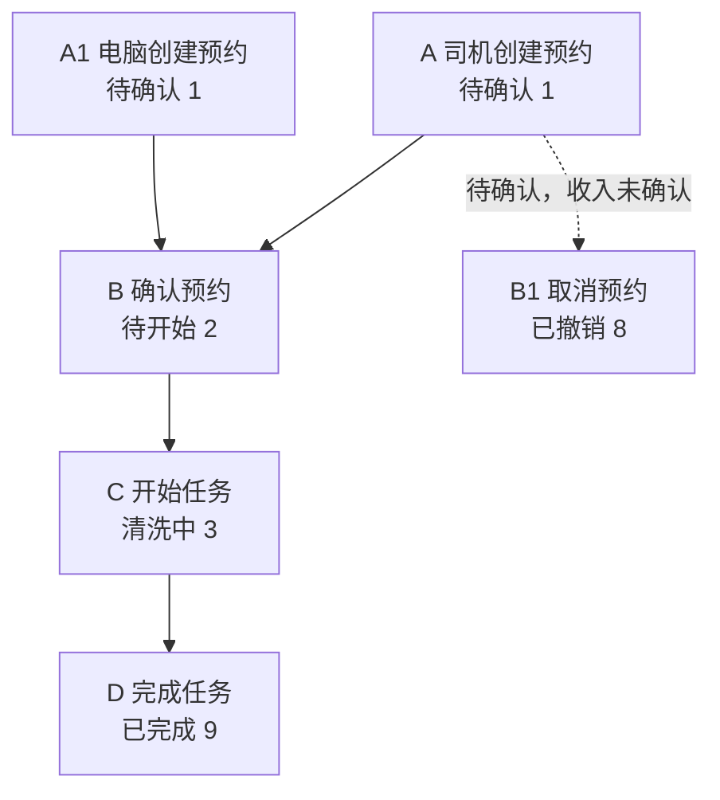
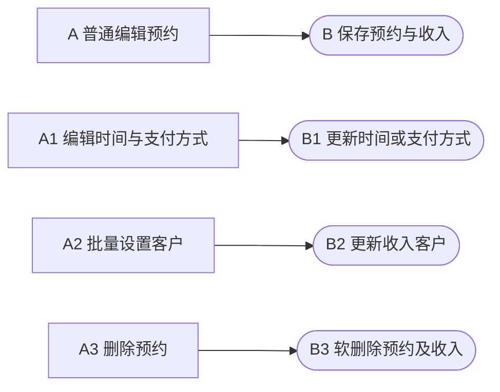
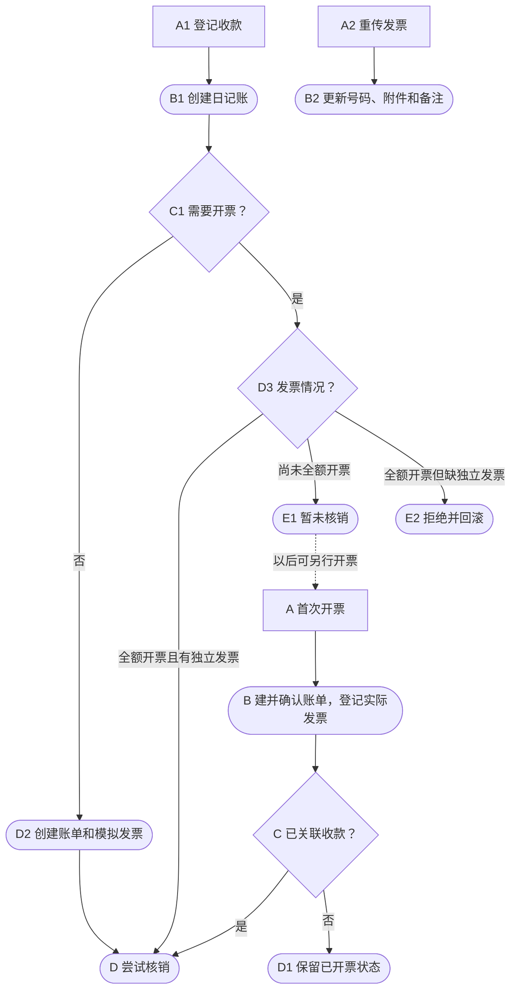
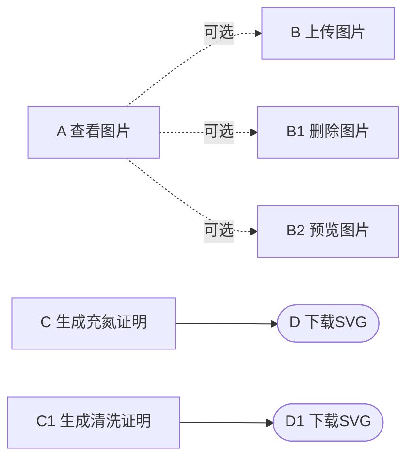
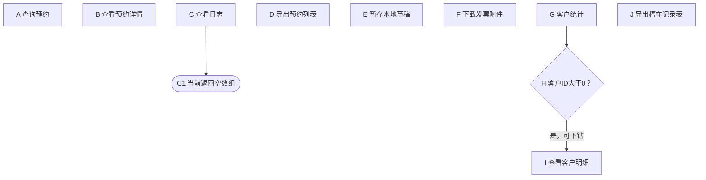
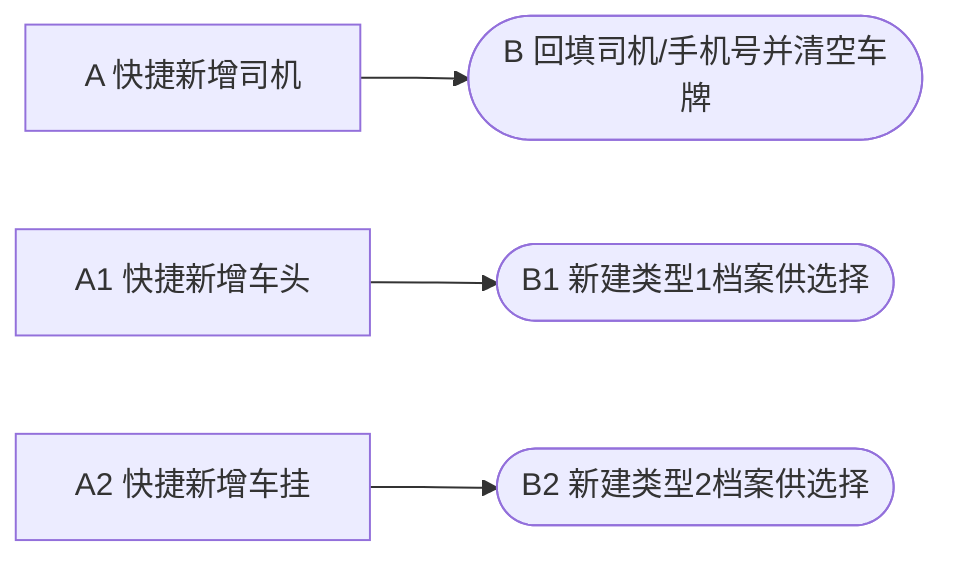

# 槽罐车清洗：AI开发上下文

本文是后续AI唯一需要读取的模块文档，用于新需求定位、方案设计和获授权的代码修改。先读第1～6节，具体定义在第7节；当前需求、项目规范和实际源码仍需核对。人版路径只作同步写入目标。

## 1. 快速摘要与代码基线

本模块覆盖清洗预约、作业状态、图片/证明及快捷财务。关键边界是作业与财务并非强制串行、取消不同于删除、日记账登记不同于收入核销。字段和按钮已有明确两端差异，不能仅从页面显示推断服务规则。

已分析：后台槽罐车预约与统计页签、司机预约表单/列表详情、工人作业列表/详情、图片与证明、快捷财务，以及专项账单中的槽罐车专用导出。后台入口为 `yard/extraOpe/tankCleanOrder` 的 AMIS 配置，移动端为 Uni-App。[E-001～E-016]

通用财务、司机/车牌及通用上传只覆盖调用边界，未完整展开；部署地址、实际角色/岗位、目标库DDL和客户端效果未核验。当前源码工作区干净，与既有AI文档记录的提交一致。本次依据当前skill原位重新生成，重点复核状态流转、独立时间编辑、财务派生条件及专用导出边界，并补齐7.1.1的流程图定义；其余条目沿用同一代码基线的既有静态分析，不升级为全量运行验证。没有调用业务接口、查询数据库或执行迁移。

输出位置：

```yaml
ai_context: /www/ai/skill-previews/code-module-feature-map/yard-tank-clean/ai-context.md
developer_output: /www/ai/skill-previews/code-module-feature-map/yard-tank-clean/developer-guide.md
```

开发前读取 [项目规范](/www/yard/web/AGENTS.md)。真实源码入口/符号在第2节索引与第7.9节证据；不依赖任何其他模块说明文档取得关键定义。

## 2. 按需求定位与可复用实现

| 变更类型 | 优先入口/可复用实现 | 关联约束与修改影响 | 验证方向 |
| --- | --- | --- | --- |
| 新增/调整字段 | E-001后台reservationFormBody/formBody；E-007司机formData/submitForm；E-002控制器；E-005验证器；E-003 upsertIncomeItem；E-004模型 | 复用现有两端表单与费用构造，核对请求/回显、可空/默认、真实存储及实际关联导出，不因有迁移文件就认为已部署 | 字段缺失/null/空串/零值、两端必填差异、旧数据回显及导出 |
| 调整按钮或权限 | E-001 visibleOn和父容器；E-002 fillFinanceState；E-003服务；E-015权限；E-016路由 | 复用现有派生标志但核对完整OR分支及服务校验，覆盖工人列表/详情等共享入口；不把隐藏当后端强制 | 无父权限、状态不符、直接接口、部分/全额财务状态 |
| 改变状态/撤销路径 | E-006状态枚举；E-003 confirm/start/complete/cancel；E-008/009手机控制器 | 检查写入、校验、Map、筛选、两端入口、时间与财务副作用；当前1→2→3→9，8为撤销 | 正常链、跳步、已撤销/已完成、重复请求及并发影响 |
| 调整费用/开票/收款 | E-003 invoice/collection/upsertIncomeItem；E-018 FinanceTool；E-014账单服务 | 复用通用收入/账单/发票/日记账服务；考虑税额与币种、已有账单、独立票、先收后票、模拟票和核销，不只改按钮 | 无客户/零额、需票先收后票、无需票、已有账单、独立票缺失 |
| 调整图片/证明/附件 | E-010手机uploadNext；E-011/012图片入口和服务；E-013证明；E-001附件控件 | 核对3/9上传限制、企业范围、逐张业务失败、本地/OSS与软删；证明文字非检测数据，文件生成有副作用 | 2/3/9、跨企业、HTTP/业务错误、部分成功、预览/下载 |
| 调整统计/专用导出 | E-003 customStatistic；E-001统计页签；E-014 export/exportTankCleanAccounts | 保留客户聚合/筛选透传，考虑币种与收入核销口径、无客户、账单来源、单选其他来源及12列格式 | 混币、未设置客户、未核销日记账、多选混来源和单选非12 |
| 接通日志 | E-002 log；E-001日志source；项目统一日志查询 | 当前固定空数组，需接通真实记录和范围，不能仅改字典/配置后称已完成 | 实际创建/更新后的日志及数据范围 |
| 调整司机缓存/快捷档案 | E-007 saveDraft/loadDraft/persistLastPlate；E-001选择器addApi | 草稿/最近车牌未按身份隔离，快捷新增是独立请求；复用现有选择器并核对完整外部约束 | 同设备换司机、空表单暂存、成功清草稿、取消预约后档案保留 |

## 3. 关键契约与决策边界

- 状态链为待确认1→待开始2→清洗中3→完成9，撤销8；确认不是保存表单。具体规则以第7.2节“状态推进/取消范围”为完整定义。
- 普通编辑与独立编辑时间是两条不同链路；不能复用一个财务锁概括全部入口。直接请求、部分财务状态和页面条件的差异在第7.2节，第7.6节定义财务派生标志。
- 字段/请求/关联及类型转换在第7.3节；`income_item`是费用表单，`incomeItem`是关联，手机承诺/多选为本地状态。时间用秒，金额UI精度不是数据库精度。
- 司机控制器显式本人/企业校验、工人列表企业注入、工人图片企业检查与基础服务数据范围须分别理解；权限码不是角色/岗位绑定，已部署配置未核验。
- 新需求必须评估共享财务、外部档案、通用上传等未完整覆盖边界；金额、日期、状态、币种和文件副作用不能仅由按钮文案推断。

## 4. 新需求的处理约定

1. 读取需求、本文及项目规范，比较本文基线与当前代码/工作区，核对目标与现状差异；从第2节索引定位真实调用链、共享依赖及可复用实现。文档与代码冲突时先修正过时事实。
2. 给出推荐方案及理由、具体文件/符号、字段或接口变化、历史数据/兼容/权限/状态及实际统计导出影响，并说明验证范围；简单改动简述，不凑多套方案。
3. 只求方案时不修改代码；明确要求实现时沿既有授权继续修改及适当验证，不机械再加一次批准。仅对阻断正确性的必要业务缺口澄清，其余独立工作继续。
4. 已完成、失败、未完成、未验证及仍为建议的内容分别记录；不能用修改文档替代实现，不能把未实施方案写成现状。数据库MCP始终仅查询，不借用其他项目数据库补核验。

## 5. 已知问题、需求状态与人工决策

已知问题和条件性建议在第7.8节OPT表独立定义；优先留意上传错误反馈OPT-004、前后端边界OPT-005，以及导出文案/单选来源差异OPT-009。现状与建议目标分开，既有缺陷不默认成为正确业务验收标准。

用户已确认两份文档分工：本文独立支撑AI新需求方案和获授权的代码修改，前置摘要/需求索引、后置完整事实；人版供开发测试，采用独立业务流程与关键规则、字母分支、操作端、字段/Map、按钮功能/条件、可观察检查点及三列报表。不单列角色/页面操作矩阵，不输出集中验证报告或维护流水。

当前任务只有重新生成文档，没有已批准的业务代码优化清单，全部OPT建议未实施。文档可用性按当前skill场景标准检查，真实页面、接口、业务验收仍未执行。重要人工约定和不采纳理由应保存在本文，不能仅写入人版。

## 6. 验证方向与双文档同步

当前未发现明确的槽罐车专用自动化测试入口；不盲目运行可能写库的旧脚本。以下是后续获授权开发时的用例方向，不是本轮已通过的运行结果。

| 影响范围 | 建议核对 |
| --- | --- |
| 正常流程 | 两端创建→后台确认→开始→完成，核对状态、时间与收入关联 |
| 字段/枚举 | 两端车挂差异、支付1/2/3/4、未知货类、空/缺时间、时间倒置 |
| 权限/数据范围 | 父入口权限、实际登录类型、跨司机/企业、撤销、部分及全额财务状态 |
| 图片 | 2拒绝、3/9上传；HTTP/业务失败、重复点击、部分成功、重试 |
| 财务 | 无客户/零额、需票先收后票、无需票、已有账单、独立发票缺失、重复和并发 |
| 报表/文件 | 混币、无客户、未核销收款、混来源、多选/单选其他来源、12列、未完成证明 |
| 日志/缓存 | 日志真实返回、同设备换司机的草稿与最近车牌 |

### 6.1 实现后的同步

功能修改后先更新本文前部摘要、需求索引、关键约束和后部事实/证据，再依据当前实现同步开发者说明；开发者文档仅为写入目标，不回读以补缺失定义。保持模块ID、实际基线、批次和覆盖范围一致，保留稳定ID与人工决策，局部复核不升级为全量已验证。讨论中的方案不改写现状，未实施建议仍是候选；同步在当次任务中完成，不创建监听或定时任务。

## 7. 完整事实附表与代码证据

各类ID在本节独立定义。7.1.1保留流程图定义，完整业务规则在7.2展开；功能表引用规则名称，按钮表保留直接操作条件；索引不代替实现复核。

### 7.1 功能与技术入口

| 功能 ID | 功能名称 | 操作端 | 前置条件与规则引用 | 处理结果 | 接口/代码入口 | 人版图表位置 | 证据 |
| --- | --- | --- | --- | --- | --- | --- | --- |
| F-001 | 司机创建预约 | 手机 | 登录司机，车头/车挂/时间及承诺校验通过；详见规则「创建必填、创建默认与来源、本地草稿」 | 创建预约与关联收入，同步司机资料 | 司机 create → workerCreate/create | FLOW-MAIN / A | E-003、E-005、E-007、E-008 |
| F-002 | 电脑创建预约 | 电脑 | 新建权限，必填及费用校验通过；详见规则「创建必填、创建默认与来源」 | 事务内创建预约及传入的关联收入 | 后台 create → service::create | FLOW-MAIN / A1 | E-001～E-005 |
| F-003 | 确认预约 | 电脑 | 确认权限，状态1；详见规则「状态推进、页面权限」 | 将状态1改为2 | 后台 confirm → service::confirm | FLOW-MAIN / B | E-001～E-003 |
| F-004 | 开始任务 | 电脑、手机 | 状态2；后台需开始权限；详见规则「状态推进、归属与查询范围」 | 将状态2改为3，写开始时间 | 后台/工人 start → service::start | FLOW-MAIN / C | E-001、E-003、E-009、E-018 |
| F-005 | 完成任务 | 电脑、手机 | 状态3；后台需完成权限；详见规则「状态推进、归属与查询范围」 | 将状态3改为9，写结束及核验时间 | 后台/工人 complete → service::complete | FLOW-MAIN / D | E-001、E-003、E-009、E-018 |
| F-009 | 取消预约 | 手机 | 司机本人，页面状态1；详见规则「取消范围、归属与查询范围」 | 将状态改为8 | 司机 cancel → service::cancel；后台同名方法未注册路由 | FLOW-MAIN / B1 | E-003、E-008、E-016 |
| F-013 | 普通编辑预约 | 电脑 | 编辑权限，未撤销且未锁定；详见规则「普通编辑锁」 | 维护预约及关联收入 | 后台 update → assertEditable/upsertIncomeItem | FLOW-MAINTAIN / A | E-001～E-005 |
| F-006 | 编辑时间与支付方式 | 电脑 | 编辑权限，页面状态9；详见规则「独立编辑时间」 | 更新起止时间或支付方式 | 后台 updateTaskTime → 同名服务 | FLOW-MAINTAIN / A1 | E-001～E-003 |
| F-010 | 批量设置客户 | 电脑 | 选择预约，客户ID大于0；详见规则「批量客户」 | 事务内批量更新收入客户 | 后台 batchSetCustom → 同名服务 | FLOW-MAINTAIN / A2 | E-001～E-003 |
| F-015 | 删除预约 | 电脑 | 删除权限，满足删除校验；详见规则「预约删除、财务派生标志」 | 事务内软删除预约及关联收入 | 后台 delete → assertDeletableAndGetIncomeItem | FLOW-MAINTAIN / A3 | E-001～E-003 |
| F-007 | 首次开票 | 电脑 | 需票、有收入/客户，未全额开票；详见规则「首次开票、财务派生标志、撤销与直接调用」 | 创建并确认账单，登记实际发票，必要时核销 | 后台 invoice → _createAccount/_createInvoice/autoWriteOff | FLOW-FINANCE / A | E-001～E-003 |
| F-008 | 登记收款 | 电脑 | 有收入/客户、正数金额，收入未收款；详见规则「收款与核销、财务派生标志、撤销与直接调用」 | 登记日记账，按开票需要和已有发票决定核销 | 后台 collection → _createPayment/autoWriteOff | FLOW-FINANCE / A1 | E-001～E-003 |
| F-014 | 重传发票 | 电脑 | 需票、已全额开票、有独立发票；详见规则「重传发票、财务派生标志、撤销与直接调用」 | 更新独立发票号码、附件和备注 | 后台 invoice 的全额开票分支 | FLOW-FINANCE / A2 | E-001～E-003 |
| F-011 | 查看图片 | 电脑、手机 | 有读取入口及数据访问范围；详见规则「父容器权限、归属与查询范围」 | 展示当前预约图片集合 | 后台图片 page / 工人 detail | FLOW-MEDIA / A | E-001、E-009～E-012、E-018 |
| F-016 | 上传图片 | 电脑、手机 | 后台读取加编辑；工人状态3/9；详见规则「图片上传、父容器权限」 | 上传文件并建立预约图片关联 | 后台/工人图片 create | FLOW-MEDIA / B | E-001、E-010～E-012 |
| F-017 | 删除图片 | 电脑 | 后台读取加编辑，关联有效；详见规则「图片删除、父容器权限」 | 软删除当前图片记录 | 后台图片 delete → deleteById | FLOW-MEDIA / B1 | E-001、E-012、E-018 |
| F-018 | 预览图片 | 电脑、手机 | 图片已加载且可访问；详见规则「父容器权限」 | 大图或系统图片预览 | 图片点击事件 / 工人 preview | FLOW-MEDIA / B2 | E-001、E-010 |
| F-019 | 生成充氮证明 | 电脑 | 读取权限，有效预约；详见规则「证明内容」 | 生成并下载充氮证明SVG | certificate(type=nitrogen) → generateCertificateImage | FLOW-MEDIA / C | E-001、E-013 |
| F-020 | 生成清洗证明 | 电脑 | 读取权限，有效预约；详见规则「证明内容」 | 生成并下载清洗证明SVG | certificate(type=clean) → generateCertificateImage | FLOW-MEDIA / C1 | E-001、E-013 |
| F-022 | 查询预约 | 电脑、手机 | 登录及相应数据范围；详见规则「归属与查询范围」 | 按筛选分页加载预约 | 三端 page；后台联动筛选/刷新 | FLOW-QUERY / A | E-001～E-004、E-008、E-009、E-018 |
| F-023 | 查看预约详情 | 电脑、手机 | 后台读取；手机受归属/数据范围约束；详见规则「归属与查询范围」 | 只读展示预约、财务或作业信息 | 三端 detail | FLOW-QUERY / B | E-001、E-002、E-008～E-010、E-018 |
| F-028 | 查看日志 | 电脑 | 可进入后台详情；详见规则「日志与普通导出」 | 请求日志，当前接口返回空数组 | 后台 log | FLOW-QUERY / C | E-001、E-002 |
| F-024 | 导出预约列表 | 电脑 | 可进入后台列表；详见规则「日志与普通导出」 | 按列表配置生成Excel | export-excel / page?is_export=1 | FLOW-QUERY / D | E-001、E-002 |
| F-025 | 暂存本地草稿 | 手机 | 可访问司机表单；详见规则「本地草稿」 | 本地保存草稿，不创建预约 | saveDraft/loadDraft/clearDraft | FLOW-QUERY / E | E-007 |
| F-026 | 下载发票附件 | 手机 | 本人详情有附件和有效地址；详见规则「发票附件」 | 打开、下载或预览附件 | 司机 downloadInvoice | FLOW-QUERY / F | E-008 |
| F-012 | 客户统计 | 电脑 | 可进入统计页签；详见规则「客户统计与下钻」 | 按客户汇总作业和相关金额 | statistic → customStatistic | FLOW-QUERY / G | E-001～E-003 |
| F-027 | 查看客户明细 | 电脑 | 统计行客户ID大于0；详见规则「客户统计与下钻」 | 携带客户及筛选打开预约明细 | 客户详情 → 后台 page | FLOW-QUERY / I | E-001 |
| F-021 | 导出槽车记录表 | 电脑 | 导出权限，来源12的有效账单；详见规则「专用账单导出」 | 生成槽车记录表12列专用Excel | 专项账单槽罐车导出 → exportTankCleanAccounts | FLOW-QUERY / J | E-014 |
| F-029 | 快捷新增司机 | 电脑 | 可进入预约表单，手机号校验通过；详见规则「档案快捷新增」 | 创建司机并回填信息，清空车牌 | 司机选择器 addApi/onEvent.addItem | FLOW-REFERENCE / A | E-001 |
| F-030 | 快捷新增车头 | 电脑 | 可进入预约表单，车头牌号校验通过；详见规则「档案快捷新增」 | 新建类型1车牌并供选择 | 车头选择器 addApi | FLOW-REFERENCE / A1 | E-001 |
| F-031 | 快捷新增车挂 | 电脑 | 可进入预约表单，车挂牌号校验通过；详见规则「档案快捷新增」 | 新建类型2车牌并供选择 | 车挂选择器 addApi | FLOW-REFERENCE / A2 | E-001 |

#### 7.1.1 流程图定义与节点对应

以下保留完整连线与结果节点，用于独立理解和同步人版；功能表中的图标识/节点对应本节。主线为正常页面路径，前后端差异以7.2规则为准；独立入口不表示必须依次执行。

##### FLOW-MAIN：预约与清洗主流程

正常页面路径为待确认→待开始→清洗中→已完成；取消为可选分支。



##### FLOW-MAINTAIN：预约维护

各项均为独立入口，不存在图示之间的强制先后关系。



##### FLOW-FINANCE：快捷财务

财务可从独立入口办理；该图描述内部联动，不表示必须先完成清洗。



##### FLOW-MEDIA：图片与证明

图片操作为可选分支，两种证明各有独立入口。



##### FLOW-QUERY：查询、报表与本地辅助

客户统计可下钻明细，其余节点为独立查询或辅助功能。



##### FLOW-REFERENCE：表单内档案快捷维护

三个快捷入口各自调用档案接口并回填表单。



### 7.2 关键规则及可观察检查点

以下检查点依据当前代码推导，尚未执行页面或接口验收。每项说明前置状态/输入、操作、页面表现及数据结果；已知缺陷和待确认的业务期望单独指出，不把现有错误表现作为正确验收标准。

**输入、默认与状态流转**

| 规则类别 | 关联功能 ID | 关键规则 | 触发结果或前后端差异 | 验证场景与预期表现 | 证据 |
| --- | --- | --- | --- | --- | --- |
| 创建必填 | F-001、F-002 | 电脑创建须司机、车头、入场时间；司机创建还须车挂，页面另需勾真实性承诺 | 真实性承诺是本地检查，不随创建请求落库；草稿不等于预约 | 司机缺车挂或未勾承诺提交→页面提示且不创建预约；电脑缺司机/车头/入场时间→校验失败。承诺字段不应被当作后端已保存事实。 | E-001、E-005、E-007、E-008 |
| 创建默认与来源 | F-001、F-002 | 正常页面新建进入待确认；服务仅在状态缺省时设1；司机入口显式写来源1 | 不能推断服务无条件覆盖任意传入状态；电脑未显式写来源2，实际来源区分待核对 | 两端正常创建→显示待确认；司机入口写来源1。电脑实际来源需核对目标库默认，不能预设一定是2。 | E-001、E-003、E-008、E-017 |
| 状态推进 | F-003、F-004、F-005 | 确认只允许1→2；开始只允许2→3；完成只允许3→9 | 确认仅写状态，不保存预约/费用表单；开始/完成写当前时间，完成另写verify_time | 依次确认/开始/完成→状态1→2→3→9并记录时间；状态2直接完成→服务拒绝，状态不应因此推进。 | E-001～E-003、E-009 |
| 取消范围 | F-009 | 司机页面仅待确认可取消；服务拒绝已撤销、已完成及收入已确认 | 服务未限定原状态只能是1；取消写8而不是删除；后台cancel未注册路由 | 本人待确认记录取消→显示已撤销、记录仍在；已完成无取消入口，服务也拒绝。直接从其他状态调用的现有边界另行确认业务期望。 | E-003、E-008、E-016 |

**编辑、时间与删除**

| 规则类别 | 关联功能 ID | 关键规则 | 触发结果或前后端差异 | 验证场景与预期表现 | 证据 |
| --- | --- | --- | --- | --- | --- |
| 普通编辑锁 | F-013 | 非撤销，且收入未确认、未全额开票、未全额收款 | 已完成但财务未锁的记录仍可普通编辑；不能按旧注释推断所有完成记录禁止编辑 | 已完成但财务未锁→仍有编辑入口，可保存；收入已确认→入口隐藏，直接更新也由服务拒绝。 | E-001～E-003 |
| 独立编辑时间 | F-006 | 页面要求状态9；服务只排除撤销，不走普通财务锁；两时间非零时结束不得早于开始 | 缺失时间键保留原值，空值转0；已开票或已收款不自动禁用此入口 | 已完成记录填结束早于开始→校验提示且不保存；清空某时间→服务写0，直接接口缺键则保留原值；财务锁不单独阻止该入口。 | E-001～E-003 |
| 批量客户 | F-010 | 客户ID大于0、所选预约均存在，且非撤销、有有效收入、收入未确认 | 事务内修改；任一不符合则回滚，规则不等于普通编辑的完整锁定条件 | 混选正常与已撤销/收入已确认记录后提交→服务拒绝，事务内已处理项也应回滚，不出现部分成功。 | E-001、E-003 |
| 预约删除 | F-015 | 服务拒绝关联发票/收款ID及部分或全部开票/收款；页面仅用已有发票/收款标志过滤 | 存在部分财务状态时仍可能显示按钮但提交被拒；软删预约及收入不等于级联撤销账单或清理图片文件 | 部分开票且页面仍可见删除时提交→后端拒绝，不软删预约/收入；合法删除后图片文件不能被理解为已同步清理。 | E-001～E-004 |

**权限与数据归属**

| 规则类别 | 关联功能 ID | 关键规则 | 触发结果或前后端差异 | 验证场景与预期表现 | 证据 |
| --- | --- | --- | --- | --- | --- |
| 页面权限 | F-002、F-003、F-004、F-005、F-006、F-013、F-015 | 后台按新建、确认、开始、完成、编辑、删除权限分别显示相应入口 | 权限码与实际角色授权不同，线上角色/岗位绑定未核验；开票/收款没有额外局部财务权限表达式 | 去掉确认权限→确认按钮不显示，不产生此按钮请求；具体角色授权和后端鉴权须在目标环境核对，不以此证明接口已鉴权。 | E-001、E-015 |
| 归属与查询范围 | F-001、F-009、F-022、F-023、F-004、F-005、F-016 | 司机详情/取消显式校验本人和企业；工人列表注入企业，工人图片上传显式校验企业 | 工人详情/开始/完成控制器未重复企业检查，需结合基础服务的登录类型及查询范围；不能把登录等同岗位授权 | 跨司机查看/取消和跨企业工人上传→显式归属检查拒绝；其他工人接口需按真实登录类型核对基础查询范围，不能提前判通过。 | E-008、E-009、E-011、E-018 |
| 父容器权限 | F-011、F-016、F-017、F-018 | 后台图片入口需读取权限；内部上传/删除另需编辑权限 | 仅有子级编辑权限不能绕过父入口；图片预览继承读取入口条件 | 只有编辑无读取→图片父入口隐藏；有读取无编辑→可看图，但上传/删除入口隐藏，不应由页面触发图片写入。 | E-001、E-012 |

**财务关联与执行边界**

| 规则类别 | 关联功能 ID | 关键规则 | 触发结果或前后端差异 | 验证场景与预期表现 | 证据 |
| --- | --- | --- | --- | --- | --- |
| 收入与账单关联 | F-001、F-002、F-007、F-008 | 预约income_item_id关联收入，收入type=5且connect_id=预约ID；账单source_type=12为另一枚举 | 不能混用收入类型与账单来源；收入日期取预约入场时间 | 带费用正常创建后核对预约关联收入：收入type5、connect_id等于预约ID、日期取入场时间；财务建账单时来源12，不能混用两类编码。 | E-003、E-004、E-014 |
| 首次开票 | F-007 | 有收入、客户ID大于0、需开票且未全额开票；快捷流程创建并确认账单，再登记实际发票 | 收入已有账单时内部创建账单会拒绝；已有收款时尝试核销；无需开票的收入由服务拒绝 | 客户有效、需票未开且无账单→建立并确认账单再登记实际发票；已有账单时请求拒绝且不重复创建。 | E-002、E-003 |
| 重传发票 | F-014 | 已全额开票且预约有独立invoice_id，并满足收入/客户及需开票口径 | 只更新该独立发票的号码、附件和备注，不重复开账单；全额开票但无独立ID会拒绝 | 全额已开且有独立发票→显示重传，保存后仍是同一发票ID；缺独立ID直接请求→拒绝，不应当作重新首次开票。 | E-001～E-003 |
| 收款与核销 | F-008、F-007 | 收款要求客户、正数金额及收入未收款；需票未开先记日记账，已全开票用独立发票核销，无需票创建账单及模拟发票后核销 | 需票且已全开但独立发票缺失时回滚；已登记日记账、收入已核销和页面收款标志可能不同；模拟发票不是对外票据 | 需票未开先收→日记账存在但收入未必核销；后开票再尝试核销。无需票收款走内部模拟票分支，不能当作已开对外实际票据。 | E-002、E-003 |
| 财务派生标志 | F-007、F-008、F-014、F-015 | 已有发票/收款标志由有效关联对象或全额财务状态生成，不能直接覆盖全部部分状态 | 开票显示还含无需票且有收款无发票的OR分支，但服务拒绝无需票，存在显示与执行差异 | 无需票且有收款无发票可能仍显示开票→服务拒绝，这是实现差异；部分状态即使标志为否，删除仍可能被服务拒绝。 | E-001～E-003 |
| 撤销与直接调用 | F-007、F-008、F-014 | 财务按钮排除已撤销，但已读模块invoice/collection没有单独撤销校验；财务也未统一要求作业完成 | 页面隐藏不等于后端已强制同一限制；通用财务全部撤销、并发约束未完整展开 | 已撤销时财务按钮隐藏；直接调用的模块缺少同等状态检查，实际共享财务是否拒绝需隔离验证，不能据隐藏判定数据一定不变。 | E-001～E-003 |

**图片、证明与附件**

| 规则类别 | 关联功能 ID | 关键规则 | 触发结果或前后端差异 | 验证场景与预期表现 | 证据 |
| --- | --- | --- | --- | --- | --- |
| 图片上传 | F-016 | 工人服务只接受状态3/9、企业匹配及合法图片类型/文件；后台未配置相同状态限制 | 工人待开始仍能选择上传但后端拒绝；上传中阻止重复选择，回调未核对HTTP/业务码，可能误报成功 | 工人状态2仍可选图但服务拒绝，界面可能误报成功，按已知缺陷记录；状态3/9合法上传应有图片记录，上传中重复选图被方法拦截。 | E-001、E-010～E-012 |
| 图片删除 | F-017 | 图片ID与预约关联及数据范围匹配 | 软删除图片记录，不物理清理文件，不等于删除预约 | 匹配预约的图片删除后→列表不再显示该记录，物理文件不因此清理；预约关联不符→拒绝，不能误删其他预约图片。 | E-012、E-018 |
| 证明内容 | F-019、F-020 | 证明类型仅nitrogen/clean；当前页面和服务未统一要求已完成 | 生成文件有写文件副作用；0.5Bar、有压及固定声明来自模板/清洗类型，不是现场检测结果 | 未完成但可读取的记录仍可请求证明→生成SVG且不推进状态；核对模板，不将0.5Bar文字作为检测合格结论。 | E-001、E-013 |
| 发票附件 | F-007、F-014、F-026 | 先上传取得路径，再提交发票；号码/附件在当前页面未设必填，下载须有非空地址 | 上传成功不等于发票登记完成；司机下载限本人详情内可见附件 | 只完成文件上传→不能判定已开票；发票表单提交后才登记/更新。司机附件空地址下载→提示未找到附件，不发生成功下载。 | E-001、E-002、E-008 |

**统计、导出与辅助功能**

| 规则类别 | 关联功能 ID | 关键规则 | 触发结果或前后端差异 | 验证场景与预期表现 | 证据 |
| --- | --- | --- | --- | --- | --- |
| 客户统计与下钻 | F-012、F-027 | 按关联收入客户汇总，无客户归未设置客户，客户ID大于0才可下钻 | 不默认只看已完成，不分币种或换汇；收款为收入核销口径，不直接等于已登记日记账 | 用待确认状态筛选仍可能计入统计；无客户行不显示客户详情；混币与先收未核销场景需按当前口径解释，不能当统一币种现金收款。 | E-001、E-003 |
| 专用账单导出 | F-021 | 来源12的账单收入须为槽罐车类型且关联有效预约；多选须同来源，非槽罐车不支持合并 | 按钮未按所选单条来源限制；单选其他来源可能走通用其他格式，不能写成所有非槽罐车选择均被拒绝 | 有效来源12导出→12列槽车记录表；多选混来源→拒绝；单选其他来源可能得到其他格式，作为按钮文案/输出差异记录。 | E-014 |
| 本地草稿 | F-025、F-001 | 司机表单暂存及隐藏/卸载时保存，预约提交成功清草稿 | 草稿与最近车牌缓存键未包含司机/企业，切换身份可能串用；草稿不写业务预约 | 未完整填写时暂存→仅本机缓存更新，无后端预约；提交成功清草稿。切换账号检查残留，现有未隔离行为不作为正确验收目标。 | E-007 |
| 档案快捷新增 | F-029、F-030、F-031 | 新增司机校验手机号，新增车头/车挂各用不同牌号正则，调用独立档案接口 | 关闭预约表单不等于撤销已建档案；页面未按已选司机禁用快捷入口，外部后端完整权限/校验未展开 | 新增司机成功后关闭预约表单→独立司机档案仍在，预约尚未创建；手机号/牌号格式错误→快捷表单拦截，车头与车挂正则分别检查。 | E-001 |
| 日志与普通导出 | F-028、F-024 | 日志页签当前固定空数组；普通列表Excel是业务列表导出 | 字典/方法存在不代表已接入日志；普通列表导出不作为独立统计报表 | 打开日志页签→当前返回空数组，不能期待真实变更记录；普通列表导出不应当作客户统计报表，也不推进作业状态。 | E-001、E-002 |

### 7.3 字段定义与约束

预约模型为 `103_tank_clean_order`，图片为 `103_tank_clean_order_image`。类型/长度依据模型、代码及声明迁移，未核验线上DDL；通用审计字段不当作页面业务输入。[E-004、E-012、E-017]

字段说明与约束表通过同一FIELD编号关联，不是重复定义新字段。`income_item` 为费用嵌套表单，`incomeItem` 为关联；手机真实性承诺和多选数组是本地状态，承诺不随请求落库，多选转字符串提交。[E-001、E-002、E-007]

#### 字段含义与来源

| 字段 ID | 页面标签/绑定 | 请求/响应键 | 业务含义与存储/派生来源 | 证据 |
| --- | --- | --- | --- | --- |
| FIELD-001 | 预约标识 | `id` | 预约标识，不同于图片ID或收入ID | E-002、E-004 |
| FIELD-002 | 业务单号 | `order_no` | 业务单号 | E-003、E-017 |
| FIELD-003 | 司机 | `driver_id` | 司机档案关联 | E-005、E-008 |
| FIELD-004 | 司机姓名/手机号/车队 | `driver_name/driver_mobile/driver_fleet`；展示 `driver.name/mobile/fleet` | 由 driver.name/mobile/fleet 关联展示，不是预约同名快照 | E-001、E-003、E-005、E-007、E-008 |
| FIELD-005 | 车头 | `head_plate_id` | 车头档案ID | E-001、E-005、E-008 |
| FIELD-006 | 车挂 | `trailer_plate_id` | 车挂档案ID | E-001、E-005、E-007、E-008 |
| FIELD-007 | 车牌号码 | `plate_number` | 关联车头/车挂拼接展示值 | E-002、E-004 |
| FIELD-008 | 前装货 | `front_cargo` | 前装货名称 | E-001、E-007、E-017 |
| FIELD-009 | 类别 | `cargo_category` | 货物类别代码 | E-001、E-005～E-009 |
| FIELD-010 | 类别补充说明 | `cargo_category_desc` | 货类补充说明 | E-003、E-017 |
| FIELD-011 | 罐装材质 | `tank_material` | 罐体材质 | E-001、E-005、E-007、E-017 |
| FIELD-012 | 清洗类型 | `clean_type` | 多选清洗项目 | E-001、E-007、E-017 |
| FIELD-013 | 大小 | `tank_size` | 大小 | E-001、E-007、E-017 |
| FIELD-014 | 仓位（工人端仓数） | `warehouse_position` | 电脑显示仓位，工人显示仓数 | E-001、E-010、E-017 |
| FIELD-015 | 入场时间 | `entry_time` | 入场/预约时间，收入日期也取此值 | E-003、E-005、E-007 |
| FIELD-016 | 开始/完成时间 | `task_start_time/task_end_time` | 作业起止时间 | E-003 |
| FIELD-017 | 去向 | `destination` | 去向 | E-001、E-007、E-017 |
| FIELD-018 | 其他（预约备注） | `remark` | 预约备注 | E-003、E-014、E-017 |
| FIELD-019 | 流程状态 | `state` | 作业流程状态 | E-003、E-006、E-017 |
| FIELD-020 | 预约来源 | `appoint_source` | 预约来源 | E-001、E-003、E-008、E-017 |
| FIELD-021 | 支付方式 | `pay_method` | 约定支付方式，不代表已收款 | E-001、E-005～E-007 |
| FIELD-022 | 收入/发票/收款关联 | `income_item_id/invoice_id/payment_id` | 收入、独立发票、现金日记账关联 | E-003、E-004 |
| FIELD-023 | 客户 | `income_item.custom_id` | 付费客户，收入表同名列 | E-001、E-003 |
| FIELD-024 | 费用名 | `income_item.expense_name` | 费用名称 | E-001、E-003、E-007 |
| FIELD-025 | 币种 | `income_item.currency` | 币种 | E-001、E-003 |
| FIELD-026 | 开票 | `income_item.need_invoice` | 开票需要 | E-003、E-005、E-006 |
| FIELD-027 | 数量 | `income_item.quantity` | 计费数量 | E-001、E-003 |
| FIELD-028 | 总金额 | `income_item.amount` | 实际含税金额 | E-001、E-003、E-007、E-018 |
| FIELD-029 | 单价/附加费用 | `income_item.unit_amount/other_amount` | 单价/附加费用 | E-001、E-003、E-018 |
| FIELD-030 | 税率 | `income_item.tax_rate` | 税率百分数 | E-001、E-003 |
| FIELD-031 | 税额/不含税/预算字段 | `tax_amount/excluding_tax_amount/budget_*` | 税额、不含税及预算字段 | E-003、E-018 |
| FIELD-032 | 单位/财务备注 | `income_item.unit/remark` | 计费单位/财务备注 | E-001、E-003 |
| FIELD-033 | 发票号码/附件/备注 | `invoice_number/invoice_img`；响应 `invoice_remark`，提交 `remark` | 关联发票号码、附件与备注 | E-001、E-002 |

#### 类型、默认、校验和编辑边界

| 字段 ID | 类型/单位/精度 | 前端默认/校验 | 后端默认/校验 | 可空/编辑条件与结构缺口 |
| --- | --- | --- | --- | --- |
| FIELD-001 | 整数ID | 页面随记录传递 | 有效正ID校验 | 非新增手填字段，受查询范围约束 |
| FIELD-002 | 声明varchar(40) | 页面展示，不作为主要表单必填输入 | 缺省TC+日期时分秒+三位随机数 | 线上唯一约束和部署DDL未核验 |
| FIELD-003 | 整数关联ID | 电脑必填，手机由身份带入 | 电脑校验正值，司机入口写登录司机ID | 不能指定其他司机，普通编辑受财务锁 |
| FIELD-004 | 关联展示字符串 | 手机提交姓名/手机号/driver_fleet；电脑选司机回填 | 同步司机资料，非空手机按11位检查；展示来自driver关联 | 非预约同名快照；快捷新增司机手机号另必填 |
| FIELD-005 | 整数关联ID | 两端必填；选项按司机及类型1 | 创建正ID校验 | 车牌档案完整约束未展开 |
| FIELD-006 | 整数关联ID | 电脑可选，司机必填 | 司机创建必填；通用规则允许空/0 | 空与0可表示未选；不能套用电脑可选推断司机端 |
| FIELD-007 | 关联拼接字符串 | 展示车头/车挂，中间斜杠 | 控制器拼接，无plate_number搜索器 | 不是同名表列，参数注释不能证明可筛选 |
| FIELD-008 | 声明varchar(255) | 自由输入或从档案选择名称 | 本模块保存名称 | 不是前装货档案ID，完整维护约束未展开 |
| FIELD-009 | 整数枚举 | 默认20，详见Map | 验证枚举值或空，司机入口缺省20 | 部分端显示编号，20普货不加编号 |
| FIELD-010 | 声明varchar(255) | 已分析主页面无独立控件 | 服务允许维护 | 可输入范围未以独立页面控件展开 |
| FIELD-011 | 声明varchar(100)字符串 | 四个字符串选项 | 未见对应后端枚举限制 | 不把前端选项等同存储只允许这四项 |
| FIELD-012 | 逗号分隔字符串 | 多选蒸罐/洗罐/充氮0.5；手机本地数组转字符串 | 保存clean_type | 本地clean_type_list不作为表列；非实测值 |
| FIELD-013 | 声明varchar(100)文本 | 非必填输入 | 未见统一单位或数值约束 | 不推断为体积，线上DDL未核验 |
| FIELD-014 | 声明varchar(100)文本 | 电脑仓位、工人仓数 | 未见仓数数值校验 | 前后端文案不同，不擅自统一含义 |
| FIELD-015 | Unix秒 | 创建必填，手机默认当前；picker毫秒转秒 | 服务缺键默认当前，校验数值；收入日期取此值 | 不能将毫秒原值提交为秒 |
| FIELD-016 | Unix秒，0表示未设置 | 独立时间表单允许清空，作业按钮触发开始/完成 | 开始/完成写当前秒；编辑缺键保留、空值0，均正值才检查先后 | 页面独立编辑限已完成，服务只排除撤销 |
| FIELD-017 | 声明varchar(255)文本 | 非必填输入 | 自由文本 | 存储长度仅依据声明迁移 |
| FIELD-018 | 声明varchar(255)文本 | 预约表单输入，与财务备注分开 | 保存预约remark | 专用导出合并预约与收入备注 |
| FIELD-019 | 整数1/2/3/8/9 | 由业务动作驱动 | 服务创建缺省1，按状态推进 | 旧迁移1=进行中已过时；不无条件覆盖任意直接调用输入 |
| FIELD-020 | 声明tinyint，1司机/2电脑 | 无主表单手填控件 | 司机入口显式1；电脑未显式2 | 实际默认/历史分布待目标库核对 |
| FIELD-021 | 整数枚举 | 当前2/3/4，默认4 | 枚举校验仍接受1；司机入口缺省4 | 1显示“-”；不等于实际已收款 |
| FIELD-022 | 整数ID | 系统关联，非普通选择字段 | 发票/付款关系过滤已撤销对象 | ID存在、有效关联和财务核销状态不同 |
| FIELD-023 | 整数客户ID | 电脑可暂不填 | 服务默认0；开票/收款要求ID大于0 | 0表示未设置；真实档案/通用财务约束未完整核验 |
| FIELD-024 | 字符串 | 默认槽罐车清洗费用 | 服务及司机入口同名默认 | 与费用归属和费用类型编码区分 |
| FIELD-025 | 整数1/2 | 人民币/美元，默认1 | 收入构造缺省1 | 客户统计未分币种或换汇 |
| FIELD-026 | 整数1/2 | 默认需票1，手机字符串提交转数字 | 非空费用对象校验合法值；服务缺失/null/空串拒绝，存在的非2归需票 | 无费用对象与传入不完整费用对象分开理解 |
| FIELD-027 | 数值，UI两位 | 默认1 | 非正值归一1 | 数据库精度未核验 |
| FIELD-028 | 数值，UI两位 | 司机初始提交0 | 经taxCompute构造含税总额及税额 | 零额不能走当前收款；UI精度不等于数据库精度 |
| FIELD-029 | 数值，中间运算四位 | 当前主要表单无独立输入项 | 服务支持；正总额且无单价先总额/数量反算四位单价 | 隐藏输入不等于服务不支持 |
| FIELD-030 | 百分数整数 | 默认6，可选0/1/3/6/9/13 | 本模块服务缺省6 | 不套用其他收入入口默认值 |
| FIELD-031 | 数值，中间计算四位 | 由计算结果展示 | taxCompute及预算构造 | 两位展示不代表实际表列精度 |
| FIELD-032 | 字符串 | 单位默认次，备注为收入备注 | 服务同样缺省单位次 | 与预约其他/remark独立 |
| FIELD-033 | 号码/备注字符串，附件对象数组 | 号码和附件当前未设必填；先通用文件上传 | 回显附件path/value/file_name；提交号码、附件、remark | invoice_remark是回显字段；上传文件不等于登记发票 |

### 7.4 Map、枚举及字典

| 字段/Map | 实际键值及类型、业务文案 | 默认/未命中处理 | 前后端或历史差异 | 使用端 | 证据 |
| --- | --- | --- | --- | --- | --- |
| `state` | 数值：1待确认；2待开始；3清洗中；8已撤销；9已完成 | 创建缺省1；枚举未知为未知，页面无通配兜底 | 页面Map与当前枚举一致；IN_PROGRESS=1名称不能按字面解释为清洗中；枚举未知为未知，页面无通配兜底 | 电脑/司机/工人/筛选 | E-001、E-006 |
| `cargo_category` | 数值：1爆炸；2气体；3易燃液体；4易燃固体；5氧化物；6有毒/氰化物；7放射性；8腐蚀性；9杂项；20普货 | 默认20；未知为未知 | 默认20；选择器/工人/专用导出为编号.名称，普货无编号；电脑和司机详情为名称；未知为未知 | 电脑与手机选择器/详情、专用导出 | E-001、E-006～E-010、E-014 |
| `pay_method` | 数值：2扫码；3对公转账；4月结；历史1显示“-” | 默认4；历史1文案为“-” | 默认4；后端cases接受1；常量WECHAT=1/ALIPAY=2/CASH=3/OTHER=4及旧迁移文案不等于当前业务含义 | 电脑与手机表单/详情 | E-005～E-007、E-017 |
| `need_invoice` | 数值：1需开票；2无需开票 | 默认1；枚举未知为未知 | 手机选项为字符串，提交转数字；枚举未知为未知；服务归一规则见FIELD-026 | 两端费用表单/服务 | E-003、E-006、E-007 |
| `currency` | 数值：1人民币；2美元 | 默认1 | 表单默认1；本模块统计未统一币种 | 电脑费用表单/统计 | E-001、E-003 |
| `tank_material` | 字符串：不锈钢；铝合金；铁；衬塑 | 未发现统一必填默认，保存字符串 | 实际存字符串，不是数字编码 | 电脑/司机表单 | E-001、E-007 |
| `clean_type` | 字符串：蒸罐；洗罐；充氮0.5 | 多选值逗号保存 | 可多选、逗号保存；证明0.5Bar来自模板/类型，非传感器测量 | 电脑/手机表单、证明 | E-001、E-007、E-013 |
| `img_type` | 数值：1清洗前；2清洗后；3其他 | 上传默认2；后台未知为“-” | 两端上传表单默认2，接口校验合法值；后台未知显示“-” | 后台/工人图片上传 | E-001、E-010～E-012 |
| `uploader_role` | 数值：1工人端；2电脑端 | 控制器写入；未知为“-” | 由对应控制器写入，非用户选择；未知显示“-” | 两端图片记录与后台展示 | E-011、E-012 |
| `file_position` | 数值：1本地；2OSS | 按存储配置写入；旧值按当前模式回退 | 依据上传配置写入；完整HTTP(S)地址直接返回，旧值缺失按当前存储模式回退 | 图片上传服务/地址访问器 | E-012 |
| `invoice_state_format` | 字符串键：未开票；部分开票；已开票；无需开票 | 通配键回显原文案 | 页面通配键显示原值；控制器根据有效发票或全额状态生成，当前不直接输出部分开票 | 后台预约列表 | E-001、E-002 |
| `collection_state_format` | 字符串键：未收款；部分收款；已收款 | 通配键回显原文案 | 页面通配键显示原值；控制器当前仅生成已收款/未收款，不直接输出部分收款 | 后台预约列表 | E-001、E-002 |
| `is_invoice_format/account_state_format/confirm_state_format` | 需/无需开票；已/未开账单；已/未确认 | 无收入时账单/确认显示“-” | 派生展示值，不是原始枚举；无收入时账单与确认状态显示“-” | 后台列表/详情 | E-002 |

### 7.5 按钮直接条件

后台权限前缀 `yardExtraOpe.tankCleanOrder.`，读取/新建/编辑/确认/开始/完成/删除分别为 `read/add/edit/confirm/start/complete/del`。图片管理受父入口读取权限与子级编辑权限共同约束；实际角色/岗位授权未核验，所有动作还需满足登录及相应数据范围。[E-001、E-008、E-009、E-011、E-015、E-018]

普通编辑锁表示收入已确认、全额开票、全额收款任一成立。已有发票/收款标志分别由有效关联对象或全额状态生成，不直接涵盖全部部分状态。开票/重传/收款没有额外局部财务权限表达式；其直接显示条件见下表，规则中的例外与服务校验需同时理解。[E-001～E-003]

**后台预约与财务**

| 按钮 ID | 页面/区域/按钮名称 | 关联功能 ID | 按钮功能 | 可用条件 | 不可用时的表现或原因 | 证据 |
| --- | --- | --- | --- | --- | --- | --- |
| BTN-001 | 预约列表／刷新图标 | F-022 | 重新加载当前列表 | 页面可访问，无额外局部权限或状态表达式 | 失败是请求错误；自动加载不另算按钮 | E-001 |
| BTN-002 | 预约列表／导出图标 | F-024 | 导出预约列表Excel | 页面可访问，未配置独立导出权限或勾选条数条件 | 导出链路未运行验证，不等于控件有禁用条件 | E-001、E-002 |
| BTN-003 | 预约列表／新建预约 | F-002 | 打开新建表单 | 有新建权限 | 无权限隐藏，打开尚未创建数据 | E-001 |
| BTN-035 | 新建预约弹窗／提交 | F-002 | 创建预约及关联收入 | 表单已打开；司机、车头、入场时间和费用校验通过 | 必填或格式失败不能正常提交，服务可拒绝 | E-001、E-003、E-005 |
| BTN-004 | 预约列表批量操作／批量设置客户 | F-010 | 打开客户设置弹窗 | 编辑权限，通过批量组件选择预约 | 无权限隐藏，未选记录的控件表现依组件，未运行核验 | E-001 |
| BTN-036 | 批量设置客户弹窗／确认提交 | F-010 | 批量修改收入客户 | 客户必填且ID大于0，全部所选预约通过后端校验 | 撤销/缺收入/收入已确认则服务拒绝，事务回滚 | E-001、E-003 |
| BTN-005 | 预约列表行／详情 | F-023 | 打开详情抽屉 | 读取权限、有效预约 | 无权限隐藏，数据获取受后端范围约束 | E-001、E-002 |
| BTN-006 | 详情抽屉／操作日志页签 | F-028 | 请求日志列表 | 继承详情读取入口前提 | 页签存在，接口固定空数组，不是禁用 | E-001、E-002 |
| BTN-013 | 预约列表行／编辑 | F-013 | 打开编辑表单 | 编辑权限、非撤销、未触发普通编辑锁 | 不满足隐藏，已完成本身不阻止编辑 | E-001、E-002 |
| BTN-038 | 编辑预约弹窗／确认提交 | F-013 | 保存预约和收入 | 输入通过校验，提交时仍满足服务财务锁规则 | 打开后状态变化也可被后端拒绝 | E-001、E-003、E-005 |
| BTN-014 | 预约列表行／确认 | F-003 | 二次确认后转待开始 | 确认权限、状态1 | 其他状态或无权限隐藏，后端再次校验 | E-001、E-003 |
| BTN-015 | 预约列表行／开始任务 | F-004 | 二次确认后开始并记时间 | 开始权限、状态2 | 其他状态或无权限隐藏，服务检查原状态 | E-001、E-003 |
| BTN-016 | 预约列表行／完成 | F-005 | 二次确认后完成并记时间 | 完成权限、状态3 | 其他状态或无权限隐藏，服务拒绝跳过开始 | E-001、E-003 |
| BTN-017 | 预约列表行／编辑时间 | F-006 | 打开时间与支付方式表单 | 编辑权限、状态9，不叠加普通编辑财务锁 | 其他状态或无权限隐藏 | E-001 |
| BTN-039 | 编辑时间弹窗／确认提交 | F-006 | 保存起止时间和支付方式 | 支付方式必填；非撤销；均非零时结束不早于开始 | 表单/服务校验拒绝；服务未强制状态9 | E-001、E-003 |
| BTN-018 | 预约列表行／开票或重传发票 | F-007、F-014 | 打开开票/重传抽屉；重传条件成立时优先显示重传 | 非撤销；开票满足①收入/客户有效且需票未全开，或②无需票且有收款无发票；重传须收入/客户有效、需票全额已开且有独立发票 | 不满足隐藏；无需开票例外分支可显示却被服务拒绝 | E-001～E-003 |
| BTN-019 | 发票抽屉／开票附件上传控件 | F-007、F-014 | 先通用上传，准备附件路径 | 已打开抽屉并选文件，控件未设置必填 | 上传文件不等于已登记发票，通用上传完整限制未展开 | E-001 |
| BTN-040 | 发票抽屉／确认提交 | F-007、F-014 | 首次登记发票或更新独立发票 | 收入/客户有效且需开票；重传有独立发票，首次不能已有账单 | 服务不满足则拒绝；号码/附件未设页面必填 | E-001～E-003 |
| BTN-020 | 预约列表行／收款 | F-008 | 二次确认后登记日记账并按条件核销 | 非撤销，收入/客户有效、无已有收款标志、金额大于0；服务要求收入未收款 | 不满足隐藏；部分收款、缺独立发票或已有账单等可被拒绝 | E-001～E-003 |
| BTN-021 | 预约列表行／删除 | F-015 | 二次确认后软删预约和收入 | 删除权限，无已有发票/收款标志，页面未限制作业状态 | 不满足隐藏；服务另拒绝部分财务状态和残留关联ID | E-001～E-003 |

**图片与证明**

| 按钮 ID | 页面/区域/按钮名称 | 关联功能 ID | 按钮功能 | 可用条件 | 不可用时的表现或原因 | 证据 |
| --- | --- | --- | --- | --- | --- | --- |
| BTN-007 | 预约列表行／图片 | F-011 | 打开图片管理窗口 | 读取权限，无作业状态限制 | 无权限隐藏 | E-001 |
| BTN-008 | 图片窗口／上传图片 | F-016 | 打开类型、文件、备注表单 | 父入口读取权限加编辑权限，无作业状态限制 | 无编辑权限隐藏；子权限不能替代父入口权限 | E-001 |
| BTN-052 | 图片上传表单／文件控件“上传图片” | F-016 | 选择待提交图片文件 | 已打开上传表单，支持多选或拖入指定图片类型 | 当前以Blob交给表单提交，选文件尚不等于创建图片记录 | E-001 |
| BTN-037 | 图片上传弹窗／确认提交 | F-016 | 上传并创建图片关联 | 继承读取及编辑前提，图片类型和文件必填，预约/数据范围有效 | 表单或后端拒绝；后台没有工人端相同的3/9限制 | E-001、E-012 |
| BTN-009 | 图片卡片／删除 | F-017 | 二次确认后软删当前图片 | 读取加编辑权限，图片ID和预约关联匹配 | 无编辑权限隐藏，关联不符服务拒绝；不是删除预约 | E-001、E-012 |
| BTN-010 | 图片卡片／点击图片 | F-018 | 打开大图弹窗 | 图片已加载，继承父入口读取前提 | 无图片无点击对象，坏地址影响显示而非业务禁用 | E-001 |
| BTN-011 | 预约列表行／充氮证明 | F-019 | 生成下载SVG证明 | 读取权限、有效预约，无完成/充氮项目显示限制 | 无权限隐藏；模板文字不表示实测 | E-001、E-013 |
| BTN-012 | 预约列表行／清洗证明 | F-020 | 生成下载SVG证明 | 读取权限、有效预约，未配置状态限制 | 无权限隐藏；后端也未统一要求已完成 | E-001、E-013 |

**司机端与工人端**

| 按钮 ID | 页面/区域/按钮名称 | 关联功能 ID | 按钮功能 | 可用条件 | 不可用时的表现或原因 | 证据 |
| --- | --- | --- | --- | --- | --- | --- |
| BTN-043 | 司机列表／预约槽罐车清洗 | F-001 | 进入预约表单 | 可访问已登录司机端，无额外记录状态条件 | 身份前提由登录及接口链路处理 | E-007、E-008 |
| BTN-024 | 司机表单／提交预约 | F-001 | 创建预约，成功后清草稿并返回 | 已选车头、车挂，已勾真实性承诺；后端必填/格式通过 | 缺车牌或承诺会提示；500毫秒防抖，未发现独立请求中禁用锁 | E-005、E-007、E-008 |
| BTN-025 | 司机表单／暂存 | F-025 | 保存本机草稿并提示 | 表单可访问，不要求通过正式预约必填检查 | 不是后端保存，缓存未按身份隔离 | E-007 |
| BTN-026 | 司机列表／点击记录卡片 | F-023 | 获取本人预约详情并打开弹窗 | 有记录，接口校验本人及企业 | 不属于本人或企业由接口拒绝 | E-008 |
| BTN-027 | 司机详情／取消预约 | F-009 | 打开取消确认框 | 详情状态1 | 其他状态不显示；打开弹框未执行撤销 | E-008 |
| BTN-044 | 司机取消确认框／确认 | F-009 | 执行撤销并刷新列表 | 归属有效，服务排除8/9及收入已确认 | 提交时状态/财务变化可被拒绝 | E-003、E-008 |
| BTN-028 | 司机详情／发票附件“点击下载” | F-026 | 打开或下载附件 | 有附件集合、当前地址非空 | 无附件不显示；空地址或下载失败有提示 | E-008 |
| BTN-029 | 工人列表／详情 | F-023 | 进入详情页 | 有可选记录，受登录及基础查询数据范围约束 | 未核验实际岗位授权，不把登录当作岗位证明 | E-009、E-010、E-018 |
| BTN-030 | 工人列表／开始任务 | F-004 | 二次确认后开始任务 | 记录状态2 | 其他状态隐藏，服务再检查原状态 | E-009 |
| BTN-031 | 工人列表／完成 | F-005 | 二次确认后完成任务 | 记录状态3 | 其他状态隐藏，服务再检查原状态 | E-009 |
| BTN-041 | 工人详情／开始任务 | F-004 | 二次确认后开始并刷新 | 详情状态2；父操作区要求2/3 | 其他状态隐藏 | E-010 |
| BTN-042 | 工人详情／完成 | F-005 | 二次确认后完成并刷新 | 详情状态3；父操作区要求2/3 | 其他状态隐藏，不能从待开始直接完成 | E-010 |
| BTN-032 | 工人详情／选择并上传图片 | F-016 | 最多选择9张，逐张上传 | 界面无状态隐藏；上传中显示loading且方法阻止重复选择；后端要求3/9及企业匹配 | 待开始仍显示但后端拒绝；回调未检查HTTP/业务码，可能误报成功 | E-010、E-011 |
| BTN-033 | 工人详情／点击已有图片 | F-018 | 系统图片预览 | 图片集合非空 | 无图片无点击对象 | E-010 |

**报表及档案快捷入口**

| 按钮 ID | 页面/区域/按钮名称 | 关联功能 ID | 按钮功能 | 可用条件 | 不可用时的表现或原因 | 证据 |
| --- | --- | --- | --- | --- | --- | --- |
| BTN-022 | 统计报表页签／查询 | F-012 | 提交筛选到统计卡片和客户表 | 页签可访问，条件可为空，无局部权限表达式 | 不强制只统计已完成，查询错误不等于禁用 | E-001、E-003 |
| BTN-051 | 客户统计表／刷新图标 | F-012 | 重新加载客户统计表 | 页签可访问，无局部权限或状态限制 | 只刷新表格组件，不能推断同步刷新顶部卡片 | E-001 |
| BTN-023 | 客户统计行／客户详情 | F-027 | 打开该客户的预约明细 | 客户ID大于0 | 未设置客户等ID非正行不显示 | E-001 |
| BTN-034 | 专项账单批量操作／槽罐车导出 | F-021 | 调用账单导出，来源12生成槽车记录表 | 有 yardIncome.generalAccount.export 或 yardIncome.account.export 权限；固定来源为空或12，需选有效账单 | 其他固定来源不构造，无权限隐藏；多选混来源会拒绝，单选其他来源可走其他导出格式 | E-014 |
| BTN-045 | 预约表单／新增司机 | F-029 | 打开快捷司机新增表单 | 可打开新建/编辑预约表单，未叠加司机局部权限表达式 | 不代表司机后端任意用户可写 | E-001 |
| BTN-046 | 新增司机表单／确认提交 | F-029 | 创建并回填司机、手机号，清空车牌 | 手机号必填且符合正则，外部接口校验通过 | 输入格式前端提示；外部模块完整权限/约束未展开 | E-001 |
| BTN-047 | 预约表单／新增车头 | F-030 | 打开快捷车头新增表单 | 可打开预约表单，无额外“已选司机”禁用表达式 | 不能把请求有司机参数推断为页面已禁用无司机场景 | E-001 |
| BTN-048 | 新增车头表单／确认提交 | F-030 | 创建类型1车牌供选择 | 车牌必填并符合车头正则，携带司机，外部接口校验通过 | 前端格式校验或外部服务拒绝 | E-001 |
| BTN-049 | 预约表单／新增车挂 | F-031 | 打开快捷车挂新增表单 | 可打开预约表单，无额外局部权限/司机禁用表达式 | 外部档案入口不等于完整权限已核验 | E-001 |
| BTN-050 | 新增车挂表单／确认提交 | F-031 | 创建类型2车牌供选择 | 车牌必填并符合车挂正则，携带司机，外部接口校验通过 | 车挂正则与车头不同，完整后端约束未展开 | E-001 |

“确认提交”描述表单提交动作；新建明确文案为“提交”，其他由组件生成的实际文案未运行核验。关闭/取消弹层、列切换和分页仅改变展示；自动加载归入查询。图片ZIP下载按钮已注释，后台cancel未注册路由，日志接口固定空数组，不推断为已开放相应能力。[E-001、E-002、E-016]

### 7.6 财务派生标志与计算边界

`fillFinanceState()` 的实际派生规则如下，都是业务标志而非角色授权结果：

```text
X=预约已撤销；H=存在收入；C=收入客户ID>0；N=need_invoice不等于2
has_invoice = 有效关联发票存在 OR 收入全额开票
has_payment = 有效关联日记账存在 OR 收入全额收款
is_edit_locked = 收入已确认 OR 收入全额开票 OR 收入全额收款
can_invoice = (!X AND H AND C AND N AND 未全额开票)
              OR (!N AND has_payment AND !has_invoice)
can_reupload_invoice = !X AND H AND C AND N AND 全额开票 AND invoice_id>0
can_collection = !X AND H AND C AND !has_payment AND amount>0
```

最终开票/重传按钮另要求非撤销。部分开票/部分收款并不保证已有标志为真，删除服务会进一步拒绝部分状态和相关ID；开票第二OR分支的“无需票”与执行服务拒绝无需票并存。`is_income_locked` 只含收入已确认或全额收款，不要混同普通编辑的 `is_edit_locked`。[E-001～E-003]

金额由本模块 `upsertIncomeItem()` 构建，调用 `FinanceTool::taxCompute`；不能把页面两位小数当作数据库精度。四位中间计算及普通收入服务钩子需同时核对。开票创建并确认账单后再登记发票；后续发票更新/撤销/并发的通用财务约束未完整覆盖。[E-003、E-018]

### 7.7 相关统计报表

未核验部署域名，链接均为真实代码入口，按所属页面进入，不以API或下载地址冒充报表页面。客户明细为统计下钻，预约通用导出是普通业务列表导出，均不另算独立统计报表。[E-001、E-014]

| 报表名称 | 报表链接 | 简述 |
| --- | --- | --- |
| 客户统计报表 | [代码入口：槽罐车清洗 → 统计报表页签](/www/yard/web/public/backend/pages/yard/extraOpe/tankCleanOrder.js:1078) | 按客户查看作业量、金额、开票及收入核销收款，可下钻明细。未默认只看已完成、未分币种/换汇，未核销日记账不等于报表收款。 |
| 槽车记录表（专用明细报表） | [代码入口：专项账单 → 槽罐车导出](/www/yard/web/public/backend/pages/yard/finance/generalIncomeAccount.js:542) | 选中槽罐车账单生成车辆与清洗费用的12列Excel，属于专用明细报表文件。不是在线汇总统计页。 |

专用Excel列为：时间、车牌号码、前装货、类别、罐装材质、清洗类型、入场时间、清洗时间、驾驶员、电话、总计、备注。汇总只按客户，不按币种；作业量是预约条数，收款取收入已核销金额，日记账登记成功不能直接当作已核销。[E-003、E-014]

### 7.8 候选建议

所有条目均未授权实施，证据和触发条件用于后续判断，不自动构成需求。

| 建议 ID | 关联功能 ID | 问题与触发条件 | 建议及验证方向 | 优先级理由 | 证据 |
| --- | --- | --- | --- | --- | --- |
| OPT-001 | F-028 | 已确认实现缺口：日志页签接口固定返回空数组 | 接入真实日志前明确业务要求，核对创建/修改后的日志及企业范围 | 中：影响追溯 | E-001、E-002 |
| OPT-002 | F-001、F-002、F-006、F-013 | 一致性：支付历史值1可通过校验但显示“-”，常量名与当前文案不同 | 确认历史兼容策略后统一校验、展示与注释，覆盖1/2/3/4 | 中：影响支付方式理解 | E-005～E-007、E-017 |
| OPT-003 | F-016 | 交互差异：工人待开始仍能选上传，后端只接受3/9 | 补状态提示或入口条件，覆盖2/3/9及失败重试 | 中：减少无效操作 | E-010、E-011 |
| OPT-004 | F-016 | 反馈缺口：手机上传success回调未检查HTTP与业务成功码 | 逐张解析响应并处理部分失败，失败不能显示整批成功 | 高：可能误导上传结果 | E-010 |
| OPT-005 | F-006、F-007、F-008、F-009、F-014、F-015 | 条件差异：时间编辑、取消、开票标志、删除的前后端规则不完全一致 | 按实际业务确认哪些规则需后端强制，覆盖直接调用、部分财务状态及撤销 | 高：涉及流程和财务数据 | E-001～E-003、E-008 |
| OPT-006 | F-012 | 报表限制：跨币种直接累加，先收未核销不计收入收款 | 标明币种/核销范围，按业务选择分币种或换算，覆盖先收后票 | 中：影响财务解释 | E-003 |
| OPT-007 | F-025 | 缓存未隔离：草稿与最近车牌键不含司机/企业 | 按身份分隔或切换时清理，覆盖同设备换账号 | 中：避免串用资料 | E-007 |
| OPT-008 | F-002 | 来源记录：电脑创建未显式写 appoint_source=2 | 先核对实际默认和历史值，再决定由入口写可信来源 | 中：影响来源统计 | E-001、E-003、E-008、E-017 |
| OPT-009 | F-021 | 导出边界：槽罐车按钮未按所选记录类型限制，单选其他来源可能导出其他格式 | 确认是否应限定选中来源12；核对单选非12、多选混来源和有效槽罐车账单 | 中：按钮文案与输出可能不符 | E-014 |

### 7.9 代码证据与接口定位

| 证据 ID | 真实入口及用途 |
| --- | --- |
| E-001 | [后台主页面](/www/yard/web/public/backend/pages/yard/extraOpe/tankCleanOrder.js:4)：预约表单、工具栏、按钮表达式、图片、证明和统计页签 |
| E-002 | [后台控制器](/www/yard/web/app/controller/backend/yard/extraOpe/TankCleanOrderController.php:33)：page/detail/fillFinanceState/fillInvoiceInfo/invoice/collection/log |
| E-003 | [核心服务](/www/yard/web/app/common/service/basic/yard/extraOpe/TankCleanOrderService.php:140)：create/update/confirm/start/complete/cancel/delete；财务内部方法及customStatistic；定位workerCreate/updateTaskTime/batchSetCustom/upsertIncomeItem及_createAccount/_createInvoice/_createPayment/autoWriteOff。 |
| E-004 | [预约模型](/www/yard/web/app/common/model/yard/extraOpe/TankCleanOrderModel.php:21)：103_tank_clean_order、searchField与关联 |
| E-005 | [预约验证器](/www/yard/web/app/common/validate/yard/extraOpe/TankCleanOrderValidate.php:29)：分端必填、手机号、枚举与费用对象 |
| E-006 | [状态](/www/yard/web/app/common/enum/yard/extraOpe/TankCleanStateEnum.php:10)、[支付方式](/www/yard/web/app/common/enum/yard/extraOpe/TankCleanPayMethodEnum.php:10)、[需开票](/www/yard/web/app/common/enum/yard/extraOpe/TankCleanNeedInvoiceEnum.php:10)、[货类](/www/yard/web/app/common/enum/yard/extraOpe/TankCleanCargoCategoryEnum.php:10)：当前枚举标签、历史值及未知兜底 |
| E-007 | [司机表单](/www/yard/web/npm/mobile-cli/src/pages/driver/tankClean/form.vue:143)：本地状态、默认值、选择器、缓存和submitForm |
| E-008 | [司机列表/详情](/www/yard/web/npm/mobile-cli/src/pages/driver/tankClean/list.vue:89)、[司机控制器](/www/yard/web/app/controller/driver/extraOpe/TankCleanOrderController.php:73)：create/cancel/assertOwner与附件下载 |
| E-009 | [工人列表](/www/yard/web/npm/mobile-cli/src/pages/worker/tankClean/list.vue:38)、[工人控制器](/www/yard/web/app/controller/api/worker/TankCleanOrderController.php:29)：page/detail/start/complete |
| E-010 | [工人详情](/www/yard/web/npm/mobile-cli/src/pages/worker/tankClean/detail.vue:28)：状态入口、chooseImage/uploadNext/preview |
| E-011 | [工人图片控制器](/www/yard/web/app/controller/api/worker/TankCleanOrderImageController.php:28)：状态3/9、企业归属与来源写入 |
| E-012 | [后台图片控制器](/www/yard/web/app/controller/backend/yard/extraOpe/TankCleanOrderImageController.php:26)、[图片服务](/www/yard/web/app/common/service/basic/yard/extraOpe/TankCleanOrderImageService.php:43)、[图片模型](/www/yard/web/app/common/model/yard/extraOpe/TankCleanOrderImageModel.php:16)：上传、本地/OSS、关联查询和软删除 |
| E-013 | [证明服务](/www/yard/web/app/common/service/basic/yard/extraOpe/TankCleanOrderService.php:859)：generateCertificateImage/buildCertificateData/renderCertificateSvg |
| E-014 | [专项账单导出按钮](/www/yard/web/public/backend/pages/yard/finance/generalIncomeAccount.js:542)、[账单导出分支](/www/yard/web/app/common/service/basic/finance/income/IncomeAccountService.php:534)、[12列构造](/www/yard/web/app/common/service/basic/finance/income/IncomeAccountService.php:1077)：固定来源、导出权限、通用export与槽罐车格式边界 |
| E-015 | [菜单/权限定义](/www/yard/web/app/common/service/basic/platform/power/PowerService.php:437)、[角色权限解析](/www/yard/web/app/common/service/basic/platform/power/PowerService.php:86)：权限定义不等于已部署角色授权 |
| E-016 | [通用路由](/www/yard/web/app/common/route/route.php:14)、[后台路由](/www/yard/web/app/common/route/backend/yardRoute.php:56)、[司机路由](/www/yard/web/app/common/route/driver/driverRoute.php:18)、[工人路由](/www/yard/web/app/common/route/api/workerRoute.php:12)、[手机请求封装](/www/yard/web/npm/mobile-cli/src/utils/request.js:15)：注册方法、统一前缀和请求方法 |
| E-017 | [初始声明迁移](</www/yard/web/duration/v 3/v 3.0.4/v 3.0.4.sql:78>)、[增量声明迁移](</www/yard/web/duration/v 3/v 3.0.5/v 3.0.5.sql:34>)：仅静态读文件，未查询实际库或执行迁移 |
| E-018 | [金额计算](/www/yard/web/app/common/tools/base/FinanceTool.php:42)、[基础查询范围](/www/yard/web/app/common/service/basic/BasicBaseService.php:51)、[API登录](/www/yard/web/app/common/middleware/login/ApiLoginCheckMiddleware.php:21)、[司机登录](/www/yard/web/app/common/middleware/login/DriverMiddleware.php:23)：计算精度、登录类型与查询范围约束 |

#### 请求前缀、方法与参数定位

| 入口 | 路由/前缀 | 方法 | 入参与边界 | 证据 |
| --- | --- | --- | --- | --- |
| 后台预约 | `/b/y/extraOpe/tankCleanOrder/` | page/detail/create/update/confirm/start/complete/updateTaskTime/invoice/collection/batchSetCustom/statistic/delete/options/log/certificate | 后台页面使用post前缀，通用route_map注册为Route::any；没有后台cancel路由 | E-001、E-002、E-016 |
| 后台图片 | `/b/y/extraOpe/tankCleanOrderImage/` | page/create/delete/download | page用connect_id；上传带connect_id、img_type、file、remark；delete带图片id和connect_id；download有路由但页面按钮已注释 | E-001、E-012、E-016 |
| 司机预约 | `/api/d/tankClean/` | page/create/detail/cancel | 手机调用/d/tankClean，由请求封装拼接baseUrl；create白名单和driver_id来源在控制器，不接受伪造其他司机 | E-007、E-008、E-016 |
| 工人作业 | `/api/worker/tankClean/` | page/detail/start/complete | page注入企业、默认状态2且只允许2/3/9；其余控制器须结合基础服务数据范围理解 | E-009、E-018 |
| 工人图片 | `/api/worker/tankCleanImage/create` | create | multipart：id、img_type、file、remark；显式企业检查并限定3/9 | E-010、E-011、E-016 |
| 发票附件 | `/b/p/upload/file` | 通用文件上传 | 先上传取得路径，再在invoice中提交invoice_img、invoice_number和remark；上传不等于开票成功 | E-001、E-002 |
| 专项账单 | `/b/y/finance/incomeAccount/export` | export | 带所选账单id集合，服务按来源分派，来源12走槽罐车专用格式 | E-014 |
