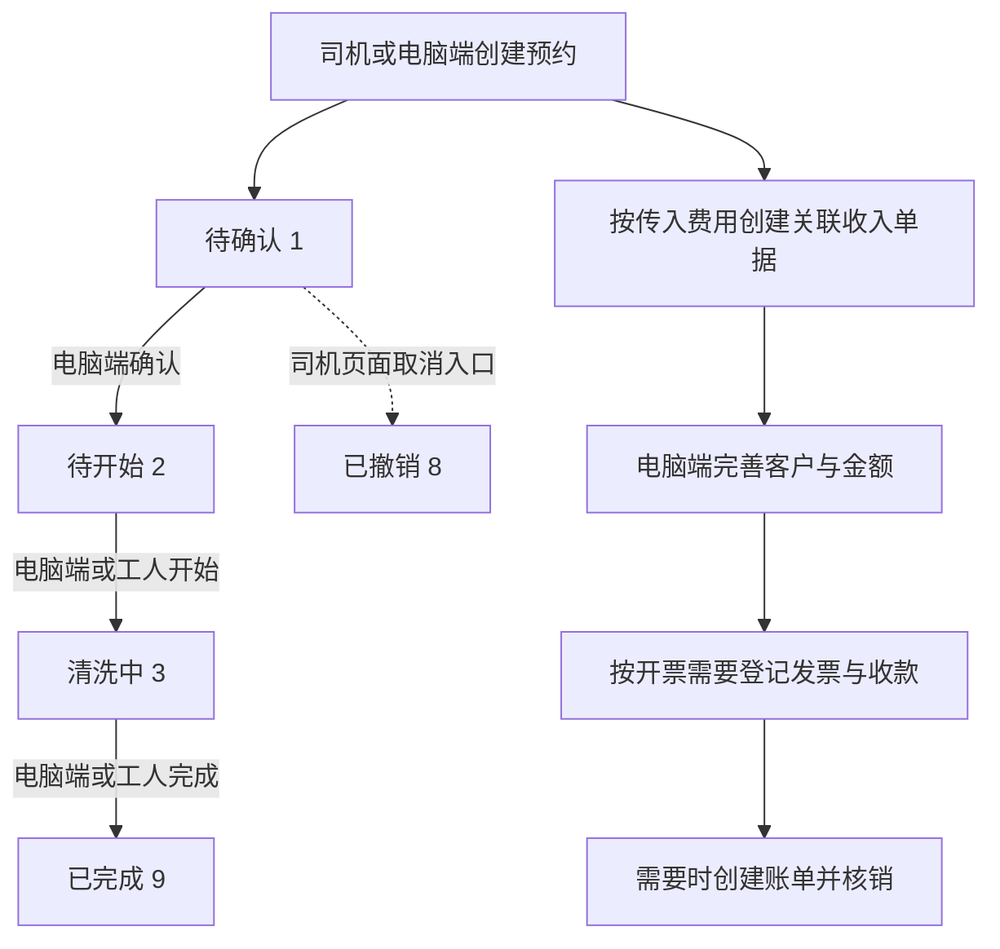

# 槽罐车业务：开发者功能说明

本次将“槽罐车业务”定位为堆场系统中的槽罐车清洗模块，覆盖预约、确认、开始、完成、图片、证明、快捷财务、统计，以及专项账单中的槽罐车导出。本文依据实际代码整理，供开发者理解；新 AI 的接手入口见 [ai-context.md](ai-context.md)。

核验基线是上方提交及干净工作区。已阅读主要页面、控制器、服务、模型、枚举和声明迁移，执行了页面配置的隔离静态检查及纯枚举检查。没有登录真实页面、调用业务接口、执行数据库查询或迁移，也未核验实际用户授权与部署配置。本文不是整个收入财务系统的全量说明。

## 1. 谁在什么页面操作什么

| 页面 ID | 使用者与入口 | 主要功能 | 核验范围 |
| --- | --- | --- | --- |
| PAGE-001 | 持有相应后台权限的用户；菜单种子“其他业务 → 槽罐车清洗”，页面标识 `yard/extraOpe/tankCleanOrder` | 预约列表、新建、编辑、状态操作、图片、证明、开票、收款 | 主页面及关联后端已静态核对；线上角色绑定及菜单改名未核验，E-001～E-006、E-015 |
| PAGE-002 | 同一后台页面的“统计报表”页签 | 按客户汇总及客户明细 | 筛选、指标、下钻已核对，E-001、E-003 |
| PAGE-003 | 司机；`pages/driver/tankClean/form` | 填写预约、暂存、选车牌与前装货 | 表单与提交链路已核对；通用车牌/前装货维护未完整展开，E-007 |
| PAGE-004 | 司机；`pages/driver/tankClean/list`，内含详情弹窗 | 本人预约、详情、取消、发票附件下载 | 页面与司机归属检查已核对，E-008 |
| PAGE-005 | 工人端使用者；`pages/worker/tankClean/list` | 待开始/清洗中/已完成列表、开始、完成 | 页面与工人接口已核对；具体工种/岗位授权未核验，E-009 |
| PAGE-006 | 工人端使用者；`pages/worker/tankClean/detail` | 作业详情、图片上传/预览、开始、完成 | 页面、企业归属与上传状态检查已核对，E-010、E-011 |
| PAGE-007 | 有专项账单及导出权限的后台用户；`yard/finance/generalIncomeAccount` | 槽罐车账单合并导出 | 只展开槽罐车导出边界，不代表已分析专项账单全功能，E-014 |

“司机”“工人端使用者”是页面与接口所服务的业务身份；后台“财务、调度、管理员”等实际角色名不可由权限码推断。菜单种子、登录验证、企业数据范围和按钮权限是不同层次。

## 2. 业务流程与关键规则



取消箭头表示页面正常入口，服务端限制见 F-009。财务操作没有统一要求必须“作业已完成”；当前按钮主要依据撤销状态、收入、客户和开票/收款标记判断，不能把示意图解释为强制串行审批流程。

| 功能 ID | 业务动作与关键规则 | 处理结果/副作用 | 证据 |
| --- | --- | --- | --- |
| F-001 | 司机填预约；车头、车挂、入场时间必填，页面须勾选真实性承诺 | 登录司机 ID 写入预约；调用司机资料同步；默认月结、普货；携带费用时创建收入 | E-007、E-008、E-003 |
| F-002 | 电脑端新建/普通编辑；客户可先不填，后补客户与金额 | 事务中维护预约及关联收入；编辑拒绝撤销单、收入已确认、全部开票或全部收款 | E-001、E-002、E-003、E-005 |
| F-003 | 电脑端确认，只允许 `state=1` | 仅将状态改为 `2`，不会保存当前预约/财务表单；方法旧注释不能替代实现 | E-003 `confirm()` |
| F-004 | 电脑端或工人开始，只允许 `state=2` | 改为 `3`，写 `task_start_time` | E-003 `start()`、E-009 |
| F-005 | 电脑端或工人完成，只允许 `state=3` | 改为 `9`，写 `task_end_time` 与 `verify_time`；不能跳过开始 | E-003 `complete()`、E-009 |
| F-006 | 电脑端“编辑时间”入口显示于 `state=9`，同时可改支付方式 | 绕过普通财务锁定；起止时间同时非零时校验先后顺序；服务只拒绝撤销单，没有要求必须已完成 | E-001、E-003 `updateTaskTime()` |
| F-007 | 开票或重传：需要关联收入、客户、需开票口径 | 首次创建并确认专项账单，登记实际发票；全额已开票且有关联独立发票时更新其号码/附件/备注；有已登记收款时尝试核销 | E-002、E-003 `invoice()` |
| F-008 | 收款：关联收入、客户和正数金额，收入不能已全额收款 | 创建现金日记账；需开票但尚未开票时暂不核销；已开票则核销；无需开票则建立账单与模拟发票后核销 | E-003 `collection/_createPayment/autoWriteOff` |
| F-009 | 司机取消仅显示于待确认；电脑端删除是另一功能 | 取消服务拒绝已撤销、已完成和收入已确认，但未限定只能从 `1` 取消；删除拒绝已部分/全部开票或收款，在事务内软删关联收入与预约 | E-003、E-008 |
| F-010 | 批量设置客户，须选预约及有效客户 | 事务处理；拒绝撤销预约、无有效收入、收入已确认；当前流程并不等同于普通编辑的全部锁定规则 | E-001、E-003 `batchSetCustom()` |
| F-011 | 图片：电脑端管理，工人端上传；证明：电脑端下载 | 工人上传只允许 `3/9`；图片删除不物理清理文件；证明生成 SVG 文件，未校验必须已完成，部分证明文案来自模板 | E-003、E-010～E-013 |
| F-012 | 客户统计及专项账单导出 | 统计按关联收入客户分组；账单导出验证同来源、槽罐车收入及有效预约关联 | E-003 `customStatistic()`、E-014 |

预约通过 `income_item_id` 关联收入；收入 `type=5`、`connect_id=预约ID`，费用归属为“槽罐车”。`income type=5` 与 `account source_type=12` 是不同枚举，不能混用。首次快捷开票/无需开票收款若发现收入已有账单，`_createAccount()` 会拒绝，需走对应通用账单流程或先处理已有关系。[E-003、E-014]

## 3. 字段定义与数据来源

### 3.1 预约与展示字段

主表映射为 `103_tank_clean_order`。下列类型/长度来自代码使用和声明迁移，不等于已确认线上表结构；相关迁移是否执行待核验。通用审计字段 `corp_id/user_id/admin_id/created_at/updated_at/deleted_at` 不作为页面业务输入解释。[E-004、E-017]

手机 `truth_confirm`（真实性承诺）和 `clean_type_list` 是本地表单状态：前者参与客户端提交检查但未随请求保存到后端，后者转为逗号连接的 `clean_type` 再提交。草稿保存不等于预约已创建。[E-007]

| 字段 ID | 页面/请求字段 | 含义、存储或派生来源 | 类型/默认与关键约束 | 证据 |
| --- | --- | --- | --- | --- |
| FIELD-001 | `id` | 预约标识，和图片 ID、收入 ID 不同 | 整数；操作接口要求有效正 ID | E-002、E-004 |
| FIELD-002 | `order_no` | 业务单号 | 声明 `varchar(40)`；未传入时由 `TC+日期时间+三位随机数` 生成 | E-003、E-017 |
| FIELD-003 | `driver_id` | 关联司机档案 | 后台创建必填；司机入口由登录态注入，不能由请求指定其他司机 | E-005、E-008 |
| FIELD-004 | `driver_name/driver_mobile/fleet` | 页面展示来自 `driver.name/mobile/fleet`，不是预约表中的同名快照 | 手机填写姓名/车队/手机号进入司机资料同步；手机号可空，非空按 11 位手机号校验；电脑选择器新增司机手机号另有必填 | E-001～E-003、E-005、E-007 |
| FIELD-005 | `head_plate_id` | 车头车牌关联 ID | 后台、司机创建均必填；车牌选择器受司机与 `plate_type=1` 影响 | E-001、E-005、E-008 |
| FIELD-006 | `trailer_plate_id` | 车挂车牌关联 ID | 后台可选；司机页面及 `driverCreateRequire` 均要求填写；通用可选正整数规则允许空/0 | E-005、E-007、E-008 |
| FIELD-007 | `plate_number` | 展示车牌，由关联车头/车挂拼接 | 派生字符串，不是预约表字段；模型没有 `plate_number` 搜索器，控制器注释提及车牌筛选不代表实现支持 | E-002、E-004 |
| FIELD-008 | `front_cargo` | 前装货名称，司机可从维护数据选择 | 声明 `varchar(255)`；页面保存名称，不是前装货档案 ID | E-001、E-007、E-017 |
| FIELD-009 | `cargo_category` | 货物类别代码 | 整数；默认 `20`；验证器接受枚举值或空，展示格式依使用端不同 | E-005、E-006 |
| FIELD-010 | `cargo_category_desc` | 货类补充说明 | 声明 `varchar(255)`，服务允许维护；当前已读主要页面无独立填写控件 | E-003、E-007、E-017 |
| FIELD-011 | `tank_material` | 罐体材质 | 声明 `varchar(100)`；页面四个字符串选项；未发现同等后端枚举校验 | E-001、E-005、E-007、E-017 |
| FIELD-012 | `clean_type` | 清洗项目，可多选 | 选择值是字符串，逗号连接保存；手机另维护本地 `clean_type_list`，提交的是连接后的 `clean_type` | E-001、E-007、E-017 |
| FIELD-013 | `tank_size` | 大小 | 非必填文本，声明 `varchar(100)`；代码未给出统一单位，不推断为体积 | E-001、E-007、E-017 |
| FIELD-014 | `warehouse_position` | 电脑“仓位”、工人“仓数” | 非必填文本，声明 `varchar(100)`；页面文案不同，不能推断已做仓数数值约束 | E-001、E-010、E-017 |
| FIELD-015 | `entry_time` | 入场/预约时间，收入日期也取此值 | 提交 Unix 秒；手机 picker 为毫秒后转秒；后台/司机创建必填，服务缺省时回退当前时间 | E-003、E-005、E-007 |
| FIELD-016 | `task_start_time/task_end_time` | 实际作业起止时间 | 开始/完成服务写当前秒数；编辑时间缺键保留旧值，空值转 `0`，同时大于零才比较先后 | E-003 |
| FIELD-017 | `destination` | 去向 | 自由文本，声明 `varchar(255)`；非必填 | E-001、E-007、E-017 |
| FIELD-018 | `remark` | 预约备注 | 与收入财务备注分开，声明 `varchar(255)`；账单导出合并两种备注 | E-003、E-014、E-017 |
| FIELD-019 | `state` | 作业流程状态 | 当前 `1/2/3/8/9`；旧迁移注释的 `1=进行中` 已过时；服务创建用 `??` 默认 `1`，不是无条件强制覆盖所有输入 | E-003、E-006、E-017 |
| FIELD-020 | `appoint_source` | 预约来源 | 旧迁移 `1=司机、2=电脑`；司机入口显式写 `1`。本次未发现电脑创建显式写 `2`，不能确认来源记录准确区分两端 | E-001、E-003、E-008、E-017 |
| FIELD-021 | `pay_method` | 支付约定，不等于实际已收款 | 默认月结 `4`；当前显示 `2/3/4`；后端枚举还接受历史值 `1`，见 Map 对照 | E-005～E-007 |
| FIELD-022 | `income_item_id/invoice_id/payment_id` | 收入、独立发票、现金日记账关联 | 发票/收款关系过滤已撤销财务记录；ID 存在、关联可见和财务状态不是同一条件 | E-003、E-004 |

### 3.2 财务表单与计算字段

页面 `income_item.xxx` 为嵌套请求对象；控制器详情会把 ORM 关系 `incomeItem` 转为适合表单回显的 `income_item`，不能当作两个数据库字段。[E-001、E-002]

| 字段 ID | 字段 | 含义/来源 | 默认、转换与规则 | 证据 |
| --- | --- | --- | --- | --- |
| FIELD-023 | `income_item.custom_id` | 付费客户，收入表同名列 | 表单非必填；服务默认 `0`；开票和收款要求有效客户 | E-001、E-003 |
| FIELD-024 | `income_item.expense_name` | 费用名称 | 默认“槽罐车清洗费用”；司机提交同名默认值 | E-001、E-007 |
| FIELD-025 | `income_item.currency` | 币种 | `1=人民币、2=美元`，默认 `1`；统计未按币种分组或换汇 | E-001、E-003 |
| FIELD-026 | `income_item.need_invoice` | 需开票还是无需开票 | `1/2`；传入非空费用对象时验证器要求该键；服务缺失/空会拒绝，存在的非 `2` 值归一到需开票 | E-003、E-005、E-006 |
| FIELD-027 | `income_item.quantity` | 数量 | 页面默认 `1`、两位精度；服务将非正数量归一为 `1` | E-001、E-003 |
| FIELD-028 | `income_item.amount` | 实际含税费用 | 页面两位输入，司机初始提交 `0`；服务调用 `FinanceTool::taxCompute()` 计算，不直接把所有金额输入当作存储事实 | E-003、E-007、E-018 |
| FIELD-029 | `income_item.unit_amount/other_amount` | 单价/附加费用，服务支持的费用输入 | 当前主要表单未独立暴露两项；总额大于零且没有单价时，以总额/数量反算四位单价 | E-001、E-003 |
| FIELD-030 | `income_item.tax_rate` | 税率百分数 | 页面与该模块服务默认 `6`；选项 `0/1/3/6/9/13`。不能套用其他收入创建入口的默认值 | E-001、E-003 |
| FIELD-031 | `tax_amount/excluding_tax_amount/budget_*` | 后端税额、不含税金额及预算字段 | 根据 `taxCompute` 结果构造；后端中间计算四位精度，表格展示两位不是数据库精度证明 | E-003、E-018 |
| FIELD-032 | `income_item.unit/remark` | 计费单位/财务备注 | 单位默认“次”；收入备注与预约备注分开 | E-001、E-003 |
| FIELD-033 | `invoice_number/invoice_img/invoice_remark` | 关联发票号码、附件、备注 | 附件统一为 `path/value/file_name`；附件先上传至通用上传接口，再提交开票/重传接口 | E-001、E-002 |

## 4. Map、枚举与实际展示

| 字段/映射 | 实际值与文案 | 默认、差异和证据 |
| --- | --- | --- |
| `state` | `1=待确认；2=待开始；3=清洗中；8=已撤销；9=已完成` | 页面 Map 与 `TankCleanStateEnum` 一致；枚举未知值为“未知”，页面 Map 未配置 `*`；`IN_PROGRESS` 的当前含义是待确认，不能按常量英文名解释为清洗中，E-001、E-006 |
| `cargo_category` | `1=爆炸；2=气体；3=易燃液体；4=易燃固体；5=氧化物；6=有毒/氰化物；7=放射性；8=腐蚀性；9=杂项；20=普货` | 默认 `20`；选择器、工人展示和账单导出使用“编号.名称”（普货不加编号）；电脑列表、司机详情只取名称；未知值为“未知”，E-001、E-006～E-010、E-014 |
| `pay_method` | `2=扫码；3=对公转账；4=月结` | UI 默认 `4`；枚举仍有 `WECHAT=1`、`ALIPAY=2`、`CASH=3`、`OTHER=4`，实际 `label(1)='-'`；校验器遍历全部 cases，故接受 `1`，与 UI 可选值不一致；旧迁移的微信/支付宝/现金/其他文案不再代表当前展示，E-005～E-007、E-017 |
| `need_invoice` | `1=需开票；2=无需开票` | 司机选择器为字符串 `'1'/'2'`，提交转数字；其他值在枚举文案为“未知”；服务归一规则另见 FIELD-026，E-003、E-006、E-007 |
| `currency` | `1=人民币；2=美元` | 此处是表单选项，默认 `1`；混币统计不是统一币种金额，E-001、E-003 |
| `tank_material` | `不锈钢、铝合金、铁、衬塑` | 字符串选项，不是 `1/2/3/4` 编码，E-001、E-007 |
| `clean_type` | `蒸罐、洗罐、充氮0.5` | 字符串多选并以逗号存储；`0.5Bar` 证明文字由模板/清洗类型推导，不是传感器读数，E-001、E-003、E-007 |
| `img_type` | `1=清洗前；2=清洗后；3=其他` | 两端上传表单默认 `2`；接口要求合法值；后台展示未知值为 `-`，E-001、E-010～E-012 |
| `uploader_role` | `1=工人端；2=电脑端` | 分别由对应控制器写入；非用户任意选择，展示未知值为 `-`，E-011、E-012 |
| `file_position` | `1=本地；2=OSS` | 依据上传配置写入；完整 HTTP(S) 地址直接返回；旧值缺失按当前存储模式回退，E-012 |
| `invoice_state_format` | 字符串键 `未开票、部分开票、已开票、无需开票` | `*` 显示原返回文案；这是后端派生文字，不是数字状态 Map。当前 `fillFinanceState()` 将部分情况简化为是否有关联/全额完成，不直接产出“部分开票”，E-001、E-002 |
| `collection_state_format` | 字符串键 `未收款、部分收款、已收款` | `*` 显示原返回文案；当前 `fillFinanceState()` 仅产生已收款/未收款，不直接产出“部分收款”，E-001、E-002 |
| `is_invoice_format/account_state_format/confirm_state_format` | 需/无需开票；已/未开账单；已/未确认 | 控制器派生显示值；空收入时账单和确认状态为 `-`。不能替代 `incomeItem` 原始数值字段判断，E-002 |

## 5. 按钮显示、禁用与请求地址

### 5.1 共同前提及后端派生标志

后台 `opePower` 的精确操作权限前缀为 `yardExtraOpe.tankCleanOrder.`。下表用 `P(read)` 表示 `isInArray(this.opePower,'yardExtraOpe.tankCleanOrder.read')`，其他后缀同理；`s` 表示当前行 `state`。菜单可达性、登录、父容器限制仍是共同前提。没有单独 `disabled` 表达式的动作不额外臆造禁用规则。[E-001、E-015]

按钮使用的派生标志由 `fillFinanceState()` 计算，简写如下（不是权限授权结果）：

```text
X = 预约已撤销(s=8)
H = 有关联收入，C = 收入客户ID>0，N = need_invoice != 2
has_invoice = 存在有效关联发票 OR 收入已全额开票
has_payment = 存在有效关联日记账 OR 收入已全额收款
is_edit_locked = 收入已确认 OR 已全额开票 OR 已全额收款
can_invoice = (!X AND H AND C AND N AND 未全额开票)
              OR (!N AND has_payment AND !has_invoice)
can_reupload_invoice = !X AND H AND C AND N AND 已全额开票 AND invoice_id>0
can_collection = !X AND H AND C AND !has_payment AND amount>0
```

注意 `can_invoice` 的第二个 OR 分支并不包含第一个分支的全部条件。最终按钮还要求 `s!=8`。即使该字段为真，开票服务仍会拒绝无需开票的收入；特定历史数据组合可能产生“显示了但服务拒绝”的差异。[E-002、E-003]

### 5.2 电脑端预约页面

API 方法来自当前页面配置；后端由 `Route::any()` 注册，允许方法范围与前端实际 POST 分别看待。`post:` 是 AMIS 前缀，不是 URL。

| 动作 ID | 页面/动作 | 实际显示或触发条件 | 请求及主要参数 | 后端规则/证据 |
| --- | --- | --- | --- | --- |
| BTN-001 | PAGE-001 列表查询/刷新 | 进入列表；筛选表单变化自动查询；无额外局部操作权限表达式 | POST `/b/y/extraOpe/tankCleanOrder/page`；司机、客户、入场时间、车队、状态及分页 | 基础数据范围；没有当前页面车牌筛选器，E-001、E-002、E-004 |
| BTN-002 | 列表导出图标 | 工具栏无额外显示条件；不推断存在独立导出权限校验 | POST `/b/y/extraOpe/tankCleanOrder/page?is_export=1` | 未实际导出验证，E-001 |
| BTN-003 | 新建预约/提交 | `P(add)`；弹窗提交受表单校验 | POST `/b/y/extraOpe/tankCleanOrder/create`；预约字段及 `income_item` | 必填/枚举校验及事务创建；打开弹窗不提交，E-001～E-005 |
| BTN-004 | 批量设置客户 | `P(edit)`；批量入口依赖选中记录，显式字段 `ids=选中ID列表` | POST `/b/y/extraOpe/tankCleanOrder/batchSetCustom`；`ids/custom_id` | 空选择、无收入、撤销和已确认收入会拒绝，E-001、E-003 |
| BTN-005 | 详情 | `P(read)` | POST `/b/y/extraOpe/tankCleanOrder/detail?id=<预约ID>` | 详情回填财务与车牌/司机展示字段，E-001、E-002 |
| BTN-006 | 详情中的日志页签 | 先满足详情父入口 `P(read)` | POST `/b/y/extraOpe/tankCleanOrder/log?id=<预约ID>` | 当前方法固定返回空数组；存在日志字典配置不等于该页面日志已接通，E-001、E-002 |
| BTN-007 | 图片弹窗 | `P(read)` | POST `/b/y/extraOpe/tankCleanOrderImage/page?connect_id=<预约ID>` | 按清洗单与企业范围查询，E-001、E-012 |
| BTN-008 | 图片弹窗内上传/提交 | 父入口 `P(read)` 且上传按钮 `P(edit)`；图片及类型必填 | POST `/b/y/extraOpe/tankCleanOrderImage/create`；预约 `id`、`img_type`、`file`、备注 | 后台未见工人同等的 `state∈{3,9}` 限制；来源写 `2`，E-001、E-012 |
| BTN-009 | 图片卡片“删除” | 父入口 `P(read)` 且卡片动作 `P(edit)` | POST `/b/y/extraOpe/tankCleanOrderImage/delete`；`id=<图片ID>, connect_id=<预约ID>` | 查询校验图片及归属，软删除；不是预约删除，E-001、E-012 |
| BTN-010 | 图片点击预览 | 图片卡片内点击，本地弹窗 | 本地预览，无独立业务 API | 不把预览误列为新增接口；未运行浏览器，E-001 |
| BTN-011 | 充氮证明 | `P(read)`；无页面状态完成限制 | POST `/b/y/extraOpe/tankCleanOrder/certificate`；`id,type=nitrogen` | 服务校验类型/记录并生成 SVG，有文件生成副作用，本次未请求，E-001、E-003 |
| BTN-012 | 清洗证明 | `P(read)`；无页面状态完成限制 | POST `/b/y/extraOpe/tankCleanOrder/certificate`；`id,type=clean` | 同上；没有独立在线预览动作，E-001、E-003 |
| BTN-013 | 普通编辑/提交 | `P(edit) AND s!=8 AND !is_edit_locked` | POST `/b/y/extraOpe/tankCleanOrder/update`；`id` 及表单 | 服务检查撤销与财务锁定；完成本身并不禁止编辑，E-001、E-003 |
| BTN-014 | 确认 | `P(confirm) AND s==1`，有确认提示 | POST `/b/y/extraOpe/tankCleanOrder/confirm?id=<ID>` | 服务要求原状态 `1`，只转 `2`，E-001、E-003 |
| BTN-015 | 开始任务 | `P(start) AND s==2`，有确认提示 | POST `/b/y/extraOpe/tankCleanOrder/start?id=<ID>` | 服务要求 `2`，转 `3` 并记时，E-001、E-003 |
| BTN-016 | 完成 | `P(complete) AND s==3`，有确认提示 | POST `/b/y/extraOpe/tankCleanOrder/complete?id=<ID>` | 服务要求 `3`，转 `9` 并记时，E-001、E-003 |
| BTN-017 | 编辑时间/提交 | `P(edit) AND s==9` | POST `/b/y/extraOpe/tankCleanOrder/updateTaskTime`；`id/task_start_time/task_end_time/pay_method` | 服务只拒绝 `8` 并检查起止顺序，不使用普通财务锁定，E-001、E-003 |
| BTN-018 | 开票/重传发票 | `s!=8 AND (can_invoice==1 OR can_reupload_invoice==1)`；文案由 `can_reupload_invoice` 切换，无额外财务权限表达式 | POST `/b/y/extraOpe/tankCleanOrder/invoice`；`id/invoice_number/invoice_img/remark` | 业务限制见 F-007；先上传附件的请求另见 BTN-019，E-001～E-003 |
| BTN-019 | 开票抽屉内附件上传 | 继承开票父入口；允许多个附件 | POST `/b/p/upload/file`；通用上传控件处理文件 | 本次只确认 receiver 配置，未展开通用上传实现或调用，E-001 |
| BTN-020 | 收款 | `s!=8 AND can_collection==1`，有确认提示；无额外财务权限表达式 | POST `/b/y/extraOpe/tankCleanOrder/collection?id=<ID>` | 收入收款状态须未收款、客户及金额有效，按需核销，E-001、E-003 |
| BTN-021 | 预约“删除” | `P(del) AND has_invoice!=1 AND has_payment!=1`，有同步删收入的确认提示 | POST `/b/y/extraOpe/tankCleanOrder/delete?id=<ID>` | 服务还拒绝部分开票/部分收款，页面标志不完整反映这两种状态，E-001～E-003 |
| BTN-022 | PAGE-002 统计查询 | 统计表单提交，无额外局部权限条件 | POST `/b/y/extraOpe/tankCleanOrder/statistic` | 卡片和客户表分别调用同一接口，E-001、E-003 |
| BTN-023 | 统计行“客户详情” | `this.custom_id > 0`；继承统计页面前提 | POST `/b/y/extraOpe/tankCleanOrder/page?custom_id=<ID>&entry_time=<范围>&driver_id=<ID>&fleet=<车队>&state=<状态>` | 透传统计筛选；未设置客户组没有此入口，E-001 |

新建/编辑表单还引用司机、车牌、客户选择器；内联新增司机为 POST `/b/y/driver/driver/create`，内联新增车牌为页面 `addApi` 指定的车牌创建入口。下拉查询和这些通用维护模块未在本样例中完整展开，不能将表单可见性等同于这些接口的独立授权。列切换、关闭弹窗、取消提交是本地界面动作，不是预约取消接口。[E-001]

### 5.3 司机端与工人端

手机 `$request` 固定 POST，拼接 `baseUrl + 相对路径`，其中 `baseUrl` 含 `/api`；下面记录完整服务路径。司机端中间件验证司机登录，详情/取消另外校验 `driver_id+corp_id`；工人端使用 API 登录中间件及服务数据范围，本次没有确认细分岗位授权。[E-008～E-011、E-016]

| 动作 ID | 页面/动作 | 显示、禁用或触发规则 | 请求及后端限制 | 证据 |
| --- | --- | --- | --- | --- |
| BTN-024 | PAGE-003 提交预约 | 车头、车挂存在，真实性勾选；500ms 防抖，未发现独立角色权限表达式 | POST `/api/d/tankClean/create`；司机与企业取登录信息，后端也要求车头/车挂/入场时间 | E-007、E-008 |
| BTN-025 | 司机“暂存”及离页保存 | 尚未提交成功时保存草稿；真实性勾选一同保存在草稿 | 本地 `driver_tank_clean_form_draft`，无预约 API；提交成功清除草稿 | E-007 |
| BTN-026 | PAGE-004 列表/详情 | 页面进入、翻页、点击记录 | POST `/api/d/tankClean/page`、`/api/d/tankClean/detail`；详情校验司机与企业归属 | E-008 |
| BTN-027 | 司机“取消预约” | 详情 `state==1` 时显示，有确认提示 | POST `/api/d/tankClean/cancel`；归属检查；服务状态范围比页面宽，见 F-009 | E-008、E-003 |
| BTN-028 | 司机发票附件下载 | `invoice_img` 有附件；按所选文件调用下载 | 客户端下载附件 URL，无专门新增的槽罐车业务接口；文件访问权限未运行核验 | E-008 |
| BTN-029 | PAGE-005 工人列表/详情跳转 | 三个页签仅 `2/3/9`，默认 `2` | POST `/api/worker/tankClean/page`；`/api/worker/tankClean/detail`；后端拒绝列表其他状态 | E-009、E-010 |
| BTN-030 | 工人“开始任务” | 列表 `item.state==2`；详情父容器 `state∈{2,3}` 且子按钮 `state==2` | POST `/api/worker/tankClean/start`；服务严格要求 `2` | E-009、E-010、E-003 |
| BTN-031 | 工人“完成” | 列表 `item.state==3`；详情父容器 `state∈{2,3}` 且子按钮 `state==3` | POST `/api/worker/tankClean/complete`；服务严格要求 `3` | E-009、E-010、E-003 |
| BTN-032 | 工人“选择并上传图片” | 上传区始终渲染；`uploading` 加载并在回调中阻止重复选择；最多 9 张压缩图片逐张上传 | multipart POST `/api/worker/tankCleanImage/create`；参数 `id/img_type/remark/file`；后端只允许本企业且 `state∈{3,9}` | E-010、E-011 |
| BTN-033 | 工人图片预览 | 已有图片可点击 | `uni.previewImage()`，本地操作，无业务写入 API；当前工人路由不提供图片删除 | E-010、E-016 |

司机车牌选择和前装货维护由其他页面承接；前装货本次确认 `/api/d/frontCargo/page/create` 路由，不将该维护模块算作完整覆盖。

### 5.4 专项账单关联动作

| 动作 ID | 动作 | 实际条件 | 请求与边界 | 证据 |
| --- | --- | --- | --- | --- |
| BTN-034 | PAGE-007 “槽罐车导出” | `fixedSourceType` 为空或为 `12` 时才构造该批量动作；显示权限为 `yardIncome.generalAccount.export OR yardIncome.account.export`，还继承专项账单页面前提 | POST `/b/y/finance/incomeAccount/export`，`id=选中账单ID`；服务只允许同来源槽罐车账单合并，逐条确认 `income.type=5` 与有效预约关系 | E-014 |

导出 12 列：时间、车牌号码、前装货、类别、罐装材质、清洗类型、入场时间、清洗时间、驾驶员、电话、总计、备注。每条收入一行，不是每张账单一行；按收入日期/ID 排序，备注合并预约与收入备注。[E-014]

### 5.5 代码存在但当前页面没有入口的能力

- 图片批量 ZIP 下载：服务和后端路由存在，但页面按钮已注释；当前配置对象中没有“批量下载”动作。
- 电脑端撤销：控制器仍有 `cancel()`，但后台路由未注册；司机端 `cancel` 仍注册。不能根据同名方法推断 `/b/y/extraOpe/tankCleanOrder/cancel` 可用。
- 日志字典存在：当前槽罐车 `log()` 固定返回空数组，不能沿用旧文档中“收入日志已纳入该页面”的说法。

## 6. 统计与财务口径

`customStatistic()` 按收入客户 ID 分组，客户缺失归“未设置客户”；没有默认强制已完成筛选，也没有币种分组/换汇。[E-003]

| 返回字段 | 口径 |
| --- | --- |
| `work_quantity` | 筛选范围内预约条数，和费用数量/收入条数不是同一概念 |
| `total_amount` | 关联收入实际金额合计，每条先按两位精度取值 |
| `excluding_tax_amount` | 关联收入不含税金额合计 |
| `invoice_amount` | 关联收入已开票金额合计 |
| `not_invoice_amount` | 仅需开票记录逐条 `max(amount-invoice_amount,0)` 后合计 |
| `collection_amount` | 关联收入已核销收款金额；未核销日记账不能等同于这个值 |
| `not_collection_amount` | 逐条 `max(amount-collection_amount,0)` 后合计 |

“收款日记账已登记”“收入已核销”“预约 `has_payment` 为真”三个状态可能不同。特别是先收款后开票，预约已关联日记账，但收入已核销金额仍可能为零。财务变更应一起核对这些层次，而不是只看状态文案。

## 7. 优化建议

均为候选建议，尚未修改业务代码，也不构成新版本开发任务。

| 建议 ID | 类型/问题与证据 | 建议及验收方向 | 优先级 |
| --- | --- | --- | --- |
| OPT-001 | 已确认实现缺口：日志页签请求的方法固定返回 `[]`，E-001、E-002 | 明确是否应接通统一日志查询；在隔离环境创建/修改后核对日志及企业范围，不只检查字典存在 | 中；影响变更追溯 |
| OPT-002 | 条件性一致性：`pay_method=1` 后端校验接受但文案为 `-`，常量名与当前展示文案不一致，E-005～E-007 | 明确历史值兼容策略，再统一校验、显示与迁移注释；核对 `1/2/3/4` 各值 | 中；避免错误理解支付方式 |
| OPT-003 | 已确认交互差异：工人待开始详情仍可选择上传，服务只接受 `3/9`，E-010、E-011 | 对上传区补状态提示或显示/禁用规则；验证 `2/3/9` 及重复上传、失败重试 | 中；减少可预见的失败操作 |
| OPT-004 | 已确认错误反馈缺口：手机上传仅在网络 success 回调继续，未检查 HTTP 状态和业务 `status`，E-010 | 每张上传解析服务返回，区分传输成功与业务成功；模拟 HTTP 错误及业务拒绝时不可显示整批成功 | 高；当前可能产生误导性成功反馈 |
| OPT-005 | 条件性权限/状态一致性：编辑时间、取消、开票标志、预约删除的页面条件和服务规则不完全相同，E-001～E-003、E-008 | 按业务确认应由后端强制的规则，分别核对直接接口调用与页面入口；不要简单照抄更严或更宽的一端 | 高；涉及流程与财务数据 |
| OPT-006 | 已确认统计口径限制：不同币种直接累加、先收未核销不计入收入收款，E-003 | 报表标明币种与核销口径，按实际业务决定分币种或统一换算；验证混币和先收后票 | 中；影响财务解释 |
| OPT-007 | 已确认本地缓存未隔离：草稿和最近车牌键未包含司机/企业，E-007 | 按身份隔离或切换账号时清除；验证同设备切换司机不带入前一账号草稿 | 中；避免资料串用 |
| OPT-008 | 条件性来源记录：电脑创建未显式设置 `appoint_source=2`，E-001、E-003、E-017 | 核对线上默认与历史记录，再决定由各端控制器设置可信来源；分别验证两端创建结果 | 中；影响来源统计 |

## 8. 代码证据索引

以下链接引用本机真实源码；行号为本次快照，长期定位同时依靠文件及符号。

| 证据 ID | 文件与关键符号 |
| --- | --- |
| E-001 | [电脑端页面](/www/yard/web/public/backend/pages/yard/extraOpe/tankCleanOrder.js:4)：`BASE_API/IMAGE_API`、两种表单、批量动作、行按钮、统计页签 |
| E-002 | [后台控制器](/www/yard/web/app/controller/backend/yard/extraOpe/TankCleanOrderController.php:33)：`page/detail/fillFinanceState/fillInvoiceInfo/create/update/log/certificate` |
| E-003 | [槽罐车业务服务](/www/yard/web/app/common/service/basic/yard/extraOpe/TankCleanOrderService.php:140)：`create/update/updateTaskTime/confirm/start/complete/cancel/delete/invoice/collection/customStatistic` 与内部校验/财务构造 |
| E-004 | [预约模型](/www/yard/web/app/common/model/yard/extraOpe/TankCleanOrderModel.php:21)：物理表、`searchField`、司机/车牌/财务关联 |
| E-005 | [预约验证器](/www/yard/web/app/common/validate/yard/extraOpe/TankCleanOrderValidate.php:29)：三类必填字段、枚举、手机号与费用对象校验 |
| E-006 | [流程状态](/www/yard/web/app/common/enum/yard/extraOpe/TankCleanStateEnum.php:10)、[支付方式](/www/yard/web/app/common/enum/yard/extraOpe/TankCleanPayMethodEnum.php:10)、[是否开票](/www/yard/web/app/common/enum/yard/extraOpe/TankCleanNeedInvoiceEnum.php:10)、[货物类别](/www/yard/web/app/common/enum/yard/extraOpe/TankCleanCargoCategoryEnum.php:10) |
| E-007 | [司机预约表单](/www/yard/web/npm/mobile-cli/src/pages/driver/tankClean/form.vue:143)：选项、草稿/最近车牌、`submitForm()` |
| E-008 | [司机列表与详情](/www/yard/web/npm/mobile-cli/src/pages/driver/tankClean/list.vue:89)、[司机控制器](/www/yard/web/app/controller/driver/extraOpe/TankCleanOrderController.php:73)：`create/cancel/assertOwner` |
| E-009 | [工人列表](/www/yard/web/npm/mobile-cli/src/pages/worker/tankClean/list.vue:38)、[工人控制器](/www/yard/web/app/controller/api/worker/TankCleanOrderController.php:29)：`page/detail/start/complete` |
| E-010 | [工人详情](/www/yard/web/npm/mobile-cli/src/pages/worker/tankClean/detail.vue:28)：上传区、状态按钮、`uploadNext()`、`preview()` |
| E-011 | [工人图片控制器](/www/yard/web/app/controller/api/worker/TankCleanOrderImageController.php:28)：状态、企业校验、来源写入 |
| E-012 | [后台图片控制器](/www/yard/web/app/controller/backend/yard/extraOpe/TankCleanOrderImageController.php:26)、[图片服务](/www/yard/web/app/common/service/basic/yard/extraOpe/TankCleanOrderImageService.php:43)、[图片模型](/www/yard/web/app/common/model/yard/extraOpe/TankCleanOrderImageModel.php:16) |
| E-013 | [证明构造与生成](/www/yard/web/app/common/service/basic/yard/extraOpe/TankCleanOrderService.php:859)：`generateCertificateImage/buildCertificateData/renderCertificateSvg` |
| E-014 | [专项账单批量导出](/www/yard/web/public/backend/pages/yard/finance/generalIncomeAccount.js:542)、[账单服务](/www/yard/web/app/common/service/basic/finance/income/IncomeAccountService.php:534)、[12列构造](/www/yard/web/app/common/service/basic/finance/income/IncomeAccountService.php:1077) |
| E-015 | [菜单与权限定义](/www/yard/web/app/common/service/basic/platform/power/PowerService.php:437)、[角色权限解析](/www/yard/web/app/common/service/basic/platform/power/PowerService.php:86) |
| E-016 | [通用路由生成](/www/yard/web/app/common/route/route.php:14)、[后台路由](/www/yard/web/app/common/route/backend/yardRoute.php:56)、[司机路由](/www/yard/web/app/common/route/driver/driverRoute.php:18)、[工人路由](/www/yard/web/app/common/route/api/workerRoute.php:12)、[手机请求封装](/www/yard/web/npm/mobile-cli/src/utils/request.js:15) |
| E-017 | [初始声明迁移](</www/yard/web/duration/v 3/v 3.0.4/v 3.0.4.sql:78>)、[增量声明迁移](</www/yard/web/duration/v 3/v 3.0.5/v 3.0.5.sql:34>)；只读文件，未执行 |
| E-018 | [金额计算](/www/yard/web/app/common/tools/base/FinanceTool.php:42)、[基础服务数据范围](/www/yard/web/app/common/service/basic/BasicBaseService.php:51)、[API登录](/www/yard/web/app/common/middleware/login/ApiLoginCheckMiddleware.php:21)、[司机登录](/www/yard/web/app/common/middleware/login/DriverMiddleware.php:23) |

## 9. 验证结果、待确认与维护

已执行：Node `vm` 隔离加载真实 AMIS 配置，替换的仅是统计卡片展示辅助函数；对确认、开始、完成、编辑、编辑时间、收款、预约删除等权限/状态组合，以及被注释动作和状态 Map 做了 18 项断言，全部通过。直接加载三个无外部依赖的 PHP 枚举，核对流程、支付和货类的实际标签。上述检查不等于 AMIS 渲染、登录鉴权或后端集成测试。

| 待确认 ID | 尚缺材料/范围 | 核实方向 |
| --- | --- | --- |
| Q-001 | 实际角色、岗位与权限绑定，以及部署入口的额外鉴权 | 在正确堆场环境只读核对，不用菜单种子推断具体角色 |
| Q-002 | 线上表结构、字段精度、迁移是否应用与历史值分布 | 使用正确的 `mysql_yard` 连接查询相关元数据；当前可用连接未确认属于堆场，未替代查询其他库 |
| Q-003 | 通用财务服务对发票更新、撤销、核销和并发的全部约束 | 扩展到对应服务并在隔离环境另行验证；不能只根据快捷入口断言全财务行为 |
| Q-004 | 日志展示、上传失败反馈、证明在各客户端的实际行为 | 当前有静态证据，浏览器/手机运行效果和网络返回未验证 |
| Q-005 | 车牌、前装货、通用上传的完整权限和输入约束 | 本次仅沿调用入口定位，没有把外部维护模块视为全量覆盖 |

维护记录：2026-10-24，应用户反馈改以槽罐车业务作为真实样例，首次生成本双文档；没有修改 `/www/yard/web`。后续更新两份文档时保持模块/分析批次一致，保留稳定 ID 和人工补充，区分新增、变更、移除、待重验。正式验收标准仍待样例反馈，不以本次静态检查替代业务验收。
