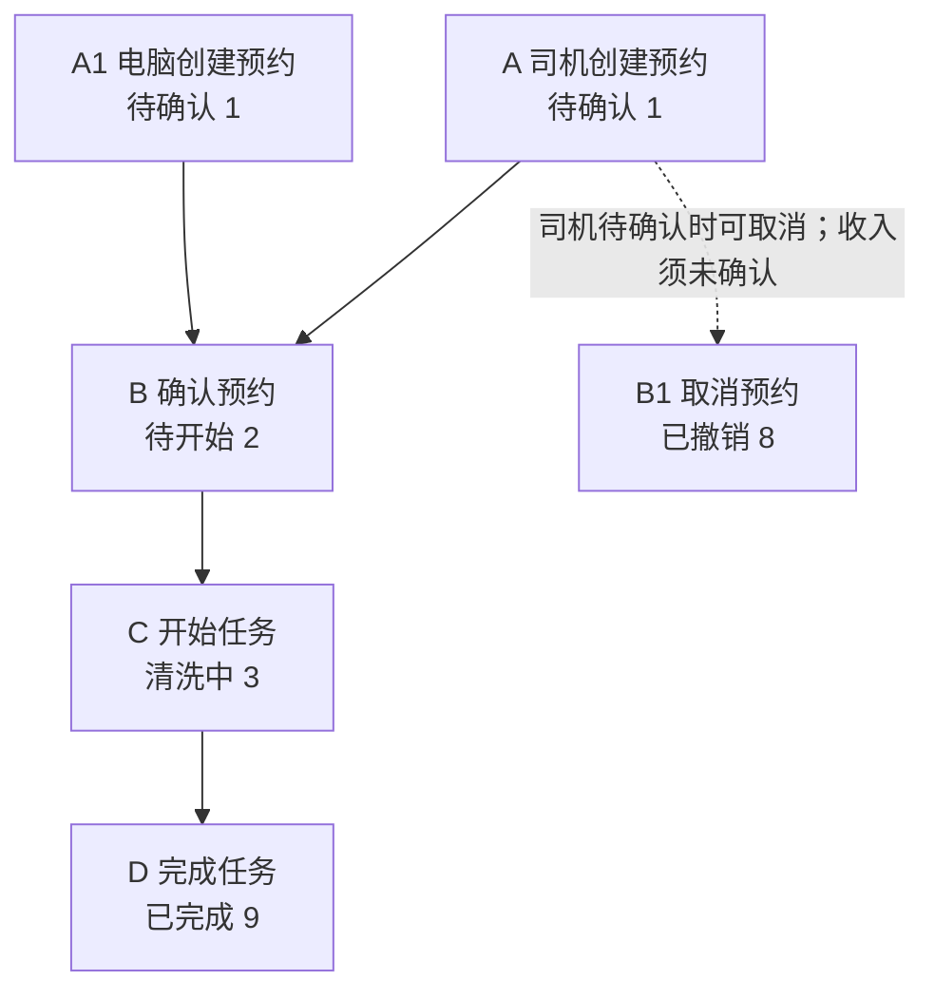
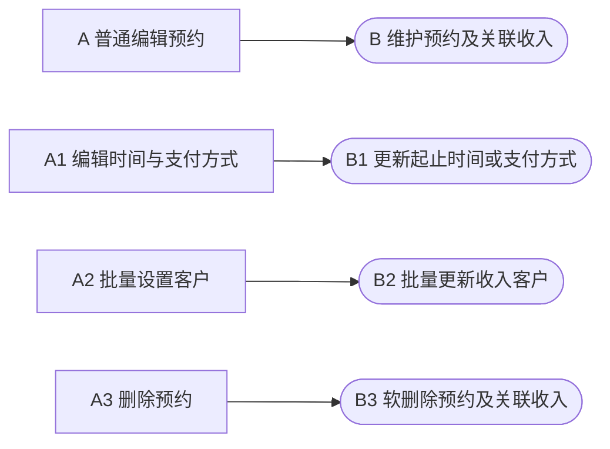
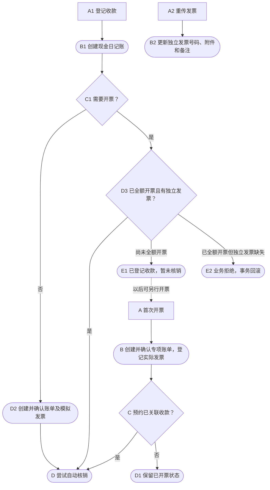
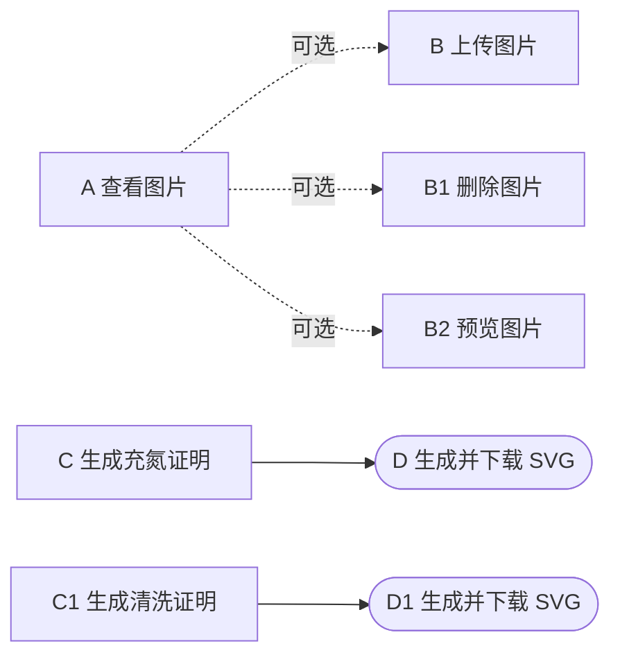
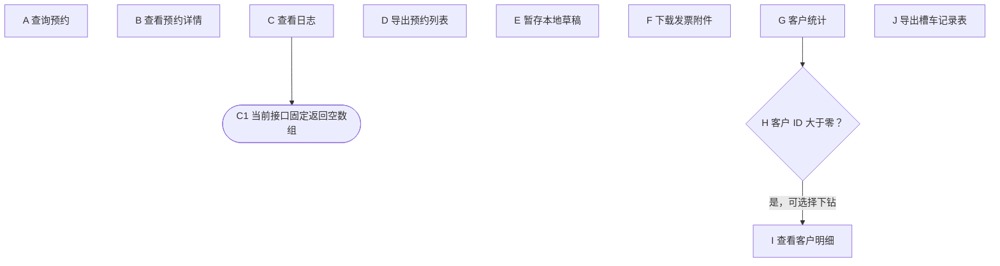
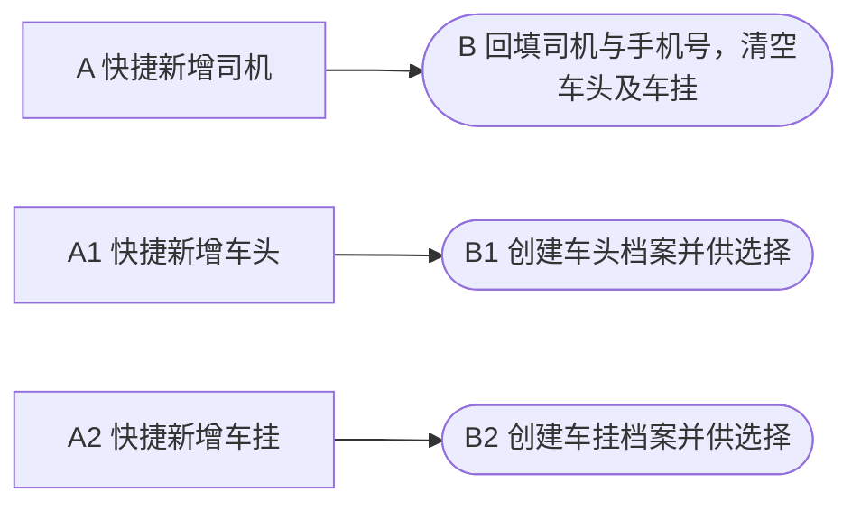

# 槽罐车业务：开发者功能说明

本文依据当前 `code-module-feature-map` skill 整理槽罐车清洗模块，供开发者理解业务、字段、页面按钮及关联报表。AI 接手入口见 [ai-context.md](/www/ai/skill-previews/code-module-feature-map/yard-tank-clean/ai-context.md)。

## 1. 模块范围

已分析预约创建与维护、确认/开始/完成/撤销、图片与证明、快捷开票与收款、客户统计及槽罐车专用账单导出。后台入口为 `yard/extraOpe/tankCleanOrder` 的 AMIS 配置，手机入口为司机预约表单/列表和工人作业列表/详情；源码位置见 E-001、E-007～E-010。专项账单只分析槽罐车导出，不扩展为整个财务系统说明。

本次按源码静态复核；业务代码与上述提交一致，工作区仅 `AGENTS.md` 有未提交修改。实际数据库结构、部署入口、角色绑定和客户端运行效果未核验；通用财务、司机/车牌维护和通用文件上传仅沿本模块调用边界分析，未作完整覆盖。字段类型引用模型或声明迁移，不能视为线上数据库结构证明。

## 2. 业务流程与关键规则

流程图使用 A、B、C、D 等字母标记节点，分支以数字后缀区分，如 A-B1-C1-D1；各图独立编号。功能表通过“对应流程图/节点”关联图中字母，保留稳定 `F-xxx` 供按钮表及 AI 上下文引用；“操作端”按实际页面入口填写。圆角节点表示状态/处理结果，菱形表示判断。已有编号保留给拆分后的主要动作：F-002 为电脑新建、F-007 为首次开票、F-009 为取消、F-011 为查看图片、F-012 为客户统计，其余独立动作使用新增编号。各图中的独立入口不表示必须依次执行。

### 2.1 预约与清洗主流程

图标识：`FLOW-MAIN`。创建节点表示正常页面提交；服务创建采用缺省状态 `1`，并非对任意直接调用都无条件覆盖传入状态。取消箭头表示司机页面的正常入口，服务限制另见表中说明。

| 功能 ID | 对应流程图/节点 | 功能名称 | 操作端 | 前置条件 | 处理与结果 | 接口/入口 | 证据 |
| --- | --- | --- | --- | --- | --- | --- | --- |
| F-001 | FLOW-MAIN / A | 司机创建预约 | 手机 | 登录司机；车头、车挂、入场时间必填；页面须勾选真实性承诺 | 注入司机与企业归属、来源 `1`，默认月结/普货；同步司机资料，随费用对象创建收入 | 司机 `TankCleanOrderController::create` → `service::create` | E-003、E-005、E-007、E-008 |
| F-002 | FLOW-MAIN / A1 | 电脑创建预约 | 电脑 | 有新建入口权限；司机、车头、入场时间等校验通过；客户可暂不填 | 事务中创建预约及传入的关联收入；正常页面提交进入待确认 | 后台 `create` → `service::create` | E-001～E-005 |
| F-003 | FLOW-MAIN / B | 确认预约 | 电脑 | 后台确认权限；原状态必须为 `1` | 仅改为 `2`；不保存预约或财务表单的编辑内容 | 后台 `confirm` → `service::confirm` | E-001～E-003 |
| F-004 | FLOW-MAIN / C | 开始任务 | 电脑、手机 | 原状态必须为 `2`；后台需开始权限；工人接口校验企业范围 | 改为 `3`，写当前开始时间 | 后台/工人 `start` → `service::start` | E-001、E-003、E-009、E-010 |
| F-005 | FLOW-MAIN / D | 完成任务 | 电脑、手机 | 原状态必须为 `3`；后台需完成权限；工人接口校验企业范围 | 改为 `9`，写结束时间及 `verify_time`；不允许跳过开始 | 后台/工人 `complete` → `service::complete` | E-001、E-003、E-009、E-010 |
| F-009 | FLOW-MAIN / B1 | 取消预约 | 手机 | 司机页面仅状态 `1` 显示；接口校验本人及企业；服务拒绝 `8/9` 和收入已确认 | 写状态 `8`，不是删除；服务本身未限定只能从 `1` 取消 | 司机 `cancel` → `service::cancel`；后台同名方法未注册路由 | E-003、E-008、E-016 |

预约通过 `income_item_id` 关联收入；收入 `type=5`、`connect_id=预约ID`，费用归属为槽罐车；专项账单 `source_type=12` 是另一类枚举。创建草稿、登记收入、作业完成和财务核销是不同结果。[E-003、E-014]

### 2.2 预约维护

图标识：`FLOW-MAINTAIN`。下列四项是独立操作，不构成串行审批。

| 功能 ID | 对应流程图/节点 | 功能名称 | 操作端 | 前置条件 | 处理与结果 | 接口/入口 | 证据 |
| --- | --- | --- | --- | --- | --- | --- | --- |
| F-013 | FLOW-MAINTAIN / A | 普通编辑预约 | 电脑 | 编辑权限、非撤销；收入未确认、未全额开票、未全额收款 | 事务中修改预约及关联收入；已完成但财务未锁定的记录仍可编辑 | 后台 `update` → `service::update/assertEditable` | E-001～E-005 |
| F-006 | FLOW-MAINTAIN / A1 | 编辑时间与支付方式 | 电脑 | 页面要求编辑权限及已完成；服务只拒绝撤销，无已完成要求 | 独立更新，不走普通编辑财务锁；缺失时间键保留、空值清零，同时非零才校验先后 | 后台 `updateTaskTime` → 同名服务 | E-001～E-003 |
| F-010 | FLOW-MAINTAIN / A2 | 批量设置客户 | 电脑 | 选中有效预约和有效客户；服务拒绝撤销、无有效收入或收入已确认 | 在事务中批量更新收入客户；校验不等于普通编辑的完整锁定规则 | 后台 `batchSetCustom` → 同名服务 | E-001～E-003 |
| F-015 | FLOW-MAINTAIN / A3 | 删除预约 | 电脑 | 删除权限；页面要求无发票/收款标志；服务还拒绝关联 ID 或部分/全部开票、收款 | 事务内软删除关联收入及预约；不是级联撤销所有账单、发票、日记账或图片文件 | 后台 `delete` → `assertDeletableAndGetIncomeItem` | E-001～E-003 |

### 2.3 快捷财务

图标识：`FLOW-FINANCE`。财务入口没有统一要求作业已完成。图中账单、发票与核销为对应功能的内部副作用；通用财务的全部撤销和并发约束未在本次展开。

| 功能 ID | 对应流程图/节点 | 功能名称 | 操作端 | 前置条件 | 处理与结果 | 接口/入口 | 证据 |
| --- | --- | --- | --- | --- | --- | --- | --- |
| F-007 | FLOW-FINANCE / A | 首次开票 | 电脑 | 有收入、有效客户、需开票且未全额开票；页面另排除撤销；收入已有账单时内部创建账单会拒绝 | 创建并确认专项账单，再登记实际发票；有关联收款时尝试核销 | 后台 `invoice` → `_createAccount/_createInvoice/autoWriteOff` | E-001～E-003 |
| F-008 | FLOW-FINANCE / A1 | 登记收款 | 电脑 | 有收入、有效客户、金额大于零；收入收款状态须为未收；页面另排除撤销及已有收款标志 | 创建日记账；需票未开先挂账，需票已开则核销，无需票则创建账单和模拟发票后核销 | 后台 `collection` → `_createPayment/autoWriteOff` | E-001～E-003 |
| F-014 | FLOW-FINANCE / A2 | 重传发票 | 电脑 | 有收入/客户、需开票、已全额开票，且预约有独立 `invoice_id`；页面另排除撤销 | 更新现有独立发票号码、附件、备注，不重复创建账单 | 后台 `invoice` 的全额开票分支 | E-001～E-003 |

“已登记收款”“收入已核销”和页面“已收款”标记可能不同，先收后票尤其如此。无需开票分支中的模拟发票是内部核销载体，不是对外实际票据。`invoice/collection` 的已读控制器与模块服务没有单独调用撤销状态校验，不能把页面的撤销隐藏规则写成后端已强制执行；共享财务服务的其他限制仍需结合具体操作复核。[E-002、E-003]

### 2.4 图片与证明

图标识：`FLOW-MEDIA`。图片查看后的操作是可选分支；证明是独立入口。

| 功能 ID | 对应流程图/节点 | 功能名称 | 操作端 | 前置条件 | 处理与结果 | 接口/入口 | 证据 |
| --- | --- | --- | --- | --- | --- | --- | --- |
| F-011 | FLOW-MEDIA / A | 查看图片 | 电脑、手机 | 后台图片入口需读取权限；工人详情须在企业数据范围内 | 后台打开图片管理窗口；工人详情加载图片集合，无独立管理弹窗 | 后台图片 `page`；工人 `detail` | E-001、E-009～E-012 |
| F-016 | FLOW-MEDIA / B | 上传图片 | 电脑、手机 | 后台从图片窗口进入需读取及编辑权限；工人后端只接受 `3/9`，校验企业、文件和图片类型 | 新建关联图片；后台来源 `2`、工人来源 `1`；工人最多选9张逐张上传 | 两端图片 `create`；工人 `uploadNext` | E-001、E-010～E-012 |
| F-017 | FLOW-MEDIA / B1 | 删除图片 | 电脑 | 后台需读取及编辑权限；服务校验图片、预约关联和企业 | 软删除图片记录，不物理清理文件 | 后台图片 `delete` → `deleteById` | E-001、E-012 |
| F-018 | FLOW-MEDIA / B2 | 预览图片 | 电脑、手机 | 已加载图片及有效地址；后台继承读取入口前提 | 后台大图弹窗；手机系统预览，不改变业务记录 | 后台图片点击事件；工人 `preview` | E-001、E-010 |
| F-019 | FLOW-MEDIA / C | 生成充氮证明 | 电脑 | 后台读取权限及有效预约；未要求必须已完成 | 按模板和清洗类型生成 SVG 下载；`0.5Bar` 等不是实测数据 | 后台 `certificate(type=nitrogen)` → `generateCertificateImage` | E-001、E-013 |
| F-020 | FLOW-MEDIA / C1 | 生成清洗证明 | 电脑 | 后台读取权限及有效预约；未要求必须已完成 | 根据预约和模板生成 SVG 下载，不更新作业状态 | 后台 `certificate(type=clean)` → `generateCertificateImage` | E-001、E-013 |

### 2.5 查询、报表及本地辅助

图标识：`FLOW-QUERY`。只有客户统计与下钻之间存在条件关联；其余节点为独立入口。进入列表、筛选联动及翻页的自动查询归 F-022，不虚构“自动加载按钮”。

| 功能 ID | 对应流程图/节点 | 功能名称 | 操作端 | 前置条件 | 处理与结果 | 接口/入口 | 证据 |
| --- | --- | --- | --- | --- | --- | --- | --- |
| F-022 | FLOW-QUERY / A | 查询预约 | 电脑、手机 | 页面及登录/数据范围前提；工人列表只接受 `2/3/9`、默认待开始 | 按实际筛选分页返回；司机接口限定本人及企业；车牌派生字段未实现同名搜索器 | 三端 `page`；后台筛选及刷新 | E-001～E-004、E-008、E-009 |
| F-023 | FLOW-QUERY / B | 查看预约详情 | 电脑、手机 | 后台读取权限；司机接口校验本人及企业；工人接口校验企业 | 展示预约、财务或作业信息；只读获取不推进状态 | 三端 `detail`；后台抽屉、司机弹窗、工人详情页 | E-001、E-002、E-008～E-010 |
| F-028 | FLOW-QUERY / C | 查看日志 | 电脑 | 已打开后台详情抽屉 | 日志页签发起请求，当前接口固定返回 `[]`，没有实际日志数据 | 后台 `log` | E-001、E-002 |
| F-024 | FLOW-QUERY / D | 导出预约列表 | 电脑 | 可进入后台列表；该局部控件未写独立导出权限表达式 | 按页面导出配置请求列表并生成 Excel；不等于独立统计报表 | 后台 `export-excel` / `page?is_export=1` | E-001、E-002 |
| F-025 | FLOW-QUERY / E | 暂存本地草稿 | 手机 | 司机表单可访问；无需通过正式预约必填校验 | 保存本机表单，页面隐藏时亦可自动保存；成功提交后清草稿，不写业务预约 | 司机表单 `saveDraft/loadDraft/clearDraft` | E-007 |
| F-026 | FLOW-QUERY / F | 下载发票附件 | 手机 | 司机本人详情存在附件且地址非空 | H5 新窗口打开；其他端下载后预览图片或打开文档 | 司机详情 `downloadInvoice` | E-008 |
| F-012 | FLOW-QUERY / G | 客户统计 | 电脑 | 可进入后台统计页签；按客户、司机、入场时间、车队、状态筛选 | 按关联收入客户汇总，缺客户归“未设置客户”；不默认限定已完成，不分币种/换汇 | 后台 `statistic` → `customStatistic` | E-001～E-003 |
| F-027 | FLOW-QUERY / I | 查看客户明细 | 电脑 | 统计行客户 ID 大于零 | 携带客户与当前筛选打开预约明细；不是另一张独立统计报表 | 客户统计“客户详情” → 后台 `page` | E-001 |
| F-021 | FLOW-QUERY / J | 导出槽车记录表 | 电脑 | 专项账单页面满足导出权限及来源限制；选中有效槽罐车账单且预约关联有效 | 校验同来源并合并为12列专用 Excel，不复用旧额外费用格式 | 专项账单“槽罐车导出” → `IncomeAccountService::exportTankCleanAccounts` | E-014 |

### 2.6 预约表单中的档案快捷维护

图标识：`FLOW-REFERENCE`。这些操作可能先创建独立档案，再回填预约表单；关闭预约表单不会据此撤销已创建档案。本次仅分析快捷入口及回填，不宣称已覆盖档案模块的全部权限与服务规则。

| 功能 ID | 对应流程图/节点 | 功能名称 | 操作端 | 前置条件 | 处理与结果 | 接口/入口 | 证据 |
| --- | --- | --- | --- | --- | --- | --- | --- |
| F-029 | FLOW-REFERENCE / A | 快捷新增司机 | 电脑 | 可打开后台新建或编辑表单；输入非空且符合页面手机号正则 | 调用司机创建接口，回填司机及手机号并清空车牌；完整后端约束未展开 | 司机选择器 `addApi/onEvent.addItem` | E-001 |
| F-030 | FLOW-REFERENCE / A1 | 快捷新增车头 | 电脑 | 可访问对应表单；车牌必填并符合车头正则；请求携带所选司机 | 创建 `plate_type=1` 档案并供当前选择器使用；有效司机等后端约束属外部模块 | 车头选择器 `addApi` | E-001 |
| F-031 | FLOW-REFERENCE / A2 | 快捷新增车挂 | 电脑 | 可访问对应表单；车牌必填并符合车挂正则；请求携带所选司机 | 创建 `plate_type=2` 档案并供当前选择器使用；完整后端约束未展开 | 车挂选择器 `addApi` | E-001 |

## 3. 字段定义与数据来源

### 3.1 预约与展示字段

主表映射为 `103_tank_clean_order`。下列类型/长度来自代码使用和声明迁移，不等于已确认线上表结构；相关迁移是否执行待核验。通用审计字段 `corp_id/user_id/admin_id/created_at/updated_at/deleted_at` 不作为页面业务输入解释。[E-004、E-017]

手机 `truth_confirm`（真实性承诺）和 `clean_type_list` 是本地表单状态：前者参与客户端提交检查但未随请求保存到后端，后者转为逗号连接的 `clean_type` 再提交。草稿保存不等于预约已创建。[E-007]

| 字段 ID | 页面/请求字段 | 含义、存储或派生来源 | 类型/默认与关键约束 | 证据 |
| --- | --- | --- | --- | --- |
| FIELD-001 | `id` | 预约标识，和图片 ID、收入 ID 不同 | 整数；操作接口要求有效正 ID | E-002、E-004 |
| FIELD-002 | `order_no` | 业务单号 | 声明 `varchar(40)`；未传入时由 `TC+日期时间+三位随机数` 生成 | E-003、E-017 |
| FIELD-003 | `driver_id` | 关联司机档案 | 后台创建必填；司机入口由登录态注入，不能由请求指定其他司机 | E-005、E-008 |
| FIELD-004 | `driver_name/driver_mobile/fleet` | 页面展示来自 `driver.name/mobile/fleet`，不是预约表中的同名快照 | 手机填写姓名/车队/手机号进入司机资料同步；手机号可空，非空按 11 位手机号校验；电脑选择器新增司机手机号另有必填 | E-001～E-003、E-005、E-007 |
| FIELD-005 | `head_plate_id` | 车头车牌关联 ID | 后台、司机创建均必填；车牌选择器受司机与 `plate_type=1` 影响 | E-001、E-005、E-008 |
| FIELD-006 | `trailer_plate_id` | 车挂车牌关联 ID | 后台可选；司机页面及 `driverCreateRequire` 均要求填写；通用可选正整数规则允许空/0 | E-005、E-007、E-008 |
| FIELD-007 | `plate_number` | 展示车牌，由关联车头/车挂拼接 | 派生字符串，不是预约表字段；模型没有 `plate_number` 搜索器，控制器注释提及车牌筛选不代表实现支持 | E-002、E-004 |
| FIELD-008 | `front_cargo` | 前装货名称，司机可从维护数据选择 | 声明 `varchar(255)`；页面保存名称，不是前装货档案 ID | E-001、E-007、E-017 |
| FIELD-009 | `cargo_category` | 货物类别代码 | 整数；默认 `20`；验证器接受枚举值或空，展示格式依使用端不同 | E-005、E-006 |
| FIELD-010 | `cargo_category_desc` | 货类补充说明 | 声明 `varchar(255)`，服务允许维护；当前已读主要页面无独立填写控件 | E-003、E-007、E-017 |
| FIELD-011 | `tank_material` | 罐体材质 | 声明 `varchar(100)`；页面四个字符串选项；未发现同等后端枚举校验 | E-001、E-005、E-007、E-017 |
| FIELD-012 | `clean_type` | 清洗项目，可多选 | 选择值是字符串，逗号连接保存；手机另维护本地 `clean_type_list`，提交的是连接后的 `clean_type` | E-001、E-007、E-017 |
| FIELD-013 | `tank_size` | 大小 | 非必填文本，声明 `varchar(100)`；代码未给出统一单位，不推断为体积 | E-001、E-007、E-017 |
| FIELD-014 | `warehouse_position` | 电脑“仓位”、工人“仓数” | 非必填文本，声明 `varchar(100)`；页面文案不同，不能推断已做仓数数值约束 | E-001、E-010、E-017 |
| FIELD-015 | `entry_time` | 入场/预约时间，收入日期也取此值 | 提交 Unix 秒；手机 picker 为毫秒后转秒；后台/司机创建必填，服务缺省时回退当前时间 | E-003、E-005、E-007 |
| FIELD-016 | `task_start_time/task_end_time` | 实际作业起止时间 | 开始/完成服务写当前秒数；编辑时间缺键保留旧值，空值转 `0`，同时大于零才比较先后 | E-003 |
| FIELD-017 | `destination` | 去向 | 自由文本，声明 `varchar(255)`；非必填 | E-001、E-007、E-017 |
| FIELD-018 | `remark` | 预约备注 | 与收入财务备注分开，声明 `varchar(255)`；账单导出合并两种备注 | E-003、E-014、E-017 |
| FIELD-019 | `state` | 作业流程状态 | 当前 `1/2/3/8/9`；旧迁移注释的 `1=进行中` 已过时；服务创建用 `??` 默认 `1`，不是无条件强制覆盖所有输入 | E-003、E-006、E-017 |
| FIELD-020 | `appoint_source` | 预约来源 | 旧迁移 `1=司机、2=电脑`；司机入口显式写 `1`。本次未发现电脑创建显式写 `2`，不能确认来源记录准确区分两端 | E-001、E-003、E-008、E-017 |
| FIELD-021 | `pay_method` | 支付约定，不等于实际已收款 | 默认月结 `4`；当前显示 `2/3/4`；后端枚举还接受历史值 `1`，见 Map 对照 | E-005～E-007 |
| FIELD-022 | `income_item_id/invoice_id/payment_id` | 收入、独立发票、现金日记账关联 | 发票/收款关系过滤已撤销财务记录；ID 存在、关联可见和财务状态不是同一条件 | E-003、E-004 |

### 3.2 财务表单与计算字段

页面 `income_item.xxx` 为嵌套请求对象；控制器详情会把 ORM 关系 `incomeItem` 转为适合表单回显的 `income_item`，不能当作两个数据库字段。[E-001、E-002]

| 字段 ID | 字段 | 含义/来源 | 默认、转换与规则 | 证据 |
| --- | --- | --- | --- | --- |
| FIELD-023 | `income_item.custom_id` | 付费客户，收入表同名列 | 表单非必填；服务默认 `0`；开票和收款要求有效客户 | E-001、E-003 |
| FIELD-024 | `income_item.expense_name` | 费用名称 | 默认“槽罐车清洗费用”；司机提交同名默认值 | E-001、E-007 |
| FIELD-025 | `income_item.currency` | 币种 | `1=人民币、2=美元`，默认 `1`；统计未按币种分组或换汇 | E-001、E-003 |
| FIELD-026 | `income_item.need_invoice` | 需开票还是无需开票 | `1/2`；传入非空费用对象时验证器要求该键；服务缺失/空会拒绝，存在的非 `2` 值归一到需开票 | E-003、E-005、E-006 |
| FIELD-027 | `income_item.quantity` | 数量 | 页面默认 `1`、两位精度；服务将非正数量归一为 `1` | E-001、E-003 |
| FIELD-028 | `income_item.amount` | 实际含税费用 | 页面两位输入，司机初始提交 `0`；服务调用 `FinanceTool::taxCompute()` 计算，不直接把所有金额输入当作存储事实 | E-003、E-007、E-018 |
| FIELD-029 | `income_item.unit_amount/other_amount` | 单价/附加费用，服务支持的费用输入 | 当前主要表单未独立暴露两项；总额大于零且没有单价时，以总额/数量反算四位单价 | E-001、E-003 |
| FIELD-030 | `income_item.tax_rate` | 税率百分数 | 页面与该模块服务默认 `6`；选项 `0/1/3/6/9/13`。不能套用其他收入创建入口的默认值 | E-001、E-003 |
| FIELD-031 | `tax_amount/excluding_tax_amount/budget_*` | 后端税额、不含税金额及预算字段 | 根据 `taxCompute` 结果构造；后端中间计算四位精度，表格展示两位不是数据库精度证明 | E-003、E-018 |
| FIELD-032 | `income_item.unit/remark` | 计费单位/财务备注 | 单位默认“次”；收入备注与预约备注分开 | E-001、E-003 |
| FIELD-033 | `invoice_number/invoice_img/invoice_remark` | 关联发票号码、附件、备注 | 附件统一为 `path/value/file_name`；附件先上传至通用上传接口，再提交开票/重传接口 | E-001、E-002 |

## 4. Map、枚举与实际展示

| 字段/映射 | 实际值与文案 | 默认、差异和证据 |
| --- | --- | --- |
| `state` | `1=待确认；2=待开始；3=清洗中；8=已撤销；9=已完成` | 页面 Map 与 `TankCleanStateEnum` 一致；枚举未知值为“未知”，页面 Map 未配置 `*`；`IN_PROGRESS` 的当前含义是待确认，不能按常量英文名解释为清洗中，E-001、E-006 |
| `cargo_category` | `1=爆炸；2=气体；3=易燃液体；4=易燃固体；5=氧化物；6=有毒/氰化物；7=放射性；8=腐蚀性；9=杂项；20=普货` | 默认 `20`；选择器、工人展示和账单导出使用“编号.名称”（普货不加编号）；电脑列表、司机详情只取名称；未知值为“未知”，E-001、E-006～E-010、E-014 |
| `pay_method` | `2=扫码；3=对公转账；4=月结` | UI 默认 `4`；枚举仍有 `WECHAT=1`、`ALIPAY=2`、`CASH=3`、`OTHER=4`，实际 `label(1)='-'`；校验器遍历全部 cases，故接受 `1`，与 UI 可选值不一致；旧迁移的微信/支付宝/现金/其他文案不再代表当前展示，E-005～E-007、E-017 |
| `need_invoice` | `1=需开票；2=无需开票` | 司机选择器为字符串 `'1'/'2'`，提交转数字；其他值在枚举文案为“未知”；服务归一规则另见 FIELD-026，E-003、E-006、E-007 |
| `currency` | `1=人民币；2=美元` | 此处是表单选项，默认 `1`；混币统计不是统一币种金额，E-001、E-003 |
| `tank_material` | `不锈钢、铝合金、铁、衬塑` | 字符串选项，不是 `1/2/3/4` 编码，E-001、E-007 |
| `clean_type` | `蒸罐、洗罐、充氮0.5` | 字符串多选并以逗号存储；`0.5Bar` 证明文字由模板/清洗类型推导，不是传感器读数，E-001、E-003、E-007 |
| `img_type` | `1=清洗前；2=清洗后；3=其他` | 两端上传表单默认 `2`；接口要求合法值；后台展示未知值为 `-`，E-001、E-010～E-012 |
| `uploader_role` | `1=工人端；2=电脑端` | 分别由对应控制器写入；非用户任意选择，展示未知值为 `-`，E-011、E-012 |
| `file_position` | `1=本地；2=OSS` | 依据上传配置写入；完整 HTTP(S) 地址直接返回；旧值缺失按当前存储模式回退，E-012 |
| `invoice_state_format` | 字符串键 `未开票、部分开票、已开票、无需开票` | `*` 显示原返回文案；这是后端派生文字，不是数字状态 Map。当前 `fillFinanceState()` 将部分情况简化为是否有关联/全额完成，不直接产出“部分开票”，E-001、E-002 |
| `collection_state_format` | 字符串键 `未收款、部分收款、已收款` | `*` 显示原返回文案；当前 `fillFinanceState()` 仅产生已收款/未收款，不直接产出“部分收款”，E-001、E-002 |
| `is_invoice_format/account_state_format/confirm_state_format` | 需/无需开票；已/未开账单；已/未确认 | 控制器派生显示值；空收入时账单和确认状态为 `-`。不能替代 `incomeItem` 原始数值字段判断，E-002 |

## 5. 列举页面按钮：描述按钮功能与可用条件

### 5.1 共同前提与财务条件

下表基于页面表达式、父容器、控制器派生字段和服务校验，未验证实际账号授权。后台权限前缀为 `yardExtraOpe.tankCleanOrder.`：读取 `read`、新建 `add`、编辑 `edit`、确认 `confirm`、开始 `start`、完成 `complete`、删除 `del`。具体角色不能由权限码或菜单种子推断。所有入口还受登录和企业数据范围约束；工人登录不等于已核验具体岗位授权。[E-015、E-016、E-018]

- **普通编辑锁**：关联收入已确认、全额开票或全额收款，任一成立即锁定。
- **已有发票标志**：存在有效关联发票，或收入已全额开票；**已有收款标志**：存在有效关联日记账，或收入已全额收款。部分开票/收款并不保证这两个标志为真，删除服务另有检查。
- **显示“开票”**：预约未撤销，并且满足以下任一分支：① 有关联收入、有效客户、需开票、未全额开票；② 无需开票、已有收款标志、无发票标志。第二分支不自动带上第一分支的收入/客户要求，且执行开票服务仍会拒绝“无需开票”，存在显示与执行差异。
- **显示“重传发票”**：预约未撤销，有关联收入与有效客户，需开票、已全额开票且独立 `invoice_id>0`。
- **显示“收款”**：预约未撤销，有关联收入与有效客户，无已有收款标志，且金额大于零。实际执行还要求收入处于未收款状态。

上述财务按钮没有再叠加独立财务权限表达式，不代表任意用户可访问页面或通过后端鉴权。显示条件不等于请求必定成功，既有账单、关系缺失及共享服务约束均可能造成业务拒绝。[E-001～E-003]

### 5.2 后台列表、维护与财务

| 按钮 ID | 页面/区域/按钮名称 | 关联功能 ID | 按钮功能 | 可用条件 | 不可用时的表现或原因 | 证据 |
| --- | --- | --- | --- | --- | --- | --- |
| BTN-001 | 预约列表工具栏／刷新图标 | F-022 | 重新加载当前列表 | 页面可访问；未写局部权限或状态条件 | 请求失败不等于按钮已禁用；首次加载及筛选自动查询不另列按钮 | E-001 |
| BTN-002 | 预约列表工具栏／导出图标 | F-024 | 导出预约列表 Excel | 可访问列表；未写独立导出权限或选择条数条件 | 接口/导出失败需据实际返回处理，未核验运行效果 | E-001、E-002 |
| BTN-003 | 预约列表工具栏／新建预约 | F-002 | 打开空白预约表单 | 有新建权限 | 无权限隐藏；打开表单尚未创建预约 | E-001 |
| BTN-035 | 新建预约弹窗／提交 | F-002 | 创建预约及关联收入 | 已打开新建弹窗；司机、车头、入场时间及费用字段校验通过 | 必填/格式校验失败不能正常提交；后端拒绝则不算创建成功 | E-001、E-003、E-005 |
| BTN-004 | 预约列表批量操作／批量设置客户 | F-010 | 打开批量客户设置表单 | 编辑权限，且按 CRUD 批量操作选择预约 | 无权限隐藏；选择不足由批量组件处理，具体渲染状态未运行核验 | E-001 |
| BTN-036 | 批量设置客户弹窗／确认提交 | F-010 | 为所选预约收入设置客户 | 客户必填、选择有效预约；全部记录需通过服务检查 | 无客户时表单校验；撤销、缺收入、收入已确认时服务拒绝并回滚 | E-001、E-003 |
| BTN-005 | 预约列表行／详情 | F-023 | 打开预约与财务详情抽屉 | 读取权限、有效记录 | 无权限隐藏；归属/记录校验由后端执行 | E-001、E-002 |
| BTN-006 | 预约详情抽屉／操作日志页签 | F-028 | 切换到日志列表并请求日志 | 已打开读取权限控制的详情抽屉 | 页签可访问，但当前接口固定返回空数组，并非按钮禁用 | E-001、E-002 |
| BTN-013 | 预约列表行／编辑 | F-013 | 打开已有预约的编辑表单 | 编辑权限、非撤销、普通编辑未锁定 | 条件不满足隐藏；已完成不单独阻止普通编辑 | E-001、E-002 |
| BTN-038 | 编辑预约弹窗／确认提交 | F-013 | 保存预约与关联收入 | 已打开编辑表单且输入有效；提交时仍须满足服务财务锁规则 | 页面打开后状态变化也可能被后端拒绝 | E-001、E-003、E-005 |
| BTN-014 | 预约列表行／确认 | F-003 | 二次确认后转入待开始 | 确认权限且待确认 `1` | 其他状态/无权限隐藏；提交时状态不符则服务拒绝 | E-001、E-003 |
| BTN-015 | 预约列表行／开始任务 | F-004 | 二次确认后开始并记开始时间 | 开始权限且待开始 `2` | 其他状态/无权限隐藏；服务再次检查原状态 | E-001、E-003 |
| BTN-016 | 预约列表行／完成 | F-005 | 二次确认后完成并记结束时间 | 完成权限且清洗中 `3` | 其他状态/无权限隐藏；服务拒绝跳过开始 | E-001、E-003 |
| BTN-017 | 预约列表行／编辑时间 | F-006 | 打开起止时间与支付方式表单 | 编辑权限且已完成 `9`；没有叠加普通编辑财务锁 | 状态不符/无权限隐藏；已锁财务不因此隐藏该入口 | E-001 |
| BTN-039 | 编辑时间弹窗／确认提交 | F-006 | 保存时间和支付方式 | 支付方式必填；预约非撤销；起止时间同时非零时结束不早于开始 | 前端必填或服务时间校验拒绝；服务没有强制已完成 | E-001、E-003 |
| BTN-018 | 预约列表行／开票或重传发票 | F-007、F-014 | 按财务状态打开对应发票抽屉 | 满足5.1的开票或重传条件；重传条件为真时使用“重传发票”文案 | 条件不满足隐藏；无需开票例外分支可能显示但提交被拒绝 | E-001～E-003 |
| BTN-019 | 发票抽屉／开票附件上传控件 | F-007、F-014 | 先上传文件，准备附件路径供提交 | 已打开发票抽屉并选文件；该控件未配置必填 | 上传不等于已登记发票；通用上传的完整大小/权限限制未展开 | E-001 |
| BTN-040 | 发票抽屉／确认提交 | F-007、F-014 | 首次登记实际发票，或更新已有发票 | 输入完成；收入、客户、需开票口径满足服务校验；重传须有独立发票；首次开票不能已有账单 | 不满足由服务拒绝；号码/附件未在当前页面配置必填，不能写成必填条件 | E-001～E-003 |
| BTN-020 | 预约列表行／收款 | F-008 | 二次确认后登记日记账并按条件核销 | 满足5.1收款显示条件；收入需未收款，金额大于零 | 不满足显示条件隐藏；部分收款、既有账单或缺独立发票等可被服务拒绝 | E-001～E-003 |
| BTN-021 | 预约列表行／删除 | F-015 | 二次确认后软删除预约和关联收入 | 删除权限、无已有发票标志、无已有收款标志；页面未要求特定作业状态 | 不满足隐藏；部分开票/收款或残留关联 ID 仍可使服务拒绝 | E-001～E-003 |

AMIS 弹窗的“确认提交”行按表单提交行为描述；仅新建弹窗显式命名“提交”，其余未自定义文案的按钮由组件生成，实际渲染文案待运行核验。表中的二次确认属于同一次操作的确认提示，不新增业务功能。[E-001]

### 5.3 后台图片与证明

| 按钮 ID | 页面/区域/按钮名称 | 关联功能 ID | 按钮功能 | 可用条件 | 不可用时的表现或原因 | 证据 |
| --- | --- | --- | --- | --- | --- | --- |
| BTN-007 | 预约列表行／图片 | F-011 | 打开预约图片管理窗口 | 读取权限；未限制作业状态 | 无权限隐藏；没有上传权限仍可查看 | E-001 |
| BTN-008 | 图片窗口／上传图片 | F-016 | 打开图片类型、文件和备注表单 | 父入口读取权限，加编辑权限；未限制作业状态 | 无编辑权限隐藏；只有子级编辑权限也不能绕过父入口 | E-001 |
| BTN-037 | 图片上传弹窗／确认提交 | F-016 | 上传文件并建立预约图片关联 | 继承读取及编辑入口前提；图片类型、文件必填；服务校验预约及企业 | 表单校验或服务拒绝；后台没有工人端相同的 `3/9` 限制 | E-001、E-012 |
| BTN-009 | 图片卡片／删除 | F-017 | 二次确认后软删除当前图片 | 父入口读取权限，加编辑权限；图片 ID、预约关联、企业须匹配 | 无编辑权限隐藏；关联不符由服务拒绝；不是删除预约 | E-001、E-012 |
| BTN-010 | 图片卡片／点击图片 | F-018 | 打开大图预览 | 图片已加载；继承父入口读取权限 | 没有图片时无可点击对象；地址错误影响加载，不是业务禁用 | E-001 |
| BTN-011 | 预约列表行／充氮证明 | F-019 | 生成并下载充氮证明 | 读取权限、有效预约；不要求已完成或已选充氮项目才显示 | 无权限隐藏；文件生成失败由接口返回；文案不能视为检测结果 | E-001、E-013 |
| BTN-012 | 预约列表行／清洗证明 | F-020 | 生成并下载清洗证明 | 读取权限、有效预约；未配置作业状态限制 | 无权限隐藏；后端未统一要求完成状态 | E-001、E-013 |

### 5.4 司机端与工人端

| 按钮 ID | 页面/区域/按钮名称 | 关联功能 ID | 按钮功能 | 可用条件 | 不可用时的表现或原因 | 证据 |
| --- | --- | --- | --- | --- | --- | --- |
| BTN-043 | 司机预约列表／预约槽罐车清洗 | F-001 | 进入预约表单 | 可访问已登录司机端；页面无额外局部状态条件 | 身份及归属由接口登录链路处理 | E-007、E-008 |
| BTN-024 | 司机预约表单／提交预约 | F-001 | 提交预约，成功后清草稿并返回 | 车头、车挂已选且已勾真实性承诺；入场时间等须通过后端校验 | 缺车牌或承诺会提示并返回；有500毫秒防抖，未发现请求进行中独立禁用锁 | E-005、E-007、E-008 |
| BTN-025 | 司机预约表单／暂存 | F-025 | 保存本机草稿并提示 | 表单可访问，无正式提交必填前提 | 不是后端预约保存；账号/企业未分隔的缓存有串用风险 | E-007 |
| BTN-026 | 司机预约列表／点击记录卡片 | F-023 | 请求本人预约详情并打开弹窗 | 有可点击记录；接口限定登录司机及企业 | 不属于本人/企业由接口拒绝；不改变状态 | E-008 |
| BTN-027 | 司机详情／取消预约 | F-009 | 打开取消确认框 | 详情状态为待确认 `1` | 其他状态不显示；打开确认框尚未撤销预约 | E-008 |
| BTN-044 | 司机取消确认框／确认 | F-009 | 执行取消，刷新本人列表 | 已打开确认框；归属正确，服务排除 `8/9` 及收入已确认 | 提交时状态/财务变化可被拒绝；取消确认框只关闭弹层 | E-003、E-008 |
| BTN-028 | 司机详情／发票附件“点击下载” | F-026 | 打开或下载当前附件 | 详情有附件列表且当前附件地址非空 | 无附件不显示列表；空地址提示“未找到发票附件”，下载失败另提示 | E-008 |
| BTN-029 | 工人预约列表／详情 | F-023 | 进入当前预约详情 | 列表已加载记录；服务校验企业 | 无企业归属不能成功取详情；未见细分岗位判断证据 | E-009、E-010 |
| BTN-030 | 工人预约列表／开始任务 | F-004 | 二次确认后开始任务 | 当前记录待开始 `2`；企业归属有效 | 其他状态隐藏；服务再次检查状态 | E-009 |
| BTN-031 | 工人预约列表／完成 | F-005 | 二次确认后完成任务 | 当前记录清洗中 `3`；企业归属有效 | 其他状态隐藏；服务再次检查状态 | E-009 |
| BTN-041 | 工人预约详情／开始任务 | F-004 | 二次确认后开始并刷新详情 | 详情状态 `2`，父操作区要求 `2/3` | 其他状态隐藏；企业或状态不符由接口拒绝 | E-010 |
| BTN-042 | 工人预约详情／完成 | F-005 | 二次确认后完成并刷新详情 | 详情状态 `3`，父操作区要求 `2/3` | 其他状态隐藏；服务不允许直接由待开始完成 | E-010 |
| BTN-032 | 工人预约详情／选择并上传图片 | F-016 | 选择最多9张图片，逐张上传 | 页面没有状态隐藏规则；上传中显示加载且方法阻止重复选择；后端要求 `3/9` | 待开始仍显示但服务拒绝；当前回调未核对 HTTP/业务成功，可能误报整批成功 | E-010、E-011 |
| BTN-033 | 工人预约详情／点击已有图片 | F-018 | 打开系统图片预览 | 已加载非空图片集合 | 无图片无可点击对象；无独立业务写入 | E-010 |

### 5.5 报表与档案快捷入口

| 按钮 ID | 页面/区域/按钮名称 | 关联功能 ID | 按钮功能 | 可用条件 | 不可用时的表现或原因 | 证据 |
| --- | --- | --- | --- | --- | --- | --- |
| BTN-022 | 统计报表页签／查询 | F-012 | 将筛选条件提交到统计卡片与客户表 | 统计页签可访问；筛选可为空；未配置局部权限表达式 | 不会自动强制仅查已完成；请求异常与控件禁用分开 | E-001、E-003 |
| BTN-051 | 客户统计表工具栏／刷新图标 | F-012 | 重新加载客户统计表 | 统计页签可访问；未写额外局部权限或状态条件 | 仅刷新表格组件，不能推断同时刷新顶部统计卡片 | E-001 |
| BTN-023 | 客户统计行／客户详情 | F-027 | 打开该客户的预约明细 | 当前行客户 ID 大于零 | “未设置客户”等 ID 非正记录不显示 | E-001 |
| BTN-034 | 专项账单批量操作／槽罐车导出 | F-021 | 将所选账单按槽车记录表格式导出 | 导出权限 `yardIncome.generalAccount.export` 或 `yardIncome.account.export`；固定来源为空或12；选择有效槽罐车账单 | 固定来源为其他类型时不构造按钮，无权限隐藏；跨来源/非槽罐车或关联无效由服务拒绝 | E-014 |
| BTN-045 | 新建/编辑预约／司机选择器“新增司机” | F-029 | 打开快捷新增司机表单 | 可打开对应预约表单；选择器设置可新增，未写额外局部权限表达式 | 不意味着已获司机模块后端授权 | E-001 |
| BTN-046 | 快捷新增司机表单／确认提交 | F-029 | 创建档案并回填司机、手机号，清空车牌 | 手机号必填且符合页面正则；外部接口校验通过 | 手机号格式错误前端提示；司机模块完整后端限制未展开 | E-001 |
| BTN-047 | 新建/编辑预约／车头选择器“新增车头” | F-030 | 打开快捷新增车头表单 | 可打开对应预约表单；未写额外局部权限或“已选司机”禁用表达式 | 不把请求中的司机参数推断为前端已禁用无司机情况 | E-001 |
| BTN-048 | 快捷新增车头表单／确认提交 | F-030 | 创建车头档案，类型固定为1 | 车牌必填且符合车头正则，请求携带司机；外部接口校验通过 | 前端格式校验或外部服务拒绝；完整后端条件未展开 | E-001 |
| BTN-049 | 新建/编辑预约／车挂选择器“新增车挂” | F-031 | 打开快捷新增车挂表单 | 可打开对应预约表单；未写额外局部权限或司机禁用表达式 | 同属外部档案快捷入口，不能推断后端任意用户可写 | E-001 |
| BTN-050 | 快捷新增车挂表单／确认提交 | F-031 | 创建车挂档案，类型固定为2 | 车牌必填且符合车挂正则，请求携带司机；外部接口校验通过 | 前端格式校验或外部服务拒绝；车挂正则与车头不同 | E-001 |

列表的列显示切换器、分页及弹层关闭/取消控件仅改变本地展示，未另建业务功能；新建弹窗明确有“取消”、详情抽屉明确有“关闭”，均不提交业务数据。统计表的刷新另见 BTN-051，列切换只改变展示。[E-001]

当前没有可用按钮的能力：图片 ZIP 批量下载按钮已被注释；后台取消方法未注册路由；日志虽有页签但当前返回空数据。不能以方法或字典存在推断页面已开放对应能力。[E-001、E-002、E-016]

## 6. 相关统计报表

未核验部署域名，以下链接为真实代码入口，需通过相应业务页面进入；不以统计 API 或下载接口替代报表页面。

| 报表名称 | 报表链接 | 简述 |
| --- | --- | --- |
| 客户统计报表 | [代码入口：槽罐车清洗 → 统计报表页签](/www/yard/web/public/backend/pages/yard/extraOpe/tankCleanOrder.js:1078) | 汇总筛选范围内各客户的作业量、金额、开票及收入核销收款情况，可下钻客户明细。未默认仅统计已完成，未分币种或换汇，先收未核销日记账不等于报表收款。 |
| 槽车记录表（专用明细报表） | [代码入口：专项账单 → 槽罐车导出](/www/yard/web/public/backend/pages/yard/finance/generalIncomeAccount.js:542) | 选中槽罐车专项账单生成12列专用 Excel 明细，用于整理车辆与清洗费用记录；属于专用明细报表文件，并非在线汇总统计页。 |

预约列表通用导出属于 F-024，不作为独立统计报表重复列举；客户详情是客户统计的下钻入口，归 F-027。[E-001、E-014]

## 7. 优化建议

均为候选建议，尚未修改业务代码，也不构成新版本开发任务。

| 建议 ID | 类型/问题与证据 | 建议及验收方向 | 优先级 |
| --- | --- | --- | --- |
| OPT-001 | 已确认实现缺口：日志页签请求的方法固定返回 `[]`，E-001、E-002 | 明确是否应接通统一日志查询；在隔离环境创建/修改后核对日志及企业范围，不只检查字典存在 | 中；影响变更追溯 |
| OPT-002 | 条件性一致性：`pay_method=1` 后端校验接受但文案为 `-`，常量名与当前展示文案不一致，E-005～E-007 | 明确历史值兼容策略，再统一校验、显示与迁移注释；核对 `1/2/3/4` 各值 | 中；避免错误理解支付方式 |
| OPT-003 | 已确认交互差异：工人待开始详情仍可选择上传，服务只接受 `3/9`，E-010、E-011 | 对上传区补状态提示或显示/禁用规则；验证 `2/3/9` 及重复上传、失败重试 | 中；减少可预见的失败操作 |
| OPT-004 | 已确认错误反馈缺口：手机上传仅在网络 success 回调继续，未检查 HTTP 状态和业务 `status`，E-010 | 每张上传解析服务返回，区分传输成功与业务成功；模拟 HTTP 错误及业务拒绝时不可显示整批成功 | 高；当前可能产生误导性成功反馈 |
| OPT-005 | 条件性权限/状态一致性：编辑时间、取消、开票标志、预约删除的页面条件和服务规则不完全相同，E-001～E-003、E-008 | 按业务确认应由后端强制的规则，分别核对直接接口调用与页面入口；不要简单照抄更严或更宽的一端 | 高；涉及流程与财务数据 |
| OPT-006 | 已确认统计口径限制：不同币种直接累加、先收未核销不计入收入收款，E-003 | 报表标明币种与核销口径，按实际业务决定分币种或统一换算；验证混币和先收后票 | 中；影响财务解释 |
| OPT-007 | 已确认本地缓存未隔离：草稿和最近车牌键未包含司机/企业，E-007 | 按身份隔离或切换账号时清除；验证同设备切换司机不带入前一账号草稿 | 中；避免资料串用 |
| OPT-008 | 条件性来源记录：电脑创建未显式设置 `appoint_source=2`，E-001、E-003、E-017 | 核对线上默认与历史记录，再决定由各端控制器设置可信来源；分别验证两端创建结果 | 中；影响来源统计 |

## 8. 代码证据索引

以下链接引用本机真实源码；行号为本次快照，长期定位同时依靠文件及符号。

| 证据 ID | 文件与关键符号 |
| --- | --- |
| E-001 | [电脑端页面](/www/yard/web/public/backend/pages/yard/extraOpe/tankCleanOrder.js:4)：`BASE_API/IMAGE_API`、两种表单、批量动作、行按钮、统计页签 |
| E-002 | [后台控制器](/www/yard/web/app/controller/backend/yard/extraOpe/TankCleanOrderController.php:33)：`page/detail/fillFinanceState/fillInvoiceInfo/create/update/log/certificate` |
| E-003 | [槽罐车业务服务](/www/yard/web/app/common/service/basic/yard/extraOpe/TankCleanOrderService.php:140)：`create/update/updateTaskTime/confirm/start/complete/cancel/delete/invoice/collection/customStatistic` 与内部校验/财务构造 |
| E-004 | [预约模型](/www/yard/web/app/common/model/yard/extraOpe/TankCleanOrderModel.php:21)：物理表、`searchField`、司机/车牌/财务关联 |
| E-005 | [预约验证器](/www/yard/web/app/common/validate/yard/extraOpe/TankCleanOrderValidate.php:29)：三类必填字段、枚举、手机号与费用对象校验 |
| E-006 | [流程状态](/www/yard/web/app/common/enum/yard/extraOpe/TankCleanStateEnum.php:10)、[支付方式](/www/yard/web/app/common/enum/yard/extraOpe/TankCleanPayMethodEnum.php:10)、[是否开票](/www/yard/web/app/common/enum/yard/extraOpe/TankCleanNeedInvoiceEnum.php:10)、[货物类别](/www/yard/web/app/common/enum/yard/extraOpe/TankCleanCargoCategoryEnum.php:10) |
| E-007 | [司机预约表单](/www/yard/web/npm/mobile-cli/src/pages/driver/tankClean/form.vue:143)：选项、草稿/最近车牌、`submitForm()` |
| E-008 | [司机列表与详情](/www/yard/web/npm/mobile-cli/src/pages/driver/tankClean/list.vue:89)、[司机控制器](/www/yard/web/app/controller/driver/extraOpe/TankCleanOrderController.php:73)：`create/cancel/assertOwner` |
| E-009 | [工人列表](/www/yard/web/npm/mobile-cli/src/pages/worker/tankClean/list.vue:38)、[工人控制器](/www/yard/web/app/controller/api/worker/TankCleanOrderController.php:29)：`page/detail/start/complete` |
| E-010 | [工人详情](/www/yard/web/npm/mobile-cli/src/pages/worker/tankClean/detail.vue:28)：上传区、状态按钮、`uploadNext()`、`preview()` |
| E-011 | [工人图片控制器](/www/yard/web/app/controller/api/worker/TankCleanOrderImageController.php:28)：状态、企业校验、来源写入 |
| E-012 | [后台图片控制器](/www/yard/web/app/controller/backend/yard/extraOpe/TankCleanOrderImageController.php:26)、[图片服务](/www/yard/web/app/common/service/basic/yard/extraOpe/TankCleanOrderImageService.php:43)、[图片模型](/www/yard/web/app/common/model/yard/extraOpe/TankCleanOrderImageModel.php:16) |
| E-013 | [证明构造与生成](/www/yard/web/app/common/service/basic/yard/extraOpe/TankCleanOrderService.php:859)：`generateCertificateImage/buildCertificateData/renderCertificateSvg` |
| E-014 | [专项账单批量导出](/www/yard/web/public/backend/pages/yard/finance/generalIncomeAccount.js:542)、[账单服务](/www/yard/web/app/common/service/basic/finance/income/IncomeAccountService.php:534)、[12列构造](/www/yard/web/app/common/service/basic/finance/income/IncomeAccountService.php:1077) |
| E-015 | [菜单与权限定义](/www/yard/web/app/common/service/basic/platform/power/PowerService.php:437)、[角色权限解析](/www/yard/web/app/common/service/basic/platform/power/PowerService.php:86) |
| E-016 | [通用路由生成](/www/yard/web/app/common/route/route.php:14)、[后台路由](/www/yard/web/app/common/route/backend/yardRoute.php:56)、[司机路由](/www/yard/web/app/common/route/driver/driverRoute.php:18)、[工人路由](/www/yard/web/app/common/route/api/workerRoute.php:12)、[手机请求封装](/www/yard/web/npm/mobile-cli/src/utils/request.js:15) |
| E-017 | [初始声明迁移](</www/yard/web/duration/v 3/v 3.0.4/v 3.0.4.sql:78>)、[增量声明迁移](</www/yard/web/duration/v 3/v 3.0.5/v 3.0.5.sql:34>)；只读文件，未执行 |
| E-018 | [金额计算](/www/yard/web/app/common/tools/base/FinanceTool.php:42)、[基础服务数据范围](/www/yard/web/app/common/service/basic/BasicBaseService.php:51)、[API登录](/www/yard/web/app/common/middleware/login/ApiLoginCheckMiddleware.php:21)、[司机登录](/www/yard/web/app/common/middleware/login/DriverMiddleware.php:23) |
