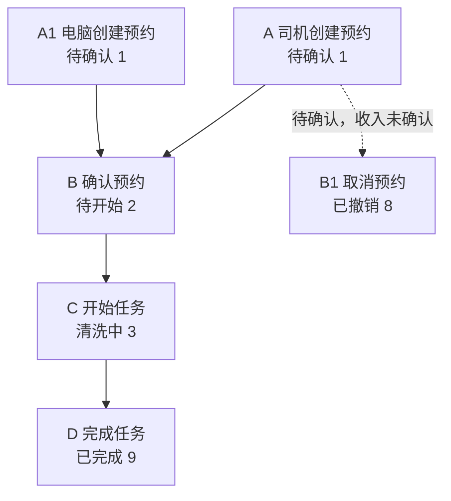
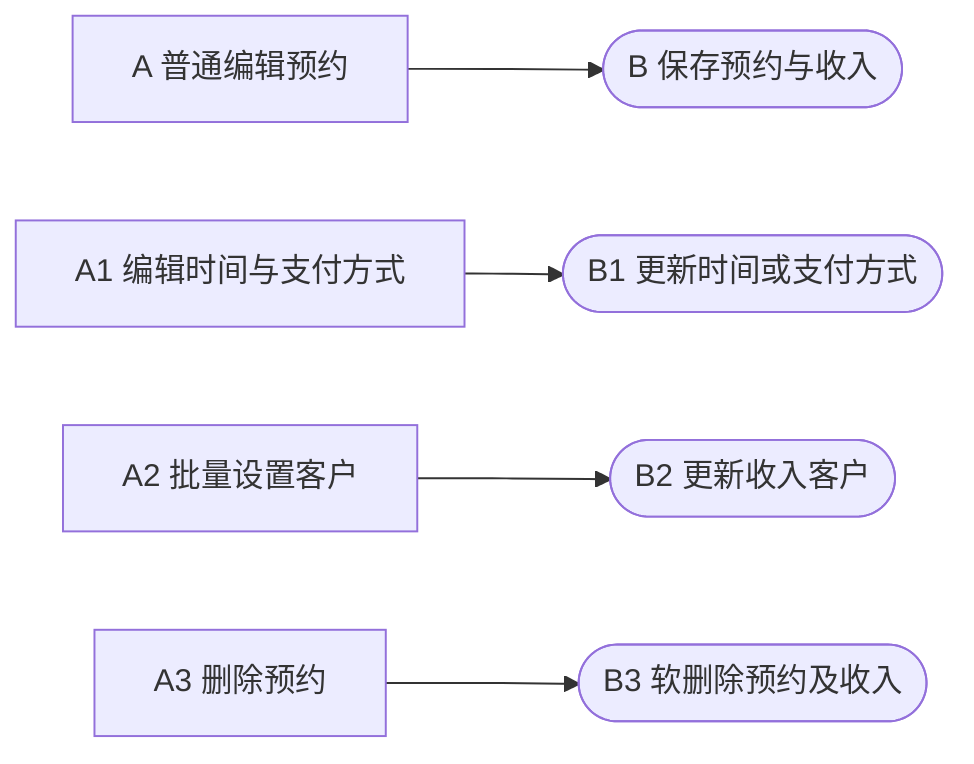
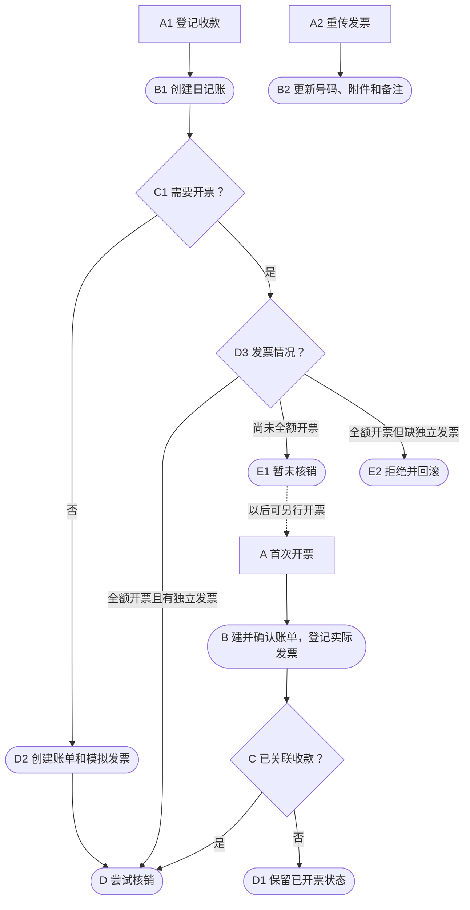
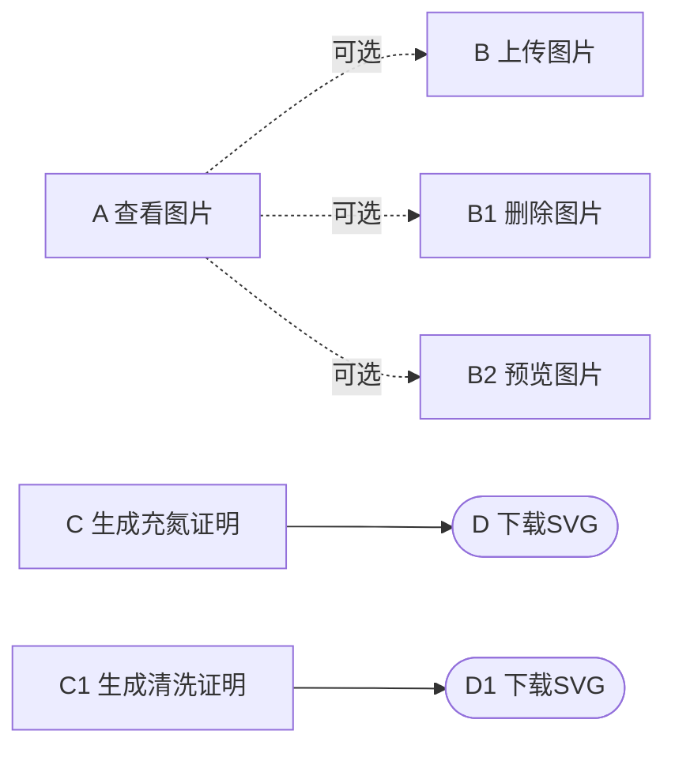
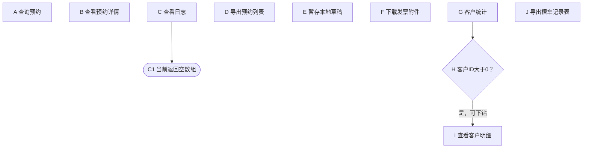
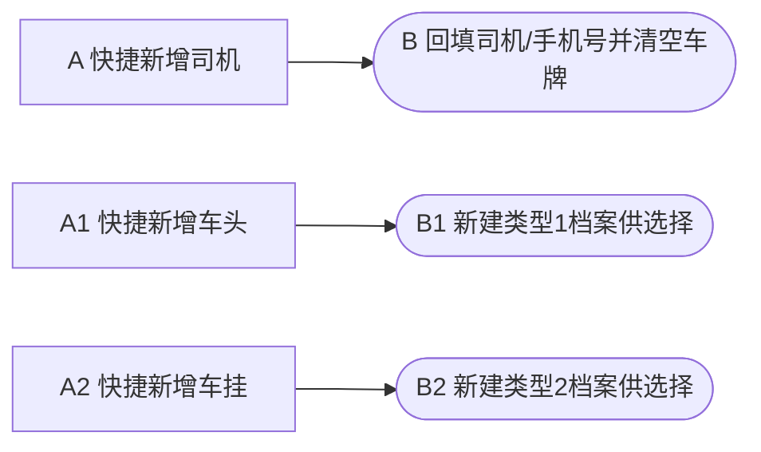

# 槽罐车清洗：开发测试功能说明

第2节查看业务流程和操作入口，第3节按页面查找功能、规则与触发结果；第4节合并字段定义和校验，第5、6节查看Map与按钮条件，第7节查报表，第9节定位完整映射和证据。当前内容来自静态代码分析，页面与接口验收尚未执行。后续AI使用独立的 [AI上下文](/www/ai/skill-previews/code-module-feature-map/yard-tank-clean/ai-context.md)，功能修改后同步本说明。

## 1. 模块范围

覆盖后台预约列表、表单/详情、图片与证明、快捷财务及统计；手机司机预约列表/表单/详情和工人作业列表/详情，以及专项账单中的槽罐车导出入口。作业与财务并非强制串行，取消不等于删除，日记账登记不等于收入核销。

源码基线与既有静态分析一致。本次重点核对请求/响应、费用回填及司机费用白名单，按当前模板合并字段表和精简展示；其余事实沿用同一基线的既有静态分析。通用财务、司机/车牌及通用上传只覆盖调用边界；部署地址、实际角色/岗位、目标库DDL和客户端效果未核验。操作链接均为已确认的页面代码入口，弹层/子页面以进入路径说明；未调用业务接口、查询数据库或执行迁移。

## 2. 业务流程

主线使用A-B-C-D，分支使用数字后缀，各图独立编号。功能名称保留稳定F编号，功能描述末尾的图标识/节点对应流程图；圆角表示结果，菱形表示判断。独立入口不虚构强制先后关系，具体规则按页面见第3节。

### 2.1 预约与清洗主流程

图标识：`FLOW-MAIN`。正常页面路径为待确认→待开始→清洗中→已完成；取消为可选分支。

| 功能名称 | 操作端 | 功能描述 | 操作链接 | 处理结果 |
| --- | --- | --- | --- | --- |
| F-001 司机创建预约 | 手机 | 填写司机、车辆、入场时间和清洗信息，提交手机预约；`FLOW-MAIN / A` | [代码入口：司机预约列表](/www/yard/web/npm/mobile-cli/src/pages/driver/tankClean/list.vue:1) → 预约槽罐车清洗 → [代码入口：司机预约表单](/www/yard/web/npm/mobile-cli/src/pages/driver/tankClean/form.vue:1) | 创建预约与关联收入，同步司机资料 |
| F-002 电脑创建预约 | 电脑 | 由后台录入预约信息及清洗费用；`FLOW-MAIN / A1` | [代码入口：后台槽罐车清洗](/www/yard/web/public/backend/pages/yard/extraOpe/tankCleanOrder.js:4) → 新建预约 | 事务内创建预约及传入的关联收入 |
| F-003 确认预约 | 电脑 | 核对待确认预约，允许其进入作业准备阶段；`FLOW-MAIN / B` | [代码入口：后台槽罐车清洗](/www/yard/web/public/backend/pages/yard/extraOpe/tankCleanOrder.js:4) → 列表行／确认 | 将状态1改为2 |
| F-004 开始任务 | 电脑、手机 | 对待开始任务登记实际开工作业；`FLOW-MAIN / C` | [代码入口：后台槽罐车清洗](/www/yard/web/public/backend/pages/yard/extraOpe/tankCleanOrder.js:4) → 列表行／开始任务；[代码入口：工人作业列表](/www/yard/web/npm/mobile-cli/src/pages/worker/tankClean/list.vue:1) 或 [代码入口：工人作业详情](/www/yard/web/npm/mobile-cli/src/pages/worker/tankClean/detail.vue:1) → 开始任务 | 将状态2改为3，写开始时间 |
| F-005 完成任务 | 电脑、手机 | 对进行中的任务登记作业完成；`FLOW-MAIN / D` | [代码入口：后台槽罐车清洗](/www/yard/web/public/backend/pages/yard/extraOpe/tankCleanOrder.js:4) → 列表行／完成；[代码入口：工人作业列表](/www/yard/web/npm/mobile-cli/src/pages/worker/tankClean/list.vue:1) 或 [代码入口：工人作业详情](/www/yard/web/npm/mobile-cli/src/pages/worker/tankClean/detail.vue:1) → 完成 | 将状态3改为9，写结束及核验时间 |
| F-009 取消预约 | 手机 | 司机撤销尚可取消的本人预约；`FLOW-MAIN / B1` | [代码入口：司机预约列表](/www/yard/web/npm/mobile-cli/src/pages/driver/tankClean/list.vue:1) → 预约详情 → 取消预约 | 将状态改为8 |

### 2.2 预约维护

图标识：`FLOW-MAINTAIN`。各项均为独立入口，不存在图示之间的强制先后关系。

| 功能名称 | 操作端 | 功能描述 | 操作链接 | 处理结果 |
| --- | --- | --- | --- | --- |
| F-013 普通编辑预约 | 电脑 | 在财务未锁定时维护预约资料和费用；`FLOW-MAINTAIN / A` | [代码入口：后台槽罐车清洗](/www/yard/web/public/backend/pages/yard/extraOpe/tankCleanOrder.js:4) → 列表行／编辑 | 维护预约及关联收入 |
| F-006 编辑时间与支付方式 | 电脑 | 独立调整已完成记录的作业时间及约定支付方式；`FLOW-MAINTAIN / A1` | [代码入口：后台槽罐车清洗](/www/yard/web/public/backend/pages/yard/extraOpe/tankCleanOrder.js:4) → 列表行／编辑时间 | 更新起止时间或支付方式 |
| F-010 批量设置客户 | 电脑 | 给勾选预约的关联收入统一指定付费客户；`FLOW-MAINTAIN / A2` | [代码入口：后台槽罐车清洗](/www/yard/web/public/backend/pages/yard/extraOpe/tankCleanOrder.js:4) → 勾选记录 → 批量设置客户 | 事务内批量更新收入客户 |
| F-015 删除预约 | 电脑 | 删除符合财务限制的预约及其收入记录；`FLOW-MAINTAIN / A3` | [代码入口：后台槽罐车清洗](/www/yard/web/public/backend/pages/yard/extraOpe/tankCleanOrder.js:4) → 列表行／删除 | 事务内软删除预约及关联收入 |

### 2.3 快捷财务

图标识：`FLOW-FINANCE`。财务可从独立入口办理；该图描述内部联动，不表示必须先完成清洗。

| 功能名称 | 操作端 | 功能描述 | 操作链接 | 处理结果 |
| --- | --- | --- | --- | --- |
| F-007 首次开票 | 电脑 | 为需要实际票据的清洗收入登记首次发票；`FLOW-FINANCE / A` | [代码入口：后台槽罐车清洗](/www/yard/web/public/backend/pages/yard/extraOpe/tankCleanOrder.js:4) → 列表行／开票 → 发票抽屉 | 创建并确认账单，登记实际发票，必要时核销 |
| F-008 登记收款 | 电脑 | 登记清洗费用收款，并根据票据情况处理核销；`FLOW-FINANCE / A1` | [代码入口：后台槽罐车清洗](/www/yard/web/public/backend/pages/yard/extraOpe/tankCleanOrder.js:4) → 列表行／收款 | 登记日记账，按开票需要和已有发票决定核销 |
| F-014 重传发票 | 电脑 | 更换独属于当前预约的已开发票资料；`FLOW-FINANCE / A2` | [代码入口：后台槽罐车清洗](/www/yard/web/public/backend/pages/yard/extraOpe/tankCleanOrder.js:4) → 列表行／重传发票 | 更新独立发票号码、附件和备注 |

### 2.4 图片与证明

图标识：`FLOW-MEDIA`。图片操作为可选分支，两种证明各有独立入口。

| 功能名称 | 操作端 | 功能描述 | 操作链接 | 处理结果 |
| --- | --- | --- | --- | --- |
| F-011 查看图片 | 电脑、手机 | 查看预约关联的清洗前后及其他图片；`FLOW-MEDIA / A` | [代码入口：后台槽罐车清洗](/www/yard/web/public/backend/pages/yard/extraOpe/tankCleanOrder.js:4) → 列表行／图片；[代码入口：工人作业详情](/www/yard/web/npm/mobile-cli/src/pages/worker/tankClean/detail.vue:1) → 图片列表 | 展示当前预约图片集合 |
| F-016 上传图片 | 电脑、手机 | 选择清洗图片、类型和备注，关联到当前预约；`FLOW-MEDIA / B` | [代码入口：后台槽罐车清洗](/www/yard/web/public/backend/pages/yard/extraOpe/tankCleanOrder.js:4) → 图片 → 上传图片；[代码入口：工人作业详情](/www/yard/web/npm/mobile-cli/src/pages/worker/tankClean/detail.vue:1) → 选择并上传图片 | 上传文件并建立预约图片关联 |
| F-017 删除图片 | 电脑 | 从图片管理中移除指定图片记录；`FLOW-MEDIA / B1` | [代码入口：后台槽罐车清洗](/www/yard/web/public/backend/pages/yard/extraOpe/tankCleanOrder.js:4) → 图片 → 图片卡片／删除 | 软删除当前图片记录 |
| F-018 预览图片 | 电脑、手机 | 点击已有图片查看大图；`FLOW-MEDIA / B2` | [代码入口：后台槽罐车清洗](/www/yard/web/public/backend/pages/yard/extraOpe/tankCleanOrder.js:4) → 图片 → 点击图片；[代码入口：工人作业详情](/www/yard/web/npm/mobile-cli/src/pages/worker/tankClean/detail.vue:1) → 点击已有图片 | 大图或系统图片预览 |
| F-019 生成充氮证明 | 电脑 | 按预约资料生成充氮证明文件；`FLOW-MEDIA / C` | [代码入口：后台槽罐车清洗](/www/yard/web/public/backend/pages/yard/extraOpe/tankCleanOrder.js:4) → 列表行／充氮证明 | 生成并下载充氮证明SVG |
| F-020 生成清洗证明 | 电脑 | 按预约资料生成清洗证明文件；`FLOW-MEDIA / C1` | [代码入口：后台槽罐车清洗](/www/yard/web/public/backend/pages/yard/extraOpe/tankCleanOrder.js:4) → 列表行／清洗证明 | 生成并下载清洗证明SVG |

### 2.5 查询、报表与本地辅助

图标识：`FLOW-QUERY`。客户统计可下钻明细，其余节点为独立查询或辅助功能。

| 功能名称 | 操作端 | 功能描述 | 操作链接 | 处理结果 |
| --- | --- | --- | --- | --- |
| F-022 查询预约 | 电脑、手机 | 使用各端筛选和分页查看预约或作业记录；`FLOW-QUERY / A` | [代码入口：后台槽罐车清洗](/www/yard/web/public/backend/pages/yard/extraOpe/tankCleanOrder.js:4) → 预约列表；[代码入口：司机预约列表](/www/yard/web/npm/mobile-cli/src/pages/driver/tankClean/list.vue:1)；[代码入口：工人作业列表](/www/yard/web/npm/mobile-cli/src/pages/worker/tankClean/list.vue:1) | 按筛选分页加载预约 |
| F-023 查看预约详情 | 电脑、手机 | 打开预约详情，查看作业、车辆及相关费用信息；`FLOW-QUERY / B` | [代码入口：后台槽罐车清洗](/www/yard/web/public/backend/pages/yard/extraOpe/tankCleanOrder.js:4) → 列表行／详情；[代码入口：司机预约列表](/www/yard/web/npm/mobile-cli/src/pages/driver/tankClean/list.vue:1) → 点击记录；[代码入口：工人作业列表](/www/yard/web/npm/mobile-cli/src/pages/worker/tankClean/list.vue:1) → 详情 | 只读展示预约、财务或作业信息 |
| F-028 查看日志 | 电脑 | 从后台详情进入操作日志页签；`FLOW-QUERY / C` | [代码入口：后台槽罐车清洗](/www/yard/web/public/backend/pages/yard/extraOpe/tankCleanOrder.js:4) → 详情 → 操作日志页签 | 请求日志，当前接口返回空数组 |
| F-024 导出预约列表 | 电脑 | 从后台列表导出当前列表配置对应的预约数据；`FLOW-QUERY / D` | [代码入口：后台槽罐车清洗](/www/yard/web/public/backend/pages/yard/extraOpe/tankCleanOrder.js:4) → 列表工具栏／导出图标 | 按列表配置生成Excel |
| F-025 暂存本地草稿 | 手机 | 在司机表单暂存未提交的信息，供再次填写；`FLOW-QUERY / E` | [代码入口：司机预约表单](/www/yard/web/npm/mobile-cli/src/pages/driver/tankClean/form.vue:1) → 暂存 | 本地保存草稿，不创建预约 |
| F-026 下载发票附件 | 手机 | 从司机详情打开或下载关联发票附件；`FLOW-QUERY / F` | [代码入口：司机预约列表](/www/yard/web/npm/mobile-cli/src/pages/driver/tankClean/list.vue:1) → 预约详情 → 发票附件／点击下载 | 打开、下载或预览附件 |
| F-012 客户统计 | 电脑 | 使用客户、司机、入场时间等条件查看客户汇总；`FLOW-QUERY / G` | [代码入口：后台槽罐车清洗](/www/yard/web/public/backend/pages/yard/extraOpe/tankCleanOrder.js:4) → 统计报表页签 | 按客户汇总作业和相关金额 |
| F-027 查看客户明细 | 电脑 | 从客户统计行进入该客户的预约明细；`FLOW-QUERY / I` | [代码入口：后台槽罐车清洗](/www/yard/web/public/backend/pages/yard/extraOpe/tankCleanOrder.js:4) → 统计报表 → 客户详情 | 携带客户及筛选打开预约明细 |
| F-021 导出槽车记录表 | 电脑 | 从专项账单选中槽罐车账单，生成专用明细文件；`FLOW-QUERY / J` | [代码入口：专项账单](/www/yard/web/public/backend/pages/yard/finance/generalIncomeAccount.js:542) → 勾选账单 → 槽罐车导出 | 生成槽车记录表12列专用Excel |

### 2.6 表单内档案快捷维护

图标识：`FLOW-REFERENCE`。三个快捷入口各自调用档案接口并回填表单。

| 功能名称 | 操作端 | 功能描述 | 操作链接 | 处理结果 |
| --- | --- | --- | --- | --- |
| F-029 快捷新增司机 | 电脑 | 在预约表单内快捷创建司机档案；`FLOW-REFERENCE / A` | [代码入口：后台槽罐车清洗](/www/yard/web/public/backend/pages/yard/extraOpe/tankCleanOrder.js:4) → 新建/编辑预约 → 司机选择器／新增 | 创建司机并回填信息，清空车牌 |
| F-030 快捷新增车头 | 电脑 | 在预约表单内快捷创建车头档案；`FLOW-REFERENCE / A1` | [代码入口：后台槽罐车清洗](/www/yard/web/public/backend/pages/yard/extraOpe/tankCleanOrder.js:4) → 新建/编辑预约 → 车头选择器／新增 | 新建类型1车牌并供选择 |
| F-031 快捷新增车挂 | 电脑 | 在预约表单内快捷创建车挂档案；`FLOW-REFERENCE / A2` | [代码入口：后台槽罐车清洗](/www/yard/web/public/backend/pages/yard/extraOpe/tankCleanOrder.js:4) → 新建/编辑预约 → 车挂选择器／新增 | 新建类型2车牌并供选择 |

## 3. 页面与功能描述

以下按电脑端页面与弹层、司机端、工人端分别组织，表内按页面区域和操作顺序列举。组件生成的“确认提交”文案未做运行核验。检查点来自代码推导，当前缺陷与正确业务预期分别说明。

### 3.1 后台预约列表（电脑）

入口：[代码入口：后台槽罐车清洗](/www/yard/web/public/backend/pages/yard/extraOpe/tankCleanOrder.js:4)，菜单路由 `yard/extraOpe/tankCleanOrder` → 预约列表。

进入后自动按筛选/分页加载预约；筛选覆盖司机、客户、入场时间、车队和流程状态。工具栏、批量区和行操作如下。普通编辑锁是收入已确认、全额开票、全额收款任一成立；权限码不代表实际角色授权。财务操作不统一要求作业完成。

| 按钮名称 | 关键规则 | 触发结果 |
| --- | --- | --- |
| 刷新图标 | 页面可访问，无额外局部权限或状态表达式 | 重新加载预约列表，不修改预约状态或费用；请求失败不应理解为业务已修改。 |
| 导出图标 | 页面可访问，未配置独立导出权限或勾选条数条件 | 生成预约列表Excel；这是普通列表导出，不是客户统计报表。 |
| 新建预约 | 有新建权限 | 打开新建预约弹窗；此时尚未创建预约，取消关闭不等于撤销已快捷创建的司机或车牌。 |
| 批量设置客户 | 编辑权限，通过批量组件选择预约 | 打开客户设置弹窗，带入所选预约ID；打开弹窗尚未修改客户。 |
| 详情 | 读取权限、有效预约 | 加载预约及关联信息并打开详情抽屉；没有读取权限时入口隐藏。 |
| 图片 | 读取权限，无作业状态限制 | 打开预约图片集合；无读取权限时隐藏入口，不能仅凭编辑权限进入。 |
| 充氮证明 | 读取权限、有效预约，无完成/充氮项目显示限制 | 生成并下载充氮证明SVG，不推进作业状态；0.5Bar、有压等模板文字不是现场检测结果。 |
| 清洗证明 | 读取权限、有效预约，未配置状态限制 | 生成并下载清洗证明SVG，不推进作业状态；当前不以已完成为统一前提。 |
| 编辑 | 编辑权限、非撤销、未触发普通编辑锁 | 打开编辑表单；已完成但财务未锁定仍能进入，打开本身不保存数据。 |
| 确认 | 确认权限、状态1 | 确认后由待确认1变为待开始2；不保存预约/费用表单。非状态1请求被拒绝，不推进状态。 |
| 开始任务 | 开始权限、状态2 | 确认后由待开始2变为清洗中3，记录当前开始时间；状态不符拒绝，不跳步。 |
| 完成 | 完成权限、状态3 | 确认后由清洗中3变为完成9，写结束及核验时间；待开始直接完成被拒绝。 |
| 编辑时间 | 编辑权限、状态9，不叠加普通编辑财务锁 | 打开独立时间/支付方式表单；已开票或已收款不单独阻止打开，不等于普通编辑。 |
| 开票或重传发票 | 非撤销；开票满足①收入/客户有效且需票未全开，或②无需票且有收款无发票；重传须收入/客户有效、需票全额已开且有独立发票 | 打开首次开票或重传抽屉，重传条件优先；“无需票且有收款无发票”的显示分支可能仍出现，但实际服务拒绝无需票开票。 |
| 收款 | 非撤销，收入/客户有效、无已有收款标志、金额大于0；服务要求收入未收款 | 先创建日记账；需票未全开时暂不核销，全开且有独立发票时核销，无需票走账单和内部模拟票后核销；缺独立发票等错误会回滚。 |
| 删除 | 删除权限，无已有发票/收款标志，页面未限制作业状态；服务拒绝关联发票/收款ID及部分或全部开票/收款；页面仅用已有发票/收款标志过滤 | 合法时事务内软删除预约及收入；部分/全部开票收款或残留关联ID导致拒绝。不会自动撤销账单或清理图片文件。 |

### 3.2 新建与编辑预约表单（电脑）

入口：[代码入口：后台槽罐车清洗](/www/yard/web/public/backend/pages/yard/extraOpe/tankCleanOrder.js:4) → 新建预约或列表行／编辑；两者使用相同预约字段组件。

按司机、车头、车挂等字段填写。电脑要求司机、车头、入场时间，车挂和客户可暂空；无客户时不能快捷开票/收款。费用与预约备注分别保存，收入类型5/connect_id关联预约，账单来源12是另一编码。清洗类型是逗号字符串，支付方式含历史值差异，字段和Map详见第4、5节。快捷档案独立创建，关闭预约不撤销档案。

| 按钮名称 | 关键规则 | 触发结果 |
| --- | --- | --- |
| 新增司机 | 可打开新建/编辑预约表单，未叠加司机局部权限表达式 | 打开快捷司机新增表单，不立即创建档案。 |
| 新增司机表单／确认提交 | 手机号必填且符合正则，外部接口校验通过 | 独立创建司机，回填司机和手机号并清空车牌；取消外层预约表单不会撤销该档案。 |
| 新增车头 | 可打开预约表单，无额外“已选司机”禁用表达式 | 打开快捷车头新增表单；未选择司机时页面没有额外禁用表达式，不能据此断言后端一定允许。 |
| 新增车头表单／确认提交 | 车牌必填并符合车头正则，携带司机，外部接口校验通过 | 通过外部接口校验后创建类型1车牌供选择；牌号格式错误被前端拦截，完整档案约束未展开。 |
| 新增车挂 | 可打开预约表单，无额外局部权限/司机禁用表达式 | 打开快捷车挂新增表单；打开尚未创建车挂档案。 |
| 新增车挂表单／确认提交 | 车牌必填并符合车挂正则，携带司机，外部接口校验通过 | 通过外部接口校验后创建类型2车牌供选择；车挂与车头使用不同正则，独立档案不随预约关闭撤销。 |
| 新建预约弹窗／提交 | 表单已打开；司机、车头、入场时间和费用校验通过；电脑创建须司机、车头、入场时间；司机创建还须车挂，页面另需勾真实性承诺 | 事务内创建待确认预约及传入的收入；必填或费用校验不通过则不应创建。电脑来源值未显式写2，实际默认未核验。 |
| 编辑预约弹窗／确认提交 | 输入通过校验，提交时仍满足服务财务锁规则；非撤销，且收入未确认、未全额开票、未全额收款 | 通过校验且未锁定时保存预约和费用；打开后状态/财务变化也可能被后端拒绝。 |

### 3.3 批量设置客户弹窗（电脑）

入口：[代码入口：后台槽罐车清洗](/www/yard/web/public/backend/pages/yard/extraOpe/tankCleanOrder.js:4) → 勾选预约 → 批量设置客户。

仅维护所选预约关联收入的客户；不同于逐条普通编辑的完整财务锁规则。

| 按钮名称 | 关键规则 | 触发结果 |
| --- | --- | --- |
| 确认提交 | 客户必填且ID大于0，全部所选预约通过后端校验；客户ID大于0、所选预约均存在，且非撤销、有有效收入、收入未确认 | 全部满足则批量更新关联收入客户；混选已撤销、缺收入或收入已确认记录时拒绝并回滚，不应部分成功。 |

### 3.4 预约详情抽屉（电脑）

入口：[代码入口：后台槽罐车清洗](/www/yard/web/public/backend/pages/yard/extraOpe/tankCleanOrder.js:4) → 列表行／详情。

打开时加载当前预约、车辆、收入和作业信息，概况信息用于只读查看；操作日志是独立页签，当前接口未接入实际记录。

| 按钮名称 | 关键规则 | 触发结果 |
| --- | --- | --- |
| 操作日志页签 | 继承详情读取入口前提 | 当前日志接口固定返回空数组，页签没有真实变更记录；这是现状缺口，不是完整日志验收目标。 |

### 3.5 图片管理与上传弹窗（电脑）

入口：[代码入口：后台槽罐车清洗](/www/yard/web/public/backend/pages/yard/extraOpe/tankCleanOrder.js:4) → 列表行／图片。

图片父入口需读取权限，内部上传/删除另需编辑权限。页面未统一限制作业状态；上传类型1清洗前、2清洗后、3其他，默认2。图片地址由本地/OSS及历史回退生成，软删不代表清理物理文件。

| 按钮名称 | 关键规则 | 触发结果 |
| --- | --- | --- |
| 上传图片 | 父入口读取权限加编辑权限，无作业状态限制 | 打开图片类型、文件和备注表单；打开尚未建立图片关联。 |
| 文件控件“上传图片” | 已打开上传表单，支持多选或拖入指定图片类型 | 准备待提交的图片Blob，可多选/拖入；选文件不等于创建图片记录。 |
| 确认提交 | 继承读取及编辑前提，图片类型和文件必填，预约/数据范围有效 | 上传文件并创建预约图片关联；不改变作业状态，后台没有工人端相同的3/9限制。 |
| 点击图片 | 图片已加载，继承父入口读取前提 | 打开当前图片大图；不修改预约和图片记录，坏地址影响展示。 |
| 删除 | 读取加编辑权限，图片ID和预约关联匹配 | 确认后软删除当前图片记录；不删除预约，也不表示物理图片文件被清理。 |

### 3.6 编辑时间弹窗（电脑）

入口：[代码入口：后台槽罐车清洗](/www/yard/web/public/backend/pages/yard/extraOpe/tankCleanOrder.js:4) → 列表行／编辑时间。

这是独立入口，页面只在状态9显示；服务仅排除撤销，不复用普通编辑的财务锁，也不强制原状态9。时间用Unix秒，0表示未设置。

| 按钮名称 | 关键规则 | 触发结果 |
| --- | --- | --- |
| 确认提交 | 支付方式必填；非撤销；均非零时结束不早于开始；页面要求状态9；服务只排除撤销，不走普通财务锁；两时间非零时结束不得早于开始 | 缺键保留旧时间，清空写0；两值正数且结束早于开始则拒绝。支付方式按传入更新，作业状态不因此推进。 |

### 3.7 开票与重传发票抽屉（电脑）

入口：[代码入口：后台槽罐车清洗](/www/yard/web/public/backend/pages/yard/extraOpe/tankCleanOrder.js:4) → 列表行／开票或重传发票。

按收入需票情况和开票状态进入首次开票或重传；无需票收款使用的内部模拟票不等于对外实际发票。页面财务按钮排除撤销，但已读模块服务未单独强制同等撤销限制，通用财务完整边界未展开。

| 按钮名称 | 关键规则 | 触发结果 |
| --- | --- | --- |
| 开票附件上传控件 | 已打开抽屉并选文件，控件未设置必填 | 通用上传返回附件路径供开票提交；上传成功不等于已登记发票。 |
| 确认提交 | 收入/客户有效且需开票；重传有独立发票，首次不能已有账单；有收入、客户ID大于0、需开票且未全额开票；快捷流程创建并确认账单，再登记实际发票 | 首次创建并确认账单后登记实际发票，有已关联收款则尝试核销；重传仅更新原独立发票号码/附件/备注。已有账单、无需票或重传缺独立发票等被拒绝。 |

### 3.8 统计报表页签（电脑）

入口：[代码入口：后台槽罐车清洗](/www/yard/web/public/backend/pages/yard/extraOpe/tankCleanOrder.js:4) → 统计报表。

自动加载统计卡片和客户统计表；按关联收入客户汇总，无客户归“未设置客户”。作业量是预约条数，未默认限定完成、不分币种/换汇，收款取收入核销口径，不能直接等同日记账登记。

| 按钮名称 | 关键规则 | 触发结果 |
| --- | --- | --- |
| 查询 | 页签可访问，条件可为空，无局部权限表达式 | 把筛选条件提交到统计卡片和客户统计表；按客户汇总，不默认只看已完成，数据不会因此改变。 |
| 刷新图标 | 页签可访问，无局部权限或状态限制 | 只重新加载客户统计表组件，不能据此推断顶部卡片同步刷新。 |
| 客户详情 | 客户ID大于0 | 打开该客户预约明细并透传当前筛选；客户ID非正时无此入口。 |

### 3.9 客户预约明细弹窗（电脑）

入口：[代码入口：后台槽罐车清洗](/www/yard/web/public/backend/pages/yard/extraOpe/tankCleanOrder.js:4) → 统计报表 → 客户ID大于0的行／客户详情。

自动加载当前客户预约列表，透传入场时间、司机、车队和状态筛选。当前配置没有额外业务写入按钮，不能把自动加载另造为按钮；该明细是统计下钻，不是独立统计报表。

### 3.10 专项账单槽罐车导出入口（电脑）

入口：[代码入口：专项账单](/www/yard/web/public/backend/pages/yard/finance/generalIncomeAccount.js:542) → 勾选账单 → 槽罐车导出；只分析本模块相关入口。

固定来源为空或12时构造此批量入口，导出权限为两种账单导出权限的OR。所选有效来源12账单收入需为槽罐车类型且关联有效预约。其他专项账单功能未完整覆盖。

| 按钮名称 | 关键规则 | 触发结果 |
| --- | --- | --- |
| 槽罐车导出 | 有 yardIncome.generalAccount.export 或 yardIncome.account.export 权限；固定来源为空或12，需选有效账单；来源12的账单收入须为槽罐车类型且关联有效预约；多选须同来源，非槽罐车不支持合并 | 来源12生成12列槽车记录表；多选混来源拒绝。单选其他来源可能导出其他格式，属于按钮文案与执行边界差异。 |

### 3.11 司机预约列表（手机）

入口：[代码入口：司机预约列表](/www/yard/web/npm/mobile-cli/src/pages/driver/tankClean/list.vue:1)，注册页面 `pages/driver/tankClean/list`。

进入后自动加载本人预约，卡片展示当前状态；页面内先列预约卡片，底部提供预约入口。查询不推进状态。

| 按钮名称 | 关键规则 | 触发结果 |
| --- | --- | --- |
| 点击记录卡片 | 有记录，接口校验本人及企业 | 加载本人预约详情并打开弹窗；跨司机/企业由控制器拒绝。 |
| 预约槽罐车清洗 | 可访问已登录司机端，无额外记录状态条件 | 跳转新建司机预约表单，不在跳转时创建预约。 |

### 3.12 司机预约详情与取消确认弹窗（手机）

入口：[代码入口：司机预约列表](/www/yard/web/npm/mobile-cli/src/pages/driver/tankClean/list.vue:1) → 点击预约卡片。

自动加载所选详情，控制器显式校验本人及企业。先展示基本信息和发票附件，再按状态提供取消；取消与删除不同，后台同名cancel方法未注册路由。

| 按钮名称 | 关键规则 | 触发结果 |
| --- | --- | --- |
| 发票附件“点击下载” | 有附件集合、当前地址非空 | 打开、下载或预览附件；空地址或下载失败有提示，不更改票据状态。 |
| 取消预约 | 详情状态1 | 打开取消确认框，尚未撤销预约；其他状态不显示该入口。 |
| 确认 | 归属有效，服务排除8/9及收入已确认；司机页面仅待确认可取消；服务拒绝已撤销、已完成及收入已确认 | 本人且状态/财务条件允许时改为撤销8并刷新列表，记录仍在；已撤销、已完成或收入已确认时服务拒绝。 |

### 3.13 司机新建预约表单（手机）

入口：[代码入口：司机预约表单](/www/yard/web/npm/mobile-cli/src/pages/driver/tankClean/form.vue:1)，注册页面 `pages/driver/tankClean/form`。

默认货类20、支付4、当前入场时间和初始费用0，支持读取草稿与最近车牌。真实性承诺只在本地校验，不随请求落库；隐藏/卸载自动暂存。与电脑不同，司机端车挂必填；草稿及最近车牌未按司机/企业隔离。

| 按钮名称 | 关键规则 | 触发结果 |
| --- | --- | --- |
| 暂存 | 表单可访问，不要求通过正式预约必填检查 | 更新本机草稿并提示，不创建后端预约；隐藏/卸载也会保存，成功提交清草稿。缓存未按司机/企业隔离是现状问题。 |
| 提交预约 | 已选车头、车挂，已勾真实性承诺；后端必填/格式通过；电脑创建须司机、车头、入场时间；司机创建还须车挂，页面另需勾真实性承诺 | 成功创建本人预约及收入、同步司机信息，清草稿后返回；缺车头/车挂或未承诺先提示，不创建预约。 |

### 3.14 工人作业列表（手机）

入口：[代码入口：工人作业列表](/www/yard/web/npm/mobile-cli/src/pages/worker/tankClean/list.vue:1)，注册页面 `pages/worker/tankClean/list`。

进入默认待开始2，提供单号搜索与2/3/9状态页签，滚动自动分页；控制器向列表查询注入企业。详情/开始/完成的数据范围还需结合基础服务和真实登录类型核对，不把登录等同岗位授权。

| 按钮名称 | 关键规则 | 触发结果 |
| --- | --- | --- |
| 单号搜索（搜索控件） | 工人列表可访问，搜索条件可为空 | 按当前状态和单号重置分页、重新请求作业列表；只改变查询结果，不改变作业状态。 |
| 待开始、清洗中、已完成（页签） | 工人列表可访问，状态分别为2/3/9 | 切换为2/3/9并重置分页重新加载；不提供待确认/已撤销作业页签。 |
| 详情 | 有可选记录，受登录及基础查询数据范围约束 | 进入对应作业详情页并加载数据；真实岗位授权和完整数据范围未做运行核验。 |
| 开始任务 | 记录状态2 | 确认后状态2变为3并写开始时间，提示开始成功并刷新列表；不满足原状态被服务拒绝。 |
| 完成 | 记录状态3 | 确认后状态3变为9并写结束/核验时间，提示完成并刷新列表；不满足原状态被服务拒绝。 |

### 3.15 工人作业详情（手机）

入口：[代码入口：工人作业详情](/www/yard/web/npm/mobile-cli/src/pages/worker/tankClean/detail.vue:1)，由列表详情进入并携带预约id。

自动加载基础资料及图片；按页面布局依次为图片上传、图片列表、底部作业操作。图片上传显式校验企业且只接受3/9，详情和开始/完成控制器未重复显式企业检查，需结合基础服务范围理解。

| 按钮名称 | 关键规则 | 触发结果 |
| --- | --- | --- |
| 选择并上传图片 | 界面无状态隐藏；上传中显示loading且方法阻止重复选择；后端要求3/9及企业匹配；工人服务只接受状态3/9、企业匹配及合法图片类型/文件；后台未配置相同状态限制 | 最多9张逐张上传，成功记录关联预约；当前回调不核对HTTP/业务码，可能误报整批成功，必须另核图片实际返回与记录。 |
| 点击已有图片 | 图片集合非空 | 调用系统图片预览，不创建或删除图片记录。 |
| 开始任务 | 详情状态2；父操作区要求2/3 | 确认后状态2变为3，记录开始时间并刷新详情。 |
| 完成 | 详情状态3；父操作区要求2/3 | 确认后状态3变为9，写结束/核验时间并刷新详情；不能从待开始直接完成。 |

## 4. 字段定义与数据来源

以下按预约基础/作业字段、费用及票据字段分组，每行合并含义、请求/响应、类型和两端校验。请求/响应说明相关入口的契约，不表示每个接口都接受或返回全部字段。类型/长度来自代码与声明迁移，未核验实际部署DDL；缺失、空串、null和零值须按各行说明区分。

### 4.1 预约基础与作业字段

| 字段名 | 请求/响应 | 字段含义 | 类型/单位/精度 | 前端默认/校验 | 后端默认/校验 | 补充说明 |
| --- | --- | --- | --- | --- | --- | --- |
| 预约标识 | 请求：各详情/修改/业务动作的 `id`；响应：预约 `id` | 预约标识，不同于图片ID或收入ID | 整数ID | 页面随记录传递 | 有效正ID校验 | 预约模型 `103_tank_clean_order` 的对应存储字段；非新增手填字段，受查询范围约束 |
| 业务单号 | 请求：查询 `order_no`；响应：`order_no`，正常表单不手填单号 | 业务单号 | 声明varchar(40) | 页面展示，不作为主要表单必填输入 | 缺省TC+日期时分秒+三位随机数 | 预约模型 `103_tank_clean_order` 的对应存储字段；线上唯一约束和部署DDL未核验 |
| 司机 | 请求：电脑 `driver_id`，司机创建由身份注入；响应：`driver_id` | 司机档案关联 | 整数关联ID | 电脑必填，手机由身份带入 | 电脑校验正值，司机入口写登录司机ID | 预约模型 `103_tank_clean_order` 的对应存储字段；不能指定其他司机，普通编辑受财务锁 |
| 司机姓名/手机号/车队 | 请求：`driver_name/driver_mobile/driver_fleet`；响应：`driver_name/driver_mobile/fleet` 及 `driver.name/mobile/fleet` | 由 driver.name/mobile/fleet 关联展示，不是预约同名快照 | 关联展示字符串 | 手机提交姓名/手机号/driver_fleet；电脑选司机回填 | 同步司机资料，非空手机按11位检查；展示来自driver关联 | 司机关联 `driver.name/mobile/fleet`，列表/详情另生成别名；司机入口可同步档案资料；非预约同名快照；快捷新增司机手机号另必填 |
| 车头 | 请求/响应：`head_plate_id` | 车头档案ID | 整数关联ID | 两端必填；选项按司机及类型1 | 创建正ID校验 | 预约模型 `103_tank_clean_order` 的对应存储字段；车牌档案完整约束未展开 |
| 车挂 | 请求/响应：`trailer_plate_id` | 车挂档案ID | 整数关联ID | 电脑可选，司机必填 | 司机创建必填；通用规则允许空/0 | 预约模型 `103_tank_clean_order` 的对应存储字段；空与0可表示未选；不能套用电脑可选推断司机端 |
| 车牌号码 | 请求：无同名页面写入字段；响应：派生 `plate_number` | 关联车头/车挂拼接展示值 | 关联拼接字符串 | 展示车头/车挂，中间斜杠 | 控制器拼接，无plate_number搜索器 | 车头/车挂关联牌号由控制器拼接，不是同名预约表列；不是同名表列，参数注释不能证明可筛选 |
| 前装货 | 请求/响应：`front_cargo` | 前装货名称 | 声明varchar(255) | 自由输入或从档案选择名称 | 本模块保存名称 | 预约模型 `103_tank_clean_order` 的对应存储字段；不是前装货档案ID，完整维护约束未展开 |
| 类别 | 请求：`cargo_category`；响应：原值及 `cargo_category_format` | 货物类别代码 | 整数枚举 | 默认20，详见Map | 验证枚举值或空，司机入口缺省20 | 预约模型 `103_tank_clean_order` 的对应存储字段；部分端显示编号，20普货不加编号 |
| 类别补充说明 | 请求/响应：`cargo_category_desc` | 货类补充说明 | 声明varchar(255) | 已分析主页面无独立控件 | 服务允许维护 | 预约模型 `103_tank_clean_order` 的对应存储字段；可输入范围未以独立页面控件展开 |
| 罐装材质 | 请求/响应：`tank_material` | 罐体材质 | 声明varchar(100)字符串 | 四个字符串选项 | 未见对应后端枚举限制 | 预约模型 `103_tank_clean_order` 的对应存储字段；不把前端选项等同存储只允许这四项 |
| 清洗类型 | 请求：`clean_type` 逗号字符串；响应：`clean_type`；手机 `clean_type_list` 仅本地数组 | 多选清洗项目 | 逗号分隔字符串 | 多选蒸罐/洗罐/充氮0.5；手机本地数组转字符串 | 保存clean_type | 预约模型 `103_tank_clean_order` 的对应存储字段；本地clean_type_list不作为表列；非实测值 |
| 大小 | 请求/响应：`tank_size` | 大小 | 声明varchar(100)文本 | 非必填输入 | 未见统一单位或数值约束 | 预约模型 `103_tank_clean_order` 的对应存储字段；不推断为体积，线上DDL未核验 |
| 仓位（工人端仓数） | 请求/响应：`warehouse_position` | 电脑显示仓位，工人显示仓数 | 声明varchar(100)文本 | 电脑仓位、工人仓数 | 未见仓数数值校验 | 预约模型 `103_tank_clean_order` 的对应存储字段；前后端文案不同，不擅自统一含义 |
| 入场时间 | 请求：`entry_time` 秒值或查询范围；响应：`entry_time` 及 `entry_time_format` | 入场/预约时间，收入日期也取此值 | Unix秒 | 创建必填，手机默认当前；picker毫秒转秒 | 服务缺键默认当前，校验数值；收入日期取此值 | 预约模型 `103_tank_clean_order` 的对应存储字段；不能将毫秒原值提交为秒 |
| 开始/完成时间 | 请求：独立编辑的 `task_start_time/task_end_time`；响应：原值及各自 `_format`，开始/完成动作自动写时间 | 作业起止时间 | Unix秒，0表示未设置 | 独立时间表单允许清空，作业按钮触发开始/完成 | 开始/完成写当前秒；编辑缺键保留、空值0，均正值才检查先后 | 预约模型 `103_tank_clean_order` 的对应存储字段；页面独立编辑限已完成，服务只排除撤销 |
| 去向 | 请求/响应：`destination` | 去向 | 声明varchar(255)文本 | 非必填输入 | 自由文本 | 预约模型 `103_tank_clean_order` 的对应存储字段；存储长度仅依据声明迁移 |
| 其他（预约备注） | 请求/响应：`remark` | 预约备注 | 声明varchar(255)文本 | 预约表单输入，与财务备注分开 | 保存预约remark | 预约模型 `103_tank_clean_order` 的对应存储字段；专用导出合并预约与收入备注 |
| 流程状态 | 请求：查询 `state`，正常作业由动作驱动；响应：`state/state_format` | 作业流程状态 | 整数1/2/3/8/9 | 由业务动作驱动 | 服务创建缺省1，按状态推进 | 预约模型 `103_tank_clean_order` 的对应存储字段；旧迁移1=进行中已过时；不无条件覆盖任意直接调用输入 |
| 预约来源 | 请求：司机入口写 `appoint_source=1`，主表单无手填；响应：记录 `appoint_source` | 预约来源 | 声明tinyint，1司机/2电脑 | 无主表单手填控件 | 司机入口显式1；电脑未显式2 | 预约模型 `103_tank_clean_order` 的对应存储字段；实际默认/历史分布待目标库核对 |
| 支付方式 | 请求：`pay_method`；响应：`pay_method/pay_method_format` | 约定支付方式，不代表已收款 | 整数枚举 | 当前2/3/4，默认4 | 枚举校验仍接受1；司机入口缺省4 | 预约模型 `103_tank_clean_order` 的对应存储字段；1显示“-”；不等于实际已收款 |
| 收入/发票/收款关联 | 请求：主表单不手填系统关联；响应：`income_item_id/invoice_id/payment_id` 及相应关联对象 | 收入、独立发票、现金日记账关联 | 整数ID | 系统关联，非普通选择字段 | 发票/付款关系过滤已撤销对象 | 预约表保存关联ID，收入/发票/日记账内容来自有效关联对象；ID存在、有效关联和财务核销状态不同 |

### 4.2 费用与票据字段

| 字段名 | 请求/响应 | 字段含义 | 类型/单位/精度 | 前端默认/校验 | 后端默认/校验 | 补充说明 |
| --- | --- | --- | --- | --- | --- | --- |
| 客户 | 请求：费用 `income_item.custom_id`，筛选/批量 `custom_id`；响应：详情费用对象、关联收入及 `income_custom_id/income_custom_name` | 付费客户，收入表同名列 | 整数客户ID | 电脑可暂不填 | 服务默认0；开票/收款要求ID大于0 | 关联收入表字段，后台详情另构造 `income_item` 回填对象；0表示未设置；真实档案/通用财务约束未完整核验 |
| 费用名 | 请求：`income_item.expense_name`；响应：详情 `income_item.expense_name` 及关联收入 | 费用名称 | 字符串 | 默认槽罐车清洗费用 | 服务及司机入口同名默认 | 关联收入表字段，后台详情另构造 `income_item` 回填对象；与费用归属和费用类型编码区分 |
| 币种 | 请求：`income_item.currency`；响应：详情 `income_item.currency` 及关联收入 | 币种 | 整数1/2 | 人民币/美元，默认1 | 收入构造缺省1 | 关联收入表字段，后台详情另构造 `income_item` 回填对象；客户统计未分币种或换汇 |
| 开票 | 请求：`income_item.need_invoice`；响应：详情 `income_item.need_invoice` 及关联收入 | 开票需要 | 整数1/2 | 默认需票1，手机字符串提交转数字 | 非空费用对象校验合法值；服务缺失/null/空串拒绝，存在的非2归需票 | 关联收入表字段，后台详情另构造 `income_item` 回填对象；无费用对象与传入不完整费用对象分开理解 |
| 数量 | 请求：电脑 `income_item.quantity`，司机费用白名单不透传数量；响应：详情费用数量及关联收入 | 计费数量 | 数值，UI两位 | 默认1 | 非正值归一1 | 关联收入表字段，后台详情另构造 `income_item` 回填对象；数据库精度未核验 |
| 总金额 | 请求：`income_item.amount`；响应：详情费用金额、关联收入及派生 `amount` | 实际含税金额 | 数值，UI两位 | 司机初始提交0 | 经taxCompute构造含税总额及税额 | 关联收入表字段，后台详情另构造 `income_item` 回填对象；零额不能走当前收款；UI精度不等于数据库精度 |
| 单价/附加费用 | 请求：服务支持 `income_item.unit_amount/other_amount`，主表单无独立输入、司机白名单不透传；响应：关联收入同名字段 | 单价/附加费用 | 数值，中间运算四位 | 当前主要表单无独立输入项 | 服务支持；正总额且无单价先总额/数量反算四位单价 | 关联收入 `unit_amount/other_amount`；当前详情的 `income_item` 回填对象不包含这两项；隐藏输入不等于服务不支持 |
| 税率 | 请求：电脑 `income_item.tax_rate`，司机费用白名单不透传税率；响应：详情费用税率及关联收入 | 税率百分数 | 百分数整数 | 默认6，可选0/1/3/6/9/13 | 本模块服务缺省6 | 关联收入表字段，后台详情另构造 `income_item` 回填对象；不套用其他收入入口默认值 |
| 税额/不含税/预算字段 | 请求：无独立页面输入，服务计算；响应：关联收入 `tax_amount/excluding_tax_amount/budget_*` | 税额、不含税及预算字段 | 数值，中间计算四位 | 由计算结果展示 | taxCompute及预算构造 | 关联收入字段由 `FinanceTool::taxCompute` 及预算构造生成；两位展示不代表实际表列精度 |
| 单位/财务备注 | 请求：`income_item.unit`、`income_item.remark`，司机费用白名单不透传财务备注；响应：详情费用单位/备注及关联收入 | 计费单位/财务备注 | 字符串 | 单位默认次，备注为收入备注 | 服务同样缺省单位次 | 关联收入表字段，后台详情另构造 `income_item` 回填对象；与预约其他/remark独立 |
| 发票号码/附件/备注 | 请求：开票 `invoice_number/invoice_img/remark`；响应：`invoice_number/invoice_img/invoice_remark` | 关联发票号码、附件与备注 | 号码/备注字符串，附件对象数组 | 号码和附件当前未设必填；先通用文件上传 | 回显附件path/value/file_name；提交号码、附件、remark | 关联发票字段，经控制器补全附件 path/value/file_name；不是预约备注；invoice_remark是回显字段；上传文件不等于登记发票 |

## 5. Map、枚举与实际展示

| 字段/Map | 实际键值及类型、业务文案 | 默认/未命中处理 | 前后端或历史差异 | 使用端 |
| --- | --- | --- | --- | --- |
| `state` | 数值：1待确认；2待开始；3清洗中；8已撤销；9已完成 | 创建缺省1；枚举未知为未知，页面无通配兜底 | 页面Map与当前枚举一致；IN_PROGRESS=1名称不能按字面解释为清洗中；枚举未知为未知，页面无通配兜底 | 电脑/司机/工人/筛选 |
| `cargo_category` | 数值：1爆炸；2气体；3易燃液体；4易燃固体；5氧化物；6有毒/氰化物；7放射性；8腐蚀性；9杂项；20普货 | 默认20；未知为未知 | 默认20；选择器/工人/专用导出为编号.名称，普货无编号；电脑和司机详情为名称；未知为未知 | 电脑与手机选择器/详情、专用导出 |
| `pay_method` | 数值：2扫码；3对公转账；4月结；历史1显示“-” | 默认4；历史1文案为“-” | 默认4；后端cases接受1；常量WECHAT=1/ALIPAY=2/CASH=3/OTHER=4及旧迁移文案不等于当前业务含义 | 电脑与手机表单/详情 |
| `need_invoice` | 数值：1需开票；2无需开票 | 默认1；枚举未知为未知 | 手机选项为字符串，提交转数字；枚举未知为未知；服务归一规则见第4节“开票”字段 | 两端费用表单/服务 |
| `currency` | 数值：1人民币；2美元 | 默认1 | 表单默认1；本模块统计未统一币种 | 电脑费用表单/统计 |
| `tank_material` | 字符串：不锈钢；铝合金；铁；衬塑 | 未发现统一必填默认，保存字符串 | 实际存字符串，不是数字编码 | 电脑/司机表单 |
| `clean_type` | 字符串：蒸罐；洗罐；充氮0.5 | 多选值逗号保存 | 可多选、逗号保存；证明0.5Bar来自模板/类型，非传感器测量 | 电脑/手机表单、证明 |
| `img_type` | 数值：1清洗前；2清洗后；3其他 | 上传默认2；后台未知为“-” | 两端上传表单默认2，接口校验合法值；后台未知显示“-” | 后台/工人图片上传 |
| `uploader_role` | 数值：1工人端；2电脑端 | 控制器写入；未知为“-” | 由对应控制器写入，非用户选择；未知显示“-” | 两端图片记录与后台展示 |
| `file_position` | 数值：1本地；2OSS | 按存储配置写入；旧值按当前模式回退 | 依据上传配置写入；完整HTTP(S)地址直接返回，旧值缺失按当前存储模式回退 | 图片上传服务/地址访问器 |
| `invoice_state_format` | 字符串键：未开票；部分开票；已开票；无需开票 | 通配键回显原文案 | 页面通配键显示原值；控制器根据有效发票或全额状态生成，当前不直接输出部分开票 | 后台预约列表 |
| `collection_state_format` | 字符串键：未收款；部分收款；已收款 | 通配键回显原文案 | 页面通配键显示原值；控制器当前仅生成已收款/未收款，不直接输出部分收款 | 后台预约列表 |
| `is_invoice_format/account_state_format/confirm_state_format` | 需/无需开票；已/未开账单；已/未确认 | 无收入时账单/确认显示“-” | 派生展示值，不是原始枚举；无收入时账单与确认状态显示“-” | 后台列表/详情 |

## 6. 列举页面按钮：描述按钮功能与可用条件

第3节说明页面功能与触发结果，本节集中核对按钮显示、隐藏、加载阻止和可用条件。

后台权限前缀 `yardExtraOpe.tankCleanOrder.`，读取/新建/编辑/确认/开始/完成/删除分别为 `read/add/edit/confirm/start/complete/del`。图片管理受父入口读取权限与子级编辑权限共同约束；实际角色/岗位授权未核验，所有动作还需满足登录及相应数据范围。

普通编辑锁表示收入已确认、全额开票、全额收款任一成立。已有发票/收款标志分别由有效关联对象或全额状态生成，不直接涵盖全部部分状态。开票/重传/收款没有额外局部财务权限表达式；其直接显示条件见下表，规则中的例外与服务校验需同时理解。

### 6.1 后台预约与财务

| 页面/区域/按钮名称 | 关联功能 ID | 按钮功能 | 可用条件 | 不可用时的表现或原因 |
| --- | --- | --- | --- | --- |
| 预约列表／刷新图标 | F-022 | 重新加载当前列表 | 页面可访问，无额外局部权限或状态表达式 | 失败是请求错误；自动加载不另算按钮 |
| 预约列表／导出图标 | F-024 | 导出预约列表Excel | 页面可访问，未配置独立导出权限或勾选条数条件 | 导出链路未运行验证，不等于控件有禁用条件 |
| 预约列表／新建预约 | F-002 | 打开新建表单 | 有新建权限 | 无权限隐藏，打开尚未创建数据 |
| 新建预约弹窗／提交 | F-002 | 创建预约及关联收入 | 表单已打开；司机、车头、入场时间和费用校验通过 | 必填或格式失败不能正常提交，服务可拒绝 |
| 预约列表批量操作／批量设置客户 | F-010 | 打开客户设置弹窗 | 编辑权限，通过批量组件选择预约 | 无权限隐藏，未选记录的控件表现依组件，未运行核验 |
| 批量设置客户弹窗／确认提交 | F-010 | 批量修改收入客户 | 客户必填且ID大于0，全部所选预约通过后端校验 | 撤销/缺收入/收入已确认则服务拒绝，事务回滚 |
| 预约列表行／详情 | F-023 | 打开详情抽屉 | 读取权限、有效预约 | 无权限隐藏，数据获取受后端范围约束 |
| 详情抽屉／操作日志页签 | F-028 | 请求日志列表 | 继承详情读取入口前提 | 页签存在，接口固定空数组，不是禁用 |
| 预约列表行／编辑 | F-013 | 打开编辑表单 | 编辑权限、非撤销、未触发普通编辑锁 | 不满足隐藏，已完成本身不阻止编辑 |
| 编辑预约弹窗／确认提交 | F-013 | 保存预约和收入 | 输入通过校验，提交时仍满足服务财务锁规则 | 打开后状态变化也可被后端拒绝 |
| 预约列表行／确认 | F-003 | 二次确认后转待开始 | 确认权限、状态1 | 其他状态或无权限隐藏，后端再次校验 |
| 预约列表行／开始任务 | F-004 | 二次确认后开始并记时间 | 开始权限、状态2 | 其他状态或无权限隐藏，服务检查原状态 |
| 预约列表行／完成 | F-005 | 二次确认后完成并记时间 | 完成权限、状态3 | 其他状态或无权限隐藏，服务拒绝跳过开始 |
| 预约列表行／编辑时间 | F-006 | 打开时间与支付方式表单 | 编辑权限、状态9，不叠加普通编辑财务锁 | 其他状态或无权限隐藏 |
| 编辑时间弹窗／确认提交 | F-006 | 保存起止时间和支付方式 | 支付方式必填；非撤销；均非零时结束不早于开始 | 表单/服务校验拒绝；服务未强制状态9 |
| 预约列表行／开票或重传发票 | F-007、F-014 | 打开开票/重传抽屉；重传条件成立时优先显示重传 | 非撤销；开票满足①收入/客户有效且需票未全开，或②无需票且有收款无发票；重传须收入/客户有效、需票全额已开且有独立发票 | 不满足隐藏；无需开票例外分支可显示却被服务拒绝 |
| 发票抽屉／开票附件上传控件 | F-007、F-014 | 先通用上传，准备附件路径 | 已打开抽屉并选文件，控件未设置必填 | 上传文件不等于已登记发票，通用上传完整限制未展开 |
| 发票抽屉／确认提交 | F-007、F-014 | 首次登记发票或更新独立发票 | 收入/客户有效且需开票；重传有独立发票，首次不能已有账单 | 服务不满足则拒绝；号码/附件未设页面必填 |
| 预约列表行／收款 | F-008 | 二次确认后登记日记账并按条件核销 | 非撤销，收入/客户有效、无已有收款标志、金额大于0；服务要求收入未收款 | 不满足隐藏；部分收款、缺独立发票或已有账单等可被拒绝 |
| 预约列表行／删除 | F-015 | 二次确认后软删预约和收入 | 删除权限，无已有发票/收款标志，页面未限制作业状态 | 不满足隐藏；服务另拒绝部分财务状态和残留关联ID |

### 6.2 图片与证明

| 页面/区域/按钮名称 | 关联功能 ID | 按钮功能 | 可用条件 | 不可用时的表现或原因 |
| --- | --- | --- | --- | --- |
| 预约列表行／图片 | F-011 | 打开图片管理窗口 | 读取权限，无作业状态限制 | 无权限隐藏 |
| 图片窗口／上传图片 | F-016 | 打开类型、文件、备注表单 | 父入口读取权限加编辑权限，无作业状态限制 | 无编辑权限隐藏；子权限不能替代父入口权限 |
| 图片上传表单／文件控件“上传图片” | F-016 | 选择待提交图片文件 | 已打开上传表单，支持多选或拖入指定图片类型 | 当前以Blob交给表单提交，选文件尚不等于创建图片记录 |
| 图片上传弹窗／确认提交 | F-016 | 上传并创建图片关联 | 继承读取及编辑前提，图片类型和文件必填，预约/数据范围有效 | 表单或后端拒绝；后台没有工人端相同的3/9限制 |
| 图片卡片／删除 | F-017 | 二次确认后软删当前图片 | 读取加编辑权限，图片ID和预约关联匹配 | 无编辑权限隐藏，关联不符服务拒绝；不是删除预约 |
| 图片卡片／点击图片 | F-018 | 打开大图弹窗 | 图片已加载，继承父入口读取前提 | 无图片无点击对象，坏地址影响显示而非业务禁用 |
| 预约列表行／充氮证明 | F-019 | 生成下载SVG证明 | 读取权限、有效预约，无完成/充氮项目显示限制 | 无权限隐藏；模板文字不表示实测 |
| 预约列表行／清洗证明 | F-020 | 生成下载SVG证明 | 读取权限、有效预约，未配置状态限制 | 无权限隐藏；后端也未统一要求已完成 |

### 6.3 司机端与工人端

| 页面/区域/按钮名称 | 关联功能 ID | 按钮功能 | 可用条件 | 不可用时的表现或原因 |
| --- | --- | --- | --- | --- |
| 司机列表／预约槽罐车清洗 | F-001 | 进入预约表单 | 可访问已登录司机端，无额外记录状态条件 | 身份前提由登录及接口链路处理 |
| 司机表单／提交预约 | F-001 | 创建预约，成功后清草稿并返回 | 已选车头、车挂，已勾真实性承诺；后端必填/格式通过 | 缺车牌或承诺会提示；500毫秒防抖，未发现独立请求中禁用锁 |
| 司机表单／暂存 | F-025 | 保存本机草稿并提示 | 表单可访问，不要求通过正式预约必填检查 | 不是后端保存，缓存未按身份隔离 |
| 司机列表／点击记录卡片 | F-023 | 获取本人预约详情并打开弹窗 | 有记录，接口校验本人及企业 | 不属于本人或企业由接口拒绝 |
| 司机详情／取消预约 | F-009 | 打开取消确认框 | 详情状态1 | 其他状态不显示；打开弹框未执行撤销 |
| 司机取消确认框／确认 | F-009 | 执行撤销并刷新列表 | 归属有效，服务排除8/9及收入已确认 | 提交时状态/财务变化可被拒绝 |
| 司机详情／发票附件“点击下载” | F-026 | 打开或下载附件 | 有附件集合、当前地址非空 | 无附件不显示；空地址或下载失败有提示 |
| 工人列表／单号搜索（搜索控件） | F-022 | 按单号重新查询作业 | 工人列表可访问，搜索条件可为空 | 提交搜索后重置分页；请求失败由请求链路处理 |
| 工人列表／待开始、清洗中、已完成（页签） | F-022 | 切换状态并重新查询作业 | 工人列表可访问，状态分别为2/3/9 | 不提供待确认/已撤销页签，服务也限制允许状态 |
| 工人列表／详情 | F-023 | 进入详情页 | 有可选记录，受登录及基础查询数据范围约束 | 未核验实际岗位授权，不把登录当作岗位证明 |
| 工人列表／开始任务 | F-004 | 二次确认后开始任务 | 记录状态2 | 其他状态隐藏，服务再检查原状态 |
| 工人列表／完成 | F-005 | 二次确认后完成任务 | 记录状态3 | 其他状态隐藏，服务再检查原状态 |
| 工人详情／开始任务 | F-004 | 二次确认后开始并刷新 | 详情状态2；父操作区要求2/3 | 其他状态隐藏 |
| 工人详情／完成 | F-005 | 二次确认后完成并刷新 | 详情状态3；父操作区要求2/3 | 其他状态隐藏，不能从待开始直接完成 |
| 工人详情／选择并上传图片 | F-016 | 最多选择9张，逐张上传 | 界面无状态隐藏；上传中显示loading且方法阻止重复选择；后端要求3/9及企业匹配 | 待开始仍显示但后端拒绝；回调未检查HTTP/业务码，可能误报成功 |
| 工人详情／点击已有图片 | F-018 | 系统图片预览 | 图片集合非空 | 无图片无点击对象 |

### 6.4 报表及档案快捷入口

| 页面/区域/按钮名称 | 关联功能 ID | 按钮功能 | 可用条件 | 不可用时的表现或原因 |
| --- | --- | --- | --- | --- |
| 统计报表页签／查询 | F-012 | 提交筛选到统计卡片和客户表 | 页签可访问，条件可为空，无局部权限表达式 | 不强制只统计已完成，查询错误不等于禁用 |
| 客户统计表／刷新图标 | F-012 | 重新加载客户统计表 | 页签可访问，无局部权限或状态限制 | 只刷新表格组件，不能推断同步刷新顶部卡片 |
| 客户统计行／客户详情 | F-027 | 打开该客户的预约明细 | 客户ID大于0 | 未设置客户等ID非正行不显示 |
| 专项账单批量操作／槽罐车导出 | F-021 | 调用账单导出，来源12生成槽车记录表 | 有 yardIncome.generalAccount.export 或 yardIncome.account.export 权限；固定来源为空或12，需选有效账单 | 其他固定来源不构造，无权限隐藏；多选混来源会拒绝，单选其他来源可走其他导出格式 |
| 预约表单／新增司机 | F-029 | 打开快捷司机新增表单 | 可打开新建/编辑预约表单，未叠加司机局部权限表达式 | 不代表司机后端任意用户可写 |
| 新增司机表单／确认提交 | F-029 | 创建并回填司机、手机号，清空车牌 | 手机号必填且符合正则，外部接口校验通过 | 输入格式前端提示；外部模块完整权限/约束未展开 |
| 预约表单／新增车头 | F-030 | 打开快捷车头新增表单 | 可打开预约表单，无额外“已选司机”禁用表达式 | 不能把请求有司机参数推断为页面已禁用无司机场景 |
| 新增车头表单／确认提交 | F-030 | 创建类型1车牌供选择 | 车牌必填并符合车头正则，携带司机，外部接口校验通过 | 前端格式校验或外部服务拒绝 |
| 预约表单／新增车挂 | F-031 | 打开快捷车挂新增表单 | 可打开预约表单，无额外局部权限/司机禁用表达式 | 外部档案入口不等于完整权限已核验 |
| 新增车挂表单／确认提交 | F-031 | 创建类型2车牌供选择 | 车牌必填并符合车挂正则，携带司机，外部接口校验通过 | 车挂正则与车头不同，完整后端约束未展开 |

“确认提交”描述表单提交动作；新建明确文案为“提交”，其他由组件生成的实际文案未运行核验。关闭/取消弹层、列切换和分页仅改变展示；自动加载归入查询。图片ZIP下载按钮已注释，后台cancel未注册路由，日志接口固定空数组，不推断为已开放相应能力。

## 7. 相关统计报表

未核验部署域名，链接均为真实代码入口，按所属页面进入，不以API或下载地址冒充报表页面。客户明细为统计下钻，预约通用导出是普通业务列表导出，均不另算独立统计报表。[E-001、E-014]

| 报表名称 | 报表链接 | 简述 |
| --- | --- | --- |
| 客户统计报表 | [代码入口：槽罐车清洗 → 统计报表页签](/www/yard/web/public/backend/pages/yard/extraOpe/tankCleanOrder.js:1078) | 按客户查看作业量、金额、开票及收入核销收款，可下钻明细。未默认只看已完成、未分币种/换汇，未核销日记账不等于报表收款。 |
| 槽车记录表（专用明细报表） | [代码入口：专项账单 → 槽罐车导出](/www/yard/web/public/backend/pages/yard/finance/generalIncomeAccount.js:542) | 选中槽罐车账单生成车辆与清洗费用的12列Excel，属于专用明细报表文件。不是在线汇总统计页。 |

## 8. 优化建议

所有条目均未授权实施，证据和触发条件用于后续判断，不自动构成需求。

| 建议 ID | 关联功能 ID | 问题与触发条件 | 建议及验证方向 | 优先级理由 | 证据 |
| --- | --- | --- | --- | --- | --- |
| OPT-001 | F-028 | 已确认实现缺口：日志页签接口固定返回空数组 | 接入真实日志前明确业务要求，核对创建/修改后的日志及企业范围 | 中：影响追溯 | E-001、E-002 |
| OPT-002 | F-001、F-002、F-006、F-013 | 一致性：支付历史值1可通过校验但显示“-”，常量名与当前文案不同 | 确认历史兼容策略后统一校验、展示与注释，覆盖1/2/3/4 | 中：影响支付方式理解 | E-005～E-007、E-017 |
| OPT-003 | F-016 | 交互差异：工人待开始仍能选上传，后端只接受3/9 | 补状态提示或入口条件，覆盖2/3/9及失败重试 | 中：减少无效操作 | E-010、E-011 |
| OPT-004 | F-016 | 反馈缺口：手机上传success回调未检查HTTP与业务成功码 | 逐张解析响应并处理部分失败，失败不能显示整批成功 | 高：可能误导上传结果 | E-010 |
| OPT-005 | F-006、F-007、F-008、F-009、F-014、F-015 | 条件差异：时间编辑、取消、开票标志、删除的前后端规则不完全一致 | 按实际业务确认哪些规则需后端强制，覆盖直接调用、部分财务状态及撤销 | 高：涉及流程和财务数据 | E-001～E-003、E-008 |
| OPT-006 | F-012 | 报表限制：跨币种直接累加，先收未核销不计收入收款 | 标明币种/核销范围，按业务选择分币种或换算，覆盖先收后票 | 中：影响财务解释 | E-003 |
| OPT-007 | F-025 | 缓存未隔离：草稿与最近车牌键不含司机/企业 | 按身份分隔或切换时清理，覆盖同设备换账号 | 中：避免串用资料 | E-007 |
| OPT-008 | F-002 | 来源记录：电脑创建未显式写 appoint_source=2 | 先核对实际默认和历史值，再决定由入口写可信来源 | 中：影响来源统计 | E-001、E-003、E-008、E-017 |
| OPT-009 | F-021 | 导出边界：槽罐车按钮未按所选记录类型限制，单选其他来源可能导出其他格式 | 确认是否应限定选中来源12；核对单选非12、多选混来源和有效槽罐车账单 | 中：按钮文案与输出可能不符 | E-014 |

## 9. 代码证据索引

前文按业务阅读需要精简列，本节保留完整功能、字段、Map和按钮映射。行号是当前基线的定位快照，长期定位同时依据路径与符号。

### 9.1 功能与流程/页面对应

| 功能 ID | 功能名称 | 流程图/节点 | 页面/按钮 | 证据 |
| --- | --- | --- | --- | --- |
| F-001 | 司机创建预约 | FLOW-MAIN / A | 第3.11节 司机预约列表（手机）：BTN-043 第3.13节 司机新建预约表单（手机）：BTN-024 | E-003、E-005、E-007、E-008 |
| F-002 | 电脑创建预约 | FLOW-MAIN / A1 | 第3.1节 后台预约列表（电脑）：BTN-003 第3.2节 新建与编辑预约表单（电脑）：BTN-035 | E-001～E-005 |
| F-003 | 确认预约 | FLOW-MAIN / B | 第3.1节 后台预约列表（电脑）：BTN-014 | E-001～E-003 |
| F-004 | 开始任务 | FLOW-MAIN / C | 第3.1节 后台预约列表（电脑）：BTN-015 第3.14节 工人作业列表（手机）：BTN-030 第3.15节 工人作业详情（手机）：BTN-041 | E-001、E-003、E-009、E-018 |
| F-005 | 完成任务 | FLOW-MAIN / D | 第3.1节 后台预约列表（电脑）：BTN-016 第3.14节 工人作业列表（手机）：BTN-031 第3.15节 工人作业详情（手机）：BTN-042 | E-001、E-003、E-009、E-018 |
| F-009 | 取消预约 | FLOW-MAIN / B1 | 第3.12节 司机预约详情与取消确认弹窗（手机）：BTN-027、BTN-044 | E-003、E-008、E-016 |
| F-013 | 普通编辑预约 | FLOW-MAINTAIN / A | 第3.1节 后台预约列表（电脑）：BTN-013 第3.2节 新建与编辑预约表单（电脑）：BTN-038 | E-001～E-005 |
| F-006 | 编辑时间与支付方式 | FLOW-MAINTAIN / A1 | 第3.1节 后台预约列表（电脑）：BTN-017 第3.6节 编辑时间弹窗（电脑）：BTN-039 | E-001～E-003 |
| F-010 | 批量设置客户 | FLOW-MAINTAIN / A2 | 第3.1节 后台预约列表（电脑）：BTN-004 第3.3节 批量设置客户弹窗（电脑）：BTN-036 | E-001～E-003 |
| F-015 | 删除预约 | FLOW-MAINTAIN / A3 | 第3.1节 后台预约列表（电脑）：BTN-021 | E-001～E-003 |
| F-007 | 首次开票 | FLOW-FINANCE / A | 第3.1节 后台预约列表（电脑）：BTN-018 第3.7节 开票与重传发票抽屉（电脑）：BTN-019、BTN-040 | E-001～E-003 |
| F-008 | 登记收款 | FLOW-FINANCE / A1 | 第3.1节 后台预约列表（电脑）：BTN-020 | E-001～E-003 |
| F-014 | 重传发票 | FLOW-FINANCE / A2 | 第3.1节 后台预约列表（电脑）：BTN-018 第3.7节 开票与重传发票抽屉（电脑）：BTN-019、BTN-040 | E-001～E-003 |
| F-011 | 查看图片 | FLOW-MEDIA / A | 第3.1节 后台预约列表（电脑）：BTN-007 第3.15节图片集合自动展示 | E-001、E-009～E-012、E-018 |
| F-016 | 上传图片 | FLOW-MEDIA / B | 第3.5节 图片管理与上传弹窗（电脑）：BTN-008、BTN-052、BTN-037 第3.15节 工人作业详情（手机）：BTN-032 | E-001、E-010～E-012 |
| F-017 | 删除图片 | FLOW-MEDIA / B1 | 第3.5节 图片管理与上传弹窗（电脑）：BTN-009 | E-001、E-012、E-018 |
| F-018 | 预览图片 | FLOW-MEDIA / B2 | 第3.5节 图片管理与上传弹窗（电脑）：BTN-010 第3.15节 工人作业详情（手机）：BTN-033 | E-001、E-010 |
| F-019 | 生成充氮证明 | FLOW-MEDIA / C | 第3.1节 后台预约列表（电脑）：BTN-011 | E-001、E-013 |
| F-020 | 生成清洗证明 | FLOW-MEDIA / C1 | 第3.1节 后台预约列表（电脑）：BTN-012 | E-001、E-013 |
| F-022 | 查询预约 | FLOW-QUERY / A | 第3.1/3.11/3.14节自动查询及筛选；第3.9节自动加载明细 第3.1节 后台预约列表（电脑）：BTN-001 第3.14节 工人作业列表（手机）：BTN-053、BTN-054 | E-001～E-004、E-008、E-009、E-018 |
| F-023 | 查看预约详情 | FLOW-QUERY / B | 第3.1节 后台预约列表（电脑）：BTN-005 第3.11节 司机预约列表（手机）：BTN-026 第3.14节 工人作业列表（手机）：BTN-029 | E-001、E-002、E-008～E-010、E-018 |
| F-028 | 查看日志 | FLOW-QUERY / C | 第3.4节 预约详情抽屉（电脑）：BTN-006 | E-001、E-002 |
| F-024 | 导出预约列表 | FLOW-QUERY / D | 第3.1节 后台预约列表（电脑）：BTN-002 | E-001、E-002 |
| F-025 | 暂存本地草稿 | FLOW-QUERY / E | 第3.13节 司机新建预约表单（手机）：BTN-025 | E-007 |
| F-026 | 下载发票附件 | FLOW-QUERY / F | 第3.12节 司机预约详情与取消确认弹窗（手机）：BTN-028 | E-008 |
| F-012 | 客户统计 | FLOW-QUERY / G | 第3.8节 统计报表页签（电脑）：BTN-022、BTN-051 | E-001～E-003 |
| F-027 | 查看客户明细 | FLOW-QUERY / I | 第3.8节 统计报表页签（电脑）：BTN-023 | E-001 |
| F-021 | 导出槽车记录表 | FLOW-QUERY / J | 第3.10节 专项账单槽罐车导出入口（电脑）：BTN-034 | E-014 |
| F-029 | 快捷新增司机 | FLOW-REFERENCE / A | 第3.2节 新建与编辑预约表单（电脑）：BTN-045、BTN-046 | E-001 |
| F-030 | 快捷新增车头 | FLOW-REFERENCE / A1 | 第3.2节 新建与编辑预约表单（电脑）：BTN-047、BTN-048 | E-001 |
| F-031 | 快捷新增车挂 | FLOW-REFERENCE / A2 | 第3.2节 新建与编辑预约表单（电脑）：BTN-049、BTN-050 | E-001 |

### 9.2 字段与证据对应

| 字段 ID | 字段名 | 请求/响应 | 证据 |
| --- | --- | --- | --- |
| FIELD-001 | 预约标识 | 请求：各详情/修改/业务动作的 `id`；响应：预约 `id` | E-002、E-004 |
| FIELD-002 | 业务单号 | 请求：查询 `order_no`；响应：`order_no`，正常表单不手填单号 | E-003、E-017 |
| FIELD-003 | 司机 | 请求：电脑 `driver_id`，司机创建由身份注入；响应：`driver_id` | E-005、E-008 |
| FIELD-004 | 司机姓名/手机号/车队 | 请求：`driver_name/driver_mobile/driver_fleet`；响应：`driver_name/driver_mobile/fleet` 及 `driver.name/mobile/fleet` | E-001、E-003、E-005、E-007、E-008 |
| FIELD-005 | 车头 | 请求/响应：`head_plate_id` | E-001、E-005、E-008 |
| FIELD-006 | 车挂 | 请求/响应：`trailer_plate_id` | E-001、E-005、E-007、E-008 |
| FIELD-007 | 车牌号码 | 请求：无同名页面写入字段；响应：派生 `plate_number` | E-002、E-004 |
| FIELD-008 | 前装货 | 请求/响应：`front_cargo` | E-001、E-007、E-017 |
| FIELD-009 | 类别 | 请求：`cargo_category`；响应：原值及 `cargo_category_format` | E-001、E-005～E-009 |
| FIELD-010 | 类别补充说明 | 请求/响应：`cargo_category_desc` | E-003、E-017 |
| FIELD-011 | 罐装材质 | 请求/响应：`tank_material` | E-001、E-005、E-007、E-017 |
| FIELD-012 | 清洗类型 | 请求：`clean_type` 逗号字符串；响应：`clean_type`；手机 `clean_type_list` 仅本地数组 | E-001、E-007、E-017 |
| FIELD-013 | 大小 | 请求/响应：`tank_size` | E-001、E-007、E-017 |
| FIELD-014 | 仓位（工人端仓数） | 请求/响应：`warehouse_position` | E-001、E-010、E-017 |
| FIELD-015 | 入场时间 | 请求：`entry_time` 秒值或查询范围；响应：`entry_time` 及 `entry_time_format` | E-003、E-005、E-007 |
| FIELD-016 | 开始/完成时间 | 请求：独立编辑的 `task_start_time/task_end_time`；响应：原值及各自 `_format`，开始/完成动作自动写时间 | E-003 |
| FIELD-017 | 去向 | 请求/响应：`destination` | E-001、E-007、E-017 |
| FIELD-018 | 其他（预约备注） | 请求/响应：`remark` | E-003、E-014、E-017 |
| FIELD-019 | 流程状态 | 请求：查询 `state`，正常作业由动作驱动；响应：`state/state_format` | E-003、E-006、E-017 |
| FIELD-020 | 预约来源 | 请求：司机入口写 `appoint_source=1`，主表单无手填；响应：记录 `appoint_source` | E-001、E-003、E-008、E-017 |
| FIELD-021 | 支付方式 | 请求：`pay_method`；响应：`pay_method/pay_method_format` | E-001、E-005～E-007 |
| FIELD-022 | 收入/发票/收款关联 | 请求：主表单不手填系统关联；响应：`income_item_id/invoice_id/payment_id` 及相应关联对象 | E-003、E-004 |
| FIELD-023 | 客户 | 请求：费用 `income_item.custom_id`，筛选/批量 `custom_id`；响应：详情费用对象、关联收入及 `income_custom_id/income_custom_name` | E-001、E-003 |
| FIELD-024 | 费用名 | 请求：`income_item.expense_name`；响应：详情 `income_item.expense_name` 及关联收入 | E-001、E-003、E-007 |
| FIELD-025 | 币种 | 请求：`income_item.currency`；响应：详情 `income_item.currency` 及关联收入 | E-001、E-003 |
| FIELD-026 | 开票 | 请求：`income_item.need_invoice`；响应：详情 `income_item.need_invoice` 及关联收入 | E-003、E-005、E-006 |
| FIELD-027 | 数量 | 请求：电脑 `income_item.quantity`，司机费用白名单不透传数量；响应：详情费用数量及关联收入 | E-001、E-003 |
| FIELD-028 | 总金额 | 请求：`income_item.amount`；响应：详情费用金额、关联收入及派生 `amount` | E-001、E-003、E-007、E-018 |
| FIELD-029 | 单价/附加费用 | 请求：服务支持 `income_item.unit_amount/other_amount`，主表单无独立输入、司机白名单不透传；响应：关联收入同名字段 | E-001、E-003、E-018 |
| FIELD-030 | 税率 | 请求：电脑 `income_item.tax_rate`，司机费用白名单不透传税率；响应：详情费用税率及关联收入 | E-001、E-003 |
| FIELD-031 | 税额/不含税/预算字段 | 请求：无独立页面输入，服务计算；响应：关联收入 `tax_amount/excluding_tax_amount/budget_*` | E-003、E-018 |
| FIELD-032 | 单位/财务备注 | 请求：`income_item.unit`、`income_item.remark`，司机费用白名单不透传财务备注；响应：详情费用单位/备注及关联收入 | E-001、E-003 |
| FIELD-033 | 发票号码/附件/备注 | 请求：开票 `invoice_number/invoice_img/remark`；响应：`invoice_number/invoice_img/invoice_remark` | E-001、E-002 |

### 9.3 Map与证据对应

| 字段/Map | 证据 |
| --- | --- |
| `state` | E-001、E-006 |
| `cargo_category` | E-001、E-006～E-010、E-014 |
| `pay_method` | E-005～E-007、E-017 |
| `need_invoice` | E-003、E-006、E-007 |
| `currency` | E-001、E-003 |
| `tank_material` | E-001、E-007 |
| `clean_type` | E-001、E-007、E-013 |
| `img_type` | E-001、E-010～E-012 |
| `uploader_role` | E-011、E-012 |
| `file_position` | E-012 |
| `invoice_state_format` | E-001、E-002 |
| `collection_state_format` | E-001、E-002 |
| `is_invoice_format/account_state_format/confirm_state_format` | E-002 |

### 9.4 按钮与功能/证据对应

| 按钮 ID | 页面/区域/按钮名称 | 关联功能 ID | 证据 |
| --- | --- | --- | --- |
| BTN-001 | 预约列表／刷新图标 | F-022 | E-001 |
| BTN-002 | 预约列表／导出图标 | F-024 | E-001、E-002 |
| BTN-003 | 预约列表／新建预约 | F-002 | E-001 |
| BTN-035 | 新建预约弹窗／提交 | F-002 | E-001、E-003、E-005 |
| BTN-004 | 预约列表批量操作／批量设置客户 | F-010 | E-001 |
| BTN-036 | 批量设置客户弹窗／确认提交 | F-010 | E-001、E-003 |
| BTN-005 | 预约列表行／详情 | F-023 | E-001、E-002 |
| BTN-006 | 详情抽屉／操作日志页签 | F-028 | E-001、E-002 |
| BTN-013 | 预约列表行／编辑 | F-013 | E-001、E-002 |
| BTN-038 | 编辑预约弹窗／确认提交 | F-013 | E-001、E-003、E-005 |
| BTN-014 | 预约列表行／确认 | F-003 | E-001、E-003 |
| BTN-015 | 预约列表行／开始任务 | F-004 | E-001、E-003 |
| BTN-016 | 预约列表行／完成 | F-005 | E-001、E-003 |
| BTN-017 | 预约列表行／编辑时间 | F-006 | E-001 |
| BTN-039 | 编辑时间弹窗／确认提交 | F-006 | E-001、E-003 |
| BTN-018 | 预约列表行／开票或重传发票 | F-007、F-014 | E-001～E-003 |
| BTN-019 | 发票抽屉／开票附件上传控件 | F-007、F-014 | E-001 |
| BTN-040 | 发票抽屉／确认提交 | F-007、F-014 | E-001～E-003 |
| BTN-020 | 预约列表行／收款 | F-008 | E-001～E-003 |
| BTN-021 | 预约列表行／删除 | F-015 | E-001～E-003 |
| BTN-007 | 预约列表行／图片 | F-011 | E-001 |
| BTN-008 | 图片窗口／上传图片 | F-016 | E-001 |
| BTN-052 | 图片上传表单／文件控件“上传图片” | F-016 | E-001 |
| BTN-037 | 图片上传弹窗／确认提交 | F-016 | E-001、E-012 |
| BTN-009 | 图片卡片／删除 | F-017 | E-001、E-012 |
| BTN-010 | 图片卡片／点击图片 | F-018 | E-001 |
| BTN-011 | 预约列表行／充氮证明 | F-019 | E-001、E-013 |
| BTN-012 | 预约列表行／清洗证明 | F-020 | E-001、E-013 |
| BTN-043 | 司机列表／预约槽罐车清洗 | F-001 | E-007、E-008 |
| BTN-024 | 司机表单／提交预约 | F-001 | E-005、E-007、E-008 |
| BTN-025 | 司机表单／暂存 | F-025 | E-007 |
| BTN-026 | 司机列表／点击记录卡片 | F-023 | E-008 |
| BTN-027 | 司机详情／取消预约 | F-009 | E-008 |
| BTN-044 | 司机取消确认框／确认 | F-009 | E-003、E-008 |
| BTN-028 | 司机详情／发票附件“点击下载” | F-026 | E-008 |
| BTN-053 | 工人列表／单号搜索（搜索控件） | F-022 | E-009、E-018 |
| BTN-054 | 工人列表／待开始、清洗中、已完成（页签） | F-022 | E-009、E-018 |
| BTN-029 | 工人列表／详情 | F-023 | E-009、E-010、E-018 |
| BTN-030 | 工人列表／开始任务 | F-004 | E-009 |
| BTN-031 | 工人列表／完成 | F-005 | E-009 |
| BTN-041 | 工人详情／开始任务 | F-004 | E-010 |
| BTN-042 | 工人详情／完成 | F-005 | E-010 |
| BTN-032 | 工人详情／选择并上传图片 | F-016 | E-010、E-011 |
| BTN-033 | 工人详情／点击已有图片 | F-018 | E-010 |
| BTN-022 | 统计报表页签／查询 | F-012 | E-001、E-003 |
| BTN-051 | 客户统计表／刷新图标 | F-012 | E-001 |
| BTN-023 | 客户统计行／客户详情 | F-027 | E-001 |
| BTN-034 | 专项账单批量操作／槽罐车导出 | F-021 | E-014 |
| BTN-045 | 预约表单／新增司机 | F-029 | E-001 |
| BTN-046 | 新增司机表单／确认提交 | F-029 | E-001 |
| BTN-047 | 预约表单／新增车头 | F-030 | E-001 |
| BTN-048 | 新增车头表单／确认提交 | F-030 | E-001 |
| BTN-049 | 预约表单／新增车挂 | F-031 | E-001 |
| BTN-050 | 新增车挂表单／确认提交 | F-031 | E-001 |

### 9.5 证据定义与接口定位

| 证据 ID | 真实入口及用途 |
| --- | --- |
| E-001 | [后台主页面](/www/yard/web/public/backend/pages/yard/extraOpe/tankCleanOrder.js:4)：预约表单、工具栏、按钮表达式、图片、证明和统计页签 |
| E-002 | [后台控制器](/www/yard/web/app/controller/backend/yard/extraOpe/TankCleanOrderController.php:33)：page/detail/fillFinanceState/fillInvoiceInfo/invoice/collection/log |
| E-003 | [核心服务](/www/yard/web/app/common/service/basic/yard/extraOpe/TankCleanOrderService.php:140)：create/update/confirm/start/complete/cancel/delete；财务内部方法及customStatistic；定位workerCreate/updateTaskTime/batchSetCustom/upsertIncomeItem及_createAccount/_createInvoice/_createPayment/autoWriteOff。 |
| E-004 | [预约模型](/www/yard/web/app/common/model/yard/extraOpe/TankCleanOrderModel.php:21)：103_tank_clean_order、searchField与关联 |
| E-005 | [预约验证器](/www/yard/web/app/common/validate/yard/extraOpe/TankCleanOrderValidate.php:29)：分端必填、手机号、枚举与费用对象 |
| E-006 | [状态](/www/yard/web/app/common/enum/yard/extraOpe/TankCleanStateEnum.php:10)、[支付方式](/www/yard/web/app/common/enum/yard/extraOpe/TankCleanPayMethodEnum.php:10)、[需开票](/www/yard/web/app/common/enum/yard/extraOpe/TankCleanNeedInvoiceEnum.php:10)、[货类](/www/yard/web/app/common/enum/yard/extraOpe/TankCleanCargoCategoryEnum.php:10)：当前枚举标签、历史值及未知兜底 |
| E-007 | [司机表单](/www/yard/web/npm/mobile-cli/src/pages/driver/tankClean/form.vue:143)：本地状态、默认值、选择器、缓存和submitForm |
| E-008 | [司机列表/详情](/www/yard/web/npm/mobile-cli/src/pages/driver/tankClean/list.vue:89)、[司机控制器](/www/yard/web/app/controller/driver/extraOpe/TankCleanOrderController.php:73)：create/cancel/assertOwner与附件下载 |
| E-009 | [工人列表](/www/yard/web/npm/mobile-cli/src/pages/worker/tankClean/list.vue:38)、[工人控制器](/www/yard/web/app/controller/api/worker/TankCleanOrderController.php:29)：page/detail/start/complete |
| E-010 | [工人详情](/www/yard/web/npm/mobile-cli/src/pages/worker/tankClean/detail.vue:28)：状态入口、chooseImage/uploadNext/preview |
| E-011 | [工人图片控制器](/www/yard/web/app/controller/api/worker/TankCleanOrderImageController.php:28)：状态3/9、企业归属与来源写入 |
| E-012 | [后台图片控制器](/www/yard/web/app/controller/backend/yard/extraOpe/TankCleanOrderImageController.php:26)、[图片服务](/www/yard/web/app/common/service/basic/yard/extraOpe/TankCleanOrderImageService.php:43)、[图片模型](/www/yard/web/app/common/model/yard/extraOpe/TankCleanOrderImageModel.php:16)：上传、本地/OSS、关联查询和软删除 |
| E-013 | [证明服务](/www/yard/web/app/common/service/basic/yard/extraOpe/TankCleanOrderService.php:859)：generateCertificateImage/buildCertificateData/renderCertificateSvg |
| E-014 | [专项账单导出按钮](/www/yard/web/public/backend/pages/yard/finance/generalIncomeAccount.js:542)、[账单导出分支](/www/yard/web/app/common/service/basic/finance/income/IncomeAccountService.php:534)、[12列构造](/www/yard/web/app/common/service/basic/finance/income/IncomeAccountService.php:1077)：固定来源、导出权限、通用export与槽罐车格式边界 |
| E-015 | [菜单/权限定义](/www/yard/web/app/common/service/basic/platform/power/PowerService.php:437)、[角色权限解析](/www/yard/web/app/common/service/basic/platform/power/PowerService.php:86)：权限定义不等于已部署角色授权 |
| E-016 | [通用路由](/www/yard/web/app/common/route/route.php:14)、[后台路由](/www/yard/web/app/common/route/backend/yardRoute.php:56)、[司机路由](/www/yard/web/app/common/route/driver/driverRoute.php:18)、[工人路由](/www/yard/web/app/common/route/api/workerRoute.php:12)、[手机请求封装](/www/yard/web/npm/mobile-cli/src/utils/request.js:15)：注册方法、统一前缀和请求方法 |
| E-017 | [初始声明迁移](</www/yard/web/duration/v 3/v 3.0.4/v 3.0.4.sql:78>)、[增量声明迁移](</www/yard/web/duration/v 3/v 3.0.5/v 3.0.5.sql:34>)：仅静态读文件，未查询实际库或执行迁移 |
| E-018 | [金额计算](/www/yard/web/app/common/tools/base/FinanceTool.php:42)、[基础查询范围](/www/yard/web/app/common/service/basic/BasicBaseService.php:51)、[API登录](/www/yard/web/app/common/middleware/login/ApiLoginCheckMiddleware.php:21)、[司机登录](/www/yard/web/app/common/middleware/login/DriverMiddleware.php:23)：计算精度、登录类型与查询范围约束 |

#### 请求前缀、方法与参数定位

| 入口 | 路由/前缀 | 方法 | 入参与边界 | 证据 |
| --- | --- | --- | --- | --- |
| 后台预约 | `/b/y/extraOpe/tankCleanOrder/` | page/detail/create/update/confirm/start/complete/updateTaskTime/invoice/collection/batchSetCustom/statistic/delete/options/log/certificate | 后台页面使用post前缀，通用route_map注册为Route::any；没有后台cancel路由 | E-001、E-002、E-016 |
| 后台图片 | `/b/y/extraOpe/tankCleanOrderImage/` | page/create/delete/download | page用connect_id；上传带connect_id、img_type、file、remark；delete带图片id和connect_id；download有路由但页面按钮已注释 | E-001、E-012、E-016 |
| 司机预约 | `/api/d/tankClean/` | page/create/detail/cancel | 手机调用/d/tankClean，由请求封装拼接baseUrl；create白名单和driver_id来源在控制器，不接受伪造其他司机 | E-007、E-008、E-016 |
| 工人作业 | `/api/worker/tankClean/` | page/detail/start/complete | page注入企业、默认状态2且只允许2/3/9；其余控制器须结合基础服务数据范围理解 | E-009、E-018 |
| 工人图片 | `/api/worker/tankCleanImage/create` | create | multipart：id、img_type、file、remark；显式企业检查并限定3/9 | E-010、E-011、E-016 |
| 发票附件 | `/b/p/upload/file` | 通用文件上传 | 先上传取得路径，再在invoice中提交invoice_img、invoice_number和remark；上传不等于开票成功 | E-001、E-002 |
| 专项账单 | `/b/y/finance/incomeAccount/export` | export | 带所选账单id集合，服务按来源分派，来源12走槽罐车专用格式 | E-014 |
