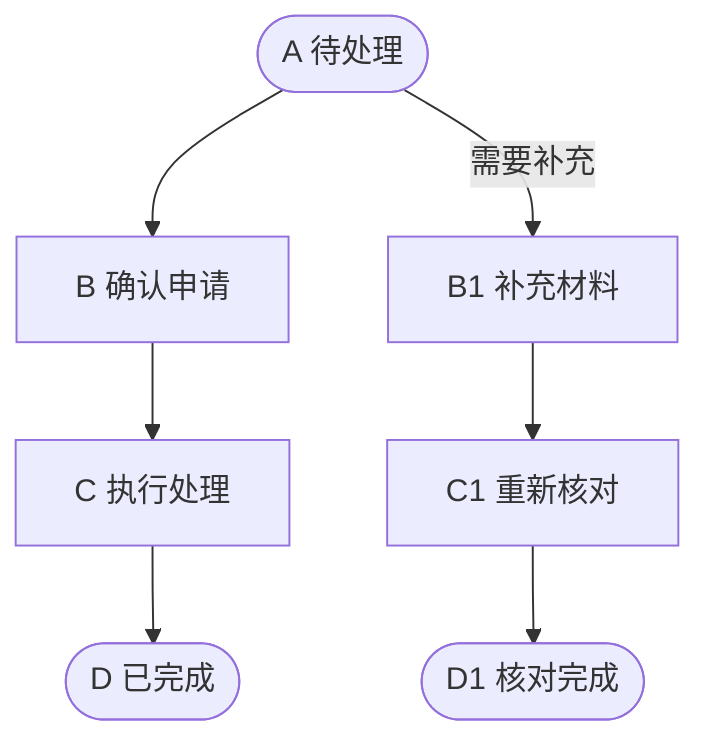

# 双文档结构

首次生成两份模块文档时读取。按模块实际复杂度调整篇幅，不以空表、编造数据或整份源码填充结构。用户已有格式时优先沿用。

## 共同元数据

两份文档记录相同的 `module_id`、`analysis_id`、代码基线和覆盖范围；`document_type` 分别为 `developer-guide` 与 `ai-context`。建议使用 YAML 头部，至少包含：

```yaml
schema_version: 1
module_id: "<稳定模块标识>"
analysis_id: "<本次分析批次>"
document_type: "developer-guide"
source_commit: "<已核实的 Git 提交；无 Git 则注明>"
source_dirty: false
verified_date: "<实际核验日期>"
timezone: "<用户时区>"
verification: "static-code"
coverage: "partial"
```

`source_dirty` 从工作区实际状态得出。提交号不能代表未提交内容；存在相关工作区变更时记录文件及必要内容指纹。核验方式与覆盖完成度是两个维度，不混用。完整分析也不表示运行可用。

## 第一份：开发者功能说明

面向开发者快速了解模块，用业务语言解释现状，代码入口用表格和证据支持。本文件是可同步生成的阅读材料，不是后续 AI 的必读输入。

### 1. 模块范围

说明业务目标、已覆盖/未覆盖功能、相关代码入口和必要核验边界，不展开完整流程或集中罗列规则。

### 2. 业务流程

用流程图与功能表说明正常步骤、可选分支、状态迁移、主要数据变化及结果；前置条件简要概括，详细限制在第3节展开。完整模块整理提供相互对应的 Mermaid 流程图与功能表，节点连接必须能由代码支持，不将本节与“关键规则”合并。

| 功能 ID | 对应流程图/节点 | 功能名称 | 操作端 | 前置条件 | 处理与结果 | 接口/入口 | 证据 |
| --- | --- | --- | --- | --- | --- | --- | --- |

#### 流程图与功能表的对应规则

- 一行描述一个独立业务功能，先确定功能 ID 再绘图。创建与编辑、取消与删除等规则或结果不同的动作分别建条目；多个界面复用同一业务功能时可以引用同一个 ID。
- 为每张图提供稳定图标识，如 `FLOW-MAIN`，在图前注明。图中节点 ID 和可见文案使用字母，例如 `A["A 提交申请"]`；主线按 `A-B-C-D` 递进，分支建议用数字后缀，例如 `A-B1-C1-D1`，后续分支可用 `B2/C2/D2`。节点多时继续使用 E、F 等字母；各图独立编号，同图内不可重复。只在实际存在顺序或分支时连线。
- 功能表保留稳定功能 ID（如 `F-001`），以“对应流程图/节点”填写 `FLOW-MAIN / A`，必要时引用多处。图中显示字母和功能名称，不再以 `F_001/F-001` 作为可见节点编号；改字母布局不重排稳定功能 ID。状态、结果可用圆角节点，判断用菱形，并在文案中说明，这些非功能节点不要求功能条目。
- 功能表增加“操作端”，按已确认入口填写“电脑”“手机”或“电脑、手机”；以能触发该功能的实际页面为准，不按后端语言、接口存在或推测填写。没有页面的任务注明实际触发源，不强行归为电脑或手机。
- 每条已纳入本次文档范围的功能至少出现在一张图中，每个图中的业务功能节点均可在功能表找到条目。复杂模块分主流程、财务或其他子流程；图片、导出等辅助功能可使用独立入口的子流程，不强行串成前后依赖。
- 图中连线表达经核实的处理顺序或业务触发，分支标明实际条件；异步、可选和不同入口的限制需说明。功能表展开同一节点的前置条件、状态/数据变化、结果与拒绝分支，避免图表顺序或口径相反。
- 交付前按“图标识 / 字母节点”检查图表对应，功能名称一致、无孤立条目或无定义功能节点，操作端与已分析入口一致。AI 接手文档沿用表中的稳定功能 ID，不另建冲突编号。

以下仅示范编号关联方式，不代表目标项目真实业务或实现证据：

图标识：`FLOW-MAIN`



| 功能 ID | 对应流程图/节点 | 功能名称 | 操作端 | 前置条件 | 处理与结果 |
| --- | --- | --- | --- | --- | --- |
| F-001 | FLOW-MAIN / B | 确认申请 | 电脑 | 申请满足确认条件 | 确认后允许执行 |
| F-002 | FLOW-MAIN / C | 执行处理 | 电脑、手机 | 已确认 | 处理后进入完成状态 |
| F-003 | FLOW-MAIN / B1 | 补充材料 | 手机 | 申请需要补充 | 保存补充资料 |
| F-004 | FLOW-MAIN / C1 | 重新核对 | 电脑 | 已补充材料 | 返回核对结果 |

### 3. 关键规则

独立说明影响功能执行和数据正确性的约束，按模块实际情况归纳状态流转、必填/格式、数据归属、金额与时间、财务联动、修改/撤销/删除限制及例外分支。仅列已发现且有证据的规则，不凑空类别。

| 规则类别 | 关联功能 ID | 关键规则 | 触发结果或前后端差异 | 证据 |
| --- | --- | --- | --- | --- |

“关联功能 ID”引用第2节已定义的 F-xxx，可关联多个功能；业务规则与流程中的前置条件、分支和结果一致。必须区分页面限制、后端强制校验和实现缺口，未知就地注明。不要把相关统计报表扩展成逐指标公式分析。

功能表保留便于理解流程的简要条件，复杂规则在本节集中展开；字段与按钮条目仍说明各自直接约束，可引用本节补充背景，不能只留“见关键规则”而省略实际可用条件。

### 4. 字段定义与数据来源

按查询、列表、表单和详情分组。字段多时将映射和校验拆表，以字段 ID 关联，避免单表过宽。

| 字段 ID | 页面标签/绑定 | 业务含义 | 请求/响应字段 | 存储/计算来源 | 证据 |
| --- | --- | --- | --- | --- | --- |

| 字段 ID | 各层类型/单位/精度 | 前端校验/默认 | 后端校验/默认 | 数据库约束或缺口 | 显示/编辑规则 |
| --- | --- | --- | --- | --- | --- |

### 5. Map、枚举与字典

| 字段/Map 符号 | 所有实际键值与业务文案 | 默认/未命中规则 | 前后端差异 | 使用页面 | 证据 |
| --- | --- | --- | --- | --- | --- |

Map 较大时一项一行；若内容来自运行字典而无法查询，记录配置来源和缺口，不编造全量值。真正的 Map 对象结构则说明 key/value 类型、嵌套字段、构造/消费位置与缺键行为。

### 6. 列举页面按钮：描述按钮功能与可用条件

按页面或区域分组，一行一个实际按钮或等价操作控件。先说明按钮做什么，再说明什么情况下可用；关联功能 ID 沿用流程图和功能表中的编号。

| 按钮 ID | 页面/区域/按钮名称 | 关联功能 ID | 按钮功能 | 可用条件 | 不可用时的表现或原因 | 证据 |
| --- | --- | --- | --- | --- | --- | --- |

按钮功能描述操作结果、状态变化或数据影响；打开弹窗、确认提交和本地预览等行为分别描述。可用条件优先用中文写清权限、状态、归属、输入与选择要求，保留条件组合含义；共同前提集中说明后引用，必要时附原表达式或场景表。

不可用表现按实际实现区分隐藏、禁用、加载中、校验提示及后端拒绝。没有显式禁用条件时据实说明；前后端条件不同则分别注明，不能把静态推导写成已登录验证。暂未确认的条件标为待确认。

主表不要求接口地址和参数列。追踪到的接口/服务入口作为证据；只有接手开发需要或用户明确要求时，才在 AI 上下文或补充说明中展开请求细节。

### 7. 相关统计报表

以报表入口为单位列举当前模块实际关联的统计报表，固定使用以下三列：

| 报表名称 | 报表链接 | 简述 |
| --- | --- | --- |

报表名称使用实际名称；链接优先为已核实的页面地址或前端路由，没有运行地址时链接真实代码文件并注明“代码入口”。页签报表说明所属页面和页签；数据 API、下载接口不能代替报表入口，不编造域名。

简述用一两句话说明统计内容与业务用途，必要时带出关键筛选范围或口径。无需展开逐项指标公式和独立“统计与财务口径”分析。区分统计报表、普通列表和导出动作，不按字段或按钮重复列举；没有发现时写明检查范围内未发现相关统计报表。

### 8. 优化建议

只列与当前范围相关的发现。建议包含关联 ID、证据、触发条件/影响、方案、优先级理由与验证方向，区分缺陷、体验改进和条件性建议。没有问题时不凑数。

### 9. 代码证据索引

代码依据使用就地引用或本节索引，记录文件链接、符号、必要行号和所支持的事实。不确定信息在相应条目中简短注明缺少的依据。对人工业务约定注明来源，冲突时并列展示。

不生成独立“验证结果、待确认与维护”章节，不额外附验证报告、集中待确认清单或维护记录；内部自检与持续更新规则照常执行，必要基线留在元数据中。

## 第二份：AI 接手上下文

这是后续 AI 唯一需要读取的模块文档，必须自包含。AI 仍应读取当前用户需求、项目 AGENTS.md 和有关源码；“只读取 AI 上下文”不代表跳过实现核对。

1. **范围与基线**：适用模块、已分析/未分析边界、当前提交及工作区状态、覆盖范围与核验方式。记录两份文档的输出路径，作为写入目标；路径本身不构成读取开发者说明的要求。
2. **代码地图**：页面及操作端、共享组件、请求封装、路由、控制器/服务、模型/Map、实际存在的规范与测试入口。提供真实路径、符号和必要行号，不依赖另一文档的证据索引。
3. **业务与技术事实**：在本文分别保存业务流程事实和关键规则，以及功能清单、状态迁移、前置条件、副作用、字段/Map、按钮显示与提交规则、报表入口；规则与功能 ID 的对应关系在本文可解析。保留生成开发者说明所需的结构化事实、稳定 ID 与代码依据；表格可紧凑组织，不必复制面向人的排版和解释。
4. **修改影响**：按字段、权限、流程、统计等变更类型指出需要检查的文件、共享依赖与调用方，以及前后端差异、金额/时间边界和数据隔离前提。
5. **问题与需求状态**：记录实际问题的触发条件、影响、候选建议及人工决策；区分已实现、候选建议、用户已确认需求和历史已完成任务。未知计划写“当前未提供”。重要保留内容不得只存在于开发者说明。
6. **后续验证方向**：只保留接手开发需要的验证方法与实际测试入口；建议用例不写成已通过结果，不附本轮集中验证报告。
7. **更新约定**：后续 AI 读取本文件并核对代码，完成功能修改后先更新本文件，再据此与源码同步更新开发者说明；不回读开发者说明来补字段定义、证据或人工背景。没有实施变更的讨论，不改写已实现现状。

引用的功能、字段、按钮、建议、证据 ID 均在本文给出定义或可定位的代码依据，不允许仅写“详见开发者文档”。需要时在两份文档分别保存同一事实，不能为避免重复而让 AI 文档缺少开发上下文。

生成时独立检查：不提供开发者说明，是否仍能从 AI 上下文找到业务规则、实现入口、修改影响、验证方向，并生成开发者说明的对应内容；缺少的信息从源码和当前用户说明补齐。两份文档同时生成时保持事实一致，后续功能更新也必须同步输出。

## 标识、链接与文档身份

功能、字段、动作、建议、证据与待确认项可用 `F-001 / FIELD-001 / BTN-001 / OPT-001 / E-001 / Q-001`，已有 ID 沿用，不重排或回收；跨模块引用包含模块 ID。

两份文档中的功能表、按钮表沿用同一套稳定功能 ID，AI 上下文独立保存编号定义与证据；流程图用字母编号，由功能表中的图/节点引用建立对应。图的布局、字母节点顺序、文件标题发生变化时不重排稳定功能 ID，同时修正图/节点引用；功能拆分时明确原 ID 保留给哪个功能，其他功能使用新 ID，并同步已有引用。

模块标识使用稳定的代码业务标识；文件名不是页面标题的即时翻译。保存到仓库的链接按文档位置计算相对路径；跨仓库样例可使用已核实的绝对文件链接。行号是快照，长期定位同时保留路径与符号。
