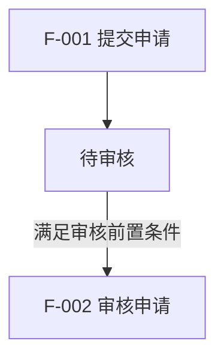

# 双文档结构

首次生成两份模块文档时读取。按模块实际复杂度调整篇幅，不以空表、编造数据或整份源码填充结构。用户已有格式时优先沿用。

## 共同元数据

两份文档记录相同的 `module_id`、`analysis_id`、代码基线和覆盖范围；`document_type` 分别为 `developer-guide` 与 `ai-context`。建议使用 YAML 头部，至少包含：

```yaml
schema_version: 1
module_id: "<稳定模块标识>"
analysis_id: "<本次分析批次>"
document_type: "developer-guide"
source_commit: "<已核实的 Git 提交；无 Git 则注明>"
source_dirty: false
verified_date: "<实际核验日期>"
timezone: "<用户时区>"
verification: "static-code"
coverage: "partial"
```

`source_dirty` 从工作区实际状态得出。提交号不能代表未提交内容；存在相关工作区变更时记录文件及必要内容指纹。核验方式与覆盖完成度是两个维度，不混用。完整分析也不表示运行可用。

## 第一份：开发者功能说明

用业务语言解释现状，详细技术入口用表格和证据支持。

### 范围与业务流程

记录业务目标、功能范围、前置条件、主要数据变化、状态迁移、返回结果与异常处理。列出已覆盖/未覆盖功能及相关代码入口；完整模块整理提供相互对应的 Mermaid 流程图与功能表，节点连接必须能由代码支持。

| 功能 ID | 对应流程图/节点 | 功能名称 | 前置条件 | 处理与结果 | 接口/入口 | 证据 |
| --- | --- | --- | --- | --- | --- | --- |

#### 流程图与功能表的对应规则

- 一行描述一个独立业务功能，先确定功能 ID 再绘图。创建与编辑、取消与删除等规则或结果不同的动作分别建条目；多个界面复用同一业务功能时可以引用同一个 ID。
- 为每张图提供稳定的图标识，如 `FLOW-MAIN`、`FLOW-FINANCE`，在图前注明。功能节点使用可解析的 Mermaid 标识（如 `F_001`），节点文案同时显示功能 ID 与功能名称（如 `F-001 创建预约`）。功能表“对应流程图/节点”填写 `FLOW-MAIN / F_001`，必要时引用多处。
- 功能 ID 是图表共同的业务标识；Mermaid 节点 ID 是该图内的定位标识，不能用图中字母 A/B/C 取代稳定功能 ID。状态节点用 `S_`，判断节点用 `D_` 等前缀区别；这些非功能节点不要求生成独立功能表条目。
- 每条已纳入本次文档范围的功能至少出现在一张图中，每个图中的业务功能节点均可在功能表找到条目。复杂模块分主流程、财务或其他子流程；图片、导出等辅助功能可使用独立入口的子流程，不强行串成前后依赖。
- 图中连线表达经核实的处理顺序或业务触发，分支标明实际条件；异步、可选和不同入口的限制需说明。功能表展开同一节点的前置条件、状态/数据变化、结果与拒绝分支，避免图表顺序或口径相反。
- 交付前对照图中显式功能 ID 与功能表 ID，检查不存在孤立条目、无定义节点或失效的图/节点引用；相同 ID 在多图中的含义保持一致。AI 接手文档沿用这些 ID，不另建冲突编号。

以下仅示范编号关联方式，不代表目标项目真实业务或实现证据：

图标识：`FLOW-MAIN`



| 功能 ID | 对应流程图/节点 | 功能名称 | 前置条件 | 处理与结果 |
| --- | --- | --- | --- | --- |
| F-001 | FLOW-MAIN / F_001 | 提交申请 | 输入满足提交校验 | 创建申请，进入待审核 |
| F-002 | FLOW-MAIN / F_002 | 审核申请 | 满足审核前置条件 | 校验并处理审核结果 |

### 字段定义与来源

按查询、列表、表单和详情分组。字段多时将映射和校验拆表，以字段 ID 关联，避免单表过宽。

| 字段 ID | 页面标签/绑定 | 业务含义 | 请求/响应字段 | 存储/计算来源 | 证据 |
| --- | --- | --- | --- | --- | --- |

| 字段 ID | 各层类型/单位/精度 | 前端校验/默认 | 后端校验/默认 | 数据库约束或缺口 | 显示/编辑规则 |
| --- | --- | --- | --- | --- | --- |

### Map、枚举与字典

| 字段/Map 符号 | 所有实际键值与业务文案 | 默认/未命中规则 | 前后端差异 | 使用页面 | 证据 |
| --- | --- | --- | --- | --- | --- |

Map 较大时一项一行；若内容来自运行字典而无法查询，记录配置来源和缺口，不编造全量值。真正的 Map 对象结构则说明 key/value 类型、嵌套字段、构造/消费位置与缺键行为。

### 列举页面按钮：描述按钮功能与可用条件

按页面或区域分组，一行一个实际按钮或等价操作控件。先说明按钮做什么，再说明什么情况下可用；关联功能 ID 沿用流程图和功能表中的编号。

| 按钮 ID | 页面/区域/按钮名称 | 关联功能 ID | 按钮功能 | 可用条件 | 不可用时的表现或原因 | 证据 |
| --- | --- | --- | --- | --- | --- | --- |

按钮功能描述操作结果、状态变化或数据影响；打开弹窗、确认提交和本地预览等行为分别描述。可用条件优先用中文写清权限、状态、归属、输入与选择要求，保留条件组合含义；共同前提集中说明后引用，必要时附原表达式或场景表。

不可用表现按实际实现区分隐藏、禁用、加载中、校验提示及后端拒绝。没有显式禁用条件时据实说明；前后端条件不同则分别注明，不能把静态推导写成已登录验证。暂未确认的条件标为待确认。

主表不要求接口地址和参数列。追踪到的接口/服务入口作为证据；只有接手开发需要或用户明确要求时，才在 AI 上下文或补充说明中展开请求细节。

### 相关统计报表

以报表入口为单位列举当前模块实际关联的统计报表，固定使用以下三列：

| 报表名称 | 报表链接 | 简述 |
| --- | --- | --- |

报表名称使用实际名称；链接优先为已核实的页面地址或前端路由，没有运行地址时链接真实代码文件并注明“代码入口”。页签报表说明所属页面和页签；数据 API、下载接口不能代替报表入口，不编造域名。

简述用一两句话说明统计内容与业务用途，必要时带出关键筛选范围或口径。无需展开逐项指标公式和独立“统计与财务口径”分析。区分统计报表、普通列表和导出动作，不按字段或按钮重复列举；没有发现时写明检查范围内未发现相关统计报表。

### 优化建议与代码依据

只列与当前范围相关的发现。建议包含关联 ID、证据、触发条件/影响、方案、优先级理由与验证方向，区分缺陷、体验改进和条件性建议。没有问题时不凑数。

代码依据使用就地引用或证据索引，记录文件链接、符号、必要行号和所支持的事实。不确定信息在相应条目中简短注明缺少的依据。对人工业务约定注明来源，冲突时并列展示。

不生成独立“验证结果、待确认与维护”章节，不额外附验证报告、集中待确认清单或维护记录；内部自检与持续更新规则照常执行，必要基线留在元数据中。

## 第二份：AI 接手上下文

写成新 AI 可以使用的开发入口，至少能回答“当前实现在哪、改哪里会影响什么、哪些事实还不确定、如何验证”。

1. **快速入口**：链接第一份文档、适用模块、覆盖边界、当前基线与核验方式。
2. **阅读顺序与代码地图**：目标项目 AGENTS.md、页面与共享组件、请求封装、路由、控制器/服务、模型/Map、相关测试与规范。只列实际存在的位置。
3. **关键现状与约束**：简述已实现行为、状态口径、金额/时间等关键计算，以及权限和数据隔离前提；通过稳定 ID 引用第一份细节。
4. **需求到修改范围**：按页面显示、字段、权限、业务流程等变更类型指出应检查的文件、共享依赖与调用方。作为定位建议，不授权修改。
5. **已知问题与需求状态**：区分现存问题、候选建议、用户已确认需求、历史已完成变更。未知计划写“当前未提供”，不虚构任务或下一版本目标。
6. **后续开发验证方向**：只保留接手开发需要的验证方法与相关测试入口，核实后再列命令；建议用例不写成已通过的结果，不附本轮集中验证报告。
7. **人工背景与决策**：保留人工补充和不采纳建议的理由；必要缺口在相关内容处就地注明。新 AI 接手先重核代码变化，再使用现状结论，不另附维护日志或待确认章节。

不要复制第一份的全部字段和按钮表；必要时保留会改变开发决策的关键值与例外。引用第一份文档也不能替代重新核对当前代码。

## 标识、链接与文档身份

功能、字段、动作、建议、证据与待确认项可用 `F-001 / FIELD-001 / BTN-001 / OPT-001 / E-001 / Q-001`，已有 ID 沿用，不重排或回收；跨模块引用包含模块 ID。

流程图与功能表共同引用同一套功能 ID。图的布局、节点顺序、文件标题发生变化时不重新编号；功能拆分时明确原 ID 保留给哪个功能，其他功能使用新 ID，并同步已有引用。

模块标识使用稳定的代码业务标识；文件名不是页面标题的即时翻译。保存到仓库的链接按文档位置计算相对路径；跨仓库样例可使用已核实的绝对文件链接。行号是快照，长期定位同时保留路径与符号。
